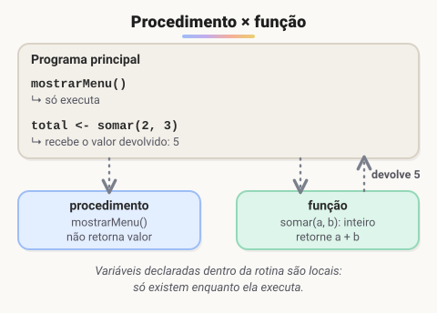
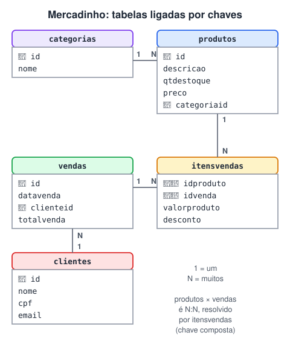
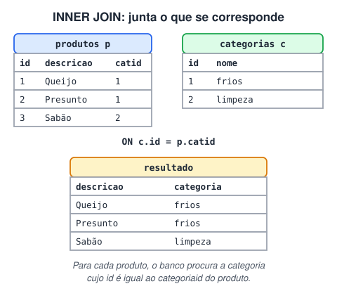
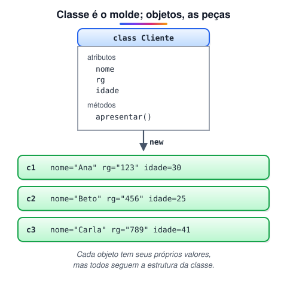

# 2 · Lógica de programação e algoritmos II (estruturas, funções, SQL e POO)

> 🗺️ **Sobre o módulo:** estruturas de dados (vetores e matrizes), ordenação, modularização com funções, uma introdução a banco de dados com SQL e os primeiros passos em orientação a objetos.
>
> **Professor:** Marcelo Bernardi · **Pré-requisito:** módulo 1 (variáveis, decisões e laços).

## Vetores e busca sequencial

> 🗺️ **Nesta aula:** vetores (arrays): como declarar, preencher, percorrer e procurar valores neles.

### De onde paramos

No módulo 1, cada variável guardava **um** valor, e o laço `para` repetia um bloco um número conhecido de vezes. Agora as duas ideias se juntam: uma variável com **várias posições**, percorrida pelo `para`, em que o `i` do laço indica a posição.

### O que é um vetor

Imagine guardar as notas de 30 alunos com 30 variáveis (`nota1`, `nota2`...). Inviável. **Um vetor é uma única variável com várias posições do mesmo tipo**, e cada posição é acessada por um **índice**.

![O vetor nomes, com 5 posições; nomes[3] guarda "Ana".](../img/vetor.svg)

```
var
   nomes : vetor[1..5] de caractere  // 5 posições, índices de 1 a 5
inicio
   nomes[3] <- "Ana"  // grava na posição 3
   escreval(nomes[3])  // lê a posição 3
```

> ⚠️ No Portugol os índices costumam começar em **1**; em Java, JavaScript e quase todas as linguagens modernas, começam em **0**. Um vetor de 5 posições vai de `v[0]` a `v[4]`, e acessar `v[5]` dá erro (*index out of bounds*).

### Percorrendo com `para`

O laço `para` combina perfeitamente com vetores: a variável de controle vira o índice.

```
para i de 1 ate 5 faca  // preencher
   escreva("Nome ", i, ": ")
   leia(nomes[i])
fimpara

para i de 1 ate 5 faca  // mostrar
   escreval(i, " - ", nomes[i])
fimpara
```

### Busca sequencial

Para saber se um valor está no vetor, compare-o com **cada posição**, uma por uma:

```
leia(procurado)
achou <- FALSO
para i de 1 ate 5 faca
   se nomes[i] = procurado entao
      achou <- VERDADEIRO
   fimse
fimpara
se achou entao
   escreval("Encontrado")
senao
   escreval("Não encontrado")
fimse
```

A variável lógica `achou` é uma **flag**: começa falsa e vira verdadeira se o valor aparecer. No pior caso (o valor não existe), o algoritmo olha **todas** as posições.

#### Teste de mesa da busca

Vetor `["Bia", "Caio", "Ana", "Davi", "Eva"]`, procurando `"Ana"`:

| `i` | `nomes[i]` | igual? | `achou` |
| --- | --- | --- | --- |
| 1 | Bia | não | FALSO |
| 2 | Caio | não | FALSO |
| 3 | Ana | **sim** | VERDADEIRO |
| 4 | Davi | não | VERDADEIRO |
| 5 | Eva | não | VERDADEIRO |

Repare que, depois de achar na posição 3, o laço continua olhando as posições 4 e 5 à toa. Com um `enquanto`, dá para parar assim que achar:

```
i <- 1
achou <- FALSO
enquanto (i <= 5) e (nao achou) faca
   se nomes[i] = procurado entao
      achou <- VERDADEIRO
   fimse
   i <- i + 1
fimenquanto
```

> 💡 Essa é a grande diferença entre `para` e `enquanto` na prática: o `para` sempre dá todas as voltas; o `enquanto` pode parar no meio quando a condição muda.

### Exercícios

#### Exercício 1: busca de nomes

Guarde 5 nomes em um vetor e pergunte se um nome existe (responda sim ou não).

#### Exercício 2: ordem inversa

Guarde 10 números e mostre o vetor na ordem inversa.

<details>
<summary>Ver dica e resolução</summary>

Percorra do último índice para o primeiro, com `passo -1`:

```
para i de 10 ate 1 passo -1 faca
   escreval(numeros[i])
fimpara
```

</details>

#### Exercício 3: operações entre vetores

Monte 2 vetores de 5 números; o usuário escolhe a operação (+ − × ÷), feita **posição a posição**. Mostre o resultado.

<details>
<summary>Ver resposta comentada</summary>

```
leia(op)
para i de 1 ate 5 faca
   escolha op
      caso "+"
         r[i] <- a[i] + b[i]
      caso "-"
         r[i] <- a[i] - b[i]
      caso "*"
         r[i] <- a[i] * b[i]
      caso "/"
         se b[i] <> 0 entao  // evita divisão por zero
            r[i] <- a[i] / b[i]
         fimse
   fimescolha
   escreval(a[i], " ", op, " ", b[i], " = ", r[i])
fimpara
```

</details>

### 🧠 Revisão rápida

**Em Java, quais são os índices de um vetor com 8 posições?**

De 0 a 7.

**Para que serve a variável `achou` na busca sequencial?**

É uma flag: indica se o valor foi encontrado em alguma posição durante o laço.

**Qual estrutura de repetição combina melhor com vetores, e por quê?**

O `para`, porque o número de posições é conhecido e a variável de controle serve de índice.

> ➡️ **Próximo passo:** com os valores guardados num vetor, a pergunta seguinte é como colocá-los em ordem. Isso é a **Ordenação com bubble sort**.

### 📌 Resumo

| Item | Em uma frase |
| --- | --- |
| Vetor | uma variável com várias posições do mesmo tipo |
| Índice | o número da posição; começa em 1 no Portugol e em 0 em Java/JS |
| Percorrer | `para i de 1 ate n`, usando `v[i]` |
| Busca sequencial | comparar o valor com cada posição, uma por uma |
| Flag | variável lógica que marca se algo aconteceu |
| Parar cedo | `enquanto` com a condição `nao achou` |

## Ordenação com bubble sort

> 🗺️ **Nesta aula:** ordenar um vetor com o **bubble sort** (método bolha), entender a troca com variável auxiliar e por que existem algoritmos mais rápidos.

### De onde paramos

Na aula anterior, os dados entraram num vetor e foram procurados um por um. Muitas tarefas ficam mais fáceis com os dados **em ordem** (mostrar um ranking, achar o maior e o menor). Para ordenar, vamos usar tudo o que já foi visto: vetores, `para` aninhado e `se`.

### A ideia

O bubble sort compara **pares vizinhos** e troca os dois de lugar se estiverem fora de ordem. Ao fim de cada passada, o maior valor ainda não ordenado "borbulha" até o final. Repetindo isso, o vetor fica ordenado.

![Ordenando [5, 3, 8, 1] em três passadas.](../img/bubble.svg)

### Trocar dois valores: a variável auxiliar

Para trocar `a` e `b`, não basta `a <- b` e `b <- a`: na primeira linha o valor original de `a` se perde. É preciso guardar um deles antes:

```
aux <- a  // guarda a
a   <- b
b   <- aux  // recupera o valor original de a
```

### O algoritmo

```
para i de 1 ate n - 1 faca  // cada passada
   para j de 1 ate n - i faca  // a cada passada, o fim já está ordenado
      se v[j] > v[j + 1] entao  // fora de ordem?
         aux      <- v[j]
         v[j]     <- v[j + 1]
         v[j + 1] <- aux
      fimse
   fimpara
fimpara
```

- Para ordem **decrescente**, basta inverter a comparação: `v[j] < v[j + 1]`.
- O `ate n - i` evita comparar de novo a parte final, que já está no lugar certo.
- **Otimização:** use uma flag `trocou`; se uma passada inteira terminar sem trocas, o vetor já está ordenado e dá para parar antes.

#### Versão com parada antecipada

É a mesma ideia da busca com `enquanto`: trocar o `para` externo por um laço que para quando nada mudou.

```
repita
   trocou <- FALSO
   para j de 1 ate n - 1 faca
      se v[j] > v[j + 1] entao
         aux      <- v[j]
         v[j]     <- v[j + 1]
         v[j + 1] <- aux
         trocou   <- VERDADEIRO
      fimse
   fimpara
ate nao trocou
```

Com o vetor `[1, 2, 3, 5, 4]`, a primeira passada troca o 5 e o 4; a segunda não troca nada, e o algoritmo para. Sem a flag, faria 4 passadas.

### Desempenho

O bubble sort faz cerca de **n²** comparações (notação **O(n²)**): para 10 elementos, ~100; para 100 mil, ~10 bilhões. Ele é ótimo para **aprender**, mas lento na prática.

| Algoritmo | Desempenho típico | Observação |
| --- | --- | --- |
| Bubble sort | O(n²) | didático |
| Insertion sort | O(n²) | bom para vetores pequenos ou quase ordenados |
| Merge sort | O(n log n) | divide ao meio, ordena e junta |
| Quick sort | O(n log n) em média | escolhe um pivô e separa menores e maiores |

Na prática, as linguagens já trazem ordenação pronta e eficiente: `Arrays.sort(v)` em Java, `v.sort((a, b) => a - b)` em JavaScript.

### Exercício

Leia 10 números e mostre-os em ordem **crescente** e **decrescente** usando bubble sort.

<details>
<summary>Ver dica</summary>

Ordene uma vez em ordem crescente. Para mostrar em ordem decrescente, não precisa ordenar de novo: basta percorrer o vetor do fim para o começo (`para i de 10 ate 1 passo -1`).

</details>

### 🧠 Revisão rápida

**Por que é preciso uma variável auxiliar para trocar dois valores?**

Porque, ao fazer `a <- b`, o valor original de `a` seria perdido. A auxiliar o guarda temporariamente.

**Depois da primeira passada do bubble sort, o que se sabe sobre o vetor?**

Que o maior valor já está na última posição.

**Como transformar o bubble sort crescente em decrescente?**

Invertendo a comparação: trocar quando `v[j] < v[j + 1]`.

> ➡️ **Próximo passo:** um vetor é uma linha de valores. E se os dados formarem uma tabela, com linhas e colunas? Isso são as **Matrizes**.

### 📌 Resumo

| Item | Em uma frase |
| --- | --- |
| Bubble sort | compara vizinhos e troca os que estão fora de ordem |
| Passada | ao fim de cada uma, o maior vai para o final |
| Variável auxiliar | guarda um valor para a troca não perdê-lo |
| Flag `trocou` | permite parar quando o vetor já está ordenado |
| O(n²) | tempo cresce com o quadrado do tamanho; lento para muitos dados |
| Na prática | use a ordenação pronta da linguagem |

## Matrizes

> 🗺️ **Nesta aula:** matrizes, os vetores de duas dimensões. São usadas para tabelas, tabuleiros, mapas de assentos e imagens (pixels).

### De onde paramos

O vetor guarda uma **fila** de valores, e um `para` basta para percorrê-lo. No módulo 1 você viu laços aninhados gerando a tabuada em forma de tabela. A matriz junta as duas coisas: dados em forma de tabela, percorridos por dois `para`, um dentro do outro.

### O que é uma matriz

**Uma matriz é um "vetor de vetores": os dados ficam em linhas e colunas, e cada posição é acessada por dois índices**, `m[linha, coluna]`.

![Matriz 4 × 5; em destaque, a posição m[2,3] (linha 2, coluna 3).](../img/matriz.svg)

```
var
   sala : vetor[1..10, 1..10] de caractere  // 10 linhas × 10 colunas = 100 posições
inicio
   sala[2, 3] <- "X"  // linha 2, coluna 3
```

Em Java, os índices começam em 0 e cada dimensão tem o próprio par de colchetes: `char[][] sala = new char[10][10]; sala[1][2] = 'X';`.

### Percorrendo: dois laços aninhados

O laço **externo** passa pelas linhas; para cada linha, o **interno** passa por todas as colunas.

```
para lin de 1 ate 10 faca
   para col de 1 ate 10 faca
      sala[lin, col] <- "L"  // L = livre
   fimpara
fimpara
```

Para **mostrar** como tabela, escreva cada posição na mesma linha e pule linha ao fim de cada linha da matriz:

```
para lin de 1 ate 10 faca
   para col de 1 ate 10 faca
      escreva(sala[lin, col], " ")
   fimpara
   escreval("")
fimpara
```

#### Teste de mesa: matriz 2 × 3

O trecho abaixo preenche cada posição com `lin * 10 + col`:

```
para lin de 1 ate 2 faca
   para col de 1 ate 3 faca
      m[lin, col] <- lin * 10 + col
   fimpara
fimpara
```

| Volta | `lin` | `col` | Grava |
| --- | --- | --- | --- |
| 1 | 1 | 1 | `m[1,1] = 11` |
| 2 | 1 | 2 | `m[1,2] = 12` |
| 3 | 1 | 3 | `m[1,3] = 13` |
| 4 | 2 | 1 | `m[2,1] = 21` |
| 5 | 2 | 2 | `m[2,2] = 22` |
| 6 | 2 | 3 | `m[2,3] = 23` |

A linha só muda depois que o laço interno passa por **todas** as colunas. O total de voltas é linhas × colunas (2 × 3 = 6).

> 💡 Para somar só uma linha, fixe `lin` e use um laço só nas colunas. Para somar uma coluna, fixe `col` e percorra as linhas. A diagonal principal são as posições em que `lin = col`.

### Exercício: sala de cinema

Simule uma sala 10 × 10: o usuário reserva cadeiras (não pode reservar uma já ocupada) e um menu mostra quantas estão livres.

<details>
<summary>Ver resposta comentada (núcleo)</summary>

```
// reservar
leia(lin, col)
se (lin < 1) ou (lin > 10) ou (col < 1) ou (col > 10) entao
   escreval("Cadeira inexistente")
senao
   se sala[lin, col] = "X" entao
      escreval("Cadeira já ocupada")
   senao
      sala[lin, col] <- "X"
      escreval("Reservada!")
   fimse
fimse

// contar livres
livres <- 0
para lin de 1 ate 10 faca
   para col de 1 ate 10 faca
      se sala[lin, col] = "L" entao
         livres <- livres + 1
      fimse
   fimpara
fimpara
escreval("Cadeiras livres: ", livres)
```

Validar os índices antes de acessar a matriz evita erro de posição inexistente.

</details>

### 🧠 Revisão rápida

**Quantas posições tem uma matriz 3 × 4?**

3 × 4 = 12 posições.

**Em `m[2, 5]`, qual índice é a linha e qual é a coluna?**

O primeiro (2) é a linha; o segundo (5) é a coluna.

**Por que se usa um laço dentro do outro para percorrer uma matriz?**

Porque são duas dimensões: o externo passa pelas linhas e, para cada linha, o interno passa por todas as colunas.

> ➡️ **Próximo passo:** o exercício do cinema já tem várias tarefas (reservar, contar, mostrar) no mesmo bloco de código. A próxima aula ensina a separar cada tarefa numa rotina com nome: **Procedimentos, funções e escopo de variáveis**.

### 📌 Resumo

| Item | Em uma frase |
| --- | --- |
| Matriz | dados em linhas e colunas, acessados por dois índices |
| `m[lin, col]` | primeiro a linha, depois a coluna |
| Em Java | `m[lin][col]`, com índices a partir de 0 |
| Percorrer | `para` das linhas por fora, das colunas por dentro |
| Total de posições | linhas × colunas |
| Validar índices | conferir os limites antes de acessar a posição |

## Procedimentos, funções e escopo de variáveis

> 🗺️ **Nesta aula:** dividir um programa em partes com **procedimentos** e **funções**, passar dados por **parâmetros** e entender **escopo** (local × global).

### De onde paramos

Os exercícios com vetores e matrizes já ficaram compridos: o mesmo laço de "mostrar o vetor" aparece em vários lugares, e o cinema mistura reservar, contar e exibir no mesmo bloco. Nesta aula, cada uma dessas tarefas vira uma rotina com nome próprio, chamada quando for preciso.

### Por que dividir o programa

Um programa de 500 linhas em um bloco só é difícil de ler, testar e corrigir. Separando cada tarefa em uma **sub-rotina** com nome claro (`cadastrar`, `pesquisar`, `calcularMedia`), você ganha:

- **leitura:** o programa principal vira um "índice" do que acontece;
- **reuso:** a mesma rotina é chamada em vários lugares;
- **manutenção:** um erro é corrigido em um lugar só.



### Procedimento: executa, não devolve

```
procedimento mostrarLinha(tamanho: inteiro)
var
   i : inteiro
inicio
   para i de 1 ate tamanho faca
      escreva("-")
   fimpara
   escreval("")
fimprocedimento

// chamada:
mostrarLinha(30)
```

### Função: processa e devolve um valor

```
funcao somar(a, b: inteiro): inteiro  // ": inteiro" = tipo do retorno
inicio
   retorne a + b
fimfuncao

// chamada: o valor devolvido pode ser usado em expressões
total <- somar(2, 3) * 10  // 50
```

|  | Procedimento | Função |
| --- | --- | --- |
| Devolve valor? | não | sim, com `retorne` |
| Como se chama | sozinho, numa linha | dentro de uma expressão ou atribuição |
| Em Java | método `void` | método com tipo de retorno (`int`, `double`...) |

### Parâmetros

São as "entradas" da rotina. Na **declaração** ficam os **parâmetros** (`a, b`); na **chamada**, os valores passados são os **argumentos** (`2, 3`). A ordem e o tipo precisam combinar.

#### O caminho de uma chamada, passo a passo

Para a linha `total <- somar(2, 3) * 10`:

1. O programa encontra `somar(2, 3)` e pausa a linha.
2. Cria os parâmetros locais: `a` recebe 2 e `b` recebe 3 (pela ordem).
3. Executa o corpo da função: `retorne a + b` devolve 5.
4. `a` e `b` deixam de existir.
5. A linha continua com o valor devolvido no lugar da chamada: `5 * 10`, e `total` recebe 50.

> 💡 Pense numa função como uma máquina de suco: você coloca as frutas (argumentos), ela trabalha por dentro e devolve o suco (retorno). Quem usa não precisa saber como ela funciona por dentro, só o que entra e o que sai.

### Escopo: local × global

| Escopo | Onde é declarada | Quem enxerga | Quanto tempo existe |
| --- | --- | --- | --- |
| **Global** | na seção `var` do programa principal | todo o programa | enquanto o programa roda |
| **Local** | dentro da função/procedimento | só aquela rotina | só enquanto a rotina executa |

Um exemplo mostra a diferença:

```
var
   contador : inteiro  // global

procedimento teste()
var
   x : inteiro  // local: só existe aqui
inicio
   x <- 10
   contador <- contador + 1  // enxerga a global
fimprocedimento

inicio
   contador <- 0
   teste()
   teste()
   escreval(contador)  // 2
   // escreval(x)  -> erro: x não existe aqui
fimalgoritmo
```

> 💡 **Boa prática:** prefira variáveis **locais** e passe os dados por **parâmetros**. Variáveis globais podem ser alteradas por qualquer parte do programa, e aí fica difícil descobrir quem mudou o quê.

### Modularizando um programa

O ideal é que o programa principal **só chame** rotinas:

```
inicio
   repita
      opcao <- menu()
      escolha opcao
         caso 1
            cadastrar()
         caso 2
            pesquisar()
         caso 3
            excluir()
      fimescolha
   ate opcao = 5
fimalgoritmo
```

### 🧠 Revisão rápida

**O que acontece com uma variável local quando a rotina termina?**

Ela deixa de existir; o valor é perdido.

**Qual a diferença entre procedimento e função?**

A função devolve um valor com `retorne`; o procedimento só executa ações.

**Na chamada `somar(4, 7)`, o que são 4 e 7?**

São os argumentos, valores passados para os parâmetros `a` e `b`.

> ➡️ **Próximo passo:** até aqui, todos os dados somem quando o programa fecha. Para guardá-los de verdade, entra o **Banco de dados relacional e SQL (MySQL)**.

### 📌 Resumo

| Item | Em uma frase |
| --- | --- |
| Sub-rotina | um trecho com nome, chamado quando preciso |
| Procedimento | executa ações e não devolve valor (`void` em Java) |
| Função | devolve um valor com `retorne` |
| Parâmetro × argumento | a variável na declaração × o valor na chamada |
| Local | existe só dentro da rotina, enquanto ela roda |
| Global | visível no programa todo; use com moderação |

## Banco de dados relacional e SQL (MySQL)

> 🗺️ **Nesta aula:** bancos de dados relacionais e SQL na prática com MySQL (via XAMPP): criar tabelas, inserir, alterar, apagar, relacionar tabelas e consultar.

### De onde paramos

Nos exercícios de cadastro, os nomes ficavam num vetor e as cadeiras do cinema numa matriz. Funciona, mas tudo some quando o programa fecha, e um vetor não sabe procurar, ordenar ou ligar dados sozinho. Um **banco de dados** resolve isso: guarda os dados no disco, de forma organizada, e responde perguntas sobre eles. Repare que uma tabela é parecida com uma matriz: linhas e colunas.

### Conceitos

Um **banco de dados relacional** guarda os dados em **tabelas**: cada **linha** é um registro (um cliente) e cada **coluna** é um campo (nome, CPF). As tabelas se ligam por **chaves**:

- **chave primária (PK):** identifica cada linha de forma única (`id`);
- **chave estrangeira (FK):** campo que aponta para a PK de outra tabela (`categoriaid` → `categorias.id`).

**SQL** (*Structured Query Language*) é a linguagem para criar e consultar o banco. As quatro operações básicas formam o **CRUD**:

| Letra | Operação | Comando SQL |
| --- | --- | --- |
| **C** | Create (criar) | `INSERT` |
| **R** | Read (ler) | `SELECT` |
| **U** | Update (alterar) | `UPDATE` |
| **D** | Delete (apagar) | `DELETE` |



### Ambiente: XAMPP

🔗 [https://www.apachefriends.org/pt_br/download.html](https://www.apachefriends.org/pt_br/download.html)

1. No painel do XAMPP, inicie **Apache** e **MySQL** e clique em **Admin** do MySQL (abre o phpMyAdmin no navegador).
2. Em **Databases**, crie o banco `basetestetreinamento` com collation `utf8mb4_general_ci` (aceita acentos e emojis).
3. Use a aba **SQL** para executar os comandos.

> 💡 Convenção: comandos SQL em **MAIÚSCULAS** e nomes de tabelas/colunas em minúsculas. O SQL não diferencia, mas fica mais legível. Cada comando termina com `;`.

### Criando uma tabela (`CREATE TABLE`)

```sql
CREATE TABLE clientes (
  -- chave única, gerada automaticamente
  id INT PRIMARY KEY AUTO_INCREMENT,
  -- NOT NULL = obrigatório
  nome VARCHAR(60) NOT NULL,
  -- tamanho fixo; UNIQUE = não pode repetir
  cpf CHAR(11) NOT NULL UNIQUE,
  data_nascimento DATE NOT NULL,
  email VARCHAR(80) NOT NULL,
  ativo BOOLEAN NOT NULL DEFAULT TRUE
);
```

Lendo em voz alta: "crie a tabela clientes, com um id inteiro que é a chave primária e se numera sozinho, um nome de até 60 letras obrigatório...". Cada linha é **nome da coluna + tipo + regras**.

| Tipo | Quando usar |
| --- | --- |
| `INT` | números inteiros (ids, quantidades) |
| `DECIMAL(10,2)` | **dinheiro** e valores que precisam ser exatos |
| `VARCHAR(n)` | texto de tamanho variável (até n caracteres) |
| `CHAR(n)` | texto de tamanho fixo (CPF, sigla de estado) |
| `DATE` / `DATETIME` | data (`'AAAA-MM-DD'`) / data e hora |
| `BOOLEAN` | verdadeiro ou falso (no MySQL vira `TINYINT(1)`) |

### Inserindo, alterando e apagando

```sql
INSERT INTO clientes (nome, cpf, data_nascimento, email)
VALUES ('Ana Souza', '12212212222', '1997-10-03', 'ana@exemplo.com');
-- texto e datas entre aspas simples; o id é gerado sozinho

UPDATE clientes SET email = 'novo@exemplo.com' WHERE id = 1;

DELETE FROM clientes WHERE id = 1;

DROP TABLE clientes;      -- apaga a TABELA inteira (estrutura e dados)
```

> ⚠️ **Sempre use** `WHERE` **no** `UPDATE` **e no** `DELETE`**.** Sem ele, **todas** as linhas são alteradas ou apagadas. Dica: antes de um `DELETE`, rode um `SELECT` com o mesmo `WHERE` para ver o que vai ser afetado.
>
> Depois de um `DELETE`, o `AUTO_INCREMENT` **não reaproveita** o id. E, em vez de apagar registros ligados a outras tabelas (um cliente com vendas), prefira **desativá-los** (`ativo = FALSE`).

### Relacionando tabelas (chave estrangeira)

```sql
CREATE TABLE categorias (
  id   INT PRIMARY KEY AUTO_INCREMENT,
  nome VARCHAR(50) NOT NULL
);

CREATE TABLE produtos (
  id          INT PRIMARY KEY AUTO_INCREMENT,
  descricao   VARCHAR(100) NOT NULL,
  qtdestoque  INT NOT NULL,
  preco       DECIMAL(10,2) NOT NULL,
  categoriaid INT NOT NULL,
  FOREIGN KEY (categoriaid) REFERENCES categorias(id)
);

INSERT INTO categorias (nome) VALUES ('frios');
INSERT INTO produtos (descricao, qtdestoque, preco, categoriaid)
VALUES ('Queijo minas', 100, 10.00, 1);
-- 1 = id da categoria 'frios'
```

Com a FK, o banco garante a **integridade referencial**: não deixa cadastrar um produto com uma categoria inexistente, nem apagar uma categoria que ainda tem produtos.

#### Relação N:N e chave composta

Uma venda tem vários produtos, e um produto aparece em várias vendas. Isso se resolve com uma **tabela associativa**:

```sql
CREATE TABLE vendas (
  id         INT PRIMARY KEY AUTO_INCREMENT,
  datavenda  DATE NOT NULL,
  clienteid  INT NOT NULL,
  totalvenda DECIMAL(10,2) NOT NULL,
  FOREIGN KEY (clienteid) REFERENCES clientes(id)
);

CREATE TABLE itensvendas (
  idproduto    INT NOT NULL,
  idvenda      INT NOT NULL,
  -- preço na data da venda
  valorproduto DECIMAL(10,2) NOT NULL,
  desconto     DECIMAL(10,2) NOT NULL DEFAULT 0,
  -- chave composta: o par não se repete
  PRIMARY KEY (idproduto, idvenda),
  FOREIGN KEY (idproduto) REFERENCES produtos(id),
  FOREIGN KEY (idvenda)   REFERENCES vendas(id)
);
```

A ordem de criação importa: uma tabela só pode referenciar outra que **já existe** (crie `clientes` antes de `vendas`, e `vendas` e `produtos` antes de `itensvendas`).

### Consultando (`SELECT`)

```sql
-- colunas escolhidas
SELECT id, descricao, preco FROM produtos;
-- todas as colunas
SELECT * FROM produtos;

-- AND: todas as condições; OR: pelo menos uma
SELECT * FROM produtos
WHERE preco < 15 AND qtdestoque <= 100;

-- crescente (ASC é o padrão) e decrescente
SELECT * FROM produtos ORDER BY preco;
SELECT * FROM produtos ORDER BY preco DESC;

-- nome começa com "An" (% = qualquer coisa)
SELECT * FROM clientes WHERE nome LIKE 'An%';
```

> 💡 O `WHERE` faz o papel do `se` do Portugol: só entram no resultado as linhas em que a condição é verdadeira. E o `ORDER BY` faz numa linha o que o bubble sort fazia com dois laços.

#### Juntando tabelas: `INNER JOIN`



```sql
-- p e c são apelidos (alias) das tabelas
SELECT p.id, p.descricao, p.preco,
       c.nome AS categoria
FROM produtos p
INNER JOIN categorias c ON c.id = p.categoriaid
WHERE p.preco < 15;
```

#### Campos calculados e agregações

```sql
-- valor total em estoque de cada produto
SELECT descricao,
       preco * qtdestoque AS total_estoque
FROM produtos;

-- totais por categoria
SELECT c.nome,
       COUNT(*)          AS qtd_produtos,
       SUM(p.qtdestoque) AS itens,
       AVG(p.preco)      AS preco_medio
FROM produtos p
INNER JOIN categorias c ON c.id = p.categoriaid
GROUP BY c.nome
ORDER BY qtd_produtos DESC;
```

`COUNT`, `SUM`, `AVG`, `MIN` e `MAX` resumem várias linhas em uma; `GROUP BY` diz por qual coluna agrupar.

> ⚠️ **Dinheiro nunca em** `FLOAT`**.** `FLOAT` guarda valores aproximados, e somar muitos preços gera centavos errados. Para dinheiro, use `DECIMAL(10,2)`: 10 dígitos no total, 2 depois da vírgula.

#### Filtrando grupos: `HAVING`

O `WHERE` filtra **linhas** antes de agrupar; o `HAVING` filtra **grupos** depois de agrupar:

```sql
-- só categorias com mais de 3 produtos
SELECT categoriaid, COUNT(*) AS qtd
FROM produtos
GROUP BY categoriaid
HAVING COUNT(*) > 3;
```

#### A ordem das cláusulas

Um `SELECT` completo sempre segue esta ordem (nem todas são obrigatórias):

```sql
SELECT   colunas
FROM     tabela
JOIN     outra ON condição
WHERE    filtro de linhas
GROUP BY coluna
HAVING   filtro de grupos
ORDER BY coluna;
```

### 🧠 Revisão rápida

**O que acontece com `DELETE FROM clientes;` sem `WHERE`?**

Todas as linhas da tabela são apagadas (a tabela continua existindo, vazia).

**Qual a diferença entre `DELETE` e `DROP TABLE`?**

`DELETE` apaga linhas (dados). `DROP TABLE` apaga a tabela inteira, estrutura e dados.

**Para que serve a chave estrangeira?**

Para ligar uma tabela a outra e garantir que a referência exista (integridade referencial).

**Como contar quantos produtos existem em cada categoria?**

`SELECT categoriaid, COUNT(*) FROM produtos GROUP BY categoriaid;`

**Qual a diferença entre `WHERE` e `HAVING`?**

`WHERE` filtra linhas antes do agrupamento; `HAVING` filtra os grupos já formados pelo `GROUP BY`.

> ➡️ **Próximo passo:** repare que um cliente é uma linha com vários campos juntos (nome, CPF, e-mail). A orientação a objetos leva essa ideia para dentro do código: **Introdução à orientação a objetos**.

### 📌 Resumo

| Item | Em uma frase |
| --- | --- |
| Tabela | linhas (registros) e colunas (campos) |
| PK | identifica cada linha de forma única |
| FK | aponta para a PK de outra tabela |
| CRUD | `INSERT`, `SELECT`, `UPDATE`, `DELETE` |
| `WHERE` | obrigatório na prática em `UPDATE` e `DELETE` |
| `JOIN` | junta tabelas pela ligação FK → PK |
| Agregação | `COUNT`, `SUM`, `AVG` com `GROUP BY` |
| Dinheiro | `DECIMAL(10,2)`, nunca `FLOAT` |

## Introdução à orientação a objetos

> 🗺️ **Nesta aula:** a ideia da programação orientada a objetos (POO): classes, objetos, construtor e herança, com exemplos em JavaScript. Em Java a ideia é a mesma (veja o módulo 3).

### De onde paramos

Até aqui, para guardar 5 clientes com nome, RG e idade, seriam precisos **três vetores separados** (`nomes[]`, `rgs[]`, `idades[]`), e cuidar para que a posição 3 de cada um fosse do mesmo cliente. No banco de dados, isso já era natural: uma linha reúne todos os campos de um cliente. A orientação a objetos traz essa ideia para o código: um **objeto** `Cliente` carrega todos os seus dados juntos, e ainda as funções que agem sobre eles.

```jsx
// antes: três vetores "paralelos"
nomes[2] = 'Ana'; idades[2] = 30

// depois: um array de objetos
clientes[2] = new Cliente('Ana', '123', 30)
```

### Estruturada × orientada a objetos

| Programação estruturada | Programação orientada a objetos |
| --- | --- |
| o programa é uma sequência de **funções** que agem sobre dados separados | o programa é formado por **objetos** que juntam **dados** (atributos) e **comportamentos** (métodos) |
| simples para programas pequenos | facilita reuso e manutenção em sistemas grandes |
| exemplo: C, Portugol | exemplo: Java, C#, JavaScript (classes) |

A primeira linguagem orientada a objetos foi o **Simula** (1967); o paradigma se popularizou com o **Smalltalk**, nos anos 1970 e 1980.

🔗 [Smalltalk - Wikipedia](https://en.wikipedia.org/wiki/Smalltalk)

[Artigo do DevMedia: POO × programação estruturada](https://www.devmedia.com.br/programacao-orientada-a-objetos-e-programacao-estruturada/32813#:~:text=Portanto%2C%20como%20vimos%20no%20decorrer,e%20fun%C3%A7%C3%B5es%20definidas%20pelo%20usu%C3%A1rio)

### Classe, objeto e construtor

- **Classe:** o **molde**. Define quais atributos e métodos os objetos terão.
- **Objeto (instância):** uma "peça" criada a partir da classe com `new`, com seus próprios valores.
- **Construtor:** método especial executado no `new`, que inicializa os atributos.
- `this`**:** dentro da classe, refere-se ao objeto que está sendo criado ou usado.



#### Projeto: classe Cliente (4.A)

Registre nome, RG e idade de um cliente e crie um objeto.

**Feito em JavaScript (Node.js)**

```jsx
const readlineSync = require('readline-sync')  // npm i readline-sync

class Cliente {
  constructor(nome, rg, idade) {
    this.nome = nome
    this.rg = rg
    // question() devolve texto; vira número
    this.idade = Number(idade)
  }

  apresentar() {
    return `${this.nome}, ${this.idade} anos (RG ${this.rg})`
  }
}

const c1 = new Cliente(
  readlineSync.question('Nome: '),
  readlineSync.question('RG: '),
  readlineSync.question('Idade: ')
)
console.log(c1.apresentar())
```

#### Projeto: 5 clientes em um array (4.B)

**Feito em JavaScript**

```jsx
const clientes = []
for (let i = 0; i < 5; i++) {
  console.log(`${i + 1}º cadastro de 5`)
  clientes.push(new Cliente(
    readlineSync.question('Nome: '),
    readlineSync.question('RG: '),
    readlineSync.question('Idade: ')
  ))
}
console.clear()
clientes.forEach(c => console.log(c.apresentar()))
```

### Herança (4.C)

Uma **subclasse** herda os atributos e métodos da **superclasse** e acrescenta os seus. Use quando existir uma relação **"é um"**: um Cidadão *é uma* Pessoa.

```jsx
class Pessoa {
  constructor(nome, idade) {
    this.nome = nome
    this.idade = idade
  }
  apresentar() { return `Sou ${this.nome}` }
}

class Cidadao extends Pessoa {
  constructor(nome, idade, nacionalidade) {
    // chama o construtor de Pessoa;
    // obrigatório antes de usar this
    super(nome, idade)
    this.nacionalidade = nacionalidade
  }
}

const c = new Cidadao('Ana', 30, 'brasileira')
// "Sou Ana": método herdado de Pessoa
console.log(c.apresentar())
```

### Os quatro pilares da POO

| Pilar | Ideia | Exemplo |
| --- | --- | --- |
| **Abstração** | representar só o que importa do mundo real | `Cliente` tem nome e CPF, não cor do cabelo |
| **Encapsulamento** | esconder os detalhes internos e expor métodos controlados | o saldo só muda por `depositar()` e `sacar()` |
| **Herança** | reaproveitar uma classe em outra mais específica | `Cidadao extends Pessoa` |
| **Polimorfismo** | o mesmo método se comporta de jeitos diferentes em cada classe | `calcularArea()` em `Circulo` e em `Quadrado` |

Esses pilares são aprofundados no módulo de Java.

#### Encapsulamento na prática

O pilar mais usado no dia a dia. Em vez de qualquer parte do código mexer no saldo diretamente, a classe só deixa mudar por métodos que conferem as regras:

```jsx
class Conta {
  #saldo = 0  // # = privado: não dá para
                      // acessar de fora da classe
  depositar(valor) {
    if (valor > 0) this.#saldo += valor
  }
  sacar(valor) {
    if (valor <= this.#saldo) this.#saldo -= valor
  }
  get saldo() { return this.#saldo }
}

const conta = new Conta()
conta.depositar(100)
conta.sacar(500)  // ignorado: sem saldo
console.log(conta.saldo)  // 100
```

> 💡 Compare com as variáveis globais da aula de funções: lá, qualquer parte do programa podia alterar o valor. Aqui, o saldo só muda por `depositar` e `sacar`, e eles nunca deixam ficar negativo.

### 🧠 Revisão rápida

**Qual a diferença entre classe e objeto?**

A classe é o molde (define a estrutura); o objeto é uma instância criada a partir dela, com valores próprios.

**Para que serve o construtor?**

Para inicializar os atributos do objeto no momento em que ele é criado com `new`.

**O que faz `super(nome, idade)` dentro de uma subclasse?**

Chama o construtor da superclasse, para que ela inicialize os atributos herdados.

**Que problema um array de objetos resolve em relação a vários vetores paralelos?**

Os dados de cada cliente ficam juntos num objeto só, sem risco de as posições dos vários vetores se desalinharem.

> ➡️ **Próximo passo:** fim do módulo 2! No módulo 3, tudo isso (variáveis, laços, vetores, funções e classes) passa do Portugol para uma linguagem profissional, o Java. Comece pelo **Roteiro do módulo de Java**.

### 📌 Resumo

| Item | Em uma frase |
| --- | --- |
| Classe | o molde: define atributos e métodos |
| Objeto | uma instância criada com `new` |
| Construtor | inicializa os atributos na criação |
| `this` | o próprio objeto, dentro da classe |
| Herança | `extends` e `super(...)`; relação "é um" |
| Encapsulamento | dados privados, alterados só por métodos |

## 📌 Resumo do módulo

| Conceito | Lembrete |
| --- | --- |
| Vetor | uma variável, várias posições; índice começa em 1 (Portugol) ou 0 (Java/JS) |
| Matriz | linhas × colunas; dois laços aninhados |
| Bubble sort | troca vizinhos fora de ordem; O(n²) |
| Procedimento × função | só executa × executa e devolve valor |
| Escopo | local (dentro da rotina) × global (programa todo) |
| CRUD | INSERT · SELECT · UPDATE · DELETE |
| PK / FK | identifica a linha / aponta para outra tabela |
| Classe × objeto | molde × instância criada com `new` |
