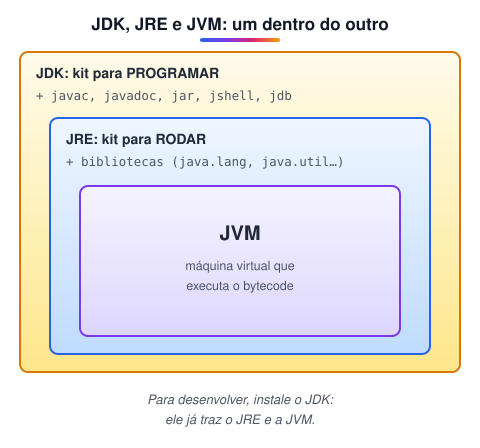
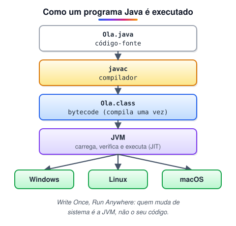
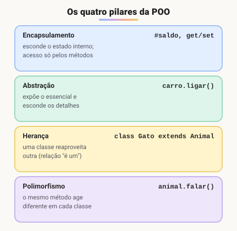
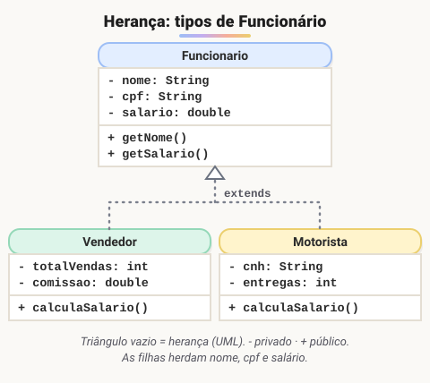
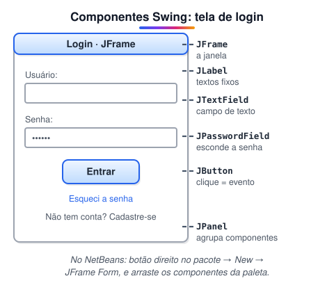
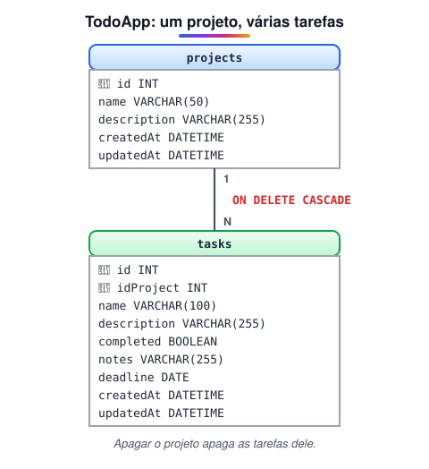
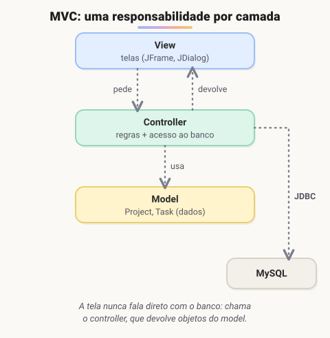
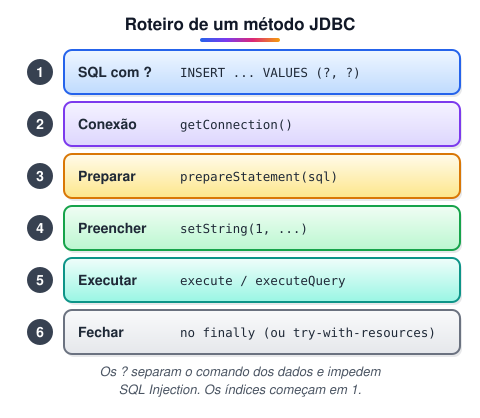
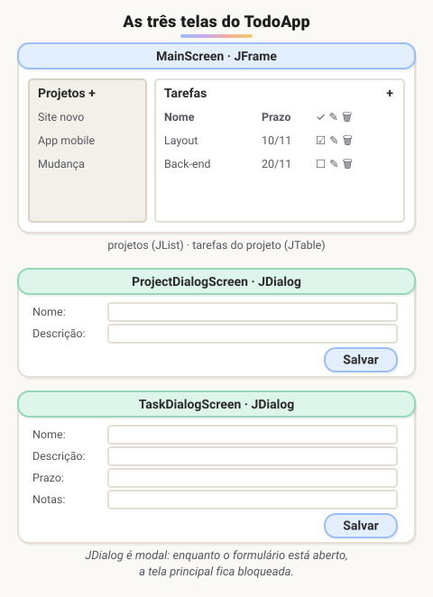
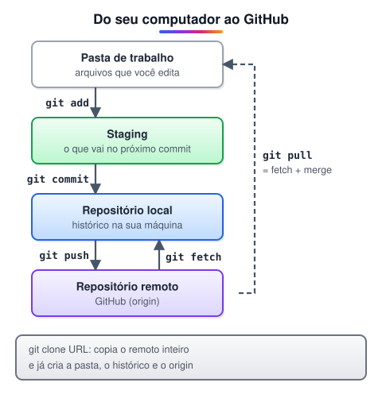

# 3 · Lógica de programação e algoritmos III (Java)

> 🗺️ **Sobre o módulo:** a passagem do Portugol para uma linguagem real, **Java**: sintaxe, orientação a objetos, interfaces gráficas com Swing e um projeto completo (TodoApp) com banco de dados MySQL e arquitetura MVC, versionado com Git e GitHub.
>
> **Professor:** Marcio Michelluzzi · **Ferramentas:** JDK (17 ou 21), NetBeans, XAMPP (MySQL).

## Roteiro do módulo de Java

> 🗺️ **Nesta aula:** o mapa do módulo. O foco é a linguagem **Java**, desde a sintaxe até um projeto completo com interface gráfica e banco de dados.

### De onde paramos

Nos módulos 1 e 2, a lógica foi praticada em **Portugol**, uma linguagem feita para aprender, e a orientação a objetos apareceu em JavaScript. Agora as mesmas ideias passam para o **Java**, uma das linguagens mais usadas em empresas. A boa notícia: quase nada é novo de verdade. Muda a forma de escrever, não o raciocínio.

| Portugol | Java |
| --- | --- |
| `escreval("Oi")` | `System.out.println("Oi");` |
| `x : inteiro` | `int x;` |
| `x <- 5` | `x = 5;` |
| `se ... entao ... fimse` | `if (...) { ... }` |
| `enquanto ... faca` | `while (...) { ... }` |
| `para i de 1 ate 10` | `for (int i = 1; i <= 10; i++)` |
| `funcao` / `procedimento` | método com retorno / método `void` |

### Roteiro do módulo

| Parte | Tema | O que se aprende |
| --- | --- | --- |
| 1 | Programação estruturada e OO | NetBeans; Portugol × Java (entrada e saída, variáveis, tipos, operadores); `if`/`switch`; `while`/`for`; classes, métodos, objetos, modificadores de acesso, construtores, herança |
| 2 | Interfaces gráficas | Swing: criar telas, paleta de componentes, propriedades, **eventos**, árvore de componentes; exercício: tela de login |
| 3 | Iniciando um projeto | requisitos, regras de negócio, escolha de tecnologias |
| 4 | Especificando o projeto | modelo entidade-relacionamento (MySQL Workbench), classes modelo, protótipo de telas |
| 5 | Codificando | padrão **MVC**, classes modelo, banco de dados, conexão (JDBC), interface gráfica |
| 6 | Finalizando e testando | controladores ligados à interface, validação de campos, tratamento de erros, depuração e testes |

### Como estudar este módulo

1. **Digite os exemplos** em vez de copiar e colar: errar a sintaxe e ler a mensagem do compilador faz parte do aprendizado.
2. **Compare com o Portugol:** cada estrutura de Java tem um equivalente que você já conhece (`se` → `if`, `enquanto` → `while`).
3. **Faça os exercícios** antes de abrir as respostas.
4. No projeto final, **desenhe antes de codar**: tabelas, classes e telas.

> ➡️ **Próximo passo:** antes de escrever a primeira linha de Java, é preciso preparar o computador: **Instalando o ambiente Java (JDK e NetBeans)**.

## Instalando o ambiente Java (JDK e NetBeans)

> 🗺️ **Nesta aula:** o que instalar para programar em Java (JDK e uma IDE), a diferença entre JDK, JRE e JVM e o primeiro programa rodando.

### De onde paramos

O Portugol rodava dentro de um programa só (o VisuAlg ou o Portugol Studio), que fazia tudo. Com Java, as peças são separadas: uma ferramenta **traduz** o código, outra o **executa** e um editor ajuda a **escrever**. Esta aula monta esse ambiente.

### JDK, JRE e JVM



| Sigla | Nome | Para quê |
| --- | --- | --- |
| **JVM** | Java Virtual Machine | executa o bytecode (`.class`) |
| **JRE** | Java Runtime Environment | JVM + bibliotecas padrão: o necessário para **rodar** programas |
| **JDK** | Java Development Kit | JRE + ferramentas de desenvolvimento (`javac`, `javadoc`, `jar`): o necessário para **programar** |

### 1. Instale o JDK

Prefira uma versão **LTS** (suporte de longo prazo), como o **Java 21** ou o **Java 17**. Há duas boas opções gratuitas:

🔗 [Download the Latest Java LTS Free](https://www.oracle.com/br/java/technologies/downloads/#jdk19-windows)

🔗 [https://adoptium.net/](https://adoptium.net/)

Depois de instalar, confira no terminal:

```bash
java -version
javac -version
```

Se o comando não for reconhecido, configure a variável de ambiente `JAVA_HOME` apontando para a pasta do JDK e inclua `%JAVA_HOME%\bin` no `PATH` (Windows).

### 2. Instale uma IDE

Uma **IDE** (ambiente de desenvolvimento integrado) junta editor, compilador, depurador e ferramentas de projeto. O curso usa o **NetBeans**:

🔗 [Apache NetBeans Releases](https://netbeans.apache.org/download/index.html)

No Windows, o instalador `.exe` é o caminho mais simples. Outras IDEs populares para Java: **IntelliJ IDEA Community** (a mais usada no mercado) e **Eclipse**. O VS Code também funciona, com o *Extension Pack for Java*.

### 3. O primeiro programa

No NetBeans: **File → New Project → Java with Maven → Java Application**, dê um nome e clique em **Finish**. Na classe principal, escreva:

```java
public class Main {
  public static void main(String[] args) {
    System.out.println("Olá, Java!");
  }
}
```

Rode com **F6** (ou o botão ▶). A saída aparece na aba **Output**, embaixo.

Cada parte, por enquanto:

- `public class Main`: todo código Java fica dentro de uma classe; o arquivo se chama `Main.java`.
- `public static void main(String[] args)`: o ponto de partida, equivalente ao `inicio` do Portugol.
- `System.out.println(...)`: o `escreval` do Java.
- Cada instrução termina com `;` e cada bloco fica entre `{ }`.

> ⚠️ Java diferencia maiúsculas de minúsculas: `system.out.println` ou `Main` escrito `main` no nome da classe dão erro. O nome da classe pública precisa ser igual ao nome do arquivo.

### 🧠 Revisão rápida

**Para programar em Java, o que é preciso instalar: JDK, JRE ou JVM?**

O JDK, que já inclui o JRE e a JVM.

**O que significa LTS e por que escolher uma versão LTS?**

*Long Term Support*: versão com correções e atualizações de segurança por vários anos. É a que as empresas usam.

**Qual método é o ponto de partida de um programa Java?**

`public static void main(String[] args)`.

> ➡️ **Próximo passo:** o programa rodou, mas o que acontece entre apertar ▶ e ver o texto? A próxima aula explica, junto com a origem da linguagem: **A história e as características do Java**.

### 📌 Resumo

| Item | Em uma frase |
| --- | --- |
| JVM | executa o bytecode |
| JRE | JVM + bibliotecas: para rodar |
| JDK | JRE + ferramentas: para programar |
| LTS | versão com suporte longo (17, 21) |
| IDE | editor + compilador + depurador juntos |
| `main` | o ponto de partida do programa |

## A história e as características do Java

> 🗺️ **Nesta aula:** de onde veio o Java, suas características principais e como um programa Java é executado.

### De onde paramos

Na aula anterior, o "Olá, Java!" rodou com um clique. Por trás, o NetBeans chamou duas ferramentas do JDK: uma que traduz e outra que executa. Entender esse caminho explica as siglas JDK, JRE e JVM e o motivo de o Java rodar em qualquer sistema.

### Um pouco de história

- **1991:** na **Sun Microsystems**, uma equipe liderada por **James Gosling** começa o "Green Project", uma linguagem para aparelhos eletrônicos (TVs a cabo, controles). O primeiro nome era **Oak**.
- **1995:** lançada oficialmente como **Java**, com foco na internet nascente.
- **2006–2007:** a Sun libera o código da plataforma (OpenJDK).
- **2010:** a **Oracle** compra a Sun e passa a cuidar do Java.
- **Hoje:** uma nova versão a cada 6 meses, e uma versão **LTS** a cada 2 anos (17, 21...).

🔗 [Java (programming language) - Wikipedia](https://en.wikipedia.org/wiki/Java_(programming_language))

### Características

| Característica | O que significa |
| --- | --- |
| **Multiplataforma** | o mesmo bytecode roda em qualquer sistema com JVM: *"write once, run anywhere"* |
| **Orientada a objetos** | todo código fica dentro de classes |
| **Fortemente e estaticamente tipada** | toda variável tem um tipo fixo, verificado na compilação |
| **Gerenciamento automático de memória** | o *garbage collector* libera objetos que não são mais usados |
| **Robusta e segura** | sem ponteiros manuais; tratamento de exceções obrigatório em vários casos |

Onde o Java é usado: sistemas de bancos e grandes empresas (back-end), aplicativos Android (ao lado do Kotlin), big data (Hadoop, Kafka), jogos (Minecraft).

### Como um programa Java é executado



1. Você escreve `Main.java`.
2. O compilador `javac` verifica e traduz o código para **bytecode** (`Main.class`).
3. A **JVM** carrega o bytecode e o executa, interpretando e compilando para código de máquina os trechos mais usados (**JIT**).

```bash
javac Main.java  # compila: gera Main.class
java Main  # executa na JVM
```

> 💡 Uma analogia: o bytecode é como um livro escrito em uma língua universal. Cada sistema (Windows, Linux, macOS) tem o seu "tradutor" (a JVM), que lê esse livro na hora. Por isso o mesmo `.class` roda em qualquer lugar onde exista uma JVM.

> ⚠️ Erros de **compilação** (um `;` faltando, um tipo errado) aparecem antes de o programa rodar, e o `javac` diz a linha. Erros de **execução** (dividir por zero, índice fora do vetor) só aparecem quando o programa está rodando, como *exceptions*.

### 🧠 Revisão rápida

**Quem criou o Java e quem é o dono hoje?**

Foi criado por James Gosling, na Sun Microsystems (1995). Desde 2010 pertence à Oracle.

**O que é bytecode?**

O código intermediário gerado pelo `javac`, que não depende do sistema operacional e é executado pela JVM.

**O que faz o garbage collector?**

Libera automaticamente a memória de objetos que não são mais usados pelo programa.

> ➡️ **Próximo passo:** com o ambiente pronto e o caminho do código entendido, é hora de escrever Java de verdade: **Sintaxe básica do Java**.

### 📌 Resumo

| Item | Em uma frase |
| --- | --- |
| Origem | Sun Microsystems, 1995; hoje mantido pela Oracle |
| Multiplataforma | o mesmo bytecode roda em qualquer JVM |
| Tipagem estática | toda variável tem tipo fixo, conferido ao compilar |
| `javac` | compila `.java` em `.class` (bytecode) |
| `java` | executa o bytecode na JVM |
| Garbage collector | libera a memória sozinho |

## Sintaxe básica do Java

> 🗺️ **Nesta aula:** a sintaxe básica de Java, sempre comparada ao Portugol: estrutura de um programa, comentários, entrada e saída, tipos, operadores, decisões, repetições, vetores e métodos.

### De onde paramos

O "Olá, Java!" já rodou e você sabe o caminho do código até a JVM. Agora vem a tradução de tudo o que foi praticado nos módulos 1 e 2. Para cada estrutura, pergunte: "como eu fazia isso no Portugol?". A lógica é a mesma; muda a escrita.

### Ferramentas de build: Maven, Gradle e Ant

Ao criar um projeto no NetBeans, você escolhe uma **ferramenta de build**. Ela compila o código, empacota o programa (`.jar`) e baixa automaticamente as **bibliotecas** (dependências) de que o projeto precisa.

| Ferramenta | Configuração | Observação |
| --- | --- | --- |
| **Ant** | XML, passo a passo | a mais antiga; tudo é manual |
| **Maven** | `pom.xml` (XML) | convenção forte; a mais usada em empresas |
| **Gradle** | script (Groovy ou Kotlin) | flexível e rápido; padrão no Android |

Para começar, escolha **Maven**: é o que você vai encontrar na maioria das empresas e no Spring Boot, mais adiante.

🔗 [https://pt.stackoverflow.com/questions/96122/quais-as-diferen%C3%A7as-entre-gradle-e-o-maven](https://pt.stackoverflow.com/questions/96122/quais-as-diferen%C3%A7as-entre-gradle-e-o-maven)

🔗 [Maven vs Gradle : quem ganha, afinal?](https://deviniciative.wordpress.com/2019/06/23/maven-vs-gradle-quem-ganha-afinal/)

Tema escuro (Dracula) para o NetBeans:

🔗 [Como MUDAR O TEMA do Netbeans (Dark Theme)](https://www.youtube.com/watch?v=wtN6YTkHznA)

### Estrutura de um programa e saída na tela

```java
// pasta lógica onde a classe fica
package meuprimeiroprojeto;

// o arquivo precisa se chamar App.java
public class App {
  // ponto de entrada: o programa começa aqui
  public static void main(String[] args) {
    System.out.println("Primeira linha");
    System.out.print("Sem pular linha, ");
    System.out.println("continua aqui.");
  }
}
```

`println` escreve e pula linha (como o `escreval`); `print` escreve sem pular (como o `escreva`).

> 💡 - Java **diferencia maiúsculas de minúsculas** (`System` ≠ `system`).
> - Toda instrução termina com `;` e os blocos ficam entre `{ }`.
> - Uma classe `public` deve ter o mesmo nome do arquivo.
> - Convenções: classes em `PascalCase` (`ContaBancaria`), variáveis e métodos em `camelCase` (`saldoAtual`), constantes em `MAIUSCULAS` (`TAXA_JUROS`) e pacotes em minúsculas.

### Comentários

```java
// comentário de uma linha

/* comentário
   de várias linhas */

/**
 * Javadoc: documenta classes e métodos
 * e gera páginas HTML automaticamente.
 * @param a primeiro número
 * @param b segundo número
 * @return a soma
 */
public static int somar(int a, int b) {
    return a + b;
}
```

Documentação oficial:

🔗 [Java Documentation - Get Started](https://docs.oracle.com/en/java/)

### Variáveis e tipos

No Portugol, as variáveis eram declaradas todas juntas na seção `var`. Em Java, você declara onde precisar, sempre com **tipo + nome**, e pode já dar um valor:

```java
int idade = 30;  // idade : inteiro
double altura = 1.75;  // altura : real
String nome = "Ana";  // nome : caractere
boolean ativo = true;  // ativo : logico
char letra = 'a';  // um caractere só
```

#### Tipos primitivos

| Tipo | Guarda | Exemplo |
| --- | --- | --- |
| `int` · `long` | inteiros (32 e 64 bits) | `int idade = 30;` |
| `byte` · `short` | inteiros pequenos (8 e 16 bits) | pouco usados no dia a dia |
| `double` · `float` | decimais; `double` é o padrão | `double d = 6.0;` |
| `boolean` | `true` ou `false` | `boolean ok = true;` |
| `char` | um caractere, entre aspas **simples** | `char c = 'a';` |

`String` (texto, entre aspas **duplas**) **não** é primitivo: é uma classe. Por isso começa com maiúscula e tem métodos (`nome.length()`, `nome.toUpperCase()`).

```java
// final = constante: não pode mudar
final double TAXA = 0.05;
// var (Java 10+): o tipo é deduzido (int)
var total = 100;
// long precisa do L no fim
long populacao = 8_000_000_000L;
```

#### Conversão (cast)

```java
int inteiro = 10;
// automático: int cabe em double
double decimal = inteiro;

double preco = 9.99;
// cast explícito: vira 9 (corta o decimal)
int truncado = (int) preco;

// texto → número e número → texto
int numero = Integer.parseInt("42");
String texto = String.valueOf(42);
```

### Operadores

| Tipo | Operadores | Portugol |
| --- | --- | --- |
| Aritméticos | `  • - * / %` | `%` é o `mod` |
| Atribuição | `= += -= *= /=` | `=` é o `<-` |
| Incremento | `++` `--` | `i <- i + 1` |
| Relacionais | `== != > < >= <=` | `==` é o `=`; `!=` é o `<>` |
| Lógicos | `&&` `\|\|` `!` | `e`, `ou`, `nao` |

`x += 5` é o mesmo que `x = x + 5`.

> ⚠️ **Divisão entre inteiros descarta a parte decimal:** `7 / 2` dá `3`. Para obter `3.5`, pelo menos um dos lados precisa ser decimal: `7 / 2.0` ou `(double) a / b`.

> ⚠️ Em Java, `=` **atribui** e `==` **compara**. No Portugol, o `=` comparava. Trocar um pelo outro é um dos erros mais comuns de quem está começando.

### Entrada de dados com `Scanner`

O `leia` do Java é a classe `Scanner`:

```java
import java.util.Scanner;

public class Entrada {
  public static void main(String[] args) {
    Scanner leitor = new Scanner(System.in);

    System.out.print("Idade: ");
    int idade = leitor.nextInt();
    // consome o Enter que sobrou
    leitor.nextLine();

    System.out.print("Nome completo: ");
    String nome = leitor.nextLine();

    System.out.println("Olá, " + nome + "!");
    // saída formatada: %d = inteiro
    System.out.printf("Em 10 anos: %d%n",
        idade + 10);

    leitor.close();
  }
}
```

| Método | Lê |
| --- | --- |
| `nextInt()` / `nextDouble()` | um número inteiro / decimal |
| `next()` | uma palavra (para no espaço) |
| `nextLine()` | a linha inteira |
| `nextBoolean()` | `true` ou `false` |

> ⚠️ Depois de `nextInt()` ou `nextDouble()`, o "Enter" fica no buffer. Se a próxima leitura for `nextLine()`, ela lê esse Enter e devolve uma linha vazia. Por isso o `leitor.nextLine()` extra no exemplo.

### Decisões: `if` e `switch`

O `se...senao` vira `if...else`. A condição fica sempre entre parênteses:

```java
if (media >= 7) {
  System.out.println("Aprovado");
} else if (media >= 5) {
  System.out.println("Recuperação");
} else {
  System.out.println("Reprovado");
}

// ternário: um if que devolve um valor
String situacao = (media >= 7)
    ? "Aprovado" : "Reprovado";
```

O `escolha...caso` vira `switch`:

```java
switch (codigo) {
  case 1:
    System.out.println("Produto 1");
    // sem break, "cai" no próximo case
    break;
  case 2:
    System.out.println("Produto 2");
    break;
  default:
    System.out.println("Inválido");
}

// Java 14+: com setas, sem break
String nome = switch (codigo) {
  case 1 -> "Produto 1";
  case 2 -> "Produto 2";
  default -> "Inválido";
};
```

> ⚠️ Para comparar **textos**, use `.equals()`: `nome.equals("Ana")`. O `==` compara se são o **mesmo objeto** na memória, e pode dar `false` mesmo com o texto igual.

### Repetições: `for`, `while` e `do-while`

| Portugol | Java |
| --- | --- |
| `para i de 0 ate 9` | `for (int i = 0; i < 10; i++)` |
| `enquanto` | `while` (testa antes) |
| `repita...ate` | `do...while` (testa depois) |

```java
// para: número de voltas conhecido
for (int i = 0; i < 10; i++) {
  System.out.println(i);
}

// enquanto: testa antes
int alunos = 0;
while (alunos < 40) {
  alunos++;  // sem isso, laço infinito
}

// repita: roda ao menos 1 vez
int opcao;
do {
  opcao = leitor.nextInt();
} while (opcao != 0);
```

O `for` tem as três partes do `para`, separadas por `;`: **início** (`int i = 0`), **condição** (`i < 10`) e **atualização** (`i++`).

> ⚠️ O `do-while` repete **enquanto** a condição for verdadeira; o `repita...ate` do Portugol repetia **até** ela ficar verdadeira. A condição fica invertida: `ate opcao = 0` vira `while (opcao != 0)`.

- `break` sai do laço imediatamente; `continue` pula para a próxima volta.

### Vetores (arrays)

O `vetor[1..5] de inteiro` do Portugol vira:

```java
// 5 posições, índices de 0 a 4
int[] numeros = new int[5];
numeros[0] = 10;

// ou já com os valores
int[] notas = {7, 8, 10};

// percorrendo pelo índice
for (int i = 0; i < notas.length; i++) {
  System.out.println(notas[i]);
}

// for-each: cada elemento, sem índice
for (int nota : notas) {
  System.out.println(nota);
}
```

> 💡 Use `notas.length` em vez de escrever o tamanho à mão: se o vetor mudar de tamanho, o laço continua certo. A condição é `i < length` (menor, não menor ou igual), porque o último índice é `length - 1`.

Matrizes têm dois pares de colchetes: `int[][] m = new int[3][4];` e `m[linha][coluna]`.

### Métodos (as funções do Java)

Procedimentos e funções do Portugol viram **métodos**. Por enquanto, todos com `static`, para poderem ser chamados direto do `main` (o motivo fica claro na aula de orientação a objetos):

```java
public class Calculadora {

  // função: devolve um int
  static int somar(int a, int b) {
    return a + b;
  }

  // procedimento: void = não devolve nada
  static void mostrarLinha(int tamanho) {
    for (int i = 0; i < tamanho; i++) {
      System.out.print("-");
    }
    System.out.println();
  }

  public static void main(String[] args) {
    mostrarLinha(20);
    int total = somar(2, 3) * 10;  // 50
    System.out.println(total);
  }
}
```

| Portugol | Java |
| --- | --- |
| `funcao somar(a, b: inteiro): inteiro` | `static int somar(int a, int b)` |
| `procedimento mostrar()` | `static void mostrar()` |
| `retorne a + b` | `return a + b;` |

### 🧠 Revisão rápida

**Quanto vale `int x = 10 / 4;`? E `double y = 10 / 4.0;`?**

`x` vale 2 (divisão inteira); `y` vale 2.5.

**Por que `"Ana" == nome` pode dar `false` mesmo quando `nome` contém "Ana"?**

Porque `==` compara referências (se é o mesmo objeto). Para comparar o conteúdo de Strings, use `.equals()`.

**O que acontece num `switch` tradicional se você esquecer o `break`?**

A execução continua nos `case` seguintes (*fall-through*) até encontrar um `break` ou o fim do `switch`.

**Qual a diferença entre `do-while` em Java e `repita...ate` no Portugol?**

Os dois rodam ao menos uma vez, mas o `do-while` repete enquanto a condição for **verdadeira**; o `repita` repete **até** ela ficar verdadeira.

**Em `int[] v = new int[8];`, qual é o último índice válido?**

7, ou seja, `v.length - 1`.

**O que significa `void` na declaração de um método?**

Que o método não devolve valor: é o equivalente ao procedimento do Portugol.

> ➡️ **Próximo passo:** a sintaxe só fixa com prática. A próxima página traz 35 exercícios resolvidos: **Exercícios de Java estruturado**. Tente cada um antes de abrir a resposta.

### 📌 Resumo

| Item | Em uma frase |
| --- | --- |
| Estrutura | tudo dentro de uma classe; começa no `main` |
| Saída | `System.out.println` (pula linha) e `print` |
| Entrada | `Scanner`; cuidado com o Enter depois de `nextInt()` |
| Tipos | `int`, `double`, `boolean`, `char`; `String` é classe |
| `7 / 2` | dá 3 entre inteiros |
| `=` × `==` | atribui × compara; texto com `.equals()` |
| Laços | `for`, `while`, `do-while`, for-each |
| Vetores | `int[] v = new int[5]`; índices de 0 a `length - 1` |
| Métodos | tipo de retorno ou `void`; `return` devolve |

## Exercícios de Java estruturado (35 exercícios com solução)

> 🗺️ **Nesta aula:** 35 exercícios de Java estruturado, em ordem de dificuldade: sequência, decisão e repetição.

### De onde paramos

A aula anterior traduziu o Portugol para Java. Estes exercícios são os mesmos tipos de problema dos módulos 1 e 2, agora escritos em Java. Se travar em algum, resolva primeiro em Portugol (ou em português, passo a passo) e só depois traduza.

> 💡 Os códigos mostram só o **miolo do** `main`. Considere sempre, no início:
>
> ```java
> import java.util.Scanner;
> // ...
> Scanner sc = new Scanner(System.in);
> ```
>
> **Como usar:** tente resolver antes de abrir a solução. Depois de resolver, compare: a sua versão pode ser diferente e estar certa.

### Parte 1: sequência (entrada → cálculo → saída)

#### 1 - Ler 2 números e exibir a soma

<details>
<summary>Ver resposta</summary>

```java
int a = sc.nextInt();
int b = sc.nextInt();
System.out.println("Soma: " + (a + b));
```

Os parênteses em `(a + b)` são importantes: sem eles, o Java juntaria os textos, e 2 e 3 virariam "Soma: 23".

</details>

#### 2 - Ler 2 números e mostrar soma, subtração, multiplicação e divisão

<details>
<summary>Ver resposta</summary>

```java
double a = sc.nextDouble();
double b = sc.nextDouble();
System.out.println("Soma: " + (a + b));
System.out.println("Sub:  " + (a - b));
System.out.println("Mult: " + (a * b));
if (b != 0) {
  System.out.println("Div:  " + (a / b));
} else {
  System.out.println("Div:  indefinida");
}
```

</details>

#### 3 - Consumo médio de um automóvel (distância ÷ combustível)

<details>
<summary>Ver resposta</summary>

```java
double km = sc.nextDouble();
double litros = sc.nextDouble();
// %.2f = decimal com 2 casas; %n = pula linha
System.out.printf("Consumo: %.2f km/l%n",
    km / litros);
```

</details>

#### 4 - Vendedor: salário fixo + 15% de comissão sobre as vendas

<details>
<summary>Ver resposta</summary>

```java
String nome = sc.nextLine();
double fixo = sc.nextDouble();
double vendas = sc.nextDouble();
double total = fixo + vendas * 0.15;
System.out.printf("%s | fixo: %.2f | final: %.2f%n",
    nome, fixo, total);
```

</details>

#### 5 - Nome do aluno e média aritmética de 3 notas

<details>
<summary>Ver resposta</summary>

```java
String nome = sc.nextLine();
double n1 = sc.nextDouble();
double n2 = sc.nextDouble();
double n3 = sc.nextDouble();
double media = (n1 + n2 + n3) / 3;
System.out.printf("%s - média %.1f%n", nome, media);
```

</details>

#### 6 - Trocar os valores de A e B

<details>
<summary>Ver resposta</summary>

```java
int a = sc.nextInt();
int b = sc.nextInt();
int aux = a;  // guarda a antes de perdê-lo
a = b;
b = aux;
System.out.println("A=" + a + " B=" + b);
```

É a mesma troca do bubble sort, no módulo 2.

</details>

#### 7 - Converter Celsius → Fahrenheit: F = (9·C + 160) / 5

<details>
<summary>Ver resposta</summary>

```java
double c = sc.nextDouble();
double f = (9 * c + 160) / 5;
System.out.println("F = " + f);
```

</details>

#### 8 - Converter dólar → real (cotação × quantidade)

<details>
<summary>Ver resposta</summary>

```java
double cotacao = sc.nextDouble();
double dolares = sc.nextDouble();
System.out.printf("R$ %.2f%n", cotacao * dolares);
```

</details>

#### 9 - Poupança: valor após 1 mês com juros de 0,07% a.m.

<details>
<summary>Ver resposta</summary>

```java
double deposito = sc.nextDouble();
// + 0,07% = multiplicar por 1,0007
System.out.printf("R$ %.2f%n", deposito * 1.0007);
```

</details>

#### 10 - Loja Mamão com Açúcar: valor de cada uma das 5 prestações

<details>
<summary>Ver resposta</summary>

```java
double compra = sc.nextDouble();
System.out.printf("5x de R$ %.2f%n", compra / 5);
```

</details>

#### 11 - Preço de venda = custo + % de acréscimo informado

<details>
<summary>Ver resposta</summary>

```java
double custo = sc.nextDouble();
double perc = sc.nextDouble();
double venda = custo * (1 + perc / 100);
System.out.printf("Venda: R$ %.2f%n", venda);
```

</details>

#### 12 - Carro novo: custo de fábrica + 45% de impostos, depois + 28% do distribuidor

<details>
<summary>Ver resposta</summary>

```java
double fabrica = sc.nextDouble();
double comImpostos = fabrica * 1.45;
double consumidor = comImpostos * 1.28;
System.out.printf("Consumidor: R$ %.2f%n", consumidor);
```

</details>

### Parte 2: decisão (`if`, `switch`)

#### 13 - Mensagem se o número for maior que 10

<details>
<summary>Ver resposta</summary>

```java
int n = sc.nextInt();
if (n > 10) {
  System.out.println("Maior que 10");
}
```

</details>

#### 14 - Ler 2 inteiros distintos e informar o maior

<details>
<summary>Ver resposta</summary>

```java
int a = sc.nextInt();
int b = sc.nextInt();
if (a > b) {
  System.out.println("Maior: " + a);
} else {
  System.out.println("Maior: " + b);
}
// atalho pronto: Math.max(a, b)
```

</details>

#### 15 - Verificar se o número está entre 100 e 200

<details>
<summary>Ver resposta</summary>

```java
int n = sc.nextInt();
if (n >= 100 && n <= 200) {
  System.out.println("Dentro");
} else {
  System.out.println("Fora");
}
```

</details>

#### 16 - Média de 3 notas: aprovado (≥ 7), recuperação (5,1–6,9), reprovado (≤ 5)

<details>
<summary>Ver resposta</summary>

```java
double m = (sc.nextDouble() + sc.nextDouble()
    + sc.nextDouble()) / 3;
if (m >= 7) {
  System.out.println("Aprovado");
} else if (m > 5) {
  System.out.println("Recuperação");
} else {
  System.out.println("Reprovado");
}
```

O `else if` só é testado se o `if` anterior foi falso. Por isso basta `m > 5`: já se sabe que `m` é menor que 7.

</details>

### Parte 3: repetição (`for`, `while`, `do-while`)

#### 17 - Ler 10 números e contar quantos estão entre 10 e 150 (inclusive)

<details>
<summary>Ver resposta</summary>

```java
int cont = 0;
for (int i = 0; i < 10; i++) {
  int n = sc.nextInt();
  if (n >= 10 && n <= 150) {
    cont++;  // contador
  }
}
System.out.println(cont + " no intervalo");
```

</details>

#### 18 - Idade de 10 pessoas: "maior de idade" (≥ 18) ou "menor de idade"

<details>
<summary>Ver resposta</summary>

```java
for (int i = 0; i < 10; i++) {
  int idade = sc.nextInt();
  if (idade >= 18) {
    System.out.println("Maior de idade");
  } else {
    System.out.println("Menor de idade");
  }
}
```

</details>

#### 19 - Nome e sexo de 12 pessoas; no fim, total de homens e mulheres

<details>
<summary>Ver resposta</summary>

```java
int h = 0, m = 0;
for (int i = 0; i < 12; i++) {
  String nome = sc.next();
  // primeira letra, em maiúscula
  char sexo = sc.next().toUpperCase().charAt(0);
  if (sexo == 'M') {
    h++;
    System.out.println(nome + " - homem");
  } else {
    m++;
    System.out.println(nome + " - mulher");
  }
}
System.out.println("Homens: " + h);
System.out.println("Mulheres: " + m);
```

</details>

#### 20 - Carango Velho: desconto por ano (até 2000 → 12%, acima → 7%), repetir até "N"; totais

<details>
<summary>Ver resposta</summary>

```java
int ate2000 = 0, total = 0;
char resp;
do {
  int ano = sc.nextInt();
  double valor = sc.nextDouble();
  double taxa;
  if (ano <= 2000) {
    taxa = 0.12;
    ate2000++;
  } else {
    taxa = 0.07;
  }
  total++;
  double desc = valor * taxa;
  System.out.printf("Desconto %.2f | Pagar %.2f%n",
      desc, valor - desc);
  System.out.print("Continuar (S/N)? ");
  resp = sc.next().toUpperCase().charAt(0);
} while (resp != 'N');
System.out.println("Até 2000: " + ate2000);
System.out.println("Total: " + total);
```

O `do-while` é a escolha certa: sempre há pelo menos um carro.

</details>

#### 21 - Serviço militar: dados de N pessoas (nome, sexo, idade, saúde) → apta ou não; totais

<details>
<summary>Ver resposta</summary>

```java
int n = sc.nextInt();  // quantas pessoas
int aptos = 0, inaptos = 0;
for (int i = 0; i < n; i++) {
  String nome = sc.next();
  char sexo = sc.next().charAt(0);
  int idade = sc.nextInt();
  char saude = sc.next().charAt(0); // B = boa
  boolean apto = sexo == 'M'
      && idade >= 18
      && saude == 'B';
  if (apto) {
    aptos++;
    System.out.println(nome + " apto");
  } else {
    inaptos++;
    System.out.println(nome + " não apto");
  }
}
System.out.println("Aptos: " + aptos);
System.out.println("Não aptos: " + inaptos);
```

Guardar a condição numa variável `boolean` com nome claro (`apto`) deixa o `if` fácil de ler.

</details>

#### 22 - 10 produtos: custo × venda → lucro, prejuízo ou empate; médias de custo e venda

<details>
<summary>Ver resposta</summary>

```java
double somaC = 0, somaV = 0;
for (int i = 0; i < 10; i++) {
  double c = sc.nextDouble();
  double v = sc.nextDouble();
  somaC += c;  // acumuladores
  somaV += v;
  if (v > c) {
    System.out.println("Lucro");
  } else if (v < c) {
    System.out.println("Prejuízo");
  } else {
    System.out.println("Empate");
  }
}
System.out.printf("Média custo %.2f%n", somaC / 10);
System.out.printf("Média venda %.2f%n", somaV / 10);
```

</details>

### Parte 4: mais decisões, combinando tudo

#### 23 - Mensagem se o número for > 80, < 25 ou == 40

<details>
<summary>Ver resposta</summary>

```java
int n = sc.nextInt();
if (n > 80 || n < 25 || n == 40) {
  System.out.println("Condição atendida");
}
```

</details>

#### 24 - N números: positivo, negativo ou zero

<details>
<summary>Ver resposta</summary>

```java
int n = sc.nextInt();  // quantos números
for (int i = 0; i < n; i++) {
  int x = sc.nextInt();
  if (x > 0) {
    System.out.println("Positivo");
  } else if (x < 0) {
    System.out.println("Negativo");
  } else {
    System.out.println("Zero");
  }
}
```

</details>

#### 25 - Dois números: iguais, ou diferentes indicando o maior

<details>
<summary>Ver resposta</summary>

```java
int a = sc.nextInt();
int b = sc.nextInt();
if (a == b) {
  System.out.println("Iguais");
} else {
  System.out.println("Diferentes; maior = "
      + Math.max(a, b));
}
```

</details>

#### 26 - Número de 1 a 5 por extenso (senão: "número inválido")

<details>
<summary>Ver resposta</summary>

```java
int n = sc.nextInt();
String extenso = switch (n) {
  case 1 -> "Um";
  case 2 -> "Dois";
  case 3 -> "Três";
  case 4 -> "Quatro";
  case 5 -> "Cinco";
  default -> "Número inválido";
};
System.out.println(extenso);
```

Com o `switch` de setas (Java 14+), não há `break` para esquecer.

</details>

#### 27 - Carango: desconto por combustível (álcool 25%, gasolina 21%, diesel 14%); valor < 5 mil encerra; totais

<details>
<summary>Ver resposta</summary>

```java
double totDesc = 0, totPago = 0;
while (true) {
  double valor = sc.nextDouble();
  if (valor < 5000) {
    break;  // encerra a entrada
  }
  // A, G ou D
  char comb = sc.next().toUpperCase().charAt(0);
  double taxa = switch (comb) {
    case 'A' -> 0.25;
    case 'G' -> 0.21;
    default -> 0.14;
  };
  double desc = valor * taxa;
  totDesc += desc;
  totPago += valor - desc;
}
System.out.printf("Descontos %.2f%n", totDesc);
System.out.printf("Pago %.2f%n", totPago);
```

`while (true)` com `break` é útil quando a condição de parada só é conhecida no meio do laço.

</details>

#### 28 - Reajuste salarial por faixa de salários mínimos; aumento total da folha

Reajuste: **< 3 SM → 50%** · **3 a 10 SM → 20%** · **10 a 20 SM → 15%** · **demais → 10%**. Ler nome, salário e salário mínimo; mostrar nome, reajuste e novo salário, e o aumento total da folha.

<details>
<summary>Ver resposta: Solução (para cada funcionário, dentro do laço)</summary>

```java
double qtd = salario / minimo;  // quantos SM
double perc;
if (qtd < 3) {
  perc = 0.50;
} else if (qtd <= 10) {
  perc = 0.20;
} else if (qtd <= 20) {
  perc = 0.15;
} else {
  perc = 0.10;
}
double reajuste = salario * perc;
folha += reajuste;  // acumula o aumento total
System.out.printf("%s | reajuste %.2f | novo %.2f%n",
    nome, reajuste, salario + reajuste);
```

</details>

#### 29 - Número do mês → nome do mês (validar inválido)

<details>
<summary>Ver resposta</summary>

```java
String[] meses = {"Janeiro", "Fevereiro", "Março",
  "Abril", "Maio", "Junho", "Julho", "Agosto",
  "Setembro", "Outubro", "Novembro", "Dezembro"};
int m = sc.nextInt();
if (m >= 1 && m <= 12) {
  // o vetor começa em 0: mês 1 → índice 0
  System.out.println(meses[m - 1]);
} else {
  System.out.println("Mês inválido");
}
```

Um vetor substitui um `switch` de 12 casos.

</details>

#### 30 - Ler 5 inteiros distintos e escrever em ordem crescente

<details>
<summary>Ver resposta</summary>

```java
int[] v = new int[5];
for (int i = 0; i < 5; i++) {
  v[i] = sc.nextInt();
}
// ordenação pronta (ou o bubble sort do módulo 2)
java.util.Arrays.sort(v);
System.out.println(java.util.Arrays.toString(v));
```

</details>

#### 31 - A e B reais, C operador: calcular A C B; operador inválido → mensagem; tratar divisão por zero

<details>
<summary>Ver resposta</summary>

```java
double a = sc.nextDouble();
double b = sc.nextDouble();
char op = sc.next().charAt(0);
switch (op) {
  case '+' -> System.out.println(a + b);
  case '-' -> System.out.println(a - b);
  case '*' -> System.out.println(a * b);
  case '/' -> {
    if (b == 0) {
      System.out.println("Erro: divisão por zero");
    } else {
      System.out.println(a / b);
    }
  }
  default -> System.out.println("Operador não definido");
}
```

</details>

#### 32 - 3 lados formam triângulo? Qual tipo (cada lado < soma dos outros dois)

**Equilátero**: 3 lados iguais · **Isósceles**: 2 iguais · **Escaleno**: todos diferentes.

<details>
<summary>Ver resposta</summary>

```java
int a = sc.nextInt();
int b = sc.nextInt();
int c = sc.nextInt();
boolean forma = a < b + c
    && b < a + c
    && c < a + b;
if (!forma) {
  System.out.println("Não forma triângulo");
} else if (a == b && b == c) {
  System.out.println("Equilátero");
} else if (a == b || a == c || b == c) {
  System.out.println("Isósceles");
} else {
  System.out.println("Escaleno");
}
```

A ordem dos testes importa: o equilátero vem antes do isósceles, porque um triângulo com 3 lados iguais também tem 2 iguais.

</details>

#### 33 - Escola Aprender: salário do professor = horas × valor do nível

Nível 1 → R$ 12/h · Nível 2 → R$ 17/h · Nível 3 → R$ 25/h.

<details>
<summary>Ver resposta</summary>

```java
int nivel = sc.nextInt();
double horas = sc.nextDouble();
double valorHora = switch (nivel) {
  case 1 -> 12;
  case 2 -> 17;
  default -> 25;
};
System.out.printf("Salário: R$ %.2f%n",
    horas * valorHora);
```

</details>

#### 34 - Categoria do nadador pela idade

Infantil A 5–7 · Infantil B 8–10 · Juvenil A 11–13 · Juvenil B 14–17 · Sênior 18–25 · fora disso: "idade fora da faixa etária".

<details>
<summary>Ver resposta</summary>

```java
int i = sc.nextInt();
String cat;
if (i < 5 || i > 25) {
  cat = "Idade fora da faixa etária";
} else if (i <= 7) {
  cat = "Infantil A";
} else if (i <= 10) {
  cat = "Infantil B";
} else if (i <= 13) {
  cat = "Juvenil A";
} else if (i <= 17) {
  cat = "Juvenil B";
} else {
  cat = "Sênior";
}
System.out.println(cat);
```

Tratar primeiro o caso inválido simplifica o resto: daí em diante, basta testar o limite de cima de cada faixa.

</details>

#### 35 - Conta de luz: kW/h consumidos × tarifa do tipo de cliente

1 Residência → R$ 0,60 · 2 Comércio → R$ 0,48 · 3 Indústria → R$ 1,29 por kWh.

<details>
<summary>Ver resposta</summary>

```java
int tipo = sc.nextInt();
double kwh = sc.nextDouble();
double tarifa = switch (tipo) {
  case 1 -> 0.60;
  case 2 -> 0.48;
  default -> 1.29;
};
System.out.printf("Conta: R$ %.2f%n", kwh * tarifa);
```

</details>

> ➡️ **Próximo passo:** todos esses programas cabem num `main` só. Quando o sistema cresce, é preciso organizar o código em classes e objetos: **Orientação a objetos em Java**.

### 📌 Resumo

| Padrão | Onde apareceu |
| --- | --- |
| Contador (`cont++`) | 17, 19, 21 |
| Acumulador (`soma += x`) | 22, 27, 28 |
| Faixas com `else if` | 16, 28, 34 |
| `switch` para valores fixos | 26, 31, 33, 35 |
| `do-while` com "continuar?" | 20 |
| `while (true)`  • `break` | 27 |
| Vetor no lugar de vários `if` | 29 |

## Orientação a objetos em Java

> 🗺️ **Nesta aula:** orientação a objetos em Java: classes e métodos, `static`, modificadores de acesso, getters e setters, construtores, herança, polimorfismo e composição.

### De onde paramos

No módulo 2, a orientação a objetos apareceu em JavaScript: classe como molde, objeto criado com `new`, construtor, `this` e herança com `extends`. Em Java, as ideias são **as mesmas**. A diferença é que o Java exige tipos em tudo e oferece um controle maior de quem pode acessar o quê. E nos 35 exercícios anteriores, tudo ficava no `main`; agora o código passa a ser dividido em classes.

### Por que orientação a objetos

A POO organiza o programa em **objetos que representam entidades do mundo real** (cliente, produto, conta), cada um com seus **dados** e seus **comportamentos**. A ideia surgiu nos anos 1960 com o **Simula** e se popularizou com o **Smalltalk**.

**Leituras**

🔗 [https://pt.wikipedia.org/wiki/Smalltalk](https://pt.wikipedia.org/wiki/Smalltalk)

[Programação estruturada x Programação orientada a objetos Devmidia](https://app.notion.com/p/995956a9ce7147edae1a21cd1839015b?pvs=21)



### Classes, atributos e métodos

- **Classe:** o molde. Define **atributos** (o estado: nome, peso) e **métodos** (o comportamento: calcular o IMC).
- **Objeto:** uma instância concreta, criada com `new`.

Em Java, cada classe pública fica no seu próprio arquivo: `Pessoa.java` e `App.java` (a que tem o `main`).

```java
// Pessoa.java
public class Pessoa {
  String nome;
  double peso;
  double altura;

  public double calcularImc() {
    return peso / (altura * altura);
  }
}
```

```java
// no main (App.java)
Pessoa p1 = new Pessoa();
p1.nome = sc.next();
p1.peso = sc.nextDouble();
p1.altura = sc.nextDouble();
System.out.printf("IMC de %s: %.1f%n",
    p1.nome, p1.calcularImc());
```

#### E o `static`?

Na aula de sintaxe, os métodos tinham `static`. Agora dá para entender:

- um método **sem** `static` pertence a cada **objeto** e precisa de um: `p1.calcularImc()`;
- um método **com** `static` pertence à **classe** e é chamado sem criar objeto: `Math.sqrt(9)`, `Integer.parseInt("5")`.

O `main` é `static` porque a JVM precisa chamá-lo antes de existir qualquer objeto.

### Modificadores de acesso e encapsulamento

Os modificadores definem **quem pode acessar** atributos e métodos:

| Modificador | Quem acessa |
| --- | --- |
| `public` | qualquer classe |
| `protected` | mesmo pacote e subclasses |
| *(nenhum)* | só o mesmo pacote |
| `private` | só a própria classe |

No exemplo acima, qualquer código podia fazer `p1.peso = -80;`. O **encapsulamento** impede isso: atributos `private`, acessados por métodos públicos.

- **getter** lê o valor: `getNome()`;
- **setter** altera o valor e pode **validar**: `setPeso(double peso)` pode recusar peso negativo.

```java
public class Pessoa {
  private String nome;
  private double peso;
  private double altura;

  public String getNome() {
    return nome;
  }

  public void setNome(String nome) {
    // this.nome = o atributo do objeto
    // nome = o parâmetro recebido
    this.nome = nome;
  }

  public void setPeso(double peso) {
    if (peso > 0) {  // o setter protege
      this.peso = peso;
    }
  }
  // getPeso, getAltura, setAltura...
}
```

> 💡 No NetBeans, **Alt + Insert** gera getters, setters e construtores automaticamente. **Alt + Shift + F** formata o código.

### Construtores

O **construtor** inicializa o objeto no momento do `new`:

- tem o **mesmo nome da classe** e **nenhum tipo de retorno** (nem `void`);
- roda automaticamente ao instanciar;
- se você não escrever nenhum, o Java cria um construtor vazio. Se escrever um com parâmetros, o vazio deixa de existir (a menos que você o declare também).

```java
public Pessoa(String nome, double peso,
              double altura) {
    this.nome = nome;
    setPeso(peso);  // reaproveita a validação
    this.altura = altura;
}
```

```java
// no main: um objeto pronto numa linha
Pessoa p1 = new Pessoa("Ana", 68, 1.75);
System.out.printf("%s: %.1f%n",
    p1.getNome(), p1.calcularImc());
// Ana: 22,2
```

Uma classe pode ter **vários construtores** com parâmetros diferentes (**sobrecarga**). Um pode chamar o outro com `this(...)`.

### Herança

A herança serve para **reaproveitar** o que é comum: escreve-se uma vez na classe pai, e as filhas herdam tudo e acrescentam o que é específico. Teste da relação: "**é um tipo de**" (Vendedor *é um tipo de* Funcionário).



```java
public class Funcionario {
  private String nome;
  private double salario;
  // getters e setters

  public double calculaSalario() {
    return salario;
  }
}
```

```java
public class Vendedor extends Funcionario {
  private int totalVendas;
  private double comissao; // por venda

  public Vendedor() {
    setSalario(2000);  // salário base
  }

  // sobrescreve o método do pai
  @Override
  public double calculaSalario() {
    return getSalario()
        + comissao * totalVendas;
  }
  // getters e setters
}
```

```java
public class Motorista extends Funcionario {
  private int entregas;

  public Motorista() {
    setSalario(3500);
  }

  @Override
  public double calculaSalario() {
    return getSalario() + entregas * 5;
  }
}
```

- `extends` declara a herança; Java só permite **um** pai por classe.
- `super(...)` chama o construtor do pai; `super.metodo()` chama a versão do pai de um método.
- `@Override` indica sobrescrita e faz o compilador avisar se a assinatura estiver errada.
- O `Vendedor` não acessa `salario` direto, porque é `private` no pai; usa `getSalario()`.

### Polimorfismo

"Muitas formas": a mesma chamada, comportamentos diferentes conforme o objeto.

```java
Vendedor v1 = new Vendedor();
v1.setNome("Carlos");
v1.setComissao(10);
v1.setTotalVendas(100);

Funcionario[] equipe = { v1, new Motorista() };
for (Funcionario f : equipe) {
  // cada objeto usa a SUA versão
  System.out.println(f.calculaSalario());
}
// 3000.0 (vendedor)
// 3500.0 (motorista)
```

O vetor é do tipo `Funcionario`, mas guarda um `Vendedor` e um `Motorista` (os dois **são** funcionários). Na hora de chamar `calculaSalario()`, o Java olha o objeto real e executa a versão certa. Para acrescentar um novo tipo de funcionário, o laço nem muda.

### Composição: quando não usar herança

Se a relação não for "é um", não force a herança. Use **composição**: um objeto **tem** outro como atributo.

```java
public class Motor {
  private int potencia;
  // ...
}

public class Carro {
  private Motor motor;  // Carro TEM um Motor

  public Carro(Motor motor) {
    this.motor = motor;
  }
}
```

> ⚠️ Um `Carro extends Motor` compilaria, mas não faz sentido: carro não **é** um motor. Pergunte sempre "é um?" (herança) ou "tem um?" (composição).

### 🧠 Revisão rápida

**Por que deixar os atributos `private`?**

Para que só a própria classe altere o estado do objeto, por métodos que podem validar os valores (encapsulamento).

**Como se reconhece um construtor?**

Tem o mesmo nome da classe e não declara tipo de retorno.

**Qual a diferença entre um método `static` e um comum?**

O `static` pertence à classe e é chamado sem objeto (`Math.sqrt(9)`); o comum pertence a cada objeto (`p1.calcularImc()`).

**O que é polimorfismo, no exemplo dos funcionários?**

Chamar `calculaSalario()` numa variável do tipo `Funcionario` e cada objeto (Vendedor, Motorista) executar a sua própria versão do método.

**Herança ou composição: um Carro e seu Motor?**

Composição: um carro **tem** um motor; ele não **é** um motor.

> ➡️ **Próximo passo:** hora de praticar cada conceito: **Exercícios de orientação a objetos em Java**.

### 📌 Resumo

| Item | Em uma frase |
| --- | --- |
| Classe × objeto | molde × instância criada com `new` |
| `static` | pertence à classe, não a cada objeto |
| `private`  • get/set | encapsulamento: o setter valida |
| Construtor | mesmo nome da classe, sem retorno |
| Sobrecarga | vários construtores ou métodos com parâmetros diferentes |
| Herança | `extends`, `super`; relação "é um" |
| `@Override` | a filha reescreve o método do pai |
| Polimorfismo | mesma chamada, versão do objeto real |
| Composição | relação "tem um": um objeto como atributo |

## Exercícios de orientação a objetos em Java

> 🗺️ **Nesta aula:** 17 exercícios de orientação a objetos em Java, de classes simples a projetos com herança e atributos estáticos.

### De onde paramos

A aula anterior apresentou classe, encapsulamento, construtor, herança e polimorfismo. Aqui cada conceito é treinado num problema. Um roteiro que funciona para todos: (1) liste os **atributos** (o que o objeto sabe), (2) liste os **métodos** (o que ele faz), (3) decida quais regras os setters e métodos devem **validar**, (4) teste num `main`.

> 💡 Códigos resumidos: getters e setters triviais foram omitidos (`// getters/setters`). O projeto completo está no arquivo de cada exercício.
>
> **Mapa:** 1 a 7 treinam **classe, construtor e encapsulamento**; 11 e 13, **herança**; 15, **atributo estático**; 8, 9, 10, 12, 14, 16 e 17 são **projetos maiores**, com dicas para começar.

### Parte 1: classe, construtor e encapsulamento

#### 1 - Classe Pessoa (nome, nascimento, altura privados), getters/setters, método que imprime os dados e método que calcula a idade

<details>
<summary>Ver resposta</summary>

```java
public class Pessoa {
    private String nome;
    private int anoNasc;
    private double altura;

    public Pessoa(String nome, int anoNasc,
                  double altura) {
        this.nome = nome;
        this.anoNasc = anoNasc;
        this.altura = altura;
    }

    public int calcularIdade() {
        int anoAtual = java.time.Year.now()
                .getValue();
        return anoAtual - anoNasc;
    }

    public void imprimir() {
        System.out.println(nome + " | "
                + altura + " m | "
                + calcularIdade() + " anos");
    }
    // getters/setters
}

// main
Pessoa p = new Pessoa("Carlos", 1990, 1.75);
p.imprimir();
```

</details>

#### 2 - ContaCorrente (número, correntista, saldo) com alterarNome, depósito e saque; saldo opcional no construtor (padrão 0)

<details>
<summary>Ver resposta</summary>

```java
public class ContaCorrente {
    private String numero;
    private String nome;
    private double saldo;

    // sem saldo: chama o outro construtor com 0
    public ContaCorrente(String numero,
                         String nome) {
        this(numero, nome, 0);
    }

    public ContaCorrente(String numero,
                         String nome, double saldo) {
        this.numero = numero;
        this.nome = nome;
        this.saldo = saldo;
    }

    public void alterarNome(String novo) {
        nome = novo;
    }

    public void deposito(double v) {
        if (v > 0) {
            saldo += v;
        } else {
            System.out.println("Depósito inválido");
        }
    }

    public void saque(double v) {
        if (v <= saldo) {
            saldo -= v;
        } else {
            System.out.println("Saldo insuficiente");
        }
    }
}
```

Dois construtores com parâmetros diferentes = **sobrecarga**; `this(...)` chama o outro construtor e evita repetir código.

</details>

#### 3 - BombaCombustivel (tipo, valor/litro, quantidade)

Métodos: **abastecerPorValor** (mostra litros) · **abastecerPorLitro** (mostra valor a pagar) · **alterarValor** · **alterarCombustivel** · **alterarQuantidadeCombustivel**. Testar numa classe com `main`.

<details>
<summary>Ver resposta</summary>

```java
public class BombaCombustivel {
  private String tipo;
  private double valorLitro;
  private double quantidade;

  // construtor com os 3 atributos (omitido)

  public void abastecerPorValor(double valor) {
    double litros = valor / valorLitro;
    quantidade -= litros;
    System.out.printf("%.2f litros de %s%n",
        litros, tipo);
  }

  public void abastecerPorLitro(double litros) {
    quantidade -= litros;
    System.out.printf("Pagar R$ %.2f%n",
        litros * valorLitro);
  }

  public void alterarValor(double v) {
    if (v > 0) valorLitro = v;
  }

  public void alterarCombustivel(String t) {
    if (!t.isEmpty()) tipo = t;
  }

  public void alterarQuantidadeCombustivel(
      double q) {
    if (q >= 0) quantidade = q;
  }
}
```

> ⚠️ Para testar se uma `String` está vazia, use `.isEmpty()`; para comparar com outro texto, `.equals()`. Nunca `== ""`.

</details>

#### 4 - Elevador (andar atual, total de andares, capacidade, pessoas)

Métodos: **inicializa** (capacidade e andares; começa no térreo e vazio) · **entra** / **sai** (respeitando limites) · **sobe** / **desce** (sem passar do último andar nem do térreo).

<details>
<summary>Ver resposta</summary>

```java
public class Elevador {
  private int andar = 0;  // térreo
  private int pessoas = 0;  // vazio
  private int totalAndares;
  private int capacidade;

  public Elevador(int capacidade,
          int totalAndares) {
    this.capacidade = capacidade;
    this.totalAndares = totalAndares;
  }

  public void entra() {
    if (pessoas < capacidade) pessoas++;
    else System.out.println("Lotado");
  }

  public void sai() {
    if (pessoas > 0) pessoas--;
  }

  public void sobe() {
    if (andar < totalAndares) andar++;
    else System.out.println("Último andar");
  }

  public void desce() {
    if (andar > 0) andar--;
    else System.out.println("Já no térreo");
  }
}
```

Cada método protege uma regra: o objeto nunca fica num estado impossível (andar -1, pessoas acima da capacidade).

</details>

#### 5 - Aluno (matrícula, nome, 2 provas, 1 trabalho)

Métodos: **media** (provas peso 2,5; trabalho peso 2) · **final** (quanto precisa na prova final; 0 se não for para a final).

<details>
<summary>Ver resposta</summary>

```java
public class Aluno {
  private String matricula, nome;
  private double p1, p2, trab;

  // média ponderada: soma dos pesos = 7
  public double media() {
    return (p1 * 2.5 + p2 * 2.5
        + trab * 2) / 7;
  }

  public double notaFinal() {
    double m = media();
    if (m >= 7) {
      return 0;  // não vai para a final
    }
    // (m + final) / 2 >= 7  →  final = 14 - m
    return 14 - m;
  }
}
```

</details>

#### 6 - Invoice (fatura de loja de informática)

Atributos: número, descrição, quantidade, preço unitário. Construtor inicializa os 4; quantidade/preço não positivos viram 0. Getters/setters e **getInvoiceAmount** (quantidade × preço).

<details>
<summary>Ver resposta</summary>

```java
public class Fatura {
    private int numero;
    private String descricao;
    private int quantidade;
    private double preco;

    public Fatura(int numero, String descricao,
                  int quantidade, double preco) {
        this.numero = numero;
        this.descricao = descricao;
        // reaproveita a validação dos setters
        setQuantidade(quantidade);
        setPreco(preco);
    }

    public void setQuantidade(int q) {
        quantidade = (q > 0) ? q : 0;
    }

    public void setPreco(double p) {
        preco = (p > 0) ? p : 0.0;
    }

    public double getInvoiceAmount() {
        return quantidade * preco;
    }
}
```

</details>

#### 7 - Funcionário (nome, sobrenome, salário mensal)

Construtor + getters/setters (salário não positivo → 0). Criar 2 instâncias, mostrar salário anual, dar 10% de aumento e mostrar de novo.

<details>
<summary>Ver resposta</summary>

```java
public class Funcionario {
    private String nome, sobrenome;
    private double salario;

    public Funcionario(String nome,
                       String sobrenome,
                       double salario) {
        this.nome = nome;
        this.sobrenome = sobrenome;
        setSalario(salario);
    }

    public void setSalario(double s) {
        salario = (s > 0) ? s : 0.0;
    }

    public double salarioAnual() {
        return salario * 12;
    }

    public void aumento(double perc) {
        salario += salario * perc / 100;
    }
}

// main
Funcionario f1 =
        new Funcionario("Ana", "Souza", 1200);
System.out.println(f1.salarioAnual()); // 14400
f1.aumento(10);
System.out.println(f1.salarioAnual()); // 15840
```

</details>

### Parte 2: projetos maiores

#### 8 - Classe Data

- **Construtor**: recebe a data e valida (se inválida → 01/01/0001).
- **compara(outra)**: 0 iguais · 1 se a atual for maior · −1 se a do parâmetro for maior.
- **getDia / getMes / getMesExtenso / getAno**, **isBissexto** e **clone** (cria nova Data com os mesmos valores).

<details>
<summary>Ver dica</summary>

- Valide em um método privado `valida(d, m, a)`: mês de 1 a 12 e dia até o último dia daquele mês (fevereiro depende de `isBissexto`).
- Bissexto: divisível por 4 e não por 100, **ou** divisível por 400.
- Em `compara`, compare primeiro o ano; se empatar, o mês; se empatar, o dia.
- `getMesExtenso`: um vetor de 12 nomes, como no exercício 29 de Java estruturado.

</details>

#### 9 - Classe Voo (máx. 100 passageiros)

- **Construtor**: número do voo e data (usar a classe Data do ex. 8).
- **proximoLivre** · **verifica(cadeira)** (está ocupada?) · **ocupa(cadeira)** (true se conseguiu) · **vagas** · **getVoo**.

<details>
<summary>Ver dica</summary>

Guarde as cadeiras num `boolean[] ocupadas = new boolean[100];`. É a sala de cinema do módulo 2 com uma dimensão só: `proximoLivre` é uma busca sequencial pelo primeiro `false`, e `vagas` é um contador de `false`. O atributo `Data data` é um exemplo de **composição**.

</details>

#### 10 - Jogador de futebol

Atributos: nome, posição, nascimento, nacionalidade, altura, peso. Getters/setters, imprimir dados, calcular idade e **tempo até aposentar** (defesa 40 · meio-campo 38 · ataque 35 anos).

<details>
<summary>Ver dica</summary>

Use um `switch` na posição para descobrir a idade de aposentadoria e subtraia a idade atual. Reaproveite o `calcularIdade()` do exercício 1.

</details>

#### 12 - Agenda (até 10 pessoas)

`armazenarPessoa(nome, idade, altura)` · `removerPessoa(nome)` · `buscarPessoa(nome)` (posição) · `imprimirAgenda()` · `imprimirPessoa(index)`.

<details>
<summary>Ver dica</summary>

A agenda **tem** um vetor `Pessoa[] pessoas = new Pessoa[10];` (composição). `buscarPessoa` percorre o vetor comparando com `.equals()` e devolve o índice, ou -1 se não achar. `removerPessoa` usa `buscarPessoa` e coloca `null` naquela posição; os outros métodos pulam as posições `null`.

</details>

#### 14 - Fatura

Atributos: número (String), descrição (String), quantidade (int), preço (double). Construtor, getters/setters e `getTotalFatura()`; valores não positivos → 0. Testar em `FaturaTeste`.

<details>
<summary>Ver dica</summary>

É o exercício 6 com o número como `String`. A classe `FaturaTeste` só tem o `main`: crie faturas com valores válidos e inválidos (quantidade negativa) e confira se o total sai 0 nos inválidos.

</details>

#### 16 - Carro

Tanque de no máx. 50 L, consumo 15 km/L. Métodos: **abastecer(litros)** · **mover(km)** · retornar combustível e distância total. Teste: 2 carros (20 L e 30 L), andar 200 km e 400 km, exibir distância e combustível restante.

<details>
<summary>Ver resposta</summary>

```java
public class Carro {
  private static final double TANQUE = 50;
  private static final double KM_POR_L = 15;
  private double combustivel = 0;
  private double distancia = 0;

  public void abastecer(double litros) {
    // não passa de 50 L
    combustivel = Math.min(TANQUE,
        combustivel + litros);
  }

  public void mover(double km) {
    double possivel = combustivel * KM_POR_L;
    // anda só o que o combustível permite
    double andou = Math.min(km, possivel);
    distancia += andou;
    combustivel -= andou / KM_POR_L;
    if (andou < km) {
      System.out.println(
        "Acabou após " + andou + " km");
    }
  }

  public double getCombustivel() {
    return combustivel;
  }

  public double getDistancia() {
    return distancia;
  }
}

// teste
Carro a = new Carro();
a.abastecer(20);
a.mover(200);  // 200 km, sobram 6,67 L
Carro b = new Carro();
b.abastecer(30);
b.mover(400);  // 400 km, sobram 3,33 L
```

</details>

#### 17 - Agenda de compromissos

Compromisso: tipo (reunião, pagamento, entrega), data, participante e telefone. Operações: agendar, remover, alterar e listar **por participante** e **por data**.

<details>
<summary>Ver dica</summary>

Duas classes: `Compromisso` (os 4 atributos, com a `Data` do exercício 8) e `Agenda` (um vetor de compromissos e as operações). Listar por data é percorrer o vetor e mostrar só os que têm `data.compara(dataBuscada) == 0`.

</details>

### Parte 3: herança e `static`

#### 11 - Ingresso e IngressoVIP (herança)

`Ingresso` tem valor e `imprimirValor()`. `IngressoVIP extends Ingresso` e tem valor adicional; método retorna o valor total. Mostrar a diferença de preços.

<details>
<summary>Ver resposta</summary>

```java
public class Ingresso {
  protected double valor;

  public Ingresso(double valor) {
    this.valor = valor;
  }

  public double getValor() {
    return valor;
  }

  public void imprimirValor() {
    System.out.printf("R$ %.2f%n", getValor());
  }
}
```

```java
public class IngressoVIP extends Ingresso {
    private double adicional;

    public IngressoVIP(double valor,
                       double adicional) {
        super(valor);
        this.adicional = adicional;
    }

    // imprimirValor() herdado já usa esta versão
    @Override
    public double getValor() {
        return valor + adicional;
    }
}
```

```java
// main
Ingresso comum = new Ingresso(100);
IngressoVIP vip = new IngressoVIP(100, 50);
comum.imprimirValor();  // R$ 100,00
vip.imprimirValor();  // R$ 150,00
double dif = vip.getValor() - comum.getValor();
System.out.println("Diferença: " + dif); // 50.0
```

Repare no polimorfismo: `imprimirValor()` foi escrito só no pai, mas chama a versão de `getValor()` do objeto real.

</details>

#### 13 - Calculadora e CalculadoraCientifica (herança)

`Calculadora`: soma, subtração, divisão, multiplicação. `CalculadoraCientifica extends Calculadora`: `raizQuadrada` e `potencia` (usar `Math.sqrt` e `Math.pow`).

<details>
<summary>Ver resposta</summary>

```java
public class Calculadora {
  public double somar(double a, double b) {
    return a + b;
  }
  public double subtrair(double a, double b) {
    return a - b;
  }
  public double multiplicar(double a, double b) {
    return a * b;
  }
  public double dividir(double a, double b) {
    if (b == 0) {
      throw new ArithmeticException(
          "Divisão por zero");
    }
    return a / b;
  }
}
```

```java
public class CalculadoraCientifica
    extends Calculadora {
  public double raizQuadrada(double x) {
    return Math.sqrt(x);
  }
  public double potencia(double b, double e) {
    return Math.pow(b, e);
  }
}

// main: a científica também soma (herdou)
CalculadoraCientifica c =
    new CalculadoraCientifica();
System.out.println(c.somar(2, 3));  // 5.0
System.out.println(c.potencia(2, 10));  // 1024.0
```

</details>

#### 15 - Funcionário com contador

Como o ex. 7, testado em `FuncionarioTeste`, + **variável de classe** (`static int total`) que conta quantos funcionários já foram criados.

<details>
<summary>Ver resposta</summary>

```java
public class Funcionario {
  // static: pertence à CLASSE,
  // compartilhado por todos os objetos
  private static int total = 0;
  private String nome;

  public Funcionario(String nome) {
    this.nome = nome;
    total++;  // cada new soma 1
  }

  public static int getTotal() {
    return total;
  }
}

// main
new Funcionario("Ana");
new Funcionario("Bruno");
// chamado pela classe, sem objeto
System.out.println(Funcionario.getTotal()); // 2
```

Se `total` não fosse `static`, cada funcionário teria o seu próprio contador, e todos valeriam 1.

</details>

> ➡️ **Próximo passo:** até aqui, tudo acontece no console. A próxima aula dá janelas, botões e campos aos programas: **Interfaces gráficas com Swing**.

### 📌 Resumo

| Conceito | Exercícios |
| --- | --- |
| Setter que valida | 2, 3, 4, 6, 7 |
| Sobrecarga de construtor com `this(...)` | 2 |
| Composição (objeto como atributo) | 9, 12, 17 |
| Herança e `@Override` | 11, 13 |
| Atributo e método `static` | 15, 16 |
| Constantes (`static final`) | 16 |

## Interfaces gráficas com Swing

> 🗺️ **Nesta aula:** interfaces gráficas em Java com **Swing** no NetBeans: criar uma janela, usar os componentes básicos, tratar eventos e organizar o layout.

### De onde paramos

Na aula de orientação a objetos, você criou classes e objetos. Uma tela Swing é exatamente isso: a janela é uma **classe** que herda de `JFrame` (`extends JFrame`), e cada botão ou campo é um **objeto** guardado como atributo dela. Tudo o que foi visto continua valendo; só muda a forma de conversar com o usuário.

### Visão geral

Até aqui, os programas conversavam pelo terminal. Com **Swing**, a biblioteca gráfica que vem no Java, criamos **janelas** com campos, botões e menus. O NetBeans tem um editor visual em que se **arrastam** os componentes, e ele gera o código.

### Criando uma tela

No projeto, clique com o botão direito no pacote → **New → JFrame Form**. Um `JFrame` é uma **janela**.

O editor tem três modos:

| Modo | Para quê |
| --- | --- |
| **Design** | montar a tela arrastando componentes da paleta |
| **Source** | ver e editar o código Java da tela |
| **History** | histórico de alterações do arquivo |

### Componentes básicos



| Componente | Para quê | Método útil |
| --- | --- | --- |
| `JFrame` | a janela | `setVisible(true)` |
| `JPanel` | agrupa e organiza componentes | — |
| `JLabel` | texto fixo, imagem ou ícone | `setText("...")` |
| `JTextField` | campo de texto de uma linha | `getText()` |
| `JPasswordField` | campo de senha (esconde os caracteres) | `getPassword()` |
| `JButton` | botão que dispara uma ação | — |
| `JCheckBox` / `JRadioButton` | opções marcáveis | `isSelected()` |
| `JComboBox` | lista suspensa | `getSelectedItem()` |
| `JTable` | tabela de dados | — |

Cada componente tem **propriedades** (texto, cor, fonte, tamanho, se está habilitado) na aba **Properties**. Dê nomes significativos às variáveis (botão direito → *Change Variable Name*): `txtLogin` e `btnEntrar` são muito melhores que `jTextField1`.

### Eventos

Interfaces gráficas seguem a **programação orientada a eventos**: o código não roda de cima para baixo, mas **reage** ao que o usuário faz (clicar, digitar, mudar o foco). No NetBeans, dê dois cliques no botão ou vá em *Events → Action → actionPerformed*, e ele cria o método:

```java
private void btnEntrarActionPerformed(
    java.awt.event.ActionEvent evt) {
  String login = txtLogin.getText();
  // getPassword() devolve char[]
  String senha = new String(
      txtSenha.getPassword());

  if (login.isBlank() || senha.isBlank()) {
    JOptionPane.showMessageDialog(this,
        "Preencha usuário e senha.");
    return;  // sai do método
  }
  JOptionPane.showMessageDialog(this,
      "Olá, " + login + "!");
}
```

Compare com o console: em vez de `sc.nextLine()`, o valor vem de `txtLogin.getText()`; em vez de `System.out.println`, a mensagem aparece numa caixa de diálogo. E o código só roda quando o usuário clica.

`JOptionPane` mostra caixas de diálogo prontas: `showMessageDialog` (aviso), `showConfirmDialog` (sim/não) e `showInputDialog` (pede um texto).

### Árvore de componentes (Navigator)

O painel **Navigator** mostra os componentes em hierarquia (janela → painéis → campos). Use-o para selecionar componentes escondidos ou movê-los para dentro e para fora de painéis.

### Alinhamento e redimensionamento

Ao redimensionar a janela, cada componente pode ficar **ancorado** a uma borda (cima/baixo, esquerda/direita) ou **esticar** junto com ela. No editor visual, isso aparece como linhas-guia entre o componente e a borda. Teste sempre maximizando a janela.

> 💡 Swing é ótimo para aprender eventos e componentes, mas hoje a maior parte das interfaces novas é feita para a **web** (HTML, CSS, JavaScript, Angular, como nos próximos módulos) ou com **JavaFX** no desktop.

### 🧠 Revisão rápida

**O que é programação orientada a eventos?**

Um modelo em que o código é executado em resposta a ações do usuário (clique, tecla, foco), e não em sequência fixa.

**Como ler o texto digitado em um `JPasswordField`?**

Com `getPassword()`, que devolve um `char[]`; para comparar como texto, use `new String(campo.getPassword())`.

**Qual componente usar para uma lista suspensa de estados?**

`JComboBox`.

> ➡️ **Próximo passo:** colocar a teoria em prática montando uma tela completa: **Exercício: tela de login com Swing**.

### 📌 Resumo

| Item | Em uma frase |
| --- | --- |
| Swing | biblioteca gráfica que vem no Java |
| `JFrame` | a janela; sua tela é uma classe que herda dele |
| Componentes | `JLabel`, `JTextField`, `JButton`... são objetos |
| Evento | código que roda em resposta a uma ação do usuário |
| `actionPerformed` | o evento do clique no botão |
| `JOptionPane` | caixas de diálogo prontas |
| Nomes | `txtLogin`, `btnEntrar`, nunca `jButton1` |

## Exercício: tela de login com Swing

> 🗺️ **Nesta aula:** exercício prático de interface gráfica: montar uma tela de login completa.

### De onde paramos

A aula anterior apresentou janelas, componentes e eventos. Este exercício junta tudo numa tela real, e essa mesma tela de login poderia ser a porta de entrada do projeto TodoApp, logo a seguir.

### Exercício

Desenvolva a interface gráfica de uma **tela de autenticação (login)**. Ela deve conter:

- campo de **login** e campo de **senha**;
- a **logo** do produto;
- uma opção para **cadastro**;
- uma opção para **recuperação de senha**.

### Roteiro sugerido

1. Crie um **JFrame Form** chamado `TelaLogin`.
2. Adicione um `JPanel` para agrupar tudo e defina uma cor de fundo.
3. **Logo:** um `JLabel` sem texto, com a propriedade **icon** apontando para uma imagem do projeto (coloque a imagem em uma pasta `imagens` dentro do pacote).
4. Campos: `JLabel` + `JTextField` (login) e `JLabel` + `JPasswordField` (senha). Renomeie as variáveis para `txtLogin` e `txtSenha`.
5. Botão **Entrar** (`btnEntrar`) com evento `actionPerformed` que valida se os campos foram preenchidos.
6. "**Cadastre-se**" e "**Esqueci minha senha**": `JLabel` com cursor de mão (propriedade *cursor* = Hand Cursor) e evento `mouseClicked`, ou `JButton` sem borda.
7. Centralize a janela: no construtor, depois de `initComponents()`, chame `setLocationRelativeTo(null);`.

<details>
<summary>Ver resposta : o código que você escreve (o resto o NetBeans gera)</summary>

```java
public class TelaLogin extends javax.swing.JFrame {

  public TelaLogin() {
    initComponents();  // gerado pelo NetBeans
    setLocationRelativeTo(null);  // centraliza
    // Enter aciona o botão Entrar
    getRootPane().setDefaultButton(btnEntrar);
  }

  private void btnEntrarActionPerformed(
      java.awt.event.ActionEvent evt) {
    String login = txtLogin.getText().trim();
    String senha = new String(
        txtSenha.getPassword());
    if (login.isEmpty() || senha.isEmpty()) {
      JOptionPane.showMessageDialog(this,
          "Preencha login e senha.");
      txtLogin.requestFocus();
      return;
    }
    JOptionPane.showMessageDialog(this,
        "Bem-vindo, " + login + "!");
  }

  private void lblCadastroMouseClicked(
      java.awt.event.MouseEvent evt) {
    JOptionPane.showMessageDialog(this,
        "Abrir a tela de cadastro");
  }

  private void lblEsqueciMouseClicked(
      java.awt.event.MouseEvent evt) {
    String email = JOptionPane
        .showInputDialog(this, "Seu e-mail:");
    if (email != null && !email.isBlank()) {
      JOptionPane.showMessageDialog(this,
          "Link enviado para " + email);
    }
  }
}
```

`showInputDialog` devolve `null` se o usuário clicar em Cancelar; por isso o teste `email != null` antes de usar o valor.

</details>

> ✅ **Checklist de qualidade:** a tecla **Enter** aciona o botão Entrar (`getRootPane().setDefaultButton(btnEntrar)`); a ordem do **Tab** segue de cima para baixo; mensagens de erro claras com `JOptionPane`; nenhum componente com nome genérico (`jButton1`).

> ⚠️ Num sistema real, a senha nunca é comparada com um texto fixo no código nem guardada em texto puro no banco: guarda-se um **hash** dela. O projeto Spring Boot, no fim do curso, mostra como.

> ➡️ **Próximo passo:** com Java, orientação a objetos, telas e (do módulo 2) SQL, dá para construir um sistema de verdade, do zero: **Projeto TodoApp 1: requisitos e regras de negócio**.

### 📌 Resumo

| Item | Em uma frase |
| --- | --- |
| `initComponents()` | código da tela gerado pelo NetBeans; não edite à mão |
| `setLocationRelativeTo(null)` | centraliza a janela |
| `setDefaultButton` | Enter aciona o botão |
| `mouseClicked` | evento de clique em rótulos |
| `showInputDialog` | pede um texto; devolve `null` no Cancelar |

## Projeto TodoApp 1: requisitos e regras de negócio

> 🗺️ **Nesta aula:** antes de programar, definir **o que** o sistema vai fazer: nome, objetivo, requisitos, regras de negócio e tecnologias do **TodoApp**, o projeto final do módulo.

### De onde paramos

Você já tem todas as peças separadas: SQL (módulo 2), Java, orientação a objetos e telas Swing (este módulo). Nas próximas 8 aulas, elas se juntam num sistema só, o **TodoApp**: um gerenciador de projetos e tarefas. A primeira etapa não tem código nenhum, e isso é de propósito.

### Por que planejar antes de codar

Começar a programar sem saber exatamente o que construir leva a retrabalho. As etapas desta aula são uma versão simplificada do que se faz em projetos reais:

**definição básica → requisitos → regras de negócio → tecnologias → modelagem do banco → protótipo de telas → código**

### Definição básica

| Item | TodoApp |
| --- | --- |
| **Nome** | TodoApp |
| **Descrição** | aplicativo para gerenciar projetos e suas tarefas |
| **Objetivo** | organizar as fases e tarefas de um ou mais projetos |

### Requisitos

**Requisito funcional** é algo que o sistema **faz**; **requisito não funcional** é uma **qualidade** ou restrição (desempenho, plataforma, segurança).

#### Entidades e atributos

| Entidade | Atributos |
| --- | --- |
| **Projeto** | nome, descrição, data de criação, data de atualização |
| **Tarefa** | nome, descrição, status (concluída ou não), observações, prazo, data de criação, data de atualização |

#### Requisitos funcionais

- RF01: cadastrar, alterar, excluir e listar **projetos**.
- RF02: cadastrar, alterar, excluir e listar **tarefas** de um projeto.
- RF03: marcar uma tarefa como concluída.

#### Requisitos não funcionais

- RNF01: aplicação desktop (Java Swing).
- RNF02: dados guardados em banco MySQL.

### Regras de negócio

**Regras de negócio** são as políticas do domínio que o sistema precisa respeitar:

- RN01: não há login nem conceito de usuário (aplicação de uso pessoal).
- RN02: toda tarefa **pertence a um projeto**.
- RN03: ao excluir um projeto, suas tarefas também são excluídas.

### Tecnologias

- **Java** com **Swing** (interface gráfica), no NetBeans.
- **MySQL** (via XAMPP) como banco de dados, acessado por **JDBC**.
- Arquitetura **MVC** (model, view, controller).

### 🧠 Revisão rápida

**Qual a diferença entre requisito funcional e não funcional?**

O funcional descreve algo que o sistema faz (cadastrar tarefa). O não funcional descreve uma qualidade ou restrição (ser desktop, usar MySQL, responder em 1 segundo).

**"Toda tarefa pertence a um projeto" é requisito ou regra de negócio?**

Regra de negócio: é uma política do domínio que o sistema precisa garantir.

> 💡 Cada decisão desta aula vira código mais tarde: as entidades viram **tabelas** (aula 2) e **classes** (aula 4); os requisitos viram **métodos** dos controllers (aula 6) e **botões** das telas (aula 7); a regra RN03 vira o `ON DELETE CASCADE` do banco.

> ➡️ **Próximo passo:** as entidades Projeto e Tarefa precisam de um lugar para morar: **Projeto TodoApp 2: banco de dados no MySQL**.

### 📌 Resumo

| Item | Em uma frase |
| --- | --- |
| Requisito funcional | o que o sistema faz |
| Requisito não funcional | qualidade ou restrição (plataforma, banco) |
| Regra de negócio | política do domínio que o sistema garante |
| Entidade | um "substantivo" do sistema: Projeto, Tarefa |
| Ordem | definir → modelar → prototipar → codar |

## Projeto TodoApp 2: banco de dados no MySQL

> 🗺️ **Nesta aula:** criar o banco de dados do TodoApp no MySQL (XAMPP), com as tabelas `projects` e `tasks` ligadas por chave estrangeira.

### De onde paramos

A aula anterior definiu duas entidades (Projeto e Tarefa) e a regra "toda tarefa pertence a um projeto". No módulo 2, você viu como isso se traduz em SQL: uma tabela para cada entidade, e uma **chave estrangeira** ligando a tarefa ao seu projeto. É exatamente o que vamos fazer. Os nomes estão em inglês, como é comum em projetos reais.

### Criando o banco

No painel do XAMPP, inicie **Apache** e **MySQL**. Depois, no phpMyAdmin (ou no terminal do MySQL):

```sql
CREATE DATABASE todoapp CHARACTER SET utf8mb4;

-- lista os bancos existentes
SHOW DATABASES;
-- seleciona o banco dos próximos comandos
USE todoapp;
-- confirma qual banco está em uso
SELECT DATABASE();
```

### Criando as tabelas



```sql
CREATE TABLE projects (
  id          INT NOT NULL AUTO_INCREMENT,
  name        VARCHAR(50)  NOT NULL,
  description VARCHAR(255) NULL,
  createdAt   DATETIME NOT NULL,
  updatedAt   DATETIME NOT NULL,
  PRIMARY KEY (id)
) ENGINE = InnoDB;

CREATE TABLE tasks (
  id          INT NOT NULL AUTO_INCREMENT,
  idProject   INT NOT NULL,
  name        VARCHAR(100) NOT NULL,
  description VARCHAR(255) NULL,
  completed   BOOLEAN NOT NULL DEFAULT FALSE,
  notes       VARCHAR(255) NULL,
  deadline    DATE NOT NULL,
  createdAt   DATETIME NOT NULL,
  updatedAt   DATETIME NOT NULL,
  PRIMARY KEY (id),
  CONSTRAINT fk_tasks_projects
    FOREIGN KEY (idProject)
    REFERENCES projects(id)
    ON DELETE CASCADE
    ON UPDATE CASCADE
) ENGINE = InnoDB;
```

| Detalhe | O que faz |
| --- | --- |
| `NULL` / `NOT NULL` | se o campo pode ficar vazio |
| `CONSTRAINT nome FOREIGN KEY` | cria a chave estrangeira com um nome (útil para mensagens de erro e para removê-la depois) |
| `ON DELETE CASCADE` | ao excluir um projeto, suas tarefas são excluídas junto (é a regra de negócio RN03) |
| `ON UPDATE CASCADE` | se o `id` do projeto mudar, as tarefas acompanham |
| `ENGINE = InnoDB` | motor do MySQL com suporte a chaves estrangeiras e transações (é o padrão nas versões atuais) |

#### Testando

```sql
INSERT INTO projects
  (name, description, createdAt, updatedAt)
VALUES ('Site novo', 'Refazer o site',
  NOW(), NOW());

INSERT INTO tasks
  (idProject, name, deadline,
   createdAt, updatedAt)
VALUES (1, 'Criar layout', '2024-11-10',
  NOW(), NOW());

SELECT p.name AS projeto,
       t.name AS tarefa, t.deadline
FROM tasks t
INNER JOIN projects p ON p.id = t.idProject;

-- teste do CASCADE: some o projeto e a tarefa
DELETE FROM projects WHERE id = 1;
SELECT * FROM tasks;  -- vazio
```

> ⚠️ Tente inserir uma tarefa com `idProject = 99` (um projeto que não existe). O MySQL recusa com um erro de chave estrangeira: é a regra RN02 ("toda tarefa pertence a um projeto") garantida pelo próprio banco, sem uma linha de Java.

### 🧠 Revisão rápida

**O que acontece com as tarefas se o projeto 1 for excluído?**

São excluídas automaticamente, por causa do `ON DELETE CASCADE`.

**Por que `description` pode ser `NULL` e `name` não?**

Porque a descrição é opcional, mas todo projeto e toda tarefa precisam de um nome.

> ➡️ **Próximo passo:** com o banco pronto, falta decidir como o usuário vai ver e mexer nesses dados: **Projeto TodoApp 3: protótipo de telas**.

### 📌 Resumo

| Item | Em uma frase |
| --- | --- |
| `CREATE DATABASE`  • `USE` | cria e seleciona o banco |
| `projects` 1 → N `tasks` | um projeto tem várias tarefas |
| `idProject` | a FK que liga a tarefa ao projeto |
| `ON DELETE CASCADE` | apagar o projeto apaga as tarefas (RN03) |
| `NOW()` | data e hora atuais |

## Projeto TodoApp 3: protótipo de telas

> 🗺️ **Nesta aula:** prototipar as telas antes de programá-las, e onde encontrar ferramentas, paletas de cores e ícones.

### De onde paramos

O banco já sabe guardar projetos e tarefas. Agora a pergunta é: como o usuário vai ver e mexer nesses dados? Antes de arrastar componentes no NetBeans, vale desenhar. Mudar um desenho leva minutos; mudar uma tela pronta, horas.

### Por que prototipar

Um **protótipo** é um desenho da tela antes do código. Ele permite discutir e mudar o layout em minutos, em vez de horas de programação. Há três níveis:

| Nível | Como é | Quando usar |
| --- | --- | --- |
| **Rascunho (sketch)** | papel e caneta | para pensar rápido na estrutura |
| **Wireframe** | caixas cinzas, sem cores | para definir a posição dos elementos |
| **Protótipo de alta fidelidade** | cores, fontes e ícones reais, às vezes clicável | para validar com o cliente antes de codar |

### Ferramentas de protótipo

🔗 [20 ferramentas de prototipagem, UX e usabilidade na web](https://www.iebschool.com/pt-br/blog/analitica-web/usabilidade-e-ux/20-ferramentas-de-prototipagem-e-usabilidade-na-web/)

🔗 [Figma: the collaborative interface design tool.](https://www.figma.com/)

🔗 [A Plataforma de Colaboração Visual para Todas as Equipes | Miro](https://miro.com/pt/)

🔗 [Kodular](https://www.kodular.io/)

O **Figma** é o padrão do mercado para interfaces; o **Miro** é ótimo para fluxos e rascunhos colaborativos.

### Paleta de cores

Escolha **poucas cores**: uma principal (marca), uma de destaque (botões de ação) e tons neutros (fundo, texto). Cuide do **contraste** entre texto e fundo.

🔗 [10 sites que vão te ajudar a criar a paleta de cores perfeita * Designerd](https://www.designerd.com.br/sites-que-vao-te-ajudar-a-criar-paleta-de-cores-perfeita/)

🔗 [Gerador de paleta de cores online: crie combinações incríveis](https://paletadecores.com/)

🔗 [https://color.adobe.com/pt/create/color-wheel](https://color.adobe.com/pt/create/color-wheel)

🔗 [🎨 Material Design Colors, Color Palette | Material UI](https://materialui.co/colors/)

### Ícones

Use um único estilo de ícone em todo o sistema (todos contornados ou todos preenchidos). Confira a **licença**: muitos ícones gratuitos exigem atribuição ao autor.

🔗 [Free Icons and Stickers - Millions of images to download](https://www.flaticon.com/)

🔗 [Ícones, ilustrações de clipart, fotos e músicas gratuitos](https://icons8.com.br/)

### Imagens de fundo

🔗 [Imagens stock: fotos, vetores e ilustrações para projetos de criação | Shutterstock](https://www.shutterstock.com/pt/)

Para imagens gratuitas, há opções como Unsplash e Pexels. Imagens de bancos pagos exigem licença.

### Telas do TodoApp

Um wireframe em texto das três telas, ligando cada parte aos requisitos da aula 1:

```
+-------------------------------------------+
| TodoApp           (cabeçalho)             |
+---------------+---------------------------+
| Projetos  [+] | Tarefas               [+] |
|               |                           |
| > Site novo   | Nome   Prazo   Feita  ✎ 🗑 |
|   Mudança     | Layout 10/11   [x]    ✎ 🗑 |
|               | Textos 15/11   [ ]    ✎ 🗑 |
+---------------+---------------------------+
```

| Tela | Tipo | Requisito atendido |
| --- | --- | --- |
| **Principal** | janela (`JFrame`) | listar projetos e as tarefas do projeto selecionado (RF01, RF02, RF03) |
| **Novo projeto** | caixa de diálogo (`JDialog`) | cadastrar projeto: nome e descrição (RF01) |
| **Nova tarefa** | caixa de diálogo (`JDialog`) | cadastrar tarefa: nome, descrição, prazo, observações (RF02) |

As telas prontas, em Swing, estão na aula "Projeto TodoApp 7: telas com Swing".

> ➡️ **Próximo passo:** com banco e telas desenhados, é hora de abrir o NetBeans e organizar o código: **Projeto TodoApp 4: arquitetura MVC e classes modelo**.

### 📌 Resumo

| Item | Em uma frase |
| --- | --- |
| Protótipo | desenho da tela antes do código |
| Rascunho → wireframe → alta fidelidade | do mais rápido ao mais detalhado |
| Paleta | poucas cores, com bom contraste |
| Ícones | um só estilo; confira a licença |
| TodoApp | 1 janela principal + 2 diálogos de cadastro |

## Projeto TodoApp 4: arquitetura MVC e classes modelo

> 🗺️ **Nesta aula:** organizar o projeto no padrão **MVC** e criar as classes modelo `Project` e `Task`.

### De onde paramos

Já temos tabelas (aula 2) e o desenho das telas (aula 3). Se todo o código (telas, SQL e regras) ficar misturado nas classes das janelas, o projeto vira um emaranhado difícil de mudar. É o mesmo problema que as funções resolveram no módulo 2, agora numa escala maior: separar o código por **responsabilidade**.

### O padrão MVC

**MVC (Model-View-Controller)** divide o projeto em três camadas, cada uma com uma responsabilidade. Assim, mudar a tela não exige mexer no banco, e vice-versa.



| Camada | Pacote | Responsabilidade | No TodoApp |
| --- | --- | --- | --- |
| **Model** | `model` | representar os dados (uma classe por entidade/tabela) | `Project`, `Task` |
| **View** | `view` | telas e interação com o usuário | `MainScreen`, `ProjectDialogScreen`, `TaskDialogScreen` |
| **Controller** | `controller` | regras e acesso ao banco; liga view e model | `ProjectController`, `TaskController` |
| (utilitários) | `util` | código de apoio | `ConnectionFactory` |

> 💡 No NetBeans: botão direito em **Source Packages → New → Java Package**, e crie `model`, `view`, `controller` e `util`.

### Classes modelo

A classe modelo é o "espelho" da tabela em Java:

| Tabela `projects` | Classe `Project` |
| --- | --- |
| `id INT` | `private int id;` |
| `name VARCHAR(50)` | `private String name;` |
| `description VARCHAR(255)` | `private String description;` |
| `createdAt DATETIME` | `private Date createdAt;` |
| uma linha | um objeto |

Cada classe tem **um atributo por coluna** da tabela, construtores, getters e setters (Alt + Insert no NetBeans) e um `toString()` que define o texto exibido em listas da tela.

**Project.java**

```java
package model;

import java.util.Date;

public class Project {
  private int id;
  private String name;
  private String description;
  private Date createdAt;
  private Date updatedAt;

  public Project() {
    // data e hora atuais
    this.createdAt = new Date();
    this.updatedAt = new Date();
  }

  public Project(int id, String name,
      String description,
      Date createdAt, Date updatedAt) {
    this.id = id;
    this.name = name;
    this.description = description;
    this.createdAt = createdAt;
    this.updatedAt = updatedAt;
  }

  // getters e setters

  // é assim que aparece na JList
  @Override
  public String toString() {
    return name;
  }
}
```

**Task.java**

```java
package model;

import java.util.Date;

public class Task {
  private int id;
  private int idProject;
  private String name;
  private String description;
  private boolean completed;
  private String notes;
  private Date deadline;
  private Date createdAt;
  private Date updatedAt;

  public Task() {
    this.createdAt = new Date();
    this.updatedAt = new Date();
  }

  // construtor com todos os campos,
  // getters e setters

  @Override
  public String toString() {
    return name;
  }
}
```

> 💡 O curso usa `java.util.Date`. Em projetos novos, prefira a API `java.time` (Java 8+): `LocalDate` para o prazo e `LocalDateTime` para criação/atualização. Ela é imutável e muito mais fácil de usar.

### 🧠 Revisão rápida

**Em qual camada fica o código que executa o `INSERT` no banco?**

No controller.

**Para que serve sobrescrever o `toString()` nas classes modelo?**

Para definir como o objeto aparece como texto, por exemplo numa lista (`JList`) da tela.

**Uma linha da tabela `tasks` corresponde a quê em Java?**

A um objeto da classe `Task`.

> ➡️ **Próximo passo:** as classes modelo existem em Java e as tabelas no MySQL, mas ainda não conversam. A ponte é o JDBC: **Projeto TodoApp 5: conexão com o banco (JDBC)**.

### 📌 Resumo

| Item | Em uma frase |
| --- | --- |
| Model | classes que representam os dados (`Project`, `Task`) |
| View | telas; só mostram e recebem dados |
| Controller | regras e acesso ao banco |
| Classe modelo | um atributo por coluna; um objeto por linha |
| `toString()` | texto do objeto em listas |
| Datas | prefira `java.time` em projetos novos |

## Projeto TodoApp 5: conexão com o banco (JDBC)

> 🗺️ **Nesta aula:** conectar o Java ao MySQL com **JDBC**, centralizando a abertura e o fechamento de conexões na classe `ConnectionFactory`, e tratar erros com `try/catch/finally`.

### De onde paramos

Temos as tabelas no MySQL (aula 2) e as classes `Project` e `Task` em Java (aula 4). Falta a ponte entre os dois mundos: um jeito de o programa Java abrir uma conversa com o banco, mandar um SQL e receber a resposta. Essa ponte é o JDBC.

### JDBC

**JDBC** (*Java Database Connectivity*) é a API padrão do Java para conversar com bancos de dados. Para cada banco existe um **driver** (uma biblioteca) que traduz as chamadas JDBC para o "idioma" daquele banco. Para o MySQL, o driver é o **MySQL Connector/J**.

> 💡 Pense numa ligação telefônica: a **conexão** é a chamada aberta, o **comando** (`PreparedStatement`) é o que você fala, e o **resultado** (`ResultSet`) é a resposta. No fim, é preciso desligar, ou a linha fica ocupada.

### 1. Adicione o driver ao projeto

No Maven, dentro de `<dependencies>` do `pom.xml`:

```xml
<dependency>
  <groupId>com.mysql</groupId>
  <artifactId>mysql-connector-j</artifactId>
  <version>8.4.0</version>
</dependency>
```

No Gradle (`build.gradle`), dentro de `dependencies { }`:

```groovy
implementation 'com.mysql:mysql-connector-j:8.4.0'
```

🔗 [https://mvnrepository.com/artifact/com.mysql/mysql-connector-j](https://mvnrepository.com/artifact/com.mysql/mysql-connector-j)

> ⚠️ Use o `mysql-connector-j` 8 ou mais recente. O antigo `mysql-connector-java` 5.x não tem a classe `com.mysql.cj.jdbc.Driver` e não conecta nas versões atuais do MySQL. Com drivers modernos, o `Class.forName(...)` que aparece em tutoriais antigos não é mais necessário.

### 2. Crie a ConnectionFactory (pacote `util`)

**Factory** (fábrica) é uma classe cuja função é **fabricar** objetos, aqui, conexões. Assim, endereço, usuário e senha do banco ficam num lugar só.

```java
package util;

import java.sql.*;

public class ConnectionFactory {
  public static final String URL =
    "jdbc:mysql://localhost:3306/todoapp";
  public static final String USER = "root";
  // senha padrão do XAMPP é vazia
  public static final String PASS = "";

  // static: chamada pela classe, sem objeto
  public static Connection getConnection() {
    try {
      return DriverManager.getConnection(
          URL, USER, PASS);
    } catch (SQLException ex) {
      throw new RuntimeException(
        "Erro na conexão com o banco.", ex);
    }
  }

  // sobrecarga 1: conexão e statement
  public static void closeConnection(
      Connection conn, PreparedStatement st) {
    closeConnection(conn, st, null);
  }

  // sobrecarga 2: + ResultSet (consultas)
  public static void closeConnection(
      Connection conn, PreparedStatement st,
      ResultSet rs) {
    try {
      if (rs != null) rs.close();
      if (st != null) st.close();
      if (conn != null) conn.close();
    } catch (SQLException ex) {
      throw new RuntimeException(
        "Erro ao fechar a conexão.", ex);
    }
  }
}
```

Lendo a URL `jdbc:mysql://localhost:3306/todoapp`: protocolo JDBC, banco MySQL, no próprio computador (`localhost`), na porta padrão do MySQL (`3306`), banco `todoapp`.

### 3. Tratamento de erros: `try / catch / finally`

Falar com o banco pode falhar por muitos motivos (MySQL desligado, senha errada, SQL inválido). Em Java, essas falhas são **exceções**, e o `try/catch` permite reagir a elas em vez de o programa simplesmente quebrar:

```java
try {
  // código que pode falhar
  // (abrir conexão, executar SQL)
} catch (SQLException ex) {
  // o que fazer se falhar
  // (mensagem, log, relançar)
} finally {
  // roda SEMPRE, com ou sem erro:
  // ideal para fechar a conexão
}
```

Desde o Java 7, o **try-with-resources** fecha os recursos automaticamente, sem `finally`:

```java
try (Connection conn =
         ConnectionFactory.getConnection();
     PreparedStatement st =
         conn.prepareStatement(sql)) {
    st.execute();
}  // conn e st fecham aqui, mesmo com erro
```

### 4. Teste a conexão

Antes de seguir, confirme que a ponte funciona (com o MySQL do XAMPP ligado):

```java
public static void main(String[] args) {
  Connection c = ConnectionFactory.getConnection();
  System.out.println("Conectado!");
  ConnectionFactory.closeConnection(c, null);
}
```

Se aparecer erro, as causas mais comuns são: MySQL desligado no XAMPP, banco `todoapp` não criado, ou driver não adicionado ao projeto.

### 🧠 Revisão rápida

**O que é um driver JDBC?**

A biblioteca que permite ao Java conversar com um banco específico (para o MySQL, o Connector/J).

**Por que fechar a conexão no `finally`?**

Porque o `finally` roda mesmo quando acontece um erro. Conexões não fechadas se acumulam e esgotam o banco.

**Por que `getConnection()` é `static`?**

Para poder ser chamado direto pela classe (`ConnectionFactory.getConnection()`), sem criar um objeto.

> ➡️ **Próximo passo:** com a conexão funcionando, os controllers usam essa ponte para salvar, alterar, excluir e listar: **Projeto TodoApp 6: controllers e CRUD com JDBC**.

### 📌 Resumo

| Item | Em uma frase |
| --- | --- |
| JDBC | API padrão do Java para bancos de dados |
| Driver | biblioteca de cada banco (`mysql-connector-j`) |
| `ConnectionFactory` | abre e fecha conexões num lugar só |
| URL JDBC | `jdbc:mysql://host:porta/banco` |
| `try/catch` | reage a erros em vez de quebrar |
| `finally` / try-with-resources | garante o fechamento da conexão |

## Projeto TodoApp 6: controllers e CRUD com JDBC

> 🗺️ **Nesta aula:** criar os **controllers** `TaskController` e `ProjectController`, com o CRUD de cada tabela usando JDBC e `PreparedStatement`.

### De onde paramos

A `ConnectionFactory` já abre e fecha conexões. Agora os controllers usam essa conexão para executar os comandos do **CRUD** que você escreveu à mão no phpMyAdmin no módulo 2 (`INSERT`, `SELECT`, `UPDATE`, `DELETE`), só que de dentro do Java, com os dados vindos dos objetos `Task` e `Project`.

### O roteiro de todo método



1. Monte o SQL com `?` no lugar dos valores.
2. Abra a conexão.
3. Prepare o comando: `conn.prepareStatement(sql)`.
4. Preencha cada `?` com `setInt`, `setString`, `setBoolean`, `setDate`... (o **primeiro** `?` é o índice **1**).
5. Execute: `execute()` para INSERT/UPDATE/DELETE; `executeQuery()` para SELECT, que devolve um `ResultSet`.
6. Feche tudo no `finally`.

> ⚠️ **Por que** `?` **e não concatenar texto?** Montar `"... WHERE name = '" + nome + "'"` permite **SQL Injection**: um usuário digita `' OR '1'='1` e altera o comando. Com `PreparedStatement`, o valor é sempre tratado como dado, nunca como parte do SQL.

### TaskController: salvar

```java
package controller;

import java.sql.*;
import java.util.*;
import model.Task;
import util.ConnectionFactory;

public class TaskController {

  public void save(Task task) {
    // 1. SQL com ? no lugar dos valores
    String sql = "INSERT INTO tasks "
      + "(idProject, name, description, "
      + "completed, notes, deadline, "
      + "createdAt, updatedAt) "
      + "VALUES (?, ?, ?, ?, ?, ?, ?, ?)";
    Connection conn = null;
    PreparedStatement st = null;
    try {
      // 2. abre a conexão
      conn = ConnectionFactory.getConnection();
      // 3. prepara o comando
      st = conn.prepareStatement(sql);
      // 4. preenche os ? (começa em 1)
      st.setInt(1, task.getIdProject());
      st.setString(2, task.getName());
      st.setString(3, task.getDescription());
      st.setBoolean(4, task.isCompleted());
      st.setString(5, task.getNotes());
      // DATE: só a data
      st.setDate(6, new java.sql.Date(
          task.getDeadline().getTime()));
      // DATETIME: data e hora
      st.setTimestamp(7, new Timestamp(
          task.getCreatedAt().getTime()));
      st.setTimestamp(8, new Timestamp(
          task.getUpdatedAt().getTime()));
      // 5. executa
      st.execute();
    } catch (SQLException ex) {
      throw new RuntimeException(
        "Erro ao salvar a tarefa: "
        + ex.getMessage(), ex);
    } finally {
      // 6. fecha sempre
      ConnectionFactory.closeConnection(conn, st);
    }
  }
```

> ⚠️ `createdAt` e `updatedAt` são `DATETIME`: grave com `setTimestamp` e leia com `getTimestamp`. O `setDate` descarta a hora.

### TaskController: alterar e excluir

```java
  public void update(Task task) {
    // createdAt não muda; só updatedAt
    String sql = "UPDATE tasks SET "
      + "idProject = ?, name = ?, "
      + "description = ?, completed = ?, "
      + "notes = ?, deadline = ?, "
      + "updatedAt = ? WHERE id = ?";
    Connection conn = null;
    PreparedStatement st = null;
    try {
      conn = ConnectionFactory.getConnection();
      st = conn.prepareStatement(sql);
      st.setInt(1, task.getIdProject());
      st.setString(2, task.getName());
      st.setString(3, task.getDescription());
      st.setBoolean(4, task.isCompleted());
      st.setString(5, task.getNotes());
      st.setDate(6, new java.sql.Date(
          task.getDeadline().getTime()));
      st.setTimestamp(7, new Timestamp(
          System.currentTimeMillis()));
      // o 8º ? é o id do WHERE
      st.setInt(8, task.getId());
      st.execute();
    } catch (SQLException ex) {
      throw new RuntimeException(
        "Erro ao alterar a tarefa", ex);
    } finally {
      ConnectionFactory.closeConnection(conn, st);
    }
  }

  public void removeById(int id) {
    String sql = "DELETE FROM tasks WHERE id = ?";
    Connection conn = null;
    PreparedStatement st = null;
    try {
      conn = ConnectionFactory.getConnection();
      st = conn.prepareStatement(sql);
      st.setInt(1, id);
      st.execute();
    } catch (SQLException ex) {
      throw new RuntimeException(
        "Erro ao excluir a tarefa", ex);
    } finally {
      ConnectionFactory.closeConnection(conn, st);
    }
  }
```

### TaskController: listar

O `SELECT` devolve várias linhas. O `ResultSet` é como um cursor: `rs.next()` avança uma linha e devolve `false` quando acabam. Para cada linha, criamos um objeto `Task` e o guardamos numa lista.

```java
    public List<Task> getAll(int idProject) {
        String sql = "SELECT * FROM tasks "
                   + "WHERE idProject = ?";
        List<Task> tasks = new ArrayList<>();
        Connection conn = null;
        PreparedStatement st = null;
        ResultSet rs = null;
        try {
            conn = ConnectionFactory.getConnection();
            st = conn.prepareStatement(sql);
            st.setInt(1, idProject);
            rs = st.executeQuery();
            // uma volta por linha do resultado
            while (rs.next()) {
                Task t = new Task();
                t.setId(rs.getInt("id"));
                t.setIdProject(rs.getInt("idProject"));
                t.setName(rs.getString("name"));
                t.setDescription(
                        rs.getString("description"));
                t.setCompleted(
                        rs.getBoolean("completed"));
                t.setNotes(rs.getString("notes"));
                t.setDeadline(rs.getDate("deadline"));
                t.setCreatedAt(
                        rs.getTimestamp("createdAt"));
                t.setUpdatedAt(
                        rs.getTimestamp("updatedAt"));
                tasks.add(t);
            }
        } catch (SQLException ex) {
            throw new RuntimeException(
                "Erro ao buscar tarefas", ex);
        } finally {
            ConnectionFactory.closeConnection(
                    conn, st, rs);
        }
        return tasks;
    }
}
```

> 💡 `List<Task>` é uma lista que cresce sozinha, diferente do vetor de tamanho fixo. `tasks.add(t)` acrescenta no fim. As coleções são aprofundadas no módulo Java 2.

### ProjectController

É o mesmo roteiro, trocando tabela e campos:

```java
public class ProjectController {

  public void save(Project p) {
    String sql = "INSERT INTO projects "
      + "(name, description, createdAt, "
      + "updatedAt) VALUES (?, ?, ?, ?)";
    Connection conn = null;
    PreparedStatement st = null;
    try {
      conn = ConnectionFactory.getConnection();
      st = conn.prepareStatement(sql);
      st.setString(1, p.getName());
      st.setString(2, p.getDescription());
      st.setTimestamp(3, new Timestamp(
          p.getCreatedAt().getTime()));
      st.setTimestamp(4, new Timestamp(
          p.getUpdatedAt().getTime()));
      st.execute();
    } catch (SQLException ex) {
      throw new RuntimeException(
        "Erro ao salvar o projeto", ex);
    } finally {
      ConnectionFactory.closeConnection(conn, st);
    }
  }

  // update  → UPDATE projects SET name = ?,
  //              description = ?, updatedAt = ?
  //              WHERE id = ?
  // removeById → DELETE FROM projects WHERE id = ?
  //              (as tarefas saem junto: CASCADE)
  // getAll  → SELECT * FROM projects
  //              (sem ?; devolve List<Project>)
}
```

**Exercício: escreva o `getAll()` do `ProjectController`**

Tente sozinho seguindo o `getAll` das tarefas. Uma resposta possível:

```java
public List<Project> getAll() {
  String sql = "SELECT * FROM projects";
  List<Project> projects = new ArrayList<>();
  Connection conn = null;
  PreparedStatement st = null;
  ResultSet rs = null;
  try {
    conn = ConnectionFactory.getConnection();
    st = conn.prepareStatement(sql);
    rs = st.executeQuery();  // sem ? para preencher
    while (rs.next()) {
      Project p = new Project();
      p.setId(rs.getInt("id"));
      p.setName(rs.getString("name"));
      p.setDescription(
          rs.getString("description"));
      p.setCreatedAt(
          rs.getTimestamp("createdAt"));
      p.setUpdatedAt(
          rs.getTimestamp("updatedAt"));
      projects.add(p);
    }
  } catch (SQLException ex) {
    throw new RuntimeException(
      "Erro ao buscar projetos", ex);
  } finally {
    ConnectionFactory.closeConnection(
        conn, st, rs);
  }
  return projects;
}
```

### 🧠 Revisão rápida

**Quando usar `execute()` e quando usar `executeQuery()`?**

`executeQuery()` para SELECT (devolve um `ResultSet`); `execute()` (ou `executeUpdate()`) para INSERT, UPDATE e DELETE.

**O que faz `rs.next()`?**

Avança para a próxima linha do resultado e devolve `false` quando não há mais linhas. Por isso é usado como condição do `while`.

**Qual o índice do primeiro `?` em `st.setString(...)`?**

1 (e não 0).

**Por que o `PreparedStatement` protege contra SQL Injection?**

Porque o valor de cada `?` é enviado separado do comando e tratado sempre como dado, nunca como parte do SQL.

> ➡️ **Próximo passo:** os controllers sabem gravar e ler. Falta o usuário poder usá-los: **Projeto TodoApp 7: telas com Swing**.

### 📌 Resumo

| Item | Em uma frase |
| --- | --- |
| Controller | uma classe por tabela, com o CRUD dela |
| `PreparedStatement` | SQL com `?`; evita SQL Injection |
| `setX(índice, valor)` | preenche os `?`, a partir do 1 |
| `execute()` × `executeQuery()` | altera dados × consulta |
| `ResultSet`  • `rs.next()` | percorre as linhas do SELECT |
| `List<Task>` | lista que cresce; um objeto por linha |

## Projeto TodoApp 7: telas com Swing

> 🗺️ **Nesta aula:** construir as três telas do TodoApp no pacote `view` e ligá-las aos controllers.

### De onde paramos

Os controllers (aula 6) já gravam e leem do banco, mas só um `main` de teste os chama. Agora as telas desenhadas na aula 3 viram Swing de verdade, e cada botão chama um método do controller. É aqui que as três camadas do MVC se encontram: a **view** recolhe os dados, monta um objeto do **model** e entrega ao **controller**.

### As três telas



| Tela | Tipo | Como criar | Função |
| --- | --- | --- | --- |
| `MainScreen` | JFrame | New → JFrame Form | lista de projetos (`JList`) e tarefas do projeto selecionado (`JTable`) |
| `ProjectDialogScreen` | JDialog | New → Swing GUI Forms → JDialog Form | cadastro de projeto |
| `TaskDialogScreen` | JDialog | idem | cadastro de tarefa |

> 💡 **JDialog** é **modal**: enquanto estiver aberto, bloqueia a janela de trás. É o ideal para formulários, porque o usuário termina (ou cancela) o cadastro antes de voltar.

### Ligando a tela ao controller

O caminho de um clique em "Salvar", camada por camada:

1. **View:** lê os campos e valida (nome obrigatório).
2. **Model:** monta um objeto `Project` com esses valores.
3. **Controller:** `save(p)` executa o `INSERT`.
4. **View:** mostra o resultado e fecha o diálogo.

```java
// ProjectDialogScreen: botão Salvar
private void btnSalvarActionPerformed(
    java.awt.event.ActionEvent evt) {
  // 1. lê e valida
  String nome = txtNome.getText().trim();
  if (nome.isEmpty()) {
    JOptionPane.showMessageDialog(this,
      "O nome do projeto é obrigatório.");
    return;
  }
  try {
    // 2. monta o objeto
    Project p = new Project();
    p.setName(nome);
    p.setDescription(txtDescricao.getText());
    // 3. o controller grava
    new ProjectController().save(p);
    // 4. avisa e fecha
    JOptionPane.showMessageDialog(this,
        "Projeto salvo!");
    this.dispose();
  } catch (RuntimeException ex) {
    JOptionPane.showMessageDialog(this,
        ex.getMessage(), "Erro",
        JOptionPane.ERROR_MESSAGE);
  }
}
```

Na tela principal, o ícone "+" abre o diálogo e recarrega a lista quando ele fecha:

```java
// MainScreen
private void lblAddProjetoMouseClicked(
    java.awt.event.MouseEvent evt) {
  // true = modal
  ProjectDialogScreen dialog =
      new ProjectDialogScreen(this, true);
  // o código PARA aqui até o diálogo fechar
  dialog.setVisible(true);
  // então atualiza a lista
  carregarProjetos();
}
```

### Mostrando os dados

- **Projetos (**`JList`**):** monte um `DefaultListModel<Project>` com `controller.getAll()`; o `toString()` do `Project` define o texto exibido.
- **Tarefas (**`JTable`**):** crie um `TableModel` (por exemplo, uma classe que estende `AbstractTableModel`) com uma linha por `Task` e colunas Nome, Prazo, Concluída, Editar e Excluir. Ao selecionar um projeto na lista, chame `taskController.getAll(projeto.getId())` e atualize a tabela.

```java
// MainScreen: preenche a JList de projetos
private void carregarProjetos() {
  DefaultListModel<Project> modelo =
      new DefaultListModel<>();
  for (Project p : projectController.getAll()) {
    modelo.addElement(p);
  }
  // o toString() de Project vira o texto
  listProjetos.setModel(modelo);
}

// excluir uma tarefa, com confirmação
private void excluirTarefa(Task t) {
  int resp = JOptionPane.showConfirmDialog(this,
      "Excluir \"" + t.getName() + "\"?",
      "Confirmar", JOptionPane.YES_NO_OPTION);
  if (resp == JOptionPane.YES_OPTION) {
    taskController.removeById(t.getId());
    carregarTarefas();  // atualiza a tabela
  }
}
```

> ✅ **Checklist de qualidade:** validar campos obrigatórios antes de salvar; mostrar erros com `JOptionPane`; pedir confirmação antes de excluir (`showConfirmDialog`); recarregar a lista depois de cada alteração.

### 🧠 Revisão rápida

**Por que usar JDialog, e não JFrame, para os formulários?**

Porque o JDialog pode ser modal: bloqueia a tela principal até o formulário ser fechado.

**Por que o código depois de `dialog.setVisible(true)` só roda quando o diálogo fecha?**

Porque um diálogo modal "segura" a execução nesse ponto até ser fechado. Isso permite recarregar a lista logo em seguida.

**No MVC, por que a tela não executa o `INSERT` diretamente?**

Porque acesso ao banco é responsabilidade do controller. Assim, se o banco mudar, as telas não precisam ser alteradas, e o mesmo controller pode servir a outras telas.

> ➡️ **Próximo passo:** confira o projeto inteiro funcionando e compare com a sua versão: **Projeto TodoApp 8: código completo**.

### 📌 Resumo

| Item | Em uma frase |
| --- | --- |
| `MainScreen` | `JFrame` com projetos (`JList`) e tarefas (`JTable`) |
| Formulários | `JDialog` modal |
| Botão Salvar | valida → monta o model → chama o controller |
| `DefaultListModel` | os itens de uma `JList` |
| `showConfirmDialog` | confirmação antes de excluir |
| Recarregar | atualize a lista depois de cada alteração |

## Projeto TodoApp 8: código completo

> 🗺️ **Nesta aula:** os arquivos finais do TodoApp, como rodá-lo e um mapa de como as peças se encaixam.

### De onde paramos

Em 7 aulas, o TodoApp saiu de uma lista de requisitos e virou um sistema completo. Antes de abrir o gabarito, vale olhar o caminho inteiro de uma ação, do clique ao banco e de volta:

```
usuário clica em "Salvar" (TaskDialogScreen)
  ↓  view: valida e monta um objeto Task (model)
  ↓  TaskController.save(task)
  ↓  ConnectionFactory.getConnection()
  ↓  PreparedStatement: INSERT INTO tasks ...
  ↓  MySQL grava a linha
  ↑  a tela fecha; MainScreen recarrega a lista
  ↑  TaskController.getAll(idProject)
  ↑  SELECT -> ResultSet -> List<Task> -> JTable
```

| Peça | Aula | Conteúdo que ela usa |
| --- | --- | --- |
| Requisitos e regras | 1 | planejamento |
| Tabelas `projects` e `tasks` | 2 | SQL (módulo 2) |
| Protótipo | 3 | desenho de telas |
| `Project`, `Task` | 4 | classes, encapsulamento |
| `ConnectionFactory` | 5 | JDBC, `static`, exceções |
| Controllers | 6 | CRUD, `PreparedStatement`, listas |
| Telas | 7 | Swing, eventos |

### Como rodar

1. No XAMPP, inicie o **MySQL** e execute o script `Banco_de_dados.sql` no phpMyAdmin.
2. Descompacte o projeto e abra no NetBeans (*File → Open Project*).
3. Confira usuário e senha do banco na `ConnectionFactory`.
4. Rode a classe `MainScreen` (Shift + F6).

### Ideias para evoluir o projeto

- Filtro de tarefas por status (concluídas / pendentes) e destaque das atrasadas.
- Ordenar tarefas por prazo.
- Trocar `java.util.Date` por `java.time.LocalDate`.
- Escrever testes com **JUnit** para os controllers.

> ➡️ **Próximo passo:** um projeto deste tamanho merece um histórico de versões e um lugar seguro na nuvem, em vez de arquivos `.rar`. É o que ensina a próxima aula: **Git e GitHub: versionando o projeto**.

### 📌 Resumo do projeto

| Camada | Classes | Responsabilidade |
| --- | --- | --- |
| model | `Project`, `Task` | os dados |
| util | `ConnectionFactory` | abrir e fechar conexões |
| controller | `ProjectController`, `TaskController` | CRUD no banco |
| view | `MainScreen` e 2 diálogos | interagir com o usuário |

## Git e GitHub: versionando o projeto

> 🗺️ **Nesta aula:** o que é controle de versão, os comandos básicos do Git, como enviar o projeto para o GitHub e como trabalhar com branches.

### De onde paramos

O TodoApp foi entregue como arquivos `.rar`: "TodoApp.rar" (gabarito) e "todoApp.rar" (minha versão). Funciona, mas e se você estragar algo amanhã e quiser voltar à versão de ontem? E se duas pessoas mexerem no projeto ao mesmo tempo? Copiar pastas (`projeto-final`, `projeto-final-2`, `projeto-final-agora-vai`) não escala. A solução profissional é um **sistema de controle de versão**.

### O que são Git e GitHub

|  | Git | GitHub |
| --- | --- | --- |
| O que é | programa de controle de versão | site que hospeda repositórios Git |
| Onde roda | no seu computador | na nuvem |
| Para quê | guardar o histórico do projeto | backup, compartilhar, colaborar |

> 💡 Pense no Git como um jogo com **pontos de salvamento**: cada **commit** é um save com uma descrição. Dá para voltar a qualquer save, comparar dois deles e até criar "linhas do tempo" paralelas (branches). O GitHub é a nuvem onde esses saves ficam guardados.

### Instalação e configuração

Baixe em `git-scm.com` e, uma única vez, diga ao Git quem você é (o nome aparece em cada commit):

```bash
git config --global user.name "Seu Nome"
git config --global user.email "voce@exemplo.com"
git --version  # confere a instalação
```

> ⚠️ O e-mail fica público no histórico. O GitHub oferece um e-mail privado do tipo `usuario@users.noreply.github.com` (em Settings → Emails), que você pode usar aqui.

### As três áreas do Git



1. **Pasta de trabalho:** os arquivos como você os edita.
2. **Staging** (área de preparação): o que vai entrar no próximo commit. Você escolhe com `git add`.
3. **Repositório:** o histórico de commits, guardado na pasta oculta `.git`.

### O ciclo do dia a dia

```bash
# 1. transforma a pasta em repositório (uma vez)
git init

# 2. o que mudou?
git status

# 3. prepara os arquivos
git add .  # todos
git add Task.java  # ou só um

# 4. grava o "save" com uma mensagem
git commit -m "Cria classe Task"

# 5. vê o histórico
git log --oneline
```

O ciclo se repete sempre: **edita →** `git add` **→** `git commit`.

> 💡 **Boas mensagens de commit** dizem o que mudou, no imperativo e de forma curta: "Adiciona exclusão de tarefas", "Corrige data no update". Evite "ajustes" ou "teste". Faça commits pequenos, um por ideia.

### Ignorando arquivos: `.gitignore`

Nem tudo deve ir para o repositório: arquivos gerados na compilação, configurações da IDE e, principalmente, **senhas**. Crie um arquivo `.gitignore` na raiz:

```
# compilação (Maven/NetBeans)
target/
build/
*.class

# IDE
nbproject/private/
.idea/

# segredos
.env
```

> ⚠️ Nunca faça commit de senhas ou chaves. Mesmo apagadas depois, elas continuam no histórico. No TodoApp, a senha do banco está na `ConnectionFactory`; num projeto real, ela viria de uma variável de ambiente ou de um arquivo ignorado.

### Enviando para o GitHub

1. No GitHub, clique em **New repository**, dê um nome (`todoapp`) e crie **sem** README (o projeto já existe).
2. Ligue o repositório local ao remoto e envie:

```bash
# "origin" é o apelido do remoto
git remote add origin https://github.com/usuario/todoapp.git

# renomeia a branch principal para main
git branch -M main

# envia; -u lembra o destino para os próximos push
git push -u origin main
```

Daí em diante, basta `git push` depois dos commits. Para trazer alterações feitas em outro computador, `git pull`. Para baixar um projeto existente pela primeira vez, `git clone URL`.

> 💡 O GitHub não aceita mais a senha da conta no terminal. Na primeira vez, use o login pelo navegador que o Git oferece (Git Credential Manager) ou crie um **token** em Settings → Developer settings.

### Branches: linhas do tempo paralelas

Uma **branch** é uma linha de desenvolvimento separada. Você cria uma para cada funcionalidade, trabalha à vontade e só junta à `main` quando estiver pronta. Se der errado, a `main` continua intacta.

```bash
# cria a branch e já muda para ela
git switch -c filtro-tarefas

# ... edita, git add, git commit ...

# volta para a main e junta o trabalho
git switch main
git merge filtro-tarefas

# apaga a branch que já foi juntada
git branch -d filtro-tarefas
```

No GitHub, em vez do `merge` local, é comum abrir um **Pull Request** (PR): um pedido para juntar a branch, em que outras pessoas revisam o código antes.

**E se o merge der conflito?**

Acontece quando as duas branches mudaram **a mesma linha**. O Git marca o trecho no arquivo:

```
<<<<<<< HEAD
versão da main
=======
versão da sua branch
>>>>>>> filtro-tarefas
```

Apague as marcas, deixe o código como deve ficar e finalize com `git add` e `git commit`.

### Exercício

Coloque o seu TodoApp no GitHub:

1. `git init` na pasta do projeto e crie o `.gitignore`.
2. Primeiro commit: "Versão inicial do TodoApp".
3. Crie o repositório no GitHub e faça o `push`.
4. Numa branch `ordenar-prazo`, implemente a ordenação de tarefas por prazo (uma das ideias da aula anterior), faça o commit e junte à `main`.

<details>
<summary>Ver dica para a ordenação</summary>

No `TaskController.getAll`, basta acrescentar `ORDER BY deadline` ao SQL: `"SELECT * FROM tasks WHERE idProject = ? ORDER BY deadline"`.

</details>

### 🧠 Revisão rápida

**Qual a diferença entre Git e GitHub?**

Git é o programa de controle de versão, que roda no computador. GitHub é um serviço na nuvem que hospeda repositórios Git.

**Para que serve o `git add`, se o `git commit` é que grava?**

Para escolher o que entra no próximo commit (a área de staging). Assim, um commit pode conter só parte das alterações.

**Qual a diferença entre `git push` e `git pull`?**

`push` envia os commits locais para o remoto; `pull` traz os commits do remoto e os junta aos arquivos locais.

**Por que trabalhar numa branch em vez de direto na `main`?**

Para desenvolver sem arriscar a versão que funciona. Só se junta à `main` quando estiver pronto, de preferência depois de revisão num Pull Request.

> ➡️ **Próximo passo:** fim da etapa de lógica! O TodoApp é desktop. A partir daqui, o curso vai para a **web**, onde estão a maioria dos sistemas atuais. Comece entendendo como ela funciona: **HTML 1 · Como a web funciona**.

### 📌 Resumo

| Comando | O que faz |
| --- | --- |
| `git init` | cria o repositório na pasta |
| `git status` | mostra o que mudou |
| `git add` | coloca alterações no staging |
| `git commit -m` | grava um ponto do histórico |
| `git log --oneline` | lista os commits |
| `git push` / `git pull` | envia / traz do GitHub |
| `git clone URL` | baixa um repositório inteiro |
| `git switch -c` | cria e muda de branch |
| `git merge` | junta uma branch na atual |
| `.gitignore` | arquivos que não vão para o repositório |

## 📌 Resumo do módulo

| Conceito | Lembrete |
| --- | --- |
| JDK ⊃ JRE ⊃ JVM | instale o JDK para programar |
| `.java` → `javac` → `.class` → JVM | compila para bytecode, roda em qualquer sistema |
| `Scanner` | entrada pelo teclado; cuidado com o Enter depois de `nextInt()` |
| `==` × `.equals()` | compare Strings com `.equals()` |
| `7 / 2` | dá 3 entre inteiros |
| Encapsulamento | atributos `private`  • getters/setters |
| Construtor | mesmo nome da classe, sem retorno |
| Herança / polimorfismo | `extends`, `super`, `@Override` |
| MVC | model (dados), view (telas), controller (regras e banco) |
| JDBC | `PreparedStatement` com `?` evita SQL Injection |
| Git | `add` → `commit` → `push`; uma branch por funcionalidade |
