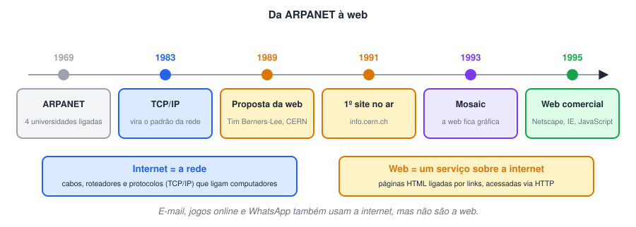
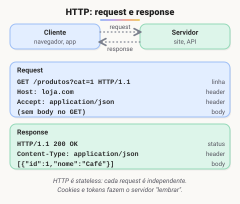
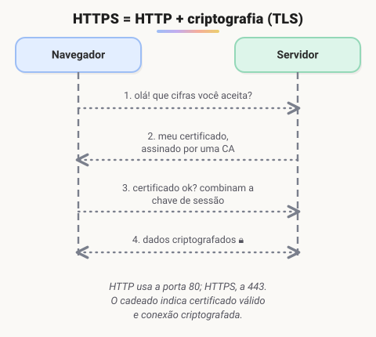
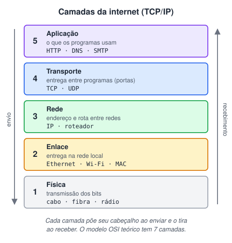
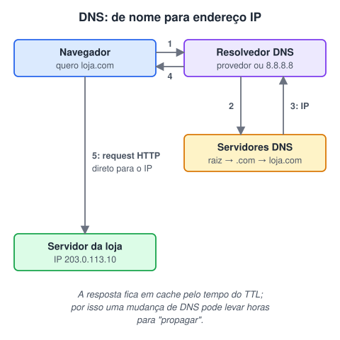
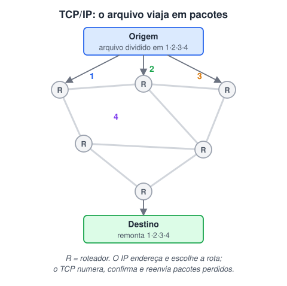
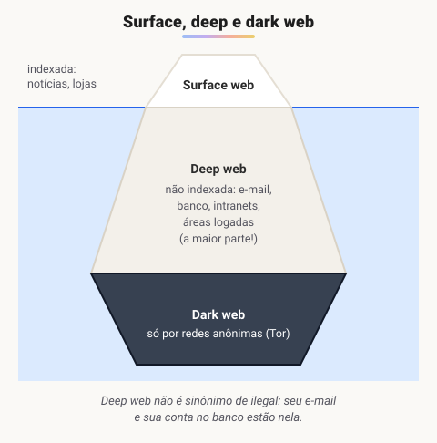
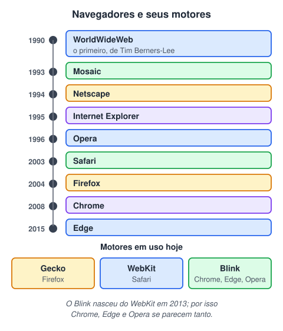

# HTML 1 · Como a web funciona

> 🗺️ **Sobre o módulo:** como a web funciona por baixo dos panos, antes de escrever a primeira tag HTML: a história da internet, o protocolo HTTP, as camadas da rede, o DNS e os navegadores.
>
> **Professor:** Ricardo Lima Gonçalves.

## A história da internet e da web

> 🗺️ **Nesta aula:** como surgiram a internet e a web, a diferença entre as duas e os três pilares criados por Tim Berners-Lee: HTML, HTTP e URL.

### De onde paramos

Até aqui, os programas rodavam em **um computador só**: o TodoApp e o MySQL ficavam na mesma máquina (`localhost`). A partir desta etapa, o programa roda num **servidor** e é usado de qualquer lugar por um **navegador**. Antes de escrever HTML, vale entender o caminho que uma página percorre até chegar à sua tela, começando pela história.

### Internet não é a mesma coisa que web



- **Internet:** a **rede** que liga computadores no mundo todo (cabos, fibras, satélites, roteadores e o protocolo TCP/IP).
- **Web (World Wide Web, WWW):** um **serviço** que roda sobre a internet: páginas em HTML, ligadas por links e acessadas pelo protocolo HTTP.

### ARPANET: a primeira rede

Nos anos 1960, a **ARPA** (agência de pesquisa do Departamento de Defesa dos EUA) financiou uma rede para ligar computadores de universidades e centros de pesquisa. Em **1969** a **ARPANET** conectou os quatro primeiros pontos. A grande inovação foi a **comutação de pacotes**: a mensagem é dividida em pedaços que podem seguir caminhos diferentes, de modo que a rede continua funcionando mesmo se um ponto cair.

### O modem

**Modem** vem de **mo**dulador/**dem**odulador: ele converte o sinal **digital** do computador em sinal **analógico** para viajar pela linha telefônica e faz o caminho inverso na chegada. A internet discada dos anos 1990 funcionava assim (e fazia aquele barulho característico ao conectar).

> 💡 Na **fibra óptica**, o sinal viaja como luz; em casa, quem faz a conversão é a **ONT** (*Optical Network Terminal*), em vez do modem tradicional. O nome "modem" continua sendo usado no dia a dia para o aparelho da operadora.

### Tim Berners-Lee e a criação da web

Em março de **1989**, no **CERN** (laboratório europeu de física, na Suíça), **Tim Berners-Lee** propôs um sistema para os pesquisadores compartilharem documentos usando **hipertexto**: textos com links para outros textos. Entre 1990 e 1991 ele criou os três pilares da web:

| Pilar | O que é |
| --- | --- |
| **HTML** | a linguagem que estrutura as páginas |
| **HTTP** | o protocolo que transporta as páginas entre servidor e navegador |
| **URL** | o endereço único de cada recurso (`https://site.com/pagina`) |

Ele também criou o primeiro navegador e o primeiro servidor web. Em 1993 o CERN liberou a tecnologia para uso público, **sem cobrar royalties**, o que permitiu à web crescer rapidamente.

🔗 [https://pt.wikipedia.org/wiki/Tim_Berners-Lee](https://pt.wikipedia.org/wiki/Tim_Berners-Lee)

### O primeiro site

O primeiro site, de 1991, explicava o próprio projeto da web. Ele foi restaurado e pode ser visitado até hoje:

🔗 [http://info.cern.ch](http://info.cern.ch/)

### Como a web chega até você

Quando você acessa um site, o pedido sai do seu dispositivo, passa pelo roteador de casa, pelo provedor (operadora), por vários roteadores da internet e chega ao **servidor** onde o site está hospedado. A resposta faz o caminho de volta. Nas próximas aulas veremos cada parte: HTTP, DNS, TCP/IP e navegadores.

### 🧠 Revisão rápida

**Qual a diferença entre internet e web?**

A internet é a rede física e lógica que liga computadores. A web é um serviço sobre ela: páginas HTML ligadas por links, acessadas via HTTP.

**Quais são os três pilares da web criados por Tim Berners-Lee?**

HTML (estrutura), HTTP (transporte) e URL (endereço).

**O que faz um modem?**

Converte o sinal digital em analógico (e vice-versa) para trafegar pela linha telefônica.

> ➡️ **Próximo passo:** dos três pilares, o HTTP é o "idioma" da conversa entre navegador e servidor. É ele que a próxima aula detalha: **HTTP e HTTPS: requests, responses, verbos e status**.

### 📌 Resumo

| Item | Em uma frase |
| --- | --- |
| Internet | a rede que liga computadores no mundo |
| Web | serviço sobre a internet: páginas, links e HTTP |
| ARPANET (1969) | a primeira rede; comutação de pacotes |
| Tim Berners-Lee (1989) | criou a web no CERN |
| HTML · HTTP · URL | estrutura · transporte · endereço |

## HTTP e HTTPS: requests, responses, verbos e status

> 🗺️ **Nesta aula:** o protocolo HTTP e sua versão segura, HTTPS: como é um request, como é uma response, os verbos (métodos) e os códigos de status.

### De onde paramos

A aula anterior apresentou os três pilares da web: HTML, HTTP e URL. Agora o foco é o HTTP, a conversa entre navegador e servidor. Ele vai aparecer de novo lá na frente: o Angular **faz** requests HTTP, e a API em Spring Boot **responde** a eles. Repare também que os verbos HTTP correspondem ao CRUD que você já conhece do SQL e do TodoApp.

### HTTP: pedido e resposta

**HTTP** (*HyperText Transfer Protocol*) é o protocolo de comunicação entre **cliente** (o navegador ou um app) e **servidor**. Toda conversa é um par **request → response**.



- É **stateless** (sem estado): cada request é independente, e o servidor não lembra das anteriores. Para "lembrar" quem você é (login, carrinho), usam-se **cookies** e **tokens**.
- O servidor decide quais **recursos** (caminhos, como `/produtos`) existem e quem pode acessá-los.

### HTTPS

**HTTPS** é o HTTP dentro de um canal criptografado pelo protocolo **TLS** (sucessor do antigo SSL).



- **Confidencialidade:** quem interceptar a comunicação não consegue ler o conteúdo.
- **Integridade:** os dados não podem ser alterados no caminho sem que isso seja detectado.
- **Autenticidade:** o **certificado** do servidor, assinado por uma **Autoridade Certificadora (CA)**, garante que o site é quem diz ser.

|  | HTTP | HTTPS |
| --- | --- | --- |
| Porta padrão | 80 | 443 |
| Criptografia | não | sim (TLS) |
| Uso hoje | só em testes locais | obrigatório na prática (navegadores alertam sites sem HTTPS) |

> 💡 O *handshake* deixa a primeira conexão um pouco mais lenta. O **HTTP/2**, que os navegadores só usam junto com HTTPS, compensa isso enviando vários arquivos em paralelo pela mesma conexão.

### Request

Estrutura de um pedido:

1. **linha inicial:** método + caminho + versão (`GET /produtos HTTP/1.1`);
2. **headers:** informações extras (`Host`, `Accept`, `Authorization`, `Cookie`);
3. **body** (opcional): os dados enviados (por exemplo, o JSON de um formulário em um `POST`).

No HTTPS, headers e body vão criptografados.

### Response

Um exemplo completo, em texto puro (é assim que trafega):

```
GET /produtos/7 HTTP/1.1
Host: loja.exemplo.com
Accept: application/json
```

```
HTTP/1.1 200 OK
Content-Type: application/json

{"id": 7, "nome": "Caneca", "preco": 29.9}
```

Estrutura de uma resposta:

1. **linha inicial:** versão + **código de status** (`HTTP/1.1 200 OK`);
2. **headers:** `Content-Type`, `Cache-Control`, `Set-Cookie`...;
3. **body:** o conteúdo (HTML, JSON, imagem, PDF).

Dá para ver tudo isso no navegador: **F12 → aba Network (Rede)** → clique em uma requisição.

### Verbos (métodos) HTTP

| Verbo | Uso | Tem body? | CRUD |
| --- | --- | --- | --- |
| `GET` | consultar um recurso | não | Read |
| `POST` | criar um novo recurso | sim | Create |
| `PUT` | substituir um recurso inteiro | sim | Update |
| `PATCH` | alterar parte de um recurso | sim | Update |
| `DELETE` | remover um recurso | normalmente não | Delete |
| `OPTIONS` | perguntar quais métodos são permitidos (usado no CORS) | não | — |

### Códigos de status

| Faixa | Significado | Exemplos |
| --- | --- | --- |
| **1xx** | informação | 100 Continue |
| **2xx** | sucesso | 200 OK · 201 Created · 204 No Content |
| **3xx** | redirecionamento | 301 Moved Permanently · 302 Found · 304 Not Modified |
| **4xx** | erro do **cliente** | 400 Bad Request · 401 Unauthorized (não autenticado) · 403 Forbidden (sem permissão) · 404 Not Found |
| **5xx** | erro do **servidor** | 500 Internal Server Error · 502 Bad Gateway · 503 Service Unavailable |

Para memorizar com bom humor:

🔗 [https://http.cat/](https://http.cat/)

🔗 [https://httpstatusdogs.com/](https://httpstatusdogs.com/)

### 🧠 Revisão rápida

**O que significa dizer que o HTTP é stateless?**

Que cada request é independente: o servidor não guarda memória das requisições anteriores.

**Qual verbo usar para cadastrar um novo cliente? E para buscar a lista de clientes?**

`POST` para cadastrar; `GET` para buscar.

**Qual a diferença entre os erros 401 e 403?**

401: você não está autenticado (não fez login). 403: você está autenticado, mas não tem permissão para aquele recurso.

**Um erro 500 é culpa de quem?**

Do servidor (faixa 5xx). Erros 4xx indicam problema no pedido do cliente.

> ➡️ **Próximo passo:** o request sai do navegador, mas como ele encontra o servidor certo no meio de bilhões de computadores? É o assunto de **Camadas da internet, DNS, TCP/IP e deep web**.

### 📌 Resumo

| Item | Em uma frase |
| --- | --- |
| HTTP | protocolo request → response entre cliente e servidor |
| Stateless | o servidor não lembra requests anteriores |
| HTTPS | HTTP + TLS: criptografia, integridade e certificado |
| Request | método + caminho + headers + body |
| Response | status + headers + body |
| Verbos | GET, POST, PUT, PATCH, DELETE ≈ CRUD |
| Status | 2xx ok · 3xx redireciona · 4xx cliente · 5xx servidor |

## Camadas da internet, DNS, TCP/IP e deep web

> 🗺️ **Nesta aula:** como a internet se organiza em camadas, como o DNS transforma nomes em endereços, como o TCP/IP entrega os dados em pacotes e o que são deep web e dark web.

### De onde paramos

Na aula de HTTP, o request simplesmente "ia" até o servidor. Mas como ele encontra o servidor certo, a partir só de um nome como `loja.com`? E como chega inteiro, atravessando cabos e roteadores? Esta aula abre a caixa: o HTTP é só a camada de cima de uma pilha de protocolos.

### Camadas

A comunicação pela internet é dividida em **camadas**. Cada uma resolve um problema específico e usa os serviços da camada de baixo, sem precisar saber como ela funciona.



| # | Camada | Responsabilidade | Exemplos |
| --- | --- | --- | --- |
| 5 | **Aplicação** | protocolos que os programas usam | HTTP, HTTPS, DNS, SMTP (e-mail), FTP |
| 4 | **Transporte** | entrega entre **programas** (portas) e confiabilidade | TCP, UDP |
| 3 | **Rede** | **endereço IP** e rota entre redes diferentes | IP (IPv4, IPv6), roteadores |
| 2 | **Enlace** | entrega dentro da rede local | Ethernet, Wi-Fi, endereço MAC, switches |
| 1 | **Física** | transmissão dos bits | cabo de cobre, fibra óptica, ondas de rádio |

O modelo de referência teórico, **OSI**, tem 7 camadas (separa sessão e apresentação da aplicação). O modelo de 5 camadas acima é a forma como a internet (TCP/IP) funciona na prática.

> 💡 Uma analogia com o correio: a **carta** é o conteúdo HTTP; o **envelope com endereço** é o IP; o **serviço de entrega com rastreio e aviso de recebimento** é o TCP; e os **caminhões e estradas** são as camadas física e de enlace. Quem escreve a carta não precisa saber por qual estrada ela vai.

### DNS

Computadores se encontram por **endereços IP** (como `142.250.79.46`), mas pessoas lembram de **nomes** (`google.com`). O **DNS** (*Domain Name System*) é a "agenda telefônica" que faz a tradução.



1. O navegador pergunta ao **resolvedor DNS** (do provedor ou público, como 8.8.8.8) qual é o IP de `loja.com`.
2. Se não souber, o resolvedor consulta os servidores DNS em cadeia: **raiz** → servidor do **.com** → servidor **autoritativo** de `loja.com`.
3. O IP volta para o resolvedor, que o repassa ao navegador.
4. O navegador faz o request HTTP diretamente para esse IP.

> 💡 As respostas ficam em **cache** pelo tempo definido no **TTL** (*time to live*). Isso acelera os próximos acessos, mas explica por que uma mudança de DNS pode demorar horas para "propagar".

### TCP/IP e pacotes



- A informação é dividida em **pacotes** pequenos.
- O **IP** coloca o endereço de origem e de destino em cada pacote, e os **roteadores** escolhem o melhor caminho naquele momento. Pacotes diferentes podem seguir rotas diferentes.
- O **TCP** numera os pacotes, confirma o recebimento e **reenvia** os que se perderam. No destino, os pacotes são **reordenados** e o arquivo é remontado.
- O **UDP** é a alternativa sem confirmação: mais rápido, mas sem garantia de entrega. É usado onde atraso é pior que perda: chamadas de vídeo, jogos online, transmissões ao vivo.

### Deep web e dark web



| Camada | O que é | Exemplos |
| --- | --- | --- |
| **Surface web** | conteúdo indexado por buscadores | sites de notícias, blogs, lojas |
| **Deep web** | conteúdo **não indexado** (exige login ou não é público) | seu e-mail, internet banking, intranets, bancos de dados |
| **Dark web** | parte da deep web acessível só por redes anônimas | sites `.onion` na rede **Tor** |

O **Tor** (*The Onion Router*, "roteamento cebola") envolve cada pacote em várias camadas de criptografia e o faz passar por vários nós. Cada nó só conhece o anterior e o próximo, o que garante anonimato. É usado por jornalistas e ativistas em países com censura, e também para atividades ilegais.

### 🧠 Revisão rápida

**Para que serve o DNS?**

Para traduzir nomes de domínio (`loja.com`) em endereços IP, que é como os computadores se encontram na rede.

**Qual a diferença entre TCP e UDP?**

O TCP confirma a entrega, ordena e reenvia pacotes perdidos (confiável). O UDP não confirma nada, mas é mais rápido (vídeo, jogos).

**Seu internet banking está na surface web ou na deep web?**

Na deep web: exige login e não é indexado por buscadores.

**Em qual camada fica o HTTP? E o IP?**

HTTP na camada de aplicação; IP na camada de rede.

> ➡️ **Próximo passo:** a resposta chega ao seu computador, mas quem a transforma numa página visual é o navegador. É a última peça do caminho: **Navegadores: história e motores de renderização**.

### 📌 Resumo

| Item | Em uma frase |
| --- | --- |
| Camadas | cada uma resolve um problema e usa a de baixo |
| IP | endereço de cada computador; roteadores escolhem o caminho |
| DNS | traduz nomes em IPs; respostas em cache (TTL) |
| TCP | entrega confiável: numera, confirma, reenvia |
| UDP | rápido, sem garantia (vídeo, jogos) |
| Deep web | tudo que não é indexado (e-mail, banco) |
| Dark web | parte da deep web só acessível por redes anônimas (Tor) |

## Navegadores: história e motores de renderização

> 🗺️ **Nesta aula:** a história dos navegadores, as "guerras dos navegadores" e os motores de renderização que existem hoje. Entender isso explica por que um site pode aparecer diferente em navegadores diferentes.

### De onde paramos

Já vimos o request sair (HTTP), achar o servidor (DNS) e viajar em pacotes (TCP/IP). A última peça é o programa que faz o pedido e desenha a resposta: o navegador. No fim desta aula, juntamos tudo num só roteiro.

### O que é um navegador

O navegador (*browser*) é o programa que: faz os requests HTTP; recebe HTML, CSS, JavaScript e imagens; e **desenha** a página na tela. A parte que interpreta HTML e CSS e monta a página é o **motor de renderização** (*engine*); o JavaScript é executado por um **motor de JavaScript** (V8 no Chrome, SpiderMonkey no Firefox).



| Navegador | Ano | Motor | Destaque |
| --- | --- | --- | --- |
| WorldWideWeb (Nexus) | 1990 | — | o primeiro, criado por Tim Berners-Lee no computador NeXT |
| Mosaic | 1993 | — | popularizou a web gráfica (imagens junto do texto) |
| Netscape Navigator | 1994 | (próprio; Gecko a partir da versão 6) | o primeiro comercial; criou o JavaScript |
| Internet Explorer | 1995 | Trident | dominou o mercado por vir junto com o Windows |
| Opera | 1996 | Presto → Blink | inovador; forte nos celulares antigos (Opera Mini) |
| Safari | 2003 | WebKit | navegador da Apple |
| Firefox | 2004 | Gecko | código aberto, extensões, comunidade |
| Chrome | 2008 | WebKit → Blink | líder de mercado hoje |
| Edge | 2015 | EdgeHTML → Blink | substituiu o Internet Explorer |

### Os primeiros navegadores

- **WorldWideWeb**, depois renomeado **Nexus** (1990): criado por Tim Berners-Lee; já era gráfico e também editava páginas, mas só rodava no computador NeXT.
- **Mosaic** (1993): criado no NCSA (Universidade de Illinois) por Marc Andreessen e Eric Bina. Foi o primeiro a mostrar **imagens no meio do texto** e a ser fácil de instalar em Windows e Mac. Popularizou a web.

### Netscape e a primeira guerra dos navegadores

Marc Andreessen saiu do NCSA e fundou a Netscape, lançando o **Netscape Navigator** (1994), o primeiro navegador comercial. A Netscape criou o **JavaScript** (1995) e mostrava a página enquanto ela carregava.

A Microsoft respondeu com o **Internet Explorer** e passou a distribuí-lo **junto com o Windows**. Muitos sites começaram a ser feitos só para o IE, e o Netscape perdeu a "guerra". Foi comprado pela AOL e descontinuado em 2008.

### A fundação Mozilla

Em 1998 a Netscape abriu o código do seu navegador, dando origem ao projeto **Mozilla** (nome que junta **Mo**saic e Go**dzilla**). Em 2003 surgiu a **Mozilla Foundation**, sem fins lucrativos, com a missão de manter a internet aberta e acessível.

🔗 [Use o Firefox, rápido como nunca](https://www.mozilla.org/pt-BR/firefox/new/)

A Mozilla mantém o **MDN**, a principal documentação de HTML, CSS e JavaScript (use sempre como referência):

🔗 [MDN Web Docs](https://developer.mozilla.org/en-US/)

Versão do Firefox voltada a desenvolvedores:

🔗 [https://www.mozilla.org/pt-BR/firefox/developer/](https://www.mozilla.org/pt-BR/firefox/developer/)

### Firefox

O Firefox nasceu como **Phoenix** (2002) e chegou à versão 1.0 em **2004**. Trouxe abas bem implementadas, bloqueio de pop-ups, proteção contra *phishing*, **extensões** e suporte a padrões web, numa época em que o IE estava parado. Seu motor é o **Gecko**.

### Internet Explorer

O IE foi construído a partir do **Spyglass Mosaic**, uma versão licenciada do Mosaic. Por vir embutido no Windows, chegou a ter mais de 90% do mercado, o que gerou processos antitruste contra a Microsoft. Depois de vencer, a Microsoft praticamente parou de evoluí-lo (o IE6 ficou de 2001 a 2006 sem nova versão) e perdeu espaço para Firefox e Chrome. Foi aposentado oficialmente em 2022.

### Microsoft Edge

Lançado em **2015** com o Windows 10, substituiu o IE. Desde **2020** usa o **Chromium** (base de código aberto do Chrome), o que melhorou muito a compatibilidade. Existe para Windows, macOS, Linux, Android e iOS.

### Opera

Surgiu em meados dos anos 1990, na Noruega, e no início era pago. Foi pioneiro em vários recursos (abas, discagem rápida) e fez sucesso nos celulares antigos com o **Opera Mini**. Hoje usa o motor Blink. Há também o **Opera GX**, voltado a gamers.

### Safari

O navegador da Apple, lançado em **2003**, usa o motor **WebKit**, criado pela Apple a partir do KHTML (do projeto KDE). No iPhone e no iPad, **todos** os navegadores historicamente tiveram que usar o WebKit, por regra da Apple.

### Google Chrome

Lançado em **2008**, com foco em velocidade (o motor de JavaScript **V8**), estabilidade (cada aba em um processo separado) e uma interface minimalista. O Chrome é baseado no projeto de código aberto **Chromium**. Começou com o WebKit e, em **2013**, criou o próprio motor, o **Blink**. Hoje é o navegador mais usado do mundo, o que lhe dá grande influência sobre os padrões da web.

> 💡 **Por que isso importa para quem desenvolve?** Hoje quase todos os navegadores usam Blink, WebKit ou Gecko e seguem os padrões do W3C e do WHATWG. Mesmo assim, **teste seu site em pelo menos dois navegadores** e consulte o site `caniuse.com` para saber se um recurso novo de CSS ou JavaScript já funciona em todos.

### Juntando tudo: o que acontece quando você digita uma URL

O roteiro do módulo inteiro, ao acessar `https://loja.com/produtos`:

1. **DNS:** o navegador descobre o IP de `loja.com` (cache ou consulta em cadeia).
2. **TCP:** abre uma conexão com esse IP na porta 443.
3. **TLS:** faz o *handshake*, confere o certificado e combina a criptografia.
4. **HTTP:** envia `GET /produtos`; o servidor responde `200 OK` com o HTML.
5. **Pacotes:** a resposta viaja em pacotes TCP/IP e é remontada.
6. **Renderização:** o motor lê o HTML, encontra CSS, JavaScript e imagens e faz um novo request para cada um.
7. Com tudo carregado, o motor monta a página e a desenha na tela; o JavaScript a deixa interativa.

> 💡 Veja isso acontecendo: abra qualquer site com **F12 → Network** e recarregue. Cada linha é um request do passo 6, com método, status e tempo.

### 🧠 Revisão rápida

**O que é um motor de renderização?**

A parte do navegador que interpreta HTML e CSS e desenha a página na tela (Blink, WebKit, Gecko).

**Por que o Internet Explorer venceu a primeira guerra dos navegadores?**

Porque vinha instalado junto com o Windows, e muitos sites passaram a ser feitos só para ele.

**Qual a relação entre Chrome, Chromium e Blink?**

Chromium é o projeto de código aberto; o Chrome é o navegador do Google construído sobre ele; Blink é o motor de renderização que eles usam (e também Edge e Opera).

**Qual site consultar para saber se um recurso funciona em todos os navegadores?**

`caniuse.com`. A documentação de referência é o MDN.

**Depois de receber o HTML, por que o navegador faz mais requests?**

Porque o HTML aponta para outros arquivos (CSS, JavaScript, imagens, fontes), e cada um é buscado com um request próprio.

> ➡️ **Próximo passo:** você viu o lado do navegador. E do outro lado, o que é e onde fica esse "servidor" que responde? É o tema do módulo **HTML 2 · Hospedagem, servidores e containers**.

### 📌 Resumo

| Item | Em uma frase |
| --- | --- |
| Navegador | faz requests e desenha a resposta |
| Motor de renderização | interpreta HTML e CSS (Blink, WebKit, Gecko) |
| Motor de JavaScript | executa o JS (V8, SpiderMonkey) |
| Guerras dos navegadores | IE venceu o Netscape; Firefox e Chrome venceram o IE |
| Chromium | base aberta do Chrome, Edge e Opera |
| Digitar uma URL | DNS → TCP → TLS → HTTP → renderização |

## 📌 Resumo do módulo

| Conceito | Lembrete |
| --- | --- |
| Internet × web | a rede × um serviço sobre ela (páginas + HTTP) |
| HTML · HTTP · URL | estrutura · transporte · endereço |
| Request / response | método + caminho + headers + body / status + headers + body |
| GET · POST · PUT · PATCH · DELETE | ler · criar · substituir · alterar parte · remover |
| 2xx · 3xx · 4xx · 5xx | sucesso · redirecionamento · erro do cliente · erro do servidor |
| HTTPS | HTTP + TLS; porta 443; certificado validado por uma CA |
| DNS | nome → IP; respostas em cache (TTL) |
| TCP × UDP | entrega garantida × rapidez sem garantia |
| Motores | Blink (Chrome, Edge, Opera) · WebKit (Safari) · Gecko (Firefox) |
