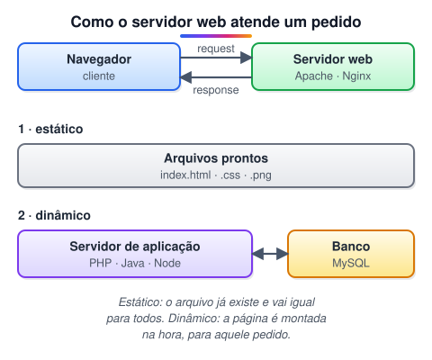
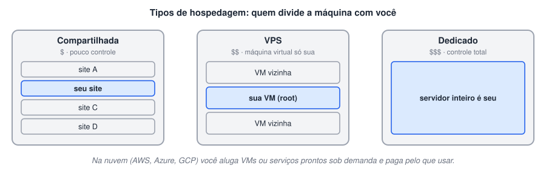
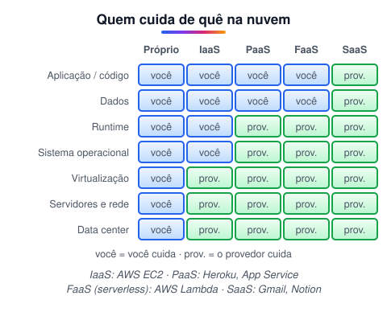
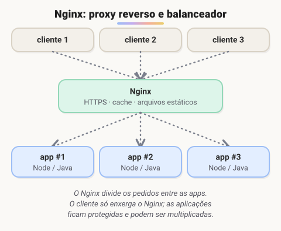
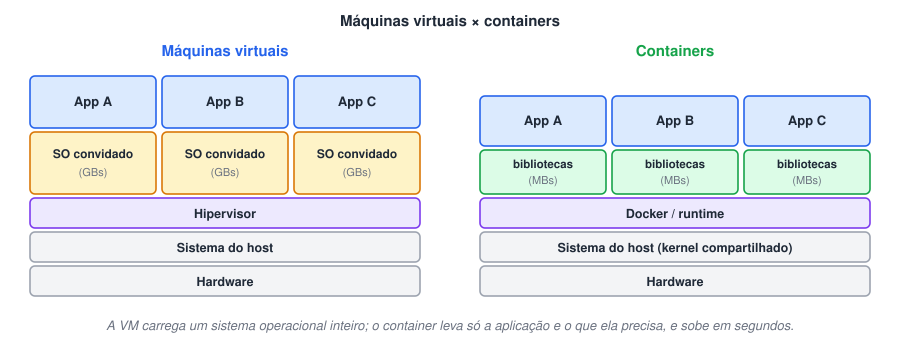

# HTML 2 · Hospedagem, servidores e containers

> 🗺️ **Sobre o módulo:** onde os sites "moram". Servidores, tipos de hospedagem, softwares de servidor web, containers e serverless, e como publicar um site de verdade.
>
> **Professor:** Ricardo Lima Gonçalves · **Ordem sugerida:** de cima para baixo.

## Servidores: o que são e como atendem um pedido

> 🗺️ **Nesta aula:** o que é um servidor, a diferença entre conteúdo estático e dinâmico e o caminho de um pedido até virar página.

### De onde paramos

No módulo anterior, o request saiu do navegador e chegou a "um servidor". Você até já usou um: o MySQL do XAMPP é um servidor de banco de dados, rodando no seu próprio computador e esperando pedidos do TodoApp. Agora vamos olhar o lado de lá de uma requisição web.

### O que pode ser um servidor

**Servidor é um papel, e não um tipo de máquina:** qualquer computador conectado à rede que fica esperando pedidos e os responde é um servidor. Pode ser o seu notebook rodando o Live Server ou um supercomputador num data center.

- Para ser encontrado por **nome** (`minhaloja.com.br`), o endereço IP do servidor precisa estar ligado a um **domínio** no **DNS**.
- Manter um servidor próprio exige máquina ligada 24 horas, boa conexão, energia de reserva, segurança e atualização. Por isso quase todo mundo usa **hospedagem** em data centers ou na nuvem.

### Conteúdo estático × dinâmico

|  | Estático | Dinâmico |
| --- | --- | --- |
| Como é | arquivo **já pronto** no servidor, igual para todos | **gerado na hora** por um programa, conforme o pedido |
| Exemplos | HTML, CSS, JavaScript do front, imagens, vídeos | feed de rede social, extrato bancário, carrinho de compras |
| Quem entrega | o servidor web, direto do disco | o servidor web, que repassa para um **servidor de aplicação** (PHP, Java, Node, Python) |
| Custo e velocidade | muito barato e rápido; fácil de colocar em cache | exige processamento e, em geral, banco de dados |

> 💡 Um site feito só com HTML, CSS e JavaScript (como os projetos deste curso) é **estático**, mesmo que tenha animações e interatividade: o servidor apenas entrega os arquivos, e quem executa o JavaScript é o navegador. Ele vira **dinâmico** quando o servidor monta a resposta de forma diferente para cada pedido.

### Como o servidor web atende um pedido



1. O navegador envia um **request** HTTP (por exemplo, `GET /produtos`).
2. O **servidor web** (Apache, Nginx) recebe e decide o caminho:
  - **estático:** procura o arquivo (`index.html`, `logo.png`) no disco e o devolve;
  - **dinâmico:** repassa o pedido ao **servidor de aplicação**, que executa o código, consulta o **banco de dados** e devolve o conteúdo gerado (HTML ou JSON).
3. O servidor web envia a **response** ao navegador, com status, cabeçalhos e corpo.

> 💡 No fim do curso, você vai construir as duas pontas: o front-end em Angular é **estático** (arquivos entregues ao navegador), e a API em Spring Boot é um **servidor de aplicação** que consulta o banco e responde em JSON.

### 🧠 Revisão rápida

**Um notebook pode ser um servidor?**

Sim. Servidor é um papel: qualquer computador que espera e responde pedidos na rede.

**O extrato do seu banco é conteúdo estático ou dinâmico?**

Dinâmico: é montado na hora, com os seus dados, por um programa que consulta o banco de dados.

> ➡️ **Próximo passo:** manter um servidor ligado 24 horas em casa não é prático. As alternativas são os **Tipos de hospedagem e modelos de nuvem**.

### 📌 Resumo

| Item | Em uma frase |
| --- | --- |
| Servidor | qualquer computador que responde a pedidos na rede |
| Estático | arquivo pronto, igual para todos |
| Dinâmico | montado na hora por um programa |
| Servidor web | cuida do HTTP e dos arquivos |
| Servidor de aplicação | executa a lógica e consulta o banco |

## Tipos de hospedagem e modelos de nuvem

> 🗺️ **Nesta aula:** os tipos de hospedagem e os modelos de nuvem, para saber escolher onde publicar um projeto.

### De onde paramos

A aula anterior mostrou que qualquer computador pode ser servidor, mas que manter um em casa exige energia, conexão e segurança 24 horas. Na prática, aluga-se um pedacinho de um data center. A questão é: qual pedaço, e quanto do trabalho fica com você?

### Tipos de hospedagem



| Tipo | Como é | Custo | Controle | Bom para |
| --- | --- | --- | --- | --- |
| **Compartilhada** | vários sites na mesma máquina, já configurada pelo provedor | $ | baixo: painel pronto (cPanel), sem acesso root | sites pequenos, blogs, WordPress |
| **VPS** (servidor virtual privado) | uma máquina virtual só sua, dentro de um servidor físico | $$ | alto: você instala e configura tudo | aplicações próprias, APIs |
| **Dedicado** (bare metal) | uma máquina física inteira para você | $$$ | total | grande tráfego, exigências de segurança e desempenho |

Na compartilhada, um vizinho com muito acesso pode deixar o seu site lento. Na VPS e no dedicado, você ganha controle, mas também passa a ser responsável por atualizações e segurança.

### Nuvem: pagar pelo que usar

Provedores como **AWS**, **Microsoft Azure** e **Google Cloud** alugam recursos sob demanda: você cria uma máquina em minutos, aumenta quando o tráfego cresce e paga por hora ou por uso. Os serviços são classificados pelo quanto o provedor faz por você:



| Modelo | Você entrega | Exemplo |
| --- | --- | --- |
| **IaaS** (infraestrutura como serviço) | instala o sistema, o runtime e a aplicação numa máquina virtual | AWS EC2, Azure Virtual Machines |
| **PaaS** (plataforma como serviço) | só o código; o provedor cuida do sistema e do runtime | Heroku, Azure App Service, Render |
| **Serverless / FaaS** (funções como serviço) | só funções, executadas sob demanda e cobradas por execução | AWS Lambda, Azure Functions |
| **SaaS** (software como serviço) | nada: você só usa o programa pronto | Gmail, Notion, Microsoft 365 |

> 💡 Uma analogia com moradia: hospedagem compartilhada é dividir um apartamento; VPS é alugar um apartamento só seu no prédio; dedicado é alugar a casa inteira. Na nuvem, IaaS é alugar o imóvel vazio, PaaS é o apartamento mobiliado, e SaaS é o hotel: você só usa.

> 💡 Para **sites estáticos** (HTML, CSS e JavaScript), existem serviços gratuitos como **GitHub Pages**, **Netlify** e **Vercel**. Veja a página "Publicando um site: domínio, DNS e deploy".

### 🧠 Revisão rápida

**Você quer publicar uma API Java sem se preocupar com sistema operacional. IaaS ou PaaS?**

PaaS: você entrega o código e o provedor cuida do sistema e do runtime.

**O Gmail é IaaS, PaaS ou SaaS?**

SaaS: um programa pronto que você só usa.

> ➡️ **Próximo passo:** dentro de qualquer hospedagem roda um programa que recebe o HTTP. Os mais usados estão em **Softwares de servidor web: Apache, Nginx, IIS, LiteSpeed e Node.js**.

### 📌 Resumo

| Item | Em uma frase |
| --- | --- |
| Compartilhada | barata, divide a máquina, pouco controle |
| VPS | máquina virtual só sua |
| Dedicado | máquina física inteira |
| IaaS | você cuida do sistema para cima |
| PaaS | você entrega só o código |
| Serverless | funções cobradas por execução |
| SaaS | programa pronto |

## Softwares de servidor web: Apache, Nginx, IIS, LiteSpeed e Node.js

> 🗺️ **Nesta aula:** os principais softwares de servidor web, para que serve cada um e o que é um proxy reverso.

### De onde paramos

Já sabemos que o servidor web recebe o HTTP e entrega arquivos ou repassa à aplicação, e que ele roda numa hospedagem. Agora, os programas que fazem esse papel. Você já usou um: o **Apache** que você liga no painel do XAMPP, ao lado do MySQL.

### Visão geral

| Servidor | Destaque | Ponto de atenção |
| --- | --- | --- |
| **Apache HTTP Server** | open source, muito documentado, configuração por pasta (`.htaccess`); parceiro clássico do PHP | em configurações antigas (MPM *prefork*), cada conexão ocupa um processo e gasta mais memória sob muito acesso |
| **Nginx** | assíncrono e orientado a eventos: muitas conexões com poucos processos; ótimo como proxy reverso, balanceador e cache | configuração menos intuitiva; não executa PHP sozinho (usa PHP-FPM) |
| **IIS** | servidor da Microsoft, integrado ao Windows e ao ASP.NET | roda só em Windows; hospedagem costuma ser mais cara |
| **LiteSpeed** | rápido e compatível com a configuração do Apache; popular em hospedagens de WordPress | a versão completa (Enterprise) é paga; existe a OpenLiteSpeed gratuita |
| **Node.js** | *runtime* que executa JavaScript no servidor; com Express, atende HTTP diretamente | é um servidor de **aplicação**; em produção costuma ficar atrás de um Nginx |

### Apache HTTP Server

🔗 [Welcome! - The Apache HTTP Server Project](https://httpd.apache.org/)

- Lançado em **1995**, a partir do servidor da NCSA. Dominou a web nos anos 1990 e 2000 e ainda é um dos mais usados.
- Forma, com Linux, MySQL e PHP, a pilha **LAMP**, base de inúmeros sites (inclusive o WordPress).
- Funciona com **módulos** (`mod_rewrite`, `mod_ssl`...) e o modo de processamento é escolhido pelo **MPM**: `prefork` (um processo por conexão), `worker` ou `event` (threads, mais leves).

### Nginx

🔗 [nginx](https://nginx.org/en/)

- Criado por Igor Sysoev e lançado em **2004** para resolver o "problema C10k": atender dez mil conexões simultâneas.
- Hoje é o servidor mais usado na web, muitas vezes na frente de outras aplicações.

#### Proxy reverso e balanceamento de carga



Um **proxy reverso** fica na frente dos servidores de aplicação. O usuário fala só com ele, e ele:

- **distribui** os pedidos entre várias cópias da aplicação (balanceamento de carga);
- cuida do **HTTPS** (certificados) num lugar só;
- serve **arquivos estáticos** e guarda respostas em **cache**;
- esconde e protege as aplicações internas.

```
server {
  listen 80;
  server_name minhaloja.com.br;

  # arquivos estáticos
  location / {
    root /var/www/site;
    try_files $uri /index.html;
  }

  # repassa para a aplicação Node
  location /api/ {
    proxy_pass http://localhost:3000;
  }
}
```

Lendo: pedidos para `/api/...` vão para a aplicação na porta 3000; todo o resto é arquivo estático da pasta `/var/www/site`.

### IIS (Internet Information Services)

🔗 [https://www.iis.net/](https://www.iis.net/)

- Servidor web da Microsoft, que acompanha o Windows. É a escolha natural para aplicações **ASP.NET** e ambientes corporativos Windows.
- Hoje o .NET moderno também roda em Linux, atrás de Nginx, o que reduziu a dependência do IIS.

### LiteSpeed

🔗 [LiteSpeed Web Server](https://www.litespeedtech.com/products/litespeed-web-server)

- Focado em desempenho e capaz de ler a configuração do Apache (`.htaccess`), o que facilita a migração.
- Muito usado em hospedagens compartilhadas de WordPress, junto com o plugin de cache LSCache.

### Node.js como servidor de aplicação

🔗 [Node.js](https://nodejs.org/)

- O Node não é um servidor web "puro": é um **ambiente de execução** de JavaScript fora do navegador, baseado no motor **V8** do Chrome.
- Com o framework **Express**, você cria rotas e responde requisições HTTP em poucas linhas:

```jsx
import express from "express";
const app = express();

// GET /api/ola responde um JSON
app.get("/api/ola", (req, res) =>
  res.json({ mensagem: "Olá!" }));

app.listen(3000);
```

- Em produção, costuma rodar atrás de um **Nginx**, que cuida do HTTPS, dos arquivos estáticos e da distribuição de carga.

> 💡 No mundo Java, o papel do Node é feito por servidores como o **Tomcat**. O Spring Boot, no fim do curso, já traz um Tomcat embutido: você roda o programa e ele passa a atender HTTP na porta 8080.

### 🧠 Revisão rápida

**O que faz um proxy reverso?**

Fica na frente das aplicações, recebe todos os pedidos e os distribui, além de cuidar do HTTPS, de arquivos estáticos e de cache.

**Por que o Nginx atende muitas conexões com poucos recursos?**

Porque é assíncrono e orientado a eventos: poucos processos cuidam de muitas conexões ao mesmo tempo.

> ➡️ **Próximo passo:** instalar e configurar esses programas em cada máquina dá trabalho, e "na minha máquina funciona" vira um problema. A solução moderna está em **Máquinas virtuais, containers e serverless**.

### 📌 Resumo

| Item | Em uma frase |
| --- | --- |
| Apache | flexível e tradicional; pilha LAMP |
| Nginx | alto desempenho; proxy reverso |
| IIS | servidor do mundo Microsoft |
| LiteSpeed | rápido e compatível com o Apache |
| Node.js | executa JavaScript no servidor |
| Proxy reverso | porta de entrada que distribui os pedidos |

## Máquinas virtuais, containers e serverless

> 🗺️ **Nesta aula:** a diferença entre máquina virtual e container e o que significa "serverless".

### De onde paramos

Para rodar o TodoApp em outro computador, foi preciso instalar o JDK certo, o XAMPP, criar o banco e ajustar a senha na `ConnectionFactory`. Agora imagine fazer isso em 50 servidores. As aulas anteriores mostraram onde e com quais programas um site roda; esta mostra como levar a aplicação **junto com o ambiente**.

### O problema: "na minha máquina funciona"

Uma aplicação depende de muita coisa além do código: versão do Java ou do Node, bibliotecas, variáveis de ambiente, configurações do sistema. Quando o ambiente do servidor é diferente do seu, ela quebra. **Máquinas virtuais e containers empacotam a aplicação junto com o ambiente**, para que ela rode igual em qualquer lugar.

### Máquinas virtuais × containers



|  | Máquina virtual (VM) | Container |
| --- | --- | --- |
| O que virtualiza | o **hardware**: cada VM tem um sistema operacional completo | o **sistema operacional**: só a aplicação e suas bibliotecas, compartilhando o kernel do host |
| Quem gerencia | um **hipervisor** (VirtualBox, VMware, Hyper-V, KVM) | um **runtime** de containers (Docker, containerd) |
| Tamanho | gigabytes | megabytes |
| Tempo para iniciar | minutos | segundos ou menos |
| Isolamento | mais forte | bom, mas compartilha o kernel |
| Uso típico | rodar outro sistema (Linux dentro do Windows), servidores na nuvem | empacotar e escalar aplicações, ambientes de desenvolvimento |

#### Docker e Kubernetes

- **Docker** é a ferramenta mais popular para criar e rodar containers. A receita do container fica num arquivo `Dockerfile`, e o resultado é uma **imagem** que roda igual no seu computador e no servidor. Veja a página "Docker na prática".
- **Kubernetes** é um **orquestrador**: gerencia centenas de containers em várias máquinas, sobe cópias quando o tráfego aumenta e reinicia o que cair.

### Serverless

**Serverless ("sem servidor") não significa que não existe servidor**, e sim que você não precisa pensar nele. Você envia só o **código de uma função**, e o provedor:

- executa a função quando chega um evento (um request HTTP, um arquivo enviado, um horário agendado);
- cria quantas cópias forem necessárias e desliga tudo quando não há uso;
- cobra **por execução** e pelo tempo de processamento.

Exemplos: **AWS Lambda**, **Azure Functions**, **Google Cloud Functions**.

| Vantagens | Desvantagens |
| --- | --- |
| não há servidor para manter | *cold start*: a primeira execução depois de um tempo parada é mais lenta |
| escala automaticamente | tempo máximo de execução por chamada |
| custo zero quando ninguém usa | mais difícil de testar localmente e de migrar de provedor |

### A evolução da hospedagem

**Servidor próprio → IaaS → PaaS → serverless:** a cada passo, você cuida de menos infraestrutura e foca mais no código. A tabela completa de "quem cuida de quê" está na página "Tipos de hospedagem e modelos de nuvem".

> 💡 Uma analogia: a VM é uma **casa** inteira (fundação, encanamento, tudo próprio); o container é um **apartamento**, que tem a sua porta e os seus móveis, mas divide a estrutura do prédio (o kernel). Por isso o apartamento é mais barato e fica pronto mais rápido.

### 🧠 Revisão rápida

**Por que um container inicia muito mais rápido que uma VM?**

Porque não precisa ligar um sistema operacional inteiro: usa o kernel do sistema hospedeiro e carrega só a aplicação e suas bibliotecas.

**"Serverless" quer dizer que não há servidor?**

Não. Há servidores, mas o provedor cuida deles; você entrega só as funções e paga por execução.

> ➡️ **Próximo passo:** a teoria de containers fica clara quando você roda um. Isso é a **Docker na prática**.

### 📌 Resumo

| Item | Em uma frase |
| --- | --- |
| VM | sistema operacional completo; pesada e bem isolada |
| Container | só a aplicação e bibliotecas; leve e rápido |
| Docker | cria e roda containers |
| Kubernetes | orquestra muitos containers |
| Serverless | funções sob demanda, cobradas por uso |

## Docker na prática

> 🗺️ **Nesta aula:** imagens, containers e registries; os comandos essenciais; um MySQL num comando; o `Dockerfile` e o Docker Compose.

### De onde paramos

A aula anterior explicou o que é um container. Agora, mão na massa. Repare na analogia da primeira tabela: imagem e container são como **classe e objeto** do módulo de Java, um molde e as instâncias criadas a partir dele.

### Os três conceitos

| Conceito | Analogia | O que é |
| --- | --- | --- |
| **Imagem** | a receita, ou uma classe | pacote somente leitura com o sistema mínimo, as dependências e a aplicação |
| **Container** | o bolo pronto, ou um objeto | uma imagem em execução; dá para rodar vários a partir da mesma imagem |
| **Registry** | a loja de receitas | repositório de imagens; o público principal é o **Docker Hub** |

### Instalação

No Windows e no macOS, instale o **Docker Desktop** (no Windows, ele usa o WSL 2). No Linux, instale o Docker Engine. Teste:

```bash
docker --version
docker run hello-world
```

### Comandos essenciais

```bash
# baixa a imagem
docker pull nginx

# roda em segundo plano (-d);
# porta 8080 do PC -> 80 do container
docker run -d -p 8080:80 --name web nginx

# containers rodando (-a mostra os parados)
docker ps

# acompanha os logs
docker logs -f web

# abre um terminal dentro do container
docker exec -it web sh

# para e remove
docker stop web && docker rm web

# imagens baixadas
docker images
```

Abra `http://localhost:8080` e você verá a página padrão do Nginx, rodando sem ter instalado o Nginx no seu sistema.

### Um banco de dados em um comando

Lembra de instalar o XAMPP para ter um MySQL? Com Docker, basta isto:

```bash
docker run -d --name mysql \
  -e MYSQL_ROOT_PASSWORD=senha123 \
  -e MYSQL_DATABASE=loja \
  -p 3306:3306 \
  -v dados-mysql:/var/lib/mysql \
  mysql:8
```

- `-e` define **variáveis de ambiente** (configuração).
- `-v` cria um **volume**: os dados ficam guardados fora do container e sobrevivem quando ele é removido. Sem volume, apagar o container apaga o banco.

### Criando a sua imagem: `Dockerfile`

Exemplo para servir um site estático com Nginx:

```docker
FROM nginx:alpine
COPY ./site /usr/share/nginx/html
EXPOSE 80
```

Exemplo para uma API Node:

```docker
FROM node:20-alpine
WORKDIR /app
COPY package*.json ./
RUN npm ci --omit=dev
COPY . .
EXPOSE 3000
CMD ["node", "server.js"]
```

```bash
docker build -t minha-api .
docker run -d -p 3000:3000 minha-api
```

Copiar o `package.json` e instalar as dependências **antes** de copiar o resto aproveita o **cache de camadas**: se só o código mudar, o `npm ci` não roda de novo. Crie também um `.dockerignore` com `node_modules` e `.git`.

### Vários containers juntos: Docker Compose

```yaml
# compose.yaml
services:
  api:
    build: .
    ports: ["3000:3000"]
    environment:
      DB_HOST: db
    depends_on: [db]
  db:
    image: mysql:8
    environment:
      MYSQL_ROOT_PASSWORD: senha123
      MYSQL_DATABASE: loja
    volumes: ["dados:/var/lib/mysql"]
volumes:
  dados:
```

```bash
# sobe tudo
docker compose up -d

# derruba tudo (os volumes continuam)
docker compose down
```

Dentro do Compose, os containers se encontram **pelo nome do serviço**: a API acessa o banco em `db:3306`, e não em `localhost`.

> ⚠️ As senhas nestes exemplos (`senha123`) são só para estudo local. Em projetos reais, elas ficam num arquivo `.env` fora do Git, como visto na aula de Git e GitHub.

### 🧠 Revisão rápida

**O que acontece com os dados do MySQL se você remover o container sem volume?**

São perdidos. O volume (`-v`) guarda os dados fora do container.

**Em `-p 8080:80`, qual porta é do seu computador?**

A primeira (8080). A segunda (80) é a porta dentro do container.

> ➡️ **Próximo passo:** para fechar o módulo, o caminho completo para colocar um site no ar com endereço próprio: **Publicando um site: domínio, DNS e deploy**.

### 📌 Resumo

| Item | Em uma frase |
| --- | --- |
| Imagem | a receita (como uma classe) |
| Container | a imagem rodando (como um objeto) |
| Docker Hub | registry público de imagens |
| `-p` · `-v` · `-e` | porta · volume · variável de ambiente |
| `Dockerfile` | receita para criar a sua imagem |
| Docker Compose | sobe vários containers juntos |

## Publicando um site: domínio, DNS e deploy

> 🗺️ **Nesta aula:** hospedagem gratuita para sites estáticos, domínio próprio, registros DNS, HTTPS e um checklist antes de publicar.

### De onde paramos

Este módulo passou por servidores, hospedagem, softwares de servidor e containers. Esta aula junta tudo com o módulo anterior (DNS) e com o Git: o seu repositório no GitHub pode virar um site no ar, com um `git push`.

### O caminho até o site estar no ar

1. **Arquivos do site** prontos (HTML, CSS, JavaScript, imagens).
2. **Hospedagem**: um lugar que entregue esses arquivos na internet.
3. **Domínio** (opcional): um nome fácil, como `meunome.dev`, apontando para a hospedagem via **DNS**.
4. **HTTPS**: certificado para o cadeado no navegador. Hoje é gratuito e automático na maioria das plataformas.

### Hospedagem gratuita para sites estáticos

| Serviço | Como publica | Endereço grátis |
| --- | --- | --- |
| **GitHub Pages** | ativa nas configurações do repositório | `usuario.github.io/projeto` |
| **Netlify** | arrasta a pasta para o site ou conecta ao GitHub | `nome.netlify.app` |
| **Vercel** | conecta ao GitHub; ótimo para React e Next.js | `nome.vercel.app` |

#### Exemplo com GitHub Pages

1. Crie um repositório e envie os arquivos, com o `index.html` na raiz.
2. No GitHub: **Settings → Pages → Source: Deploy from a branch →** `main` **/** `root` → Save.
3. Em um ou dois minutos o site estará em `https://usuario.github.io/repositorio/`.
4. A cada `git push`, o site é atualizado automaticamente.

Com Netlify ou Vercel ligados ao GitHub acontece o mesmo: cada push gera um novo **deploy**. Isso é uma forma simples de **CI/CD** (integração e entrega contínuas).

### Domínio próprio

- **Registro:** domínios `.br` são registrados no **Registro.br**; os `.com`, `.dev` e outros, em registradores como Cloudflare, Namecheap ou GoDaddy. Paga-se uma taxa anual.
- **Apontamento:** no painel de DNS do domínio, você cria registros que apontam para a hospedagem.

| Registro | Faz | Exemplo |
| --- | --- | --- |
| `A` | nome → endereço IPv4 | `meusite.com.br → 185.199.108.153` |
| `AAAA` | nome → endereço IPv6 |  |
| `CNAME` | nome → outro nome | `www.meusite.com.br → usuario.github.io` |
| `MX` | para onde vão os e-mails do domínio | servidor do Google Workspace |
| `TXT` | textos de verificação e segurança | provar que o domínio é seu |

Depois de configurar o DNS, cadastre o domínio na plataforma de hospedagem. Mudanças de DNS podem levar de minutos a algumas horas para valer em todo lugar, por causa do cache (**TTL**).

### HTTPS

GitHub Pages, Netlify e Vercel emitem o certificado sozinhos (via **Let's Encrypt**). Em uma VPS própria, a ferramenta **Certbot** faz isso:

```bash
sudo certbot --nginx -d meusite.com.br -d www.meusite.com.br
```

### E quando o site tem back-end?

Páginas estáticas não executam código no servidor. Para uma API em Java, Node ou PHP com banco de dados, use uma plataforma **PaaS** (Render, Railway, Heroku, Azure App Service) ou uma **VPS** com Nginx na frente da aplicação.

### Checklist antes de publicar

- Links e caminhos relativos funcionando (`./css/style.css`, e não `C:\Users\...`).
- Nomes de arquivos sem espaços nem acentos, com maiúsculas e minúsculas iguais às usadas nos links (servidores Linux diferenciam `Logo.png` de `logo.png`).
- Imagens otimizadas (WebP, tamanho adequado).
- `<title>` e `<meta name="description">` preenchidos.
- Nada de senhas ou chaves de API nos arquivos publicados.

### 🧠 Revisão rápida

**Qual registro DNS usar para apontar `www.meusite.com.br` para `usuario.github.io`?**

`CNAME`, porque aponta um nome para outro nome.

**Por que o GitHub Pages não serve para uma API em Java?**

Porque só entrega arquivos estáticos; não executa código no servidor. Uma API precisa de PaaS ou VPS.

> ➡️ **Próximo passo:** você já sabe como a web funciona e como publicar um site. Falta escrever o site! O próximo módulo começa o HTML de verdade: **HTML 3 · Fundamentos do HTML**.

### 📌 Resumo

| Item | Em uma frase |
| --- | --- |
| Site estático | GitHub Pages, Netlify ou Vercel, grátis e com HTTPS |
| Deploy contínuo | cada `git push` publica de novo |
| Domínio | registrado por ano; apontado no DNS |
| `A` · `CNAME` | nome → IP · nome → outro nome |
| HTTPS | Let's Encrypt, automático nas plataformas |
| Back-end | PaaS ou VPS |

## 📌 Resumo do módulo

| Conceito | Lembrete |
| --- | --- |
| Servidor | qualquer computador que responde a pedidos na rede |
| Estático × dinâmico | arquivo pronto × página montada na hora por um programa |
| Servidor web × de aplicação | cuida do HTTP e dos arquivos × executa a lógica (PHP, Java, Node) |
| Compartilhada · VPS · dedicado | divide a máquina · VM só sua · máquina inteira |
| IaaS · PaaS · serverless · SaaS | você cuida de cada vez menos coisas |
| Apache · Nginx | tradicional e flexível · alto desempenho e proxy reverso |
| Proxy reverso | fica na frente das aplicações: HTTPS, cache e balanceamento |
| VM × container | SO completo (GBs) × só app e bibliotecas, compartilha o kernel (MBs) |
| Imagem · container · volume | receita · receita rodando · dados que sobrevivem ao container |
| Registro DNS `A` · `CNAME` | nome → IP · nome → outro nome |
