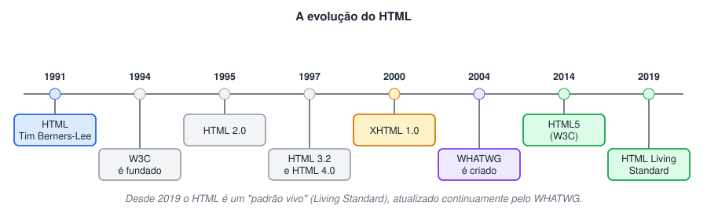
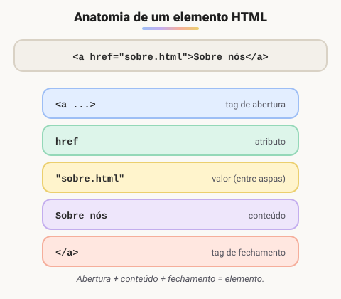
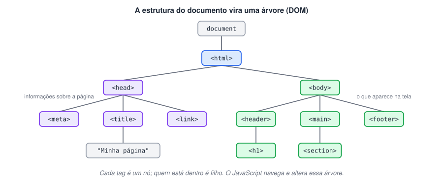
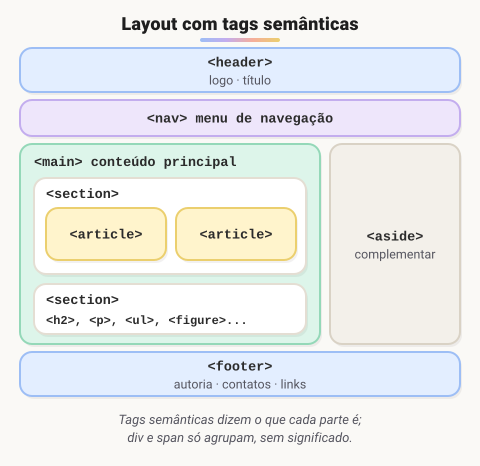
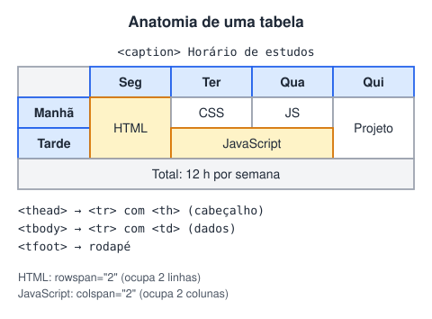
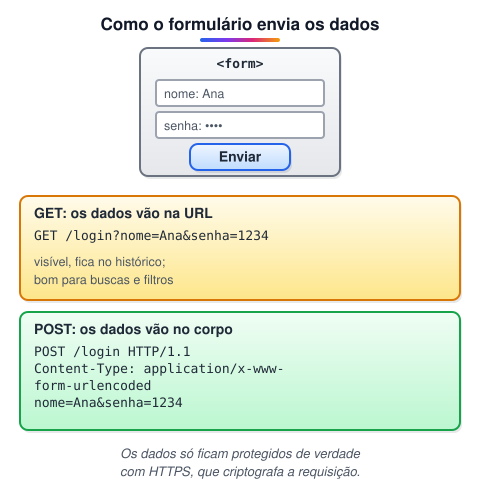

# HTML 3 · Fundamentos do HTML

> 🗺️ **Sobre o módulo:** o HTML de verdade: estrutura do documento, tags semânticas, textos, links, listas, tabelas, imagens, mídia e formulários. Ao longo das aulas, um **currículo** é construído aos poucos (projeto teste).
>
> **Professor:** Ricardo Lima Gonçalves · **Ferramentas:** VS Code e a extensão Live Server.

## O que é o HTML e como ele surgiu

> 🗺️ **Nesta aula:** o que é o HTML, quem o criou e como ele chegou ao HTML5 de hoje.

### De onde paramos

Os módulos HTML 1 e 2 explicaram o caminho de uma página: o navegador pede, o servidor entrega um arquivo HTML e o motor de renderização o desenha. Agora vamos olhar para dentro desse arquivo. Uma diferença importante em relação ao Java: HTML **não é** linguagem de programação.

### O que é o HTML

**HTML (HyperText Markup Language) é a linguagem de marcação que estrutura o conteúdo de uma página web.** Ela diz ao navegador o que é cada coisa: isto é um título, isto é um parágrafo, isto é um link, isto é uma imagem.

- É uma linguagem de **marcação**, e não de **programação**: não tem variáveis, condições nem laços. Quem dá comportamento à página é o **JavaScript**, e quem cuida da aparência é o **CSS**.
- **Hipertexto** é o texto com links que levam a outros documentos, a ideia central da web.

| Camada | Linguagem | Papel |
| --- | --- | --- |
| Estrutura | HTML | o que é cada conteúdo |
| Apresentação | CSS | cores, fontes, layout |
| Comportamento | JavaScript | interação e lógica |

### Como surgiu

Entre 1989 e 1991, **Tim Berners-Lee**, físico do **CERN** (o laboratório europeu de física de partículas), criou três peças que formam a web até hoje: o **HTML**, o protocolo **HTTP** e as **URLs**, além do primeiro navegador e do primeiro servidor web. O objetivo era que cientistas de vários países compartilhassem documentos ligados entre si.

**Saiba mais sobre Tim Berners-Lee**

🔗 [https://en.wikipedia.org/wiki/Tim_Berners-Lee](https://en.wikipedia.org/wiki/Tim_Berners-Lee)

### Marcos históricos



| Ano | Marco |
| --- | --- |
| 1991 | primeira descrição pública do HTML (18 tags) |
| 1994 | Berners-Lee funda o **W3C**, consórcio que passa a padronizar a web |
| 1995 | **HTML 2.0**, primeira especificação formal, na época do boom do Netscape |
| 1997 | **HTML 3.2** e **HTML 4.0** (4.01 em 1999) |
| 2000 | **XHTML**: HTML com as regras rígidas do XML |
| 2004 | Mozilla, Opera e Apple criam o **WHATWG** |
| 2014 | **HTML5** vira recomendação oficial do W3C (5.1 em 2016, 5.2 em 2017) |
| 2019 | W3C e WHATWG fazem acordo: vale o **HTML Living Standard**, mantido pelo WHATWG |

### Por que surgiu o HTML5

- No início dos anos 2000, o W3C apostava no **XHTML 2**, rígido e incompatível com as páginas existentes. Navegadores e desenvolvedores queriam evoluir o HTML que já funcionava.
- Em **2004**, Mozilla, Opera e Apple criaram o **WHATWG** e começaram a especificar o que viria a ser o HTML5. Em 2007 o W3C adotou a proposta, e o XHTML 2 foi abandonado em 2009.
- Enquanto isso, recursos como vídeo, animação e jogos dependiam de **plugins** como o **Adobe Flash**, pesado, inseguro e que não funcionava no iPhone.

O HTML5 trouxe:

- **tags semânticas**: `header`, `nav`, `main`, `section`, `article`, `aside`, `footer`;
- **áudio e vídeo nativos** (`audio`, `video`), sem plugins;
- `canvas` e SVG para desenho e gráficos;
- **novos tipos de input** (`email`, `date`, `range`...) e validação de formulários;
- **APIs** para o JavaScript: armazenamento local, geolocalização, arrastar e soltar.

Com isso o Flash ficou desnecessário, e a Adobe encerrou o suporte a ele no fim de 2020.

> 💡 Navegadores já implementavam partes do HTML5 desde cerca de 2008; 2014 é o ano em que o W3C o publicou como recomendação oficial. Hoje não há mais "versões": o HTML é um padrão vivo, atualizado continuamente.

### 🧠 Revisão rápida

**Por que se diz que HTML não é linguagem de programação?**

Porque não tem variáveis, decisões nem laços: só marca o que é cada conteúdo. A lógica fica com o JavaScript.

**Que plugin o HTML5 tornou desnecessário?**

O Adobe Flash, porque áudio, vídeo e desenho passaram a ser nativos (`audio`, `video`, `canvas`).

> ➡️ **Próximo passo:** hora de escrever o primeiro arquivo: **Estrutura básica de um documento HTML**.

### 📌 Resumo

| Item | Em uma frase |
| --- | --- |
| HTML | linguagem de marcação: diz o que é cada conteúdo |
| HTML · CSS · JS | estrutura · aparência · comportamento |
| Origem | Tim Berners-Lee, CERN, 1989–1991 |
| W3C · WHATWG | quem padroniza a web |
| HTML5 | semântica, mídia nativa, novos inputs, APIs |
| Hoje | HTML Living Standard (padrão vivo) |

## Estrutura básica de um documento HTML

> 🗺️ **Nesta aula:** como uma tag é escrita, o esqueleto de qualquer página, o DOM e as ferramentas para escrever e validar HTML.

### De onde paramos

A aula anterior mostrou que o HTML marca o que é cada conteúdo. Assim como todo programa Java tinha a mesma estrutura mínima (`class` + `main`), toda página HTML tem um esqueleto fixo. Primeiro, as peças que o formam: elementos, tags e atributos.

### Elementos, tags e atributos



```html
<!-- abre e fecha -->
<p>Um parágrafo.</p>

<!-- com atributo -->
<a href="sobre.html">Sobre mim</a>

<!-- tag vazia: sem conteúdo e sem fechamento -->


<!-- isto é um comentário: não aparece -->
```

- **Atributos** ficam na abertura, no formato `nome="valor"`, e configuram o elemento (`href`, `src`, `alt`, `id`, `class`...).
- Elementos podem ficar **um dentro do outro** (aninhados). Feche sempre na ordem inversa: `<p><strong>texto</strong></p>`, e não `<p><strong>texto</p></strong>`.
- O HTML não diferencia maiúsculas de minúsculas, mas a convenção é escrever tudo **em minúsculas**.

> 💡 No início, muitas tags eram só visuais (`&lt;font&gt;`, `&lt;center&gt;`). No HTML5, cada tag tem um **significado** (semântica) e a aparência fica a cargo do CSS. Isso ajuda buscadores, leitores de tela e a manutenção do código.

### O esqueleto de uma página

```html
<!DOCTYPE html>
<html lang="pt-BR">
  <head>
    <meta charset="UTF-8">
    <meta name="viewport"
      content="width=device-width, initial-scale=1.0">
    <title>Título que aparece na aba</title>
  </head>
  <body>
    <h1>Olá, mundo!</h1>
  </body>
</html>
```

| Parte | Para que serve |
| --- | --- |
| `<!DOCTYPE html>` | avisa que o documento é HTML5. Sem ele, o navegador entra em **quirks mode** (modo de compatibilidade antigo) e pode exibir a página de forma errada |
| `<html lang="pt-BR">` | raiz do documento; o `lang` informa o idioma para leitores de tela, tradutores e buscadores |
| `<head>` | informações **sobre** a página, que não aparecem nela: codificação, título, CSS, metadados para buscadores |
| `<meta charset="UTF-8">` | codificação de caracteres; garante acentos, `ç` e emojis. Deve ser a **primeira** tag do `head` |
| `<meta name="viewport">` | faz a página se ajustar à largura do celular |
| `<title>` | título da aba e do resultado no Google |
| `<body>` | tudo o que aparece na tela |

> ⌨️ No **VS Code**, num arquivo `.html` vazio, digite `!` e aperte Tab (atalho do Emmet) para gerar esse esqueleto.

### O documento vira uma árvore: o DOM



Ao ler o HTML, o navegador monta uma árvore de objetos chamada **DOM** (Document Object Model). É essa árvore que o CSS estiliza e que o JavaScript lê e altera. Por isso é tão importante aninhar as tags corretamente.

### Tags opcionais e erros que o navegador perdoa

O navegador é tolerante: se você esquecer `<head>`, `<body>` ou até o fechamento de alguns elementos, ele **corrige sozinho** ao montar o DOM. Isso não é desculpa para omitir: o resultado pode ser diferente do esperado e mais difícil de depurar. Escreva sempre a estrutura completa e valide.

### Editores e ferramentas

- **VS Code**: o editor mais usado hoje, gratuito, com Emmet, extensões (Live Server, Prettier) e terminal integrado.
- **Sublime Text** e **Notepad++**: editores leves e rápidos.
- **DevTools do navegador** (F12): mostra o DOM montado e permite editar HTML e CSS ao vivo.

🔗 [https://code.visualstudio.com/](https://code.visualstudio.com/)

### Validação e documentação

- **Validador do W3C**: aponta tags não fechadas, atributos inválidos e erros de estrutura.

🔗 [https://validator.w3.org/](https://validator.w3.org/)

- **MDN Web Docs** (Mozilla): a referência mais completa e confiável sobre HTML, CSS e JavaScript, com versão em português.

🔗 [https://developer.mozilla.org/pt-BR/docs/Web/HTML](https://developer.mozilla.org/pt-BR/docs/Web/HTML)

- **W3Schools**: bom para exemplos rápidos e testes no navegador.

🔗 [https://www.w3schools.com/](https://www.w3schools.com/)

### Prática: o projeto do currículo

Ao longo do módulo, você vai montar um **currículo** em HTML, aula por aula. Comece agora:

1. Crie uma pasta `curriculo` e, dentro dela, o arquivo `index.html`.
2. Gere o esqueleto (`!` + Tab), troque o `lang` para `pt-BR` e o `title` para "Currículo | Seu Nome".
3. No `body`, escreva um `<h1>` com o seu nome.
4. Abra com o **Live Server** (botão direito → *Open with Live Server*) e veja a página atualizar sozinha a cada salvamento.

### 🧠 Revisão rápida

**O que acontece se faltar o `<!DOCTYPE html>`?**

O navegador entra em *quirks mode*, um modo de compatibilidade antigo, e pode exibir a página de forma diferente.

**O que fica no `head` e o que fica no `body`?**

No `head`, informações sobre a página, que não aparecem nela (charset, título, CSS). No `body`, tudo o que aparece na tela.

**Por que fechar as tags na ordem certa importa?**

Porque o navegador monta a árvore do DOM a partir do aninhamento; tags trocadas geram uma árvore diferente da esperada.

> ➡️ **Próximo passo:** o `head` tem muito mais que `charset` e `title`: é ali que se ligam CSS e JavaScript. Veja em **O head: metadados, favicon, CSS e scripts**.

### 📌 Resumo

| Item | Em uma frase |
| --- | --- |
| Elemento | abertura + atributos + conteúdo + fechamento |
| Tag vazia | sem conteúdo nem fechamento (`img`, `meta`) |
| Atributo | `nome="valor"` na abertura |
| Esqueleto | `!DOCTYPE`, `html lang`, `head`, `body` |
| DOM | a árvore que o navegador monta a partir do HTML |
| Validação | `validator.w3.org`; referência: MDN |

## O head: metadados, favicon, CSS e scripts

> 🗺️ **Nesta aula:** um `head` completo: metadados, favicon, Open Graph, CSS e onde colocar o `<script>`.

### De onde paramos

No esqueleto da aula anterior, o `head` tinha só três linhas. Mas é ele que liga a página ao CSS (aparência) e ao JavaScript (comportamento), as duas outras camadas da web. Também define como a página aparece fora dela: na aba, no Google e quando alguém compartilha o link.

### Um `head` completo

```html
<head>
  <meta charset="UTF-8">
  <meta name="viewport"
    content="width=device-width, initial-scale=1.0">
  <title>Currículo | Seu Nome</title>
  <meta name="description"
    content="Dev front-end em formação.">

  <!-- ícone da aba -->
  <link rel="icon" href="img/favicon.svg">

  <!-- CSS -->
  <link rel="stylesheet" href="css/style.css">

  <!-- prévia ao compartilhar o link (Open Graph) -->
  <meta property="og:title"
    content="Currículo de Seu Nome">
  <meta property="og:description"
    content="Projetos e formação.">
  <meta property="og:image"
    content="https://meusite.com/img/capa.png">

  <!-- JavaScript -->
  <script src="js/main.js" defer></script>
</head>
```

### As tags do `head`

| Tag | Para que serve |
| --- | --- |
| `<meta charset="UTF-8">` | codificação dos caracteres; sempre a primeira |
| `<meta name="viewport">` | faz a página usar a largura real do celular. Sem ela, o celular mostra a versão "de computador" encolhida |
| `<title>` | texto da aba e título azul no Google; até cerca de 60 caracteres |
| `<meta name="description">` | resumo exibido abaixo do título no Google; até cerca de 155 caracteres |
| `<link rel="icon">` | **favicon**, o ícone da aba |
| `<link rel="stylesheet">` | liga um arquivo CSS |
| `<style>` | CSS escrito na própria página (use pouco) |
| `<script>` | liga ou escreve JavaScript |
| `<meta property="og:...">` | **Open Graph**: título, descrição e imagem da prévia no WhatsApp, LinkedIn e Facebook |
| `<link rel="canonical">` | indica ao Google qual é o endereço "oficial" de uma página repetida |
| `<meta name="robots" content="noindex">` | pede para a página não aparecer nos buscadores |

### Onde colocar o `<script>`

O navegador lê o HTML de cima para baixo. Um `<script>` comum **para a leitura** até o arquivo ser baixado e executado. Se o script tentar mexer num elemento que ainda não foi lido, dá erro.

| Forma | Comportamento |
| --- | --- |
| `<script src>` no `head` | bloqueia a página e não enxerga o `body` ❌ |
| `<script src>` no fim do `body` | funciona; era a solução tradicional |
| `<script src defer>` no `head` | baixa em paralelo e executa **depois** de ler o HTML, na ordem ✅ |
| `<script src async>` | baixa em paralelo e executa **assim que chegar**, sem ordem; bom para scripts independentes (análises, anúncios) |
| `<script type="module">` | já se comporta como `defer` e permite `import`/`export` |

### Três formas de usar CSS

```html
<!-- 1. externo: o recomendado -->
<link rel="stylesheet" href="style.css">

<!-- 2. interno: só nesta página -->
<style> h1 { color: navy; } </style>

<!-- 3. inline: evite -->
<h1 style="color: navy">Título</h1>
```

O CSS externo pode ser reaproveitado em todas as páginas e fica em cache no navegador.

### Favicon

- O formato mais simples hoje é **SVG** (nítido em qualquer tamanho) ou **PNG** de 32×32 px.
- Para iPhone, acrescente `<link rel="apple-touch-icon" href="img/icone-180.png">`.

### 🧠 Revisão rápida

**Por que usar `defer` no `<script>` do `head`?**

Para o script ser baixado sem travar a leitura do HTML e só executar depois que a página inteira foi lida, quando todos os elementos já existem.

**O que controla o título e a imagem da prévia quando o link é compartilhado no WhatsApp?**

As metatags Open Graph (`og:title`, `og:image`...).

> ➡️ **Próximo passo:** o `head` está pronto. Agora o `body`: como dividir a página em regiões com significado, em **Tags estruturais e semântica**.

### 📌 Resumo

| Item | Em uma frase |
| --- | --- |
| `charset` · `viewport` | em toda página |
| `title` · `description` | aba e resultado no Google |
| Favicon | `<link rel="icon">`, de preferência SVG |
| CSS | `<link rel="stylesheet">` (externo) |
| JavaScript | `<script src defer>` no `head` |
| Open Graph | prévia ao compartilhar o link |

## Tags estruturais e semântica

> 🗺️ **Nesta aula:** dividir a página em regiões com significado usando as tags semânticas do HTML5, e saber quando usar `div` e `span`.

### De onde paramos

O esqueleto e o `head` estão prontos. Agora o `body`. Assim como o TodoApp foi dividido em camadas (model, view, controller) com papéis claros, uma página é dividida em **regiões** com papéis claros: cabeçalho, menu, conteúdo principal, rodapé.

### Por que tags semânticas

Antes do HTML5, tudo era feito com `<div>`, distinguidas só por classes (`<div class="menu">`). As **tags semânticas** dizem o **papel** de cada região. Quem se beneficia:

- **leitores de tela**, que permitem pular direto para o menu ou o conteúdo principal;
- **buscadores**, que entendem melhor o que é conteúdo principal e o que é complementar;
- **quem mantém o código**, que lê `<nav>` em vez de decifrar uma `div` genérica.



| Tag | Uso |
| --- | --- |
| `<header>` | cabeçalho da página **ou** de uma seção/artigo: logo, título, introdução |
| `<nav>` | bloco de links de navegação principais (menu) |
| `<main>` | conteúdo principal; **um por página**, fora de header, footer e aside |
| `<section>` | seção temática, normalmente com um título (`h2`–`h6`) |
| `<article>` | conteúdo **independente**, que faria sentido sozinho: post, notícia, produto, comentário |
| `<aside>` | conteúdo complementar: barra lateral, links relacionados, anúncios |
| `<footer>` | rodapé da página ou de uma seção: autoria, direitos, contatos |
| `<div>` | bloco **genérico**, sem significado; usado para agrupar por estilo ou layout |
| `<span>` | trecho **genérico em linha**, sem significado; usado para estilizar parte de um texto |

> 💡 **section ou article?** Pergunte: "isto faria sentido sozinho, copiado para outro site?" Se sim, é `article` (um post, um card de produto). Se é apenas uma parte temática da página (como "Sobre", "Serviços"), é `section`. Se só precisa de uma caixa para o CSS, é `div`.

### Elementos de bloco × em linha

|  | Bloco (*block*) | Em linha (*inline*) |
| --- | --- | --- |
| Ocupa | a largura toda, começando em nova linha | só o espaço do conteúdo, no meio do texto |
| Exemplos | `div`, `p`, `h1`–`h6`, `section`, `ul`, `table`, `form` | `span`, `a`, `strong`, `em`, `img`, `code` |

O CSS pode mudar esse comportamento com a propriedade `display`.

### Projeto teste: currículo

> 🧩 O projeto do curso (um currículo) cresce a cada aula. Abaixo, só o **trecho novo** de cada etapa.

#### Parte 1: `main`

**Código**

```html
<body>
  <main>
    Curso de HTML - Proway EAD <br>
    Faculdade - DEF <br>
  </main>
</body>
```

`<br>` quebra a linha. Ele será substituído por tags melhores (parágrafos e listas) nas próximas aulas.

#### Parte 2: `header`

**Código**

```html
<header>Currículo de estudos - Seu Nome</header>
<main>
  <!-- header da seção principal -->
  <header>Cursos realizados</header>
  ...
</main>
```

O `<header>` pode ser o cabeçalho da página e também de seções internas.

#### Parte 3: `footer` e entidades HTML

**Código**

```html
<main>
  ...
  <footer>Atualizado em 2022</footer>
</main>
<footer>
  Criado no curso de HTML<br>
  &copy; 2022 - Seu Nome
</footer>
```

**Entidades HTML** escrevem caracteres especiais ou reservados entre `&` e `;`:

| Entidade | Resultado |
| --- | --- |
| `&copy;` | © |
| `&lt;` e `&gt;` | < e > (para mostrar uma tag como texto) |
| `&amp;` | & |
| `&nbsp;` | espaço que não quebra linha |

#### Parte 4: `section`

**Código**

```html
<section>
  Dados pessoais
  <section>Documentos ...</section>
  <section>Dados de contato ...</section>
</section>
```

Seções podem ser **aninhadas** para organizar subtemas.

#### Parte 5: `article`

**Código**

```html
<section>
  Ensino formal:
  <article>Ensino médio - Escola ABC ...</article>
  <article>Faculdade DEF ...</article>
</section>
```

Cada formação é um item independente, então cada uma vira um `article`.

#### Parte 6: `nav`

**Código**

```html
<header>
  Currículo de estudos - Seu Nome
  <nav>Início · Sobre mim · Contatos</nav>
</header>
<footer>
  <nav>LinkedIn · Proway · Escola · Faculdade</nav>
</footer>
```

#### Parte 7: `aside`

**Código**

```html
<aside>
  Experiência profissional
  <article>
    Aux. Adm - Empresa XXX
    <header>Início: jan/20XX</header>
    <section>Responsável por...</section>
    <footer>Término: dez/20XX</footer>
  </article>
</aside>
```

A experiência profissional complementa a formação, que é o conteúdo principal do currículo.

#### Parte 8: `span`

**Código**

```html
<nav>
  <span>Início</span>
  <span>Sobre mim</span>
  <span>Contatos</span>
</nav>
...
<span>Curso de HTML</span> - Proway EAD
```

O `span` marca um trecho **em linha**, sem quebrar o texto, para que o CSS possa estilizá-lo depois.

### 🧠 Revisão rápida

**Quantos `main` uma página pode ter?**

Um só, com o conteúdo principal.

**Um card de produto numa loja é `section` ou `article`?**

`article`: faz sentido sozinho, independente do resto da página.

**Quando usar `div`?**

Quando nenhuma tag semântica serve e você só precisa de uma caixa para agrupar elementos por estilo ou layout.

> ➡️ **Próximo passo:** as regiões estão definidas, mas o texto dentro delas ainda está solto. A próxima aula o organiza: **Textos: títulos, parágrafos e formatação**.

### 📌 Resumo

| Item | Em uma frase |
| --- | --- |
| Semântica | a tag diz o papel do conteúdo |
| `header` · `footer` | cabeçalho e rodapé da página ou de uma seção |
| `nav` | menu de navegação |
| `main` | conteúdo principal; um por página |
| `section` × `article` | parte temática × conteúdo independente |
| `aside` | conteúdo complementar |
| `div` × `span` | bloco genérico × trecho em linha genérico |
| Entidades | `&copy;`, `&lt;`, `&amp;` |

## Textos: títulos, parágrafos e formatação

> 🗺️ **Nesta aula:** organizar textos com títulos, parágrafos e as tags de formatação certas para cada significado.

### De onde paramos

Na aula anterior, o currículo ganhou regiões (`header`, `main`, `section`...), mas o texto dentro delas ainda estava solto, separado por `<br>`. Agora cada pedaço de texto ganha a tag certa: título, parágrafo, destaque.

### Títulos: `h1` a `h6`

```html
<h1>Título principal da página</h1>
<h2>Seção</h2>
<h3>Subseção</h3>
<!-- ... até <h6> -->
```

Os títulos formam o **sumário** da página para buscadores e leitores de tela, que permitem navegar de título em título. Regras:

- **Um** `<h1>` **por página**, com o assunto principal.
- **Não pule níveis** (de `h2` direto para `h4`).
- Escolha o nível pela **hierarquia**, e não pelo tamanho da letra: o tamanho se ajusta no CSS.
- Toda `section` e todo `article` devem ter um título.

### Parágrafos e quebras

```html
<p>Um parágrafo é um bloco de texto. Espaços e quebras de linha extras
   no código são ignorados pelo navegador.</p>
<p>Endereço:<br>Rua A, 123<br>Rio de Janeiro</p>

<!-- separação temática entre blocos -->
<hr>
```

- `<br>` quebra a linha **dentro** de um conteúdo em que a quebra faz parte do texto (endereço, poema).
- **Não** use vários `<br>` para criar espaço entre blocos: o resultado varia e é má prática. Espaçamento é papel do **CSS** (`margin`, `padding`).

### Formatação com significado

| Tag | Significado | Aparência padrão |
| --- | --- | --- |
| `<strong>` | **importância** | negrito |
| `<em>` | **ênfase** (muda o sentido da frase) | itálico |
| `<b>` / `<i>` | destaque visual sem importância extra (termo técnico, palavra estrangeira) | negrito / itálico |
| `<mark>` | trecho marcado ou relevante (ex.: resultado de busca) | fundo amarelo |
| `<small>` | observação, letra miúda | menor |
| `<del>` / `<ins>` | texto removido / inserido | riscado / sublinhado |
| `<sub>` / `<sup>` | subscrito / sobrescrito | H2O, x² |
| `<abbr title="...">` | abreviação, com a forma completa no `title` | sublinhado pontilhado |
| `<code>` | trecho de código | fonte monoespaçada |
| `<time datetime="2024-03-10">` | data ou hora legível por máquinas | normal |

```html
<p><strong>Atenção:</strong> a inscrição
  termina <em>hoje</em>.</p>

<p>A <abbr title="World Wide Web Consortium">
  W3C</abbr> padroniza a web.</p>

<p>Evento em
  <time datetime="2024-03-10">10 de março</time>.</p>
```

### Citações e código

```html
<blockquote cite="https://exemplo.com/fonte">
  <p>Citação longa, em bloco, recuada.</p>
</blockquote>
<p>Como disse ele, <q>citação curta, entre aspas</q>.</p>

<!-- pre mantém espaços e quebras de linha -->
<pre><code>function ola() {
  console.log("Olá");
}</code></pre>
```

### Texto de preenchimento: Lorem Ipsum

Durante o desenvolvimento, use texto fictício para ver o layout preenchido. No VS Code, digite `lorem` e aperte Tab (ou `lorem20` para 20 palavras).

**Geradores de texto**

🔗 [https://www.lipsum.com/](https://www.lipsum.com/)

🔗 [https://mussumipsum.com/](https://mussumipsum.com/)

### Projeto teste: títulos e parágrafos

**Parte 9: títulos**

```html
<header>
  <h1>Currículo de estudos - <span>Seu Nome</span></h1>
  <nav>
    <h2>Navegação principal</h2>
    ...
  </nav>
</header>
<main>
  <header><h2>Cursos realizados</h2></header>
  <section>
    <h3>Ensino formal</h3>
    <article><h4>Ensino médio</h4> ...</article>
    <article><h4>Ensino superior</h4> ...</article>
  </section>
</main>
<aside>
  <h2>Experiência profissional</h2>
  <article><h3>Aux. Adm</h3> ...</article>
</aside>
```

**Parte 10: parágrafos com Lorem Ipsum**

```html
<article>
  <h4>Ensino superior</h4>
  <p>Lorem ipsum dolor sit amet, consectetur adipiscing elit...</p>
  <p>Mussum Ipsum, cacilds vidis litro abertis...</p>
</article>
```

**Parte 11: quebras de linha**

```html
<nav>
  Início<br>
  Proway<br>
  Escola<br>
  Faculdade
</nav>
```

Na aula de listas, esse menu vira uma lista de links, que é a forma correta.

> ⚠️ Repare que o `aside` usa `h2`, e não `h5`: como ele não está dentro do `main`, está no mesmo nível das seções principais. O nível do título segue a **hierarquia**, e não a ordem em que aparece na página.

### 🧠 Revisão rápida

**Posso usar `h3` só porque quero uma letra menor?**

Não. O nível segue a hierarquia do conteúdo; o tamanho se ajusta no CSS.

**Qual a diferença entre `strong` e `b`?**

`strong` indica importância (leitores de tela podem destacar); `b` é só destaque visual.

**Como criar espaço entre dois parágrafos?**

Com CSS (`margin`), e não com vários `<br>`.

> ➡️ **Próximo passo:** o currículo tem textos organizados, mas ainda é uma página isolada. A próxima aula liga páginas entre si e ao resto da web: **Links e caminhos**.

### 📌 Resumo

| Item | Em uma frase |
| --- | --- |
| `h1`–`h6` | um `h1`; não pular níveis |
| `p` | parágrafo; espaços extras são ignorados |
| `br` | quebra dentro do texto, não para espaçar |
| `strong` · `em` | importância · ênfase |
| `blockquote` · `q` | citação longa · curta |
| `pre`  • `code` | código com espaços preservados |

## Links e caminhos

> 🗺️ **Nesta aula:** criar links entre páginas, para outros sites, para trechos da mesma página e para e-mail e telefone.

### De onde paramos

O "H" de HTML é de **hipertexto**: texto com links, a ideia que Tim Berners-Lee criou no CERN. Até aqui, o currículo era uma página só. Agora ele ganha páginas irmãs e ligações com o resto da web. E a URL, o terceiro pilar da web, aparece no `href`.

### A tag `<a>`

**Link (hiperlink) é a referência de uma página para outra**, o que transforma documentos soltos em uma "teia" (*web*). O elemento é o `<a>` (*anchor*, âncora), e o destino vai no atributo `href`.

```html
<a href="https://developer.mozilla.org">Documentação da MDN</a>
```

O texto do link deve dizer **para onde ele leva**. "Clique aqui" não ajuda quem usa leitor de tela, que costuma navegar pela lista de links da página.

### Tipos de caminho

| Tipo | Exemplo | Quando usar |
| --- | --- | --- |
| **Absoluto** | `https://site.com/contato.html` | links para **outros sites** |
| **Relativo** | `sobre.html`, `paginas/contato.html` | páginas do **mesmo site** |
| Relativo, pasta acima | `../index.html` | voltar uma pasta |
| Relativo à raiz do site | `/img/logo.png` | a partir da raiz do domínio (precisa de servidor) |
| **Âncora** | `#contato` | ir para o elemento com `id="contato"` na mesma página |
| Outra página + âncora | `sobre.html#formacao` | abrir a página já na seção |

```html
<nav>
  <a href="#inicio">Início</a>
  <a href="#contato">Contato</a>
</nav>
...
<section id="contato">...</section>
```

> 💡 Pense em caminhos relativos como direções a partir de onde você está: `sobre.html` = "o arquivo nesta pasta"; `paginas/sobre.html` = "entre na pasta paginas"; `../index.html` = "volte uma pasta". Caminhos absolutos são o endereço completo, que vale de qualquer lugar.

> 💡 Prefira caminhos **relativos** dentro do próprio projeto: o site continua funcionando quando muda de pasta ou de domínio. Um caminho como `C:\Users\voce\site\sobre.html` só funciona no seu computador.

### Onde o link abre: `target`

| Valor | Abre em |
| --- | --- |
| `_self` (padrão) | na mesma aba |
| `_blank` | em uma nova aba |
| `_parent` / `_top` | na janela pai / no topo (usado com iframes) |

```html
<a href="https://site.com" target="_blank"
   rel="noopener noreferrer">Abrir em nova aba</a>
```

Abra em nova aba só quando fizer sentido (um documento externo, por exemplo); forçar novas abas atrapalha o botão "voltar". O `rel="noopener"` impede que a página aberta controle a sua. Navegadores modernos já aplicam isso por padrão com `_blank`, mas manter o atributo não custa nada.

### Links especiais

```html
<a href="mailto:contato@exemplo.com">
  Enviar e-mail</a>
<a href="tel:+5521999999999">Ligar</a>
<a href="https://wa.me/5521999999999">WhatsApp</a>
<a href="curriculo.pdf" download>Baixar currículo (PDF)</a>
```

Em `tel:` e `wa.me`, use o número no formato internacional: `+55` (Brasil), DDD e número, sem espaços.

### Projeto teste

**Parte 12: menu ligando três páginas**

```html
<!-- index.html -->
<nav>
  <h2>Navegação principal</h2>
  <a href="index.html">Início</a> -
  <a href="sobre.html">Sobre mim</a> -
  <a href="contato.html">Contatos</a>
</nav>

<!-- sobre.html -->
<h1>Sobre mim</h1>
<p>Lorem ipsum...</p>

<!-- contato.html -->
<h1>Meus contatos</h1>
<article><h2>LinkedIn</h2></article>
<article><h2>E-mail</h2></article>
<article><h2>GitHub</h2></article>
```

**Parte 13: e-mail, telefone e redes**

```html
<article>
  <h3>Dados de contato</h3>
  <a href="mailto:seu-email@exemplo.com">Meu e-mail</a><br>
  <a href="tel:+5521999999999">Meu telefone</a>
</article>
...
<footer>
  <nav>
    <a href="https://www.linkedin.com/in/seu-usuario/">LinkedIn</a>
    <a href="https://github.com/seu-usuario">GitHub</a>
  </nav>
</footer>
```

### 🧠 Revisão rápida

**Estando em `paginas/contato.html`, qual caminho leva ao `index.html` da raiz?**

`../index.html`: o `..` volta uma pasta.

**Como fazer um link que leva à seção de contato da mesma página?**

Dê um `id` à seção (`id="contato"`) e use `href="#contato"`.

**Por que evitar "clique aqui" como texto de link?**

Porque não diz para onde o link leva; quem usa leitor de tela ouve a lista de links fora do contexto.

> ➡️ **Próximo passo:** o menu do currículo ainda é uma fileira de links separados por hífen. A forma certa de organizar itens em sequência está em **Listas**.

### 📌 Resumo

| Item | Em uma frase |
| --- | --- |
| `<a href>` | cria o link; o texto diz o destino |
| Absoluto | endereço completo, para outros sites |
| Relativo | a partir da pasta atual, para o próprio projeto |
| `#id` | trecho da mesma página |
| `target="_blank"` | nova aba; use com moderação |
| `mailto:` · `tel:` · `download` | links especiais |

## Listas

> 🗺️ **Nesta aula:** usar listas ordenadas, não ordenadas e de definição, inclusive aninhadas e em menus.

### De onde paramos

Na aula de links, o menu do currículo ficou como uma fileira de links separados por hífen, e os documentos como linhas soltas com `<br>`. Os dois são, na verdade, **listas** de itens. O HTML tem tags próprias para isso.

### Os três tipos de lista

| Tag | Tipo | Use quando | Marcador padrão |
| --- | --- | --- | --- |
| `<ol>` | ordenada (*ordered list*) | a **ordem importa**: passo a passo, ranking | 1, 2, 3 |
| `<ul>` | não ordenada (*unordered list*) | a ordem não importa: itens, características, menus | • |
| `<dl>` | de definição (*description list*) | termo e descrição: glossário, ficha técnica | sem marcador |

Em `ol` e `ul`, cada item é um `<li>` (*list item*). Dentro de `ol`/`ul` só podem ficar `li`, mas dentro de um `li` pode ir qualquer coisa: links, parágrafos, imagens e outras listas.

### Lista ordenada

```html
<ol>
  <li>Instale o VS Code</li>
  <li>Crie o arquivo index.html</li>
  <li>Abra com o Live Server</li>
</ol>
```

| Atributo | Efeito |
| --- | --- |
| `type="a"`, `"A"`, `"i"`, `"I"` | letras ou algarismos romanos |
| `start="5"` | começa a contar do 5 |
| `reversed` | conta de trás para frente (ranking) |

### Lista não ordenada

```html
<ul>
  <li>HTML</li>
  <li>CSS</li>
  <li>JavaScript</li>
</ul>
```

O formato do marcador (bolinha, quadrado, nenhum, imagem) é escolhido no CSS com `list-style`.

### Lista de definição

```html
<dl>
  <dt>HTML</dt>
  <dd>Linguagem de marcação que estrutura a página.</dd>
  <dt>CSS</dt>
  <dd>Linguagem de estilo que define a aparência.</dd>
</dl>
```

`<dt>` é o termo (*definition term*) e `<dd>` a descrição (*definition description*).

### Listas aninhadas e menus

Uma lista pode ficar **dentro de um** `li` de outra lista, formando submenus e tópicos:

```html
<nav>
  <ul>
    <li><a href="index.html">Início</a></li>
    <li>
      <a href="cursos.html">Cursos</a>
      <ul>
        <li><a href="html.html">HTML</a></li>
        <li><a href="css.html">CSS</a></li>
      </ul>
    </li>
  </ul>
</nav>
```

> 💡 Menus de navegação costumam ser um `&lt;ul&gt;` de links dentro de um `&lt;nav&gt;`. Assim o leitor de tela anuncia "lista de 3 itens", e o CSS transforma a lista vertical num menu horizontal.

### Projeto teste

**Parte 14: menu e experiências em lista ordenada**

```html
<nav>
  <h2>Navegação principal</h2>
  <ol>
    <li><a href="index.html">Início</a></li>
    <li><a href="sobre.html">Sobre mim</a></li>
    <li><a href="contato.html">Contatos</a></li>
  </ol>
</nav>
...
<aside>
  <h2>Experiência profissional</h2>
  <ol>
    <li><article>...</article></li>
  </ol>
</aside>
```

**Parte 15: sublistas e documentos**

```html
<li>
  <a href="contato.html">Contatos</a>
  <ul>
    <li><a href="https://github.com/seu-usuario">
      Meu GitHub</a></li>
    <li>Telefones:
      <ol>
        <li>Fixo</li>
        <li>Celular</li>
        <li>Comercial</li>
      </ol>
    </li>
  </ul>
</li>
...
<article>
  <h4>Documentos</h4>
  <ul>
    <li>Identidade: XXX</li>
    <li>CPF: XXX</li>
    <li>CNH: XXX</li>
  </ul>
</article>
```

> ⚠️ No projeto, o menu principal usa `ol`. Funciona, mas a ordem dos links de um menu raramente tem significado; o mais comum e semântico é `ul`.

### 🧠 Revisão rápida

**Uma receita de bolo: ingredientes e modo de preparo. Que lista usar em cada parte?**

Ingredientes: `ul` (a ordem não importa). Modo de preparo: `ol` (os passos têm ordem).

**Posso colocar um `p` direto dentro de um `ul`?**

Não: dentro de `ul`/`ol` só vai `li`. O `p` pode ficar dentro do `li`.

> ➡️ **Próximo passo:** listas organizam itens numa dimensão. Quando os dados se cruzam em linhas e colunas (como a matriz do módulo 2), a ferramenta é outra: **Tabelas**.

### 📌 Resumo

| Item | Em uma frase |
| --- | --- |
| `ol` | ordem importa (passos, ranking) |
| `ul` | ordem não importa (itens, menus) |
| `dl`  • `dt`/`dd` | termo e descrição |
| `li` | cada item; pode conter qualquer coisa |
| Aninhar | lista dentro de um `li` |
| Menu | `nav`  • `ul`  • `li`  • `a` |

## Tabelas

> 🗺️ **Nesta aula:** montar tabelas acessíveis, com cabeçalho, corpo, rodapé e células mescladas.

### De onde paramos

Você já trabalhou com dados em linhas e colunas duas vezes: a **matriz** do módulo 2 (sala de cinema) e as **tabelas do MySQL**. A tabela HTML é a forma de **mostrar** esse tipo de dado numa página, e se monta igual a percorrer uma matriz: linha por linha, célula por célula.

### Quando usar tabela

Tabelas servem para **dados tabulares**: informações que se cruzam em linhas e colunas (horários, preços, notas, comparativos). **Nunca** use tabela para montar o layout da página, como se fazia nos anos 1990: isso é papel do CSS (Flexbox e Grid), e tabelas de layout confundem leitores de tela.

### Anatomia



| Tag | Papel |
| --- | --- |
| `<table>` | a tabela inteira |
| `<caption>` | título da tabela (primeiro filho do `table`) |
| `<thead>` · `<tbody>` · `<tfoot>` | cabeçalho, corpo e rodapé |
| `<tr>` | uma linha (*table row*) |
| `<th>` | célula de **cabeçalho** (negrito e centralizada por padrão) |
| `<td>` | célula de **dado** (*table data*) |

```html
<table>
  <caption>Notas do bimestre</caption>
  <thead>
    <tr>
      <th scope="col">Aluno</th>
      <th scope="col">Nota</th>
    </tr>
  </thead>
  <tbody>
    <tr><th scope="row">Ana</th><td>9,5</td></tr>
    <tr><th scope="row">Beto</th><td>8,0</td></tr>
  </tbody>
  <tfoot>
    <tr><th scope="row">Média</th><td>8,75</td></tr>
  </tfoot>
</table>
```

O atributo `scope` diz se o `th` é cabeçalho de **coluna** (`col`) ou de **linha** (`row`). Com ele, o leitor de tela anuncia "Ana, Nota: 9,5" em vez de só "9,5".

### Mesclando células

- `rowspan="2"`: a célula ocupa **2 linhas** (cresce para baixo). Na linha de baixo, você escreve **uma célula a menos**.
- `colspan="2"`: a célula ocupa **2 colunas** (cresce para o lado). Na mesma linha, você escreve **uma célula a menos**.

> 💡 Antes de escrever, desenhe a grade no papel e conte: cada linha precisa somar o mesmo número de colunas, contando os `colspan` e as células que "descem" de cima com `rowspan`. É o erro mais comum com tabelas.

### Projeto teste

**Parte 16: horário de estudos**

```html
<aside>
  <table>
    <caption><h3>Horários de estudo</h3></caption>
    <thead>
      <tr>
        <th>Dias</th><th>Seg</th><th>Ter</th>
        <th>Qua</th><th>Qui</th><th>Sex</th>
      </tr>
    </thead>
    <tbody>
      <tr>
        <th>Manhã</th>
        <td rowspan="2">HTML</td>
        <td rowspan="2">CSS</td>
        <td>HTML</td>
        <td>CSS</td>
        <td rowspan="2">JavaScript</td>
      </tr>
      <tr>
        <th>Tarde</th>
        <!-- Seg, Ter e Sex já vêm de cima (rowspan) -->
        <!-- Qua + Qui -->
        <td colspan="2">JavaScript</td>
      </tr>
    </tbody>
    <tfoot>
      <tr>
        <th></th><th>Foco HTML</th>
        <th>Foco CSS</th><th>HTML + JS</th>
        <th>CSS + JS</th><th>Foco JS</th>
      </tr>
    </tfoot>
  </table>
</aside>
```

> ⚠️ "Manhã" e "Tarde" são `th`, e não `td`: elas não são dados, e sim os **cabeçalhos das linhas**.

### Estilizando

Tabelas sem CSS ficam sem bordas. O básico:

```css
table { border-collapse: collapse; width: 100%; }
th, td { border: 1px solid #ccc; padding: 8px; }
/* efeito zebra */
tbody tr:nth-child(even) { background: #f4f4f4; }
```

### 🧠 Revisão rápida

**Numa tabela de 4 colunas, uma linha tem uma célula com `colspan="2"`. Quantas células mais essa linha deve ter?**

Duas: a célula mesclada vale por duas colunas, e 2 + 2 = 4.

**Posso usar tabela para dividir a página em colunas?**

Não. Tabela é para dados; o layout se faz com CSS (Flexbox e Grid).

> ➡️ **Próximo passo:** até aqui, o currículo é só texto. A próxima aula traz imagens: **Imagens: img, figure e picture**.

### 📌 Resumo

| Item | Em uma frase |
| --- | --- |
| Uso | só para dados tabulares, nunca layout |
| `tr` · `th` · `td` | linha · cabeçalho · dado |
| `caption` | título da tabela |
| `thead` · `tbody` · `tfoot` | cabeçalho · corpo · rodapé |
| `scope` | `col` ou `row`, para acessibilidade |
| `rowspan` · `colspan` | mescla linhas · colunas |

## Imagens: img, figure e picture

> 🗺️ **Nesta aula:** inserir imagens leves e acessíveis, escolher o formato certo e usar `figure` e `picture`.

### De onde paramos

O currículo já tem estrutura, textos, links, listas e tabela. Falta a foto. Imagens usam o que você viu na aula de links (caminhos relativos e absolutos no `src`) e, como cada imagem é um request a mais (lembra do F12 → Network?), o tamanho do arquivo pesa na velocidade da página.

### A tag ``

```html

```

| Atributo | Para que serve |
| --- | --- |
| `src` | caminho da imagem (relativo ou absoluto) |
| `alt` | **texto alternativo**: lido por leitores de tela, exibido se a imagem falhar e usado por buscadores. **Obrigatório** |
| `width` / `height` | dimensões em pixels; o navegador **reserva o espaço** antes de carregar e a página não "pula" |
| `loading="lazy"` | só baixa a imagem quando ela estiver perto de aparecer na tela |

`` é uma tag **vazia** (sem fechamento) e **em linha**.

#### Como escrever um bom `alt`

- Descreva a **informação** que a imagem passa, e não "imagem de...".
- Gráfico: diga a conclusão ("Vendas cresceram 30% no trimestre").
- Imagem **decorativa** (enfeite, fundo): use `alt=""` vazio, para o leitor de tela pular. Não omita o atributo.

### Formatos de imagem

| Formato | Use para | Observação |
| --- | --- | --- |
| **WebP** | quase tudo na web | leve, com transparência e animação; suportado por todos os navegadores atuais |
| **AVIF** | fotos, quando o tamanho importa muito | ainda menor que WebP |
| **JPG** | fotografias | sem transparência |
| **PNG** | transparência, capturas de tela, imagens com texto | sem perda, porém mais pesado |
| **SVG** | ícones, logotipos, ilustrações, diagramas | vetorial: fica nítido em qualquer tamanho |
| **GIF** | animações simples | antigo e pesado; prefira vídeo ou WebP animado |

#### Imagem embutida em Base64

Uma imagem pode ser escrita dentro do próprio HTML como texto (`src="data:image/png;base64,iVBORw0..."`). Isso evita um pedido ao servidor, mas aumenta o arquivo em cerca de 33% e impede o cache separado. Use só para imagens **muito pequenas**.

**Links úteis**

🔗 [https://developer.mozilla.org/pt-BR/docs/Web/Media/Formats/Image_types](https://developer.mozilla.org/pt-BR/docs/Web/Media/Formats/Image_types)

🔗 [https://squoosh.app/](https://squoosh.app/)

### `<figure>` e `<figcaption>`: mídia com legenda

```html
<figure>
  
  <figcaption>Figura 1: vendas em 2022.</figcaption>
</figure>
```

Use quando a imagem (ou gráfico, tabela, trecho de código) tem uma **legenda visível** e é referenciada pelo texto.

### `<picture>`: versões diferentes da mesma imagem

O navegador lê os `<source>` de cima para baixo e usa o **primeiro** que suportar (formato) ou que combinar com a tela (`media`). O `` no final é obrigatório: é o padrão e quem leva o `alt`.

```html
<picture>
  <source srcset="foto.avif" type="image/avif">
  <source srcset="foto.webp" type="image/webp">
  <source media="(max-width: 600px)"
          srcset="foto-celular.jpg">
  
</picture>
```

#### Imagens responsivas com `srcset`

Para a mesma imagem em vários tamanhos, deixe o navegador escolher a mais adequada à tela:

```html

```

### Projeto teste

**Partes 17 e 18: foto no cabeçalho**

```html
<header>
  <picture>
    <source srcset="img/foto.webp" type="image/webp">
    
  </picture>
  <h1>Currículo de estudos - Seu Nome</h1>
</header>
```

> ⚠️ Um `source` só faz sentido para oferecer um formato **melhor** (WebP, AVIF) ou outro **recorte**. Um `source` em JPG é inútil, porque todo navegador já entende JPG no `img`.

### 🧠 Revisão rápida

**Qual `alt` usar numa imagem só decorativa?**

`alt=""` (vazio), para o leitor de tela pular. Não omita o atributo.

**Por que informar `width` e `height`?**

Para o navegador reservar o espaço antes de a imagem carregar, evitando que o conteúdo "pule".

**Que formato usar para um logotipo?**

SVG: é vetorial e fica nítido em qualquer tamanho.

> ➡️ **Próximo passo:** além de imagens, a página pode ter mídia que se move e conteúdo de outros sites: **Áudio, vídeo e iframe**.

### 📌 Resumo

| Item | Em uma frase |
| --- | --- |
| `img` | tag vazia; sempre com `alt` |
| `width`/`height` | evitam que a página pule |
| `loading="lazy"` | baixa só quando vai aparecer |
| Formatos | WebP para quase tudo; SVG para ícones |
| `figure` | mídia com legenda visível |
| `picture` · `srcset` | versões alternativas e tamanhos |

## Áudio, vídeo e iframe

> 🗺️ **Nesta aula:** vídeo e áudio nativos, legendas e o `iframe` para incorporar conteúdo de outros sites.

### De onde paramos

A aula de imagens usou `picture` com vários `source`, e o navegador escolhia o primeiro que entendesse. Vídeo e áudio funcionam do mesmo jeito. E foram justamente essas tags que, como vimos na história do HTML5, aposentaram o Flash.

### `<video>`

```html
<video controls width="640"
       poster="img/capa.jpg" preload="metadata">
  <source src="video/aula.webm" type="video/webm">
  <source src="video/aula.mp4" type="video/mp4">
  <track src="legendas/pt.vtt" kind="subtitles"
         srclang="pt" label="Português" default>
  Seu navegador não suporta vídeo.
  <a href="video/aula.mp4">Baixe o arquivo</a>.
</video>
```

| Atributo | Efeito |
| --- | --- |
| `controls` | mostra play, volume e tela cheia. Sem ele, o vídeo não tem controles |
| `poster` | imagem exibida antes de dar play |
| `autoplay` | começa sozinho; os navegadores só permitem com `muted` |
| `muted` | sem som |
| `loop` | repete |
| `playsinline` | no iPhone, toca dentro da página, sem tela cheia |
| `preload` | `none`, `metadata` (só duração) ou `auto` |

- O navegador usa o **primeiro** `<source>` que suportar. **MP4 (H.264)** funciona em todos; **WebM** costuma ser menor.
- `<track>` adiciona **legendas** em formato WebVTT, importante para acessibilidade.
- O texto dentro da tag só aparece em navegadores sem suporte.

```html
<!-- vídeo de fundo decorativo -->
<video autoplay muted loop playsinline
       src="fundo.mp4"></video>
```

### `<audio>`

```html
<audio controls>
  <source src="podcast.mp3" type="audio/mpeg">
  <source src="podcast.ogg" type="audio/ogg">
</audio>
```

Mesmos atributos do vídeo (`controls`, `autoplay`, `loop`, `muted`, `preload`). **MP3** funciona em todos os navegadores.

> 💡 Arquivos de vídeo são pesados. Para vídeos longos, é melhor hospedar no YouTube ou Vimeo e incorporar com `iframe`: eles ajustam a qualidade à conexão de cada pessoa e não gastam a banda do seu servidor.

### `<iframe>`: uma página dentro da outra

```html
<!-- YouTube: botão Compartilhar → Incorporar -->
<iframe width="560" height="315"
  src="https://www.youtube.com/embed/ID_DO_VIDEO"
  title="Aula de HTML"
  loading="lazy"
  allow="autoplay; encrypted-media;
         picture-in-picture"
  allowfullscreen></iframe>

<!-- Google Maps: Compartilhar → Incorporar -->
<iframe
  src="https://www.google.com/maps/embed?pb=..."
  title="Localização da loja"
  width="600" height="400" loading="lazy"></iframe>
```

- O `title` é obrigatório para acessibilidade: o leitor de tela anuncia o que é o quadro.
- `loading="lazy"` só carrega quando o iframe chega perto da tela.
- Muitos sites **bloqueiam** ser exibidos em iframe (cabeçalho `X-Frame-Options`), para evitar golpes. Por isso não dá para colocar, por exemplo, o site do seu banco dentro da sua página.
- Para conteúdos de terceiros não confiáveis, use o atributo `sandbox`, que bloqueia scripts e formulários do iframe.

### Vídeo responsivo

```css
iframe, video {
  width: 100%;
  height: auto;
  aspect-ratio: 16 / 9;
}
```

### 🧠 Revisão rápida

**Por que o `autoplay` não funciona sozinho?**

Porque os navegadores só permitem tocar automaticamente vídeos sem som; é preciso `muted`.

**Por que não dá para colocar o site do seu banco num `iframe`?**

Porque o site bloqueia ser exibido em iframe (`X-Frame-Options`), para evitar golpes que imitam a página.

> ➡️ **Próximo passo:** até aqui, a página só **mostra** coisas. A última parte do módulo faz o caminho inverso: o usuário **envia** dados. Comece por **Formulários: form, GET e POST**.

### 📌 Resumo

| Item | Em uma frase |
| --- | --- |
| `video` · `audio` | mídia nativa; use `controls` |
| `source` | vários formatos; vale o primeiro suportado |
| `track` | legendas (WebVTT) |
| `autoplay` | só com `muted` |
| `iframe` | outra página dentro da sua; sempre com `title` |
| Vídeos longos | YouTube/Vimeo + `iframe` |

## Formulários: form, GET e POST

> 🗺️ **Nesta aula:** como um formulário envia dados, a diferença entre GET e POST e como organizar os campos.

### De onde paramos

No módulo HTML 1, você viu os verbos HTTP: `GET` para buscar, `POST` para criar. No TodoApp, uma tela Swing recolhia os dados e chamava o controller. O formulário HTML junta as duas ideias: é a "tela de cadastro" da web, e envia os dados num request `GET` ou `POST`.

### O que é um formulário

**O** `<form>` **agrupa campos para o usuário enviar dados**: login, cadastro, busca, contato. Quando ele é enviado, o navegador junta os campos e faz uma requisição HTTP para o endereço indicado.

```html
<form action="/cadastro" method="post">
  <label for="nome">Nome</label>
  <input id="nome" name="nome" type="text">
  <button type="submit">Enviar</button>
</form>
```

| Atributo | Para que serve |
| --- | --- |
| `action` | **para onde** os dados vão (a URL que vai processá-los). Sem `action`, vão para a própria página |
| `method` | **como** vão: `get` (padrão) ou `post` |
| `name` (em cada campo) | a **chave** do dado enviado. Campo sem `name` **não é enviado** |

### GET × POST



|  | `GET` | `POST` |
| --- | --- | --- |
| Onde vão os dados | na **URL** (`?chave=valor&chave2=valor2`) | no **corpo** da requisição |
| Visível | sim: aparece na barra, no histórico e nos logs | não aparece na URL |
| Limite de tamanho | URLs muito longas são cortadas | sem limite prático (permite enviar arquivos) |
| Pode salvar / compartilhar o link | sim | não |
| Uso | **buscas e filtros** | **cadastros, login, pagamentos, upload** |

```html
<!-- busca: GET, para poder compartilhar -->
<form action="https://www.google.com/search" method="get">
  <input type="search" name="q" placeholder="Pesquisar">
  <button>Buscar</button>
</form>
<!-- ao enviar "html":
     https://www.google.com/search?q=html -->
```

> 🔒 **POST não é criptografia.** Ele só tira os dados da URL; quem protege a informação no caminho é o **HTTPS**. Senhas sempre com `POST` **e** HTTPS.

### Organizando campos: `fieldset` e `legend`

Para formulários longos, agrupe campos relacionados. O `legend` vira o título do grupo e é anunciado pelos leitores de tela:

```html
<form>
  <fieldset>
    <legend>Dados pessoais</legend>
    <label for="nome">Nome</label>
    <input id="nome" name="nome">
  </fieldset>
  <fieldset>
    <legend>Endereço</legend>
    <label for="cep">CEP</label>
    <input id="cep" name="cep" inputmode="numeric">
  </fieldset>
</form>
```

### O HTML não processa os dados

O HTML só **coleta e envia**. Quem recebe, valida e guarda é um programa no **servidor** (Java, Node, PHP...), ou o **JavaScript** da própria página, que pode interceptar o envio e mandar os dados para uma API com `fetch`.

### Projeto teste

**Parte 19: início do formulário de contato**

```html
<!-- contato.html -->
<h1>Contatos</h1>
<form action="https://www.google.com/search" method="get">
  <label for="nome">Nome</label>
  <input id="nome" type="text" name="q"
         placeholder="Seu nome">
</form>
```

Para testar sem back-end, o formulário envia para a busca do Google, que lê o parâmetro `q`. Num formulário de contato real, o `action` seria o endereço da sua API.

### 🧠 Revisão rápida

**Um campo sem `name` é enviado?**

Não. O `name` é a chave do dado; sem ele, o campo é ignorado no envio.

**Um formulário de login deve usar GET ou POST?**

POST (e HTTPS): com GET, a senha ficaria visível na URL, no histórico e nos logs.

**Quem processa os dados enviados pelo formulário?**

Um programa no servidor (ou o JavaScript da página). O HTML só coleta e envia.

> ➡️ **Próximo passo:** o formulário é só a moldura. Os campos dentro dele estão em **Campos do formulário: input, label e textarea**.

### 📌 Resumo

| Item | Em uma frase |
| --- | --- |
| `action` | para onde os dados vão |
| `method` | como vão: `get` ou `post` |
| `name` | a chave de cada dado |
| GET | dados na URL; buscas e filtros |
| POST | dados no corpo; cadastros e login |
| `fieldset`  • `legend` | agrupa campos com título |
| Segurança | quem protege é o HTTPS, não o POST |

## Campos do formulário: input, label e textarea

> 🗺️ **Nesta aula:** os tipos de campo, ligar cada campo ao seu rótulo e usar a validação que o próprio navegador oferece.

### De onde paramos

A aula anterior mostrou a moldura (`form`, `action`, `method`). Agora os campos, que são os equivalentes web dos componentes Swing: `input` é o `JTextField`, `checkbox` é o `JCheckBox`, `label` é o `JLabel`.

### `<input>` e `<label>`

```html
<label for="email">E-mail</label>
<input id="email" type="email" name="email"
       placeholder="voce@exemplo.com" required>
```

- O `for` do `label` aponta para o `id` do campo. Assim, clicar no texto foca o campo, e o leitor de tela anuncia "E-mail, campo de edição".
- O `placeholder` é só uma **dica**: some quando a pessoa digita e não substitui o `label`.
- `input` é uma tag vazia (sem fechamento).

### Atributos mais usados

| Atributo | Função |
| --- | --- |
| `name` | chave do dado enviado (sem `name`, o campo não é enviado) |
| `value` | valor inicial |
| `placeholder` | texto de exemplo enquanto o campo está vazio |
| `required` | obrigatório |
| `disabled` | desativado e **não enviado** |
| `readonly` | só leitura, mas **é enviado** |
| `autocomplete` | ajuda o navegador a preencher (`name`, `email`, `tel`, `postal-code`, `new-password`...) |
| `autofocus` | foca o campo ao abrir a página (use com moderação) |

### Tipos de `input`

O `type` muda o controle exibido, o teclado do celular e a validação automática.

| `type` | Comportamento |
| --- | --- |
| `text` | texto livre (padrão) |
| `password` | esconde os caracteres |
| `email` | exige um `@` e domínio; teclado com `@` no celular |
| `tel` | teclado numérico no celular (não valida formato) |
| `url` | exige `http://` ou `https://` |
| `number` | só números; aceita `min`, `max`, `step` |
| `range` | controle deslizante; `min`, `max`, `step` |
| `search` | campo de busca, com botão para limpar |
| `date`, `time`, `datetime-local`, `month` | seletores de data e hora |
| `color` | seletor de cor |
| `file` | envio de arquivo; `accept=".pdf,image/*"`, `multiple`. Exige `method="post"` e `enctype="multipart/form-data"` no form |
| `checkbox` | caixas: marque **várias** |
| `radio` | bolinhas: **uma** por grupo (mesmo `name`) |
| `hidden` | invisível; envia um valor fixo |

#### Checkbox e radio

```html
<fieldset>
  <legend>Quais cursos você fez?</legend>
  <label>
    <input type="checkbox" name="cursos"
           value="html"> HTML
  </label>
  <label>
    <input type="checkbox" name="cursos"
           value="css" checked> CSS
  </label>
</fieldset>

<fieldset>
  <legend>Horário preferido</legend>
  <label>
    <input type="radio" name="horario"
           value="manha"> Manhã
  </label>
  <label>
    <input type="radio" name="horario"
           value="tarde"> Tarde
  </label>
</fieldset>
```

- O mesmo `name` nos `radio` forma um grupo: marcar um desmarca o outro.
- O `value` é o que vai para o servidor (`horario=manha`), e não o texto da tela.
- `checked` deixa marcado por padrão.
- Envolver o `input` com o `label` é outra forma válida de ligá-los, sem precisar de `id`.

### `<textarea>`: texto longo

```html
<label for="msg">Mensagem</label>
<textarea id="msg" name="mensagem"
          rows="5" maxlength="500"></textarea>
```

Diferente do `input`, tem fechamento, e o valor inicial vai **entre** as tags, e não em `value`.

### Validação nativa

O navegador bloqueia o envio e mostra uma mensagem se a regra não for cumprida:

```html
<input type="text" name="nome" required
       minlength="3" maxlength="60">

<input type="number" name="idade"
       min="18" max="120">

<!-- pattern: expressão regular -->
<input type="text" name="cep"
       pattern="[0-9]{5}-?[0-9]{3}"
       title="CEP no formato 00000-000">
```

> ⚠️ A validação do HTML melhora a experiência, mas **não é segurança**: qualquer pessoa pode desativá-la no DevTools ou enviar dados direto para o servidor. O back-end **sempre** precisa validar de novo.

### Projeto teste

**Parte 20: primeiro campo com rótulo**

```html
<!-- contato.html -->
<h1>Contatos</h1>
<form>
  <label for="nome">Nome</label>
  <input id="nome" type="text" name="nome"
         placeholder="Digite seu nome" required>
</form>
```

### 🧠 Revisão rápida

**Como ligar um `label` ao seu campo?**

Com o `for` do label igual ao `id` do campo, ou envolvendo o campo com o label.

**Três `radio` com `name` diferentes: o que acontece?**

Viram três grupos separados, e dá para marcar os três. Para escolher só um, o `name` precisa ser igual.

**Se o HTML já valida o e-mail, o servidor precisa validar de novo?**

Sim. A validação do navegador pode ser desligada; segurança é sempre no servidor.

> ➡️ **Próximo passo:** quando as opções são muitas para `radio`, entra a lista suspensa: **Listas de opções: select e datalist**.

### 📌 Resumo

| Item | Em uma frase |
| --- | --- |
| `label` | rótulo ligado ao campo por `for` = `id` |
| `name` | sem ele, o campo não é enviado |
| `type` | define o controle, o teclado e a validação |
| `radio` × `checkbox` | uma opção (mesmo `name`) × várias |
| `textarea` | texto longo; valor entre as tags |
| Validação nativa | conforto; segurança é no servidor |

## Listas de opções: select e datalist

> 🗺️ **Nesta aula:** oferecer listas de opções com `select` e sugestões de preenchimento com `datalist`.

### De onde paramos

Na aula anterior, `radio` resolvia "escolha uma opção". Mas imagine 27 estados como bolinhas na tela. Para muitas opções, existe a lista suspensa, o equivalente web do `JComboBox` do Swing.

### `<select>`: lista suspensa

```html
<label for="estado">Estado</label>
<select id="estado" name="estado" required>
  <option value="">Selecione...</option>
  <optgroup label="Sudeste">
    <option value="RJ">Rio de Janeiro</option>
    <option value="SP" selected>São Paulo</option>
  </optgroup>
  <optgroup label="Sul">
    <option value="PR">Paraná</option>
  </optgroup>
</select>
```

- Cada opção é um `<option>`; o `value` é o que vai para o servidor (`estado=SP`), e o texto é o que a pessoa vê.
- `selected` define a opção inicial; `<optgroup>` agrupa opções com um título.
- Uma primeira opção com `value=""` funciona como "placeholder": com `required`, o navegador não deixa enviar enquanto ela estiver escolhida.
- `multiple` permite escolher várias (com Ctrl ou Cmd), mas é pouco intuitivo; para poucas opções, checkboxes costumam ser melhores.

**Quando usar:** muitas opções fixas (estados, países, categorias). Para 2 a 5 opções, `radio` mostra tudo de uma vez e exige um clique a menos.

### `<datalist>`: sugestões enquanto digita

```html
<label for="cidade">Cidade</label>
<input id="cidade" name="cidade" list="cidades">
<datalist id="cidades">
  <option value="Rio de Janeiro">
  <option value="São Paulo">
  <option value="Londrina">
</datalist>
```

O `list` do `input` aponta para o `id` do `datalist`. Conforme a pessoa digita, aparecem as sugestões, mas ela **pode digitar outro valor**.

### `select` × `datalist` × `radio`

|  | `select` | `datalist` | `radio` |
| --- | --- | --- | --- |
| Aceita valor fora da lista? | não | **sim** | não |
| Mostra as opções | ao clicar | ao digitar | todas, sempre |
| Bom para | muitas opções fixas | autocompletar com liberdade | poucas opções fixas |

### Projeto teste

**Parte 21: formulário de contato completo**

```html
<!-- contato.html -->
<form action="/contato" method="post">
  <label for="nome">Nome</label>
  <input id="nome" name="nome"
         autocomplete="name" required>

  <label for="email">E-mail</label>
  <input id="email" type="email" name="email"
         autocomplete="email" required>

  <label for="tel">Telefone</label>
  <input id="tel" type="tel" name="tel"
         placeholder="(21) 99999-9999">

  <label for="idade">Idade</label>
  <input id="idade" type="number" name="idade"
         min="14" max="120">

  <label for="linkedin">LinkedIn</label>
  <input id="linkedin" type="url"
         name="linkedin">

  <label for="urgencia">Urgência</label>
  <input id="urgencia" type="range"
         name="urgencia" min="0" max="10">

  <fieldset>
    <legend>Melhores dias</legend>
    <label><input type="checkbox" name="dia"
                  value="seg"> Segunda</label>
    <label><input type="checkbox" name="dia"
                  value="qua"> Quarta</label>
  </fieldset>

  <fieldset>
    <legend>Horário</legend>
    <label><input type="radio" name="horario"
                  value="manha"> Manhã</label>
    <label><input type="radio" name="horario"
                  value="tarde"> Tarde</label>
  </fieldset>

  <label for="cidade">Cidade</label>
  <input id="cidade" list="cidades" name="cidade">
  <datalist id="cidades">
    <option value="Rio de Janeiro">
    <option value="São Paulo">
    <option value="Londrina">
  </datalist>

  <label for="msg">Mensagem</label>
  <textarea id="msg" name="mensagem"
            rows="6" required></textarea>
</form>
```

> 💡 Repare no formulário: cada campo tem `label`, os grupos de checkbox e radio estão em `fieldset`, e não há nenhum `<br>`. O espaçamento e o alinhamento ficam para o CSS, no próximo módulo.

### 🧠 Revisão rápida

**Num `select` de estados, o que é enviado: "São Paulo" ou "SP"?**

"SP", o `value` da opção. O texto é só o que a pessoa vê.

**Qual a principal diferença entre `select` e `datalist`?**

O `datalist` só sugere: a pessoa pode digitar um valor fora da lista. O `select` limita às opções.

> ➡️ **Próximo passo:** o formulário de contato tem todos os campos, mas falta o que o envia: **Botões**.

### 📌 Resumo

| Item | Em uma frase |
| --- | --- |
| `select`  • `option` | escolha fechada numa lista suspensa |
| `value` | o que vai para o servidor |
| `optgroup` | agrupa opções com título |
| `datalist` | sugestões; aceita qualquer valor |
| Quantas opções? | poucas → `radio`; muitas → `select` |

## Botões

> 🗺️ **Nesta aula:** usar o `button` com o `type` certo e evitar envios acidentais do formulário.

### De onde paramos

O formulário de contato tem todos os campos. Falta o botão, que, como o "Salvar" do TodoApp, dispara o envio. Em Swing, todo botão precisava de um evento programado; no HTML, um botão dentro de `form` já sabe enviar sozinho, e isso tem uma pegadinha.

### Os três tipos de botão

| `type` | O que faz |
| --- | --- |
| `submit` | **envia** o formulário. É o **padrão** de um `<button>` dentro de um `<form>` |
| `reset` | volta todos os campos aos valores iniciais |
| `button` | não faz nada sozinho; serve para ações com **JavaScript** |

```html
<form>
  <input type="text" name="nome">
  <button type="submit">Enviar</button>
  <button type="reset">Limpar</button>
  <button type="button" onclick="ajuda()">
    Ajuda</button>
</form>
```

> ⚠️ Um `&lt;button&gt;` **sem** `type` dentro de um `form` é tratado como `submit`. É uma causa clássica de bug: você cria um botão "Mostrar senha", clica, e o formulário é enviado. Para qualquer ação que não seja enviar, declare `type="button"`.

### `button` × `input type="submit"`

```html
<!-- aceita HTML dentro -->
<button type="submit">
   Enviar
</button>

<!-- só texto -->
<input type="submit" value="Enviar">
```

Prefira `<button>`: aceita ícones e formatação e é mais fácil de estilizar.

### Botão ou link?

| Use | Quando |
| --- | --- |
| `<a href>` | **leva a outro lugar** (outra página, outra seção) |
| `<button>` | **executa uma ação** (enviar, abrir menu, curtir, apagar) |

Mesmo que pareçam iguais na tela (o CSS deixa um com a cara do outro), escolher o elemento certo garante o comportamento esperado no teclado (Enter e Espaço) e nos leitores de tela.

> 💡 O botão "Limpar" (`reset`) é cada vez menos usado: é fácil clicar sem querer e perder tudo o que foi digitado. Se usar, deixe-o visualmente discreto e longe do "Enviar".

### Projeto teste

**Parte 22: botões do formulário de contato**

```html
<!-- contato.html: final do formulário -->
  ...
  <button type="reset">Limpar</button>
  <button type="submit">Enviar mensagem</button>
</form>
```

### Fechando o módulo: o currículo completo

Olhe para trás: o currículo começou com um `h1` e agora tem três páginas ligadas por links, regiões semânticas, listas, uma tabela de horários, foto com `picture` e um formulário de contato completo. Tudo isso sem uma linha de CSS: é a **estrutura**. Valide as três páginas em `validator.w3.org` antes de seguir.

### 🧠 Revisão rápida

**Um botão "Mostrar senha" dentro do formulário envia o form ao ser clicado. Por quê?**

Porque, sem `type`, um `button` dentro de `form` é `submit`. A correção é `type="button"`.

**"Ver todos os produtos" deve ser link ou botão?**

Link (`a href`): leva a outra página. Botão é para ações.

> ➡️ **Próximo passo:** o HTML básico está completo. O módulo seguinte vai além da estrutura: como fazer a página ser encontrada, acessível a todos e segura. É o **HTML avançado · SEO, acessibilidade, segurança e PWA**.

### 📌 Resumo

| Item | Em uma frase |
| --- | --- |
| `submit` | envia; padrão dentro de `form` |
| `reset` | limpa os campos; use com cuidado |
| `button` | ações com JavaScript |
| `button` × `input submit` | prefira `button`: aceita HTML |
| Link × botão | leva a um lugar × executa uma ação |

## 📌 Resumo do módulo

| Conceito | Lembrete |
| --- | --- |
| HTML · CSS · JS | estrutura · aparência · comportamento |
| Esqueleto | `<!DOCTYPE html>`, `html lang`, `head` (charset, viewport, title), `body` |
| DOM | a árvore que o navegador monta a partir do HTML |
| Semânticas | `header`, `nav`, `main` (um só), `section`, `article`, `aside`, `footer` |
| `div` × `span` | bloco genérico × trecho em linha genérico |
| Títulos | um `h1`; não pular níveis |
| `strong` × `em` | importância × ênfase |
| Links | absoluto (outros sites) · relativo (seu projeto) · `#id` (mesma página) |
| Listas | `ol` ordem importa · `ul` não importa · `dl` termo e definição |
| Tabelas | só para dados; `th`/`td`; `rowspan` e `colspan` |
| Imagens | sempre `alt`; WebP para fotos, SVG para ícones |
| Mídia | `video`/`audio` com `controls`; `iframe` com `title` |
| Script | `<script defer>` no `head` |
| Formulário | `action`  • `method`; todo campo com `name` e `label` |
| GET × POST | dados na URL (buscas) × no corpo (cadastros, login) |
| `button` no form | sem `type` = `submit`; use `type="button"` para JS |
