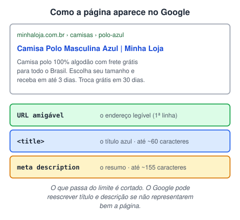
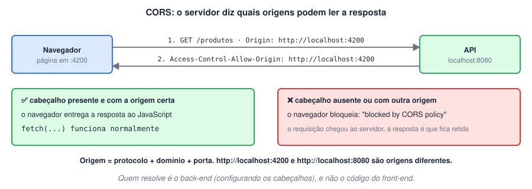

# HTML avançado · SEO, acessibilidade, segurança e PWA

> 🗺️ **Sobre o módulo:** o que separa uma página que "funciona" de um site profissional: aparecer no Google, ser usável por todos, ser seguro, rápido e instalável como app.
>
> **Professor:** Elder · **Pré-requisito:** HTML 3.

## SEO on-page

> 🗺️ **Nesta aula:** o que, dentro da própria página, ajuda o site a aparecer melhor no Google.

### De onde paramos

No módulo anterior, você aprendeu a escrever o `title`, a `meta description`, um `h1` por página e tags semânticas. Parecia só "boa prática", mas cada uma dessas regras tem um motivo: é com elas que o Google entende e apresenta a sua página. Esta aula mostra o porquê.

### On-page × off-page

**SEO (Search Engine Optimization) é o conjunto de práticas para uma página aparecer melhor nos buscadores.**

|  | On-page | Off-page |
| --- | --- | --- |
| Onde | **dentro** do site | **fora** do site |
| Exemplos | título, descrição, conteúdo, estrutura do HTML, URLs, imagens, velocidade | links de outros sites apontando para o seu (*backlinks*), menções, redes sociais |
| Quem controla | você | depende de terceiros |

Esta página trata do **on-page**, que é responsabilidade direta de quem desenvolve.

### Como o Google funciona (resumo)

1. **Rastreamento**: robôs (*crawlers*) seguem links e baixam as páginas.
2. **Indexação**: o Google lê o conteúdo e o guarda no índice.
3. **Classificação**: para cada busca, ordena as páginas por relevância e qualidade.

Se uma página não tem links apontando para ela e não está no sitemap, pode nunca ser encontrada.

### O resultado da busca



#### `<title>` (título SEO)

```html
<title>Camisa Polo Masculina Azul | Minha Loja</title>
```

- Aparece na **aba do navegador** e como **título azul** no Google.
- Até cerca de **60 caracteres**; o principal assunto primeiro, a marca no fim.
- **Único** em cada página do site.

#### Meta description

```html
<meta name="description"
  content="Camisa polo 100% algodão com frete
  grátis. Escolha seu tamanho.">
```

- Resumo exibido abaixo do título; até cerca de **155 caracteres**.
- Não melhora a posição diretamente, mas aumenta os **cliques**. Use um convite à ação ("Confira", "Escolha", "Aprenda").
- Também **única** por página.

#### `<h1>` × `<title>`

O `<title>` fica no `head` e aparece na aba e no Google. O `<h1>` é o título **visível** no corpo da página. Os dois devem tratar do mesmo assunto, mas não precisam ser idênticos.

### URLs amigáveis

```
✅ minhaloja.com.br/camisas/polo-azul
❌ minhaloja.com.br/produto.php?id=8273
```

Palavras que descrevem o conteúdo, em minúsculas, sem acentos, separadas por **hífen**.

### Conteúdo e estrutura

- **Conteúdo original e útil**, que responda de verdade à dúvida de quem buscou. Texto copiado de outro site é ignorado ou penalizado.
- **Palavras-chave** usadas de forma natural no título, no `h1`, nos intertítulos e no texto. Repetir à força (*keyword stuffing*) prejudica.
- **Intertítulos** (`h2`, `h3`) organizam o texto e ajudam o Google a entender a hierarquia.
- **Links internos** para outras páginas do próprio site que aprofundem o assunto, com textos descritivos.
- **HTML semântico**: `main`, `article`, `nav` ajudam o buscador a separar o conteúdo principal do resto.

### Imagens

```html

```

- Nome de arquivo descritivo (e não `IMG_1234.jpg`).
- `alt` descrevendo a imagem.
- Formato leve (WebP) e tamanho adequado: imagem pesada deixa a página lenta, e velocidade conta.

### Sitemap e robots.txt

- `sitemap.xml`: lista as páginas do site para o Google. Normalmente gerado automaticamente e enviado pelo **Google Search Console**.
- `robots.txt`: arquivo na raiz do site que diz aos robôs o que **não** rastrear (`Disallow: /admin`).

### Experiência da página

O Google também avalia:

- **HTTPS**;
- **versão para celular** (o Google indexa primeiro a versão mobile);
- **velocidade** e estabilidade (as métricas *Core Web Vitals*; veja a página de desempenho).

> 💡 O Google corta o título por **largura em pixels** (cerca de 600 px), e não por número exato de letras. "Cerca de 60 caracteres" é uma boa regra prática.

### Ferramentas

🔗 [https://search.google.com/search-console](https://search.google.com/search-console)

🔗 [https://pagespeed.web.dev/](https://pagespeed.web.dev/)

### 🧠 Revisão rápida

**A meta description melhora a posição no Google?**

Não diretamente, mas aumenta os cliques, porque é o resumo que aparece no resultado.

**Por que repetir a palavra-chave dez vezes no texto é ruim?**

Porque é *keyword stuffing*: o Google penaliza, e o texto fica ruim de ler.

> ➡️ **Próximo passo:** muitas regras de SEO (semântica, `alt`, títulos em ordem) também servem a pessoas com deficiência. Esse é o tema de **Acessibilidade na web**.

### 📌 Resumo

| Item | Em uma frase |
| --- | --- |
| SEO on-page | o que você controla dentro da página |
| `title` · `description` | ~60 · ~155 caracteres; únicos por página |
| `h1` e intertítulos | um `h1`; hierarquia em ordem |
| URL | palavras, minúsculas, hífens |
| Imagens | nome e `alt` descritivos; formato leve |
| Sitemap · robots.txt | lista as páginas · diz o que não rastrear |

## Acessibilidade na web

> 🗺️ **Nesta aula:** construir páginas que funcionem para todas as pessoas, incluindo quem usa leitor de tela, só o teclado ou tem baixa visão.

### De onde paramos

Você já praticou boa parte da acessibilidade sem perceber: `alt` nas imagens, `label` nos campos, `button` em vez de `div`, um `h1` e títulos em ordem. Esta aula explica para quem cada uma dessas regras faz diferença e acrescenta as que faltam (teclado, contraste, ARIA).

### Por que acessibilidade

**Acessibilidade é garantir que qualquer pessoa consiga usar o site**, independentemente de limitações visuais, auditivas, motoras ou cognitivas, permanentes ou temporárias (um braço quebrado, o sol na tela do celular).

- No Brasil, a **Lei Brasileira de Inclusão (Lei 13.146/2015)** obriga sites de empresas e órgãos públicos a serem acessíveis.
- A referência técnica mundial é a **WCAG** (Web Content Accessibility Guidelines), do W3C. O nível **AA** é o mais exigido.
- Bônus: site acessível costuma ter **SEO** melhor, funcionar melhor no celular e ter código mais organizado.

Pessoas navegam de formas diferentes: mouse, toque, **só teclado** (Tab, Enter, setas), **leitor de tela** (NVDA, VoiceOver, TalkBack), comandos de voz, zoom de 200% ou mais.

### 1. HTML semântico vem primeiro

A maior parte da acessibilidade vem de usar a tag certa:

```html
<!-- ❌ parece botão, mas não recebe foco,
     não funciona com Enter e é lido como texto -->
<div class="botao" onclick="salvar()">
  Salvar</div>

<!-- ✅ foco, teclado e anúncio de graça -->
<button type="button" onclick="salvar()">
  Salvar</button>
```

- Estrutura com `header`, `nav`, `main`, `footer`: o leitor de tela permite pular direto para cada região.
- Títulos em ordem (`h1` → `h2` → `h3`): muita gente navega pulando de título em título.
- `<a>` para navegar, `<button>` para ações.
- `<html lang="pt-BR">`: o leitor de tela usa a pronúncia correta.

### 2. Imagens com texto alternativo

```html


<!-- decorativa: alt vazio -->

```

### 3. Formulários com rótulo

```html
<label for="cpf">CPF</label>
<input id="cpf" name="cpf" inputmode="numeric"
       aria-describedby="cpf-dica">
<small id="cpf-dica">Somente números</small>
```

- Todo campo com `label`; o `placeholder` não substitui.
- Mensagens de erro em **texto**, perto do campo, e não só com borda vermelha.

### 4. Teclado e foco

- Teste a página só com **Tab**, **Shift + Tab**, **Enter** e **Espaço**: tudo o que é clicável precisa ser alcançável, na ordem lógica.
- **Nunca** remova o contorno de foco sem colocar outro:

```css
/* ❌ */
:focus { outline: none; }

/* ✅ */
:focus-visible {
  outline: 3px solid #1a73e8;
  outline-offset: 2px;
}
```

- Um link "Pular para o conteúdo" no início ajuda quem usa teclado a não passar pelo menu inteiro em toda página:

```html
<a href="#conteudo" class="pular">Pular para o conteúdo</a>
...
<main id="conteudo">
```

### 5. Contraste e cor

- Contraste mínimo (WCAG AA): **4,5:1** para texto normal e **3:1** para texto grande. O DevTools mostra o valor ao inspecionar uma cor.
- Não transmita informação **só pela cor**: "campos em vermelho são obrigatórios" não funciona para daltônicos. Use também ícone ou texto.
- Permita aumentar o texto: use `rem` no CSS e não bloqueie o zoom no `viewport`.

### 6. Movimento e mídia

- Nada piscando mais de 3 vezes por segundo (risco de convulsão).
- Respeite quem pede menos movimento no sistema:

```css
@media (prefers-reduced-motion: reduce) {
  * {
    animation: none !important;
    transition: none !important;
  }
}
```

- Vídeos com **legendas**; áudios com **transcrição**.

### 7. ARIA: só quando o HTML não basta

**ARIA** são atributos que dão informações extras aos leitores de tela:

```html
<!-- botão só com ícone -->
<button aria-label="Fechar">✕</button>

<!-- estado de um menu que abre e fecha -->
<button aria-expanded="false"
    aria-controls="menu">Menu</button>

<!-- anunciado na hora -->
<div role="alert">Pagamento recusado</div>

<!-- decoração ignorada -->
<span aria-hidden="true">★</span>
```

> ⚠️ Primeira regra da ARIA: **se existe uma tag HTML que faz isso, use a tag**. ARIA mal usado piora a experiência, e um `role="button"` numa `div` não a torna clicável pelo teclado.

### Ferramentas para testar

- **Lighthouse** (DevTools → aba Lighthouse → Accessibility).
- Extensões **axe DevTools** e **WAVE**.
- Leitores de tela: **NVDA** (Windows, gratuito) e **VoiceOver** (macOS e iPhone).

🔗 [https://developer.mozilla.org/pt-BR/docs/Learn/Accessibility/HTML](https://developer.mozilla.org/pt-BR/docs/Learn/Accessibility/HTML)

🔗 [https://wave.webaim.org/](https://wave.webaim.org/)

> 💡 Um teste de 2 minutos: desconecte o mouse e tente usar o seu currículo só com Tab, Enter e Espaço. Você consegue chegar a todos os links e enviar o formulário? Sempre vê onde está o foco?

### 🧠 Revisão rápida

**Por que um `div` com `onclick` não é um bom botão?**

Porque não recebe foco pelo teclado, não responde a Enter/Espaço e o leitor de tela não o anuncia como botão.

**Qual o contraste mínimo para texto normal (WCAG AA)?**

4,5:1.

**Quando usar ARIA?**

Só quando não existe uma tag HTML que faça aquilo (como um botão só com ícone, que precisa de `aria-label`).

> ➡️ **Próximo passo:** um site encontrado e acessível também precisa ser protegido: **Segurança: HTTPS, CORS, CSP e OWASP**.

### 📌 Resumo

| Item | Em uma frase |
| --- | --- |
| WCAG AA | a referência técnica mais exigida |
| Semântica | resolve a maior parte, de graça |
| `alt` · `label` · `lang` | imagens, campos e idioma |
| Teclado | tudo alcançável, com foco visível |
| Contraste | 4,5:1; nunca só a cor |
| ARIA | só quando não há tag HTML |

## Segurança: HTTPS, CORS, CSP e OWASP

> 🗺️ **Nesta aula:** os mecanismos que protegem a comunicação e o conteúdo de um site: HTTPS/TLS, CORS e CSP, e conhecer os riscos do OWASP Top 10.

### De onde paramos

Alguns temas de segurança já apareceram: o HTTPS no módulo HTML 1, o `PreparedStatement` contra SQL Injection no TodoApp e o "nunca confie na validação do navegador" nos formulários. Esta aula reúne tudo e acrescenta duas peças que você vai encontrar de verdade no fim do curso: o **CORS** (quando o Angular chamar a API Spring) e o **CSP**.

### HTTPS: SSL e TLS

**HTTPS é o HTTP dentro de um canal criptografado.** Ele garante três coisas:

- **confidencialidade**: ninguém no caminho (Wi-Fi público, provedor) consegue ler os dados;
- **integridade**: ninguém consegue alterar a página no caminho;
- **autenticidade**: o **certificado digital**, emitido por uma autoridade certificadora (CA), prova que o site é mesmo quem diz ser.

|  | SSL | TLS |
| --- | --- | --- |
| O que é | *Secure Sockets Layer*, o protocolo original (anos 1990) | *Transport Layer Security*, o sucessor |
| Situação | **obsoleto e inseguro**; todas as versões foram abandonadas | em uso: **TLS 1.2** e **TLS 1.3** |

O nome "certificado SSL" continua sendo usado por costume, mas o que funciona hoje é TLS. Certificados gratuitos e automáticos estão disponíveis pelo **Let's Encrypt**.

> 💡 O cadeado indica que a **conexão** é segura, e não que o site é confiável. Sites de golpe também têm HTTPS. Confira sempre o domínio.

### CORS: chamando APIs de outra origem

Por segurança, o navegador aplica a **política de mesma origem** (*same-origin policy*): o JavaScript de uma página só pode **ler** respostas da **mesma origem**, isto é, mesmo **protocolo + domínio + porta**.

| Página | Requisição para | Mesma origem? |
| --- | --- | --- |
| `https://loja.com` | `https://loja.com/api` | ✅ |
| `https://loja.com` | `http://loja.com/api` | ❌ protocolo diferente |
| `https://loja.com` | `https://api.loja.com` | ❌ domínio diferente |
| `http://localhost:4200` | `http://localhost:8080` | ❌ porta diferente |

**CORS** (*Cross-Origin Resource Sharing*) é o jeito de o **servidor** autorizar outras origens, por meio de cabeçalhos na resposta:



```
Access-Control-Allow-Origin: https://loja.com
Access-Control-Allow-Methods: GET, POST, PUT
Access-Control-Allow-Headers: Content-Type
Access-Control-Max-Age: 86400
```

Lendo: "aceito pedidos vindos de `https://loja.com`, com esses métodos e cabeçalhos; guarde essa autorização por 86.400 segundos (um dia)". Com `*` no lugar da origem, qualquer site pode chamar.

#### Preflight

Antes de requisições "não simples" (com `PUT`, `DELETE`, JSON no corpo ou cabeçalho `Authorization`), o navegador envia uma requisição `OPTIONS` perguntando se pode. Só se o servidor responder com os cabeçalhos certos é que a requisição real é feita.

#### Erros comuns e soluções

- *"has been blocked by CORS policy: No 'Access-Control-Allow-Origin' header"*: o servidor não autorizou a origem. A solução é **configurar o back-end** (Spring, Express e ASP.NET têm opções prontas).
- Em desenvolvimento com Angular, um **proxy** do próprio Angular (`proxy.conf.json`) faz a chamada parecer da mesma origem.
- Extensões que "desligam o CORS" no navegador só mascaram o problema no seu computador.

### CSP: quais conteúdos a página pode carregar

**Content Security Policy** é um cabeçalho (ou `meta` tag) em que o site lista **de onde** aceita carregar scripts, estilos, imagens, fontes e iframes. Tudo fora da lista é bloqueado. É a principal defesa extra contra **XSS** (injeção de scripts maliciosos).

```
Content-Security-Policy:
  default-src 'self';
  img-src 'self' https://cdn.minhaloja.com;
  script-src 'self'
```

Lendo: "por padrão, só carregue coisas do meu próprio site; imagens também podem vir do meu CDN; scripts, só do meu site".

- `'self'`: só da própria origem.
- Com CSP, scripts escritos dentro do HTML (`<script>...</script>` e `onclick="..."`) são bloqueados, a menos que você libere explicitamente. É mais um motivo para manter o JavaScript em arquivos separados.

**Documentação de CSP**

🔗 [https://developer.mozilla.org/pt-BR/docs/Web/HTTP/CSP](https://developer.mozilla.org/pt-BR/docs/Web/HTTP/CSP)

🔗 [https://content-security-policy.com/](https://content-security-policy.com/)

### Outros cabeçalhos de segurança

| Cabeçalho | Protege contra |
| --- | --- |
| `Strict-Transport-Security` (HSTS) | acesso por HTTP sem criptografia; força HTTPS |
| `X-Frame-Options: DENY` ou CSP `frame-ancestors` | sua página ser exibida dentro de um iframe de outro site (*clickjacking*) |
| `X-Content-Type-Options: nosniff` | o navegador "adivinhar" o tipo de um arquivo e executá-lo como script |
| `Referrer-Policy` | vazamento da URL de origem para outros sites |

O **Mozilla Observatory** analisa um site publicado e aponta o que falta. Nem todo alerta precisa ser corrigido; avalie caso a caso.

🔗 [https://developer.mozilla.org/en-US/observatory](https://developer.mozilla.org/en-US/observatory)

### OWASP Top 10

A **OWASP** (*Open Worldwide Application Security Project*) é uma fundação sem fins lucrativos, criada em 2001, que publica guias e ferramentas gratuitas de segurança. Seu documento mais conhecido é o **Top 10**, a lista dos riscos mais críticos em aplicações web. Alguns itens da edição de 2021:

| Risco | Exemplo |
| --- | --- |
| **Controle de acesso quebrado** | trocar `/pedidos/15` por `/pedidos/16` na URL e ver o pedido de outra pessoa |
| **Falhas de criptografia** | senhas salvas sem *hash*, site sem HTTPS |
| **Injeção** (SQL, XSS...) | digitar `' OR 1=1 --` num campo e o SQL ser executado; inserir `<script>` num comentário |
| **Configuração insegura** | senha padrão, mensagens de erro com detalhes internos |
| **Componentes vulneráveis** | bibliotecas desatualizadas com falhas conhecidas |
| **Falhas de autenticação** | login sem limite de tentativas, sessão que nunca expira |

🔗 [https://owasp.org/www-project-top-ten/](https://owasp.org/www-project-top-ten/)

> 🔑 **Regra de ouro:** nunca confie em dados vindos do usuário. Valide no servidor, use consultas parametrizadas no banco e, ao mostrar texto do usuário na página, use `textContent` em vez de `innerHTML`.

### 🧠 Revisão rápida

**O Angular em `localhost:4200` chama a API em `localhost:8080` e dá erro de CORS. Onde se corrige?**

No servidor (a API), autorizando a origem `http://localhost:4200`. A porta diferente torna a origem diferente.

**Um site com cadeado é confiável?**

Não necessariamente. O cadeado só garante que a conexão é criptografada; sites de golpe também têm HTTPS.

**Que item do OWASP Top 10 o `PreparedStatement` do TodoApp evita?**

Injeção (SQL Injection).

> ➡️ **Próximo passo:** um site seguro também precisa ser rápido, e o Google mede isso: **Desempenho: Core Web Vitals e Lighthouse**.

### 📌 Resumo

| Item | Em uma frase |
| --- | --- |
| HTTPS | HTTP com TLS; SSL é obsoleto |
| Origem | protocolo, domínio e porta |
| CORS | o servidor autoriza outras origens |
| Preflight | `OPTIONS` antes de requests "não simples" |
| CSP | lista de onde a página pode carregar recursos |
| OWASP Top 10 | os riscos mais comuns em aplicações web |

## Desempenho: Core Web Vitals e Lighthouse

> 🗺️ **Nesta aula:** as três métricas Core Web Vitals, como melhorar cada uma e como medir com Lighthouse.

### De onde paramos

Várias regras dos módulos anteriores eram, na verdade, regras de desempenho: `width`/`height` nas imagens (para a página não pular), `loading="lazy"`, WebP, `script defer`. Esta aula dá nome e número ao que elas melhoram.

### Por que desempenho importa

Páginas lentas perdem visitantes: quanto mais tempo para carregar, maior a chance de a pessoa desistir, principalmente no celular com 4G fraco. O Google também usa a experiência da página como um dos sinais de classificação.

### Core Web Vitals

São as três métricas que o Google usa para medir a experiência real dos usuários:

| Métrica | Mede | Bom |
| --- | --- | --- |
| **LCP** (*Largest Contentful Paint*) | quanto demora para o maior elemento visível (imagem de destaque, título) aparecer | até **2,5 s** |
| **INP** (*Interaction to Next Paint*) | quanto a página demora para reagir a um clique ou toque | até **200 ms** |
| **CLS** (*Cumulative Layout Shift*) | quanto o conteúdo "pula" de lugar enquanto carrega | até **0,1** |

O INP substituiu o antigo FID (*First Input Delay*) em março de 2024.

### Como melhorar cada uma

#### LCP: carregar rápido o que importa

- Imagens em **WebP/AVIF**, no tamanho certo (`srcset`).
- A imagem principal **sem** `loading="lazy"` e com `fetchpriority="high"`; o `lazy` fica para as imagens abaixo da dobra.
- CSS e JavaScript **minificados**; scripts com `defer`.
- Servidor rápido, com cache e compressão (gzip/brotli), e uma **CDN** para arquivos estáticos.

#### INP: não travar a página

- Menos JavaScript, e dividido em partes menores.
- Evitar tarefas longas na thread principal; trabalho pesado pode ir para um *Web Worker*.

#### CLS: nada de conteúdo pulando

- Sempre `width` e `height` (ou `aspect-ratio`) em imagens, vídeos e iframes.
- Reservar espaço para anúncios e banners que entram depois.
- Fontes com `font-display: swap` e de tamanho parecido com a fonte reserva.

### Ferramentas

- **Lighthouse** (DevTools → aba Lighthouse): nota de 0 a 100 em Desempenho, Acessibilidade, Boas práticas e SEO, com a lista do que corrigir.
- **PageSpeed Insights**: o mesmo teste, mais os dados reais de usuários do Chrome.
- Aba **Network** do DevTools: veja o peso e o tempo de cada arquivo; simule uma conexão lenta em *Throttling*.

🔗 [https://pagespeed.web.dev/](https://pagespeed.web.dev/)

🔗 [https://web.dev/articles/vitals](https://web.dev/articles/vitals)

### Checklist rápido

- Imagens otimizadas, com `width`/`height` e `lazy` abaixo da dobra.
- `<script defer>`; nada de bibliotecas carregadas sem uso.
- CSS e JS minificados em produção.
- Fontes: no máximo duas famílias, com `font-display: swap`.
- Cache e compressão ativos no servidor.

### 🧠 Revisão rápida

**Uma imagem sem `width`/`height` carrega e empurra o texto para baixo. Qual métrica piora?**

CLS (estabilidade do layout).

**A imagem principal, no topo da página, deve ter `loading="lazy"`?**

Não: ela precisa carregar o quanto antes (afeta o LCP). O `lazy` é para as imagens abaixo da dobra.

> ➡️ **Próximo passo:** o último passo do módulo transforma um site rápido e seguro num app instalável: **PWA: Progressive Web Apps**.

### 📌 Resumo

| Métrica | Mede | Bom |
| --- | --- | --- |
| LCP | carregamento do maior elemento | ≤ 2,5 s |
| INP | resposta a cliques | ≤ 200 ms |
| CLS | conteúdo pulando | ≤ 0,1 |
| Ferramentas | Lighthouse e PageSpeed Insights | — |

## PWA: Progressive Web Apps

> 🗺️ **Nesta aula:** o que transforma um site em um app instalável e que funciona offline.

### De onde paramos

O módulo levou o site a ser encontrado (SEO), usável por todos (acessibilidade), seguro (HTTPS, CSP) e rápido (Core Web Vitals). O último passo é fazê-lo se comportar como um aplicativo. Os exemplos usam um pouco de JavaScript, que será estudado no seu próprio módulo; por enquanto, foque na ideia.

### O que é uma PWA

**PWA (*Progressive Web App*) é um site que se comporta como aplicativo:** pode ser instalado na tela inicial, abrir em janela própria (sem a barra do navegador), funcionar sem internet e enviar notificações, sem passar pela Play Store ou App Store.

"Progressivo" porque continua sendo um site comum: em navegadores que não suportam algum recurso, ele apenas funciona sem aquele recurso.

| Vantagens | Limitações |
| --- | --- |
| um só código para celular e computador | acesso ao hardware menor que o de um app nativo |
| atualização imediata, sem loja | no iPhone, alguns recursos chegaram tarde ou têm restrições |
| leve: nada de baixar 100 MB | não aparece nas lojas sem empacotamento extra |

Exemplos conhecidos: Twitter/X Lite, Starbucks, Pinterest e Spotify (versão web).

### Os três ingredientes

1. **HTTPS**: obrigatório (com exceção de `localhost`, para testes).
2. **Web App Manifest** (`manifest.json`): nome, ícones e cores do app.
3. **Service Worker**: um script que roda em segundo plano, intercepta as requisições e permite o cache para uso offline.

#### 1. O manifest

```json
{
  "name": "Lista de Tarefas",
  "short_name": "Tarefas",
  "start_url": "/",
  "display": "standalone",
  "background_color": "#ffffff",
  "theme_color": "#1a73e8",
  "icons": [
    { "src": "icons/192.png",
      "sizes": "192x192" },
    { "src": "icons/512.png",
      "sizes": "512x512" }
  ]
}
```

```html
<link rel="manifest" href="manifest.json">
<meta name="theme-color" content="#1a73e8">
```

`display: standalone` abre o app sem a barra de endereço.

#### 2. Registrando o Service Worker

```jsx
// main.js
if ("serviceWorker" in navigator) {
  navigator.serviceWorker.register("/sw.js");
}
```

#### 3. Um Service Worker simples (cache primeiro)

```jsx
// sw.js
const CACHE = "app-v1";
const ARQUIVOS = ["/", "/index.html",
  "/css/style.css", "/js/main.js"];

// na instalação: guarda a "casca" no cache
self.addEventListener("install", (e) => {
  e.waitUntil(
    caches.open(CACHE)
      .then((c) => c.addAll(ARQUIVOS))
  );
});

// a cada request: usa o cache ou vai à rede
self.addEventListener("fetch", (e) => {
  e.respondWith(
    caches.match(e.request)
      .then((salvo) => salvo || fetch(e.request))
  );
});
```

### Arquitetura App Shell

Separa a **casca** (a interface fixa: cabeçalho, menu, layout) do **conteúdo** (os dados):

- a casca fica em cache e abre **instantaneamente**, até sem internet;
- o conteúdo é buscado depois e pode ser guardado em cache também.

### Estratégias de cache

| Estratégia | Como funciona | Bom para |
| --- | --- | --- |
| *Cache first* | usa o cache; só vai à rede se não tiver | arquivos que mudam pouco (CSS, ícones, fontes) |
| *Network first* | tenta a rede; se falhar, usa o cache | dados que precisam estar atualizados |
| *Stale-while-revalidate* | mostra o cache na hora e atualiza em segundo plano | notícias, listas |

Na prática, bibliotecas como o **Workbox** (do Google) e frameworks (Angular com `ng add @angular/pwa`) geram o Service Worker por você.

### Testando

- DevTools → **Application**: veja o manifest, o Service Worker e o cache; marque **Offline** para simular sem internet.
- **Lighthouse** aponta o que falta para a página ser instalável.

**Geradores de manifest**

🔗 [https://www.simicart.com/manifest-generator.html/](https://www.simicart.com/manifest-generator.html/)

🔗 [https://developer.mozilla.org/pt-BR/docs/Web/Progressive_web_apps](https://developer.mozilla.org/pt-BR/docs/Web/Progressive_web_apps)

### 🧠 Revisão rápida

**Quais são os três ingredientes de uma PWA?**

HTTPS, o manifest (nome, ícones, cores) e um Service Worker (cache e offline).

**Para uma lista de preços que muda toda hora, qual estratégia de cache usar?**

*Network first*: tenta a rede para ter o dado atualizado e só usa o cache se estiver offline.

> ➡️ **Próximo passo:** fim da etapa de HTML! Até aqui, todas as páginas têm a aparência padrão do navegador. A próxima etapa cuida do visual: **CSS 1 · Fundamentos do CSS**.

### 📌 Resumo

| Item | Em uma frase |
| --- | --- |
| PWA | site que se instala e funciona como app |
| Manifest | nome, ícones, cores e modo de exibição |
| Service Worker | script em segundo plano: cache e offline |
| App Shell | casca em cache, conteúdo buscado depois |
| Cache first · network first | arquivos fixos · dados atualizados |

## 📌 Resumo do módulo

| Conceito | Lembrete |
| --- | --- |
| SEO on-page | `title` (~60), `description` (~155), um `h1`, URL com hífens, conteúdo original |
| Sitemap · robots.txt | lista as páginas · diz o que não rastrear |
| Acessibilidade | HTML semântico, `alt`, `label`, teclado, foco visível, contraste 4,5:1 |
| ARIA | só quando não existe tag HTML para aquilo |
| HTTPS | HTTP + TLS (SSL é obsoleto); protege a conexão |
| Origem | protocolo + domínio + porta |
| CORS | o servidor autoriza outras origens com `Access-Control-Allow-Origin` |
| CSP | lista de onde a página pode carregar recursos; defesa contra XSS |
| OWASP Top 10 | riscos mais comuns: controle de acesso, criptografia, injeção |
| Core Web Vitals | LCP ≤ 2,5 s · INP ≤ 200 ms · CLS ≤ 0,1 |
| PWA | HTTPS + manifest + Service Worker |
