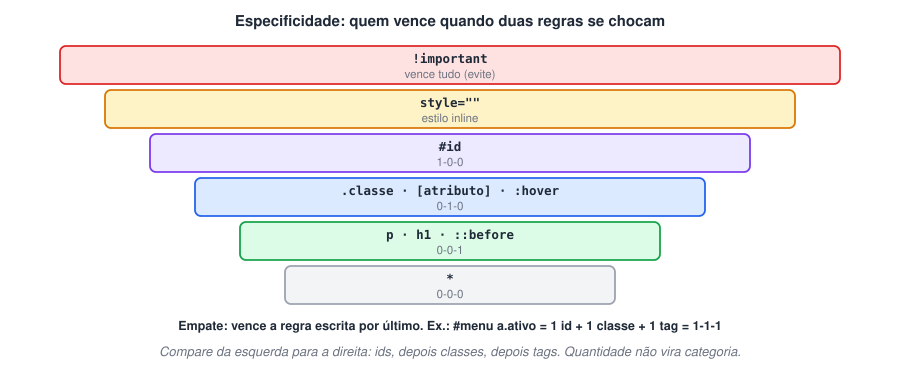
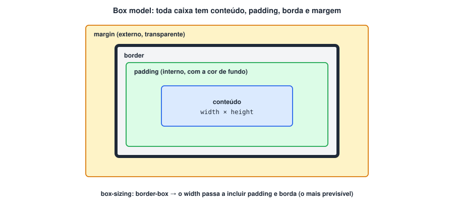
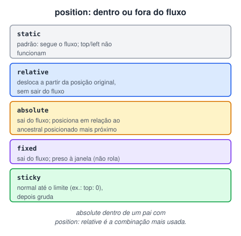
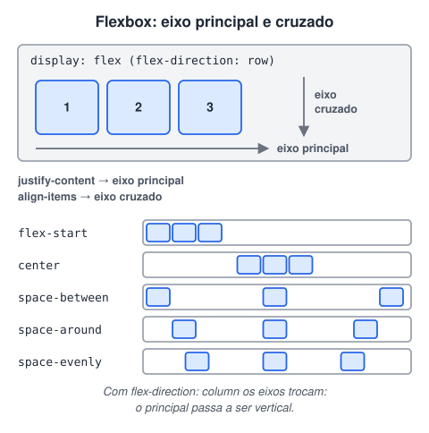
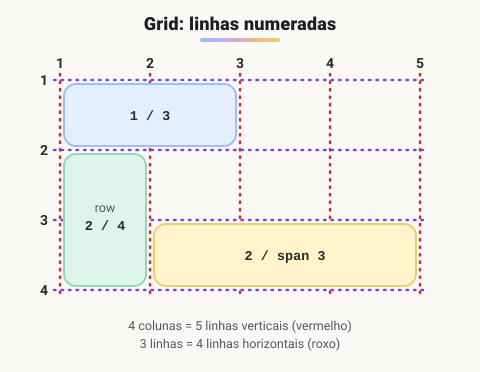

# CSS 1 · Fundamentos do CSS

> 🗺️ **Sobre o módulo:** a aparência da página: sintaxe e cascata, cores, fundos, fontes e textos, o modelo de caixa e as ferramentas de layout (display, position, Flexbox, Grid e responsividade).
>
> **Professor:** Ricardo Lima Gonçalves · **Pré-requisito:** HTML 3.

## O que é CSS: sintaxe, seletores e cascata

> 🗺️ **Nesta aula:** escrever regras CSS, ligar o CSS ao HTML, dominar os seletores e entender quem vence quando duas regras entram em conflito.

### De onde paramos

O currículo em HTML está completo, mas tem a cara padrão do navegador: fonte serifada, texto preto, tudo empilhado. Lembra da tabela "HTML · CSS · JavaScript = estrutura · aparência · comportamento"? Agora começa a segunda camada. A boa notícia: todo o trabalho de semântica e de classes vai servir de "gancho" para o CSS.

### O que é o CSS

**CSS (Cascading Style Sheets, ou folhas de estilo em cascata) define a aparência da página**: cores, fontes, espaçamentos, layout e animações. O HTML diz **o que** é cada conteúdo; o CSS diz **como** ele aparece.

- Proposto por **Håkon Wium Lie** em 1994 e publicado pelo W3C em 1996 (CSS1). O CSS2 veio em 1998, e o CSS3 passou a ser dividido em **módulos** que evoluem separadamente (Flexbox, Grid, Animações...).
- Antes dele, a aparência era definida no próprio HTML (`<font>`, `bgcolor`) e os layouts eram montados com **tabelas**. O CSS permitiu o design ***tableless***: um único arquivo de estilo muda a aparência do site inteiro.

### Sintaxe


```css
/* comentário */
seletor {
  propriedade: valor;
  outra-propriedade: valor;
}

h1 {
  color: navy;
  font-size: 32px;
}
```

- **Seletor**: **quem** recebe o estilo.
- **Declaração**: `propriedade: valor;`, ou seja, **o que** muda. Esquecer o `;` quebra a declaração seguinte.

### Três formas de aplicar CSS

| Forma | Como | Quando usar |
| --- | --- | --- |
| **Externo** ✅ | `<link rel="stylesheet" href="css/style.css">` no `head` | o padrão: um arquivo para várias páginas, guardado em cache |
| **Interno** | `<style> ... </style>` no `head` | página única ou testes rápidos |
| **Inline** | `<h1 style="color: purple;">` | casos pontuais; difícil de manter e com prioridade altíssima |

É comum ter vários arquivos (`reset.css`, `style.css`, `responsivo.css`); eles são aplicados na ordem em que aparecem.

### Seletores

| Seletor | Exemplo | Seleciona |
| --- | --- | --- |
| Universal | `*` | todos os elementos |
| Tag (tipo) | `p` | todos os `<p>` |
| Classe | `.destaque` | elementos com `class="destaque"`. Um elemento pode ter várias classes: `class="card destaque"` |
| ID | `#topo` | o elemento com `id="topo"` (um id não se repete na página) |
| Atributo | `input[type="email"]` | elementos com aquele atributo/valor |
| Agrupamento | `h1, h2, h3` | todos os da lista |
| Descendente | `nav a` | `a` em qualquer nível dentro de `nav` |
| Filho direto | `ul > li` | `li` que é filho imediato de `ul` |
| Irmão adjacente | `h2 + p` | o `p` logo depois de um `h2` |
| Combinado | `p.destaque` | `p` que tem a classe `destaque` |
| Duas classes | `.btn.primario` | elemento com as duas classes |

> 💡 **Classe ou ID?** Para estilizar, use **classes**: são reutilizáveis e têm peso moderado. Deixe o `id` para âncoras de link (`#contato`), formulários (`label for`) e JavaScript.

### A cascata: quem vence um conflito

Quando duas regras definem a mesma propriedade para o mesmo elemento, o navegador decide nesta ordem:

1. **Importância**: `!important` vence (evite: torna tudo difícil de sobrescrever).
2. **Especificidade**: o seletor mais "específico" vence.
3. **Ordem**: com especificidade igual, vence a regra que aparece **por último**.



A especificidade é contada como três números (**ids – classes – tags**) e comparada da esquerda para a direita:

| Seletor | Especificidade |
| --- | --- |
| `p` | 0-0-1 |
| `.menu a` | 0-1-1 |
| `p.destaque` | 0-1-1 |
| `#topo` | 1-0-0 |
| `#topo .menu a:hover` | 1-2-1 |

Um único id (1-0-0) vence qualquer quantidade de classes (0-15-0). O estilo **inline** vence todos os seletores.

#### Teste de mesa da cascata

Qual cor fica no link `<a class="ativo">` dentro de `<nav id="menu">`?

```css
a { color: black; }  /* 0-0-1 */
nav a { color: gray; }  /* 0-0-2 */
.ativo { color: blue; }  /* 0-1-0 */
#menu a { color: green; }  /* 1-0-1 */
```

Comparando da esquerda para a direita: só `#menu a` tem um id (1), então ele vence, e o link fica **verde**, mesmo com `.ativo` escrito para ele. É por isso que se evita id no CSS: depois fica difícil sobrescrever.

### Herança

Algumas propriedades são **herdadas** pelos filhos: principalmente as de texto (`color`, `font-family`, `font-size`, `line-height`). Por isso basta definir a fonte no `body`. Propriedades de caixa (`margin`, `padding`, `border`, `background`) **não** são herdadas.

```css
body {
  font-family: system-ui, sans-serif;
  color: #222;
  line-height: 1.5;
}
```

> 💡 **Lembrete:** seletores de atributo e pseudo-classes têm o mesmo peso de uma classe (0-1-0); pseudo-elementos têm o peso de uma tag (0-0-1).

### Prática no currículo

Crie `css/style.css`, ligue-o no `head` das três páginas e comece pelo `body` (fonte, cor e altura de linha, como no exemplo de herança). Como o arquivo é compartilhado, as três páginas mudam juntas.

### 🧠 Revisão rápida

**`.card p` × `p`: qual vence?**

`.card p` (0-1-1 contra 0-0-1).

**Duas regras com o mesmo seletor `.titulo` definem cores diferentes. Qual vale?**

A que aparece por último, porque a especificidade é igual.

**Por que basta definir a fonte no `body`?**

Porque as propriedades de texto são herdadas pelos elementos de dentro.

> ➡️ **Próximo passo:** os seletores desta aula escolhem elementos pelo que eles **são**. A próxima escolhe pelo que está **acontecendo** com eles (mouse em cima, foco): **Estados de links, pseudo-classes e pseudo-elementos**.

### 📌 Resumo

| Item | Em uma frase |
| --- | --- |
| Regra | `seletor { propriedade: valor; }` |
| Onde | arquivo externo com `<link>` |
| Seletores | tag, `.classe`, `#id`, descendente, filho |
| Cascata | `!important` → especificidade → última regra |
| Especificidade | ids – classes – tags |
| Herança | texto herda; caixa não |

## Estados de links, pseudo-classes e pseudo-elementos

> 🗺️ **Nesta aula:** estilizar estados (hover, foco, visitado), posições (primeiro, último, alternados) e partes de um elemento com pseudo-classes e pseudo-elementos.

### De onde paramos

Os seletores da aula anterior escolhem elementos pelo que eles são (tag, classe, id). Mas o mesmo link deve mudar quando o mouse passa em cima, e a linha par de uma tabela deve ter outra cor. Para isso existem os **pseudo**-seletores, que se juntam aos que você já conhece: `a:hover`, `tr:nth-child(even)`.

### Pseudo-classe × pseudo-elemento

- **Pseudo-classe** (`:`) seleciona um elemento **em um estado ou posição**: com o mouse em cima, com foco, o primeiro da lista.
- **Pseudo-elemento** (`::`) estiliza **uma parte** do elemento ou cria um conteúdo decorativo: a primeira letra, um enfeite antes ou depois.

### Estados de links

```css
/* ainda não visitado */
a:link    { color: #1a73e8; }
/* já visitado */
a:visited { color: #7c3aed; }
/* mouse em cima */
a:hover   { color: #0b4fb3; }
/* no momento do clique */
a:active  { color: #dc2626; }
```

> 💡 Com especificidade igual, a última regra vence. Por isso, escreva na ordem **L**o**V**e **HA**te: `:link`, `:visited`, `:hover`, `:active`. Se o `:hover` vier antes do `:visited`, links já visitados não mudam de cor ao passar o mouse.

Por privacidade, o `:visited` só aceita mudanças de **cor**.

### Pseudo-classes de interação e formulário

| Seletor | Seleciona |
| --- | --- |
| `:hover` | mouse em cima (não existe no toque: não esconda informação só no hover) |
| `:active` | sendo clicado |
| `:focus` | com foco (clique em campo ou Tab) |
| `:focus-visible` | com foco vindo do **teclado**; ideal para o contorno de acessibilidade |
| `:checked` | checkbox ou radio marcado |
| `:disabled` / `:enabled` | campo desativado / ativo |
| `:required` / `:optional` | campo obrigatório / opcional |
| `:valid` / `:invalid` | campo que passa / não passa na validação |
| `:placeholder-shown` | campo vazio, mostrando o placeholder |

```css
button:hover {
  filter: brightness(0.95);
}
button:focus-visible {
  outline: 3px solid #1a73e8;
  outline-offset: 2px;
}
/* só depois que a pessoa digitou */
input:invalid:not(:placeholder-shown) {
  border-color: #dc2626;
}
```

### Pseudo-classes de posição

| Seletor | Seleciona |
| --- | --- |
| `:first-child` / `:last-child` | primeiro / último filho do pai |
| `:nth-child(3)` | o terceiro filho |
| `:nth-child(odd)` / `(even)` | ímpares / pares (efeito zebra) |
| `:nth-child(3n)` | a cada três (3º, 6º, 9º...) |
| `:first-of-type` / `:nth-of-type(2)` | contam só irmãos **da mesma tag** |
| `:only-child` | filho único |

```css
/* linha entre itens, menos no último */
li:not(:last-child) {
  border-bottom: 1px solid #ddd;
}
/* zebra */
tbody tr:nth-child(even) {
  background: #f4f4f4;
}
```

### Pseudo-classes lógicas

```css
/* todos, menos os .primario */
.botao:not(.primario) { background: none; }

/* atalho para listas de seletores */
:is(h1, h2, h3) a { color: inherit; }

/* o card que CONTÉM uma imagem */
.card:has(img) { padding-top: 0; }

/* o elemento html; usado para variáveis */
:root { --cor-principal: #1a73e8; }

/* o elemento cujo id está na URL */
:target { background: #fff3c4; }
```

### Pseudo-elementos

| Seletor | Estiliza |
| --- | --- |
| `::before` / `::after` | um conteúdo criado antes / depois do conteúdo do elemento. **Exige** `content` (nem que seja `content: ""`) |
| `::first-letter` / `::first-line` | primeira letra / primeira linha |
| `::placeholder` | o texto do placeholder |
| `::selection` | o trecho selecionado com o mouse |
| `::marker` | o marcador da lista |

```css
.obrigatorio::after {
  content: " *";
  color: #dc2626;
}
p::first-letter {
  font-size: 2.5em;
  float: left;
  line-height: 1;
}
::selection { background: #ffd166; }
li::marker { color: #1a73e8; }
```

`::before` e `::after` são **decorativos**: o leitor de tela nem sempre lê o `content`, e eles não funcionam em tags vazias como `img` e `input`.

### 🧠 Revisão rápida

**Como fazer a tabela de horários do currículo ficar zebrada?**

`tbody tr:nth-child(even) { background: #f4f4f4; }`

**Um `::before` não aparece. O que costuma faltar?**

A propriedade `content` (nem que seja `content: ""`).

**Qual a diferença entre `:focus` e `:focus-visible`?**

`:focus-visible` só aparece quando o foco vem do teclado, ideal para o contorno de acessibilidade sem incomodar quem usa mouse.

> ➡️ **Próximo passo:** os exemplos usaram várias cores (`#1a73e8`, `rgb(...)`). Agora, como escrevê-las e escolhê-las: **Cores**.

### 📌 Resumo

| Item | Em uma frase |
| --- | --- |
| `:` pseudo-classe | estado ou posição |
| `::` pseudo-elemento | parte do elemento ou enfeite |
| Links | ordem LVHA |
| `:focus-visible` | contorno de foco do teclado |
| `:nth-child()` | posição; `even` faz zebra |
| `:not()` · `:is()` · `:has()` | combinam seletores |
| `::before`/`::after` | precisam de `content` |

## Cores

> 🗺️ **Nesta aula:** as formas de escrever cores no CSS, usar transparência e escolher cores com contraste suficiente.

### De onde paramos

Já sabemos **selecionar** elementos (inclusive em estados como `:hover`). Agora, o primeiro tipo de valor que vamos aplicar: cores. A aula de acessibilidade deixou uma regra que volta aqui: contraste mínimo de 4,5:1.

### Onde a cor é usada

| Propriedade | Pinta |
| --- | --- |
| `color` | o **texto** (e, por padrão, a borda e os ícones SVG com `currentColor`) |
| `background-color` | o **fundo** da caixa |
| `border-color` | a borda |
| `outline-color`, `box-shadow`, `text-shadow` | contorno e sombras |

### Formatos de cor

| Formato | Exemplo | Como funciona |
| --- | --- | --- |
| Nome | `red`, `white`, `rebeccapurple` | cerca de 140 nomes pré-definidos; bom para testes |
| Hexadecimal | `#1a73e8` · `#fff` · `#1a73e880` | pares `RR GG BB` de `00` a `ff` (0 a 255); 3 dígitos é atalho (`#fff` = `#ffffff`); 8 dígitos incluem a transparência |
| RGB | `rgb(26 115 232)` · `rgb(26 115 232 / 50%)` | vermelho, verde e azul de 0 a 255, mais transparência opcional |
| HSL | `hsl(217 82% 51%)` | **matiz** (0 a 360°, a posição no círculo de cores), **saturação** (%) e **luminosidade** (%) |
| Palavras-chave | `transparent`, `currentColor` | sem cor / mesma cor do texto |

```css
body {
  color: #222;
  background-color: #fafafa;
}
h1 { color: hsl(217 82% 51%); }

/* vermelho com 10% de opacidade */
.aviso { background-color: rgb(255 0 0 / 0.1); }
```

> 💡 **Por que HSL é prático:** para criar variações de uma cor, mude só a luminosidade. `hsl(217 82% 51%)` é o azul principal; `hsl(217 82% 40%)` é a versão escura para o `:hover`; `hsl(217 82% 95%)` é um fundo clarinho da mesma família.

As formas antigas `rgba(255, 0, 0, 0.5)` e `hsla(...)`, com vírgulas, continuam funcionando. A sintaxe moderna, com espaços e `/` para a transparência, é aceita por todos os navegadores atuais.

### `opacity` × cor transparente

```css
/* só o FUNDO fica transparente */
.a { background-color: rgb(0 0 0 / 50%); }

/* a caixa INTEIRA, inclusive o texto */
.b { opacity: 0.5; }
```

### Contraste

Texto precisa se destacar do fundo. A WCAG pede contraste mínimo de **4,5:1** para texto normal e **3:1** para texto grande. O DevTools mostra o valor ao clicar no quadradinho de cor de uma propriedade.

**Ferramentas de cor**

🔗 [https://coolors.co/](https://coolors.co/)

🔗 [https://webaim.org/resources/contrastchecker/](https://webaim.org/resources/contrastchecker/)

🔗 [https://hslpicker.com/](https://hslpicker.com/)

### Lendo um hexadecimal

No módulo 0, você viu que computadores contam em binário. O hexadecimal é a base 16 (0–9 e a–f), e cada par vale de 0 a 255:

| Cor | R | G | B | Resultado |
| --- | --- | --- | --- | --- |
| `#ff0000` | ff = 255 | 00 = 0 | 00 = 0 | vermelho puro |
| `#000000` | 0 | 0 | 0 | preto |
| `#ffffff` | 255 | 255 | 255 | branco |
| `#808080` | 128 | 128 | 128 | cinza médio |

### 🧠 Revisão rápida

**Quero um fundo semitransparente sem deixar o texto transparente. Uso `opacity`?**

Não: `opacity` afeta a caixa inteira. Use uma cor transparente no fundo, como `rgb(0 0 0 / 50%)`.

**Como criar uma versão mais escura de `hsl(217 82% 51%)` para o hover?**

Diminuindo a luminosidade: `hsl(217 82% 40%)`.

> ➡️ **Próximo passo:** além de cores sólidas, o fundo pode ter imagens e degradês: **Fundos e gradientes**.

### 📌 Resumo

| Item | Em uma frase |
| --- | --- |
| `color` · `background-color` | texto · fundo |
| Hex | `#RRGGBB`, de 00 a ff |
| `rgb()` · `hsl()` | canais · matiz, saturação, luminosidade |
| Transparência | `/ 50%` ou 8 dígitos no hex |
| `opacity` | afeta a caixa toda |
| Contraste | mínimo 4,5:1 |

## Fundos e gradientes

> 🗺️ **Nesta aula:** controlar cor, imagem e gradiente de fundo de qualquer elemento.

### De onde paramos

A aula anterior usou `background-color` para pintar o fundo. Mas o fundo de uma caixa também pode ser uma imagem ou um degradê, como o banner no topo de um site. Lembra da aula de imagens, que perguntava "isto é conteúdo ou decoração?"? Decoração é aqui.

### Propriedades de fundo

| Propriedade | Função | Valores comuns |
| --- | --- | --- |
| `background-color` | cor de fundo | `#fff`, `transparent` |
| `background-image` | imagem ou gradiente | `url("img/bg.webp")`, `linear-gradient(...)` |
| `background-repeat` | repete a imagem? | `repeat` (padrão), `no-repeat`, `repeat-x`, `repeat-y` |
| `background-position` | onde a imagem fica | `center`, `top right`, `50% 0` |
| `background-size` | tamanho da imagem | `cover` (preenche tudo, pode cortar) · `contain` (aparece inteira, pode sobrar espaço) · `200px auto` |
| `background-attachment` | rola junto com a página? | `scroll` (padrão), `fixed` (efeito *parallax*) |

```css
.banner {
  /* aparece enquanto a imagem carrega */
  background-color: #1e293b;
  background-image: url("../img/banner.webp");
  background-repeat: no-repeat;
  background-position: center;
  background-size: cover;
  min-height: 60vh;
}
```

> ⚠️ O caminho do `url()` é relativo ao **arquivo CSS**, e não ao HTML. Se o CSS está em `css/style.css` e a imagem em `img/`, o caminho é `../img/banner.webp`.

### O atalho `background`

```css
.banner {
  background: #1e293b url("../img/banner.webp")
              no-repeat center / cover;
}
```

A ordem é flexível, mas o tamanho vem logo depois da posição, separado por `/`. Cuidado: o atalho **reinicia** todas as propriedades de fundo que você não escrever.

### Gradientes

Gradientes são tratados como **imagens** (`background-image`):

```css
.linear {
  background: linear-gradient(to right,
              #1a73e8, #9333ea);
}
.angulo {
  background: linear-gradient(135deg,
              #f97316 0%, #facc15 100%);
}
.radial {
  background: radial-gradient(circle,
              #fff, #cbd5e1);
}

/* camada escura por cima, para o texto
   ficar legível sobre a imagem */
.hero {
  background:
    linear-gradient(rgb(0 0 0 / 50%),
                    rgb(0 0 0 / 50%)),
    url("../img/hero.webp") center / cover;
  color: white;
}
```

Várias camadas são separadas por vírgula; a primeira fica **por cima**.

### Imagem de fundo ou ``?

| `background-image` | `` |
| --- | --- |
| decoração (texturas, banners atrás de texto) | conteúdo (foto de produto, gráfico, foto de perfil) |
| sem `alt`: invisível para leitores de tela | tem `alt`, aparece no Google Imagens |

### 🧠 Revisão rápida

**`cover` ou `contain` para um banner que deve preencher toda a faixa?**

`cover`: preenche tudo, mesmo que corte as bordas da imagem.

**A foto de perfil do currículo deve ser `background-image`?**

Não: é conteúdo, então fica no HTML como `` com `alt`.

> ➡️ **Próximo passo:** cores e fundos prontos. Agora o texto em si: **Fontes e unidades de medida**.

### 📌 Resumo

| Item | Em uma frase |
| --- | --- |
| `background-image` | imagem ou gradiente de fundo |
| `cover` × `contain` | preenche × mostra inteira |
| `url()` | relativo ao arquivo CSS |
| Gradientes | são imagens; várias camadas por vírgula |
| Conteúdo × decoração | `` no HTML × fundo no CSS |

## Fontes e unidades de medida

> 🗺️ **Nesta aula:** escolher e carregar fontes, definir tamanho, peso e estilo, e usar as unidades de medida certas.

### De onde paramos

Na primeira aula de CSS, o `body` recebeu uma fonte e, por herança, todo o texto mudou. Agora vamos controlar a tipografia de verdade: qual fonte, de que tamanho e em qual unidade. As unidades valem para tudo no CSS (espaçamentos, larguras), não só para fontes.

> 💡 `font-*` muda a aparência dos **caracteres** (família, tamanho, peso). `text-*` muda o comportamento do **bloco de texto** (alinhamento, decoração, espaçamento); veja a próxima página.

### Propriedades de fonte

| Propriedade | Exemplo | Observação |
| --- | --- | --- |
| `font-family` | `"Inter", Arial, sans-serif` | lista de **reserva** (*fallback*): se a primeira não carregar, usa a próxima. Termine sempre com uma família genérica |
| `font-size` | `16px` · `1.25rem` · `1.2em` · `120%` | tamanho; veja as unidades abaixo |
| `font-weight` | `400` (normal) · `700` (bold) · `100` a `900` | peso; só aparece se a fonte tiver aquele peso |
| `font-style` | `normal` · `italic` | itálico |
| `font-variant` | `small-caps` | versaletes (maiúsculas pequenas) |
| `font` (atalho) | `italic 700 1.25rem/1.4 "Inter", sans-serif` | estilo, peso, tamanho/altura da linha e família; **tamanho e família são obrigatórios** |

#### Famílias genéricas

| Genérica | Aparência | Exemplos |
| --- | --- | --- |
| `serif` | com serifas (os "pezinhos") | Times New Roman, Georgia |
| `sans-serif` | sem serifas; a mais usada em telas | Arial, Helvetica, Inter |
| `monospace` | todas as letras com a mesma largura; para código | Consolas, Courier |
| `system-ui` | a fonte padrão do sistema operacional | Segoe UI, San Francisco, Roboto |

### Unidades de medida

| Unidade | Relativa a | Uso típico |
| --- | --- | --- |
| `px` | fixa | bordas, sombras, detalhes |
| `rem` ✅ | tamanho da fonte da **raiz** (`html`, normalmente 16px) | fontes, espaçamentos: previsível e respeita o zoom do usuário |
| `em` | tamanho da fonte do **próprio elemento** (ou do pai, quando usada no `font-size`) | espaçamentos que crescem junto com o texto de um componente |
| `%` | o elemento pai | larguras |
| `vw` / `vh` | 1% da largura / altura da janela | seções de tela cheia, tipografia fluida |
| `ch` | largura do caractere "0" | limitar linhas de texto: `max-width: 65ch` |

> ⚠️ `em` no `font-size` se **acumula** em elementos aninhados: uma lista com `font-size: 1.2em` dentro de outra igual fica com 1,2 × 1,2 = 1,44 vez o tamanho. Com `rem` isso não acontece.

```css
/* = 16px por padrão; respeita o usuário */
html  { font-size: 100%; }
body  { font-size: 1rem; }  /* 16px */
h1    { font-size: 2.5rem; }  /* 40px */
small { font-size: 0.875rem; }  /* 14px */

/* fluido: cresce com a tela,
   entre um mínimo e um máximo */
h1 { font-size: clamp(1.75rem, 4vw, 3rem); }
```

### Fontes personalizadas

#### Google Fonts (o jeito mais simples)

```html
<!-- no <head>, antes do seu CSS -->
<link rel="preconnect" href="https://fonts.googleapis.com">
<link rel="preconnect" href="https://fonts.gstatic.com" crossorigin>
<link rel="stylesheet"
  href="https://fonts.googleapis.com/css2?
family=Inter:wght@400;700&display=swap">
<!-- (o endereço acima é uma linha só) -->
```

```css
body { font-family: "Inter", system-ui, sans-serif; }
```

#### Arquivo próprio com `@font-face`

```css
@font-face {
  font-family: "Minha Fonte";
  src: url("../fonts/minha-fonte.woff2") format("woff2");
  font-weight: 400;
  /* mostra a reserva enquanto a sua carrega */
  font-display: swap;
}
```

Use o formato **WOFF2**, o mais leve. Cada peso e estilo é um arquivo a mais para baixar: carregue só os que usar (normalmente 2 ou 3).

### 🧠 Revisão rápida

**Com `html` em 16px, quanto vale `1.5rem`?**

24px (1,5 × 16).

**Por que terminar `font-family` com `sans-serif`?**

É a reserva final: se nenhuma fonte da lista carregar, o navegador usa uma sem serifa qualquer, em vez da padrão com serifa.

> ➡️ **Próximo passo:** com a fonte escolhida, falta organizar o bloco de texto: **Texto: alinhamento, decoração e espaçamento**.

### 📌 Resumo

| Item | Em uma frase |
| --- | --- |
| `font-family` | lista com reserva; genérica no fim |
| `font-weight` | 400 normal, 700 negrito |
| `rem` | relativo à raiz; o padrão para fontes |
| `em` | relativo ao elemento; se acumula |
| `vw`/`vh` · `ch` | janela · largura de caractere |
| Fontes próprias | Google Fonts ou `@font-face` com WOFF2 |

## Texto: alinhamento, decoração e espaçamento

> 🗺️ **Nesta aula:** alinhar, decorar e espaçar textos para que fiquem fáceis de ler.

### De onde paramos

A aula anterior cuidou dos **caracteres** (`font-*`). Esta cuida do **bloco de texto** (`text-*`): onde ele se alinha, quanto espaço tem entre as linhas, se o link é sublinhado. São detalhes que fazem a maior diferença na leitura.

### Propriedades `text-*`

| Propriedade | Valores | Efeito |
| --- | --- | --- |
| `text-align` | `left` · `right` · `center` · `justify` · `start` · `end` | alinhamento horizontal do texto **dentro** da caixa |
| `text-decoration` | `underline` · `line-through` · `overline` · `none` | sublinhado e riscado; `none` tira o sublinhado dos links |
| `text-transform` | `uppercase` · `lowercase` · `capitalize` | muda maiúsculas e minúsculas só na exibição; o HTML continua igual |
| `text-indent` | `2em` | recuo da primeira linha do parágrafo |
| `text-shadow` | `1px 1px 2px rgb(0 0 0 / 40%)` | sombra no texto |
| `text-overflow` | `ellipsis` | coloca "..." no texto que não cabe (com `overflow: hidden` e `white-space: nowrap`) |
| `white-space` | `nowrap` · `pre` | impede a quebra de linha / respeita espaços do código |

> 💡 `text-align: center` centraliza o **conteúdo em linha** (texto, imagens, links) dentro da caixa. Para centralizar a própria **caixa**, use `margin: 0 auto` (com largura definida), Flexbox ou Grid.

### Espaçamento entre linhas e letras

| Propriedade | Valores | Efeito |
| --- | --- | --- |
| `line-height` | `1.5` (sem unidade = 1,5 × o tamanho da fonte) · `24px` | altura de cada linha. Entre **1.4 e 1.6** melhora muito a leitura de parágrafos |
| `letter-spacing` | `0.05em` · `2px` | espaço entre letras; útil em títulos em maiúsculas |
| `word-spacing` | `0.2em` | espaço entre palavras |

Prefira `line-height` **sem unidade**: o valor é recalculado para cada tamanho de fonte dos elementos filhos.

### Exemplo

```css
body { line-height: 1.6; }

h1 {
  text-align: center;
  text-transform: uppercase;
  letter-spacing: 0.08em;
}

/* linhas com até ~65 caracteres */
p { max-width: 65ch; }

a { text-decoration: none; }
a:hover { text-decoration: underline; }

.cortar {
  white-space: nowrap;
  overflow: hidden;
  text-overflow: ellipsis;
}
```

> ⚠️ Ao tirar o sublinhado dos links, garanta que eles continuem reconhecíveis (cor diferente do texto, sublinhado no `:hover` e no foco). `justify` pode criar "rios" de espaço em colunas estreitas e dificultar a leitura para pessoas com dislexia.

### 🧠 Revisão rápida

**`text-align: center` num `div` centraliza o próprio `div` na página?**

Não: centraliza o conteúdo em linha dentro dele. Para centralizar a caixa, `margin: 0 auto` (com largura), Flexbox ou Grid.

**Por que preferir `line-height: 1.5` a `line-height: 24px`?**

Porque sem unidade o valor é proporcional à fonte de cada elemento; em px fica fixo e pode apertar textos maiores.

> ➡️ **Próximo passo:** várias vezes apareceu "a caixa". Todo elemento é uma caixa, com medidas próprias: **Box model: margin, padding, borda e box-sizing**.

### 📌 Resumo

| Item | Em uma frase |
| --- | --- |
| `text-align` | alinha o conteúdo, não a caixa |
| `text-decoration` | sublinhado; `none` nos links com cuidado |
| `text-transform` | maiúsculas só na exibição |
| `line-height` | 1.4 a 1.6, sem unidade |
| `max-width: 65ch` | linhas confortáveis de ler |

## Box model: margin, padding, borda e box-sizing

> 🗺️ **Nesta aula:** entender que todo elemento é uma caixa, controlar seus espaços internos e externos e calcular o tamanho final sem surpresas.

### De onde paramos

Nas aulas de HTML, você viu elementos de **bloco** e **em linha**, e a regra "espaço entre blocos é CSS, não `<br>`". Agora vem o como: todo elemento é uma caixa retangular, e o espaço dentro e fora dela se controla com `padding` e `margin`. É o conceito mais importante para montar layouts.

### Toda caixa tem quatro camadas



| Camada | O que é | Pega a cor de fundo? |
| --- | --- | --- |
| **content** | o conteúdo (texto, imagem); tamanho definido por `width` e `height` | sim |
| **padding** | espaço **interno**, entre o conteúdo e a borda | sim |
| **border** | a borda | tem cor própria |
| **margin** | espaço **externo**, que afasta a caixa das vizinhas | não (transparente) |

Use o DevTools (F12 → Elements → aba *Computed*) para ver o desenho da caixa de qualquer elemento, com os valores de cada camada.

### Atalhos de margin e padding

Os valores seguem o **sentido horário**, começando por cima:

```css
/* os 4 lados */
margin: 10px;
/* vertical | horizontal */
margin: 10px 20px;
/* cima | horizontal | baixo */
margin: 10px 20px 30px;
/* cima | direita | baixo | esquerda */
margin: 10px 20px 30px 40px;
/* um lado só: -top, -right, -bottom, -left */
margin-top: 10px;

/* centraliza um bloco na horizontal */
.container {
  width: 80%;
  margin: 0 auto;
}
```

> ⚠️ **Colapso de margens:** quando dois blocos ficam um em cima do outro, as margens verticais **não somam**: vale só a maior. Um `h2` com `margin-bottom: 20px` seguido de um `p` com `margin-top: 30px` ficam a 30px de distância, e não a 50px. Isso não acontece com margens laterais nem dentro de containers flex e grid.

### `box-sizing`: o tamanho final da caixa

| Valor | O `width` inclui... | `width: 200px; padding: 20px; border: 5px` dá... |
| --- | --- | --- |
| `content-box` (padrão) | só o conteúdo | 200 + 40 + 10 = **250px** de largura |
| `border-box` ✅ | conteúdo + padding + borda | **200px** de largura |

#### Teste de mesa: calculando a largura

Uma caixa com `width: 300px; padding: 10px 20px; border: 2px solid; margin: 15px`:

| Parte | `content-box` | `border-box` |
| --- | --- | --- |
| conteúdo | 300 | 300 − 40 − 4 = 256 |
| • padding (esq. + dir.) | 20 + 20 = 40 | (já incluído) |
| • borda (esq. + dir.) | 2 + 2 = 4 | (já incluído) |
| **largura visível** | **344px** | **300px** |
| espaço ocupado (+ margem 15 + 15) | 374px | 330px |

Com `border-box`, o `width` que você escreve é o tamanho que você vê. Por isso quase todo projeto começa com este *reset*:

```css
*, *::before, *::after { box-sizing: border-box; }
```

### Bordas

```css
.caixa {
  /* atalho: largura estilo cor */
  border: 2px solid #1a73e8;
  /* cantos arredondados;
     50% num quadrado = círculo */
  border-radius: 12px;
}
.so-embaixo { border-bottom: 3px dashed gray; }
```

| Estilos de borda |
| --- |
| `solid` · `dashed` · `dotted` · `double` · `groove` · `ridge` · `inset` · `outset` · `none` |

Propriedades individuais: `border-width`, `border-style`, `border-color`, e cada lado separado (`border-top-width`, `border-left-color`...).

### Outras propriedades da caixa

| Propriedade | Para que serve |
| --- | --- |
| `max-width` / `min-width` | limites; `max-width: 100%` impede que imagens estourem a tela |
| `height: auto` | altura ajustada ao conteúdo (padrão) |
| `overflow` | o que fazer com o que não cabe: `visible` (padrão), `hidden`, `scroll`, `auto` |
| `outline` | contorno **fora** da borda que não ocupa espaço; usado no foco |
| `box-shadow` | sombra: `0 4px 12px rgba(0,0,0,.15)` |

### 🧠 Revisão rápida

**Qual a diferença entre `padding` e `margin`?**

`padding` é o espaço interno (pega a cor de fundo); `margin` é o espaço externo, transparente, que afasta as vizinhas.

**O que significa `padding: 10px 20px`?**

10px em cima e embaixo, 20px nas laterais.

**Um `h2` com `margin-bottom: 20px` e um `p` com `margin-top: 30px`: qual a distância entre eles?**

30px: as margens verticais colapsam e vale a maior.

> ➡️ **Próximo passo:** sabendo o tamanho de cada caixa, falta decidir **onde** ela fica: **Display e posicionamento**.

### 📌 Resumo

| Item | Em uma frase |
| --- | --- |
| Caixa | conteúdo + padding + borda + margem |
| Atalho | cima, direita, baixo, esquerda |
| `margin: 0 auto` | centraliza um bloco com largura |
| `border-box` | o `width` inclui padding e borda |
| Colapso | margens verticais: vale a maior |
| `max-width: 100%` | imagens não estouram a tela |

## Display e posicionamento

> 🗺️ **Nesta aula:** os valores de `display`, os cinco tipos de `position`, o `z-index` e o lugar do `float` hoje.

### De onde paramos

O box model definiu o **tamanho** de cada caixa. Por padrão, as caixas seguem o **fluxo normal**: blocos um embaixo do outro, elementos em linha lado a lado, na ordem do HTML. `display` muda como cada caixa entra nesse fluxo, e `position` permite tirá-la dele.

### `display`: como a caixa se comporta

| Valor | Comportamento | Exemplos de tags com esse padrão |
| --- | --- | --- |
| `block` | ocupa a largura toda e começa em nova linha; aceita `width`, `height` e margens verticais | `div`, `p`, `h1`, `section`, `ul` |
| `inline` | fica na linha, do tamanho do conteúdo; **ignora** `width`, `height` e margens verticais | `span`, `a`, `strong`, `em` |
| `inline-block` | fica na linha, **mas** aceita largura, altura e margens | `button`, `input`, `img` (comportamento parecido) |
| `none` | some da página e não ocupa espaço | menus fechados, conteúdo oculto |
| `flex` | os filhos viram itens flexíveis em uma direção | barras de menu, cards lado a lado |
| `grid` | os filhos se organizam em linhas e colunas | layouts de página, galerias |

```css
/* link com área clicável maior */
nav a {
  display: inline-block;
  padding: 8px 16px;
}
.escondido { display: none; }
```

> 💡 `display: none` tira o elemento da página (e dos leitores de tela). `visibility: hidden` deixa invisível, mas o espaço continua reservado. `opacity: 0` deixa transparente, e o elemento continua clicável.

### `position`: tirando a caixa do fluxo



Com `position` diferente de `static`, as propriedades `top`, `right`, `bottom` e `left` passam a funcionar.

```css
/* selo no canto do card */
.card { position: relative; } /* referência */
.selo {
  position: absolute;
  top: 8px;
  right: 8px;
}

/* cabeçalho que gruda no topo ao rolar */
header {
  position: sticky;
  top: 0;
  background: white;
}

/* botão flutuante de WhatsApp */
.whats {
  position: fixed;
  bottom: 20px;
  right: 20px;
}
```

- `absolute` se posiciona em relação ao **ancestral mais próximo com** `position` **diferente de** `static`. Se nenhum tiver, usa a página inteira. Por isso a dupla "pai `relative` + filho `absolute`" é tão comum.
- `sticky` só funciona com um limite definido (`top: 0`) e dentro do elemento pai.

### `z-index`: quem fica por cima

Quando caixas posicionadas se sobrepõem, o `z-index` decide a ordem: **maior fica na frente**.

```css
.modal {
  position: fixed;
  z-index: 100;
}
.overlay {
  position: fixed;
  inset: 0;
  z-index: 90;
  background: rgb(0 0 0 / 50%);
}
```

- Só funciona em elementos **posicionados** (ou itens flex e grid).
- `inset: 0` é atalho para `top`, `right`, `bottom` e `left` iguais a 0: a caixa cobre o pai inteiro.

### `float` (legado)

`float: left` faz o texto contornar uma imagem, como em revistas. Antes do Flexbox ele era usado para montar colunas, mas hoje isso se faz com Flexbox ou Grid; use `float` só para o contorno de texto.

### 🧠 Revisão rápida

**Coloquei `width: 200px` num `span` e nada mudou. Por quê?**

Porque `span` é `inline`, que ignora largura e altura. Use `display: inline-block` ou `block`.

**Um selo com `position: absolute` foi parar no canto da página, e não do card. O que falta?**

`position: relative` no card, para ele virar a referência.

**`fixed` × `sticky`?**

`fixed` fica sempre no mesmo lugar da janela; `sticky` rola normalmente até encostar no limite (`top: 0`) e aí gruda.

> ➡️ **Próximo passo:** alinhar caixas lado a lado com `inline-block` ou `float` dá trabalho. O `display: flex` resolve isso: **Flexbox**.

### 📌 Resumo

| Item | Em uma frase |
| --- | --- |
| `block` · `inline` · `inline-block` | ocupa a linha · no texto · no texto com tamanho |
| `display: none` | some e não ocupa espaço |
| `relative`  • `absolute` | o filho se posiciona dentro do pai |
| `fixed` · `sticky` | preso na janela · gruda ao rolar |
| `z-index` | maior fica na frente |
| `float` | só para texto contornar imagem |

## Flexbox

> 🗺️ **Nesta aula:** os eixos do Flexbox, as propriedades do container e dos itens e cinco receitas prontas.

### De onde paramos

Na aula anterior, colocar caixas lado a lado exigia `inline-block` ou `float`, e centralizar algo na vertical era quase impossível. O Flexbox resolve as duas coisas com `display: flex`, um dos valores de `display` que você já conheceu.

### A ideia

**Flexbox organiza itens em uma direção (linha ou coluna) e distribui o espaço entre eles.** Você aplica `display: flex` no **container** (o pai), e os **filhos diretos** viram itens flexíveis.



### Propriedades do container (o pai)

| Propriedade | Valores | Faz |
| --- | --- | --- |
| `display` | `flex` | ativa o Flexbox |
| `flex-direction` | `row` (padrão) · `column` · `row-reverse` · `column-reverse` | direção do eixo principal |
| `justify-content` | `flex-start` · `center` · `flex-end` · `space-between` · `space-around` · `space-evenly` | distribuição no **eixo principal** |
| `align-items` | `stretch` (padrão) · `flex-start` · `center` · `flex-end` · `baseline` | alinhamento no **eixo cruzado** |
| `flex-wrap` | `nowrap` (padrão) · `wrap` | deixa os itens quebrarem para a linha de baixo |
| `gap` | `16px` | espaço entre os itens |
| `align-content` | como `justify-content` | distribui as **linhas**, quando há `wrap` |

### Propriedades dos itens (os filhos)

| Propriedade | Faz |
| --- | --- |
| `flex-grow` | quanto o item **cresce** para ocupar o espaço que sobra (0 = não cresce) |
| `flex-shrink` | quanto ele **encolhe** quando falta espaço (1 = encolhe; 0 = não) |
| `flex-basis` | tamanho inicial antes de crescer ou encolher |
| `flex` | atalho: `flex: 1` = cresce igualmente; `flex: 0 0 200px` = fixo em 200px |
| `align-self` | alinha **só este** item no eixo cruzado |
| `order` | muda a ordem visual (não muda a ordem para leitores de tela) |

### Receitas

```css
/* 1. centralizar nos dois eixos */
.centro {
  display: flex;
  justify-content: center;
  align-items: center;
  min-height: 100vh;
}

/* 2. navbar: logo à esquerda, menu à direita */
.navbar {
  display: flex;
  justify-content: space-between;
  align-items: center;
}

/* 3. cards que quebram de linha */
.cards {
  display: flex;
  flex-wrap: wrap;
  gap: 16px;
}
/* cresce, encolhe, base de 250px */
.card { flex: 1 1 250px; }

/* 4. rodapé sempre no fim da página */
body {
  display: flex;
  flex-direction: column;
  min-height: 100vh;
}
main { flex: 1; }

/* 5. empurrar um item para a direita */
.menu .sair { margin-left: auto; }
```

> 🎮 Para fixar, jogue o **Flexbox Froggy**: 24 fases ajudando sapos a chegarem nas folhas usando propriedades do Flexbox.

🔗 [https://flexboxfroggy.com/#pt-br](https://flexboxfroggy.com/#pt-br)

🔗 [https://css-tricks.com/snippets/css/a-guide-to-flexbox/](https://css-tricks.com/snippets/css/a-guide-to-flexbox/)

### Prática no currículo

Transforme o menu (`nav ul`) numa barra horizontal: `display: flex`, `gap: 1rem` e `list-style: none`. Depois, no `header`, use a receita 2 para deixar o nome à esquerda e o menu à direita.

### 🧠 Revisão rápida

**Com `flex-direction: column`, qual propriedade centraliza os itens na horizontal?**

`align-items: center`: na coluna, o eixo principal é vertical e o cruzado é horizontal.

**`display: flex` afeta os netos?**

Não: só os filhos diretos viram itens flexíveis.

> ➡️ **Próximo passo:** o Flexbox trabalha numa direção. Para linhas **e** colunas ao mesmo tempo (o layout da página inteira), existe o **CSS Grid**.

### 📌 Resumo

| Item | Em uma frase |
| --- | --- |
| `display: flex` | no pai; os filhos viram itens |
| `justify-content` | distribui no eixo principal |
| `align-items` | alinha no eixo cruzado |
| `flex-direction` | `row` ou `column` (troca os eixos) |
| `gap` · `flex-wrap` | espaço entre itens · quebra de linha |
| `flex: 1` | o item divide o espaço livre |

## CSS Grid

> 🗺️ **Nesta aula:** definir uma grade, posicionar itens, áreas com nome e galerias responsivas.

### De onde paramos

O Flexbox organiza itens em uma direção. O Grid trabalha com linhas e colunas ao mesmo tempo, como a **matriz** do módulo 2 ou uma tabela, mas para layout (lembra que tabela HTML nunca deve ser usada para layout? É o Grid que faz esse papel).

### A ideia

**Grid organiza os filhos em linhas e colunas ao mesmo tempo.** Use para o layout da página (cabeçalho, lateral, conteúdo, rodapé) e para galerias e listas de cards.

| Flexbox | Grid |
| --- | --- |
| uma dimensão (linha **ou** coluna) | duas dimensões (linhas **e** colunas) |
| o conteúdo define o tamanho | a grade define o tamanho |
| barras de menu, alinhar itens | estrutura da página, galerias |

Os dois são combinados o tempo todo: Grid para o esqueleto, Flexbox dentro de cada parte.



### Definindo a grade

```css
.galeria {
  display: grid;
  /* 3 colunas: uma fixa e duas
     que dividem o resto */
  grid-template-columns: 200px 1fr 1fr;
  grid-template-rows: auto 1fr auto;
  /* espaço entre linhas e colunas */
  gap: 16px;
}
```

- `fr` (fração) divide o espaço livre: `1fr 2fr` dá 1/3 e 2/3.
- `repeat(4, 1fr)` = quatro colunas iguais.
- `minmax(200px, 1fr)` = no mínimo 200px, no máximo uma fração.

### Posicionando itens

```css
/* da linha 1 até a 3: ocupa 2 colunas */
.destaque { grid-column: 1 / 3; }

/* -1 = a última linha: largura toda */
.banner { grid-column: 1 / -1; }

/* ocupa 2 linhas */
.alto { grid-row: span 2; }
```

### Áreas com nome

```css
.pagina {
  display: grid;
  grid-template-columns: 200px 1fr;
  grid-template-areas:
    "header header"
    "aside  main"
    "footer footer";
  min-height: 100vh;
}
header { grid-area: header; }
aside  { grid-area: aside; }
main   { grid-area: main; }
footer { grid-area: footer; }

/* no celular, tudo em uma coluna */
@media (max-width: 700px) {
  .pagina {
    grid-template-columns: 1fr;
    grid-template-areas:
      "header" "main" "aside" "footer";
  }
}
```

### Galeria responsiva sem media query

```css
.cards {
  display: grid;
  grid-template-columns:
    repeat(auto-fit, minmax(240px, 1fr));
  gap: 20px;
}
```

O navegador coloca quantas colunas de pelo menos 240px couberem e distribui o resto: 4 colunas no monitor, 2 no tablet e 1 no celular.

### Alinhamento

| No container | Alinha os itens dentro das células |
| --- | --- |
| `justify-items` | na horizontal |
| `align-items` | na vertical |
| `place-items: center` | atalho para os dois |

> 🎮 Para praticar: **Grid Garden**, um jogo em que você rega uma horta usando propriedades do Grid.

🔗 [https://cssgridgarden.com/#pt-br](https://cssgridgarden.com/#pt-br)

🔗 [https://css-tricks.com/snippets/css/complete-guide-grid/](https://css-tricks.com/snippets/css/complete-guide-grid/)

### Prática no currículo

O currículo tem `header`, `main`, `aside` (experiência) e `footer`: exatamente o exemplo de áreas com nome. Aplique-o no `body` e veja a experiência profissional virar uma coluna lateral.

### 🧠 Revisão rápida

**Em `grid-template-columns: 1fr 2fr`, quanto do espaço cada coluna recebe?**

1/3 e 2/3.

**Como fazer um item ocupar todas as colunas, sem saber quantas são?**

`grid-column: 1 / -1`.

**Flexbox ou Grid para o esqueleto da página?**

Grid (duas dimensões). Dentro de cada parte, Flexbox costuma alinhar os itens.

> ➡️ **Próximo passo:** a grade do currículo fica apertada no celular. A última aula do módulo adapta o layout a cada tela: **Responsividade e media queries**.

### 📌 Resumo

| Item | Em uma frase |
| --- | --- |
| Grid | linhas e colunas ao mesmo tempo |
| `fr` | fração do espaço livre |
| `repeat()` · `minmax()` | repetir colunas · limites de tamanho |
| `grid-column: 1 / -1` | largura toda |
| `grid-template-areas` | layout desenhado com nomes |
| `auto-fit`  • `minmax` | galeria responsiva sem media query |

## Responsividade e media queries

> 🗺️ **Nesta aula:** viewport, media queries, mobile first, técnicas sem media query e como testar.

### De onde paramos

A meta tag `viewport` apareceu lá no esqueleto do HTML, e o `@media` já surgiu no exemplo do Grid. Agora as peças se juntam. Repare que `@media` funciona como um `se` do Portugol: "se a tela tiver pelo menos 768px, aplique estas regras".

### O que é design responsivo

**Um site responsivo se adapta ao tamanho da tela**: o mesmo HTML, com o CSS reorganizando o layout. Três ingredientes:

1. a meta tag **viewport** no `head`;
2. **layouts fluidos** (porcentagens, `fr`, Flexbox e Grid, em vez de larguras fixas);
3. **media queries** para ajustes em cada faixa de tamanho.

```html
<meta name="viewport" content="width=device-width, initial-scale=1.0">
```

Sem essa linha, o celular finge ter 980px de largura e mostra a página encolhida.

### Media queries

```css
/* aplica só quando a tela tiver PELO MENOS 768px */
@media (min-width: 768px) {
  .cards { grid-template-columns: repeat(2, 1fr); }
}

/* só até 600px */
@media (max-width: 600px) {
  nav ul { flex-direction: column; }
}

/* outras condições */
@media (orientation: landscape) { ... }

/* sistema em modo escuro */
@media (prefers-color-scheme: dark) { ... }

/* a pessoa pediu menos animação */
@media (prefers-reduced-motion: reduce) { ... }

/* na impressão */
@media print {
  nav, footer { display: none; }
}
```

### Mobile first

Escreva primeiro o CSS do **celular** (sem media query) e use `min-width` para **acrescentar** ajustes nas telas maiores:

```css
/* celular: a base, sem media query */
.cards {
  display: grid;
  gap: 16px;
  grid-template-columns: 1fr;
}

/* tablet */
@media (min-width: 640px) {
  .cards {
    grid-template-columns: repeat(2, 1fr);
  }
}

/* desktop */
@media (min-width: 1024px) {
  .cards {
    grid-template-columns: repeat(4, 1fr);
  }
}
```

O CSS do celular fica mais simples e leve, e as telas grandes recebem melhorias.

#### Pontos de quebra (*breakpoints*) comuns

| Faixa | Largura mínima |
| --- | --- |
| celular | (padrão) |
| celular grande / tablet em pé | 640px |
| tablet deitado | 768px |
| notebook | 1024px |
| monitor grande | 1280px |

Melhor ainda: crie o ponto de quebra onde **o seu layout começa a quebrar**, e não pelo modelo de aparelho.

### Técnicas que dispensam media query

```css
/* mídia nunca estoura a tela */
img, video {
  max-width: 100%;
  height: auto;
}

/* até 1100px, com folga nas laterais */
.container {
  width: min(1100px, 100% - 2rem);
  margin-inline: auto;
}

/* fonte fluida */
h1 { font-size: clamp(1.75rem, 5vw, 3rem); }
```

### Unidades da janela

| Unidade | Significa |
| --- | --- |
| `vw` / `vh` | 1% da largura / altura da janela |
| `dvh` | altura **dinâmica**: desconta as barras do navegador do celular, que aparecem e somem |
| `vmin` / `vmax` | 1% do menor / maior lado |

`height: 100vh` no celular muitas vezes fica maior que a tela visível; prefira `min-height: 100dvh`.

### Testando

- DevTools → **modo responsivo** (`Ctrl + Shift + M`): simula celulares e tablets.
- Teste também no seu celular de verdade: com o Live Server, acesse `http://IP-do-computador:5500` na mesma rede Wi-Fi.

### Fechando o módulo: o currículo estilizado

Com o que viu até aqui, o currículo ganhou: fonte e cores (aulas 3 a 6), espaçamentos (box model), menu em Flexbox, página em Grid e, agora, uma versão de celular com uma coluna só. Teste no modo responsivo do DevTools e no seu celular.

### 🧠 Revisão rápida

**No mobile first, as media queries usam `min-width` ou `max-width`?**

`min-width`: o CSS base é o do celular, e as media queries acrescentam ajustes a partir de certa largura.

**A página aparece minúscula no celular, como se fosse de computador. O que falta?**

A meta tag `viewport` no `head`.

**Como garantir que nenhuma imagem passe da largura da tela?**

`img { max-width: 100%; height: auto; }`

> ➡️ **Próximo passo:** o CSS básico está completo. Quando os arquivos crescem, surgem as ferramentas para organizá-los, junto com animações e frameworks: **CSS avançado · Sass, PostCSS, animações e organização**.

### 📌 Resumo

| Item | Em uma frase |
| --- | --- |
| `viewport` | sem ele, não há responsividade |
| `@media` | regras que valem só sob uma condição |
| Mobile first | base para o celular + `min-width` |
| Breakpoint | onde o seu layout quebra |
| Sem media query | `max-width: 100%`, `clamp()`, `auto-fit` |
| `dvh` | altura real da tela do celular |

## 📌 Resumo do módulo

| Conceito | Lembrete |
| --- | --- |
| Regra | `seletor { propriedade: valor; }` |
| Onde escrever | arquivo externo com `<link rel="stylesheet">` |
| Seletores | tag, `.classe`, `#id`, `[atributo]`, `pai filho`, `pai > filho` |
| Cascata | `!important` → especificidade (ids-classes-tags) → última regra |
| Herança | propriedades de texto passam aos filhos; as de caixa, não |
| Pseudo | `:hover`, `:focus-visible`, `:nth-child()` · `::before`, `::after` |
| Cores | hex, `rgb()`, `hsl()`; contraste mínimo 4,5:1 |
| Fundo | `background-size: cover`; gradientes são imagens |
| Unidades | `rem` para fontes, `%`/`fr` para larguras, `vw`/`vh` para a janela |
| Box model | conteúdo + padding + borda + margem; `box-sizing: border-box` |
| Display | `block`, `inline`, `inline-block`, `none`, `flex`, `grid` |
| Position | `relative` (referência) + `absolute`; `fixed`; `sticky` |
| Flexbox | uma dimensão; `justify-content` (principal) e `align-items` (cruzado) |
| Grid | duas dimensões; `grid-template-columns`, `fr`, áreas |
| Responsivo | meta viewport + mobile first + `@media (min-width)` |
