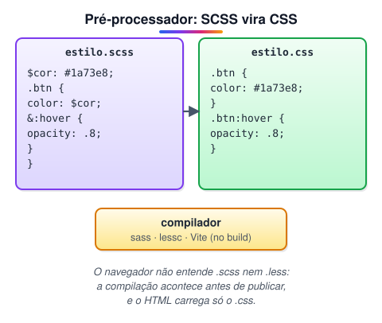
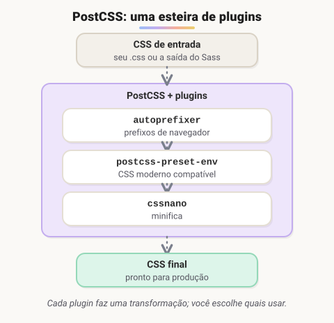

# CSS avançado · Sass, PostCSS, animações e organização

> 🗺️ **Sobre o módulo:** ferramentas e técnicas para CSS de projetos grandes: variáveis e animações nativas, pré-processadores (Sass e Less), PostCSS, CSS-in-JS e formas de organizar o código (BEM, Bootstrap, Tailwind).
>
> **Professor:** Elder · **Pré-requisito:** CSS 1.

## Variáveis CSS, transições e animações

> 🗺️ **Nesta aula:** variáveis CSS (e tema escuro), transições, `transform` e animações com `@keyframes`.

### De onde paramos

No módulo CSS 1, a mesma cor `#1a73e8` se repetiu em várias regras. Se o azul mudar, é preciso caçá-lo arquivo por arquivo. Na programação, isso se resolve com uma **variável**, e o CSS moderno tem as suas. Depois, a página ganha movimento: o `:hover` que antes trocava de cor de uma vez passa a mudar suavemente.

### Variáveis CSS (*custom properties*)

```css
:root {
  --cor-primaria: #1a73e8;
  --cor-texto: #1f2937;
  --cor-fundo: #ffffff;
  --raio: 8px;
  --espaco: 1rem;
}

.botao {
  background: var(--cor-primaria);
  border-radius: var(--raio);
  padding: var(--espaco) calc(var(--espaco) * 2);
}

/* valor reserva se a variável não existir */
.alerta { color: var(--cor-alerta, crimson); }
```

#### Diferenças para as variáveis do Sass

| Sass (`$cor`) | CSS (`--cor`) |
| --- | --- |
| some na compilação: vira um valor fixo | existe no navegador, em tempo real |
| não muda depois de compilado | pode mudar por media query, classe ou JavaScript |
| escopo de arquivo/bloco | segue a **cascata** e a herança do HTML |

#### Tema escuro com variáveis

```css
:root {
  --cor-fundo: #fff;
  --cor-texto: #111;
}

/* pelo sistema operacional... */
@media (prefers-color-scheme: dark) {
  :root {
    --cor-fundo: #121212;
    --cor-texto: #eee;
  }
}

/* ...ou por classe, com um botão */
.tema-escuro {
  --cor-fundo: #121212;
  --cor-texto: #eee;
}

body {
  background: var(--cor-fundo);
  color: var(--cor-texto);
}
```

```jsx
// liga/desliga o tema (JavaScript, visto adiante)
const raiz = document.documentElement;
raiz.classList.toggle("tema-escuro");
raiz.style.setProperty("--cor-primaria", "tomato");
```

### Transições: suavizar uma mudança de estado

```css
.botao {
  background: var(--cor-primaria);
  transition: background-color 0.2s ease,
              transform 0.2s ease;
}
.botao:hover {
  background: #1558b0;
  transform: translateY(-2px);
}
```

Formato: `transition: propriedade duração curva atraso`.

| Curva (*timing function*) | Movimento |
| --- | --- |
| `ease` (padrão) | acelera e desacelera |
| `linear` | velocidade constante |
| `ease-in` / `ease-out` | começa devagar / termina devagar |
| `cubic-bezier(...)` | curva personalizada |

### `transform`

```css
transform: translate(10px, 20px); /* move */
transform: scale(1.1);  /* +10% */
transform: rotate(45deg);  /* gira */
/* combina */
transform: translateX(-50%) rotate(10deg);
```

> ⚡ Para animações suaves, anime só `transform` e `opacity`: o navegador os processa na placa de vídeo, sem recalcular o layout. Animar `width`, `height`, `top` ou `margin` pode deixar a página travando. Evite `transition: all`.

### Animações com `@keyframes`

Para movimentos que acontecem sozinhos ou têm várias etapas:

```css
@keyframes aparecer {
  from {
    opacity: 0;
    transform: translateY(20px);
  }
  to {
    opacity: 1;
    transform: translateY(0);
  }
}

@keyframes pulsar {
  0%, 100% { transform: scale(1); }
  50%      { transform: scale(1.08); }
}

@keyframes girar { to { transform: rotate(360deg); } }

.card    { animation: aparecer 0.4s ease-out both; }
.alerta  { animation: pulsar 1.5s ease-in-out infinite; }
.loading { animation: girar 1s linear infinite; }
```

| Propriedade | Exemplo | Faz |
| --- | --- | --- |
| `animation-name` | `aparecer` | qual `@keyframes` usar |
| `animation-duration` | `0.4s` | duração |
| `animation-timing-function` | `ease-out` | curva |
| `animation-delay` | `0.1s` | espera antes de começar |
| `animation-iteration-count` | `3` · `infinite` | quantas vezes |
| `animation-direction` | `alternate` | vai e volta |
| `animation-fill-mode` | `both` | mantém o estilo do primeiro/último quadro |

### Respeite quem prefere menos movimento

```css
@media (prefers-reduced-motion: reduce) {
  *, *::before, *::after {
    animation-duration: 0.01ms !important;
    animation-iteration-count: 1 !important;
    transition-duration: 0.01ms !important;
  }
}
```

### 🧠 Revisão rápida

**`transition` ou `animation` para um botão que muda de cor no hover?**

`transition`: suaviza a mudança entre dois estados. `animation` é para movimentos que acontecem sozinhos ou têm várias etapas.

**Por que preferir animar `transform` a animar `top`?**

Porque `transform` não obriga o navegador a recalcular o layout; a animação fica mais suave.

> ➡️ **Próximo passo:** antes das variáveis nativas, os projetos usavam ferramentas que estendiam o CSS. Elas continuam muito presentes: **Pré e pós-processadores de CSS**.

### 📌 Resumo

| Item | Em uma frase |
| --- | --- |
| `--nome` · `var()` | declara · usa uma variável CSS |
| Tema escuro | trocar o valor das variáveis |
| `transition` | suaviza mudança de estado |
| `transform` | move, gira, escala |
| `@keyframes` e `animation` | animação com etapas |
| Desempenho | anime `transform` e `opacity` |

## Pré e pós-processadores de CSS

> 🗺️ **Nesta aula:** o que são pré-processadores e pós-processadores de CSS, por que existem e quando vale usá-los.

### De onde paramos

Você já conhece um "tradutor" desse tipo: o `javac`, que transforma `.java` em bytecode antes de rodar. Os pré-processadores de CSS fazem algo parecido: você escreve numa linguagem com mais recursos, e um compilador gera o CSS que o navegador entende.

### O problema

Em projetos grandes, o CSS puro tinha limitações: não havia variáveis, era preciso repetir seletores longos e trechos inteiros de código, e tudo ficava num arquivo gigante. Para resolver isso surgiram ferramentas que **estendem** a linguagem.

### Pré-processadores



**Pré-processador é uma linguagem "turbinada" que é compilada para CSS puro.** Recursos típicos:

- **variáveis** para cores, fontes e medidas;
- **aninhamento** de seletores, espelhando o HTML;
- **mixins**: blocos de estilo reutilizáveis, com parâmetros;
- **funções** (clarear e escurecer cores, cálculos);
- **condicionais e laços**, para gerar classes em série;
- **módulos**: dividir o estilo em vários arquivos e juntar no final.

|  | Sass (SCSS) | Less | Stylus |
| --- | --- | --- | --- |
| Variáveis | `$cor` | `@cor` | `cor = ...` |
| Sintaxe | `.scss` igual ao CSS; `.sass` por indentação | parecida com CSS | minimalista, chaves opcionais |
| Popularidade hoje | **a mais usada** (Angular, Bootstrap 4+) | Bootstrap até a v3; projetos legados | pouco usada |

### Pós-processadores: PostCSS



O **PostCSS** não é uma linguagem nova: ele lê CSS, aplica **plugins** e devolve CSS. É usado para adicionar prefixos de navegador, permitir recursos novos em navegadores antigos e minificar. Costuma rodar **depois** do Sass, ou sozinho.

### Ainda preciso disso?

O CSS evoluiu e hoje faz nativamente muito do que antes exigia um pré-processador:

| Recurso | Antes | Hoje no CSS puro |
| --- | --- | --- |
| Variáveis | `$cor` (Sass) | `--cor` e `var(--cor)` (*custom properties*), que ainda mudam em tempo real |
| Aninhamento | Sass/Less | **CSS nesting** (`.card { & h2 { } }`), suportado nos navegadores atuais desde 2023 |
| Cálculos | funções do Sass | `calc()`, `min()`, `max()`, `clamp()` |
| Cores derivadas | `darken()` | `color-mix()` |

Mesmo assim, o Sass continua muito usado em projetos existentes e em frameworks (o Angular cria projetos com SCSS). Saber ler e escrever SCSS ainda é exigido em vagas de front-end.

### 🧠 Revisão rápida

**O navegador entende um arquivo `.scss`?**

Não. O SCSS precisa ser compilado para `.css` antes; o navegador só entende CSS.

**Qual a diferença entre Sass e PostCSS?**

Sass é uma linguagem estendida compilada para CSS (pré). PostCSS recebe CSS e aplica plugins, devolvendo CSS (pós).

> ➡️ **Próximo passo:** o pré-processador mais usado, e o que o Angular cria por padrão: **Sass (SCSS)**.

### 📌 Resumo

| Item | Em uma frase |
| --- | --- |
| Pré-processador | linguagem estendida → CSS (Sass, Less) |
| Pós-processador | CSS → plugins → CSS (PostCSS) |
| Compilação | acontece no build, não no navegador |
| CSS moderno | já tem variáveis, aninhamento e funções |

## Sass (SCSS)

> 🗺️ **Nesta aula:** usar o Sass (SCSS), o pré-processador mais popular: variáveis, aninhamento, mixins, módulos, condições e laços.

### De onde paramos

Repare na lista de recursos do Sass: variáveis, funções com parâmetros (mixins), condições e laços. É a lógica de programação dos módulos 1 e 2, aplicada a gerar CSS. Um `@for` do Sass funciona como o `para` do Portugol.

### O que é

**Sass (*Syntactically Awesome Style Sheets*) é o pré-processador de CSS mais usado.** A implementação oficial hoje é o **Dart Sass**, instalado pelo npm. As versões antigas em Ruby e a LibSass (`node-sass`) foram descontinuadas.

🔗 [Sass: Syntactically Awesome Style Sheets](https://sass-lang.com/)

```bash
npm install -D sass
# recompila a cada alteração
npx sass scss/main.scss css/main.css --watch
```

#### Duas sintaxes

| `.scss` ✅ | `.sass` |
| --- | --- |
| chaves e `;`, igual ao CSS | indentação, sem chaves nem `;` |
| a mais usada (padrão no Angular) | mais enxuta, menos comum |

```scss
// .scss
.botao {
  color: white;
}
```

```sass
// .sass
.botao
  color: white
```

### Variáveis: `$`

```scss
$cor-primaria: #1a73e8;
$espaco: 16px;

.botao {
  background: $cor-primaria;
  padding: $espaco ($espaco * 2);
}
```

### Aninhamento e `&`

```scss
.menu {
  display: flex;
  // vira: .menu a
  a {
    color: inherit;
    // vira: .menu a:hover
    &:hover { color: $cor-primaria; }
  }
  // vira: .menu--escuro
  &--escuro { background: #111; }
}
```

Regra prática: no máximo três níveis.

### Mixins: `@mixin` e `@include`

```scss
@mixin centralizar($direcao: row) {
  display: flex;
  flex-direction: $direcao;
  justify-content: center;
  align-items: center;
}

.hero  { @include centralizar; }
.lista { @include centralizar(column); }

// @content recebe o bloco passado
@mixin celular {
  @media (max-width: 600px) { @content; }
}
.card {
  padding: 32px;
  @include celular { padding: 16px; }
}
```

No Sass, o mixin precisa ser declarado **antes** de ser usado.

### `@extend` e placeholders

```scss
%botao-base {
  padding: 8px 16px;
  border-radius: 6px;
  border: 0;
}

.btn-primario {
  @extend %botao-base;
  background: $cor-primaria;
}
.btn-secundario {
  @extend %botao-base;
  background: gray;
}
```

O `%` cria um seletor "fantasma" que só aparece no CSS final se for estendido.

### Módulos: `@use` (substitui o `@import`)

Arquivos **parciais** começam com `_` e não geram CSS sozinhos:

```scss
// _cores.scss
$primaria: #1a73e8;

// main.scss
@use "cores";
@use "sass:math";

// acesso pelo namespace
h1 { color: cores.$primaria; }
// divisão com math.div
.coluna { width: math.div(100%, 3); }
```

- `@use` carrega cada arquivo **uma vez** e com **namespace**, evitando conflito de nomes.
- O antigo `@import` está **obsoleto** desde o Dart Sass 1.80 (2024) e será removido.
- A divisão com `/` também está obsoleta; use `math.div()`.

### Condições e laços

```scss
@mixin tema($escuro: false) {
  @if $escuro {
    background: #111;
    color: #eee;
  } @else {
    background: #fff;
    color: #111;
  }
}

// gera .mt-1, .mt-2, .mt-3
@for $i from 1 through 3 {
  .mt-#{$i} { margin-top: $i * 8px; }
}

$cores: (sucesso: green, erro: red);
@each $nome, $cor in $cores {
  .alerta-#{$nome} {
    border-left: 4px solid $cor;
  }
}
```

O `@for` acima vira este CSS depois de compilado:

```css
.mt-1 { margin-top: 8px; }
.mt-2 { margin-top: 16px; }
.mt-3 { margin-top: 24px; }
```

> 💡 **Interpolação** `#{$variavel}` insere um valor dentro de seletores, nomes de propriedades ou textos, como em `.mt-#{$i}`.

### 🧠 Revisão rápida

**Em `.card { &:hover { } }`, qual seletor o Sass gera?**

`.card:hover`: o `&` é substituído pelo seletor do pai.

**Qual a diferença entre `@mixin` e `@extend`?**

O mixin copia as declarações para cada lugar que o inclui (e aceita parâmetros). O `@extend` agrupa os seletores que compartilham o mesmo bloco.

**Por que usar `@use` e não `@import`?**

O `@import` está obsoleto; o `@use` carrega cada arquivo uma vez e com namespace, evitando conflito de nomes.

> ➡️ **Próximo passo:** o Sass tem um "primo" com sintaxe parecida, comum em projetos mais antigos: **Less**.

### 📌 Resumo

| Item | Em uma frase |
| --- | --- |
| Dart Sass | a implementação oficial, pelo npm |
| `$var` | variável (some na compilação) |
| `&` | o seletor do pai no aninhamento |
| `@mixin`/`@include` | bloco reutilizável com parâmetros |
| `@use` | módulos com namespace |
| `@if` · `@for` · `@each` | lógica para gerar CSS |

## Less

> 🗺️ **Nesta aula:** escrever estilos com variáveis, aninhamento, mixins, funções e operações no Less.

### De onde paramos

O Less faz as mesmas coisas que o Sass da aula anterior, com outra sintaxe. A principal diferença visual: variáveis com `@` em vez de `$`. Estude-o comparando com o Sass; você vai encontrá-lo sobretudo em projetos mais antigos.

### O que é

**Less (Leaner Style Sheets) é um pré-processador com sintaxe muito parecida com o CSS.** Todo CSS válido também é Less válido. Ele é escrito em JavaScript e foi a base do Bootstrap até a versão 3.

🔗 [Getting started | Less.js](https://lesscss.org/)

```bash
npm install -g less
# compila; o HTML importa o estilo.css
lessc estilo.less estilo.css
```

O Less também pode ser compilado **no navegador** com um script, mas isso deixa a página lenta: use só para testes.

### Variáveis: `@`

```less
@cor-primaria: #1a73e8;
@raio: 8px;

.botao {
  background: @cor-primaria;
  border-radius: @raio;
}
```

### Aninhamento

Seletores dentro de seletores geram seletores descendentes. O `&` representa o seletor pai:

```less
.card {
  padding: 16px;
  // gera .card h2
  h2 { font-size: 1.25rem; }
  // gera .card:hover
  &:hover {
    box-shadow: 0 4px 12px rgba(0, 0, 0, .15);
  }
  // gera .card--destaque
  &--destaque {
    border: 2px solid @cor-primaria;
  }
}
```

Evite passar de três níveis: seletores muito longos ficam pesados e difíceis de sobrescrever.

### Funções prontas

```less
@base: #3366cc;
.btn { background: @base; }
// 10% mais escuro
.btn:hover { background: darken(@base, 10%); }
// 20% de opacidade
.fundo { background: fade(@base, 20%); }
// 50%
.metade { width: percentage(0.5); }
```

Outras: `lighten()`, `saturate()`, `mix()`, `round()`, `ceil()`.

### Mixins

Um mixin é um bloco de estilos reutilizável, escrito como uma classe e que pode ter parâmetros com valor padrão:

```less
.arredondado(@raio: 5px) {
  border-radius: @raio;
}

.botao { .arredondado(); }  // 5px
.card  { .arredondado(10px); }
.foto  { .arredondado(50%); }
```

### Condições: *guards*

```less
// fundo claro -> texto preto
.cor-texto(@cor) when (lightness(@cor) >= 50%) {
  color: black;
}
// fundo escuro -> texto branco
.cor-texto(@cor) when (lightness(@cor) < 50%) {
  color: white;
}

.banner {
  background: #222;
  .cor-texto(#222);  // texto branco
}
```

### Operações

```less
@base: 16px;
h1 { font-size: @base * 2; }  // 32px
h2 { font-size: @base + 4; }  // 20px
.coluna { width: (100% / 3); }  // divisão entre parênteses
```

> ⚠️ Desde o Less 4, a divisão com `/` só é calculada **entre parênteses**; sem eles, a barra fica como texto, porque o CSS a usa em `font: 16px/1.5`. E chame mixins sempre com parênteses: `.arredondado();`.

### Sass × Less lado a lado

| Recurso | Sass (SCSS) | Less |
| --- | --- | --- |
| Variável | `$cor` | `@cor` |
| Mixin | `@mixin x() {}` e `@include x;` | `.x() {}` e `.x();` |
| Condição | `@if` | `when` (guard) |
| Escurecer cor | `color.adjust()` | `darken()` |

### Importando arquivos

```less
@import "variaveis.less";
@import "botoes.less";
```

### 🧠 Revisão rápida

**Como se declara uma variável no Less? E no Sass?**

Less: `@cor: blue;`. Sass: `$cor: blue;`.

**Todo CSS válido é Less válido?**

Sim: o Less é um "superconjunto" do CSS.

> ➡️ **Próximo passo:** depois de compilar, o CSS ainda pode ser melhorado automaticamente (prefixos, minificação): **PostCSS**.

### 📌 Resumo

| Item | Em uma frase |
| --- | --- |
| Less | pré-processador com sintaxe de CSS |
| `@var` | variável |
| Mixin | classe reutilizável com parâmetros |
| Guards (`when`) | condições |
| Funções | `darken()`, `lighten()`, `fade()` |
| Divisão | sempre entre parênteses |

## PostCSS

> 🗺️ **Nesta aula:** o PostCSS e seus plugins mais usados: prefixos automáticos, CSS moderno compatível, minificação e verificação de código.

### De onde paramos

Sass e Less transformam uma linguagem estendida em CSS. O PostCSS entra **depois**: pega o CSS pronto (escrito à mão ou gerado pelo Sass) e o melhora automaticamente. É como um revisor que passa no texto depois de escrito.

### O que é


**PostCSS é uma ferramenta em JavaScript que lê o CSS, aplica plugins e devolve CSS.** Sozinho ele não faz nada: cada recurso vem de um plugin. Por isso é chamado de **pós-processador** (trabalha sobre CSS pronto), ao contrário do Sass e do Less, que compilam uma linguagem própria.

- Roda no **build**: Vite, Angular CLI, webpack e Next.js já usam PostCSS por baixo dos panos.
- Costuma vir **depois** do Sass: SCSS → Sass → CSS → PostCSS → CSS final.

🔗 [PostCSS](https://postcss.org/)

### Plugins mais usados

| Plugin | Faz |
| --- | --- |
| **autoprefixer** | adiciona prefixos de navegador (`-webkit-`, `-ms-`) conforme a lista de navegadores que você suporta |
| **postcss-preset-env** | permite usar recursos novos do CSS, convertendo-os para navegadores mais antigos |
| **cssnano** | minifica o CSS: tira espaços e comentários e encurta valores |
| **stylelint** | aponta erros e padroniza o estilo do código (como um ESLint para CSS) |
| **tailwindcss** | o Tailwind também funciona como plugin do PostCSS |

**Links dos plugins**

🔗 [https://autoprefixer.github.io/](https://autoprefixer.github.io/)

🔗 [https://stylelint.io/](https://stylelint.io/)

🔗 [https://www.postcss.parts/](https://www.postcss.parts/)

### Exemplo com autoprefixer

```bash
npm install -D postcss postcss-cli autoprefixer
```

```jsx
// postcss.config.js
module.exports = {
  plugins: [require("autoprefixer")],
};
```

No `package.json`, a lista de navegadores que você suporta (Browserslist):

```json
"browserslist": [
  "> 0.5%", "last 2 versions", "not dead"
]
```

```css
/* entrada */
.caixa { user-select: none; }

/* saída */
.caixa {
  -webkit-user-select: none;
  user-select: none;
}
```

```bash
npx postcss src/estilo.css -o dist/estilo.css
```

> 💡 O autoprefixer só acrescenta o que a sua lista de navegadores exige. Com uma lista atual, `display: flex` não recebe prefixo nenhum; já `user-select` ainda precisa de `-webkit-` no Safari.

### 🧠 Revisão rápida

**O PostCSS sozinho faz alguma coisa?**

Não: cada recurso vem de um plugin (autoprefixer, cssnano...).

**Qual plugin deixa o CSS final menor?**

O cssnano, que minifica.

> ➡️ **Próximo passo:** com as ferramentas prontas, falta decidir como **organizar** o CSS de um projeto grande: **Organizando o CSS: BEM, Bootstrap e Tailwind**.

### 📌 Resumo

| Item | Em uma frase |
| --- | --- |
| PostCSS | CSS → plugins → CSS |
| autoprefixer | prefixos de navegador |
| postcss-preset-env | CSS novo em navegadores antigos |
| cssnano | minifica |
| stylelint | aponta erros e padroniza |
| Browserslist | lista de navegadores suportados |

## Organizando o CSS: BEM, Bootstrap e Tailwind

> 🗺️ **Nesta aula:** três formas de manter o CSS organizado em projetos grandes: a convenção BEM, o Bootstrap e o Tailwind.

### De onde paramos

Na aula da cascata, um id no seletor "ganhava" de tudo e ficava difícil sobrescrever. Em projetos grandes, esse tipo de briga de especificidade se multiplica. Assim como o MVC organizou o código Java do TodoApp em papéis claros, existem estratégias para organizar o CSS.

### O problema

Com o tempo, o CSS de um projeto tende a virar uma bagunça: classes com nomes ambíguos, regras que se sobrepõem, medo de apagar algo e quebrar outra página, e `!important` espalhado. Existem três caminhos principais para evitar isso.

### 1. Metodologia BEM

**BEM (Bloco, Elemento, Modificador) é uma convenção de nomes de classes.**

| Parte | Formato | Exemplo |
| --- | --- | --- |
| **Bloco** | um componente independente | `.card` |
| **Elemento** | uma parte do bloco: `bloco__elemento` | `.card__titulo`, `.card__imagem` |
| **Modificador** | uma variação: `bloco--modificador` | `.card--destaque`, `.card__botao--desativado` |

```html
<article class="card card--destaque">
  
  <h2 class="card__titulo">Camisa polo</h2>
  <button class="card__botao">Comprar</button>
</article>
```

```scss
.card {
  padding: 1rem;
  &__titulo { font-size: 1.25rem; }
  &__botao  { background: var(--cor-primaria); }
  &--destaque { border: 2px solid gold; }
}
```

Vantagens: todas as classes têm a **mesma especificidade baixa** (uma classe só), os nomes dizem onde cada estilo é usado e não há colisões.

### 2. Bootstrap: componentes prontos

**Bootstrap é o framework CSS mais conhecido**: traz um sistema de grid, componentes prontos (botões, cards, menus, modais, formulários) e utilitários.

```html
<!-- o CSS do Bootstrap, por CDN -->
<link rel="stylesheet" href="https://cdn.jsdelivr.net/
npm/bootstrap@5.3.3/dist/css/bootstrap.min.css">
<!-- (o endereço acima é uma linha só) -->

<div class="container">
  <div class="row">
    <div class="col-12 col-md-6">
      <div class="card">
        <div class="card-body">
          <h5 class="card-title">Título</h5>
          <a href="#" class="btn btn-primary">Ver mais</a>
        </div>
      </div>
    </div>
  </div>
</div>
```

- O grid tem **12 colunas**: `col-12 col-md-6` ocupa a largura toda no celular e metade a partir de telas médias.
- Personalização por variáveis Sass ou CSS.
- Bom para painéis administrativos e protótipos rápidos; o risco é todo site ficar com "cara de Bootstrap".

### 3. Tailwind CSS: classes utilitárias

**Tailwind oferece uma classe pequena para cada propriedade**, aplicadas direto no HTML:

```html
<button class="px-4 py-2 rounded-lg
               bg-blue-600 text-white
               font-semibold hover:bg-blue-700">
  Salvar
</button>
```

Lendo as classes: `px-4` = padding horizontal; `py-2` = padding vertical; `rounded-lg` = cantos arredondados; `bg-blue-600` = fundo azul; `hover:bg-blue-700` = azul mais escuro no hover.

- Não há componentes prontos: você monta o visual combinando utilitários.
- No build, só as classes realmente usadas vão para o CSS final, que fica pequeno.
- Responsivo e estados com prefixos: `md:grid-cols-3`, `hover:`, `focus:`, `dark:`.
- O HTML fica "carregado" de classes; em frameworks de componentes isso pesa menos, porque cada componente encapsula seu HTML.

### Comparando

|  | CSS próprio + BEM | Bootstrap | Tailwind |
| --- | --- | --- | --- |
| Velocidade para começar | lenta | muito rápida | rápida |
| Visual exclusivo | total | difícil | total |
| Tamanho do CSS | o que você escrever | grande, se não enxugar | pequeno |
| Curva de aprendizado | CSS puro | classes do framework | nomes dos utilitários |

Qualquer que seja a escolha, saber **CSS puro** continua essencial: frameworks só aceleram quem já entende o que está por baixo.

**Documentações**

🔗 [https://getbootstrap.com/](https://getbootstrap.com/)

🔗 [https://tailwindcss.com/](https://tailwindcss.com/)

🔗 [https://getbem.com/](https://getbem.com/)

### 🧠 Revisão rápida

**No BEM, o que significa `.menu__item--ativo`?**

O elemento `item` do bloco `menu`, na variação `ativo`.

**No Bootstrap, o que faz `col-12 col-md-6`?**

Ocupa as 12 colunas (largura toda) no celular e 6 colunas (metade) a partir de telas médias.

> ➡️ **Próximo passo:** em frameworks de componentes, existe ainda outra abordagem: escrever o CSS dentro do JavaScript. É o tema de **Styled Components e CSS-in-JS**.

### 📌 Resumo

| Item | Em uma frase |
| --- | --- |
| BEM | `bloco__elemento--modificador` |
| Vantagem do BEM | especificidade baixa e sem colisões |
| Bootstrap | componentes e grid de 12 colunas prontos |
| Tailwind | uma classe utilitária por propriedade |
| Base de tudo | CSS puro bem entendido |

## Styled Components e CSS-in-JS

> 🗺️ **Nesta aula:** a abordagem CSS-in-JS com Styled Components e as alternativas para isolar estilos por componente.

### De onde paramos

O BEM evita colisões de nomes por **convenção**: depende de todos seguirem a regra. Os frameworks de componentes vão além e isolam o estilo **automaticamente**. Esta aula mostra a versão do React (CSS-in-JS) e prepara o terreno para o Angular, que faz isso do jeito dele. O exemplo usa JavaScript e React, que você ainda vai estudar; foque na ideia.

### O problema: CSS é global

Num projeto grande, uma regra `.titulo` escrita para um componente pode afetar outro que também usa `.titulo`. Frameworks baseados em componentes (React, Angular, Vue) resolvem isso **isolando o estilo de cada componente**.

### Styled Components

🔗 [styled-components](https://styled-components.com/)

**Styled Components é uma biblioteca** ***CSS-in-JS*** **para React**: o CSS é escrito dentro do JavaScript, numa *template string*, e o resultado é um componente já estilizado.

```jsx
import styled from "styled-components";

const Botao = styled.button`
  background: ${(p) =>
    p.$primario ? "#1a73e8" : "#e5e7eb"};
  color: ${(p) =>
    p.$primario ? "white" : "#111"};
  padding: 10px 20px;
  border: 0;
  border-radius: 6px;

  &:hover { opacity: 0.9; }
`;

export default function App() {
  return (
    <>
      <Botao $primario>Salvar</Botao>
      <Botao>Cancelar</Botao>
    </>
  );
}
```

- Cada componente recebe um **nome de classe único** gerado automaticamente (`.sc-a1b2c3`), então não há conflito.
- O estilo pode **depender das props**, como o `$primario` acima. O `$` na frente indica que a prop é só para o estilo e não vai para o HTML.
- Suporta aninhamento com `&`, media queries e temas (`ThemeProvider`).

| Vantagens | Desvantagens |
| --- | --- |
| estilo junto do componente e isolado | o CSS é gerado em tempo de execução, o que custa desempenho |
| estilos dinâmicos com props | só funciona com React |
| apagar o componente apaga o estilo | depende de JavaScript para aparecer |

> ⚠️ Em 2025, os mantenedores colocaram o Styled Components em **modo de manutenção** (só correções, sem novos recursos) e recomendaram outras soluções para projetos novos. O conceito de CSS-in-JS continua importante para entender projetos existentes.

### Outras formas de isolar estilos

| Abordagem | Como funciona | Onde aparece |
| --- | --- | --- |
| **CSS Modules** | arquivo `Botao.module.css`; as classes ganham nomes únicos na compilação | React, Next.js, Vite |
| **Encapsulamento do Angular** | cada componente tem seu `.scss`, e o Angular isola o estilo automaticamente | Angular (você verá no módulo de Angular) |
| **Tailwind CSS** | classes utilitárias direto no HTML (`class="px-4 py-2 rounded bg-blue-600"`) | muito usado em projetos novos |
| **BEM** | convenção de nomes (`.card__titulo--destaque`) que evita colisões no CSS comum | qualquer projeto |

### 🧠 Revisão rápida

**Como o Styled Components evita que `.titulo` de um componente afete outro?**

Gerando um nome de classe único para cada componente automaticamente.

**No Angular, como os estilos de um componente ficam isolados?**

Cada componente tem o seu arquivo `.scss`, e o Angular isola o estilo automaticamente (encapsulamento).

> ➡️ **Próximo passo:** fim da etapa de CSS! Estrutura (HTML) e aparência (CSS) prontas, falta a terceira camada: o **comportamento**. Ela começa em **JavaScript · Fundamentos, DOM, eventos e jQuery**.

### 📌 Resumo

| Item | Em uma frase |
| --- | --- |
| Problema | CSS é global; nomes colidem |
| CSS-in-JS | estilo dentro do JavaScript do componente |
| Styled Components | classes únicas e estilo por props (em manutenção) |
| CSS Modules | classes renomeadas na compilação |
| Angular | estilo de componente isolado automaticamente |

## 📌 Resumo do módulo

| Conceito | Lembrete |
| --- | --- |
| Variáveis CSS | `--nome` em `:root`, `var(--nome)`; mudam em tempo real (temas) |
| Transição × animação | suaviza mudança de estado × `@keyframes` com várias etapas |
| Desempenho | anime `transform` e `opacity` |
| Pré-processador | linguagem estendida compilada para CSS (Sass, Less) |
| Sass | `$var`, aninhamento com `&`, `@mixin`/`@include`, `@use` (não `@import`) |
| Less | `@var`, mixins como classes, `darken()`, divisão entre parênteses |
| PostCSS | CSS → plugins (autoprefixer, cssnano) → CSS |
| BEM | `.bloco__elemento--modificador` |
| Bootstrap · Tailwind | componentes prontos · classes utilitárias |
| CSS-in-JS | estilo dentro do componente React (Styled Components, em manutenção) |
