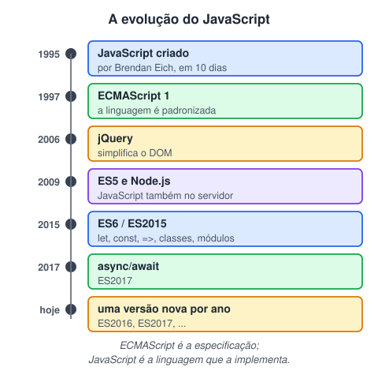
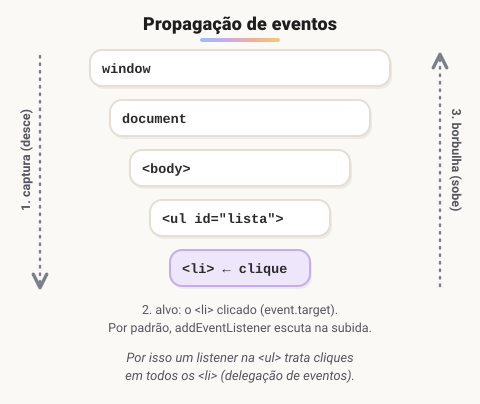
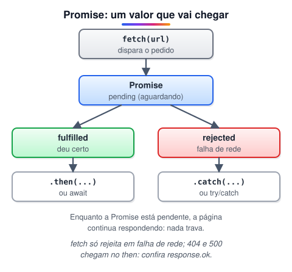

# JavaScript · Fundamentos, DOM, eventos e jQuery

> 🗺️ **Sobre o módulo:** a linguagem que dá comportamento à página. Da sintaxe básica (variáveis, condicionais, laços, funções) à manipulação do DOM, eventos, requisições a APIs e a biblioteca jQuery.
>
> **Professor:** Ralf Lima · **Pré-requisitos:** HTML 3 e CSS 1 · **Ferramenta essencial:** o Console do DevTools (F12).

## O que é JavaScript e como usar na página

> 🗺️ **Nesta aula:** o que é JavaScript, como colocá-lo na página e como mostrar e receber informações (console e caixas de diálogo).

### De onde paramos

HTML deu a estrutura, CSS deu a aparência. Falta a terceira camada: o **comportamento**. E aqui você volta à programação de verdade, com variáveis, decisões, laços e funções, os mesmos conceitos do Portugol e do Java. Você até já escreveu um pouco de JavaScript, nas classes do módulo 2. A diferença é que agora ele vai rodar **dentro da página**.

### O que é JavaScript

**JavaScript é a linguagem de programação da web**: dá **comportamento** à página. Junto com o HTML (estrutura) e o CSS (aparência), forma a base de todo site.

- Linguagem de **alto nível**, **interpretada** (compilada na hora pelo motor do navegador, como o V8 do Chrome) e de **tipagem dinâmica** (a variável não tem tipo fixo).
- Roda no **navegador** e também fora dele, com **Node.js** (servidores, ferramentas de linha de comando).
- Usos no navegador: reagir a cliques, validar formulários, mostrar e esconder elementos, buscar dados de APIs sem recarregar a página.

### Um pouco de história



- Criado por **Brendan Eich** na **Netscape**, em 1995, em cerca de 10 dias. Chamou-se Mocha, depois LiveScript e, por fim, **JavaScript**, aproveitando a fama do Java. Apesar do nome, **as duas linguagens não têm relação**.
- Em 1997 foi padronizado pela Ecma International com o nome **ECMAScript**. As versões são chamadas de ES5, ES6 (ES2015), ES2017...
- O **ES6 (2015)** foi a grande virada: `let`, `const`, arrow functions, classes, módulos, template strings, Promises. Desde então sai uma versão nova por ano.

### Onde escrever o JavaScript

```html
<!DOCTYPE html>
<html lang="pt-BR">
<head>
  <meta charset="UTF-8">
  <title>Minha página</title>
  <!-- ✅ externo, com defer -->
  <script src="js/main.js" defer></script>
</head>
<body>
  <h1>Olá</h1>

  <script>
    // interno: útil em testes rápidos
    console.log("Página carregada");
  </script>
</body>
</html>
```

| Forma | Quando usar |
| --- | --- |
| **Arquivo externo** com `defer` no `head` ✅ | sempre que possível: organizado, reaproveitável e em cache |
| `<script>` interno no fim do `body` | exemplos e testes |
| Atributos como `onclick="..."` no HTML | evite: mistura estrutura e comportamento (veja a página de eventos) |

> 💡 O `defer` faz o script ser baixado em paralelo e executado só depois que todo o HTML foi lido. Sem ele, um script no `head` tenta acessar elementos que ainda não existem e dá erro.

### Mostrando informações

#### `console.log`: a ferramenta do programador

```jsx
console.log("Olá, mundo!");
console.log("Total:", 10 + 5);
console.table([
  { nome: "Ana", nota: 9 },
  { nome: "Beto", nota: 7 },
]);
console.error("Algo deu errado");
```

O resultado aparece no **Console** do DevTools (F12). É ali também que aparecem os erros do seu código, com o arquivo e a linha. Deixe-o sempre aberto enquanto programa.

#### Caixas de diálogo do navegador

| Função | Mostra | Retorna |
| --- | --- | --- |
| `alert("msg")` | mensagem + OK | nada (`undefined`) |
| `confirm("msg")` | OK / Cancelar | `true` / `false` |
| `prompt("msg")` | campo de texto | o texto digitado (**sempre string**) ou `null` se cancelar |

```jsx
const nome = prompt("Qual é o seu nome?");
if (nome !== null && confirm("Deseja continuar?")) {
  alert(`Olá, ${nome}!`);
}

// converta: prompt sempre devolve texto
const idade = Number(prompt("Idade:"));
```

> ⚠️ `alert`, `confirm` e `prompt` **travam a página** até a pessoa responder e não podem ser estilizados. São ótimos para aprender, mas em sites reais as mensagens são feitas com HTML e CSS, alteradas pelo JavaScript.

### Comentários

```jsx
// comentário de uma linha

/*
  comentário de
  várias linhas
*/
```

### Comparando com o que você já sabe

|  | Portugol | Java | JavaScript |
| --- | --- | --- | --- |
| Escrever | `escreval(x)` | `System.out.println(x)` | `console.log(x)` |
| Ler | `leia(x)` | `sc.nextLine()` | `prompt("...")` |
| Variável | `x : inteiro` | `int x;` | `let x;` (sem tipo) |
| Roda em | VisuAlg | JVM | navegador ou Node.js |

### 🧠 Revisão rápida

**JavaScript e Java são a mesma linguagem?**

Não. O nome foi uma jogada de marketing de 1995; as linguagens são diferentes.

**O que `prompt("Idade:")` devolve quando a pessoa digita 20?**

O texto `"20"`, e não o número. Converta com `Number()`.

**Onde aparecem os erros do seu JavaScript?**

No Console do DevTools (F12), com o arquivo e a linha.

> ➡️ **Próximo passo:** o primeiro bloco de qualquer linguagem: **Variáveis, tipos e operadores**.

### 📌 Resumo

| Item | Em uma frase |
| --- | --- |
| JavaScript | a linguagem de comportamento da web |
| ECMAScript | o padrão; ES6 (2015) modernizou tudo |
| Onde escrever | arquivo externo com `defer` |
| `console.log` | a ferramenta de depuração |
| `alert` · `confirm` · `prompt` | caixas de diálogo; só para aprender |

## Variáveis, tipos e operadores

> 🗺️ **Nesta aula:** `let` e `const`, os tipos de dados, conversões e os operadores aritméticos, relacionais e lógicos.

### De onde paramos

Variáveis e operadores você já conhece do Portugol e do Java. A grande diferença do JavaScript: a variável **não tem tipo fixo**. Em Java, `int x` só aceita inteiros; em JavaScript, `let x` pode guardar um número agora e um texto depois. Isso dá liberdade, e também algumas armadilhas que esta aula mostra.

### Variáveis

**Variável é um nome que guarda um valor na memória** para ser usado depois.

```jsx
const nome = "Ana"; // não pode mudar
let idade = 25;  // pode mudar
idade = 26;
```

|  | `var` | `let` | `const` |
| --- | --- | --- | --- |
| Escopo | função | bloco `{ }` | bloco `{ }` |
| Pode redeclarar | sim | não | não |
| Pode reatribuir | sim | sim | **não** |
| Uso hoje | **evite** | quando o valor muda | **padrão** |

> 💡 Use `const` por padrão e troque para `let` só quando precisar reatribuir. Um `const` com objeto ou array **pode ter o conteúdo alterado** (`lista.push(1)` funciona); o que não pode é apontar para outro valor (`lista = []`).

Regras de nomes: letras, números, `_` e `$`, sem começar com número. Convenção: **camelCase** (`precoTotal`, `nomeCompleto`). O JavaScript diferencia maiúsculas de minúsculas (`nome` ≠ `Nome`).

### Tipos de dados

| Tipo | Exemplo | `typeof` |
| --- | --- | --- |
| `string` (texto) | `"Ana"`, `'Ana'`, ```Ana``` | `"string"` |
| `number` (inteiro ou decimal) | `42`, `3.14`, `NaN` | `"number"` |
| `boolean` | `true`, `false` | `"boolean"` |
| `undefined` | variável sem valor | `"undefined"` |
| `null` | "vazio" de propósito | `"object"` (um erro histórico da linguagem) |
| `bigint` | `9007199254740993n` | `"bigint"` |
| `symbol` | `Symbol("id")` | `"symbol"` |
| `object` (objetos, arrays, datas) | `{ nome: "Ana" }`, `[1, 2]` | `"object"` |

Para saber se algo é array, use `Array.isArray(valor)`.

### Conversões

```jsx
Number("42")  // 42
Number("42abc")  // NaN (Not a Number)
parseInt("42px")  // 42 (para no "p")
parseFloat("3.5")  // 3.5
String(42)  // "42"
(3.14159).toFixed(2) // "3.14" (string)
Boolean("")  // false
```

> ⚠️ O `+` com texto **junta** em vez de somar: `"5" + 3` dá `"53"`. Já `"5" - 3` dá `2`. Valores vindos de `prompt` e de campos de formulário são **sempre texto**: converta com `Number()` antes de calcular.

### Operadores aritméticos e de atribuição

| Operador | Exemplo | Resultado |
| --- | --- | --- |
| `  • - * /` | `7 / 2` | `3.5` (não é 3 como no Java!) |
| `%` (resto) | `7 % 2` | `1` (útil para saber se é par: `n % 2 === 0`) |
| `**` (potência) | `2 ** 3` | `8` |
| `++` / `--` | `i++` | soma / subtrai 1 |
| `+=`, `-=`, `*=` | `total += 10` | `total = total + 10` |

### Operadores relacionais

```jsx
3 < 4  // true
3 >= 4  // false
// == converte o tipo antes de comparar
3 == "3"  // true
// === compara valor E tipo ✅
3 === "3"  // false
3 !== "3"  // true
```

Use sempre `===` **e** `!==`: o `==` faz conversões automáticas com resultados estranhos (`0 == ""` é `true`).

### Operadores lógicos

| Operador | Resultado | Exemplo |
| --- | --- | --- |
| `&&` (E) | verdadeiro se **todos** forem | `idade >= 18 && temCnh` |
| `\|\|` (OU) | verdadeiro se **pelo menos um** for | `ehAdmin \|\| ehDono` |
| `!` (NÃO) | inverte | `!logado` |

```jsx
// mesmo que numero !== 0
if (!(numero === 0)) console.log("Não é zero");
```

#### Valores "falsos" (*falsy*)

Em uma condição, estes valores contam como `false`: `false`, `0`, `""` (texto vazio), `null`, `undefined` e `NaN`. Todo o resto conta como `true`, inclusive `"0"`, `[]` e `{}`.

```jsx
const nome = prompt("Nome:");
// falso se vazio ou cancelado
if (nome) console.log("Digitou algo");

// valor padrão
const apelido = nomeInformado || "Visitante";

// ?? só troca null/undefined (mantém o 0)
const qtd = quantidade ?? 1;
```

### 🧠 Revisão rápida

**Quanto vale `"10" + 5`? E `"10" - 5`?**

`"105"` (o `+` concatena com texto) e `5` (o `-` converte para número).

**Quanto vale `7 / 2` em JavaScript? E em Java, entre inteiros?**

Em JavaScript, `3.5` (só há um tipo `number`). Em Java, `3`.

**`const lista = []; lista.push(1);` dá erro?**

Não: o conteúdo do array pode mudar. O que `const` impede é `lista = outraCoisa`.

> ➡️ **Próximo passo:** com variáveis e comparações, dá para tomar decisões e repetir: **Condicionais e laços de repetição**.

### 📌 Resumo

| Item | Em uma frase |
| --- | --- |
| `const` · `let` | padrão · quando muda; nunca `var` |
| Tipagem dinâmica | a variável não tem tipo fixo |
| `typeof` | mostra o tipo do valor |
| `Number()` | converte texto em número |
| `===` | compara valor e tipo; use sempre |
| Falsy | `false`, `0`, `""`, `null`, `undefined`, `NaN` |

## Condicionais e laços de repetição

> 🗺️ **Nesta aula:** `if`, ternário e `switch`; os laços `for`, `while`, `do...while`, `for...of` e `for...in`.

### De onde paramos

Esta aula é quase uma revisão: a sintaxe do JavaScript para decisões e laços é praticamente igual à do Java. Se você fez os 35 exercícios de Java estruturado, vai reconhecer tudo. As novidades são o `for...of` e o `for...in`.

| Portugol | Java | JavaScript |
| --- | --- | --- |
| `se ... senao` | `if ... else` | `if ... else` |
| `escolha` | `switch` | `switch` |
| `para` | `for (int i...)` | `for (let i...)` |
| `enquanto` | `while` | `while` |
| `repita ... ate` | `do ... while` | `do ... while` |

### `if`, `else if`, `else`

```jsx
const idade = 17;

if (idade >= 18) {
  console.log("Você pode votar e dirigir.");
} else if (idade >= 16) {
  console.log("Pode votar, mas não dirigir.");
} else {
  console.log("Você ainda não pode votar.");
}
```

O JavaScript testa de cima para baixo e executa **só o primeiro** bloco verdadeiro.

```jsx
const media = 7.5;
if (media >= 9)      console.log("Aprovado com honras");
else if (media >= 7) console.log("Aprovado");
else if (media >= 5) console.log("Recuperação");
else                 console.log("Reprovado");
```

### Operador ternário

Um `if/else` em uma linha, que **devolve um valor**:

```jsx
const situacao = media >= 7 ? "Aprovado" : "Reprovado";
```

### `switch`

Compara **um valor** com vários casos, usando igualdade estrita (`===`):

```jsx
switch (diaDaSemana) {
  case "sábado":
  case "domingo":
    console.log("Fim de semana!");
    break;
  case "segunda":
    console.log("Começo da semana");
    break;
  default:
    console.log("Dia útil");
}
```

Sem `break`, a execução "cai" no caso seguinte. Isso pode ser usado de propósito, como em sábado e domingo acima.

### Laços de repetição

| Laço | Testa a condição | Quando usar |
| --- | --- | --- |
| `for` | antes | número de repetições conhecido |
| `while` | antes | repetir **enquanto** algo for verdade |
| `do...while` | depois (roda pelo menos uma vez) | menus, pedir um valor até ser válido |
| `for...of` | — | percorrer os **valores** de um array ou texto |
| `for...in` | — | percorrer as **chaves** de um objeto |

```jsx
for (let i = 1; i <= 5; i++) {
  console.log(`Volta ${i}`);
}

let tentativas = 0;
while (tentativas < 3) {
  tentativas++;
}

let senha;
do {
  senha = prompt("Senha (mínimo 6):");
} while (senha !== null && senha.length < 6);

const frutas = ["maçã", "banana", "uva"];
for (const fruta of frutas) console.log(fruta);

const pessoa = { nome: "Ana", idade: 30 };
for (const chave in pessoa) console.log(chave, pessoa[chave]);
```

#### `break` e `continue`

```jsx
for (const n of [3, 8, -1, 5]) {
  if (n < 0) break;  // sai do laço
  if (n % 2 === 0) continue; // próxima volta
  console.log(n);  // 3
}
```

Teste de mesa:

| `n` | `n < 0`? | par? | Faz |
| --- | --- | --- | --- |
| 3 | não | não | mostra 3 |
| 8 | não | sim | `continue` (pula) |
| -1 | **sim** | — | `break` (sai) |
| 5 | — | — | nunca chega aqui |

> ⚠️ **Laço infinito:** se a condição de um `while` nunca ficar falsa (por exemplo, esquecendo o `i++`), a aba trava. Feche a aba e confira a variável de controle.

### 🧠 Revisão rápida

**Qual laço usar para percorrer os valores de um array?**

`for...of`.

**`for...in` percorre o quê?**

As **chaves** de um objeto.

**Como escrever "Par" ou "Ímpar" numa linha só?**

`const tipo = n % 2 === 0 ? "Par" : "Ímpar";`

> ➡️ **Próximo passo:** agrupar trechos de código em blocos com nome, como os procedimentos e funções do módulo 2: **Funções**.

### 📌 Resumo

| Item | Em uma frase |
| --- | --- |
| `if/else if/else` | executa só o primeiro bloco verdadeiro |
| Ternário | `cond ? a : b` devolve um valor |
| `switch` | usa `===`; precisa de `break` |
| `for` · `while` · `do...while` | contagem · condição · pelo menos uma vez |
| `for...of` · `for...in` | valores · chaves |
| `break` · `continue` | sai · pula a volta |

## Funções

> 🗺️ **Nesta aula:** criar e chamar funções nas três formas do JavaScript, usar parâmetros e retorno, entender escopo e passar funções como argumento (callbacks).

### De onde paramos

No módulo 2, procedimentos e funções dividiram o programa em partes; no Java, eles viraram métodos. Em JavaScript, a ideia é a mesma, com uma novidade poderosa: uma função é um **valor**, que pode ser guardado numa variável e passado para outra função. Isso é a base de eventos, temporizadores e métodos de array.

### O que é uma função

**Função é um bloco de código com nome, que só executa quando é chamado.** Ela evita repetição e organiza o programa em partes pequenas com um objetivo cada.

```jsx
// a e b são parâmetros (entrada)
function somar(a, b) {
  // devolve o resultado e encerra
  return a + b;
}

// 2 e 3 são os argumentos -> 5
const resultado = somar(2, 3);
```

Sem `return`, a função devolve `undefined`.

### Três formas de criar

```jsx
// 1. declaração: pode ser chamada antes
//    da linha em que foi escrita (hoisting)
function adicionar(a, b) {
  return a + b;
}

// 2. expressão de função: guardada numa variável
const dividir = function (a, b) {
  return a / b;
};

// 3. arrow function (ES6): mais curta
const subtrair = (a, b) => {
  return a - b;
};
// uma expressão só: retorno implícito
const multiplicar = (a, b) => a * b;
const dobro = (n) => n * 2;

// devolvendo objeto: entre parênteses
const criarUsuario = (nome) =>
  ({ nome, ativo: true });
```

### Parâmetros

```jsx
// valor padrão
const saudar = (nome = "visitante") =>
  `Olá, ${nome}!`;
saudar();  // "Olá, visitante!"
saudar("Ana");  // "Olá, Ana!"

// quantidade livre de argumentos
const somarTodos = (...numeros) => {
  let soma = 0;
  for (const n of numeros) soma += n;
  return soma;
};
somarTodos(1, 2, 3, 4); // 10
```

### Escopo: onde a variável existe

```jsx
const global = "visível em todo lugar";

function exemplo() {
  const local = "só dentro da função";
  if (true) {
    const bloco = "só dentro do if";
  }
  // ❌ ReferenceError: bloco não existe aqui
  console.log(bloco);
}
// ❌ ReferenceError
console.log(local);
```

`let` e `const` valem só dentro do bloco `{ }` em que foram criados. Prefira variáveis locais: funções que dependem de variáveis globais são mais difíceis de entender e testar.

### Funções como valores: callbacks

Em JavaScript, funções podem ser guardadas em variáveis e **passadas para outras funções**. Uma função passada como argumento é chamada de **callback**:

```jsx
function executarDuasVezes(acao) {
  acao();
  acao();
}
executarDuasVezes(() => console.log("Oi"));

setTimeout(() => console.log("1 segundo"), 1000);
botao.addEventListener("click", () => alert("Clicou"));
[1, 2, 3].map((n) => n * 10);
```

Os eventos, os temporizadores e os métodos de array (`map`, `filter`) funcionam assim.

### Boas práticas

- Nome com **verbo**, dizendo o que faz: `calcularMedia`, `validarEmail`, `mostrarMensagem`.
- Uma função, uma responsabilidade.
- Prefira **receber** os dados por parâmetro e **devolver** o resultado, em vez de ler e alterar variáveis de fora.

### A mesma função em três linguagens

```
// Portugol
funcao dobro(n: inteiro): inteiro
inicio
   retorne n * 2
fimfuncao

// Java
static int dobro(int n) { return n * 2; }

// JavaScript
const dobro = (n) => n * 2;
```

### 🧠 Revisão rápida

**O que uma função sem `return` devolve?**

`undefined`.

**Reescreva `function quadrado(x) { return x * x; }` como arrow function.**

`const quadrado = (x) => x * x;`

**O que é um callback?**

Uma função passada como argumento para outra, que a chama no momento certo (um clique, o fim de um tempo).

> ➡️ **Próximo passo:** as funções vão trabalhar sobre coleções de dados, os vetores do módulo 2 e os objetos do módulo de POO: **Arrays e objetos**.

### 📌 Resumo

| Item | Em uma frase |
| --- | --- |
| Declaração | `function nome() {}` |
| Arrow function | `const nome = () => {}` |
| `return` | devolve o valor; sem ele, `undefined` |
| Parâmetro padrão | `(nome = "x")` |
| `...resto` | junta vários argumentos num array |
| Escopo | `let`/`const` valem só no bloco |
| Callback | função passada para outra função |

## Arrays e objetos

> 🗺️ **Nesta aula:** arrays e seus métodos (`map`, `filter`, `reduce`...), objetos, arrays de objetos, desestruturação e spread.

### De onde paramos

O array é o **vetor** do módulo 2, só que cresce sozinho e já vem com dezenas de métodos prontos. Lembra da busca sequencial e do bubble sort, feitos com laços? Aqui viram uma linha (`find`, `sort`). E o objeto junta dados de uma entidade, como a linha de uma tabela do MySQL ou um objeto Java, sem precisar de classe.

### Arrays: listas ordenadas

```jsx
const frutas = ["maçã", "banana", "laranja"];
frutas[0];  // "maçã" (começa em 0)
frutas.at(-1);  // "laranja" (último)
frutas.length;  // 3
frutas[1] = "kiwi"; // altera
```

#### Adicionar e remover

| Método | Faz |
| --- | --- |
| `push(x)` / `pop()` | adiciona / remove no **fim** |
| `unshift(x)` / `shift()` | adiciona / remove no **início** |
| `splice(i, n)` | remove `n` itens a partir do índice `i` |
| `slice(i, f)` | **copia** um trecho (sem alterar o original) |
| `includes(x)` / `indexOf(x)` | existe? / em qual posição (-1 se não achar) |
| `join(", ")` | junta em um texto |

#### Métodos que recebem uma função

```jsx
const numeros = [5, 12, 8, 3];

// só percorre
numeros.forEach((n) => console.log(n));

// transforma: [10, 24, 16, 6]
const dobros = numeros.map((n) => n * 2);

// filtra: [12, 8]
const grandes = numeros.filter((n) => n > 6);

// primeiro que atende: 12
const primeiro = numeros.find((n) => n > 6);

// acumula: 28
const soma = numeros.reduce(
  (acc, n) => acc + n, 0);

// algum? todos? -> true, true
numeros.some((n) => n > 10);
numeros.every((n) => n > 0);

// ordena uma cópia: [3, 5, 8, 12]
const ordenados =
  [...numeros].sort((a, b) => a - b);
```

#### Teste de mesa do `reduce`

`numeros.reduce((acc, n) => acc + n, 0)` com `[5, 12, 8, 3]`: o `0` é o valor inicial do acumulador, como o `soma <- 0` do Portugol.

| Volta | `acc` | `n` | Devolve |
| --- | --- | --- | --- |
| 1 | 0 | 5 | 5 |
| 2 | 5 | 12 | 17 |
| 3 | 17 | 8 | 25 |
| 4 | 25 | 3 | **28** |

```jsx
// (equivalente com laço)
let total = 0;
for (const n of numeros) total += n;
```

> ⚠️ `sort()` sem função compara como **texto**: `[10, 9, 1].sort()` dá `[1, 10, 9]`. Para números, use `sort((a, b) =&gt; a - b)`. E lembre: `sort`, `push` e `splice` alteram o array original; `map`, `filter` e `slice` criam um novo.

### Objetos: dados com nome

```jsx
const aluno = {
  nome: "Ana",
  idade: 20,
  cursos: ["HTML", "CSS"],
  apresentar() {
    return `Oi, eu sou ${this.nome}`;
  },
};

aluno.nome;  // "Ana"
// colchetes: útil com a chave numa variável
aluno["idade"];  // 20

aluno.email = "ana@exemplo.com"; // adiciona
delete aluno.idade;  // remove
aluno.apresentar(); // "Oi, eu sou Ana"

// lista das chaves
Object.keys(aluno);
// pares [chave, valor]
Object.entries(aluno);
```

### Array de objetos

A estrutura mais comum para listas de registros e dados vindos de APIs:

```jsx
const alunos = [
  { nome: "John", idade: 25, nota: 90 },
  { nome: "Mary", idade: 23, nota: 85 },
];
alunos.push({ nome: "Liam", idade: 20, nota: 95 });

for (const a of alunos) console.log(`${a.nome} - ${a.nota}`);

// ["John", "Liam"]
const aprovados = alunos
  .filter((a) => a.nota >= 88)
  .map((a) => a.nome);

// 90
const media = alunos.reduce(
  (s, a) => s + a.nota, 0) / alunos.length;
```

### Desestruturação e spread

```jsx
// tira propriedades para variáveis
const { nome, nota } = alunos[0];
// tira posições
const [primeiro, segundo] = frutas;

// copia e acrescenta
const copia = [...frutas, "uva"];
// copia o objeto e muda um campo
const atualizado = { ...aluno, idade: 21 };
```

> 🔗 Arrays e objetos são guardados por **referência**: `const b = a` não copia, só cria outro nome para a mesma lista. Para copiar, use spread (`[...a]`, `{...obj}`).

### 🧠 Revisão rápida

**Qual método usar para ter só os preços acima de 100? E para aplicar 10% de desconto em todos?**

`filter` para selecionar; `map` para transformar.

**O que `[10, 9, 1].sort()` devolve?**

`[1, 10, 9]`, porque sem função compara como texto. Use `sort((a, b) => a - b)`.

**`const b = a;` copia o array `a`?**

Não: cria outro nome para o mesmo array. Para copiar, `[...a]`.

> ➡️ **Próximo passo:** os elementos de arrays e objetos muitas vezes são textos, números e datas, cada um com seus métodos: **Textos, números e datas**.

### 📌 Resumo

| Item | Em uma frase |
| --- | --- |
| Array | lista que cresce; índice a partir de 0 |
| `push`/`pop` | adiciona/remove no fim |
| `map` · `filter` · `find` · `reduce` | transforma · filtra · acha um · acumula |
| Objeto | `chave: valor`; acesso com `.` ou `[]` |
| Desestruturação | `const { nome } = obj` |
| Spread | `[...a]`, `{...obj}` copiam |

## Textos, números e datas

> 🗺️ **Nesta aula:** métodos de texto, template strings, `Math`, números aleatórios, formatação brasileira e datas.

### De onde paramos

Arrays e objetos guardam os dados; na maior parte das vezes, esses dados são textos, números e datas. Assim como a `String` do Java tinha métodos (`length()`, `toUpperCase()`), em JavaScript cada tipo também traz os seus.

### Textos (strings)

```jsx
const t = "Hello, World!";
```

| Método | Exemplo | Resultado |
| --- | --- | --- |
| `length` (propriedade) | `t.length` | `13` |
| `toUpperCase()` / `toLowerCase()` | `t.toUpperCase()` | `"HELLO, WORLD!"` |
| `indexOf()` / `lastIndexOf()` | `t.indexOf("World")` | `7` (ou `-1` se não achar) |
| `includes()` | `t.includes("World")` | `true` |
| `startsWith()` / `endsWith()` | `t.endsWith("!")` | `true` |
| `slice(início, fim)` | `t.slice(7, 12)` | `"World"` (o fim não entra; aceita negativos) |
| `replace()` / `replaceAll()` | `"a-b-c".replaceAll("-", "/")` | `"a/b/c"` |
| `split()` | `"a,b,c".split(",")` | `["a", "b", "c"]` |
| `trim()` | `"  oi  ".trim()` | `"oi"` |
| `padStart()` | `"7".padStart(2, "0")` | `"07"` |

Textos são **imutáveis**: os métodos devolvem um texto novo. Guarde o resultado (`nome = nome.trim()`).

#### Template strings

```jsx
const nome = "Ana";
// crase + ${}
const msg = `Olá, ${nome}! ${2 + 3} mensagens.`;
const html = `
  <li>${nome}</li>
`;  // aceita várias linhas
```

### Números e `Math`

| Método | Exemplo | Resultado |
| --- | --- | --- |
| `Math.round()` | `Math.round(3.5)` | `4` |
| `Math.floor()` / `Math.ceil()` | `Math.floor(3.9)` / `Math.ceil(3.1)` | `3` / `4` |
| `Math.trunc()` | `Math.trunc(-3.7)` | `-3` (só corta) |
| `Math.min()` / `Math.max()` | `Math.max(5, 8, 1)` | `8` |
| `Math.max(...lista)` | `Math.max(...[5, 8, 1])` | `8` |
| `Math.abs()` / `Math.sqrt()` | `Math.sqrt(16)` | `4` |
| `Math.random()` |  | decimal aleatório entre 0 (incluído) e 1 (excluído) |
| `toFixed(n)` | `(3.14159).toFixed(2)` | `"3.14"` (texto) |
| `Number.isInteger()` | `Number.isInteger(5.0)` | `true` |

```jsx
// inteiro aleatório entre min e max (inclusive)
const aleatorio = (min, max) =>
  Math.floor(Math.random() * (max - min + 1))
  + min;

// 5 números sem repetir, de 1 a 10
const sorteados = [];
while (sorteados.length < 5) {
  const n = aleatorio(1, 10);
  if (!sorteados.includes(n)) sorteados.push(n);
}
```

> ⚠️ `0.1 + 0.2` dá `0.30000000000000004`: números decimais são guardados em binário e alguns não têm representação exata. Para dinheiro, calcule em **centavos** (inteiros) e formate só na hora de mostrar.

### Formatando para o Brasil

```jsx
const preco = 1234.5;
// "R$ 1.234,50"
preco.toLocaleString("pt-BR",
  { style: "currency", currency: "BRL" });

// "26%"
(0.256).toLocaleString("pt-BR",
  { style: "percent" });
```

### Datas

```jsx
const agora = new Date();
// atenção: o mês começa em 0 (11 = dezembro)
const natal = new Date(2025, 11, 25);

agora.getFullYear(); // 2025
agora.getMonth();  // 0 a 11
agora.getDate();  // dia do mês
agora.getDay();  // 0 = domingo

// "29/10/2025"
agora.toLocaleDateString("pt-BR");
// "14:30"
agora.toLocaleTimeString("pt-BR",
  { hour: "2-digit", minute: "2-digit" });

// diferença em dias
const UM_DIA = 1000 * 60 * 60 * 24;
const dias = Math.ceil((natal - agora) / UM_DIA);
```

Subtrair duas datas dá a diferença em **milissegundos**.

### 🧠 Revisão rápida

**Como transformar `"  Ana  "` em `"ANA"`?**

`"  Ana  ".trim().toUpperCase()`.

**Como sortear um inteiro de 1 a 6 (um dado)?**

`Math.floor(Math.random() * 6) + 1`.

**Qual mês é `new Date(2025, 0, 1)`?**

Janeiro: o mês começa em 0.

> ➡️ **Próximo passo:** antes de levar o JavaScript para a página, mais duas peças da linguagem moderna, essenciais para o Angular: **Classes e módulos (ES6)**.

### 📌 Resumo

| Item | Em uma frase |
| --- | --- |
| Textos | imutáveis; métodos devolvem um novo texto |
| Template string | ```Olá, ${nome}``` |
| `Math` | `round`, `floor`, `ceil`, `max`, `random` |
| `toFixed` | arredonda, mas devolve texto |
| `toLocaleString("pt-BR")` | formata moeda, números e datas |
| `Date` | mês começa em 0; subtrair dá milissegundos |

## Classes e módulos (ES6)

> 🗺️ **Nesta aula:** classes em JavaScript (construtor, métodos, getters, privados, herança) e módulos com `import` e `export`.

### De onde paramos

Você já viu classes duas vezes: em JavaScript, no módulo 2 (a classe `Cliente`), e em Java, no módulo 3. Esta aula revisa a sintaxe de JavaScript com o que faltou (privados, getters, `static`) e acrescenta os **módulos**: o jeito de dividir o código em vários arquivos, como os pacotes do Java.

### Classes

```jsx
class Produto {
  // campo privado: só acessível aqui dentro
  #preco;

  constructor(nome, preco) {
    this.nome = nome;
    this.preco = preco; // passa pelo setter
  }

  get preco() {
    return this.#preco;
  }

  set preco(valor) {
    if (valor < 0) {
      throw new Error("Preço inválido");
    }
    this.#preco = valor;
  }

  aplicarDesconto(percentual) {
    this.preco = this.#preco * (1 - percentual / 100);
  }

  static comparar(a, b) {
    return a.preco - b.preco;
  }
}

const caneca = new Produto("Caneca", 30);
caneca.aplicarDesconto(10);
console.log(caneca.preco); // 27
// caneca.#preco -> erro: é privado
```

| JavaScript | Java | Para quê |
| --- | --- | --- |
| `constructor()` | construtor com o nome da classe | inicializa o objeto |
| `this.nome` | `this.nome` | o próprio objeto |
| `#preco` | `private double preco` | encapsulamento |
| `get preco()` | `getPreco()` | ler com validação ou cálculo |
| `set preco(v)` | `setPreco(v)` | alterar com validação |
| `static` | `static` | pertence à classe |

> 💡 Com `get` e `set`, o uso parece um atributo comum (`caneca.preco = 50`), mas por trás roda o método, com a validação. Em Java, você chamaria `setPreco(50)` explicitamente.

### Herança

```jsx
class ProdutoDigital extends Produto {
  constructor(nome, preco, tamanhoMb) {
    // chama o construtor de Produto
    super(nome, preco);
    this.tamanhoMb = tamanhoMb;
  }

  // sobrescreve (como o @Override do Java)
  descricao() {
    return `${this.nome} (${this.tamanhoMb} MB)`;
  }
}

const ebook = new ProdutoDigital("E-book", 20, 5);
ebook.aplicarDesconto(50); // herdado
console.log(ebook.preco);  // 10
```

### Módulos: `import` e `export`

Conforme o código cresce, ele é dividido em arquivos. Cada arquivo é um **módulo**, com escopo próprio: nada sai dele a menos que seja **exportado**, e nada de fora entra a menos que seja **importado**.

```jsx
// produto.js
export class Produto { /* ... */ }
export const TAXA = 0.1;

// export default: o "principal" do arquivo
export default function formatar(valor) {
  return valor.toLocaleString("pt-BR",
    { style: "currency", currency: "BRL" });
}
```

```jsx
// main.js
import formatar, { Produto, TAXA } from "./produto.js";

const p = new Produto("Caneca", 30);
console.log(formatar(p.preco)); // "R$ 30,00"
```

| Exportação | Importação |
| --- | --- |
| `export const x` (nomeada) | `import { x } from "./arq.js"` (nome exato, entre chaves) |
| `export default ...` (uma por arquivo) | `import qualquerNome from "./arq.js"` (sem chaves) |

No navegador, o arquivo principal precisa ser carregado como módulo:

```html
<script type="module" src="js/main.js"></script>
```

> ⚠️ Módulos não funcionam abrindo o HTML direto do disco (`file://`): o navegador bloqueia por segurança. Use o Live Server ou outro servidor local. E no navegador o caminho precisa da extensão: `"./produto.js"`.

### Onde isso aparece no Angular

Um componente Angular, que você vai escrever em breve, junta tudo desta aula:

```jsx
// TypeScript, mas a estrutura é a mesma
import { Component } from "@angular/core";

@Component({ selector: "app-produto" })
export class ProdutoComponent {
  nome = "Caneca";
}
```

Um `import` no topo, uma `class` exportada e campos e métodos dentro dela.

### 🧠 Revisão rápida

**Como declarar um campo privado numa classe JavaScript?**

Com `#` na frente do nome: `#preco`.

**Qual a diferença entre `import { x }` e `import x`?**

Com chaves, importa uma exportação nomeada (o nome precisa ser igual). Sem chaves, importa o `export default` (o nome é livre).

**O que é preciso no `<script>` para usar `import` no navegador?**

`type="module"`, e abrir a página por um servidor (como o Live Server).

> ➡️ **Próximo passo:** a linguagem está completa. Agora o JavaScript vai mexer na página: **DOM: selecionar e alterar elementos**.

### 📌 Resumo

| Item | Em uma frase |
| --- | --- |
| `class`  • `constructor` | molde e inicialização |
| `#campo` | privado |
| `get`/`set` | acesso com validação, com cara de atributo |
| `extends`  • `super` | herança |
| Módulo | um arquivo com escopo próprio |
| `export`/`import` | compartilha entre arquivos |
| `type="module"` | carrega módulos no navegador |

## DOM: selecionar e alterar elementos

> 🗺️ **Nesta aula:** encontrar elementos da página com JavaScript, ler e alterar seu conteúdo, atributos e estilos, e criar ou remover elementos.

### De onde paramos

Na aula de estrutura do HTML, você viu que o navegador transforma o HTML numa árvore, o **DOM**. Até agora, o JavaScript só escrevia no Console. Aqui ele passa a ler e alterar essa árvore, e a página muda na tela. E é aqui que os seletores do CSS voltam: o JavaScript usa os mesmos (`.classe`, `#id`, `nav a`) para encontrar elementos.

### O DOM

**DOM (Document Object Model) é o HTML transformado em uma árvore de objetos** que o JavaScript pode ler e alterar. A raiz é o objeto `document`. Quando o JavaScript altera o DOM, a tela se atualiza na hora.

### 1. Selecionar elementos

| Método | Retorna |
| --- | --- |
| `document.querySelector("seletor")` ✅ | o **primeiro** elemento que combina com o seletor CSS (ou `null`) |
| `document.querySelectorAll("seletor")` ✅ | **todos** (uma `NodeList`, que aceita `forEach`) |
| `document.getElementById("id")` | um elemento pelo id (sem `#`) |
| `document.getElementsByClassName("classe")` | coleção pela classe (sem `.`) |
| `document.getElementsByTagName("p")` | coleção pela tag |

```jsx
const titulo = document.querySelector("h1");
const botao = document.querySelector("#enviar");
const cards = document.querySelectorAll(".card");
const primeiroLink = document.querySelector("nav a");

cards.forEach((card) => card.classList.add("visivel"));
```

`querySelector` aceita qualquer seletor CSS (`"ul > li:first-child"`, `"input[type=email]"`), por isso é o mais usado hoje.

> ⚠️ `getElementsByClassName` e `getElementsByTagName` devolvem uma `HTMLCollection`, que **não tem** `forEach`. Para percorrê-la, use `for...of` ou converta com `Array.from()`. Se o seletor não encontrar nada, `querySelector` devolve `null`, e qualquer acesso depois dá "Cannot read properties of null": confira o seletor e se o script tem `defer`.

### 2. Ler e alterar conteúdo

| Propriedade | Faz |
| --- | --- |
| `textContent` ✅ | lê ou troca **só o texto** (seguro) |
| `innerHTML` | lê ou troca o **HTML interno** (interpreta tags) |
| `value` | valor de campos (`input`, `select`, `textarea`) |

```jsx
const p = document.querySelector("#mensagem");
p.textContent = "Cadastro realizado!";
p.innerHTML = "Cadastro <strong>realizado</strong>!";

const nome = document.querySelector("#nome").value;
```

> 🔒 Nunca coloque no `innerHTML` um texto digitado pelo usuário: se ele escrever uma tag `&lt;img onerror=...&gt;`, o código será executado (ataque **XSS**). Para texto, use `textContent`.

### 3. Atributos

```jsx
const link = document.querySelector("a");
link.href = "https://developer.mozilla.org";
link.setAttribute("target", "_blank");
link.getAttribute("href");

const img = document.querySelector("img");
img.src = "img/foto2.webp";
img.alt = "Nova foto";

document.querySelector("#enviar").disabled = true;
```

### 4. Estilos: prefira classes

```jsx
const caixa = document.querySelector(".caixa");

// estilo direto (inline):
// propriedades com hífen viram camelCase
caixa.style.backgroundColor = "navy";
caixa.style.padding = "20px";

// ✅ melhor: o visual fica no CSS
// e o JS só liga e desliga classes
caixa.classList.add("destaque");
caixa.classList.remove("oculto");
// liga se desligada, e vice-versa
caixa.classList.toggle("aberto");
// true / false
caixa.classList.contains("aberto");
```

### 5. Criar e remover elementos

```jsx
const lista = document.querySelector("#lista");

const item = document.createElement("li");
item.textContent = "Novo item";
item.classList.add("item");
// no fim (prepend coloca no começo)
lista.append(item);

// remove da página
item.remove();

// várias linhas de uma vez a partir de dados
const frutas = ["maçã", "banana", "uva"];
lista.replaceChildren(
  ...frutas.map((f) => {
    const li = document.createElement("li");
    li.textContent = f;
    return li;
  })
);
```

### 6. Navegar pela árvore

```jsx
item.parentElement;  // o pai
lista.children;  // os filhos
item.nextElementSibling; // o próximo irmão
// o ancestral mais próximo com o seletor
item.closest(".card");
```

### Exemplo completo

**Copiar o texto digitado para um parágrafo**

```html
<input type="text" id="entrada">
<button type="button" id="copiar">
  Copiar</button>
<p id="saida">Conteúdo original</p>

<script>
  const entrada = document.querySelector("#entrada");
  const saida = document.querySelector("#saida");

  const botao = document.querySelector("#copiar");

  botao.addEventListener("click", () => {
    saida.textContent =
      entrada.value || "(vazio)";
  });
</script>
```

### 🧠 Revisão rápida

**`document.querySelector(".card")` devolve quantos elementos?**

Só o primeiro. Para todos, `querySelectorAll`.

**Por que preferir `textContent` a `innerHTML` para mostrar o que o usuário digitou?**

Porque `innerHTML` interpreta tags, e um texto malicioso poderia executar código (XSS).

**Como mostrar um menu escondido com JavaScript, mantendo o visual no CSS?**

Com uma classe: `menu.classList.toggle("aberto")`, e no CSS a regra `.aberto { display: block; }`.

> ➡️ **Próximo passo:** alterar a página só faz sentido em resposta a algo que o usuário fez (um clique, uma tecla). Isso são os **Eventos**.

### 📌 Resumo

| Item | Em uma frase |
| --- | --- |
| DOM | o HTML como árvore de objetos |
| `querySelector(All)` | encontra elementos com seletores CSS |
| `textContent` · `innerHTML` · `value` | texto · HTML · valor de campo |
| `classList` | liga e desliga classes |
| `createElement`  • `append` | cria elementos |
| `remove()` | apaga um elemento |

## Eventos

> 🗺️ **Nesta aula:** fazer a página reagir a cliques, digitação, envio de formulários e carregamento, usando `addEventListener`.

### De onde paramos

Você já programou orientado a eventos: no Swing, o `btnSalvarActionPerformed` só rodava quando o botão era clicado. Na web é igual. A diferença é que, em vez de o NetBeans criar o método, você registra uma função (um **callback**, da aula de funções) com `addEventListener`.

### O que são eventos

**Eventos são acontecimentos na página**: um clique, uma tecla, o envio de um formulário, o fim do carregamento. O JavaScript "escuta" um evento e executa uma função quando ele acontece.

```jsx
const botao = document.querySelector("#salvar");

botao.addEventListener("click", (evento) => {
  // evento.target = quem recebeu a ação
  console.log("Clicou!", evento.target);
});
```

`addEventListener(tipo, funcao)` é a forma recomendada: separa HTML e JavaScript e permite vários ouvintes no mesmo elemento. Para parar de ouvir, use `removeEventListener` com a mesma função.

> 💡 A forma antiga, com atributo no HTML (`&lt;button onclick="salvar()"&gt;`), funciona, mas mistura as camadas, só aceita uma função por evento e é bloqueada por políticas de segurança (CSP). Você vai encontrá-la em código legado.

### Eventos mais usados

| Evento | Dispara quando |
| --- | --- |
| `click` / `dblclick` | clique / clique duplo |
| `mouseenter` / `mouseleave` | o mouse entra / sai do elemento |
| `input` | **a cada alteração** de um campo (cada tecla) |
| `change` | o valor muda **e é confirmado** (select, checkbox; em campos de texto, ao sair do campo) |
| `submit` | um formulário é enviado |
| `focus` / `blur` | o campo ganha / perde o foco |
| `keydown` / `keyup` | uma tecla é pressionada / solta |
| `DOMContentLoaded` | o HTML foi lido (sem esperar imagens) |
| `load` | **tudo** carregou (imagens, CSS) |
| `scroll` / `resize` | a página rola / a janela muda de tamanho |

#### Exemplos

```jsx
// change em um select
const select = document.querySelector("#estado");
select.addEventListener("change", () => {
  console.log("Escolheu:", select.value);
});

// input: contador de caracteres ao digitar
const msg = document.querySelector("#mensagem");
const contador = document.querySelector("#contador");
msg.addEventListener("input", () => {
  contador.textContent = `${msg.value.length}/200`;
});

// teclado
document.addEventListener("keydown", (e) => {
  if (e.key === "Escape") fecharModal();
});
```

| Evento de teclado | Observação |
| --- | --- |
| `keydown` | pega todas as teclas (Enter, Esc, setas, Shift) |
| `keyup` | bom para ler o valor já atualizado do campo |
| `keypress` | **obsoleto**: use `keydown` |

Use `e.key` (`"Enter"`, `"a"`, `"ArrowUp"`) em vez do antigo `e.keyCode`.

### Formulários: `submit` e `preventDefault`

```jsx
const form = document.querySelector("#cadastro");

form.addEventListener("submit", (e) => {
  // impede o envio padrão (que recarrega)
  e.preventDefault();
  const dados = new FormData(form);
  const nome = dados.get("nome");
  if (!nome.trim()) {
    alert("Preencha o nome");
    return;
  }
  console.log("Enviando", Object.fromEntries(dados));
});
```

Ouça o `submit` do **formulário**, e não o `click` do botão: assim o envio pelo Enter também é tratado.

### Esperando a página carregar

```jsx
document.addEventListener("DOMContentLoaded", () => {
  // aqui o HTML já existe
});
window.addEventListener("load", () => {
  // aqui até as imagens já carregaram
});
```

Se o script já está com `defer`, o `DOMContentLoaded` não é necessário.

### Propagação e delegação



Quando você clica num `<li>`, o evento "sobe" (*borbulha*) e também dispara nos elementos de fora: `<ul>`, `<body>`, `document`. Isso permite a **delegação de eventos**: um único ouvinte no pai trata todos os filhos, inclusive os criados depois.

```jsx
document.querySelector("#lista").addEventListener("click", (e) => {
  const item = e.target.closest("li");
  if (!item) return;
  item.classList.toggle("concluido");
});
```

`e.stopPropagation()` interrompe a subida; use só quando realmente precisar.

### Juntando DOM e eventos: lista de tarefas

Um mini TodoApp na web, com o que foi visto até aqui:

```html
<form id="form-tarefa">
  <label for="tarefa">Nova tarefa</label>
  <input id="tarefa" name="tarefa" required>
  <button>Adicionar</button>
</form>
<ul id="lista"></ul>
```

```jsx
const form = document.querySelector("#form-tarefa");
const campo = document.querySelector("#tarefa");
const lista = document.querySelector("#lista");

// 1. adicionar
form.addEventListener("submit", (e) => {
  e.preventDefault();
  const li = document.createElement("li");
  li.textContent = campo.value.trim();
  lista.append(li);
  form.reset();
});

// 2. marcar como concluída (delegação)
lista.addEventListener("click", (e) => {
  const li = e.target.closest("li");
  if (li) li.classList.toggle("concluido");
});
```

```css
.concluido {
  text-decoration: line-through;
  opacity: 0.6;
}
```

### 🧠 Revisão rápida

**Por que ouvir o `submit` do formulário, e não o `click` do botão?**

Porque o `submit` também dispara quando a pessoa aperta Enter num campo.

**O que `e.preventDefault()` faz no `submit`?**

Impede o envio padrão, que recarregaria a página, para o JavaScript tratar os dados.

**Na lista de tarefas, por que o clique está no `ul`, e não em cada `li`?**

Delegação: um único ouvinte no pai atende todos os itens, inclusive os criados depois.

> ➡️ **Próximo passo:** até aqui, os dados nascem e morrem na página. O passo seguinte é buscá-los de um servidor, sem recarregar: **JavaScript assíncrono: JSON, fetch e async/await**.

### 📌 Resumo

| Item | Em uma frase |
| --- | --- |
| `addEventListener` | registra uma função para um evento |
| `e.target` | o elemento que recebeu a ação |
| `input` × `change` | a cada tecla × ao confirmar |
| `submit`  • `preventDefault()` | trata o formulário sem recarregar |
| `keydown`  • `e.key` | teclado |
| Delegação | um ouvinte no pai para todos os filhos |

## JavaScript assíncrono: JSON, fetch e async/await

> 🗺️ **Nesta aula:** código assíncrono, JSON, `localStorage`, Promises, `fetch` com `async`/`await` e envio de dados com POST.

### De onde paramos

No módulo HTML 1, você viu o HTTP: request, response, verbos e status. Agora o JavaScript faz esses requests sozinho, sem recarregar a página. É exatamente o que o Angular vai fazer para conversar com a API em Spring Boot no fim do curso: `GET` para listar, `POST` para criar, com dados em JSON.

### Síncrono × assíncrono

O JavaScript executa uma coisa por vez. Se ele **esperasse parado** a resposta de um servidor (que pode levar segundos), a página inteira travaria. Por isso, operações demoradas são **assíncronas**: o pedido é feito, o código segue em frente e, quando a resposta chega, uma função é chamada.

```jsx
console.log("1");
setTimeout(() => console.log("2"), 1000);
console.log("3");
// imprime 1, 3 e, um segundo depois, 2
```

### JSON: o formato dos dados

**JSON (*JavaScript Object Notation*) é o formato de texto mais usado para trocar dados** entre o navegador e as APIs. Parece um objeto JavaScript, com regras mais rígidas:

```json
{
  "id": 7,
  "nome": "Café especial",
  "preco": 39.9,
  "disponivel": true,
  "tags": ["grão", "250g"],
  "fornecedor": null
}
```

- chaves e textos **sempre entre aspas duplas**;
- sem vírgula sobrando no final, sem comentários, sem funções nem `undefined`.

```jsx
// objeto -> texto JSON
const texto = JSON.stringify({ nome: "Ana" });

// texto JSON -> objeto
const objeto = JSON.parse('{"nome":"Ana"}');
```

#### Guardando dados no navegador: `localStorage`

O `localStorage` guarda pares chave/valor **em texto**, e eles continuam lá depois de fechar o navegador. Para guardar objetos e arrays, converta com JSON:

```jsx
const tarefas = [{ titulo: "Estudar", feita: false }];
localStorage.setItem("tarefas", JSON.stringify(tarefas));

const salvas = JSON.parse(
  localStorage.getItem("tarefas") ?? "[]");
localStorage.removeItem("tarefas");
```

O `sessionStorage` funciona igual, mas apaga ao fechar a aba. Nunca guarde senhas ou tokens sensíveis ali: qualquer script da página consegue ler.

### Promises



**Promise é um objeto que representa um resultado que ainda vai chegar.** Ela começa **pendente** (*pending*) e termina **cumprida** (*fulfilled*), com um valor, ou **rejeitada** (*rejected*), com um erro.

### `fetch`: buscando dados de uma API

#### Com `.then()`

```jsx
const URL_API =
  "https://jsonplaceholder.typicode.com/users";

fetch(URL_API)
  // lê o corpo e converte o JSON
  // (também devolve uma Promise)
  .then((resposta) => resposta.json())
  .then((usuarios) => console.log(usuarios))
  .catch((erro) => console.error(erro));
```

#### Com `async`/`await` (mais legível) ✅

```jsx
async function buscarUsuarios() {
  try {
    const resposta = await fetch(URL_API);
    if (!resposta.ok) {
      throw new Error(`HTTP ${resposta.status}`);
    }
    const usuarios = await resposta.json();
    return usuarios;
  } catch (erro) {
    console.error("Falhou:", erro);
    return [];
  }
}
```

- `await` **espera** a Promise terminar, sem travar a página, e só pode ser usado dentro de uma função `async` (ou num `<script type="module">`).
- Uma função `async` **sempre devolve uma Promise**.

> 💡 Repare no `try/catch`: é o mesmo do JDBC no TodoApp. Falar com outro sistema (banco ou API) pode falhar, e o programa precisa reagir em vez de quebrar.

> ⚠️ O `fetch` só rejeita em **falha de rede**. Respostas com status 404 ou 500 são consideradas "sucesso" pelo `fetch`, por isso confira sempre `resposta.ok` (verdadeiro para status 200 a 299).

### Enviando dados (POST)

```jsx
const URL_POSTS =
  "https://jsonplaceholder.typicode.com/posts";

const resposta = await fetch(URL_POSTS, {
  method: "POST",
  headers: {
    "Content-Type": "application/json",
  },
  body: JSON.stringify({
    title: "Olá",
    body: "Primeiro post",
    userId: 1,
  }),
});
// { id: 101, ... }
const criado = await resposta.json();
```

Para `PUT`, `PATCH` e `DELETE`, mude o `method`.

### Exemplo completo: lista de usuários na tela

```html
<button type="button" id="carregar">
  Carregar usuários</button>
<p id="status"></p>
<ul id="lista"></ul>

<script type="module">
  const lista = document.querySelector("#lista");
  const status = document.querySelector("#status");

  const botao = document.querySelector("#carregar");
  const URL_API =
    "https://jsonplaceholder.typicode.com/users";

  botao.addEventListener("click", async () => {
    status.textContent = "Carregando...";
    try {
      const resp = await fetch(URL_API);
      if (!resp.ok) throw new Error(resp.status);
      const usuarios = await resp.json();
      lista.replaceChildren(
        ...usuarios.map((u) => {
          const li = document.createElement("li");
          li.textContent = `${u.name} (${u.email})`;
          return li;
        })
      );
      status.textContent = `${usuarios.length} usuários`;
    } catch (e) {
      status.textContent = "Não foi possível carregar.";
    }
  });
</script>
```

### Várias requisições ao mesmo tempo

```jsx
const [usuarios, posts] = await Promise.all([
  fetch("/api/usuarios").then((r) => r.json()),
  fetch("/api/posts").then((r) => r.json()),
]);
```

### 🧠 Revisão rápida

**No exemplo do `setTimeout`, por que o 3 aparece antes do 2?**

Porque o `setTimeout` é assíncrono: agenda a função e o código segue; o 2 só aparece quando o tempo passa.

**Um `fetch` recebeu 404. Ele cai no `catch`?**

Não: só falha de rede rejeita. Por isso se confere `resposta.ok` e se lança o erro manualmente.

**Como guardar um array no `localStorage`?**

Convertendo para texto: `localStorage.setItem("chave", JSON.stringify(array))`.

> ➡️ **Próximo passo:** antes do JavaScript moderno, quase tudo isso (DOM, eventos, requisições) era feito com uma biblioteca que você ainda vai encontrar em sistemas antigos: **jQuery**.

### 📌 Resumo

| Item | Em uma frase |
| --- | --- |
| Assíncrono | pede, segue em frente e reage quando chega |
| JSON | `stringify` (objeto → texto) e `parse` (texto → objeto) |
| `localStorage` | guarda texto no navegador |
| Promise | resultado que ainda vai chegar |
| `async`/`await` | espera a Promise sem travar a página |
| `resposta.ok` | confira sempre; 404 não é erro para o `fetch` |
| POST | `method`, `headers` e `body` em JSON |

## jQuery

> 🗺️ **Nesta aula:** usar o jQuery para selecionar elementos, tratar eventos e criar efeitos, e saber quando ele ainda faz sentido.

### De onde paramos

Tudo o que o jQuery faz você já sabe fazer com JavaScript moderno: selecionar (DOM), reagir (eventos) e buscar dados (`fetch`). Por isso esta aula é uma tradução: para cada método do jQuery, existe o equivalente que você acabou de aprender.

### O que é o jQuery

🔗 [https://jquery.com/](https://jquery.com/)

**jQuery é uma biblioteca JavaScript**, criada por **John Resig** em 2006, que simplifica selecionar elementos, tratar eventos, criar animações e fazer requisições (AJAX) com uma sintaxe curta: `$("seletor").ação()`.

Na época, cada navegador (principalmente o Internet Explorer) tinha suas próprias diferenças, e o jQuery escondia isso. Foi usado em grande parte dos sites da web.

> 🧭 **jQuery hoje:** o JavaScript moderno incorporou quase tudo o que ele oferecia (`querySelector`, `classList`, `fetch`, transições CSS), e frameworks como Angular e React assumiram a construção de interfaces. Em projetos novos ele é raramente necessário, mas continua presente em muitos sistemas legados, temas de WordPress e no Bootstrap até a versão 4, então vale saber ler.

### JavaScript puro × jQuery

| Tarefa | JavaScript moderno | jQuery |
| --- | --- | --- |
| Selecionar | `document.querySelectorAll(".item")` | `$(".item")` |
| Texto | `el.textContent = "Oi"` | `$(el).text("Oi")` |
| HTML | `el.innerHTML = "<b>Oi</b>"` | `$(el).html("<b>Oi</b>")` |
| Valor de campo | `input.value` | `$("input").val()` |
| Classe | `el.classList.add("ativo")` | `$(el).addClass("ativo")` |
| Evento | `el.addEventListener("click", fn)` | `$(el).on("click", fn)` |
| Requisição | `fetch(url)` | `$.get(url)` / `$.ajax(...)` |

A grande facilidade é que o jQuery aplica a ação em **todos** os elementos encontrados, sem precisar de `forEach`.

### Instalando

```html
<!-- CDN oficial: confira a versão mais recente em jquery.com -->
<script src="https://code.jquery.com/jquery-3.7.1.min.js"></script>
<!-- seu código DEPOIS do jQuery -->
<script src="js/main.js" defer></script>
```

```jsx
// main.js
// atalho de $(document).ready():
// espera o DOM ficar pronto
$(function () {
  $("button").on("click", () => {
    alert("Botão clicado!");
  });
});
```

### Seletores e conteúdo

```jsx
// lê o HTML
$("#titulo").html();
// troca o texto de TODOS os .subtitulo
$(".subtitulo").text("Novo texto");
// lê o valor
$("input[name=email]").val();
$("li").first().addClass("destaque");
// um atributo
$("img").attr("alt", "Logo");
// vários de uma vez
$("img").attr({ alt: "Logo", width: 200 });
```

### Eventos

```jsx
$("button").on("click", function () {
  // this = o botão clicado
  $(this).toggleClass("ativo");
  $("h1").html("Você clicou no botão!");
});

// delegação: vale para li criados depois
$("#lista").on("click", "li", function () {
  $(this).remove();
});
```

Os atalhos `.click(fn)`, `.change(fn)` e `.keyup(fn)` ainda funcionam, mas estão **obsoletos** desde a versão 3.3. Prefira `.on("evento", fn)`.

### Efeitos

| Método | Faz |
| --- | --- |
| `.show()` / `.hide()` / `.toggle()` | mostra / esconde / alterna |
| `.fadeIn(t)` / `.fadeOut(t)` / `.fadeToggle(t)` | aparece / some com transparência |
| `.slideDown(t)` / `.slideUp(t)` / `.slideToggle(t)` | abre / fecha deslizando |
| `.animate({ propriedades }, t)` | anima propriedades CSS **numéricas** (largura, altura, opacidade, posição) |
| `.css({ ... })` | lê ou altera estilos |

Tempo `t`: `"fast"` (200 ms), padrão (400 ms), `"slow"` (600 ms) ou um número em milissegundos.

### Projetos testes

#### Exibir e ocultar imagem

**Código**

```jsx
$("#ocultar").on("click", () => $("img").hide());
$("#exibir").on("click", () => $("img").show());
```

#### Efeito fade

**Código**

```jsx
// começa oculto
$("h1").hide();
// 3 segundos
$("#exibir").on("click",
  () => $("h1").fadeIn(3000));
$("#ocultar").on("click",
  () => $("h1").fadeOut("slow"));
```

#### Efeito slide

**Código**

```jsx
$(".ocultar").on("click",
  () => $(".mensagem").slideUp(1000));
$(".exibir").on("click",
  () => $(".mensagem").slideDown(2000));
```

#### Efeito animate

**Código**

```jsx
// CSS: div { width: 200px; height: 100px; }
$("button").on("click", () => {
  $("div").animate(
    { width: "600px", height: "300px" }, 800);
});
```

O `.animate()` não anima cores sem o plugin jQuery UI; para isso, use transições CSS.

#### Editando CSS

**Código**

```jsx
$("h1").css({
  color: "red",
  borderStyle: "solid",
  borderColor: "black",
});
```

#### Alterando atributos

**Código**

```jsx
// vários atributos
$("img").attr({ alt: "Logo alterada", width: 200 });
// um atributo
$("img").attr("title", "Logo");
```

### 🧠 Revisão rápida

**Traduza para JavaScript moderno: `$(".item").addClass("ativo")`.**

`document.querySelectorAll(".item").forEach((el) => el.classList.add("ativo"));`

**`.click(fn)` ou `.on("click", fn)`?**

`.on("click", fn)`: os atalhos estão obsoletos desde o jQuery 3.3.

> ➡️ **Próximo passo:** fim da etapa de JavaScript! Montar uma aplicação inteira só com DOM e eventos fica difícil de organizar. Os frameworks resolvem isso com componentes. O curso segue com **Angular · Componentes, rotas, services e formulários**.

### 📌 Resumo

| Item | Em uma frase |
| --- | --- |
| `$("seletor")` | seleciona e age em todos os encontrados |
| `$(function(){})` | espera o DOM ficar pronto |
| `.on("evento", fn)` | eventos (inclusive delegação) |
| Efeitos | `fade`, `slide`, `animate` |
| Hoje | útil para manter código legado |

## 📌 Resumo do módulo

| Conceito | Lembrete |
| --- | --- |
| Onde escrever | `<script src="..." defer>` no `head` |
| Variáveis | `const` por padrão, `let` se muda, nunca `var` |
| Comparação | sempre `===` e `!==` |
| `+` com texto | concatena: `"5" + 3` = `"53"`; converta com `Number()` |
| Falsy | `false`, `0`, `""`, `null`, `undefined`, `NaN` |
| Laços | `for` (contagem), `while`, `do...while`, `for...of` (valores) |
| Funções | declaração, expressão e arrow; `return` devolve o valor |
| Arrays | `map` transforma, `filter` filtra, `find` acha, `reduce` acumula |
| Objetos | `obj.chave`; spread `{...obj}` copia |
| DOM | `querySelector`, `textContent`, `classList`, `createElement` |
| Eventos | `addEventListener`; `submit`  • `preventDefault()` |
| Assíncrono | `async`/`await`  • `fetch`; confira `resposta.ok` |
| JSON | `JSON.stringify` ↔ `JSON.parse` |
| jQuery | `$(seletor).on(...)`; útil para código legado |
| Classes e módulos | `class`, `#privado`, `extends`; `export`/`import` |
