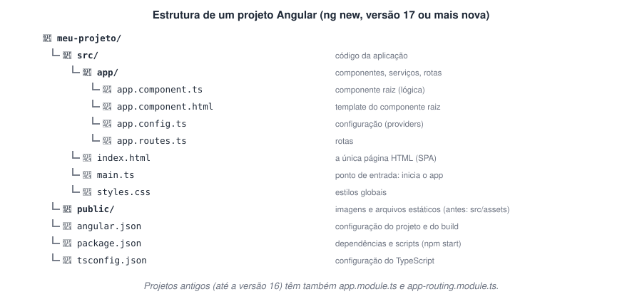
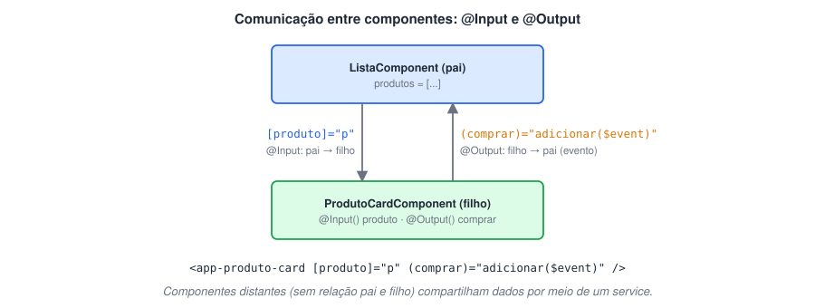
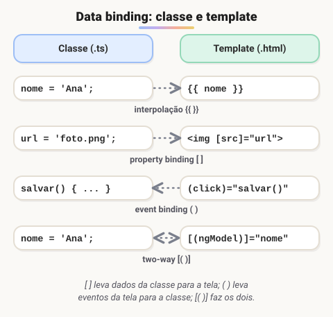
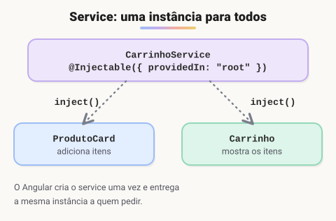
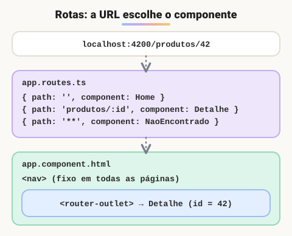

# Angular · Componentes, rotas, services e formulários

> 🗺️ **Sobre o módulo:** criar aplicações de página única com Angular: TypeScript, componentes, templates, services, rotas e formulários, terminando com uma loja virtual e a integração com Bootstrap.
>
> **Professores:** William e Ralf Lima (Bootstrap) · **Pré-requisito:** JavaScript · **Versão de referência:** Angular 17 ou mais nova (componentes standalone).

## O que é Angular e preparando o ambiente

> 🗺️ **Nesta aula:** o que é o Angular e instalar tudo o que é preciso para criar o primeiro projeto.

### De onde paramos

No fim do módulo de JavaScript, a lista de tarefas já exigia vários `querySelector`, ouvintes e `createElement`. Imagine um sistema com 50 telas assim. Um **framework** organiza esse trabalho: você descreve **o que** deve aparecer, e ele cuida de atualizar o DOM. É a mesma ideia do MVC do TodoApp, aplicada ao front-end.

### O que é o Angular

**Angular é um framework do Google para criar aplicações web completas**, escrito em **TypeScript**. Ele organiza a interface em **componentes** e já traz rotas, formulários, requisições HTTP, testes e build, tudo integrado.

- Cria **SPAs** (*Single Page Applications*): o navegador carrega **uma única página HTML**, e o Angular troca o conteúdo da tela conforme a navegação, sem recarregar.
- Muito usado em sistemas corporativos (bancos, seguradoras, consultorias como a Capgemini).
- Não confunda com o **AngularJS** (versão 1.x, de 2010), que é outro framework e foi descontinuado em 2021. O "Angular" atual nasceu na versão 2, em 2016, e lança uma versão nova a cada seis meses.

| Framework | Empresa | Característica |
| --- | --- | --- |
| **Angular** | Google | completo e opinativo: tudo vem incluído, com uma forma "oficial" de fazer |
| **React** | Meta | biblioteca focada na interface; o resto vem de pacotes da comunidade |
| **Vue** | comunidade | progressivo e de curva de aprendizado suave |

### O que instalar

| Ferramenta | Para quê |
| --- | --- |
| **Node.js (versão LTS)** | executa as ferramentas do Angular; traz o **npm**, o gerenciador de pacotes |
| **Angular CLI** | comando `ng`, que cria projetos, componentes e serviços e roda o servidor |
| **VS Code** com a extensão **Angular Language Service** | autocompletar e erros dentro dos templates HTML |

🔗 [https://nodejs.org/](https://nodejs.org/)

🔗 [https://code.visualstudio.com/](https://code.visualstudio.com/)

🔗 [Angular Language Service - Visual Studio Marketplace](https://marketplace.visualstudio.com/items?itemName=Angular.ng-template)

### Instalando o Angular CLI

```bash
# confere o Node (use a versão LTS)
node -v
npm -v

npm install -g @angular/cli

# confere a instalação
ng version
```

- No **Linux/macOS**, se aparecer erro de permissão, prefira instalar o Node com o **nvm** em vez de usar `sudo`.
- No **Windows/PowerShell**, se aparecer "a execução de scripts foi desabilitada", rode uma vez:

```powershell
Set-ExecutionPolicy -Scope CurrentUser RemoteSigned
```

> 💡 **TypeScript** é o JavaScript com **tipos**: você declara que uma variável é `string` ou `number` e o editor avisa erros antes de rodar. O navegador não entende TypeScript; o Angular compila tudo para JavaScript. Veja a página "TypeScript essencial".

### 🧠 Revisão rápida

**O que é uma SPA?**

Uma *Single Page Application*: o navegador carrega uma só página HTML, e o JavaScript troca o conteúdo conforme a navegação, sem recarregar.

**Por que é preciso instalar o Node.js para usar Angular?**

Porque as ferramentas do Angular (o CLI, o compilador, o servidor de desenvolvimento) rodam em Node, e o npm instala os pacotes.

> ➡️ **Próximo passo:** ambiente pronto, hora de criar o primeiro projeto: **Criando o projeto e entendendo a estrutura**.

### 📌 Resumo

| Item | Em uma frase |
| --- | --- |
| Angular | framework do Google, em TypeScript, para SPAs |
| SPA | uma página; o conteúdo troca sem recarregar |
| AngularJS × Angular | 1.x (descontinuado) × 2 em diante |
| Node.js + npm | rodam as ferramentas e instalam pacotes |
| Angular CLI | o comando `ng` |

## Criando o projeto e entendendo a estrutura

> 🗺️ **Nesta aula:** criar um projeto Angular, rodá-lo no navegador e entender para que serve cada pasta e arquivo.

### De onde paramos

No NetBeans, um clique em *New Project* criava a estrutura de um projeto Java. No Angular, quem faz isso é o CLI, pelo terminal. A estrutura gerada parece grande, mas no dia a dia você vai mexer quase só dentro de `src/app`.

### Criando e rodando

```bash
# cria o projeto (pergunta o estilo: CSS, SCSS)
ng new loja
cd loja

# compila, sobe em localhost:4200 e abre
ng serve -o
```

- O `ng serve` fica **observando os arquivos**: ao salvar, a página recarrega sozinha. Para parar, `Ctrl + C`.
- `npm start` faz o mesmo que `ng serve` (está definido nos scripts do `package.json`).
- Para gerar a versão de produção: `ng build` (os arquivos ficam em `dist/`).

### Estrutura de pastas



> 💡 **Analogia:** pense numa casa recém-entregue. O `index.html` é a fachada, com uma única porta (`<app-root>`); o `main.ts` é o disjuntor que liga a energia; `src/app` são os cômodos onde você vive e reforma todo dia; o `angular.json` é a planta da casa; o `package.json` é a lista de compras; e o `node_modules` é a despensa cheia: na mudança você não carrega a despensa, leva só a lista e compra tudo de novo (`npm install`).

| Arquivo | Papel |
| --- | --- |
| `src/index.html` | a **única** página HTML. Contém só `<app-root>`, onde o Angular desenha a aplicação |
| `src/main.ts` | ponto de entrada: inicia o componente raiz |
| `src/app/app.component.*` | o componente raiz: `.ts` (lógica), `.html` (template), `.css` (estilo) |
| `src/app/app.config.ts` | configurações globais (rotas, HttpClient, animações) |
| `src/app/app.routes.ts` | lista de rotas |
| `src/styles.css` | estilos que valem para toda a aplicação |
| `public/` | imagens e arquivos servidos como estão |
| `angular.json` | configuração do projeto e do build |
| `package.json` | dependências e scripts |
| `node_modules/` | pacotes instalados (não vai para o Git; recrie com `npm install`) |

### Comandos do CLI que você vai usar sempre

| Comando | Atalho | Faz |
| --- | --- | --- |
| `ng generate component nome` | `ng g c nome` | cria um componente |
| `ng generate service nome` | `ng g s nome` | cria um service |
| `ng generate pipe nome` | `ng g p nome` | cria um pipe |
| `ng generate guard nome` | `ng g g nome` | cria um guard de rota |
| `ng add pacote` |  | instala e configura uma biblioteca (`ng add @angular/material`) |
| `ng test` |  | roda os testes |
| `ng update` |  | atualiza o Angular do projeto |

> ⚠️ **Versões diferentes, arquivos diferentes.** Desde o Angular 17, o `ng new` cria projetos com **componentes standalone**: não existe `app.module.ts`, e a configuração fica em `app.config.ts` e `app.routes.ts`. Na versão 18, `src/assets` virou `public/`. Na 20, os nomes perderam o sufixo (`app.ts` em vez de `app.component.ts`). Projetos e tutoriais antigos usam módulos; o funcionamento é o mesmo.

### O caminho até a tela

```
navegador abre localhost:4200
  -> recebe index.html, que tem <app-root>
  -> carrega main.ts
  -> main.ts inicia o AppComponent
  -> o Angular desenha o template do
     AppComponent dentro de <app-root>
```

### 🧠 Revisão rápida

**Quantas páginas HTML tem uma aplicação Angular?**

Uma: `src/index.html`. Todo o resto é desenhado pelo Angular dentro de `<app-root>`.

**A pasta `node_modules` vai para o Git?**

Não: é enorme e pode ser recriada com `npm install`. Ela já vem no `.gitignore` do projeto.

> ➡️ **Próximo passo:** todos os arquivos `.ts` do projeto estão em TypeScript. Antes de mexer neles: **TypeScript essencial**.

### 📌 Resumo

| Item | Em uma frase |
| --- | --- |
| `ng new` | cria o projeto |
| `ng serve -o` | roda em `localhost:4200`, recarregando sozinho |
| `ng build` | gera a versão final em `dist/` |
| `index.html` → `main.ts` → `AppComponent` | o caminho de início |
| `ng g c` · `ng g s` | cria componente · service |

## TypeScript essencial

> 🗺️ **Nesta aula:** tipos, funções tipadas, interfaces, classes, genéricos e decoradores.

### De onde paramos

O TypeScript fica no meio do caminho entre as duas linguagens que você já conhece: tem a sintaxe do **JavaScript** e os tipos do **Java**. Se `int idade = 30;` e `let idade = 30;` são familiares, `let idade: number = 30;` também vai ser.

### O que é

**TypeScript é o JavaScript com tipos**, criado pela Microsoft. Você declara o tipo das variáveis, parâmetros e retornos, e o editor aponta erros **antes** de rodar. No fim, o TypeScript é compilado para JavaScript comum.

```tsx
let nome: string = "Ana";
// ❌ erro no editor: number não é string
nome = 42;
```

### Tipos básicos

```tsx
let idade: number = 30;
let ativo: boolean = true;
let nomes: string[] = ["Ana", "Beto"];
// tupla
let par: [string, number] = ["Ana", 30];
// desliga a checagem: evite
let qualquer: any = "evite";
// precisa verificar antes de usar
let desconhecido: unknown;
// union: um ou outro
let talvez: string | null = null;
// só esses valores
let status: "ativo" | "inativo" = "ativo";
```

Na maioria dos casos o TypeScript **infere** o tipo sozinho: `let total = 0` já é `number`.

### Funções

```tsx
function somar(a: number, b: number): number {
  return a + b;
}

// titulo? = opcional
const saudar = (nome: string,
                titulo?: string): string =>
  `Olá, ${titulo ?? ""} ${nome}`;
```

### Interfaces e types: o formato dos objetos

```tsx
export interface Produto {
  id: number;
  nome: string;
  preco: number;
  descricao?: string;  // opcional
  readonly criadoEm: Date; // só leitura
}

const p: Produto = {
  id: 1, nome: "Mouse", preco: 99,
  criadoEm: new Date(),
};

// type: apelido para qualquer tipo
type Id = number | string;
```

No Angular, interfaces descrevem os dados que vêm da API (`Produto`, `Usuario`, `Pedido`). São o equivalente das classes modelo do TodoApp (`Project`, `Task`): um atributo para cada campo.

### Classes

```tsx
export class Carrinho {
  // só acessível dentro da classe
  private itens: Produto[] = [];

  // "public" no construtor já cria
  // a propriedade this.dono
  constructor(public dono: string) {}

  adicionar(p: Produto): void {
    this.itens.push(p);
  }

  get total(): number {
    return this.itens.reduce((s, i) => s + i.preco, 0);
  }
}

const c = new Carrinho("Ana");
c.adicionar(p);
c.total;  // 99
```

| Modificador | Acesso |
| --- | --- |
| `public` (padrão) | de qualquer lugar |
| `private` | só dentro da classe |
| `protected` | na classe e nas filhas |
| `readonly` | não pode ser reatribuído |

### Genéricos

```tsx
function primeiro<T>(lista: T[]): T | undefined {
  return lista[0];
}

// "esta requisição devolve uma lista de Produto"
this.http.get<Produto[]>("/api/produtos");
```

### Decoradores

Funções com `@` que adicionam informações a classes e propriedades. O Angular usa muito: `@Component`, `@Injectable`, `@Input`, `@Output`. Lembram as anotações do Java, como o `@Override`, e vai acontecer o mesmo no Spring Boot (`@RestController`).

### O operador `!` e o `?.`

```tsx
// "!" = vai ser preenchido depois
@Input() produto!: Produto;

// "?." = se for null/undefined, para
// e devolve undefined
usuario?.endereco?.cidade;
```

### 🧠 Revisão rápida

**O navegador executa TypeScript?**

Não: o TypeScript é compilado para JavaScript antes, como o `.java` vira bytecode.

**Para que serve uma `interface` no Angular?**

Para descrever o formato dos objetos (como os dados da API), e o editor avisar se faltar ou sobrar campo.

**O que significa o `?` em `descricao?: string`?**

Que a propriedade é opcional.

> ➡️ **Próximo passo:** com a linguagem na mão, o bloco fundamental do Angular: **Componentes**.

### 📌 Resumo

| Item | Em uma frase |
| --- | --- |
| TypeScript | JavaScript com tipos, compilado para JS |
| `x: tipo` | declara o tipo; ele é inferido quando possível |
| `interface` | o formato de um objeto |
| `?` · `readonly` | opcional · só leitura |
| `private`/`public` | modificadores de acesso, como no Java |
| `<T>` | genéricos |
| `@Decorador` | metadados em classes e propriedades |

## Componentes

> 🗺️ **Nesta aula:** criar componentes (pelo CLI e à mão), fazê-los conversar com `@Input` e `@Output`, projetar conteúdo com `ng-content` e conhecer o ciclo de vida.

### De onde paramos

Na aula de tags semânticas, a página foi dividida em regiões (`header`, `nav`, `main`). No Angular, cada região (e cada peça repetida, como um card) vira um **componente**: uma classe TypeScript com o seu HTML e o seu CSS. É como se você pudesse criar as suas próprias tags, como `<app-produto-card>`.

### O que é um componente

**Componente é um pedaço reutilizável da tela** (um cabeçalho, um card de produto, um formulário) com três partes ligadas pelo decorador `@Component`:

| Parte | Arquivo | Contém |
| --- | --- | --- |
| Classe | `.ts` | dados e lógica |
| Template | `.html` | a estrutura que aparece na tela |
| Estilo | `.css` / `.scss` | a aparência, **isolada** só para este componente |

A aplicação é uma **árvore de componentes**: o `AppComponent` contém o `HeaderComponent`, que contém o `MenuComponent`, e assim por diante.

### Criando pelo terminal (o jeito normal)

```bash
# atalho: ng g c produto-card
ng generate component produto-card
```

O CLI cria a pasta `produto-card/` com `.ts`, `.html`, `.css` e `.spec.ts` (teste).

```tsx
// produto-card.component.ts
import { Component } from "@angular/core";

@Component({
  // a tag usada no HTML
  selector: "app-produto-card",
  // componentes e pipes usados no template
  imports: [],
  templateUrl: "./produto-card.component.html",
  styleUrl: "./produto-card.component.css",
})
export class ProdutoCardComponent {
  nome = "Notebook";
  preco = 3500;
}
```

Para usar dentro de outro componente: **importe** a classe no `imports` dele e escreva a tag no template.

```tsx
// app.component.ts
@Component({
  selector: "app-root",
  imports: [ProdutoCardComponent],
  template: `<app-produto-card />`,
})
export class AppComponent {}
```

### Criando à mão (para entender o que o CLI faz)

**Passo a passo**

```tsx
// src/app/primeiro/primeiro.component.ts
import { Component } from "@angular/core";

@Component({
  selector: "app-primeiro",
  // template e estilo direto no .ts
  template: `<h2>Primeiro componente</h2>`,
  styles: [`h2 { color: crimson; }`],
})
export class PrimeiroComponent {}
```

Depois é só importar `PrimeiroComponent` no componente que vai usá-lo e escrever `<app-primeiro />`.

**Projetos antigos com NgModule (Angular 16 ou anterior)**

Em projetos com módulos, o componente não é standalone: ele precisa ser **declarado** em um `NgModule`, e todo componente declarado no mesmo módulo pode usar os outros.

```tsx
// app.module.ts
@NgModule({
  // componentes deste módulo
  declarations: [AppComponent, PrimeiroComponent],
  imports: [BrowserModule, FormsModule],
  bootstrap: [AppComponent],
})
export class AppModule {}
```

O `ng g c` nesses projetos já adiciona o componente em `declarations` automaticamente.

### Comunicação entre componentes



> 💡 **Analogia:** pense no `@Input` como os **parâmetros** de uma função: dados que entram, vindos de quem chama. E pense no `@Output` como um **evento** do Swing: o filho só avisa "o botão Comprar foi clicado", e o pai decide o que fazer com isso. O filho não sabe quem é o pai; só recebe e avisa, por isso pode ser reutilizado em qualquer lugar.

```tsx
// filho: produto-card.component.ts
import { Component, EventEmitter,
         Input, Output } from "@angular/core";
import { CurrencyPipe } from "@angular/common";

export interface Produto {
  id: number;
  nome: string;
  preco: number;
}

@Component({
  selector: "app-produto-card",
  imports: [CurrencyPipe],
  template: `
    <h3>{{ produto.nome }}</h3>
    <p>{{ produto.preco | currency: 'BRL' }}</p>
    <button (click)="comprar.emit(produto)">
      Comprar</button>
  `,
})
export class ProdutoCardComponent {
  // recebe do pai
  @Input({ required: true }) produto!: Produto;
  // avisa o pai
  @Output() comprar = new EventEmitter<Produto>();
}
```

```html
<!-- pai: lista.component.html -->
@for (p of produtos; track p.id) {
  <app-produto-card
    [produto]="p"
    (comprar)="adicionarAoCarrinho($event)" />
}
```

- **Pai → filho**: `@Input()` + property binding `[produto]`.
- **Filho → pai**: `@Output()` + `EventEmitter` + event binding `(comprar)`; o valor emitido chega como `$event`.
- **Componentes sem relação direta**: compartilham dados por um **service**.


> 💡 Nas versões mais novas existem também as funções `input()` e `output()`, baseadas em **signals** (`produto = input.required&lt;Produto&gt;()`). Os decoradores `@Input`/`@Output` continuam funcionando e são os mais encontrados em projetos existentes.

### Projeção de conteúdo: `ng-content`

Cria um "buraco" no template do componente, onde o pai coloca o HTML que quiser:

```html
<!-- card.component.html -->
<div class="card">
  <ng-content />
</div>

<!-- uso -->
<app-card>
  <h3>Qualquer conteúdo</h3>
  <p>Definido por quem usa o card.</p>
</app-card>
```

### Ciclo de vida

| Gancho (*hook*) | Quando executa | Uso típico |
| --- | --- | --- |
| `constructor` | na criação da classe | só injeção de dependências |
| `ngOnChanges` | quando um `@Input` muda | reagir a dados vindos do pai |
| `ngOnInit` | uma vez, depois do primeiro `ngOnChanges` | **buscar dados** e inicializar |
| `ngAfterViewInit` | depois que o template foi desenhado | acessar elementos da tela |
| `ngOnDestroy` | antes de o componente sair da tela | **limpar**: cancelar inscrições, timers |

```tsx
export class ListaComponent implements OnInit, OnDestroy {
  ngOnInit() { this.carregarProdutos(); }
  ngOnDestroy() { clearInterval(this.timer); }
}
```

### 🧠 Revisão rápida

**Quais são as três partes de um componente?**

Classe (`.ts`, dados e lógica), template (`.html`) e estilo (`.css`), ligados pelo `@Component`.

**Como o pai passa um produto para o card? E como o card avisa que o botão foi clicado?**

Pai → filho: `@Input` com `[produto]="p"`. Filho → pai: `@Output` com `EventEmitter` e `(comprar)="..."`.

**Em qual gancho do ciclo de vida se buscam os dados iniciais?**

`ngOnInit`.

> ➡️ **Próximo passo:** o template do card usou `{{ }}`, `(click)` e `| currency`. Cada símbolo desses está explicado em **Templates: interpolação, binding, pipes e controle de fluxo**.

### 📌 Resumo

| Item | Em uma frase |
| --- | --- |
| Componente | classe + template + estilo, com `@Component` |
| `selector` | a tag do componente |
| `imports` | o que o template usa |
| `@Input` | dados do pai para o filho |
| `@Output` com `EventEmitter` | eventos do filho para o pai |
| `ng-content` | o pai coloca HTML dentro do filho |
| `ngOnInit` · `ngOnDestroy` | carregar · limpar |

## Templates: interpolação, binding, pipes e controle de fluxo

> 🗺️ **Nesta aula:** os quatro tipos de *data binding*, `@if`/`@for`/`@switch`, classes dinâmicas e pipes.

### De onde paramos

No JavaScript puro, para mostrar um valor era preciso `querySelector` + `textContent`, e para reagir a um clique, `addEventListener`. No template do Angular, você só **declara** a ligação (`{{ nome }}`, `(click)="salvar()"`), e o Angular mantém o DOM atualizado sozinho. É isso que se chama *data binding*.

### Os quatro tipos de *data binding*



> 💡 **Analogia:** pense num restaurante: a **classe** é a cozinha e o **template** é o salão. A interpolação `{{ }}` é o quadro do prato do dia, que mostra o que a cozinha tem. O `[prop]` é a placa "esgotado", acesa ou apagada conforme o estoque da cozinha. O `(evento)` é a campainha que o cliente toca para chamar a cozinha. E o `[(ngModel)]` é uma comanda compartilhada: o garçom anota e a cozinha vê; a cozinha corrige e o garçom vê.

```tsx
export class PerfilComponent {
  nome = "João";
  foto = "img/joao.webp";
  carregando = false;
  salvar() {
    console.log("salvando", this.nome);
  }
}
```

```html
<!-- 1. interpolação: mostra um valor como texto -->
<h2>Olá, {{ nome }}!</h2>
<p>2 + 2 = {{ 2 + 2 }}</p>

<!-- 2. property binding: liga uma
     propriedade do elemento a um valor -->

<button [disabled]="carregando">Salvar</button>

<!-- 3. event binding: chama um método
     quando o evento acontece -->
<button (click)="salvar()">Salvar</button>
<input (keyup.enter)="salvar()">

<!-- 4. two-way binding: campo e variável
     sempre iguais (precisa do FormsModule) -->
<input [(ngModel)]="nome">
```

| Sintaxe | Direção |
| --- | --- |
| `{{ valor }}` | classe → tela (texto) |
| `[propriedade]="valor"` | classe → tela (propriedade) |
| `(evento)="metodo()"` | tela → classe |
| `[(ngModel)]="valor"` | nos dois sentidos |

Para usar `[(ngModel)]` num componente standalone, adicione `FormsModule` ao `imports` do componente.

### Controle de fluxo: `@if`, `@for`, `@switch` (Angular 17+)

```html
@if (carregando) {
  <p>Carregando...</p>
} @else if (produtos.length === 0) {
  <p>Nenhum produto encontrado.</p>
} @else {
  <ul>
    @for (p of produtos; track p.id; let i = $index) {
      <li>{{ i + 1 }}. {{ p.nome }}</li>
    } @empty {
      <li>Lista vazia</li>
    }
  </ul>
}

@switch (status) {
  @case ("pago") { <span class="ok">Pago</span> }
  @case ("pendente") { <span class="alerta">Pendente</span> }
  @default { <span>Desconhecido</span> }
}
```

O `track` é obrigatório no `@for`: diz ao Angular como identificar cada item (normalmente o `id`), para atualizar só o que mudou.

**Sintaxe antiga: *ngIf e *ngFor (projetos até o Angular 16)**

```html
<p *ngIf="carregando; else lista">Carregando...</p>
<ng-template #lista>
  <li *ngFor="let p of produtos; trackBy: porId">
    {{ p.nome }}
  </li>
</ng-template>
```

As diretivas estruturais `*ngIf`, `*ngFor` e `*ngSwitch` ainda funcionam, mas foram substituídas pelo controle de fluxo com `@`.

### Classes e estilos dinâmicos

```html
<!-- liga/desliga uma classe -->
<li [class.concluida]="tarefa.feita">...</li>

<!-- várias classes de uma vez -->
<div [ngClass]="{ ativo: selecionado,
                  erro: temErro }">...</div>

<p [style.color]="temErro ? 'red' : 'inherit'">
  ...</p>
```

### Pipes: formatar na exibição

```html
<!-- JOÃO -->
<p>{{ nome | uppercase }}</p>
<!-- R$ 3.500,00 -->
<p>{{ preco | currency: 'BRL' }}</p>
<!-- 29/10/2025 -->
<p>{{ hoje | date: 'dd/MM/yyyy' }}</p>
<!-- 26% -->
<p>{{ 0.256 | percent }}</p>
<!-- os 100 primeiros caracteres -->
<p>{{ descricao | slice: 0:100 }}...</p>
<!-- ótimo para depurar -->
<pre>{{ produto | json }}</pre>
```

O pipe muda só a **exibição**: o valor na classe continua o mesmo. Pipes podem ser encadeados (`{{ nome | lowercase | titlecase }}`). Em componentes standalone, importe os pipes usados (`CurrencyPipe`, `DatePipe`...).

> 🇧🇷 Para datas e moeda no formato brasileiro, registre o idioma: em `app.config.ts`, adicione `{ provide: LOCALE_ID, useValue: 'pt-BR' }` e chame `registerLocaleData(localePt)` (de `@angular/common/locales/pt`).

#### Pipe personalizado

```bash
ng g pipe cpf
```

```tsx
@Pipe({ name: "cpf" })
export class CpfPipe implements PipeTransform {
  transform(valor: string): string {
    // 3 dígitos, 3, 3 e 2
    const formato =
      /(\d{3})(\d{3})(\d{3})(\d{2})/;
    return valor.replace(formato,
      "$1.$2.$3-$4");
  }
}
// {{ "12345678900" | cpf }}
//   -> 123.456.789-00
```

🔗 [https://angular.dev/guide/templates/pipes](https://angular.dev/guide/templates/pipes)

### JavaScript puro × Angular

| Tarefa | JavaScript (DOM) | Template Angular |
| --- | --- | --- |
| Mostrar um valor | `el.textContent = nome` | `{{ nome }}` |
| Reagir a um clique | `addEventListener("click", f)` | `(click)="f()"` |
| Desabilitar | `btn.disabled = true` | `[disabled]="carregando"` |
| Liga/desliga classe | `classList.toggle("x")` | `[class.x]="cond"` |
| Lista | `createElement` num laço | `@for` |

### 🧠 Revisão rápida

**Qual a diferença entre `[disabled]="x"` e `(click)="x()"`?**

Colchetes levam um valor da classe para a tela (property binding); parênteses levam um evento da tela para a classe (event binding).

**Por que o `@for` exige `track`?**

Para o Angular identificar cada item (pelo `id`) e atualizar só o que mudou, em vez de redesenhar a lista toda.

**O pipe `currency` altera o valor guardado na classe?**

Não: pipes mudam só a exibição.

> ➡️ **Próximo passo:** os componentes estão desenhando dados, mas de onde eles vêm, e como dois componentes compartilham os mesmos dados? A resposta são os **Services e injeção de dependência**.

### 📌 Resumo

| Item | Em uma frase |
| --- | --- |
| `{{ }}` | interpolação: valor como texto |
| `[prop]` | property binding: classe → tela |
| `(evento)` | event binding: tela → classe |
| `[(ngModel)]` | nos dois sentidos |
| `@if` · `@for` · `@switch` | controle de fluxo |
| `[class.x]` · `ngClass` | classes dinâmicas |
| Pipes | formatam só a exibição |

## Services e injeção de dependência

> 🗺️ **Nesta aula:** o que é um service, como criá-lo, injeção de dependência e estado compartilhado com signals.

### De onde paramos

No TodoApp, as telas Swing não falavam com o banco: chamavam o **controller**, que cuidava das regras e do JDBC. No Angular, a divisão é igual. Os componentes cuidam da tela; a lógica e os dados que não pertencem a uma tela específica vão para um **service**. E como vários componentes podem usar o mesmo service, ele também resolve o problema da aula anterior: compartilhar dados entre componentes sem relação direta.

### Para que servem

**Service é uma classe para lógica e dados que não pertencem a uma tela específica**: chamadas à API, carrinho de compras, usuário logado, regras de cálculo. Componentes cuidam da **apresentação**; services cuidam do **resto**.

- O mesmo service pode ser usado por vários componentes, que passam a **compartilhar** os dados.
- Fica mais fácil testar e reaproveitar.

| TodoApp (Java) | Angular |
| --- | --- |
| tela Swing (view) | componente |
| controller | service |
| classe modelo (`Task`) | interface (`Produto`) |

### Criando

```bash
# atalho: ng g s carrinho
ng generate service carrinho
```

```tsx
// carrinho.service.ts
import { Injectable } from "@angular/core";
import { Produto } from "./produto";

// uma única instância para a aplicação inteira
@Injectable({ providedIn: "root" })
export class CarrinhoService {
  private itens: Produto[] = [];

  adicionar(p: Produto) {
    this.itens.push(p);
  }

  remover(id: number) {
    this.itens = this.itens
      .filter((i) => i.id !== id);
  }

  listar() {
    return this.itens;
  }

  get total() {
    return this.itens
      .reduce((s, i) => s + i.preco, 0);
  }
}
```

### Injeção de dependência



> 💡 **Analogia:** num escritório, ninguém compra a própria cafeteira. Cada pessoa pede café, e a empresa aponta para a **mesma** cafeteira da copa. O componente é o funcionário, o service é a cafeteira, e o Angular é a empresa que entrega. Se alguém faz um café novo, todo mundo que for à copa encontra o mesmo bule: é assim que componentes diferentes compartilham o carrinho.

O componente **não cria** o service com `new`: ele **pede** um, e o Angular entrega. Isso se chama **injeção de dependência**.

```tsx
import { Component, inject } from "@angular/core";

@Component({
  selector: "app-carrinho",
  templateUrl: "./carrinho.component.html",
})
export class CarrinhoComponent {
  // forma moderna
  private carrinho = inject(CarrinhoService);

  // forma tradicional, pelo construtor:
  // constructor(private carrinho:
  //             CarrinhoService) {}

  get itens() { return this.carrinho.listar(); }
  get total() { return this.carrinho.total; }
}
```

Como o service é `providedIn: "root"`, o `ProdutoCardComponent` que adiciona itens e o `CarrinhoComponent` que os mostra recebem **a mesma instância**: o que um faz, o outro enxerga.

> 💡 Por que não usar `new CarrinhoService()`? Porque cada `new` criaria um carrinho diferente, e os componentes não compartilhariam nada. Pedindo ao Angular, todos recebem o mesmo objeto, como o `static` do Java fazia com o contador de funcionários.

### Compartilhando estado que muda: signals

Para a tela atualizar sozinha quando os dados do service mudam, use **signals** (Angular 16+):

```tsx
import { Injectable, computed, signal }
  from "@angular/core";

@Injectable({ providedIn: "root" })
export class CarrinhoService {
  readonly itens = signal<Produto[]>([]);

  readonly total = computed(() =>
    this.itens().reduce((s, i) => s + i.preco, 0)
  );

  adicionar(p: Produto) {
    this.itens.update((lista) => [...lista, p]);
  }
}
```

```html
<span>
  {{ carrinho.itens().length }} itens ·
  {{ carrinho.total() | currency: 'BRL' }}
</span>
```

Um signal é lido chamando-o como função (`itens()`), alterado com `set()` ou `update()`, e `computed()` cria valores derivados que se recalculam sozinhos. Em projetos mais antigos, o mesmo papel é feito com `BehaviorSubject` do RxJS.

> 💡 Pense num signal como uma célula de planilha: `itens` é uma célula com dados, e `total` é uma célula com fórmula. Quando os itens mudam, o total se recalcula, e tudo o que mostra o total na tela se atualiza.

### 🧠 Revisão rápida

**O que vai num service e o que vai num componente?**

No componente, a apresentação (template, reação aos cliques). No service, a lógica e os dados compartilhados (chamadas à API, carrinho, usuário logado).

**O que `providedIn: "root"` garante?**

Uma única instância do service para a aplicação inteira, compartilhada por todos que a pedirem.

**Como se lê o valor de um signal chamado `itens`?**

Chamando como função: `itens()`.

> ➡️ **Próximo passo:** com componentes e services, a aplicação já tem várias telas. Falta navegar entre elas sem recarregar: **Rotas: navegação, parâmetros, lazy loading e guards**.

### 📌 Resumo

| Item | Em uma frase |
| --- | --- |
| Service | lógica e dados compartilhados |
| `@Injectable({ providedIn: "root" })` | instância única |
| Injeção de dependência | o componente pede; o Angular entrega |
| `inject(Servico)` | a forma moderna de pedir |
| `signal` · `computed` | estado que muda · valor derivado |
| `set` · `update` | alteram um signal |

## Rotas: navegação, parâmetros, lazy loading e guards

> 🗺️ **Nesta aula:** definir rotas, navegar com `routerLink`, ler parâmetros da URL, navegar pelo código, lazy loading e guards.

### De onde paramos

No currículo em HTML, cada página era um arquivo (`index.html`, `sobre.html`, `contato.html`), e clicar num link recarregava tudo. Numa SPA só existe **uma** página. O **Router** do Angular faz parecer que há várias: lê a URL e troca o componente exibido, sem recarregar. Lembra das âncoras `#contato`, que mudavam a URL sem sair da página? A ideia é parecida.

### Como funciona



> 💡 **Analogia:** pense numa TV. O aparelho (a única página, `index.html`) nunca muda; a **URL** é o número do canal; o **Router** é o controle remoto; e o `<router-outlet>` é a tela, onde aparece o programa do canal escolhido. Trocar de canal não troca de TV. Um canal que não existe mostra "sem sinal" (a rota `**`), e o controle parental que pede senha antes de abrir um canal é o **guard**.

Numa SPA, mudar de "página" não recarrega nada: o **Router** do Angular lê a URL e troca o componente exibido dentro do `<router-outlet>`.

### 1. Definindo as rotas

```tsx
// app.routes.ts
import { Routes } from "@angular/router";

export const routes: Routes = [
  { path: "", component: HomeComponent },
  { path: "produtos",
    component: ListaProdutosComponent },
  // :id = parâmetro
  { path: "produtos/:id",
    component: DetalheProdutoComponent },
  { path: "carrinho",
    component: CarrinhoComponent,
    title: "Meu carrinho" },
  // qualquer outra: página 404
  { path: "**",
    component: NaoEncontradoComponent },
];
```

A ordem importa: o Router usa a **primeira** rota que combinar, por isso `**` fica sempre no fim. As rotas são registradas em `app.config.ts` com `provideRouter(routes)`, o que o `ng new` já faz.

### 2. Onde a página aparece e como navegar

```html
<!-- app.component.html -->
<nav>
  <a routerLink="/" routerLinkActive="ativo"
     [routerLinkActiveOptions]="{ exact: true }">
    Início</a>
  <a routerLink="/produtos"
     routerLinkActive="ativo">Produtos</a>
  <a [routerLink]="['/produtos', produto.id]">
    Ver produto</a>
</nav>

<!-- o componente da rota atual aparece aqui -->
<router-outlet />
```

- Use `routerLink`, e **não** `href`: o `href` recarregaria a aplicação inteira.
- `routerLinkActive` aplica uma classe ao link da página atual.
- Importe `RouterLink`, `RouterLinkActive` e `RouterOutlet` no componente.

### 3. Lendo o parâmetro da URL

```tsx
export class DetalheProdutoComponent {
  private rota = inject(ActivatedRoute);

  // /produtos/7 -> 7
  id = Number(
    this.rota.snapshot.paramMap.get("id"));
}
```

Query string (`/produtos?busca=mouse`): `this.rota.snapshot.queryParamMap.get("busca")`.

### 4. Navegando pelo código

```tsx
private router = inject(Router);

finalizarCompra() {
  // ... salva o pedido
  this.router.navigate(["/pedidos", pedidoId]);
}
```

### 5. Lazy loading: carregar só quando precisar

```tsx
{
  path: "admin",
  loadComponent: () =>
    import("./admin/admin.component")
      .then((m) => m.AdminComponent),
},
```

O código dessa tela só é baixado quando alguém acessa a rota, e a aplicação abre mais rápido. Para um grupo de rotas, existe o `loadChildren`, que carrega um arquivo de rotas inteiro.

### 6. Guards: controlando o acesso

```tsx
// auth.guard.ts
export const authGuard: CanActivateFn = () => {
  const auth = inject(AuthService);
  const router = inject(Router);
  return auth.estaLogado()
    ? true
    : router.createUrlTree(["/login"]);
};
```

```tsx
// app.routes.ts
{ path: "perfil",
  component: PerfilComponent,
  canActivate: [authGuard] },
```

| Guard | Decide se pode... |
| --- | --- |
| `canActivate` | entrar na rota |
| `canActivateChild` | entrar nas rotas filhas |
| `canDeactivate` | sair da rota (ex.: formulário não salvo) |
| `canMatch` | sequer considerar a rota (e baixar o código dela) |

> ⚠️ Guards melhoram a experiência, mas **não são segurança**: todo o código do front pode ser lido e alterado no navegador. Quem protege os dados de verdade é a API, verificando o login em cada requisição. É a mesma regra da validação de formulários: o servidor sempre confere de novo.

**Versão com NgModule e guard em classe (projetos antigos)**

```tsx
// app-routing.module.ts
const routes: Routes = [
  { path: "", component: HomeComponent },
  { path: "perfil",
    component: PerfilComponent,
    canActivate: [AuthGuard] },
];

@NgModule({
  imports: [RouterModule.forRoot(routes)],
  exports: [RouterModule],
})
export class AppRoutingModule {}

@Injectable({ providedIn: "root" })
export class AuthGuard implements CanActivate {
  constructor(private auth: AuthService,
              private router: Router) {}

  canActivate(): boolean | UrlTree {
    return this.auth.isAuthenticated()
      ? true
      : this.router.createUrlTree(["/login"]);
  }
}
```

Guards em classe (`implements CanActivate`) estão obsoletos desde o Angular 15.2; o padrão atual são funções (`CanActivateFn`).

### 🧠 Revisão rápida

**Por que usar `routerLink` em vez de `href`?**

Porque o `href` recarrega a aplicação inteira; o `routerLink` só troca o componente.

**Por que a rota `**` fica por último?**

Porque ela combina com qualquer URL, e o Router usa a primeira rota que combinar.

**Um guard impede que alguém acesse os dados da API sem login?**

Não: só esconde a tela. A API precisa verificar o login em cada requisição.

> ➡️ **Próximo passo:** as telas de cadastro e login precisam de formulários com validação, e o Angular tem ferramentas próprias para isso: **Formulários no Angular**.

### 📌 Resumo

| Item | Em uma frase |
| --- | --- |
| `app.routes.ts` | a lista de rotas; `**` por último |
| `<router-outlet>` | onde a página aparece |
| `routerLink` | navega sem recarregar |
| `:id` e `ActivatedRoute` | parâmetro na URL |
| `Router.navigate` | navega pelo código |
| `loadComponent` | lazy loading |
| Guards | controlam acesso à tela, não aos dados |

## Formulários no Angular

> 🗺️ **Nesta aula:** as duas formas de fazer formulários no Angular (template-driven e reactive), os estados de um campo e os validadores prontos.

### De onde paramos

O HTML já tem formulário com validação (`required`, `type="email"`), e o JavaScript sabe tratar o `submit` com `preventDefault()`. O Angular junta as duas coisas e acrescenta o que faltava: saber, a qualquer momento, se cada campo é válido, se já foi tocado, e mostrar a mensagem de erro certa no lugar certo.

### Duas abordagens

|  | Template-driven | Reactive forms ✅ |
| --- | --- | --- |
| Onde fica a lógica | no **template**, com `ngModel` | na **classe**, com `FormGroup` |
| Módulo | `FormsModule` | `ReactiveFormsModule` |
| Bom para | formulários simples | grandes, com validações complexas |
| Testes | mais difíceis | mais fáceis |

### Template-driven

```tsx
@Component({
  selector: "app-contato",
  imports: [FormsModule],
  templateUrl: "./contato.component.html",
})
export class ContatoComponent {
  contato = { nome: "", email: "" };

  enviar() {
    console.log(this.contato);
  }
}
```

```html
<form #f="ngForm" (ngSubmit)="enviar()">
  <input name="nome" [(ngModel)]="contato.nome"
         required minlength="3" #nome="ngModel">
  @if (nome.invalid && nome.touched) {
    <small>Nome obrigatório (mín. 3 letras)</small>
  }

  <input name="email" type="email"
         [(ngModel)]="contato.email"
         required email>

  <button [disabled]="f.invalid">Enviar</button>
</form>
```

Com `ngModel` dentro de um `form`, o atributo `name` é obrigatório. `#nome="ngModel"` cria uma variável no template para consultar o estado do campo.

### Reactive forms

```tsx
import { Component, inject } from "@angular/core";
import { FormBuilder, ReactiveFormsModule,
         Validators } from "@angular/forms";

@Component({
  selector: "app-cadastro",
  imports: [ReactiveFormsModule],
  templateUrl: "./cadastro.component.html",
})
export class CadastroComponent {
  private fb = inject(FormBuilder);

  // campo: [valor inicial, [validadores]]
  form = this.fb.group({
    nome: ["", [Validators.required,
                Validators.minLength(3)]],
    email: ["", [Validators.required,
                 Validators.email]],
    idade: [null as number | null,
            [Validators.min(18)]],
  });

  enviar() {
    if (this.form.invalid) {
      // mostra os erros de todos os campos
      this.form.markAllAsTouched();
      return;
    }
    // { nome: ..., email: ..., idade: ... }
    console.log(this.form.value);
  }
}
```

```html
<form [formGroup]="form" (ngSubmit)="enviar()">
  <label for="nome">Nome</label>
  <input id="nome" formControlName="nome">
  @if (form.controls.nome.touched
       && form.controls.nome.hasError('required')) {
    <small>Informe o nome.</small>
  }

  <label for="email">E-mail</label>
  <input id="email" type="email"
         formControlName="email">
  @if (form.controls.email.touched
       && form.controls.email.hasError('email')) {
    <small>E-mail inválido.</small>
  }

  <label for="idade">Idade</label>
  <input id="idade" type="number"
         formControlName="idade">

  <button type="submit">Cadastrar</button>
</form>
```

> 💡 Compare com o botão Salvar do TodoApp: lá, o próprio código lia cada campo, conferia se estava vazio e mostrava um `JOptionPane`. Aqui, as regras ficam declaradas uma vez (`Validators`), e o Angular mantém o estado de cada campo atualizado enquanto a pessoa digita.

### Estados de um campo

| Estado | Significa |
| --- | --- |
| `valid` / `invalid` | passa / não passa nas validações |
| `touched` / `untouched` | já perdeu o foco alguma vez / nunca |
| `dirty` / `pristine` | o valor foi alterado / ainda é o original |

O Angular também aplica classes CSS correspondentes (`ng-invalid`, `ng-touched`...), úteis para estilizar:

```css
input.ng-invalid.ng-touched {
  border-color: crimson;
}
```

### Validadores prontos

`Validators.required`, `requiredTrue` (checkbox de aceite), `minLength(n)`, `maxLength(n)`, `min(n)`, `max(n)`, `email`, `pattern(/regex/)`.

### 🧠 Revisão rápida

**Por que mostrar o erro só depois que o campo foi `touched`?**

Para não exibir "campo obrigatório" antes de a pessoa ter tido a chance de preencher.

**Template-driven ou reactive para um cadastro com 15 campos e regras entre eles?**

Reactive: a lógica fica na classe, fácil de organizar e testar.

**Se o Angular já valida o e-mail, a API precisa validar de novo?**

Sim. A validação do front é conforto; quem garante os dados é o servidor.

> ➡️ **Próximo passo:** componentes, templates, services, rotas e formulários juntos num projeto só: **Projeto: loja virtual com Angular**.

### 📌 Resumo

| Item | Em uma frase |
| --- | --- |
| Template-driven | `FormsModule` e `ngModel`; formulários simples |
| Reactive | `ReactiveFormsModule` e `FormBuilder`; recomendado |
| `Validators` | regras prontas: `required`, `email`, `min`... |
| `touched` | mostre erros só depois dele |
| `markAllAsTouched()` | revela todos os erros ao tentar enviar |
| Segurança | a API valida de novo |

## Projeto: loja virtual com Angular

> 🗺️ **Nesta aula:** juntar componentes, templates, services e rotas em uma loja simples de computadores (*computers-store*): lista de produtos, detalhe e carrinho.

### De onde paramos

Assim como o TodoApp juntou tudo do módulo de Java num sistema só, esta loja junta tudo do módulo de Angular. Repare na mesma divisão em camadas: a **interface** `Produto` é o model, os **services** fazem o papel dos controllers, e os **componentes** são as telas.

### O que vamos construir

| Tela | Rota | Componentes |
| --- | --- | --- |
| Lista de produtos | `/` | `HomeComponent`, `ProdutoCardComponent` |
| Detalhe do produto | `/produtos/:id` | `DetalheComponent` |
| Carrinho | `/carrinho` | `CarrinhoComponent` |

Dados compartilhados: `ProdutoService` (lista de produtos) e `CarrinhoService` (itens escolhidos). O `HeaderComponent` aparece em todas as telas.

### Passo 1: criar o projeto e os arquivos

```bash
ng new computers-store
cd computers-store

ng g c header
ng g c produto-card
ng g c pages/home
ng g c pages/detalhe
ng g c pages/carrinho
ng g s services/produto
ng g s services/carrinho

ng serve -o
```

### Passo 2: o modelo e os dados

```tsx
// src/app/models/produto.ts
export interface Produto {
  id: number;
  nome: string;
  preco: number;
  imagem: string;
}
```

```tsx
// services/produto.service.ts
@Injectable({ providedIn: "root" })
export class ProdutoService {
  private produtos: Produto[] = [
    { id: 1, nome: "Notebook 14\"",
      preco: 3500, imagem: "notebook.webp" },
    { id: 2, nome: "Monitor 27\"",
      preco: 1400, imagem: "monitor.webp" },
    { id: 3, nome: "Teclado mecânico",
      preco: 420, imagem: "teclado.webp" },
  ];

  listar() {
    return this.produtos;
  }

  buscar(id: number) {
    return this.produtos.find((p) => p.id === id);
  }
}
```

Por enquanto, os produtos estão fixos no código. No módulo seguinte (APIs com Angular), essa lista é trocada por uma chamada HTTP, e o resto da aplicação nem percebe, porque os componentes só conversam com o service.

### Passo 3: as rotas

```tsx
// app.routes.ts
export const routes: Routes = [
  { path: "", component: HomeComponent,
    title: "Computers Store" },
  { path: "produtos/:id",
    component: DetalheComponent },
  { path: "carrinho",
    component: CarrinhoComponent },
  { path: "**", redirectTo: "" },
];
```

```html
<!-- app.component.html -->
<app-header />
<main class="container">
  <router-outlet />
</main>
```

### Passo 4: cabeçalho com contador do carrinho

```html
<!-- header.component.html -->
<header class="topo">
  <a routerLink="/" class="logo">
    Computers Store</a>
  <a routerLink="/carrinho">
    🛒 {{ carrinho.itens().length }}</a>
</header>
```

```tsx
// header.component.ts
export class HeaderComponent {
  carrinho = inject(CarrinhoService);
}
```

### Passo 5: lista de produtos com card reutilizável

```tsx
// home.component.ts
export class HomeComponent {
  produtos = inject(ProdutoService).listar();
  carrinho = inject(CarrinhoService);
}
```

```html
<!-- home.component.html -->
<section class="grade">
  @for (p of produtos; track p.id) {
    <app-produto-card
      [produto]="p"
      (comprar)="carrinho.adicionar($event)" />
  }
</section>
```

```html
<!-- produto-card.component.html -->
<article class="card">
  
  <h3>
    <a [routerLink]="['/produtos', produto.id]">
      {{ produto.nome }}</a>
  </h3>
  <p>{{ produto.preco | currency: 'BRL' }}</p>
  <button type="button"
          (click)="comprar.emit(produto)">
    Adicionar ao carrinho
  </button>
</article>
```

### Passo 6: detalhe do produto

```tsx
// detalhe.component.ts
export class DetalheComponent {
  private rota = inject(ActivatedRoute);
  private id = Number(
    this.rota.snapshot.paramMap.get("id"));

  produto = inject(ProdutoService).buscar(this.id);
}
```

```html
<!-- detalhe.component.html -->
@if (produto) {
  <h1>{{ produto.nome }}</h1>
  <p>{{ produto.preco | currency: 'BRL' }}</p>
} @else {
  <p>Produto não encontrado.</p>
}
<a routerLink="/">Voltar</a>
```

### Passo 7: carrinho

```html
<!-- carrinho.component.html -->
@if (carrinho.itens().length) {
  <ul>
    @for (item of carrinho.itens();
          track $index) {
      <li>{{ item.nome }}:
        {{ item.preco | currency: 'BRL' }}</li>
    }
  </ul>
  <p><strong>Total:
    {{ carrinho.total() | currency: 'BRL' }}
  </strong></p>
} @else {
  <p>Seu carrinho está vazio.
    <a routerLink="/">Ver produtos</a></p>
}
```

O `CarrinhoService` com signals está na página "Services e injeção de dependência".

### O caminho de um clique em "Adicionar"

```
botão no ProdutoCardComponent
  -> comprar.emit(produto)          (@Output)
  -> HomeComponent: carrinho.adicionar($event)
  -> CarrinhoService: itens.update(...)  (signal)
  -> HeaderComponent mostra o novo total,
     sem ninguém mandar atualizar
```

### Desafios para praticar

- Botão de remover item do carrinho.
- Quantidade por item, em vez de repetir o produto.
- Salvar o carrinho no `localStorage` para não perder ao recarregar.
- Campo de busca que filtra a lista pelo nome.
- Estilizar com Bootstrap ou Angular Material.

### Recursos

🔗 [Font Awesome](https://fontawesome.com/)

🔗 [https://material.angular.io/](https://material.angular.io/)

### 🧠 Revisão rápida

**Por que o cabeçalho atualiza o contador sozinho quando um item é adicionado na lista?**

Porque os dois componentes usam a mesma instância do `CarrinhoService`, e o `itens` é um signal: quando muda, tudo o que o lê na tela é atualizado.

**Se a lista de produtos passar a vir de uma API, quais arquivos mudam?**

Só o `ProdutoService`. Os componentes continuam chamando os mesmos métodos.

> ➡️ **Próximo passo:** a loja funciona, mas com o visual padrão. Para estilizar rápido, com um framework CSS: **Angular com Bootstrap**.

### 📌 Resumo

| Camada | Na loja | Equivalente no TodoApp |
| --- | --- | --- |
| Model | `interface Produto` | `class Task` |
| Lógica e dados | `ProdutoService`, `CarrinhoService` | controllers |
| Telas | componentes de página + card | telas Swing |
| Navegação | rotas | abrir `JDialog` |

## Angular com Bootstrap

> 🗺️ **Nesta aula:** instalar o Bootstrap num projeto Angular e usar seu grid e componentes visuais.

### De onde paramos

O Bootstrap apareceu no módulo de CSS avançado, num arquivo HTML comum via CDN. Num projeto Angular, ele entra como **pacote npm**, e as classes funcionam do mesmo jeito dentro dos templates, junto com `@for` e bindings.

### O que é o Bootstrap

**Bootstrap é um framework CSS** com sistema de grid responsivo e componentes prontos (botões, cards, navbar, modais, formulários), aplicados por **classes** no HTML: `class="btn btn-primary"`. Veja a página "Organizando o CSS: BEM, Bootstrap e Tailwind" no módulo de CSS avançado.

### Instalando no Angular

```bash
ng new loja-bootstrap
cd loja-bootstrap
npm install bootstrap
```

Registre o CSS (e, se for usar componentes com JavaScript, o script) no `angular.json`:

Em `angular.json`, dentro de `projects > (nome) > architect > build > options`:

```json
"styles": [
  "node_modules/bootstrap/dist/css/bootstrap.min.css",
  "src/styles.css"
],
"scripts": [
  "node_modules/bootstrap/dist/js/bootstrap.bundle.min.js"
]
```

Depois de mexer no `angular.json`, **pare e rode de novo** o `ng serve`: ele não recarrega essas configurações sozinho.

> 💡 Alternativa sem mexer no `angular.json`: no `src/styles.css`, escreva `@import "bootstrap/dist/css/bootstrap.min.css";`. O arquivo `bootstrap-reboot.min.css` contém só o *reset* de estilos, sem componentes.

### Usando

```html
<nav class="navbar bg-dark" data-bs-theme="dark">
  <div class="container">
    <a class="navbar-brand" routerLink="/">
      Computers Store</a>
  </div>
</nav>

<div class="container my-4">
  <div class="row g-3">
    @for (p of produtos; track p.id) {
      <div class="col-12 col-sm-6 col-lg-4">
        <div class="card h-100">
          
          <div class="card-body">
            <h5 class="card-title">
              {{ p.nome }}</h5>
            <p class="card-text">
              {{ p.preco | currency: 'BRL' }}</p>
            <button class="btn btn-primary"
                    (click)="comprar(p)">
              Comprar</button>
          </div>
        </div>
      </div>
    }
  </div>
</div>
```

`col-12 col-sm-6 col-lg-4`: 1 card por linha no celular, 2 em telas pequenas e 3 em telas grandes.

### Componentes interativos: ng-bootstrap

Componentes com comportamento (modal, dropdown, carrossel, datepicker) dependem de JavaScript. No Angular, a forma recomendada é a biblioteca **ng-bootstrap**, que reescreve esses componentes em Angular, sem precisar do `bootstrap.bundle.js`:

```bash
ng add @ng-bootstrap/ng-bootstrap
```

🔗 [https://ng-bootstrap.github.io/](https://ng-bootstrap.github.io/)

🔗 [https://getbootstrap.com/docs/5.3/getting-started/introduction/](https://getbootstrap.com/docs/5.3/getting-started/introduction/)

### 🧠 Revisão rápida

**Alterei o `angular.json` e nada mudou na tela. O que faltou?**

Parar e rodar de novo o `ng serve`, que não recarrega essas configurações sozinho.

**Por que usar ng-bootstrap para modais, em vez do JavaScript do Bootstrap?**

Porque o ng-bootstrap reescreve esses componentes em Angular, integrados ao ciclo de vida e aos bindings, sem manipular o DOM por fora.

> ➡️ **Próximo passo:** fim do módulo de Angular! A loja usa dados fixos no código. O próximo módulo a liga a uma API de verdade: **APIs com Angular · REST, HttpClient e CRUD**.

### 📌 Resumo

| Item | Em uma frase |
| --- | --- |
| Instalação | `npm install bootstrap` |
| Registro | `styles` no `angular.json` (reinicie o `ng serve`) |
| Grid | `container` > `row` > `col-*` |
| Componentes | classes no template (`btn`, `card`) |
| Interativos | ng-bootstrap |

## 📌 Resumo do módulo

| Conceito | Lembrete |
| --- | --- |
| Angular | framework do Google, em TypeScript, para SPAs |
| CLI | `ng new`, `ng serve -o`, `ng g c`, `ng g s`, `ng build` |
| TypeScript | tipos (`: string`), `interface`, classes, decoradores |
| Componente | classe + template + estilo; `@Component`; standalone com `imports` |
| Binding | `{{ }}` texto · `[ ]` propriedade · `( )` evento · `[( )]` dois sentidos |
| Controle de fluxo | `@if`, `@for` (com `track`), `@switch` |
| Pipes | `currency`, `date`, `uppercase`, `json`; só mudam a exibição |
| Comunicação | `@Input` (pai → filho) · `@Output` e `EventEmitter` (filho → pai) · service (qualquer um) |
| Service | `@Injectable({ providedIn: 'root' })`; recebido com `inject()` |
| Rotas | `app.routes.ts`, `<router-outlet>`, `routerLink`, `:id`, guards |
| Formulários | reactive: `FormBuilder`, `Validators` e `formControlName` |
| Ciclo de vida | `ngOnInit` (carregar) · `ngOnDestroy` (limpar) |
