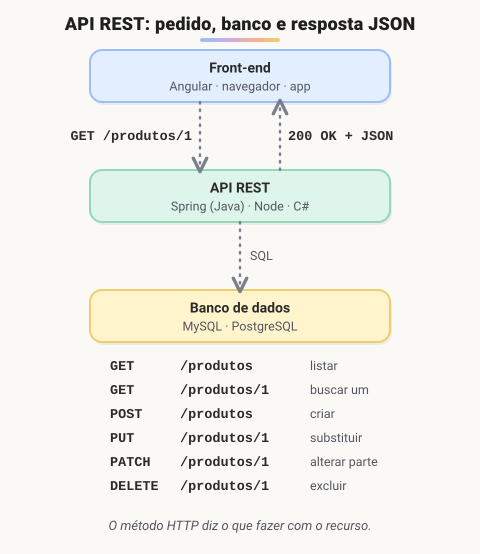
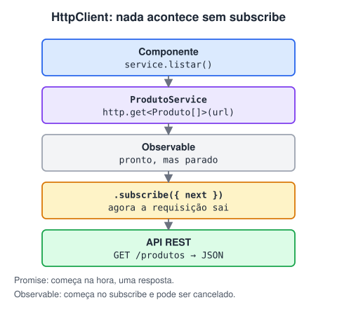

# APIs com Angular · REST, HttpClient e CRUD

> 🗺️ **Sobre o módulo:** como o front-end conversa com o back-end. O que é uma API e o padrão REST, como consumir APIs no Angular com HttpClient e um projeto de cadastro completo (CRUD).
>
> **Professor:** Ralf Lima · **Pré-requisitos:** módulo de Angular e a página "JavaScript assíncrono".

## O que é uma API e o padrão REST

> 🗺️ **Nesta aula:** o que é uma API, o que significa REST e como os métodos e códigos HTTP são usados.

### De onde paramos

Três peças que você já viu se juntam aqui: os **verbos e status HTTP** (módulo HTML 1), o **CRUD** do SQL e do TodoApp e o **JSON** com `fetch` (módulo de JavaScript). Uma API REST é justamente um CRUD exposto pela web: cada operação do banco vira um verbo HTTP numa URL.

| CRUD | SQL | HTTP (REST) |
| --- | --- | --- |
| Create | `INSERT` | `POST /produtos` |
| Read | `SELECT` | `GET /produtos` |
| Update | `UPDATE` | `PUT /produtos/1` |
| Delete | `DELETE` | `DELETE /produtos/1` |

### O que é uma API

**API (Application Programming Interface) é um contrato que permite que um programa use funções e dados de outro**, sem conhecer o código interno dele.

Na web, uma API é um serviço que recebe **requisições HTTP** (de um site, um app de celular ou outro sistema), consulta o banco de dados e devolve os dados, normalmente em **JSON**. Isso permite que o mesmo back-end atenda o site, o app e parceiros.



> 💡 **Analogia:** a API é o garçom entre o salão e a cozinha. O front-end (o cliente) faz o pedido seguindo o cardápio (a documentação); a API leva à cozinha (o banco de dados) e volta com o prato pronto, em JSON. O mesmo garçom atende quem está no salão, no delivery ou no balcão: site, app e parceiros usam a mesma API.

### REST

**REST (*Representational State Transfer*) é um estilo de arquitetura para APIs sobre HTTP.** Os dados são organizados em **recursos**, cada um com uma URL, e o **método HTTP** diz o que fazer com ele.

Princípios:

- **cliente-servidor**: front-end e back-end separados, conversando só pela API;
- **sem estado** (*stateless*): cada requisição traz tudo o que é necessário, inclusive a identificação do usuário (por exemplo, um token);
- **cacheável**: respostas podem dizer se podem ser guardadas em cache;
- **interface uniforme**: URLs de recursos e métodos HTTP padronizados.

#### Métodos HTTP

| Método | Ação | Exemplo | Corpo |
| --- | --- | --- | --- |
| `GET` | buscar (não altera nada) | `GET /produtos` · `GET /produtos/1` | não |
| `POST` | criar | `POST /produtos` | JSON do novo produto |
| `PUT` | substituir **por completo** | `PUT /produtos/1` | JSON completo |
| `PATCH` | alterar **parte** | `PATCH /produtos/1` | só os campos alterados |
| `DELETE` | excluir | `DELETE /produtos/1` | não |

Boas práticas de URL: substantivos no plural (`/produtos`, e não `/getProdutos`), hierarquia para relações (`/clientes/7/pedidos`) e filtros na query string (`/produtos?categoria=monitor&page=2`).

#### Códigos de status

| Código | Significa | Quando |
| --- | --- | --- |
| `200 OK` | sucesso | GET, PUT, PATCH |
| `201 Created` | criado | POST |
| `204 No Content` | sucesso sem corpo | DELETE |
| `400 Bad Request` | dados inválidos | validação falhou |
| `401 Unauthorized` | não autenticado | falta login/token |
| `403 Forbidden` | sem permissão | logado, mas sem acesso |
| `404 Not Found` | não existe | id inexistente |
| `500 Internal Server Error` | erro no servidor | bug na API |

#### Exemplo de troca

```
POST /produtos HTTP/1.1
Content-Type: application/json
Authorization: Bearer eyJhbGciOi...

{ "nome": "Mouse", "preco": 99.9 }
```

```
HTTP/1.1 201 Created
Content-Type: application/json

{ "id": 15, "nome": "Mouse", "preco": 99.9 }
```

### Quem cria e quem consome

| Lado | Exemplos |
| --- | --- |
| **Front-end** (consome APIs) | Angular, React, Vue, apps mobile |
| **Back-end** (cria APIs) | Java → **Spring Boot** · C# → ASP.NET Core · JavaScript → Node.js com Express · PHP → Laravel · Python → Django, FastAPI |

### Ferramentas para testar APIs

- **Postman** ou **Insomnia**: enviam requisições de qualquer método e mostram a resposta.
- Extensão **Thunder Client** no VS Code.
- APIs públicas para treinar: **JSONPlaceholder**, **ViaCEP** (`https://viacep.com.br/ws/01001000/json/`), **PokéAPI**.

🔗 [https://jsonplaceholder.typicode.com/](https://jsonplaceholder.typicode.com/)

### 🧠 Revisão rápida

**Qual requisição REST lista os pedidos do cliente 7?**

`GET /clientes/7/pedidos`.

**`PUT` × `PATCH`?**

`PUT` substitui o recurso inteiro (envia todos os campos); `PATCH` altera só os campos enviados.

**Que status uma API deve devolver ao criar um produto?**

`201 Created`, normalmente com o produto criado (já com `id`) no corpo.

> ➡️ **Próximo passo:** do lado do front-end, o Angular tem uma ferramenta própria para fazer essas requisições: **Consumindo APIs com HttpClient e Observables**.

### 📌 Resumo

| Item | Em uma frase |
| --- | --- |
| API | contrato para um sistema usar outro |
| REST | recursos com URL e métodos HTTP; sem estado |
| URLs | substantivos no plural: `/produtos/1` |
| Métodos | GET busca · POST cria · PUT/PATCH alteram · DELETE exclui |
| Status | 2xx sucesso · 4xx erro do cliente · 5xx erro do servidor |
| Testar | Postman, Insomnia, Thunder Client |

## Consumindo APIs com HttpClient e Observables

> 🗺️ **Nesta aula:** habilitar o HttpClient, um service com o CRUD da API, Observables, uso no componente, operadores RxJS e interceptors.

### De onde paramos

No JavaScript puro, buscar dados era `await fetch(url)` + `resposta.json()`. No Angular, quem faz isso é o **HttpClient**, sempre dentro de um **service** (como o `ProdutoService` da loja, que tinha os produtos fixos). A grande mudança: em vez de uma Promise, ele devolve um **Observable**.

### 1. Habilitando o HttpClient

```tsx
// app.config.ts
import { provideHttpClient, withFetch }
  from "@angular/common/http";

export const appConfig: ApplicationConfig = {
  providers: [
    provideRouter(routes),
    provideHttpClient(withFetch()),
  ],
};
```

Em projetos com NgModule, o equivalente antigo era importar `HttpClientModule` no `AppModule`.

### 2. Um service para a API

Requisições ficam em **services**, nunca direto no componente:

```tsx
// services/produto.service.ts
import { Injectable, inject } from "@angular/core";
import { HttpClient } from "@angular/common/http";
import { Observable } from "rxjs";
import { Produto } from "../models/produto";

@Injectable({ providedIn: "root" })
export class ProdutoService {
  private http = inject(HttpClient);
  private api = "http://localhost:3000/produtos";

  // GET /produtos
  listar(): Observable<Produto[]> {
    return this.http.get<Produto[]>(this.api);
  }

  // GET /produtos/1
  buscar(id: number): Observable<Produto> {
    return this.http.get<Produto>(
      `${this.api}/${id}`);
  }

  // POST /produtos
  criar(p: Omit<Produto, "id">) {
    return this.http.post<Produto>(this.api, p);
  }

  // PUT /produtos/1
  atualizar(p: Produto) {
    return this.http.put<Produto>(
      `${this.api}/${p.id}`, p);
  }

  // DELETE /produtos/1
  excluir(id: number) {
    return this.http.delete<void>(
      `${this.api}/${id}`);
  }
}
```

O HttpClient já converte JSON automaticamente nos dois sentidos. `Omit<Produto, "id">` significa "um Produto sem o `id`", porque quem gera o id é a API.

> 💡 Compare com o `TaskController` do TodoApp: um método por operação do CRUD, cada um montando a requisição. Lá era SQL com JDBC; aqui é HTTP com HttpClient. A estrutura é a mesma.

### 3. Observables: o "fetch" do Angular

O HttpClient devolve um **Observable** (da biblioteca **RxJS**), e não uma Promise. A diferença mais importante: **nada acontece até alguém se inscrever** com `subscribe`.

| Promise | Observable |
| --- | --- |
| começa na hora | só começa com `subscribe()` |
| entrega **um** valor | pode entregar **vários** ao longo do tempo |
| não pode ser cancelada | pode ser cancelada (`unsubscribe`) |
| `then` / `await` | `subscribe` / operadores |



> 💡 **Analogia:** uma Promise é como pedir uma pizza: você liga, ela chega uma vez. Um Observable é como assinar uma revista: nada chega até você assinar (`subscribe`), podem chegar várias edições, e dá para cancelar.

### 4. Usando no componente

```tsx
export class ListaProdutosComponent
    implements OnInit {
  private service = inject(ProdutoService);
  produtos: Produto[] = [];
  carregando = true;
  erro = "";

  ngOnInit() {
    this.service.listar().subscribe({
      next: (lista) => {
        this.produtos = lista;
        this.carregando = false;
      },
      error: () => {
        this.erro = "Não foi possível carregar.";
        this.carregando = false;
      },
    });
  }

  excluir(id: number) {
    this.service.excluir(id).subscribe(() => {
      this.produtos = this.produtos
        .filter((p) => p.id !== id);
    });
  }
}
```

```html
@if (carregando) { <p>Carregando...</p> }
@if (erro) { <p class="erro">{{ erro }}</p> }
@for (p of produtos; track p.id) {
  <li>
    {{ p.nome }}
    <button (click)="excluir(p.id)">Excluir</button>
  </li>
}
```

#### Alternativa: pipe `async`

```tsx
// o $ no fim do nome indica um Observable
produtos$ = inject(ProdutoService).listar();
```

```html
@if (produtos$ | async; as produtos) {
  @for (p of produtos; track p.id) {
    <li>{{ p.nome }}</li>
  }
}
```

O `async` se inscreve e cancela a inscrição sozinho quando o componente sai da tela.

### 5. Operadores RxJS mais comuns

```tsx
import { map, catchError, of } from "rxjs";

this.http.get<Produto[]>(this.api).pipe(
  // transforma a resposta
  map((lista) =>
    lista.filter((p) => p.preco < 1000)),
  // em caso de erro, devolve lista vazia
  catchError(() => of([]))
);
```

### 6. Cabeçalhos, parâmetros e token

```tsx
this.http.get<Produto[]>(this.api, {
  // ?categoria=monitor&_page=1
  params: { categoria: "monitor", _page: 1 },
  headers: { Authorization: `Bearer ${token}` },
});
```

Para colocar o token em **todas** as requisições, use um **interceptor**, que fica "no meio do caminho" de cada request:

```tsx
export const authInterceptor: HttpInterceptorFn =
  (req, next) => {
    const token = localStorage.getItem("token");
    if (!token) {
      return next(req);
    }
    const comToken = req.clone({
      setHeaders: {
        Authorization: `Bearer ${token}`,
      },
    });
    return next(comToken);
  };

// app.config.ts:
// provideHttpClient(
//   withInterceptors([authInterceptor]))
```

### Erros comuns

| Sintoma | Causa |
| --- | --- |
| nada acontece | faltou o `subscribe` (ou o `async`) |
| `No provider for HttpClient` | faltou `provideHttpClient()` |
| *blocked by CORS policy* | a API não autorizou `localhost:4200` |
| `undefined` logo após o `subscribe` | a resposta ainda não chegou: use o valor dentro do `next` |

### 🧠 Revisão rápida

**Chamei `service.listar()` e nenhuma requisição apareceu na aba Network. Por quê?**

Porque faltou o `subscribe` (ou o pipe `async`): um Observable só executa quando alguém se inscreve.

**Onde colocar as chamadas ao HttpClient: no componente ou num service?**

Num service. O componente só chama os métodos do service.

**Para que serve um interceptor?**

Para alterar todas as requisições num lugar só, por exemplo acrescentando o token de login no cabeçalho.

> ➡️ **Próximo passo:** hora de juntar tudo num cadastro completo, com uma API de treino: **Projeto: CRUD com Angular e json-server**.

### 📌 Resumo

| Item | Em uma frase |
| --- | --- |
| `provideHttpClient()` | habilita o HttpClient |
| `http.get/post/put/delete<T>()` | o CRUD pela API |
| Observable | só executa com `subscribe` ou `async` |
| `next` / `error` | sucesso / falha no `subscribe` |
| `pipe(map, catchError)` | transforma e trata erros |
| Interceptor | altera todas as requisições (token) |

## Projeto: CRUD com Angular e json-server

> 🗺️ **Nesta aula:** subir uma API de treino com json-server e construir um CRUD completo em Angular: lista, exclusão e um formulário que cria e edita.

### De onde paramos

O `ProdutoService` da aula anterior já sabe fazer as cinco requisições. Falta uma API para respondê-las. Antes de construir a API de verdade em Java (no último módulo), vamos usar uma de treino. Repare que o projeto é o TodoApp de novo, em versão web: uma lista, um formulário de cadastro e as operações de CRUD.

### A API de mentira: json-server

O **json-server** transforma um arquivo JSON em uma API REST completa em segundos.

```bash
npm install -D json-server
```

Na raiz do projeto, o arquivo `db.json`:

```json
{
  "produtos": [
    { "id": "1", "nome": "Notebook",
      "preco": 3500 },
    { "id": "2", "nome": "Monitor",
      "preco": 1400 }
  ]
}
```

```bash
npx json-server db.json --port 3000
```

Rotas criadas automaticamente:

| Requisição | Faz |
| --- | --- |
| `GET /produtos` | lista |
| `GET /produtos/1` | busca um |
| `POST /produtos` | cria (gera o `id`) |
| `PUT` ou `PATCH /produtos/1` | altera |
| `DELETE /produtos/1` | exclui |

As alterações são gravadas no próprio `db.json`, que faz o papel do banco de dados.

> ⚠️ Na versão 1.x do json-server, os `id`s são **textos** (`"1"`). Por isso, no modelo do Angular, declare `id: string`.

### Estrutura do projeto

```bash
ng new crud-produtos
cd crud-produtos
ng g interface models/produto
ng g s services/produto
ng g c pages/lista
ng g c pages/formulario
```

```tsx
// app.routes.ts
export const routes: Routes = [
  { path: "", component: ListaComponent },
  { path: "novo", component: FormularioComponent },
  // o mesmo formulário para criar e editar
  { path: "editar/:id",
    component: FormularioComponent },
];
```

O `ProdutoService` é o da página "Consumindo APIs com HttpClient e Observables", com `api = "http://localhost:3000/produtos"` e `id: string`.

### Lista com exclusão

```html
<!-- lista.component.html -->
<a routerLink="/novo">+ Novo produto</a>
<table>
  <thead>
    <tr><th>Nome</th><th>Preço</th><th></th></tr>
  </thead>
  <tbody>
    @for (p of produtos; track p.id) {
      <tr>
        <td>{{ p.nome }}</td>
        <td>{{ p.preco | currency: 'BRL' }}</td>
        <td>
          <a [routerLink]="['/editar', p.id]">
            Editar</a>
          <button type="button"
                  (click)="excluir(p)">
            Excluir</button>
        </td>
      </tr>
    }
  </tbody>
</table>
```

```tsx
// lista.component.ts
export class ListaComponent implements OnInit {
  private service = inject(ProdutoService);
  produtos: Produto[] = [];

  ngOnInit() {
    this.service.listar()
      .subscribe((lista) => this.produtos = lista);
  }

  excluir(p: Produto) {
    if (!confirm(`Excluir ${p.nome}?`)) return;
    this.service.excluir(p.id).subscribe(() => {
      this.produtos = this.produtos
        .filter((x) => x.id !== p.id);
    });
  }
}
```

### Formulário que cria e edita

```tsx
// formulario.component.ts
export class FormularioComponent
    implements OnInit {
  private fb = inject(FormBuilder);
  private service = inject(ProdutoService);
  private rota = inject(ActivatedRoute);
  private router = inject(Router);

  // null quando a rota é "novo"
  id = this.rota.snapshot.paramMap.get("id");

  form = this.fb.nonNullable.group({
    nome: ["", Validators.required],
    preco: [0, [Validators.required,
                Validators.min(0.01)]],
  });

  ngOnInit() {
    // editando: preenche com os dados atuais
    if (this.id) {
      this.service.buscar(this.id)
        .subscribe((p) => this.form.patchValue(p));
    }
  }

  salvar() {
    if (this.form.invalid) {
      this.form.markAllAsTouched();
      return;
    }
    const dados = this.form.getRawValue();
    // tem id: PUT; não tem: POST
    const req = this.id
      ? this.service.atualizar(
          { id: this.id, ...dados })
      : this.service.criar(dados);
    req.subscribe(() =>
      this.router.navigate(["/"]));
  }
}
```

```html
<!-- formulario.component.html -->
<h1>{{ id ? 'Editar' : 'Novo' }} produto</h1>
<form [formGroup]="form" (ngSubmit)="salvar()">
  <label for="nome">Nome</label>
  <input id="nome" formControlName="nome">

  <label for="preco">Preço</label>
  <input id="preco" type="number" step="0.01"
         formControlName="preco">

  <button type="submit">Salvar</button>
  <a routerLink="/">Cancelar</a>
</form>
```

> 💡 Um formulário só para criar e editar: a rota com `:id` diz qual é o caso. No TodoApp, isso equivale a usar o mesmo `JDialog` para nova tarefa e para editar uma existente.

### Rodando

Dois terminais: um com `npx json-server db.json --port 3000` (a API) e outro com `ng serve -o` (o front-end). Abra a aba Network do DevTools e veja cada clique virar um `GET`, `POST`, `PUT` ou `DELETE`.

### Desafios

- Campo de busca (filtrando a lista no front ou com parâmetros na URL).
- Mensagem de sucesso depois de salvar.
- Indicador de carregamento e tratamento de erro.
- Trocar o json-server por uma API real em Java com Spring Boot: é o projeto final do curso, no módulo Java 2.

### 🧠 Revisão rápida

**Como o formulário sabe se está criando ou editando?**

Pela rota: em `/editar/:id` existe um `id`; em `/novo`, não.

**Para que serve o `patchValue`?**

Para preencher o formulário com os dados do produto que veio da API.

**Se o json-server for trocado por uma API em Java com as mesmas rotas, o que muda no Angular?**

Praticamente só o endereço `api` no service (e talvez o tipo do `id`).

> ➡️ **Próximo passo:** fim da etapa de front-end! Falta o outro lado: construir a API de verdade. A etapa final volta ao Java, agora para o back-end, começando por **Java 1 · Fundamentos da linguagem**.

### 📌 Resumo

| Item | Em uma frase |
| --- | --- |
| json-server | API REST de treino a partir de um `db.json` |
| Lista | `GET` no `ngOnInit`; `DELETE` no botão |
| Formulário | um só para criar (`POST`) e editar (`PUT`) |
| `patchValue` · `getRawValue` | preenche · lê o formulário |
| Dois servidores | json-server (3000) + Angular (4200) |

## 📌 Resumo do módulo

| Conceito | Lembrete |
| --- | --- |
| API | contrato para um sistema usar outro; na web, HTTP + JSON |
| REST | recursos com URL + métodos HTTP; sem estado |
| Métodos | GET busca · POST cria · PUT substitui · PATCH altera parte · DELETE exclui |
| Status | 200/201/204 sucesso · 400/401/403/404 erro do cliente · 500 erro do servidor |
| HttpClient | `provideHttpClient()`; chamadas dentro de services |
| Observable | só executa com `subscribe` ou pipe `async` |
| Interceptor | adiciona o token em todas as requisições |
| json-server | API REST falsa a partir de um `db.json`, para treinar |
