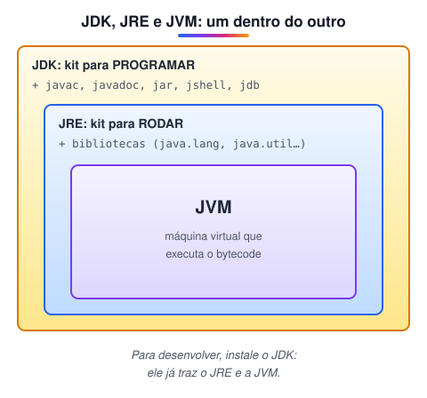
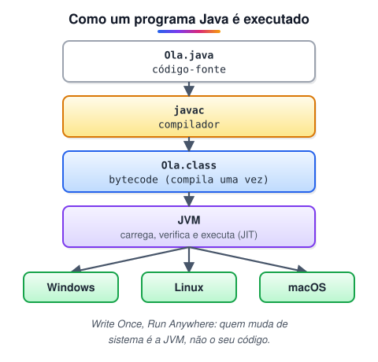
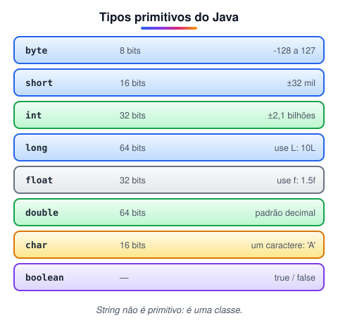
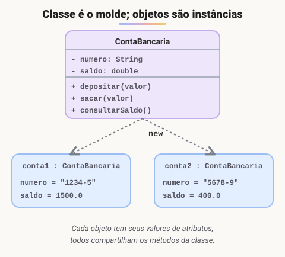

# Java 1 · Fundamentos da linguagem

> 🗺️ **Sobre o módulo:** a base da linguagem Java: como ela funciona, o ambiente de desenvolvimento, variáveis, operadores, decisões, repetições, métodos, entrada de dados e os conceitos iniciais de orientação a objetos.
>
> **Professor:** Marcio · **Continuação:** módulo "Java 2 · Orientação a objetos, coleções e back-end".

> 🧭 **Como usar este módulo:** muito do que está aqui você já viu no módulo 3 (Java estruturado e o TodoApp). Use-o como **revisão aprofundada**: cada página retoma o básico rapidamente e acrescenta os detalhes que o back-end exige (tipos e memória, `switch` moderno, a classe `String`, `printf`). O objetivo final da etapa é construir a API em Spring Boot que o Angular vai consumir.

## Introdução ao Java: história, JDK, JRE e JVM

> 🗺️ **Nesta aula:** a origem do Java, suas características e o que são JDK, JRE e JVM, e entender o caminho do código-fonte até a execução.

### De onde paramos

Você já usou Java no módulo 3, para programas de console e para o TodoApp desktop. Agora ele volta com outro papel: o **back-end**, a API que o Angular vai consumir. Esta aula revisa a base (o que é o Java e como ele roda) com alguns detalhes a mais.

### Um pouco de história

- A **Sun Microsystems** foi fundada em 1982 por estudantes de Stanford (o nome vem de *Stanford University Network*).
- Em 1991, uma equipe liderada por **James Gosling** começou o "Projeto Green", para criar software para eletrônicos (TVs interativas, controles). A linguagem se chamou Oak, depois **Java**.
- A ideia era rodar em aparelhos diferentes sem reescrever o código: ***write once, run anywhere*** (escreva uma vez, rode em qualquer lugar). Para TVs foi cedo demais, mas o boom da internet trouxe a oportunidade, e o Java foi lançado em **1995**.
- Em **2010**, a **Oracle** comprou a Sun e passou a controlar o Java. Desde 2018 sai uma versão nova a cada seis meses, e de tempos em tempos uma versão **LTS** (*Long-Term Support*), com suporte longo: **8, 11, 17, 21 e 25**.

### Características

| Característica | Significa |
| --- | --- |
| **Orientado a objetos** | o programa é organizado em classes e objetos |
| **Portável** | o mesmo programa compilado roda em Windows, Linux e macOS |
| **Fortemente tipado** | cada variável tem um tipo fixo, verificado na compilação |
| **Robusto e seguro** | sem ponteiros manuais; memória liberada automaticamente (*garbage collector*) |
| **Multithread** | executa várias tarefas ao mesmo tempo |
| **Bom desempenho** | a JVM compila os trechos mais usados para código de máquina durante a execução (JIT) |

Hoje o Java é muito usado em **sistemas corporativos e bancários** (com Spring Boot), em aplicativos **Android** (junto com Kotlin) e em sistemas de grande porte.

### JDK, JRE e JVM



| Sigla | Nome | Para que serve |
| --- | --- | --- |
| **JVM** | *Java Virtual Machine* | máquina virtual que **executa o bytecode**; existe uma JVM para cada sistema operacional |
| **JRE** | *Java Runtime Environment* | JVM + bibliotecas padrão: o necessário para **rodar** programas Java |
| **JDK** | *Java Development Kit* | JRE + ferramentas para **desenvolver**: `javac` (compilador), `java`, `jar`, `javadoc`, `jshell`, depurador |

Para programar, instale o **JDK**.

### Do código à execução



```java
// Main.java
public class Main {
  public static void main(String[] args) {
    System.out.println("Olá, Java!");
  }
}
```

```bash
# compila: gera Main.class (bytecode)
javac Main.java
# a JVM executa o bytecode
java Main
# Java 11+: compila e roda de uma vez
java Main.java
```

1. Você escreve o **código-fonte** (`.java`).
2. O compilador `javac` verifica os erros e gera o **bytecode** (`.class`), uma linguagem intermediária que não depende do sistema.
3. A **JVM** carrega o bytecode e o executa, interpretando e compilando os trechos mais usados (JIT).

Por isso o Java é chamado de linguagem **híbrida**: é compilado (para bytecode) e depois interpretado/compilado pela JVM.

### 🧠 Revisão rápida

**Por que o Java é chamado de linguagem híbrida?**

Porque é compilado para bytecode (`javac`) e depois interpretado e compilado em tempo de execução pela JVM (JIT).

**Quais são as versões LTS mais recentes do Java?**

17, 21 e 25 (ainda há muitos sistemas em 8 e 11).

> ➡️ **Próximo passo:** conferir o ambiente e conhecer as IDEs mais usadas no mercado: **Preparando o ambiente: JDK e IDEs**.

### 📌 Resumo

| Item | Em uma frase |
| --- | --- |
| Java | 1995, Sun; desde 2010, Oracle |
| Lema | escreva uma vez, rode em qualquer lugar |
| JDK ⊃ JRE ⊃ JVM | para programar, instale o JDK |
| Caminho | `.java` → `javac` → `.class` → JVM |
| LTS | versões com suporte longo: 17, 21, 25 |

## Preparando o ambiente: JDK e IDEs

> 🗺️ **Nesta aula:** instalar o JDK e escolher uma IDE para programar em Java.

### De onde paramos

No módulo 3, o ambiente foi JDK + NetBeans, ótimo para telas Swing. Para o back-end com Spring Boot, o mercado usa mais o **IntelliJ IDEA**. Esta aula compara as opções; se você já tem o JDK instalado, só confira a versão.

### 1. Instale o JDK

Prefira uma versão **LTS** (suporte de longo prazo): **17, 21 ou 25**. Projetos antigos ainda usam o Java 8 ou 11.

| Distribuição | Observação |
| --- | --- |
| **Eclipse Temurin** (Adoptium) | gratuita, de código aberto, muito usada; boa escolha padrão |
| **Oracle JDK** | da Oracle; gratuita para uso pessoal e para desenvolvimento |
| **Amazon Corretto**, **Microsoft Build of OpenJDK** | alternativas gratuitas de grandes empresas |

Todas são baseadas no **OpenJDK** e funcionam da mesma forma para estudar.

🔗 [https://adoptium.net/](https://adoptium.net/)

🔗 [https://www.oracle.com/br/java/technologies/downloads/](https://www.oracle.com/br/java/technologies/downloads/)

Depois de instalar, confira no terminal:

```bash
java -version
javac -version
```

Se o comando não for reconhecido, a pasta `bin` do JDK não está no **PATH**. No Windows, marque a opção de configurar o `JAVA_HOME` e o PATH no instalador, ou ajuste em "Variáveis de ambiente".

### 2. Escolha uma IDE

> 💡 **IDE** (ambiente de desenvolvimento integrado) é o programa onde você escreve, executa e depura o código. NetBeans, Eclipse e IntelliJ são IDEs, e não **frameworks**. Frameworks são bibliotecas que dão estrutura à aplicação, como **Spring** e **Hibernate**.

| IDE | Pontos fortes | Bom para |
| --- | --- | --- |
| **IntelliJ IDEA** (Community, gratuita) | sugestões e refatoração excelentes; a mais usada no mercado hoje | projetos profissionais, Spring Boot (a versão paga tem mais recursos para Spring) |
| **Eclipse** | tradicional, gratuito, muito plugin; comum em empresas grandes | projetos corporativos legados |
| **NetBeans** | simples; editor visual de telas Swing (arrastar e soltar) | iniciantes e interfaces gráficas desktop |
| **VS Code** com *Extension Pack for Java* | leve; o mesmo editor do front-end | quem já usa VS Code |

🔗 [https://www.jetbrains.com/idea/download/](https://www.jetbrains.com/idea/download/)

🔗 [https://www.eclipse.org/downloads/](https://www.eclipse.org/downloads/)

🔗 [https://netbeans.apache.org/download/](https://netbeans.apache.org/download/)

### 3. Primeiro projeto

1. Crie um projeto Java novo na IDE (no IntelliJ: *New Project → Java*, escolhendo o JDK instalado).
2. Crie a classe `Main` com o método `main`.
3. Escreva `System.out.println("Olá, Java!");` e execute (no IntelliJ, o botão ▶ ao lado do `main`).

Atalhos úteis: no IntelliJ e no Eclipse, `sout` + Tab gera `System.out.println()`, e `psvm` (IntelliJ) ou `main` + Ctrl+Espaço (Eclipse) gera o método `main`.

### 🧠 Revisão rápida

**NetBeans é um framework?**

Não: é uma IDE (onde se escreve o código). Frameworks são bibliotecas que estruturam a aplicação, como o Spring.

**`java -version` não é reconhecido no terminal. O que falta?**

A pasta `bin` do JDK no PATH (ou o `JAVA_HOME` configurado).

> ➡️ **Próximo passo:** com o ambiente pronto, a revisão da linguagem começa por **Variáveis e tipos de dados**.

### 📌 Resumo

| Item | Em uma frase |
| --- | --- |
| JDK | uma versão LTS; Temurin é boa escolha |
| Conferir | `java -version` e `javac -version` |
| IDE ≠ framework | onde se escreve × o que estrutura a aplicação |
| IntelliJ | a mais usada, ótima para Spring Boot |
| Atalhos | `sout` e `psvm` |

## Variáveis e tipos de dados

> 🗺️ **Nesta aula:** declarar variáveis e constantes, conhecer os tipos primitivos e de referência e converter valores entre tipos.

### De onde paramos

Você acabou de passar pelo JavaScript e pelo TypeScript. A volta ao Java mostra o contraste: em JavaScript, `let x` aceita qualquer coisa; em TypeScript, o tipo é opcional; em Java, ele é **obrigatório e fixo**. Esta aula revisa os tipos e acrescenta os quatro "lugares" onde uma variável pode viver.

### Variáveis em Java

Em Java, **toda variável tem um tipo fixo**, declarado antes do nome:

```java
int idade = 25;
double salario = 3500.50;
String nome = "Ana";
idade = 26;  // pode mudar o valor
// ❌ erro de compilação: o tipo não muda
// idade = "vinte";
```

| Tipo de variável | Como | Característica |
| --- | --- | --- |
| **Local** | declarada dentro de um método | só existe dentro do bloco `{ }`; precisa ser inicializada antes do uso |
| **Constante** | `final` | não pode ser reatribuída; convenção: `MAIUSCULAS_COM_UNDERLINE` |
| **De instância** (atributo) | declarada na classe, sem `static` | cada objeto tem o seu valor |
| **Estática** (de classe) | `static`, declarada na classe | um **único valor compartilhado** por todos os objetos |

```java
public class Contador {
  // estática: pertence à classe
  static int totalCriados = 0;
  // constante de instância
  final int ID;
  // constante da classe
  static final double PI = 3.14159;

  Contador() {
    totalCriados++;
    ID = totalCriados;
  }

  public static void main(String[] args) {
    // Java 10+: tipo inferido (String),
    // só em variáveis locais
    var nome = "Ana";
    new Contador();
    new Contador();
    // 2
    System.out.println(Contador.totalCriados);
  }
}
```

Convenções de nome: variáveis e métodos em **camelCase** (`precoTotal`), classes em **PascalCase** (`ContaBancaria`), constantes em **MAIÚSCULAS** (`TAXA_JUROS`).

### Tipos primitivos



| Tipo | Tamanho | Faixa / guarda | Exemplo |
| --- | --- | --- | --- |
| `byte` | 8 bits | −128 a 127 | `byte b = 100;` |
| `short` | 16 bits | −32.768 a 32.767 | `short s = 30000;` |
| `int` ✅ | 32 bits | cerca de ±2,1 bilhões | `int idade = 25;` |
| `long` | 64 bits | inteiros enormes | `long populacao = 8_000_000_000L;` |
| `float` | 32 bits | decimal com ~7 dígitos de precisão | `float altura = 1.75f;` |
| `double` ✅ | 64 bits | decimal com ~15 dígitos de precisão | `double preco = 25.5;` |
| `char` | 16 bits | um caractere (aspas simples) | `char letra = 'J';` |
| `boolean` | — | `true` ou `false` | `boolean ativo = true;` |

- Números inteiros sem nada são `int`; para `long`, use `L` no fim. Decimais sem nada são `double`; para `float`, use `f`.
- O `_` pode separar milhares para facilitar a leitura: `1_000_000`.

### Tipos de referência

Guardam um **endereço para um objeto** e podem valer `null`:

```java
String nome = "João";
int[] notas = {8, 7, 10};
List<String> nomes = new ArrayList<>();
Pessoa p = new Pessoa();
```

`String` não é primitivo: é uma classe. Por isso começa com letra maiúscula e tem métodos (`nome.length()`, `nome.toUpperCase()`).

> ⚠️ Para comparar **textos**, use `.equals()`, e não `==`. O `==` compara se são **o mesmo objeto** na memória: `nome.equals("Ana")` ✅ · `nome == "Ana"` ❌ (pode funcionar ou não, dependendo de como o texto foi criado).

### Conversão de tipos (*casting*)

```java
int i = 10;
// automática (alargamento): int cabe em double
double d = i;

double preco = 9.99;
// explícita (estreitamento): corta o decimal
int inteiro = (int) preco; // 9

// texto -> int
int numero = Integer.parseInt("42");
// texto -> double
double valor = Double.parseDouble("3.5");
// número -> texto
String texto = String.valueOf(42);
```

> ⚠️ Divisão entre inteiros dá inteiro: `7 / 2` é `3`. Para obter `3.5`, pelo menos um lado precisa ser decimal: `7 / 2.0` ou `(double) 7 / 2`. Para dinheiro, os sistemas reais usam `BigDecimal`, porque `double` tem erros de arredondamento.

### Comparando as três linguagens

|  | Java | TypeScript | JavaScript |
| --- | --- | --- | --- |
| Declaração | `int x = 5;` | `let x: number = 5;` | `let x = 5;` |
| Constante | `final int X = 5;` | `const X = 5;` | `const X = 5;` |
| Tipo muda? | nunca | não (erro no editor) | sim |
| Inteiro × decimal | `int` × `double` | só `number` | só `number` |
| Comparar texto | `.equals()` | `===` | `===` |

### 🧠 Revisão rápida

**Qual a diferença entre uma variável de instância e uma `static`?**

A de instância tem um valor em cada objeto; a `static` tem um único valor compartilhado pela classe.

**Quanto vale `(int) 9.99`?**

9: o cast corta a parte decimal, sem arredondar.

**Por que não comparar Strings com `==` em Java?**

Porque `==` compara se é o mesmo objeto na memória, e não o conteúdo. Use `.equals()`.

> ➡️ **Próximo passo:** com as variáveis, vêm as operações sobre elas: **Operadores**.

### 📌 Resumo

| Item | Em uma frase |
| --- | --- |
| Tipo fixo | declarado antes do nome; nunca muda |
| Local · instância · `static` | no método · em cada objeto · na classe |
| `final` | constante |
| Primitivos | 8; `int` e `double` são os mais usados |
| Referência | objetos, `String`, arrays; podem ser `null` |
| Casting | alargamento automático; estreitamento com `(tipo)` |

## Operadores

> 🗺️ **Nesta aula:** os operadores aritméticos, de comparação, lógicos e de atribuição do Java e entender a ordem em que são avaliados.

### De onde paramos

Os operadores são quase os mesmos em Portugol, Java e JavaScript. Esta aula foca nas pegadinhas do Java: a divisão entre inteiros, a diferença entre `x++` e `++x`, o curto-circuito e a ordem de avaliação.

### O que são

**Operadores são símbolos que fazem uma operação sobre valores** e produzem um resultado.

| Categoria | Operadores | Exemplo | Resultado |
| --- | --- | --- | --- |
| Atribuição | `=` | `int n = 5;` | `n` vale 5 |
| Aritméticos | `+` `-` `*` `/` `%` | `7 % 2` · `10 / 4` · `10 / 4.0` | `1` · `2` · `2.5` |
| Comparação | `==` `!=` `>` `<` `>=` `<=` | `7 > 5` | `true` |
| Lógicos | `&&` (E) · `\|\|` (OU) · `!` (NÃO) | `true && false` | `false` |
| Incremento | `++` `--` | `x++` | soma 1 a `x` |
| Atribuição composta | `+=` `-=` `*=` `/=` `%=` | `n += 2` | `n = n + 2` |
| Ternário | `cond ? a : b` | `idade >= 18 ? "M" : "m"` | um dos dois valores |

### Detalhes importantes

#### Divisão inteira e resto

```java
// inteiro / inteiro = inteiro (descarta o decimal)
int a = 10 / 4;  // 2
double b = 10 / 4.0;  // 2.5
// resto da divisão
int resto = 10 % 4;  // 2
boolean par = n % 2 == 0;
```

#### Pré e pós-incremento

```java
int x = 5;
// usa e depois soma: a = 5, x = 6
int a = x++;
// soma e depois usa: x = 7, b = 7
int b = ++x;
```

Sozinhos numa linha (`x++;`), os dois fazem a mesma coisa.

#### Curto-circuito

`&&` e `||` param assim que o resultado está definido. Isso evita erros:

```java
// se texto for null, não chega a chamar length()
if (texto != null && texto.length() > 3) {
  ...
}
```

#### `+` com texto

```java
// junta da esquerda para a direita: "Total: 23"
System.out.println("Total: " + 2 + 3);
// "Total: 5"
System.out.println("Total: " + (2 + 3));
```

#### Comparando objetos

`==` em objetos compara **referências** (se é o mesmo objeto). Para comparar conteúdo de `String` e outros objetos, use `.equals()`.

### Precedência (do maior para o menor)

| Ordem | Operadores |
| --- | --- |
| 1 | `()` parênteses |
| 2 | `++` `--` `!` |
| 3 | `*` `/` `%` |
| 4 | `+` `-` |
| 5 | `<` `>` `<=` `>=` |
| 6 | `==` `!=` |
| 7 | `&&` |
| 8 | `\|\|` |
| 9 | `?:` |
| 10 | `=` `+=` `-=`... |

Na dúvida, **use parênteses**: deixam a intenção clara para quem lê.

### Classe `Math`

```java
Math.pow(2, 10);  // 1024.0 (potência)
Math.sqrt(16);  // 4.0
Math.abs(-7);  // 7
Math.round(2.5);  // 3
Math.max(4, 9);  // 9
// decimal de 0 (inclusive) a 1 (exclusive)
Math.random();
```

### 🧠 Revisão rápida

**Quanto vale `2 + 3 * 4`? E `(2 + 3) * 4`?**

14 (a multiplicação vem antes) e 20.

**Com `int x = 5;`, quanto valem `a` e `x` depois de `int a = x++;`?**

`a` = 5 e `x` = 6: o valor é usado antes de somar.

**Por que `texto != null && texto.length() > 3` não dá erro quando `texto` é `null`?**

Curto-circuito: como a primeira parte é falsa, o `&&` nem avalia a segunda.

> ➡️ **Próximo passo:** operadores de comparação e lógicos são a matéria-prima das decisões: **Estruturas condicionais**.

### 📌 Resumo

| Item | Em uma frase |
| --- | --- |
| `/` entre inteiros | descarta o decimal |
| `%` | resto; `n % 2 == 0` testa par |
| `x++` × `++x` | usa e soma × soma e usa |
| `&&` / `\|\|` | curto-circuito |
| `+` com texto | concatena da esquerda para a direita |
| Precedência | na dúvida, parênteses |

## Estruturas condicionais

> 🗺️ **Nesta aula:** decidir qual trecho executar com `if`, `else if`, `else`, o operador ternário e o `switch` (clássico e moderno).

### De onde paramos

O `se...senao` do Portugol, o `if` do módulo 3 e o do JavaScript são a mesma ideia. A revisão aqui destaca duas diferenças do Java: a condição precisa ser `boolean` de verdade (nada de "valores falsy"), e o `switch` moderno com setas.

### `if`, `else if`, `else`

As condicionais controlam o **fluxo** do programa: executam blocos diferentes de acordo com uma expressão **booleana** (`true` ou `false`).

```java
int nota = 7;

if (nota >= 9) {
  System.out.println("Excelente");
} else if (nota >= 7) {
  System.out.println("Aprovado");
} else if (nota >= 5) {
  System.out.println("Recuperação");
} else {
  System.out.println("Reprovado");
}
```

- O Java testa de cima para baixo e executa **só o primeiro** bloco verdadeiro.
- A condição precisa ser `boolean`: `if (x)` com `x` inteiro **não compila** (diferente do JavaScript).
- Use sempre chaves `{ }`, mesmo com uma linha só: evita erros quando alguém acrescenta outra linha depois.

### Combinando condições

```java
if (idade >= 18 && temCnh) {
  System.out.println("Pode dirigir");
}

if (dia.equals("sábado")
    || dia.equals("domingo")) {
  System.out.println("Fim de semana");
}
```

### Operador ternário

```java
String situacao = nota >= 7 ? "Aprovado" : "Reprovado";
```

### `switch` clássico

Compara **um valor** (`int`, `char`, `String` ou `enum`) com vários casos:

```java
switch (dia) {
  case 1:
    System.out.println("Domingo");
    break;
  case 7:
    System.out.println("Sábado");
    break;
  default:
    System.out.println("Dia útil");
}
```

Sem `break`, a execução "cai" no caso seguinte (*fall-through*), o que é uma fonte comum de bugs.

### `switch` moderno (Java 14+)

```java
String nome = switch (dia) {
  case 1 -> "Domingo";
  case 2, 3, 4, 5, 6 -> "Dia útil";
  case 7 -> "Sábado";
  default -> "Inválido";
};
```

- Com `->`, não há "queda" entre casos e não precisa de `break`.
- Pode **devolver um valor** direto para uma variável.
- Vários valores no mesmo caso, separados por vírgula.

> ⚠️ Ao comparar `String` no `if`, use `.equals()`: `if (resposta.equals("sim"))`. Para ignorar maiúsculas e minúsculas, `equalsIgnoreCase()`. No `switch`, Strings já são comparadas pelo conteúdo.

### 🧠 Revisão rápida

**`int x = 1; if (x) { ... }` compila em Java?**

Não: a condição precisa ser `boolean`. Escreva `if (x != 0)`.

**No `switch` com setas (`->`), é preciso `break`?**

Não: não há "queda" para o caso seguinte.

> ➡️ **Próximo passo:** depois de decidir, repetir: **Laços de repetição**.

### 📌 Resumo

| Item | Em uma frase |
| --- | --- |
| `if/else if/else` | só o primeiro verdadeiro executa |
| Condição | sempre `boolean` |
| Ternário | escolhe entre dois valores |
| `switch` clássico | precisa de `break` |
| `switch` moderno | `->`, sem `break`, devolve valor |
| Strings | `.equals()` no `if` |

## Laços de repetição

> 🗺️ **Nesta aula:** repetir instruções com `while`, `do-while`, `for` e `for-each`, e controlar o laço com `break` e `continue`.

### De onde paramos

Os laços do Java você já praticou nos 35 exercícios do módulo 3. Aqui eles aparecem lado a lado, com os padrões mais comuns (acumulador, contador, laços aninhados) para revisar de uma vez.

### Os quatro laços

| Laço | Testa a condição | Uso típico |
| --- | --- | --- |
| `while` | **antes** (pode não executar nenhuma vez) | repetir enquanto algo for verdade, sem saber quantas vezes |
| `do-while` | **depois** (executa pelo menos uma vez) | menus, pedir um valor até ser válido |
| `for` | antes (início; condição; incremento) | quantidade de repetições conhecida |
| `for-each` | percorre cada item | arrays e coleções |

```java
// while
int i = 0;
while (i < 5) {
  System.out.println(i);
  i++;
}

// do-while: pede a nota até ser válida
Scanner sc = new Scanner(System.in);
int nota;
do {
  System.out.print("Nota (0 a 10): ");
  nota = sc.nextInt();
} while (nota < 0 || nota > 10);

// for
for (int k = 1; k <= 10; k++) {
  System.out.println("7 x " + k + " = " + (7 * k));
}

// for-each
String[] nomes = {"Ana", "Beto", "Carla"};
for (String nome : nomes) {
  System.out.println(nome);
}
```

### `break` e `continue`

```java
for (int n = 1; n <= 10; n++) {
  if (n == 8) break;  // sai do laço
  if (n % 2 == 0) continue; // próxima volta
  System.out.println(n);  // 1, 3, 5, 7
}
```

### Laços aninhados

```java
for (int linha = 1; linha <= 3; linha++) {
  for (int coluna = 1; coluna <= 3; coluna++) {
    System.out.print(linha * coluna + "\t");
  }
  System.out.println();
}
```

O laço de dentro executa por completo a cada volta do laço de fora.

### Acumuladores e contadores

```java
int[] valores = {4, 8, 15, 16, 23, 42};
int soma = 0, pares = 0;
for (int v : valores) {
  soma += v;  // acumulador
  if (v % 2 == 0) pares++; // contador
}
// 18.0
double media = (double) soma / valores.length;
```

> ⚠️ **Laço infinito:** se a condição nunca ficar falsa (esquecer o `i++`, por exemplo), o programa não termina. Na IDE, use o botão de parar. No `for-each` não há índice: se precisar da posição ou de alterar o array, use o `for` comum.

### 🧠 Revisão rápida

**Qual laço usar para pedir um valor até ele ser válido?**

`do-while`: precisa pedir pelo menos uma vez antes de testar.

**Por que `(double) soma / valores.length`, e não só `soma / valores.length`?**

Porque os dois são inteiros, e a divisão descartaria o decimal. O cast faz a conta em `double`.

> ➡️ **Próximo passo:** blocos de código reutilizáveis e a classe mais usada do Java: **Métodos e a classe String**.

### 📌 Resumo

| Item | Em uma frase |
| --- | --- |
| `while` | testa antes |
| `do-while` | executa pelo menos uma vez |
| `for` | contagem conhecida |
| `for-each` | percorre arrays e coleções |
| `break` · `continue` | sai · pula a volta |
| Acumulador · contador | `soma += v` · `cont++` |

## Métodos e a classe String

> 🗺️ **Nesta aula:** criar métodos (blocos de código com nome, parâmetros e retorno) e usar os principais recursos da classe `String`.

### De onde paramos

No Portugol você criou **funções** e no JavaScript, `function` e arrow functions. Em Java a ideia é a mesma, com uma diferença: tudo vive dentro de uma classe, e cada parâmetro e retorno tem tipo declarado. Esta aula é a ponte para a orientação a objetos, logo a seguir.

### Métodos

**Método é um bloco de código com nome**, que pode receber parâmetros e devolver um valor. Antes de entrar em orientação a objetos, os métodos `static` permitem organizar o programa em partes:

```java
public class Calculadora {

  // tipo de retorno + nome + parâmetros
  static double media(double a, double b) {
    return (a + b) / 2;
  }

  static boolean ehPar(int n) {
    return n % 2 == 0;
  }

  // void: não devolve nada
  static void mostrarLinha() {
    System.out.println("----------");
  }

  public static void main(String[] args) {
    mostrarLinha();
    System.out.println(media(7, 8)); // 7.5
    System.out.println(ehPar(10));  // true
  }
}
```

| Parte | Exemplo | Significa |
| --- | --- | --- |
| Modificador | `public`, `private`, `static` | quem acessa; `static` = pertence à classe |
| Tipo de retorno | `double`, `boolean`, `void` | o que o método devolve |
| Nome | `media` | verbo em camelCase |
| Parâmetros | `(double a, double b)` | entradas, com tipo |
| `return` | `return (a + b) / 2;` | devolve o valor e encerra o método |

#### Sobrecarga

Vários métodos com o mesmo nome e **parâmetros diferentes**:

```java
static int somar(int a, int b) { return a + b; }
static double somar(double a, double b) {
  return a + b;
}
static int somar(int a, int b, int c) {
  return a + b + c;
}
```

#### Passagem por valor

O Java sempre passa **cópias** dos valores. Alterar um parâmetro primitivo dentro do método não muda a variável de fora. Com objetos e arrays, a cópia é do **endereço**: o método consegue alterar o conteúdo do objeto.

```java
static void dobrar(int n) { n = n * 2; }
static void zerar(int[] v) { v[0] = 0; }

int x = 5;
dobrar(x);  // x continua 5
int[] nums = {9, 9};
zerar(nums); // nums vira {0, 9}
```

> 💡 **Analogia:** passar um primitivo é entregar uma **fotocópia** de um número; quem rabiscar a cópia não muda o original. Passar um objeto é entregar uma cópia do **endereço de uma casa**: a pessoa vai até a mesma casa e pode mudar os móveis.

### A classe `String`

```java
String nome = "  Ana Souza  ";
```

| Método | Exemplo | Resultado |
| --- | --- | --- |
| `length()` | `"Java".length()` | `4` |
| `charAt(i)` | `"Java".charAt(0)` | `'J'` |
| `toUpperCase()` / `toLowerCase()` | `"java".toUpperCase()` | `"JAVA"` |
| `trim()` / `strip()` | `nome.trim()` | `"Ana Souza"` |
| `substring(i, f)` | `"Banco".substring(1, 3)` | `"an"` (o fim não entra) |
| `indexOf(s)` | `"Banco".indexOf("co")` | `3` (ou `-1`) |
| `contains(s)` | `"Banco".contains("an")` | `true` |
| `startsWith` / `endsWith` | `"foto.png".endsWith(".png")` | `true` |
| `replace(a, b)` | `"1.234".replace(".", "")` | `"1234"` |
| `split(sep)` | `"a;b;c".split(";")` | `["a", "b", "c"]` |
| `equals` / `equalsIgnoreCase` | `"sim".equalsIgnoreCase("SIM")` | `true` |
| `isEmpty()` / `isBlank()` | `"  ".isBlank()` | `true` (Java 11+) |
| `String.join` | `String.join(", ", lista)` | `"a, b, c"` |

> ⚠️ `String` é **imutável**: `nome.toUpperCase();` sozinho não muda `nome`; o método devolve um texto novo. Guarde o resultado: `nome = nome.toUpperCase();`. E compare sempre com `.equals()`, nunca com `==`.

#### `StringBuilder`: montando textos em laços

```java
StringBuilder sb = new StringBuilder();
for (int i = 1; i <= 5; i++) {
  sb.append(i).append(" ");
}
// "1 2 3 4 5"
String resultado = sb.toString().trim();
```

Concatenar com `+` dentro de um laço cria um objeto novo a cada volta; o `StringBuilder` reaproveita o mesmo.

#### Text blocks (Java 15+)

```java
String json = """
  { "nome": "Ana", "idade": 30 }
  """;
```

### 🧠 Revisão rápida

**O que significa `void` na assinatura de um método?**

Que o método não devolve valor; ele só executa algo (como imprimir).

**Depois de `String s = "oi"; s.toUpperCase();`, quanto vale `s`?**

Continua `"oi"`: `String` é imutável. É preciso guardar o resultado: `s = s.toUpperCase();`.

**Quanto vale `"Programa".substring(0, 3)`?**

`"Pro"`: começa no índice 0 e para antes do 3.

> ➡️ **Próximo passo:** fazer o programa conversar com o usuário: **Entrada e saída de dados**.

### 📌 Resumo

| Item | Em uma frase |
| --- | --- |
| Método | modificador + retorno + nome + parâmetros |
| `void` | não devolve valor |
| Sobrecarga | mesmo nome, parâmetros diferentes |
| Passagem | sempre por valor (cópia) |
| `String` | imutável; compare com `.equals()` |
| `StringBuilder` | monta textos em laços |

## Entrada e saída de dados: Scanner, JOptionPane e printf

> 🗺️ **Nesta aula:** ler dados digitados pelo usuário no console (`Scanner`) e em janelas (`JOptionPane`), e mostrar resultados formatados.

### De onde paramos

No Portugol, `leia()` e `escreva()` faziam essa conversa. Em Java, a saída é o `System.out` que você já usa, e a entrada pede uma ferramenta: o `Scanner` (console) ou o `JOptionPane` (janelas).

### Comparando as duas formas

|  | `Scanner` | `JOptionPane` |
| --- | --- | --- |
| Pacote | `java.util` | `javax.swing` |
| Onde aparece | no console / terminal | em janelas gráficas (pop-up) |
| O que devolve | métodos por tipo (`nextInt`, `nextDouble`, `nextLine`) | **sempre** `String` (precisa converter) |
| Uso hoje | exercícios e programas de terminal | exercícios rápidos com janela |

### `Scanner`

```java
import java.util.Scanner;

public class Main {
  public static void main(String[] args) {
    Scanner sc = new Scanner(System.in);

    System.out.print("Nome: ");
    // lê a linha inteira
    String nome = sc.nextLine();

    System.out.print("Idade: ");
    int idade = sc.nextInt();

    System.out.print("Salário: ");
    double salario = sc.nextDouble();

    System.out.printf(
      "%s tem %d anos e ganha R\$ %.2f%n",
      nome, idade, salario);
    sc.close();
  }
}
```

| Método | Lê |
| --- | --- |
| `nextLine()` | a linha inteira, com espaços |
| `next()` | uma palavra (até o espaço) |
| `nextInt()`, `nextDouble()`, `nextBoolean()` | um valor do tipo |

> ⚠️ **A armadilha do Enter:** `nextInt()` e `nextDouble()` leem o número, mas deixam o "Enter" no buffer. Um `nextLine()` logo depois lê essa linha vazia e parece ser "pulado". Solução: chame um `sc.nextLine();` extra depois do `nextInt()`, ou leia tudo com `nextLine()` e converta (`Integer.parseInt(sc.nextLine())`).

> 💡 **Vírgula ou ponto?** O `Scanner` usa o idioma do computador: num sistema em português, `nextDouble()` espera `3,5`, e `3.5` dá `InputMismatchException`. Para padronizar com ponto, crie-o com `new Scanner(System.in).useLocale(Locale.US)`.

### `JOptionPane`

```java
import javax.swing.JOptionPane;

String entrada =
  JOptionPane.showInputDialog("Digite um número:");
// String → int
int num = Integer.parseInt(entrada);
JOptionPane.showMessageDialog(null,
  "O dobro é " + (num * 2));

int resp = JOptionPane.showConfirmDialog(null,
  "Deseja continuar?");
if (resp == JOptionPane.YES_OPTION) { ... }
```

| Método | Mostra |
| --- | --- |
| `showInputDialog` | campo para digitar; devolve `String` (ou `null` se cancelar) |
| `showMessageDialog` | uma mensagem com OK |
| `showConfirmDialog` | Sim / Não / Cancelar; devolve uma constante |

Se a pessoa digitar algo que não é número, `Integer.parseInt` lança `NumberFormatException` (veja a página de exceções).

### Mostrando resultados formatados

```java
System.out.println("Linha com quebra no fim");
System.out.print("Sem quebra");
System.out.printf("Preço: R\$ %.2f | Qtd: %d%n",
  9.5, 3);
// "00042"
String msg = String.format("%05d", 42);
```

| Formato | Para |
| --- | --- |
| `%d` | inteiro |
| `%.2f` | decimal com 2 casas |
| `%s` | texto |
| `%n` | quebra de linha |

### Juntando tudo: um mini programa

Um programa que lê notas até o usuário digitar `-1` e mostra a média, usando laço, método e entrada:

```java
import java.util.Scanner;

public class Notas {
  static double media(double soma, int qtd) {
    return qtd == 0 ? 0 : soma / qtd;
  }

  public static void main(String[] args) {
    Scanner sc = new Scanner(System.in);
    double soma = 0;
    int qtd = 0;
    while (true) {
      System.out.print("Nota (-1 sai): ");
      double n = Double.parseDouble(
        sc.nextLine().replace(",", "."));
      if (n == -1) break;
      soma += n;
      qtd++;
    }
    System.out.printf("Média: %.1f%n",
      media(soma, qtd));
  }
}
```

### 🧠 Revisão rápida

**Por que um `nextLine()` logo depois de `nextInt()` parece ser "pulado"?**

Porque o `nextInt()` deixa o Enter no buffer, e o `nextLine()` lê essa linha vazia.

**O que `JOptionPane.showInputDialog` devolve?**

Sempre uma `String` (ou `null` se cancelar). Para número, converta com `Integer.parseInt` ou `Double.parseDouble`.

**Qual formato mostra `3.14159` como `3.14`?**

`%.2f`.

> ➡️ **Próximo passo:** organizar dados e comportamento juntos, em classes: **Orientação a objetos**.

### 📌 Resumo

| Item | Em uma frase |
| --- | --- |
| `Scanner` | lê do console por tipo |
| `JOptionPane` | janelas; devolve sempre `String` |
| Armadilha do Enter | `nextLine()` extra após `nextInt()` |
| `printf` | `%d`, `%.2f`, `%s`, `%n` |
| Conversão | `Integer.parseInt`, `Double.parseDouble` |

## Orientação a objetos: classes, objetos e pilares

> 🗺️ **Nesta aula:** entender classes, objetos, atributos e métodos, e os pilares da orientação a objetos: encapsulamento, herança e polimorfismo.

### De onde paramos

Você já usou objetos sem perceber: `String`, `Scanner` e `ArrayList` são classes. No JavaScript, viu `class` na aula de ES6, e no TodoApp do módulo 3 criou a classe `Tarefa`. Agora é hora de entender as regras por trás: por que esconder atributos, quando herdar e como um mesmo método se comporta de formas diferentes.

### Classe e objeto



| Conceito | Resumo | Analogia |
| --- | --- | --- |
| **Classe** | molde que define atributos e métodos | a planta de uma casa |
| **Objeto** (instância) | um exemplar criado a partir da classe com `new` | cada casa construída |
| **Atributo** | variável da classe: o **estado** do objeto | cor, número de quartos |
| **Método** | função da classe: o **comportamento** | abrir a porta |

```java
public class ContaBancaria {
  // atributos
  private String numero;
  private double saldo;

  // construtor: chamado no new
  public ContaBancaria(String numero) {
    this.numero = numero;
  }

  // métodos
  public void depositar(double valor) {
    if (valor > 0) saldo += valor;
  }

  public double getSaldo() {
    return saldo;
  }
}

// instanciação
ContaBancaria c1 = new ContaBancaria("1234-5");
c1.depositar(1500);
System.out.println(c1.getSaldo()); // 1500.0
```

- Assinatura de um método: `modificador tipoRetorno nome(parâmetros)`. `void` = não devolve nada.
- `this` se refere ao próprio objeto: `this.numero = numero` diferencia o atributo do parâmetro com o mesmo nome.

### Encapsulamento

**Esconder os dados** (`private`) e expor só **operações seguras** (métodos públicos), que garantem as regras de negócio:

```java
public class ContaBancaria {
  // ninguém de fora altera direto
  private double saldo;

  public void sacar(double valor) {
    if (valor <= 0)
      throw new IllegalArgumentException(
        "Valor inválido");
    if (valor > saldo)
      throw new IllegalStateException(
        "Saldo insuficiente");
    saldo -= valor;
  }

  // leitura permitida; sem setSaldo
  public double getSaldo() { return saldo; }
}
```

> 💡 **Analogia:** o caixa eletrônico. Você não abre o cofre do banco (o atributo `private`); você usa os botões "sacar" e "depositar" (os métodos públicos), e é o caixa que confere se há saldo.

Por convenção, o acesso a atributos privados é feito por **getters** (`getNome()`) e **setters** (`setNome(...)`), criados só quando fazem sentido.

| Modificador | Quem acessa |
| --- | --- |
| `public` | todos |
| `protected` | o pacote e as subclasses |
| *(sem modificador)* | só o pacote |
| `private` | só a própria classe |

### Herança

A **subclasse** (`extends`) herda atributos e métodos da **superclasse** e acrescenta ou modifica o que precisar. Teste: a frase "**é um**" precisa fazer sentido ("Cachorro **é um** Animal").

```java
public class Animal {
  protected String nome;
  public Animal(String nome) {
    this.nome = nome;
  }
  public void emitirSom() {
    System.out.println("...");
  }
}

public class Cachorro extends Animal {
  private String raca;
  public Cachorro(String nome, String raca) {
    // construtor de Animal (primeira linha)
    super(nome);
    this.raca = raca;
  }
  @Override
  public void emitirSom() {
    System.out.println(nome + ": Au au!");
  }
}
```

- Java permite herdar de **uma única** classe (para "vários tipos", use interfaces).
- Toda classe herda, direta ou indiretamente, de `Object` (que traz `toString`, `equals`, `hashCode`).

### Polimorfismo

Uma variável do tipo da superclasse pode guardar qualquer subclasse, e o método executado é o **da classe real** do objeto:

```java
class Forma {
  double area() { return 0; }
}

class Circulo extends Forma {
  double r;
  Circulo(double r) { this.r = r; }
  @Override
  double area() { return Math.PI * r * r; }
}

class Quadrado extends Forma {
  double lado;
  Quadrado(double l) { this.lado = l; }
  @Override
  double area() { return lado * lado; }
}

Forma[] formas = { new Circulo(1), new Quadrado(2) };
for (Forma f : formas) {
  // 3.14 e 4.00
  System.out.printf("%.2f%n", f.area());
}
```

|  | Sobrescrita (*override*) | Sobrecarga (*overload*) |
| --- | --- | --- |
| Onde | na **subclasse** | na **mesma** classe |
| Assinatura | igual à do método herdado | mesmo nome, **parâmetros diferentes** |
| Decidido | na execução (pelo objeto real) | na compilação (pelos argumentos) |
| Exemplo | `@Override emitirSom()` | `somar(int, int)` e `somar(double, double)` |

### Abstração

Modelar só o que importa para o sistema: uma `Pessoa` num sistema de RH tem `nome`, `cpf` e `cargo`, mas não precisa de `corDoCabelo`. Classes `abstract` e interfaces são as ferramentas de abstração do Java (veja a próxima aula).

### 🧠 Revisão rápida

**Qual a diferença entre classe e objeto?**

A classe é o molde (a planta); o objeto é um exemplar criado com `new` (cada casa construída), com seus próprios valores.

**Por que `saldo` é `private` e não há `setSaldo`?**

Para que ninguém altere o saldo sem passar pelas regras de `depositar` e `sacar`.

**No laço `for (Forma f : formas)`, qual `area()` é executado?**

O da classe real de cada objeto (`Circulo` ou `Quadrado`): isso é polimorfismo.

**"Carro é um Motor" faz sentido? Use herança ou não?**

Não faz sentido: um carro **tem um** motor. Use um atributo (composição), não `extends`.

> ➡️ **Próximo passo:** com a base da linguagem pronta, o módulo **Java 2** traz interfaces, coleções, exceções e o caminho até uma API.

### 📌 Resumo

| Item | Em uma frase |
| --- | --- |
| Classe · objeto | molde · exemplar criado com `new` |
| Construtor | inicializa o objeto no `new` |
| Encapsulamento | atributos `private` e métodos com regras |
| Herança | `extends` e `super`; "é um" |
| Polimorfismo | o método do objeto real é o executado |
| Abstração | modelar só o que importa |

## 📌 Resumo do módulo

| Conceito | Lembrete |
| --- | --- |
| Execução | `.java` → `javac` → `.class` (bytecode) → JVM |
| JDK ⊃ JRE ⊃ JVM | instale o JDK, de preferência LTS (17, 21 ou 25) |
| Tipos | 8 primitivos (`int`, `double`, `boolean`, `char`...) + referências (`String`, objetos) |
| `final` · `static` | constante · compartilhado pela classe |
| `7 / 2` | `3` entre inteiros; use `7 / 2.0` |
| Strings | imutáveis; compare com `.equals()` |
| Condicionais | `if/else if/else`, ternário, `switch` (moderno com `->`) |
| Laços | `while`, `do-while`, `for`, `for-each`; `break`/`continue` |
| Métodos | tipo de retorno + nome + parâmetros; `void`; sobrecarga |
| Entrada | `Scanner` (cuidado com o Enter após `nextInt`) · `JOptionPane` (sempre `String`) |
| Saída | `printf("%.2f %d %s%n", ...)` |
| POO | classe/objeto, encapsulamento (`private`), herança (`extends`), polimorfismo (`@Override`) |
