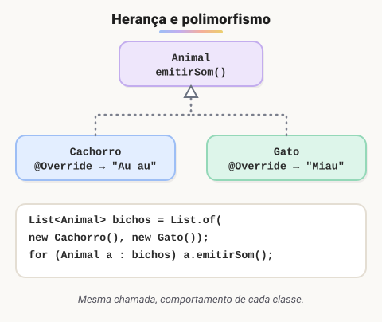
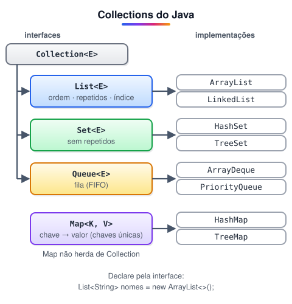
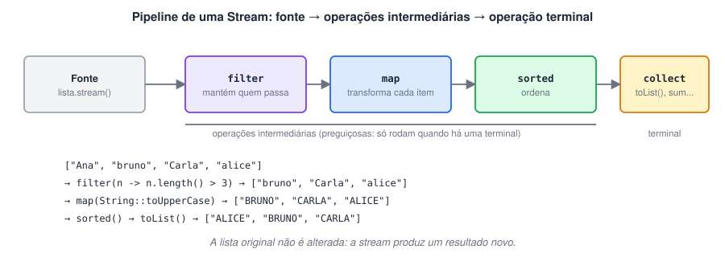
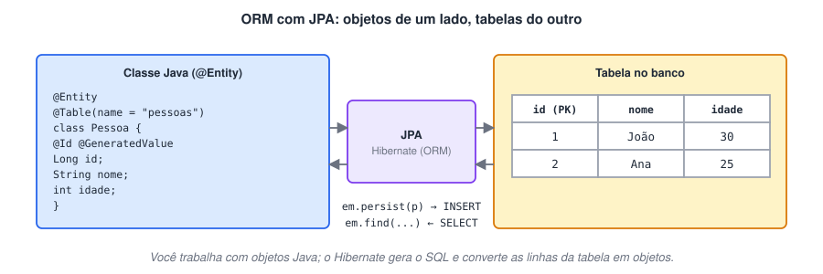
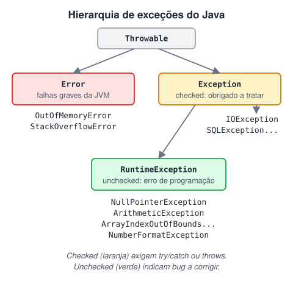
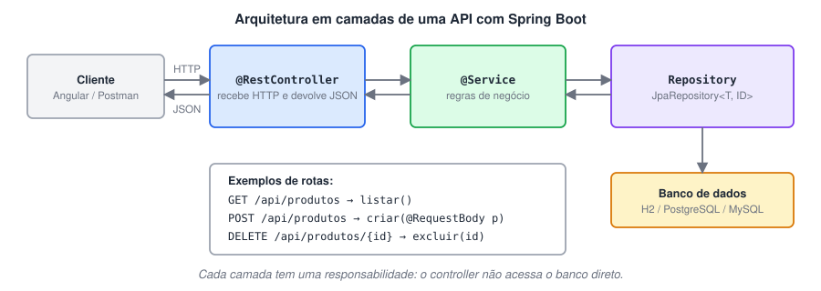
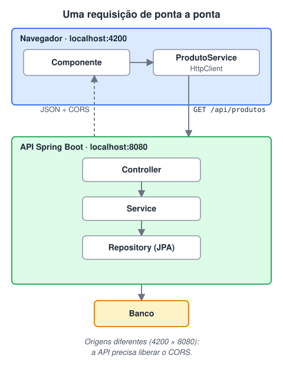

# Java 2 · Orientação a objetos, coleções e back-end

> 🗺️ **Sobre o módulo:** continuação do Java 1 (Prof. Marcio). Aqui você aprofunda a orientação a objetos, conhece as coleções e os recursos do Java moderno (generics, lambdas, Streams, `java.time`), aprende a guardar dados em banco e a tratar erros, cria uma **API REST com Spring Boot** e termina com um **projeto full-stack**, ligando essa API ao Angular dos módulos anteriores.<br />**Pré-requisito:** módulo Java 1 · Fundamentos da linguagem.

## Conceitos importantes de orientação a objetos

> 🗺️ **Nesta aula:** as peças que você mais usa no dia a dia do Java orientado a objetos: construtores, modificadores de acesso, `static`, enum, classes abstratas e interfaces. Depois vêm as estruturas para guardar vários valores: arrays e o framework **Collections** (List, Set, Map).

#### De onde paramos

No Java 1 você criou classes com atributos, construtor e métodos, e viu herança e polimorfismo. Agora entram as peças que faltavam para modelar sistemas maiores (constantes, enums, interfaces) e as coleções, que substituem o array quando o tamanho muda, como a lista de tarefas do TodoApp.

### 1. Construtores

- Método especial que **inicializa** o objeto no momento do `new`. Tem o **mesmo nome da classe** e **não tem tipo de retorno**.
- Se você não escrever nenhum, o Java cria um construtor vazio padrão. Se escrever qualquer um, o padrão deixa de existir.
- Pode haver vários (**sobrecarga**), e um pode chamar o outro com `this(...)`.

**Código exemplo**

```java
public class Pessoa {
  private String nome;
  private int idade;

  // reaproveita o outro construtor
  public Pessoa() { this("Sem nome", 0); }

  public Pessoa(String nome, int idade) {
    // this = "o atributo deste objeto"
    this.nome = nome;
    this.idade = idade;
  }
}

Pessoa p1 = new Pessoa();  // "Sem nome", 0
Pessoa p2 = new Pessoa("Ana Souza", 30);
```

### 2. Modificadores de acesso e encapsulamento

| Modificador | Quem acessa |
| --- | --- |
| **`public`** | qualquer lugar |
| **`protected`** | a própria classe, o mesmo pacote e as subclasses |
| (padrão, sem palavra) | a própria classe e o mesmo pacote |
| **`private`** | só a própria classe |

- Regra prática do **encapsulamento**: atributos `private` e acesso controlado por métodos `public` (getters/setters ou métodos de negócio que validam os dados).

**Código exemplo**

```java
public class ContaBancaria {
  // ninguém de fora altera direto
  private double saldo;

  public void depositar(double valor) {
    if (valor <= 0)
      throw new IllegalArgumentException(
          "Valor inválido");
    saldo += valor;
  }
  // leitura liberada
  public double getSaldo() { return saldo; }
}
```

### 3. Membros `static` e `final`

- `static` pertence à **classe**, não ao objeto: existe uma única cópia, acessada por `NomeDaClasse.membro`. Ex.: `Math.sqrt()`, contadores globais.
- `final` impede mudança: variável `final` não pode ser reatribuída; método `final` não pode ser sobrescrito; classe `final` não pode ser herdada (ex.: `String`).
- Constantes costumam ser `public static final` com nome em MAIÚSCULAS.

**Código exemplo**

```java
public class Pedido {
  // constante
  public static final double TAXA = 7.5;
  // compartilhado por todos os pedidos
  private static int totalCriados = 0;

  public Pedido() { totalCriados++; }

  public static int getTotalCriados() {
    return totalCriados;
  }
}

new Pedido();
new Pedido();
// 2
System.out.println(Pedido.getTotalCriados());
```

### 4. Enumeradores (`enum`)

- Tipo com um conjunto **fixo** de constantes (dias, status, níveis). Evita valores inválidos como `"pago"` vs `"PAGO"`.
- Um enum pode ter atributos, construtor e métodos, e funciona muito bem com `switch`.

**Código exemplo**

```java
public enum StatusPedido {
  ABERTO("Aguardando pagamento"),
  PAGO("Pago"),
  ENVIADO("Em transporte");

  private final String descricao;

  StatusPedido(String descricao) {
    this.descricao = descricao;
  }
  public String getDescricao() {
    return descricao;
  }
}

StatusPedido s = StatusPedido.PAGO;
// PAGO - Pago
System.out.println(s + " - " + s.getDescricao());
for (StatusPedido st : StatusPedido.values())
  System.out.println(st);
```

### 5. Classes abstratas e interfaces

- **Classe abstrata** (`abstract class`): não pode ser instanciada. Serve de **base** para subclasses e pode ter atributos, construtores, métodos prontos e métodos `abstract` (sem corpo) que as filhas devem implementar.
- **Interface**: um **contrato**. Declara o que a classe deve saber fazer; quem a `implements` é obrigado a implementar os métodos. Desde o Java 8 pode ter métodos `default` e `static`.
- Uma classe **herda de uma só** classe (`extends`), mas pode **implementar várias** interfaces.

|  | Classe abstrata | Interface |
| --- | --- | --- |
| Instanciar com `new` | ❌ | ❌ |
| Atributos de instância | ✅ | ❌ (só constantes) |
| Construtor | ✅ | ❌ |
| Quantas uma classe pode usar | 1 (`extends`) | várias (`implements`) |
| Quando usar | classes que **são** um tipo comum e compartilham código | capacidades que classes diferentes **sabem fazer** |

**Código exemplo**

```java
interface Pagavel { double calcularPagamento(); }

abstract class Funcionario implements Pagavel {
  protected String nome;
  Funcionario(String nome) { this.nome = nome; }
  // método pronto, herdado
  public String getNome() { return nome; }
}

class Mensalista extends Funcionario {
  private double salario;
  Mensalista(String nome, double salario) {
    super(nome);
    this.salario = salario;
  }
  public double calcularPagamento() {
    return salario;
  }
}

class Horista extends Funcionario {
  private int horas;
  private double valorHora;
  Horista(String nome, int horas, double vh) {
    super(nome);
    this.horas = horas;
    this.valorHora = vh;
  }
  public double calcularPagamento() {
    return horas * valorHora;
  }
}

List<Pagavel> folha = List.of(
    new Mensalista("Ana", 5000),
    new Horista("Bia", 80, 40));
// polimorfismo
for (Pagavel p : folha)
  System.out.println(p.calcularPagamento());
```



> 💡 **Analogia:** no fim do mês, o RH manda **o mesmo pedido** a todos os funcionários: "calcule o seu pagamento". O mensalista responde com o salário fixo; o horista multiplica as horas pelo valor da hora. O RH não precisa saber quem é quem: só confia que todos cumprem o contrato `Pagavel`. Isso é polimorfismo: uma chamada, comportamentos diferentes conforme o objeto real.

### 6. Arrays

- Coleção de **tamanho fixo** de valores do **mesmo tipo**. Índices vão de **0 a N-1** e o tamanho fica em `.length`.
- Acessar um índice fora do intervalo lança `ArrayIndexOutOfBoundsException`.
- A classe utilitária `java.util.Arrays` ajuda: `Arrays.sort(v)`, `Arrays.toString(v)`, `Arrays.fill(v, 0)`.

**Código exemplo unidimensional**

```java
int[] numeros = new int[10];
for (int i = 0; i < numeros.length; i++)
  numeros[i] = i * 10;
System.out.println(numeros[5]);  // 50

// criação já com valores
int[] notas = {7, 9, 5};
Arrays.sort(notas);
// [5, 7, 9]
System.out.println(Arrays.toString(notas));
```

**Código exemplo bidimensional (matriz)**

```java
// 3 linhas × 4 colunas
int[][] matriz = new int[3][4];
for (int i = 0; i < matriz.length; i++)
  for (int j = 0; j < matriz[i].length; j++)
    matriz[i][j] = (i + 1) * (j + 1);
// linha 2, coluna 3 → 6
System.out.println(matriz[1][2]);
```

**Preenchendo um array pelo teclado (Scanner)**

```java
Scanner sc = new Scanner(System.in);
int[] valores = new int[5];
for (int i = 0; i < valores.length; i++)
  valores[i] = sc.nextInt();
for (int v : valores) System.out.println(v);
```

**Preenchendo um array com caixas de diálogo (JOptionPane)**

```java
String[] paises = new String[4];
for (int i = 0; i < paises.length; i++)
  paises[i] =
    JOptionPane.showInputDialog("Informe um país");
for (String p : paises) System.out.println(p);
```

> 💡 **Valores padrão** de um array recém-criado: números → `0` · `boolean` → `false` · `char` → o caractere nulo (código 0) · objetos e `String` → `null`.

### 7. Collections

- Estruturas **dinâmicas** do pacote `java.util` para guardar e manipular grupos de objetos. Crescem e diminuem sozinhas.
- Boa prática: **declare pela interface** (`List`, `Set`, `Map`) e escolha a implementação no `new`. Assim fica fácil trocar depois.



> 💡 **Analogia:** a `List` é uma lista de compras: tem ordem e pode repetir item ("leite" duas vezes). O `Set` é a lista de convidados de uma festa: cada nome entra uma vez só. A `Queue` é a fila do banco: quem chega primeiro é atendido primeiro. E o `Map` é a agenda do celular: você procura pelo nome (a chave) e encontra o número (o valor).

| Interface | Característica | Implementação mais comum | Use quando… |
| --- | --- | --- | --- |
| `List` | ordenada, aceita repetidos, acesso por índice | `ArrayList` | precisa de uma lista na ordem de inserção |
| `Set` | **não** aceita repetidos | `HashSet` (sem ordem), `TreeSet` (ordenado) | quer valores únicos ou testar se algo existe |
| `Queue`/`Deque` | fila ou pilha | `ArrayDeque` | processa itens por ordem de chegada |
| `Map` | pares **chave → valor**, chaves únicas | `HashMap`, `TreeMap` | busca um valor pela chave (ex.: CPF → cliente) |

##### Códigos exemplo

**List**

```java
List<String> frutas = new ArrayList<>();
frutas.add("Maçã");
frutas.add("Banana");
frutas.add("Maçã");  // aceita repetido
frutas.get(1);  // "Banana"
frutas.remove(0);  // pelo índice
frutas.contains("Banana");  // true
frutas.size();
frutas.isEmpty();

// lista imutável (Java 9+)
List<String> fixa = List.of("A", "B");
```

**Set**

```java
Set<String> conjunto = new HashSet<>();
conjunto.add("Maçã");
conjunto.add("Maçã");  // ignorado: já existe
conjunto.contains("Maçã");  // true
conjunto.size();  // 1
```

**Map**

```java
Map<String, Double> precos = new HashMap<>();
precos.put("café", 6.5);
precos.put("pão", 1.2);
precos.get("café");  // 6.5
// 0.0 (chave inexistente)
precos.getOrDefault("leite", 0.0);
precos.containsKey("pão");  // true
precos.remove("pão");
for (var e : precos.entrySet())
  System.out.println(
      e.getKey() + " = " + e.getValue());
```

**Ordenando coleções (Comparable e Comparator)**

```java
List<String> nomes = new ArrayList<>(
  List.of("Carla", "Ana", "Bruno"));
// ordem natural: Ana, Bruno, Carla
Collections.sort(nomes);
// Carla, Bruno, Ana
nomes.sort(Comparator.reverseOrder());

record Produto(String nome, double preco) {}
List<Produto> itens = new ArrayList<>(List.of(
  new Produto("TV", 2000),
  new Produto("Mouse", 80)));
// do mais barato ao mais caro
itens.sort(Comparator.comparing(Produto::preco));
```

> 💡 **Array** → tamanho **fixo** definido na criação; aceita primitivos (`int[]`).<br />**ArrayList** → tamanho **dinâmico**; só guarda objetos (`List<Integer>`, nunca `List<int>`); traz métodos prontos (`add`, `remove`, `contains`, `sort`).

> ⚠️ Para que `HashSet`, `HashMap` e `contains` reconheçam dois objetos **seus** como iguais, a classe precisa sobrescrever `equals()` **e** `hashCode()`. Records (Java 16+) já fazem isso automaticamente.

### 🧠 Revisão rápida

**Por que `new Pedido()` duas vezes faz `getTotalCriados()` devolver 2?**

Porque `totalCriados` é `static`: existe uma única cópia, compartilhada por todos os objetos.

**Tenho `Cachorro`, `Gato` e `Passaro` com código em comum. Classe abstrata ou interface?**

Classe abstrata `Animal`: eles **são** um tipo comum e compartilham código. Uma interface caberia para uma capacidade, como `Voador`.

**Qual coleção usar para guardar clientes e buscar pelo CPF?**

`Map<String, Cliente>` (ex.: `HashMap`), com o CPF como chave.

> ➡️ **Próximo passo:** o `List<String>` que você acabou de usar é um *generic*. Ele e outros recursos do Java moderno estão em **Tópicos avançados de Java**.

### 📌 Resumo da aula

| Conceito | Em uma frase |
| --- | --- |
| Construtor | inicializa o objeto no `new`; mesmo nome da classe, sem retorno |
| `private` e métodos públicos | encapsulamento: o objeto protege os próprios dados |
| `static` | pertence à classe, uma cópia só |
| `final` | não muda (variável), não sobrescreve (método), não herda (classe) |
| `enum` | conjunto fixo de constantes com tipo próprio |
| Classe abstrata | base comum com código compartilhado; não instancia |
| Interface | contrato de comportamento; uma classe pode ter várias |
| Array | tamanho fixo, mesmo tipo, índice de 0 a N-1 |
| List / Set / Map | lista ordenada / valores únicos / chave → valor |

## Tópicos avançados de Java

> 🗺️ **Nesta aula:** recursos que aparecem em todo código Java profissional: classes wrapper, generics, annotations, o laço for-each, threads e datas com `java.time`. Lambdas e Streams ganharam uma página própria logo a seguir.

#### De onde paramos

Na aula anterior apareceu `List<Integer>`, e não `List<int>`, e o `@Override` já vem do Java 1. Esta aula explica esses detalhes (wrappers, generics, annotations) e acrescenta dois temas práticos: executar tarefas em paralelo e trabalhar com datas.

### 1. Classes wrapper

- **Wrapper** é a classe que "embrulha" um tipo primitivo em objeto.

| Primitivo | Wrapper |
| --- | --- |
| `int` | `Integer` |
| `long` | `Long` |
| `double` | `Double` |
| `char` | `Character` |
| `boolean` | `Boolean` |

- Necessário onde só cabem objetos (ex.: `ArrayList<Integer>`) e para usar métodos utilitários (`parseInt`, `valueOf`, `compareTo`).
- **Autoboxing/unboxing:** o Java converte sozinho (`Integer x = 10; int y = x;`).
- Um wrapper pode ser `null`; um primitivo não. Fazer unboxing de um `null` lança `NullPointerException`.

**Código exemplo**

```java
Integer i = 10;  // autoboxing
int n = Integer.parseInt("10");  // String → int
// String → double
double d = Double.parseDouble("2.7");
// número → String
String s = String.valueOf(i);

// < 0 menor | 0 igual | > 0 maior
int r = Integer.valueOf(10).compareTo(20);

Integer a = 127, b = 127;
// compare wrappers com equals, não com ==
System.out.println(a.equals(b));  // true
```

> ⚠️ `new Integer(10)` e os outros construtores de wrappers estão **depreciados** desde o Java 9 (e marcados para remoção). Use `Integer.valueOf(10)` ou simplesmente o autoboxing.

### 2. Generics

- Permitem criar classes, interfaces e métodos com o **tipo como parâmetro** (`<T>`).
- Ganhos: **segurança de tipo em tempo de compilação** e reuso, sem casts manuais.
- `<T extends X>` restringe `T` a subtipos de `X`. O curinga `<?>` aceita "qualquer tipo".

**Código exemplo**

```java
// só aceita String
List<String> list = new ArrayList<>();
list.add("Hello");
String first = list.get(0);  // sem cast

// classe genérica
class Par<K, V> {
  private final K chave;
  private final V valor;
  Par(K chave, V valor) {
    this.chave = chave;
    this.valor = valor;
  }
  K getChave() { return chave; }
  V getValor() { return valor; }
}
Par<Integer, String> p = new Par<>(1, "Um");

// método genérico
static <T extends Comparable<T>>
    T maior(T a, T b) {
  return a.compareTo(b) >= 0 ? a : b;
}
maior(3, 7);  // 7
maior("ana", "bia");  // "bia"
```

### 3. Annotations

- **Metadados** (`@Nome`) aplicados a classes, métodos, atributos e parâmetros. Sozinhas não mudam a lógica: são lidas pelo compilador, por frameworks ou via **reflexão**.
- Do próprio Java: `@Override`, `@Deprecated`, `@FunctionalInterface`, `@SuppressWarnings`.
- De frameworks: `@Entity`, `@Id` (JPA), `@RestController`, `@GetMapping`, `@Autowired` (Spring).
- Ao criar a sua: `@Retention` define até quando ela existe (SOURCE, CLASS, RUNTIME) e `@Target` define onde pode ser usada.

**Código exemplo: criando e lendo uma annotation**

```java
// disponível em execução
@Retention(RetentionPolicy.RUNTIME)
// só em classes/interfaces
@Target(ElementType.TYPE)
@interface Tabela { String nome(); }

@Tabela(nome = "alunos")
class Aluno { int id; String nome; }

// Lendo via reflexão
Tabela t =
  Aluno.class.getAnnotation(Tabela.class);
// alunos
if (t != null) System.out.println(t.nome());
```

### 4. Laço for-each

- Percorre **cada elemento** de um array ou coleção, sem índice: `for (Tipo item : colecao)`.
- Use quando não precisa da posição. Para remover itens durante o percurso, use `removeIf` ou um `Iterator` (remover dentro do for-each lança `ConcurrentModificationException`).

**Código exemplo**

```java
int[] nums = {1, 2, 3, 4, 5};
for (int n : nums) System.out.println("nº " + n);

List<String> nomes = new ArrayList<>(
  List.of("Ana", "Bruno", "Alice"));
// jeito seguro de remover
nomes.removeIf(nome -> nome.startsWith("A"));
nomes.forEach(System.out::println);  // Bruno
```

### 5. Threads e concorrência

- **Thread** é uma linha de execução independente. Várias podem rodar ao mesmo tempo no mesmo programa.
- Uso: tarefas longas (rede, arquivos) sem travar o resto e aproveitamento de vários núcleos do processador.
- `start()` inicia a thread (chamar `run()` direto apenas executa o método na thread atual). `join()` espera ela terminar.
- Cuidado: duas threads alterando o mesmo dado causam **condição de corrida**. Use `synchronized`, classes como `AtomicInteger` ou dados separados por thread.
- No código profissional, prefira um `ExecutorService` (pool de threads) a criar `Thread` manualmente. Desde o Java 21 existem as **virtual threads**, leves e baratas.

**Código exemplo: duas threads somando partes de um array**

```java
static int[] arr = {5, 8, 2, 7, 4, 1};
// cada thread usa a sua variável
static int somaPar = 0, somaImpar = 0;

public static void main(String[] args)
    throws InterruptedException {
  Thread t1 = new Thread(() -> {
    for (int i = 0; i < arr.length; i += 2)
      somaPar += arr[i];
  });
  Thread t2 = new Thread(() -> {
    for (int i = 1; i < arr.length; i += 2)
      somaImpar += arr[i];
  });

  t1.start(); t2.start();  // em paralelo
  t1.join();  t2.join();  // espera as duas
  // 27
  System.out.println(somaPar + somaImpar);
}
```

**Código exemplo: ExecutorService**

```java
// Java 19+: o try fecha o pool sozinho
try (ExecutorService pool =
         Executors.newFixedThreadPool(2)) {
  Future<Integer> f1 = pool.submit(() -> 2 + 3);
  Future<Integer> f2 = pool.submit(() -> 10 * 2);
  // 25 (get espera o resultado)
  System.out.println(f1.get() + f2.get());
}
```

### 6. Datas e horas

- **API moderna (Java 8+):** `java.time`**.** Classes imutáveis e claras. É a que você deve usar.

| Classe | Representa | Exemplo |
| --- | --- | --- |
| `LocalDate` | só a data | 2026-03-15 |
| `LocalTime` | só a hora | 14:30 |
| `LocalDateTime` | data + hora, sem fuso | 2026-03-15T14:30 |
| `ZonedDateTime` | data + hora + fuso | …-03:00[America/Sao_Paulo] |
| `Duration` / `Period` | intervalo em horas / em dias, meses, anos | PT2H / P1M |
| `DateTimeFormatter` | formata e interpreta textos | `dd/MM/yyyy` |

- **API antiga:** `Calendar`**,** `Date` **e** `SimpleDateFormat` (`java.util`). Ainda aparece em sistemas legados, mas é mutável e confusa (janeiro é o mês 0).

**Código exemplo: java.time**

```java
LocalDate hoje = LocalDate.now();
LocalDate entrega = hoje.plusDays(5);
DateTimeFormatter br =
  DateTimeFormatter.ofPattern("dd/MM/yyyy");
// ex.: 20/03/2026
System.out.println(entrega.format(br));

// texto → data
LocalDate nasc = LocalDate.parse("10/05/1998", br);
int idade = Period.between(nasc, hoje).getYears();
boolean atrasado = hoje.isAfter(entrega);

ZonedDateTime sp = ZonedDateTime.now(
  ZoneId.of("America/Sao_Paulo"));
```

**Código exemplo: Calendar (legado)**

```java
Calendar cal = Calendar.getInstance(
  TimeZone.getTimeZone("America/Sao_Paulo"));
SimpleDateFormat f =
  new SimpleDateFormat("dd/MM/yyyy HH:mm:ss");
// agora
System.out.println(f.format(cal.getTime()));
// +5 dias
cal.add(Calendar.DATE, 5);
System.out.println(f.format(cal.getTime()));
```

### 🧠 Revisão rápida

**Por que `List<int>` não compila?**

Coleções só guardam objetos. Use o wrapper: `List<Integer>`.

**O que acontece se você chamar `t1.run()` em vez de `t1.start()`?**

O código roda na thread atual, sem paralelismo. Só `start()` cria a nova linha de execução.

**Como transformar o texto `"25/12/2026"` em data?**

`LocalDate.parse("25/12/2026", DateTimeFormatter.ofPattern("dd/MM/yyyy"))`.

> ➡️ **Próximo passo:** as setas `->` que apareceram em `removeIf` e nas threads são lambdas. Elas são o tema de **Lambdas, Streams e Optional**.

### 📌 Resumo da aula

| Tema | Lembre |
| --- | --- |
| Wrapper | objeto que embrulha primitivo; `parseX` / `valueOf`; compare com `equals` |
| Generics | `<T>` dá segurança de tipo e reuso sem cast |
| Annotations | metadados `@` lidos pelo compilador, frameworks ou reflexão |
| for-each | percorre sem índice; para remover use `removeIf` |
| Threads | `start()` e `join()`; cuidado com dados compartilhados; prefira `ExecutorService` |
| Datas | use `java.time` (`LocalDate`, `DateTimeFormatter`); `Calendar` é legado |

## Lambdas, Streams e Optional

> 🗺️ **Nesta aula:** expressões lambda, interfaces funcionais, method reference, a API de Streams (filtrar, transformar, agrupar e somar coleções) e o `Optional` para evitar `NullPointerException`.

#### De onde paramos

No JavaScript você usou arrow functions com `filter`, `map` e `reduce` para trabalhar com arrays. O Java ganhou a mesma ideia a partir da versão 8: a lambda é a "arrow function" do Java, e a Stream é o encadeamento `filter → map → ...`. Se aquilo fez sentido no JS, esta aula vai parecer familiar.

### 1. Expressões lambda

- Uma **lambda** é uma função anônima e curta, escrita como `(parâmetros) -> expressão`.
- Ela substitui as classes anônimas verbosas sempre que se espera uma **interface funcional** (interface com **um único** método abstrato).

| Forma | Exemplo |
| --- | --- |
| sem parâmetros | `() -> System.out.println("oi")` |
| um parâmetro | `n -> n * 2` |
| vários parâmetros | `(a, b) -> a + b` |
| com bloco | `(a, b) -> { return a + b; }` |

| JavaScript | Java |
| --- | --- |
| `n => n * 2` | `n -> n * 2` |
| `lista.filter(...).map(...)` | `lista.stream().filter(...).map(...).toList()` |
| `reduce((a, b) => a + b, 0)` | `reduce(0, Integer::sum)` |

**Antes e depois**

```java
// Antes (classe anônima)
Comparator<String> c1 = new Comparator<>() {
  @Override
  public int compare(String a, String b) {
    return a.length() - b.length();
  }
};

// Depois (lambda)
Comparator<String> c2 =
    (a, b) -> a.length() - b.length();
```

### 2. Interfaces funcionais prontas (`java.util.function`)

| Interface | Recebe → devolve | Método | Uso típico |
| --- | --- | --- | --- |
| `Predicate<T>` | T → boolean | `test` | filtros |
| `Function<T, R>` | T → R | `apply` | transformações |
| `Consumer<T>` | T → nada | `accept` | imprimir, salvar |
| `Supplier<T>` | nada → T | `get` | gerar valores |
| `BinaryOperator<T>` | (T, T) → T | `apply` | somar, combinar |

**Código exemplo**

```java
Predicate<Integer> ehPar = n -> n % 2 == 0;
Function<String, Integer> tam = s -> s.length();
Consumer<String> imprimir =
  s -> System.out.println(s);
Supplier<Double> sorteio = () -> Math.random();

ehPar.test(4);  // true
tam.apply("Java");  // 4
imprimir.accept("Olá");
```

### 3. Method reference (`::`)

- Atalho para uma lambda que só chama um método já existente.

| Lambda | Method reference |
| --- | --- |
| `s -> System.out.println(s)` | `System.out::println` |
| `s -> s.toUpperCase()` | `String::toUpperCase` |
| `s -> Integer.parseInt(s)` | `Integer::parseInt` |
| `() -> new ArrayList<>()` | `ArrayList::new` |

### 4. Streams

- Uma **Stream** é um fluxo de dados sobre o qual você encadeia operações de forma **declarativa** (diz *o que* quer, não *como* percorrer).
- Três partes: **fonte** (`lista.stream()`) → **operações intermediárias** (`filter`, `map`, `sorted`…) → **uma operação terminal** (`toList`, `count`, `sum`, `forEach`…).
- As intermediárias são **preguiçosas**: só executam quando chega uma terminal. A coleção original **não** é alterada.



| Operação | Tipo | O que faz |
| --- | --- | --- |
| `filter(pred)` | intermediária | mantém só os elementos que passam no teste |
| `map(func)` | intermediária | transforma cada elemento |
| `sorted()` / `sorted(comp)` | intermediária | ordena |
| `distinct()` | intermediária | remove repetidos |
| `limit(n)` / `skip(n)` | intermediária | pega / pula os primeiros n |
| `toList()` | terminal | junta numa lista (Java 16+) |
| `count()` | terminal | conta |
| `anyMatch` / `allMatch` | terminal | algum / todos passam no teste? |
| `findFirst()` | terminal | primeiro elemento, como `Optional` |
| `reduce` / `sum` / `average` | terminal | combina tudo em um valor |
| `collect(Collectors.groupingBy(...))` | terminal | agrupa num `Map` |

**Código exemplo: filtrar, transformar e ordenar**

```java
List<String> nomes =
  List.of("Ana", "bruno", "Carla", "alice");

// [ALICE, BRUNO, CARLA]
List<String> resultado = nomes.stream()
  .filter(n -> n.length() > 3)
  .map(String::toUpperCase)
  .sorted()
  .toList();
```

**Código exemplo: números (somar, média, máximo)**

```java
List<Integer> notas = List.of(7, 9, 5, 10, 6);

// 37
int soma = notas.stream()
  .mapToInt(Integer::intValue).sum();
// 7.4
double media = notas.stream()
  .mapToInt(n -> n).average().orElse(0);
// 10
int maior = notas.stream()
  .max(Integer::compare).orElseThrow();
// 3
long aprovados = notas.stream()
  .filter(n -> n >= 7).count();
```

**Código exemplo: lista de objetos e agrupamento**

```java
record Produto(String nome, String categoria,
               double preco) {}

List<Produto> produtos = List.of(
  new Produto("Notebook", "Informática", 4500),
  new Produto("Mouse", "Informática", 80),
  new Produto("Cadeira", "Móveis", 900));

// Nomes dos produtos acima de 100
// [Notebook, Cadeira]
List<String> caros = produtos.stream()
    .filter(p -> p.preco() > 100)
    .map(Produto::nome)
    .toList();

// Total por categoria
Map<String, Double> total = produtos.stream()
    .collect(Collectors.groupingBy(
        Produto::categoria,
        Collectors.summingDouble(Produto::preco)));
// {Informática=4580.0, Móveis=900.0}
```

> ⚠️ Uma stream só pode ser consumida **uma vez**: depois da operação terminal, crie outra com `.stream()`. E `toList()` devolve uma lista **imutável**; se precisar alterar depois, use `collect(Collectors.toList())` ou `new ArrayList<>(...)`.

### 5. Optional

- `Optional<T>` é uma "caixa" que **pode ou não** conter um valor. Ele deixa explícito, no tipo de retorno, que o resultado pode estar ausente, e evita `NullPointerException`.
- Muito usado como retorno de buscas: `findFirst()`, `max()`, e no Spring Data `findById()`.

| Método | O que faz |
| --- | --- |
| `Optional.of(v)` / `ofNullable(v)` / `empty()` | cria |
| `isPresent()` / `isEmpty()` | testa se há valor |
| `orElse(padrao)` | valor ou um padrão |
| `orElseThrow()` | valor ou lança exceção |
| `ifPresent(acao)` | executa só se houver valor |
| `map(func)` | transforma o valor, se existir |

**Código exemplo**

```java
Optional<String> comB =
  List.of("Ana", "Bruno", "Bia").stream()
    .filter(n -> n.startsWith("B"))
    .findFirst();

comB.ifPresent(System.out::println);  // Bruno
String nome = comB.orElse("ninguém");
// 5
int tam = comB.map(String::length).orElse(0);

// No Spring Data:
// Produto p = repositorio.findById(id)
//     .orElseThrow(() ->
//         new RuntimeException("Não encontrado"));
```

> 💡 Use `Optional` como **tipo de retorno** de métodos. Evite usá-lo em atributos de classe ou parâmetros, e nunca chame `get()` sem antes verificar se há valor: prefira `orElse` ou `orElseThrow`.

### 🧠 Revisão rápida

**Escreva uma Stream que devolve os números pares de `nums`, multiplicados por 10.**

`nums.stream().filter(n -> n % 2 == 0).map(n -> n * 10).toList()`

**Depois de `nomes.stream().map(String::toUpperCase).toList()`, a lista `nomes` mudou?**

Não: a Stream devolve uma lista nova e não altera a original.

**Por que `findFirst()` devolve `Optional` e não o valor direto?**

Porque pode não haver nenhum elemento. O `Optional` obriga quem chama a tratar esse caso (`orElse`, `orElseThrow`).

> ➡️ **Próximo passo:** até aqui os dados somem quando o programa fecha. Hora de guardá-los num banco e tratar o que pode dar errado: **Persistência de dados e tratamento de erros**.

### 📌 Resumo da aula

| Tema | Lembre |
| --- | --- |
| Lambda | `(params) -> corpo`; implementa uma interface funcional |
| Interfaces funcionais | `Predicate` testa, `Function` transforma, `Consumer` consome, `Supplier` fornece |
| Method reference | `Classe::metodo` como atalho de lambda |
| Stream | fonte → intermediárias (preguiçosas) → uma terminal |
| Operações-chave | `filter`, `map`, `sorted`, `toList`, `count`, `sum`, `groupingBy` |
| Optional | valor que pode faltar; use `orElse` / `orElseThrow` / `ifPresent` |

## Persistência de dados e tratamento de erros

> 🗺️ **Nesta aula:** como um programa Java guarda dados de forma permanente (JDBC e JPA/Hibernate) e como ele lida com erros sem quebrar (exceções, `try/catch/finally`, `throw`, `throws` e try-with-resources).

#### De onde paramos

No módulo de SQL você escreveu `SELECT`, `INSERT` e `JOIN` direto no banco. Agora o Java vai mandar esses comandos por você. E, como banco, rede e arquivos podem falhar, esta aula também mostra como tratar erros sem derrubar o programa.

### Parte 1 · Persistência de dados

- **Persistir** = guardar dados de forma permanente (banco de dados, arquivo), para que sobrevivam ao fim da aplicação.
- Em Java há dois níveis principais:

| Camada | O que é | Você escreve |
| --- | --- | --- |
| **JDBC** | API básica do Java para conversar com qualquer banco relacional | o SQL na mão |
| **JPA** (com **Hibernate**) | especificação de **ORM**: mapeia classes ↔ tabelas | classes anotadas; o SQL é gerado |
| **Spring Data JPA** | camada do Spring sobre a JPA | só interfaces (`findByNome`…) |

#### 1. JDBC: o SQL na mão

- Passos: obter uma `Connection` → preparar um `PreparedStatement` → executar → ler o `ResultSet`.
- Use sempre `PreparedStatement` com `?`: ele trata os valores e **evita SQL injection**.

**Código exemplo**

```java
String url =
    "jdbc:postgresql://localhost:5432/escola";
String sql =
    "SELECT id, nome FROM pessoas WHERE idade > ?";
try (Connection con = DriverManager
         .getConnection(url, "usuario", "senha");
     PreparedStatement ps =
         con.prepareStatement(sql)) {
  // preenche o primeiro ?
  ps.setInt(1, 18);
  try (ResultSet rs = ps.executeQuery()) {
    while (rs.next()) {
      System.out.println(rs.getInt("id")
          + " - " + rs.getString("nome"));
    }
  }
} catch (SQLException e) {
  System.out.println("Erro: " + e.getMessage());
}
```

#### 2. JPA e Hibernate: trabalhando com objetos

- A **JPA** (Jakarta Persistence API) faz o **ORM**: cada classe `@Entity` vira uma tabela, cada objeto vira uma linha. O **Hibernate** é a implementação mais usada.
- Anotações-chave:
  - `@Entity`: a classe é uma tabela.
  - `@Table(name = "...")`: nome da tabela, se for diferente do nome da classe.
  - `@Id`: chave primária.
  - `@GeneratedValue`: id gerado automaticamente.
  - `@Column`: detalhes da coluna (nome, tamanho, `nullable`).
  - `@OneToMany` / `@ManyToOne`: relacionamentos.
- Quem faz as operações é o `EntityManager`: `persist` (INSERT), `find` (SELECT por id), `merge` (UPDATE), `remove` (DELETE).
- Toda escrita acontece dentro de uma **transação** (`begin` → operações → `commit`).



**Código exemplo**

```java
import jakarta.persistence.*;

@Entity
@Table(name = "pessoas")
public class Pessoa {
  @Id
  @GeneratedValue(
      strategy = GenerationType.IDENTITY)
  private Long id;
  private String nome;
  private int idade;

  // a JPA exige um construtor sem argumentos
  protected Pessoa() {}

  public Pessoa(String nome, int idade) {
    this.nome = nome;
    this.idade = idade;
  }
  // getters e setters
}

EntityManagerFactory f = Persistence
    .createEntityManagerFactory("minha-unidade");
EntityManager em = f.createEntityManager();

em.getTransaction().begin();
// INSERT
em.persist(new Pessoa("Ana Souza", 30));
em.getTransaction().commit();

// SELECT ... WHERE id = 1
Pessoa p = em.find(Pessoa.class, 1L);
// JPQL: consulta sobre a classe, não a tabela
List<Pessoa> adultos = em.createQuery(
    "SELECT p FROM Pessoa p WHERE p.idade >= 18",
    Pessoa.class).getResultList();

em.close();
f.close();
```

> ⚠️ **javax ou jakarta?** Desde o Jakarta EE 9 o pacote da JPA mudou de `javax.persistence` para `jakarta.persistence`. Projetos com Spring Boot 3 ou Hibernate 6 em diante usam o novo nome; tutoriais antigos com `javax` não compilam nessas versões sem trocar os imports.

> 💡 No dia a dia com Spring Boot você quase não usa o `EntityManager` direto: basta criar uma interface que estende `JpaRepository<Pessoa, Long>` e ganhar `save`, `findAll`, `findById` e `deleteById` prontos. Veja a página sobre Spring Boot neste módulo.

### Parte 2 · Exceções e tratamento de erros

- **Exceção** = evento anormal durante a execução (divisão por zero, arquivo inexistente, índice inválido). Tratar a exceção evita que o programa quebre e permite reagir ao erro.



| Tipo | Exemplos | O compilador obriga a tratar? | Significa |
| --- | --- | --- | --- |
| **Checked** (`Exception`) | `IOException`, `SQLException` | ✅ sim: `try/catch` ou `throws` | problema externo previsível |
| **Unchecked** (`RuntimeException`) | `NullPointerException`, `ArithmeticException` | ❌ não | geralmente um bug no código |
| **Error** | `OutOfMemoryError`, `StackOverflowError` | ❌ não | falha grave da JVM; não se trata |

#### 3. Palavras-chave

- `try`: bloco que pode falhar. Se uma exceção acontece, a execução pula para o `catch` correspondente.
- `catch (Tipo e)`: trata a exceção. Pode haver vários, do **mais específico ao mais genérico**. Também é possível juntar tipos: `catch (IOException | SQLException e)`.
- `finally`: opcional; **sempre** executa, com ou sem erro (ex.: fechar recursos).
- `throw`: **lança** uma exceção manualmente.
- `throws`: na assinatura do método, **avisa** que ele pode lançar uma exceção e repassa o tratamento a quem o chama.

**Código exemplo: try / catch / finally**

```java
int[] array = new int[5];
try {
  // ArrayIndexOutOfBoundsException
  array[10] = 10;
} catch (ArrayIndexOutOfBoundsException e) {
  System.out.println("Índice inválido");
} catch (Exception e) {
  // genérico sempre por último
  System.out.println("Outro erro: " + e);
} finally {
  System.out.println("finally sempre executa");
}
```

**Código exemplo: throw e throws**

```java
static double dividir(int x, int y) {
  if (y == 0)
    throw new ArithmeticException("Divisão por zero");
  return (double) x / y;
}

// checked: o throws avisa quem chama
static String lerArquivo(String caminho)
    throws IOException {
  return Files.readString(Path.of(caminho));
}

try {
  System.out.println(lerArquivo("dados.txt"));
} catch (IOException e) {
  System.out.println("Não consegui ler: "
      + e.getMessage());
}
```

#### 4. try-with-resources

- Para tudo que precisa ser fechado (arquivos, conexões, `Scanner`), declare o recurso entre parênteses no `try`. Ele é **fechado automaticamente** no fim, mesmo se der erro. Substitui o `finally` só para fechar coisas.

**Código exemplo**

```java
try (BufferedReader br = new BufferedReader(
         new FileReader("dados.txt"))) {
  String linha;
  while ((linha = br.readLine()) != null)
    System.out.println(linha);
} catch (IOException e) {
  System.out.println("Erro: " + e.getMessage());
}
// br.close() foi chamado sozinho no fim do try
```

#### 5. Criando suas próprias exceções

- Crie uma classe que estende `RuntimeException` (unchecked) ou `Exception` (checked) para representar erros do **seu negócio**, com mensagem clara.

**Código exemplo**

```java
public class SaldoInsuficienteException
    extends RuntimeException {
  public SaldoInsuficienteException(
      double saldo, double valor) {
    super("Saldo de " + saldo
        + " insuficiente para sacar " + valor);
  }
}

public void sacar(double valor) {
  if (valor > saldo)
    throw new SaldoInsuficienteException(
        saldo, valor);
  saldo -= valor;
}
```

> 💡 **Boas práticas:** nunca deixe um `catch` vazio (no mínimo registre o erro) · capture a exceção mais específica possível · não use exceções para controlar o fluxo normal do programa · inclua na mensagem o contexto que ajuda a achar o problema.

### 🧠 Revisão rápida

**Por que usar `PreparedStatement` com `?` em vez de montar o SQL com `+`?**

Para evitar SQL injection: o valor é tratado como dado, nunca como parte do comando.

**Na JPA, o que vira tabela e o que vira linha?**

A classe `@Entity` vira tabela; cada objeto dela vira uma linha.

**Qual a diferença entre `throw` e `throws`?**

`throw` lança a exceção agora, no corpo do método. `throws` fica na assinatura e avisa que o método pode lançá-la.

**`NullPointerException` é checked ou unchecked? O que ela costuma indicar?**

Unchecked. Normalmente indica um bug: alguém usou uma variável que estava `null`.

> ➡️ **Próximo passo:** juntar tudo (classes, coleções, JPA e exceções) numa API que o Angular pode consumir: **Introdução ao Spring Boot**.

### 📌 Resumo da aula

| Tema | Lembre |
| --- | --- |
| JDBC | SQL na mão; sempre `PreparedStatement` com `?` |
| JPA / Hibernate | ORM: `@Entity` vira tabela; `EntityManager` dentro de uma transação |
| Pacote | `jakarta.persistence` nas versões atuais |
| Checked × unchecked | checked obriga tratar (`IOException`); unchecked indica bug (`NullPointerException`) |
| `try/catch/finally` | tenta, trata, sempre executa |
| `throw` × `throws` | lança agora × avisa na assinatura |
| try-with-resources | fecha arquivos e conexões sozinho |
| Exceção própria | `extends RuntimeException` com mensagem de negócio |

## Introdução ao Spring Boot: criando uma API REST

> 🗺️ **Nesta aula:** o que é o Spring Boot, como criar um projeto, a arquitetura em camadas (controller, service, repository) e um CRUD completo de produtos com banco de dados, pronto para ser chamado pelo Angular.

#### De onde paramos

No módulo de APIs você consumiu dados de um json-server com o `HttpClient` do Angular, e na aula anterior viu como a JPA transforma classes em tabelas. Falta a peça do meio: o **back-end em Java** que recebe as requisições HTTP e conversa com o banco. É isso que o Spring Boot entrega.

> 💡 **Analogia:** um restaurante. O **controller** é o garçom (recebe o pedido e entrega o prato), o **service** é o cozinheiro (aplica as regras), o **repository** é a despensa (guarda e busca os ingredientes). O cliente (o Angular) só fala com o garçom.

### 1. O que é o Spring Boot

- O **Spring** é o framework Java mais usado no mercado para back-end. Ele cuida da **injeção de dependências** (cria e entrega os objetos que cada classe precisa) e oferece módulos para web, banco de dados, segurança e mais.
- O **Spring Boot** simplifica o uso do Spring: configuração automática, servidor web embutido (Tomcat) e "starters" que trazem as dependências certas. Você roda a aplicação com um `main`.
- As versões atuais (Spring Boot 3 e 4) exigem **Java 17 ou superior**.

### 2. Criando o projeto

1. Acesse o Spring Initializr (start.spring.io) (ou use o assistente do IntelliJ / VS Code).
2. Escolha **Maven**, linguagem **Java** e a versão mais recente estável do Spring Boot.
3. Adicione as dependências:
  - **Spring Web**: cria a API REST.
  - **Spring Data JPA**: acesso ao banco com repositórios.
  - **H2 Database**: banco em memória, ótimo para estudar (troque por PostgreSQL ou MySQL depois).
  - **Validation** (opcional): validação com `@NotBlank`, `@Positive`…
4. Gere, descompacte e abra na IDE. Rode a classe com `@SpringBootApplication`: a API sobe em `http://localhost:8080`.

**Estrutura de pastas sugerida**

```
src/main/java/com/exemplo/loja/
├── LojaApplication.java  ← main
├── model/Produto.java  ← entidade
├── repository/ProdutoRepository.java
├── service/ProdutoService.java
└── controller/ProdutoController.java
src/main/resources/application.properties
```

### 3. Arquitetura em camadas



| Camada | Anotação | Responsabilidade |
| --- | --- | --- |
| Controller | `@RestController` | recebe a requisição HTTP, chama o service e devolve JSON |
| Service | `@Service` | regras de negócio e validações |
| Repository | interface que estende `JpaRepository` | conversa com o banco |
| Model / Entity | `@Entity` | representa a tabela |

### 4. CRUD de produtos, passo a passo

**Passo 1 · Entidade**

```java
@Entity
public class Produto {
  @Id
  @GeneratedValue(
      strategy = GenerationType.IDENTITY)
  private Long id;
  private String nome;
  private Double preco;

  // construtor vazio, getters e setters
}
```

**Passo 2 · Repository**

```java
public interface ProdutoRepository
    extends JpaRepository<Produto, Long> {
  // o Spring gera a consulta pelo nome do método
  List<Produto> findByNomeContainingIgnoreCase(
      String nome);
}
```

- Só com isso você ganha `save`, `findAll`, `findById`, `deleteById`, `count` e outros.

**Passo 3 · Service**

```java
@Service
public class ProdutoService {
  private final ProdutoRepository repo;

  // injeção pelo construtor
  public ProdutoService(ProdutoRepository repo) {
    this.repo = repo;
  }

  public List<Produto> listar() {
    return repo.findAll();
  }

  public Produto buscar(Long id) {
    return repo.findById(id)
        .orElseThrow(() ->
            new ResponseStatusException(
                HttpStatus.NOT_FOUND,
                "Produto não encontrado"));
  }

  public Produto salvar(Produto p) {
    return repo.save(p);
  }

  public Produto atualizar(Long id, Produto dados) {
    Produto p = buscar(id);
    p.setNome(dados.getNome());
    p.setPreco(dados.getPreco());
    return repo.save(p);
  }

  public void excluir(Long id) {
    repo.delete(buscar(id));
  }
}
```

**Passo 4 · Controller**

```java
@RestController
@RequestMapping("/api/produtos")
// libera o Angular em desenvolvimento
@CrossOrigin(origins = "http://localhost:4200")
public class ProdutoController {
  private final ProdutoService service;

  public ProdutoController(ProdutoService s) {
    this.service = s;
  }

  @GetMapping
  public List<Produto> listar() {
    return service.listar();
  }

  @GetMapping("/{id}")
  public Produto buscar(@PathVariable Long id) {
    return service.buscar(id);
  }

  @PostMapping
  @ResponseStatus(HttpStatus.CREATED)
  public Produto criar(@RequestBody Produto p) {
    return service.salvar(p);
  }

  @PutMapping("/{id}")
  public Produto atualizar(@PathVariable Long id,
                           @RequestBody Produto p) {
    return service.atualizar(id, p);
  }

  @DeleteMapping("/{id}")
  @ResponseStatus(HttpStatus.NO_CONTENT)
  public void excluir(@PathVariable Long id) {
    service.excluir(id);
  }
}
```

**Passo 5 · Configuração (application.properties)**

```
spring.datasource.url=jdbc:h2:mem:loja
spring.jpa.hibernate.ddl-auto=update
spring.jpa.show-sql=true
spring.h2.console.enabled=true
```

- `ddl-auto=update` cria e atualiza as tabelas a partir das entidades (bom para estudo; em produção use migrações com Flyway ou Liquibase).
- O console do H2 fica em `http://localhost:8080/h2-console`.

### 5. Mapa das rotas criadas

| Método HTTP | Rota | Ação | Status de sucesso |
| --- | --- | --- | --- |
| GET | `/api/produtos` | listar todos | 200 OK |
| GET | `/api/produtos/{id}` | buscar um | 200 OK (404 se não existir) |
| POST | `/api/produtos` | criar | 201 Created |
| PUT | `/api/produtos/{id}` | atualizar | 200 OK |
| DELETE | `/api/produtos/{id}` | excluir | 204 No Content |

### 6. Testando e ligando ao Angular

- Teste as rotas com **Postman**, **Insomnia** ou a extensão REST Client do VS Code antes de ligar o front-end.
- No projeto Angular de CRUD, troque a URL do service de `http://localhost:3000/produtos` (json-server) para `http://localhost:8080/api/produtos`. O resto do código com `HttpClient` continua igual.

> ⚠️ **Erro de CORS no navegador?** O Angular roda em `localhost:4200` e a API em `localhost:8080`: são origens diferentes, e o navegador bloqueia a chamada se o back-end não permitir. Por isso o `@CrossOrigin` no controller (ou uma configuração global de CORS).

> 💡 **Próximos passos de estudo:** DTOs (não expor a entidade direto), validação com `@Valid`, tratamento global de erros com `@RestControllerAdvice`, testes com JUnit e Mockito, segurança com Spring Security e documentação com Swagger (springdoc-openapi).

### 🧠 Revisão rápida

**Em qual camada fica a regra "não aceitar produto com preço negativo"?**

No **service**. O controller só recebe e responde; o repository só acessa o banco.

**Qual anotação pega o `5` de `/api/produtos/5`? E qual lê o JSON enviado no corpo?**

`@PathVariable` para o 5; `@RequestBody` para o JSON.

**Que status HTTP o `POST` devolve quando cria com sucesso?**

201 Created (por causa do `@ResponseStatus(HttpStatus.CREATED)`).

> ➡️ **Próximo passo:** ligar de verdade as duas pontas, Angular e Spring Boot, num só projeto: **Projeto full-stack: Angular + API Spring Boot**.

### 📌 Resumo da aula

| Tema | Lembre |
| --- | --- |
| Spring Boot | Spring pré-configurado, servidor embutido, Java 17+ |
| Initializr | Spring Web + Spring Data JPA + banco (H2 para estudo) |
| Camadas | Controller → Service → Repository → banco |
| Repository | `extends JpaRepository<Entidade, TipoDoId>` dá o CRUD pronto |
| Anotações web | `@GetMapping`, `@PostMapping`, `@PutMapping`, `@DeleteMapping`, `@PathVariable`, `@RequestBody` |
| Injeção | prefira receber dependências pelo construtor |
| Angular | apontar o service para `localhost:8080` e liberar CORS |

## Projeto full-stack: Angular + API Spring Boot

> 🗺️ **Nesta aula:** o projeto que fecha o programa. Você liga o front-end em Angular à API em Spring Boot da aula anterior, resolve o CORS, testa o CRUD completo de ponta a ponta e aprende a investigar os erros mais comuns dessa integração.

#### De onde paramos

Você tem as duas metades prontas: no módulo de APIs, um CRUD em Angular que falava com o json-server (`localhost:3000`); na aula anterior, uma API REST em Spring Boot (`localhost:8080`). Este projeto troca o json-server pela API Java. É exatamente o que um desenvolvedor full-stack faz no dia a dia: um front-end e um back-end independentes, conversando por HTTP e JSON.



### 1. Visão geral do projeto

| Parte | Tecnologia | Porta | Responsabilidade |
| --- | --- | --- | --- |
| Front-end | Angular + `HttpClient` | 4200 | telas, formulários e chamadas HTTP |
| Back-end | Spring Boot (Web + Data JPA) | 8080 | regras de negócio e rotas REST |
| Banco | H2 (estudo) ou PostgreSQL | — | guardar os produtos |

> 💡 **Contrato:** front e back só precisam concordar em duas coisas: as **rotas** (`GET /api/produtos`, `POST /api/produtos`...) e o **formato do JSON** (`{ "id": 1, "nome": "Caneta", "preco": 2.5 }`). Se o contrato bate, cada lado pode mudar por dentro à vontade.

### 2. Back-end: preparando a API

Use a API de produtos da aula anterior. Dois ajustes deixam a integração mais robusta.

##### CORS global

Em vez de `@CrossOrigin` em cada controller, libere o Angular num só lugar:

```java
@Configuration
public class CorsConfig implements WebMvcConfigurer {
  @Override
  public void addCorsMappings(CorsRegistry reg) {
    reg.addMapping("/api/**")
       .allowedOrigins("http://localhost:4200")
       .allowedMethods("GET", "POST", "PUT",
                       "DELETE");
  }
}
```

##### Dados iniciais para testar

Com o H2 em memória, o banco começa vazio a cada execução. Um `CommandLineRunner` cadastra alguns produtos ao subir:

```java
@Bean
CommandLineRunner carga(ProdutoRepository repo) {
  return args -> {
    repo.save(new Produto("Caneta", 2.5));
    repo.save(new Produto("Caderno", 18.9));
  };
}
```

> ⚠️ Esse código usa um construtor `Produto(String nome, Double preco)`. Se a sua entidade só tem o construtor vazio, crie também esse (a JPA continua exigindo o vazio).

Antes de abrir o Angular, confira no navegador ou no Postman: `http://localhost:8080/api/produtos` deve devolver a lista em JSON.

### 3. Front-end: apontando o Angular para a API

##### Modelo

O mesmo formato do JSON da API:

```tsx
export interface Produto {
  id?: number;
  nome: string;
  preco: number;
}
```

##### URL em um só lugar

Guarde o endereço da API num arquivo de ambiente, para trocar entre desenvolvimento e produção sem mexer no service:

```tsx
// src/environments/environment.ts
export const environment = {
  apiUrl: 'http://localhost:8080/api'
};
```

##### Service

```tsx
@Injectable({ providedIn: 'root' })
export class ProdutoService {
  private url =
    `${environment.apiUrl}/produtos`;

  constructor(private http: HttpClient) {}

  listar(): Observable<Produto[]> {
    return this.http.get<Produto[]>(this.url);
  }
  buscar(id: number): Observable<Produto> {
    return this.http.get<Produto>(
      `${this.url}/${id}`);
  }
  criar(p: Produto): Observable<Produto> {
    return this.http.post<Produto>(this.url, p);
  }
  atualizar(p: Produto): Observable<Produto> {
    return this.http.put<Produto>(
      `${this.url}/${p.id}`, p);
  }
  excluir(id: number): Observable<void> {
    return this.http.delete<void>(
      `${this.url}/${id}`);
  }
}
```

> 💡 Compare com o service do json-server: só a `url` mudou. Esse é o ganho de isolar as chamadas HTTP num service.

##### Habilitando o HttpClient

Nas versões atuais do Angular (componentes standalone), registre o cliente HTTP em `app.config.ts`:

```tsx
export const appConfig: ApplicationConfig = {
  providers: [
    provideRouter(routes),
    provideHttpClient()
  ]
};
```

Em projetos com `NgModule`, o equivalente é importar `HttpClientModule` no `AppModule`.

##### Componente de listagem

```tsx
export class ProdutoListaComponent
    implements OnInit {
  produtos: Produto[] = [];
  erro = '';

  constructor(private service: ProdutoService) {}

  ngOnInit(): void {
    this.carregar();
  }

  carregar(): void {
    this.service.listar().subscribe({
      next: lista => this.produtos = lista,
      error: () =>
        this.erro = 'Não foi possível carregar.'
    });
  }

  excluir(id: number): void {
    this.service.excluir(id)
      .subscribe(() => this.carregar());
  }
}
```

```html
<p *ngIf="erro">{{ erro }}</p>
<ul>
  <li *ngFor="let p of produtos">
    {{ p.nome }}: {{ p.preco | currency:'BRL' }}
    <button (click)="excluir(p.id!)">
      Excluir
    </button>
  </li>
</ul>
```

> ⚠️ **Nada acontece sem** `subscribe`**:** o `Observable` do `HttpClient` é preguiçoso, como a Stream do Java. A requisição só é enviada quando alguém se inscreve nele.

### 4. Teste de ponta a ponta

Rode as duas aplicações, cada uma no seu terminal:

```bash
# terminal 1: back-end
./mvnw spring-boot:run

# terminal 2: front-end
ng serve
```

Abra `http://localhost:4200` e acompanhe uma operação inteira:

| Passo | Onde | O que acontece |
| --- | --- | --- |
| 1 | Componente | o usuário clica em "Salvar" |
| 2 | Service Angular | `POST /api/produtos` com o JSON do formulário |
| 3 | Navegador | confere o CORS (a API libera a origem 4200?) |
| 4 | Controller | `@RequestBody` transforma o JSON em `Produto` |
| 5 | Service Java | aplica as regras e chama o repository |
| 6 | Repository | a JPA gera o `INSERT` |
| 7 | Controller | devolve `201 Created` com o produto e seu `id` |
| 8 | Componente | recarrega a lista na tela |

> 💡 Deixe o DevTools aberto na aba **Network** (F12): cada clique mostra a requisição, o status e o JSON de resposta. Com `spring.jpa.show-sql=true`, o console do Java mostra o SQL gerado. Assim você enxerga os oito passos acontecendo.

### 5. Quando algo dá errado

| Sintoma | Causa provável | Como resolver |
| --- | --- | --- |
| Console: "blocked by CORS policy" | a API não libera a origem 4200 | configure o CORS (seção 2) |
| Network: status 0 / "connection refused" | a API não está rodando | suba o Spring Boot e teste a URL direto |
| 404 Not Found | rota diferente (`/produtos` × `/api/produtos`) | confira a URL do service e o `@RequestMapping` |
| 400 Bad Request | JSON com campo ou tipo diferente da entidade | compare o corpo enviado com a classe Java |
| 500 Internal Server Error | exceção no back-end | leia o stack trace no console do Java |
| Lista vazia após reiniciar | H2 em memória perde os dados | use a carga inicial ou um banco em arquivo |

### 6. Indo além

- **DTOs:** receba e devolva classes próprias (`ProdutoRequest`, `ProdutoResponse`) em vez da entidade, para controlar o que a API expõe.
- **Validação:** `@NotBlank` e `@Positive` no DTO, `@Valid` no controller e mensagens de erro exibidas no formulário Angular.
- **Erros padronizados:** um `@RestControllerAdvice` transforma exceções em respostas JSON com status certo.
- **Proxy do Angular:** com um `proxy.conf.json`, o `ng serve` repassa `/api` para a porta 8080, e o navegador nem vê duas origens.
- **Versionamento:** guarde front e back no GitHub (aula de Git do módulo 3), em dois repositórios ou em duas pastas do mesmo.

### 🧠 Revisão rápida

**Por que o navegador bloqueia a chamada de `localhost:4200` para `localhost:8080`?**

Porque a porta faz parte da origem: são origens diferentes, e o navegador só permite a chamada se a API responder liberando a origem (CORS).

**Trocar o json-server pela API Java exigiu mudar quais partes do Angular?**

Praticamente só a URL do service (de preferência no arquivo de ambiente). Componentes e modelo continuam iguais, desde que o JSON tenha o mesmo formato.

**O `POST` devolve 400. Por onde começar?**

Pela aba Network: compare o JSON enviado com os campos e tipos da entidade (ou DTO) Java.

> 🏁 **Fim do programa:** você saiu da lógica em Portugol e chegou a uma aplicação web completa, com front-end, back-end e banco. Para revisar, volte ao índice do curso e use o **📌 Resumo** de cada módulo como checklist.

### 📌 Resumo

| Item | Em uma frase |
| --- | --- |
| Contrato | rotas + formato do JSON combinados entre front e back |
| CORS | a API precisa liberar a origem do Angular |
| `environment.apiUrl` | a URL da API em um só lugar |
| `HttpClient` | `get`, `post`, `put`, `delete` devolvem `Observable` |
| `subscribe` | sem ele, a requisição não é enviada |
| Depuração | aba Network no navegador + console do Java |

## 📌 Resumo do módulo

| Aula | O que você deve saber fazer |
| --- | --- |
| Conceitos de OO | usar construtores, encapsulamento, `static`, `enum`, classe abstrata × interface, arrays e List/Set/Map |
| Tópicos avançados | wrappers, generics, annotations, for-each, threads e datas com `java.time` |
| Lambdas e Streams | filtrar, transformar, ordenar e agrupar coleções; usar `Optional` |
| Persistência e erros | JDBC com `PreparedStatement`, entidades JPA, `try/catch/finally`, `throws`, try-with-resources |
| Spring Boot | montar um CRUD REST em camadas |
| Projeto full-stack | ligar o Angular à API, configurar CORS e depurar a integração |
