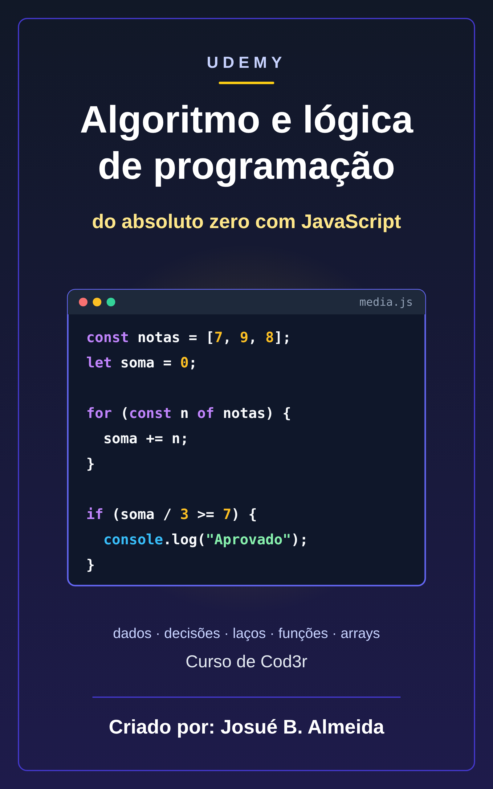

# Udemy: Algoritmo e lógica de programação do absoluto zero com JS - Cod3r

📥 **[Baixar o EPUB](https://github.com/Joshpcbrrj/biblioteca-de-estudos/releases/download/epubs/cod3r-logica-javascript.epub)**

Lógica de programação do zero usando JavaScript: algoritmos e teste de mesa, dados e operadores, decisões e laços, funções, arrays e objetos, terminando com algoritmos clássicos. Cada tema tem uma aula e uma página de desafios; as respostas ficam recolhidas em **Ver resposta**.

- [Sobre o curso](aulas/00-sobre-o-curso.md)

## 🧭 Comece aqui

- [Algoritmos e lógica: os primeiros passos](aulas/01-algoritmos-e-logica-os-primeiros-passos.md)
- [Setup para trabalhar com JavaScript](aulas/02-setup-para-trabalhar-com-javascript.md)

## 📦 1. Dados

- [Dados](aulas/03-dados.md)
- [Textos e números: métodos essenciais](aulas/04-textos-e-numeros-metodos-essenciais.md)
- [Desafios dados](aulas/05-desafios-dados.md)

## ➗ 2. Operadores

- [Operadores](aulas/06-operadores.md)
- [Desafios de operadores](aulas/07-desafios-de-operadores.md)

## 🔀 3. Estruturas de controle

- [Estruturas de controle](aulas/08-estruturas-de-controle.md)
- [Desafios de estruturas de controle](aulas/09-desafios-de-estruturas-de-controle.md)

## ⚡ 4. Funções

- [Functions e arrow functions](aulas/10-functions-e-arrow-functions.md)
- [Erros e depuração: encontrando e tratando problemas](aulas/11-erros-e-depuracao-encontrando-e-tratando.md)
- [Desafios de função](aulas/12-desafios-de-funcao.md)

## 📚 5. Arrays

- [Arrays](aulas/13-arrays.md)
- [Mais sobre arrays: find, some, every, sort e desestruturação](aulas/14-mais-sobre-arrays-find-some-every-sort-e.md)
- [Desafio arrays](aulas/15-desafio-arrays.md)

## 🧱 6. Objetos

- [Objetos](aulas/16-objetos.md)
- [Desafio objetos](aulas/17-desafio-objetos.md)

## 🏆 7. Prática final

- [Algoritmos clássicos: contador, acumulador, busca e ordenação](aulas/18-algoritmos-classicos-contador-acumulador-busca.md)
- [Lista de exercícios finais](aulas/19-lista-de-exercicios-finais.md)
