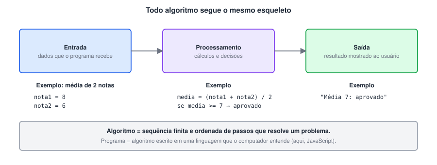

# Algoritmos e lógica: os primeiros passos

> ✨ **Página nova:** o curso é "do absoluto zero", mas as anotações começavam direto no setup. Esta página cobre a base que vem antes do código: o que é um algoritmo, como representá-lo e como testá-lo no papel.

> 🗺️ **Nesta aula:** o que é algoritmo e lógica de programação, o esqueleto entrada → processamento → saída, pseudocódigo, fluxograma, teste de mesa e como ler dados digitados pelo usuário em JavaScript.

## 1. O que é um algoritmo

- **Algoritmo** é uma sequência **finita** e **ordenada** de passos que resolve um problema. Uma receita de bolo e as instruções de montagem de um móvel são algoritmos.
- **Lógica de programação** é a habilidade de organizar esses passos de forma clara, sem ambiguidade, na ordem certa.
- **Programa** é um algoritmo escrito em uma linguagem que o computador entende, como JavaScript.

**Exemplo do cotidiano: trocar uma lâmpada**

1. Desligar o interruptor.
2. Pegar uma escada e posicioná-la embaixo da lâmpada.
3. Subir na escada.
4. Retirar a lâmpada queimada.
5. Colocar a lâmpada nova.
6. Descer da escada.
7. Ligar o interruptor.
8. **Se** a lâmpada não acender, **voltar** ao passo 1 e verificar a instalação.<br>Repare que já aparecem as três ideias da programação: **sequência** (passos em ordem), **decisão** ("se não acender") e **repetição** ("voltar ao passo 1").

## 2. Entrada, processamento e saída

- Quase todo programa segue este esqueleto: recebe dados (**entrada**), faz cálculos e decisões (**processamento**) e mostra um resultado (**saída**).



## 3. Formas de representar um algoritmo

| Forma | Como é | Vantagem |
| --- | --- | --- |
| Descrição narrativa | passos em português comum | fácil de escrever, mas pode ser ambígua |
| Pseudocódigo (Portugol) | português estruturado, parecido com código | treina a lógica sem se preocupar com a sintaxe |
| Fluxograma | desenho com símbolos padronizados | mostra visualmente os caminhos |
| Código | linguagem de programação (JavaScript) | o computador executa |

**O mesmo algoritmo em pseudocódigo e em JavaScript**

```
algoritmo "media"
var
  nota1, nota2, media: real
inicio
  leia(nota1)
  leia(nota2)
  media <- (nota1 + nota2) / 2
  se media >= 7 entao
    escreva("Aprovado")
  senao
    escreva("Reprovado")
  fimse
fimalgoritmo
```

```jsx
const nota1 = 8;
const nota2 = 6;
const media = (nota1 + nota2) / 2;

if (media >= 7) {
  console.log("Aprovado");
} else {
  console.log("Reprovado");
}
```

#### Símbolos do fluxograma

| Símbolo | Significado |
| --- | --- |
| Oval | início e fim |
| Retângulo | processamento (cálculo, atribuição) |
| Losango | decisão (pergunta com sim/não) |
| Paralelogramo | entrada ou saída de dados |
| Setas | sentido do fluxo |

## 4. Teste de mesa

- É "executar o programa no papel": você anota numa tabela o valor de cada variável a cada passo. Serve para encontrar erros de lógica **antes** de rodar e para entender código de outras pessoas.

```jsx
let soma = 0;
for (let i = 1; i <= 4; i++) {
  soma += i;
}
console.log(soma);
```

| Passo | `i` | `i <= 4`? | `soma` |
| --- | --- | --- | --- |
| início | – | – | 0 |
| 1ª volta | 1 | sim | 1 |
| 2ª volta | 2 | sim | 3 |
| 3ª volta | 3 | sim | 6 |
| 4ª volta | 4 | sim | 10 |
| fim | 5 | não | **10** (impresso) |

## 5. Lendo dados do usuário

- Nos exercícios do curso os valores ficam fixos no código. Para o programa **perguntar** ao usuário, depende de onde o JavaScript roda.

**No navegador: prompt()**

```jsx
const nome = prompt("Qual é o seu nome?");  // sempre devolve string (ou null)
const idade = Number(prompt("Qual é a sua idade?")); // converta para número!
alert(`Olá, ${nome}! Daqui a 10 anos você terá ${idade + 10}.`);
```

- Abra o console do navegador (F12 → Console) e cole o código para testar.

**No Node.js: módulo readline**

```jsx
const readline = require("node:readline/promises");

async function main() {
  const rl = readline.createInterface({ input: process.stdin, output: process.stdout });

  const nome = await rl.question("Qual é o seu nome? ");
  const idade = Number(await rl.question("Qual é a sua idade? "));
  console.log(`Olá, ${nome}! Daqui a 10 anos você terá ${idade + 10}.`);

  rl.close();
}

main();
```

- `prompt()` **não existe** no Node.js; por isso o uso do `readline`.

> ⚠️ O painel **Output** do Code Runner não aceita digitação. Para programas que leem dados, rode `node arquivo.js` no terminal ou ative a opção **Run In Terminal** do Code Runner.

> 💡 Tudo que vem do teclado chega como **texto**. `"5" + 1` dá `"51"`. Converta com `Number()` antes de fazer contas.

## 📌 Resumo da aula

| Conceito | Em uma frase |
| --- | --- |
| Algoritmo | sequência finita e ordenada de passos que resolve um problema |
| Três estruturas básicas | sequência, decisão e repetição |
| Entrada → processamento → saída | esqueleto de quase todo programa |
| Pseudocódigo / fluxograma | jeitos de planejar antes de programar |
| Teste de mesa | acompanhar as variáveis no papel, passo a passo |
| Entrada de dados | `prompt()` no navegador, `readline` no Node; converta com `Number()` |
