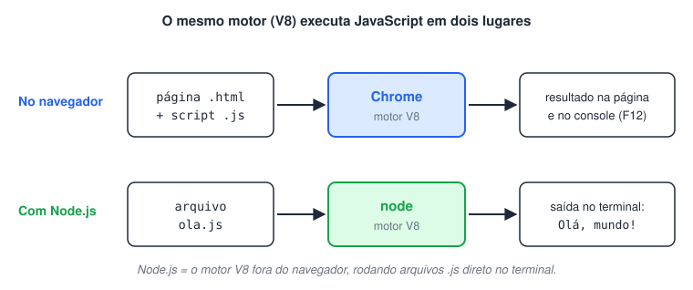
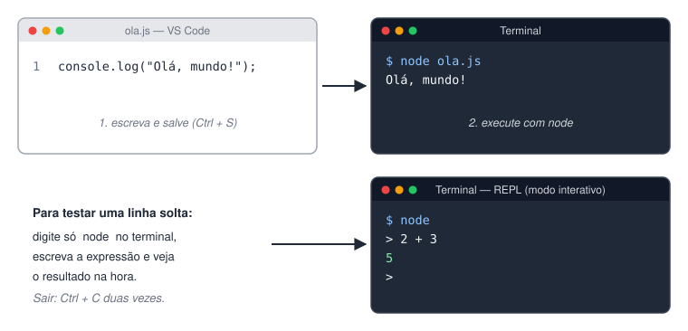

# Setup para trabalhar com JavaScript

> 🗺️ **Nesta aula:** instalar o Node.js (que executa JavaScript fora do navegador) e o VS Code, rodar o primeiro arquivo `.js` e usar o REPL para testar linhas soltas.

## Visão geral

Para estudar JavaScript fora do navegador você precisa de duas coisas:

1. **Um ambiente que execute JavaScript** → o Node.js.
2. **Um editor de código** → o VS Code.

O JavaScript nasceu para rodar dentro do navegador. O **Node.js** é um *runtime*: ele pega o motor V8 (o mesmo do Chrome) e permite executar arquivos `.js` direto no terminal, sem página HTML.



## Node.js

🔗 [Node.js](https://nodejs.org/en/)

- Baixe a versão **LTS** (*Long Term Support*). É a mais estável e a recomendada para estudo.
- O instalador do Node já inclui o **npm**, então não é preciso instalá-lo separadamente.

Depois de instalar, confira no terminal:

```bash
node --version  # mostra a versão do Node, ex.: v22.x.x
npm --version  # mostra a versão do npm
```

### Complementos do Node

**npm** (*Node Package Manager*) → gerenciador de pacotes. Serve para baixar bibliotecas feitas por outras pessoas (`npm install nome-do-pacote`). Neste curso ele quase não é usado, mas vem junto com o Node.

🔗 [Downloading and installing Node.js and npm | npm Docs](https://docs.npmjs.com/downloading-and-installing-node-js-and-npm)

**Chocolatey** → gerenciador de programas para Windows (opcional). Permite instalar software pelo terminal, por exemplo `choco install nodejs-lts`.

🔗 [Chocolatey - The package manager for Windows](https://chocolatey.org/)

### Executando um arquivo

Crie um arquivo `ola.js`:

```jsx
console.log("Olá, mundo!");
```

No terminal, dentro da pasta do arquivo:

```bash
node ola.js
# Saída: Olá, mundo!
```

> `console.log()` imprime valores no terminal. É a ferramenta que você mais vai usar para ver o que o seu código está fazendo.

Também dá para testar linhas soltas no **REPL** (modo interativo): digite apenas `node` no terminal, escreva expressões (`2 + 3`) e veja o resultado na hora. Para sair, `Ctrl + C` duas vezes.



## Editor de código VS Code

🔗 [Visual Studio Code - Code Editing. Redefined](https://code.visualstudio.com/)

O VS Code tem terminal integrado (atalho: Ctrl + crase), então você pode escrever e rodar `node arquivo.js` sem sair do editor.

### Complementos do VS Code

**Darcula Theme** → tema escuro usado no curso, para facilitar a leitura do código.

🔗 [https://marketplace.visualstudio.com/items?itemName=rokoroku.vscode-theme-darcula](https://marketplace.visualstudio.com/items?itemName=rokoroku.vscode-theme-darcula)

**Code Runner** → adiciona um botão ▶ (ou `Ctrl + Alt + N`) que executa o arquivo aberto e mostra a saída no painel *Output*. Por baixo, ele roda o mesmo `node arquivo.js`.

🔗 [https://marketplace.visualstudio.com/items?itemName=formulahendry.code-runner](https://marketplace.visualstudio.com/items?itemName=formulahendry.code-runner)

> 💡 Dica: no Code Runner, ative a opção **Run In Terminal** nas configurações. Assim a saída aparece no terminal integrado, que mostra erros com mais detalhe.

## 📌 Resumo da aula

| Item | Lembre |
| --- | --- |
| Node.js | runtime que executa JavaScript no terminal; instale a versão LTS |
| npm | gerenciador de pacotes, já vem com o Node |
| Executar um arquivo | `node arquivo.js` |
| REPL | digite `node` e teste expressões; sair com Ctrl + C duas vezes |
| VS Code | editor com terminal integrado (Ctrl + crase) |
| Code Runner | executa o arquivo com ▶ ou Ctrl + Alt + N; ative Run In Terminal |
