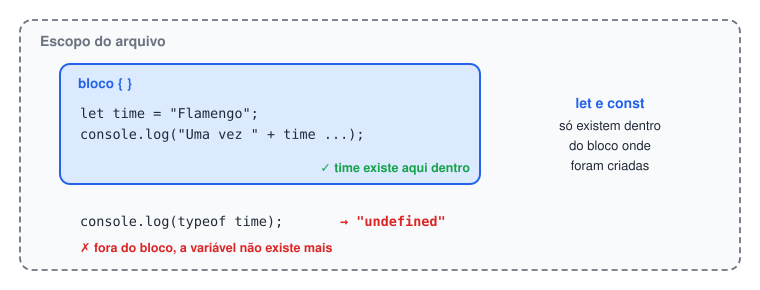
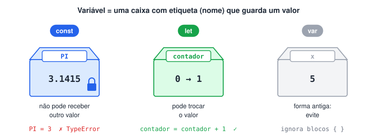
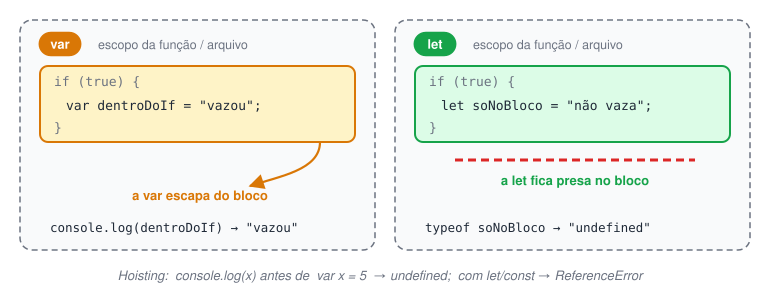
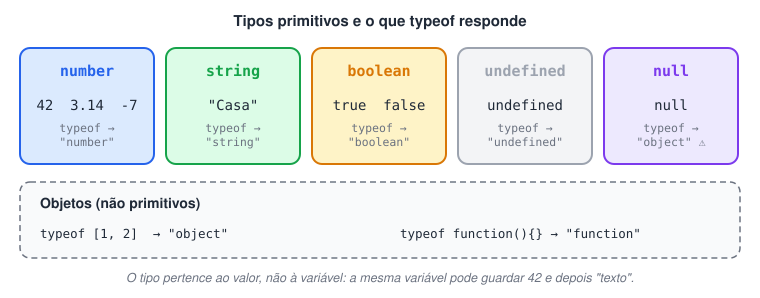
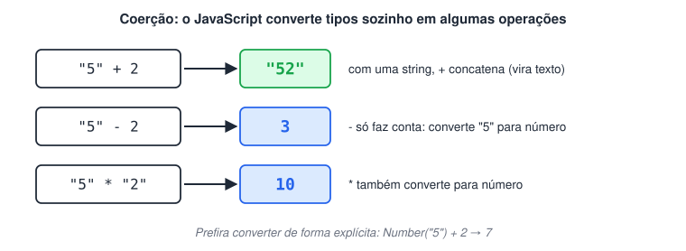
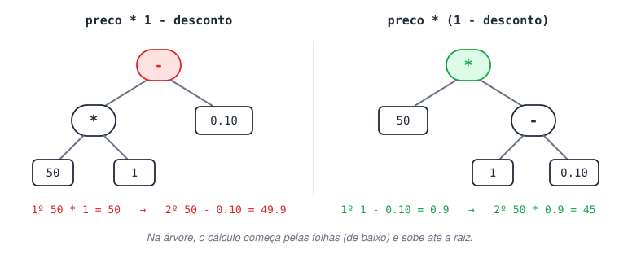
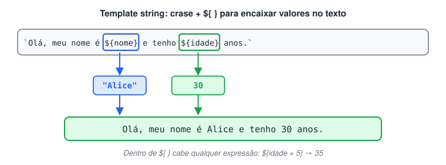

# Dados

> 🗺️ **Nesta aula:** as peças básicas de todo programa: comentários, sentenças e blocos, variáveis (`const`, `let`, `var`), regras de nomes, tipos de dados, `typeof`, conversão de tipos, parênteses nas contas e montagem de textos com concatenação e template strings.

## Comentários

Comentários são trechos ignorados na execução. Servem para explicar o código para quem lê.

```jsx
// Comentário de uma linha: vai do // até o fim da linha

/* Comentário de várias linhas:
   tudo entre a abertura e o fechamento é ignorado */

let total = 10; // também pode vir depois de uma instrução
```

## Sentenças (instruções)

Uma sentença é uma instrução completa, como declarar uma variável ou chamar uma função. Por convenção, cada uma termina com ponto e vírgula `;`.

```jsx
let a = 10;
console.log(a);
```

O JavaScript tem *ASI* (inserção automática de ponto e vírgula), então o código costuma funcionar sem `;`. Mesmo assim, escolha um estilo e mantenha: misturar os dois pode gerar erros difíceis de achar.

## Blocos

Um bloco é um grupo de sentenças entre chaves `{ }`. Blocos aparecem em `if`, laços e funções, e definem **escopo**: variáveis criadas com `let` ou `const` dentro de um bloco só existem ali dentro.

```jsx
{
  let time = "Flamengo";
  console.log("Uma vez " + time + ", sempre " + time);
}

console.log(typeof time); // "undefined" → "time" não existe fora do bloco
```



## Variáveis e constantes

Variável é um nome que guarda um valor na memória. Há três formas de declarar:



| Palavra-chave | Pode reatribuir? | Escopo | Uso recomendado |
| --- | --- | --- | --- |
| `const` | Não | Bloco | Padrão: use sempre que o valor não for trocado |
| `let` | Sim | Bloco | Quando o valor precisa mudar (contadores, acumuladores) |
| `var` | Sim | Função | Evitar; forma antiga, mantida por compatibilidade |

```jsx
const PI = 3.1415;  // constante: não pode receber outro valor
let contador = 0;  // variável: pode mudar
contador = contador + 1;

// PI = 3; // ❌ TypeError: Assignment to constant variable.
```

**Por que evitar **`var`**?** Ela tem dois comportamentos que confundem:

1. **Ignora blocos**: uma `var` criada dentro de um `if` ou `for` continua existindo fora dele (o escopo dela é a função inteira, ou o arquivo inteiro se estiver fora de função).
2. **Hoisting**: a declaração é "içada" para o topo do escopo. Dá para usar a variável antes da linha em que foi criada, mas ela vale `undefined` até a atribuição.

```jsx
console.log(x); // undefined → a declaração foi içada, o valor não
var x = 5;

if (true) {
  var dentroDoIf = "vazou";
  let soNoBloco = "não vaza";
}
console.log(dentroDoIf);  // "vazou"
console.log(typeof soNoBloco);  // "undefined"

// Com let/const, usar antes da declaração gera erro:
// console.log(y); // ❌ ReferenceError: Cannot access 'y' before initialization
// let y = 10;
```

> ⚠️ `const` impede **reatribuir** a variável, mas não congela o conteúdo. Um array ou objeto declarado com `const` ainda pode ter itens alterados (`const lista = []; lista.push(1);` funciona).



## Nomeando variáveis e funções

Regras obrigatórias:

- Pode conter letras, dígitos, `_` e `$`, mas **não pode começar com dígito** (`2nome` é inválido).
- Não pode ser palavra reservada (`let`, `if`, `function`, `class` …).
- É *case-sensitive*: `nome` e `Nome` são variáveis diferentes.

Convenções de estilo:

```jsx
// camelCase → padrão do JavaScript para variáveis e funções
let nomeCompleto = "Ana Silva";
function calcularMedia() {}

// snake_case → funciona, mas é mais comum em Python
let nome_completo = "Ana Silva";

// PascalCase → para classes e funções construtoras
class ContaBancaria {}

// MAIÚSCULAS → constantes "fixas" do programa
const TAXA_JUROS = 0.05;
```

Prefira nomes que digam o que o valor representa: `precoComDesconto` é melhor que `x2`.

## Tipos de dados

O JavaScript tem **tipagem dinâmica**: o tipo pertence ao **valor**, não à variável. A mesma variável pode guardar um número e depois um texto.

Tipos primitivos usados no curso:

| Tipo | Exemplo | Observação |
| --- | --- | --- |
| `number` | `10`, `3.14`, `-7` | Inteiros e decimais são o mesmo tipo |
| `string` | `"Casa"`, `'Casa'` | Texto; aspas simples, duplas ou crase (ver template strings) |
| `boolean` | `true`, `false` | Verdadeiro ou falso |
| `undefined` | `undefined` | Variável declarada sem valor |
| `null` | `null` | "Ausência de valor" atribuída de propósito |

Além dos primitivos há os **objetos**, que incluem arrays e funções (vistos nas próximas seções).

```jsx
let valor = 42;
valor = "agora sou texto"; // permitido: tipagem dinâmica

let semValor;
console.log(semValor); // undefined
```

> ℹ️ A sintaxe `let numero: number = 42;` **não é JavaScript**: é TypeScript, uma linguagem que adiciona tipos estáticos ao JS e precisa ser compilada. Em JavaScript puro não existe forma de fixar o tipo de uma variável.



## Verificando o tipo com `typeof`

`typeof` é um operador que devolve, em string, o tipo do valor.

```jsx
console.log(typeof 10);  // "number"  (não há int/float separados)
console.log(typeof 3.14);  // "number"
console.log(typeof "Casa");  // "string"
console.log(typeof true);  // "boolean"
console.log(typeof undefined);  // "undefined"
console.log(typeof [1, 2]);  // "object"   (array é um objeto)
console.log(typeof function(){}); // "function"
console.log(typeof null);  // "object"   (bug histórico da linguagem)
```

Para saber se algo é array, use `Array.isArray(valor)`.

## Conversão de tipos

**Conversão explícita** (você pede):

```jsx
console.log(Number("42"));  // 42
console.log(Number("abc"));  // NaN (Not a Number: conversão falhou)
console.log(String(42));  // "42"
console.log(parseInt("10px")); // 10 (lê o número do início do texto)
console.log(parseFloat("3.5")); // 3.5
```

**Conversão implícita (coerção)**: o JS converte sozinho em algumas operações, e isso causa surpresas.

```jsx
console.log("5" + 2); // "52" → com uma string, + concatena
console.log("5" - 2); // 3  → - só faz conta, então converte para número
console.log("5" * "2"); // 10
```



## Usando parênteses em operações

Os parênteses definem a ordem de cálculo, como na matemática. Sem eles valem as regras de precedência (`*` e `/` antes de `+` e `-`).

```jsx
// Calculando 10% de desconto sobre R$ 50,00
const preco = 50;
const desconto = 0.10;

console.log(preco * 1 - desconto);  // 49.9 → errado: fez (50 * 1) - 0.10
console.log(preco * (1 - desconto)); // 45  → correto: (1 - 0.10) é calculado primeiro
```



## Concatenando strings

O operador `+` entre strings junta os textos (concatenação).

```jsx
const time = "Flamengo";

console.log("Vamo " + time + "! Minha maior paixão. Vamo " + time + "...");
// Vamo Flamengo! Minha maior paixão. Vamo Flamengo...
```

Fique atento aos espaços: eles precisam estar dentro das aspas (`"Vamo "`), senão as palavras ficam grudadas.

## Template strings

Template string é delimitada por **crase** (o acento grave, em vez de aspas) e permite inserir expressões com `${ }`. É mais legível que concatenar com `+` e aceita quebra de linha.



```jsx
const nome = "Alice";
const idade = 30;

const mensagem = `Olá, meu nome é ${nome} e eu tenho ${idade} anos.`;
console.log(mensagem); // Olá, meu nome é Alice e eu tenho 30 anos.

// Qualquer expressão cabe dentro de ${ }
console.log(`Daqui a 5 anos terei ${idade + 5} anos.`); // ... terei 35 anos.

// Várias linhas
const lista = `Itens:
- arroz
- feijão`;
console.log(lista);
```

> ➡️ `break` e `continue` foram movidos para a página **Estruturas de controle**, junto com os laços em que são usados.

## 📌 Resumo da aula

| Tema | Lembre |
| --- | --- |
| Comentários | `//` uma linha · `/* */` várias linhas |
| Bloco `{ }` | agrupa instruções e limita o escopo de `let`/`const` |
| `const` × `let` × `var` | `const` por padrão, `let` se o valor muda, evite `var` |
| Nomes | camelCase; não começa com dígito; maiúsculas importam |
| Tipos primitivos | `number`, `string`, `boolean`, `undefined`, `null` |
| `typeof` | devolve o tipo em texto; `typeof null` é `"object"` (bug histórico) |
| Conversão | `Number()`, `String()`, `parseInt()`; `"5" + 2` = `"52"`, `"5" - 2` = `3` |
| Template string | crase + `${expressão}` |

Para continuar: métodos de texto e de número estão na página **Textos e números: métodos essenciais**.
