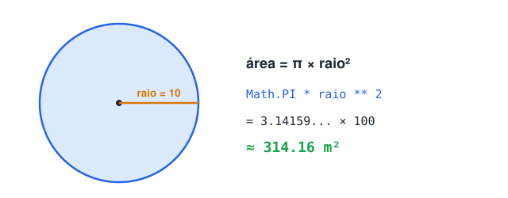
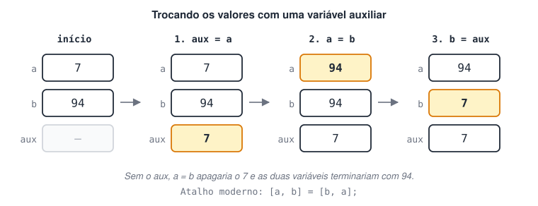

# Desafios dados

### 1 - Calcule a área de uma circunferência de raio 10.

Fórmula: área = π × raio². Em JavaScript, π está disponível em `Math.PI`.



<details>
<summary>Ver resposta</summary>

```jsx
function calcularArea(raio) {
  return Math.PI * raio ** 2; // ** é o operador de potência
}

const raio = 10;
const area = calcularArea(raio);

console.log(`A área do círculo é ${area.toFixed(2)} m²`);
// A área do círculo é 314.16 m²
```

**Pontos de atenção**

- `raio ** 2` é o mesmo que `raio * raio`.
- `toFixed(2)` formata o número com 2 casas decimais (e devolve uma **string**). Sem ele, a saída seria `314.1592653589793`.
- A função **retorna** o valor em vez de imprimir. Assim o resultado pode ser reaproveitado em outros cálculos.

</details>

### 2 - Crie um programa com a variável A valendo 7 e B valendo 94. Ao final, A deve valer 94 e B deve valer 7.



<details>
<summary>Ver resposta</summary>

```jsx
let a = 7;
let b = 94;
console.log(`Antes:  a = ${a}, b = ${b}`); // Antes:  a = 7, b = 94

// Solução 1: variável auxiliar
let aux = a; // guarda o 7 antes que ele seja sobrescrito
a = b;  // a = 94
b = aux;  // b = 7
console.log(`Depois: a = ${a}, b = ${b}`); // Depois: a = 94, b = 7

// Solução 2: desestruturação de array (destroca os valores)
[a, b] = [b, a];
console.log(`Destrocado: a = ${a}, b = ${b}`); // Destrocado: a = 7, b = 94
```

**Por que a variável auxiliar?** Se fizermos direto `a = b; b = a;`, o valor original de `a` se perde na primeira linha e as duas variáveis terminam com 94.

**Como funciona a solução 2:** o lado direito cria um array temporário `[94, 7]` com os valores atuais, e o lado esquerdo distribui cada posição para `a` e `b`.

</details>
