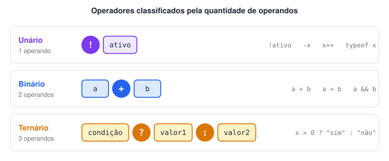
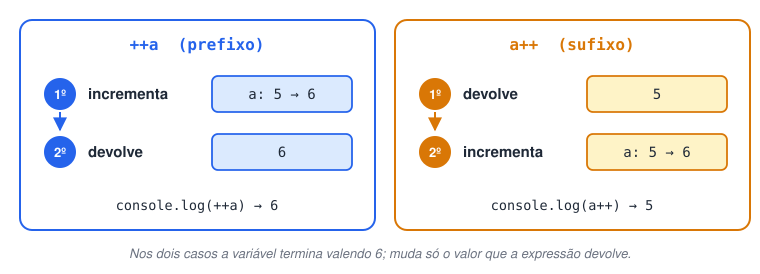
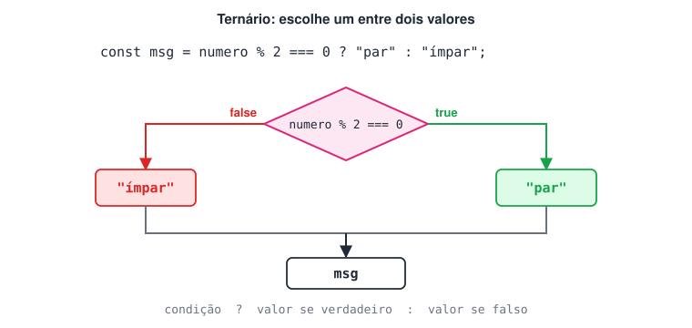
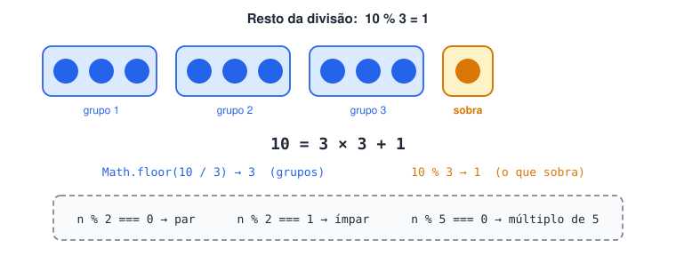
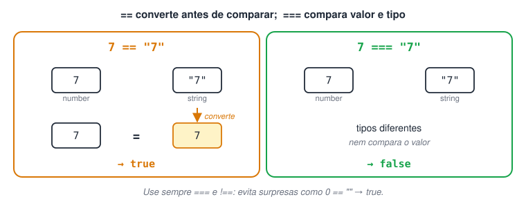
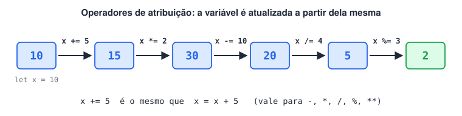
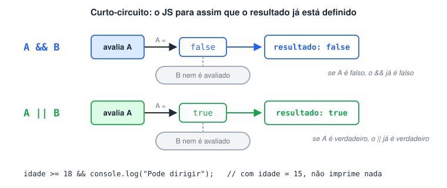
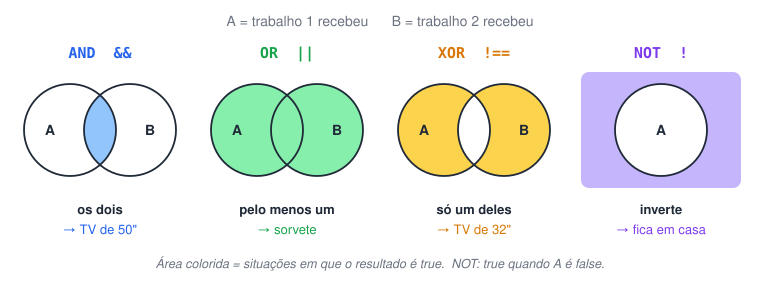
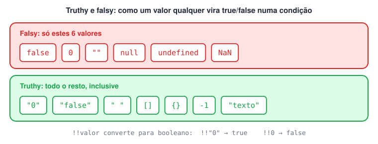
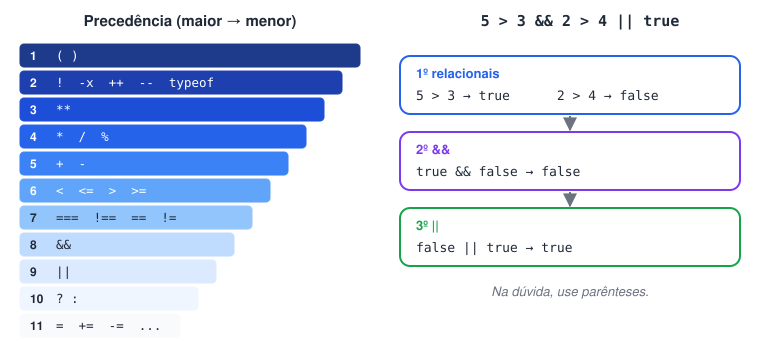

# Operadores

> 🗺️ **Nesta aula:** como os operadores são classificados (unários, binários e ternário) e os cinco grupos que você usa o tempo todo: aritméticos, relacionais, de atribuição, lógicos (com tabela verdade e truthy/falsy) e a ordem de precedência.

## Unários, binários e ternários

Os operadores são classificados pela **quantidade de operandos** (valores) que recebem.



### Operadores binários

Recebem **dois** operandos, um de cada lado: `a + b`, `a > b`, `a && b`. A maioria dos operadores é binária.

```jsx
const a = 5;
const b = 10;

console.log(a + b);  // 15   (aritmético)
console.log(a < b);  // true (relacional)
```

### Operadores unários

Recebem **um** operando. Exemplos: `-x` (negação numérica), `++` e `--` (incremento/decremento), `!` (negação lógica) e `typeof`.

```jsx
let x = 5;
console.log(-x);  // -5
console.log(!true);  // false
console.log(typeof x);  // "number"
```

**Prefixo × sufixo** no incremento/decremento:

- `++a` (prefixo): **primeiro incrementa**, depois devolve o valor novo.
- `a++` (sufixo): **primeiro devolve** o valor atual, depois incrementa.

```jsx
let a = 5;
let b = 5;

console.log(++a === b++); // false → compara 6 === 5
console.log(a, b);  // 6 6  → depois da linha, os dois valem 6

let c = 5;
console.log(c++); // 5 (devolve o valor antigo)
console.log(c);  // 6
```



### Operador ternário (atribuição condicional)

É o único operador com **três** operandos: `condição ? valorSeVerdadeiro : valorSeFalso`. É uma forma curta de `if/else` quando o objetivo é **escolher um valor**.

```jsx
const numero = 10;
const mensagem = numero % 2 === 0 ? "O número é par" : "O número é ímpar";
console.log(mensagem); // O número é par

// Encadeando para mais de duas respostas (avaliado da esquerda para a direita)
const hora = 19;
const saudacao = hora <= 11 ? "Bom dia"
               : hora <= 17 ? "Boa tarde"
               : "Boa noite";
console.log(saudacao); // Boa noite
```



Use ternários encadeados com moderação: com muitos níveis, um `if/else` fica mais legível.

## Aritméticos

Realizam operações matemáticas com números.

| Operador | Operação | Exemplo | Resultado |
| --- | --- | --- | --- |
| `+` | Adição | `10 + 5` | `15` |
| `-` | Subtração | `10 - 5` | `5` |
| `*` | Multiplicação | `10 * 5` | `50` |
| `/` | Divisão | `10 / 4` | `2.5` |
| `%` | Resto da divisão (módulo) | `10 % 3` | `1` |
| `**` | Potência | `2 ** 3` | `8` |
| `++` | Incremento (soma 1) | `x++` | `x + 1` |
| `--` | Decremento (subtrai 1) | `x--` | `x - 1` |

```jsx
let x = 10;
let y = 5;

console.log(x + y);  // 15
console.log(x - y);  // 5
console.log(x * y);  // 50
console.log(x / 4);  // 2.5  (a divisão não é inteira)
console.log(x % 3);  // 1    (10 = 3 * 3 + 1)

x++; // x agora é 11
y--; // y agora é 4
console.log(x, y); // 11 4
```

**O resto (**`%`**) é muito usado em lógica:**

```jsx
console.log(7 % 2 === 0);  // false → 7 é ímpar
console.log(15 % 5 === 0);  // true  → 15 é múltiplo de 5
console.log(Math.floor(10 / 3)); // 3 → divisão inteira (arredonda para baixo)
```

**Casos especiais:**

```jsx
console.log(10 / 0);  // Infinity
console.log(0.1 + 0.2);  // 0.30000000000000004 (imprecisão de ponto flutuante)
console.log("abc" * 2);  // NaN
```



## Relacionais (comparação)

Comparam dois valores e **sempre** produzem um booleano (`true` ou `false`).

| Operador | Significado |
| --- | --- |
| `==` | Igual (converte os tipos antes de comparar) |
| `===` | Estritamente igual (valor **e** tipo iguais) |
| `!=` | Diferente (com conversão) |
| `!==` | Estritamente diferente |
| `<` / `>` | Menor que / maior que |
| `<=` / `>=` | Menor ou igual / maior ou igual |

```jsx
console.log(7 == "7");  // true  → "7" é convertido para 7 antes de comparar
console.log(7 === "7");  // false → number ≠ string
console.log(7 != 5);  // true
console.log(7 !== "7");  // true  → tipos diferentes

console.log(4 < 9);  // true
console.log(5 > 12);  // false
console.log(6 <= 6);  // true
console.log(8 >= 2);  // true
```

> ✅ Boa prática: use sempre `===` e `!==`. A conversão automática do `==` gera resultados inesperados, como `0 == ""` → `true` e `null == undefined` → `true`.



**Comparando strings:** a comparação é feita caractere a caractere pela ordem Unicode (ordem "de dicionário", mas maiúsculas vêm antes das minúsculas).

```jsx
console.log("abc" < "abd"); // true
console.log("Z" < "a");  // true (maiúsculas têm código menor)
console.log("10" < "9");  // true! comparou "1" com "9" como texto
```

## Atribuição

O operador `=` guarda o valor da direita na variável da esquerda. Ele pode ser combinado com um operador aritmético para atualizar a própria variável.

| Operador | Equivale a |
| --- | --- |
| `x = 5` | atribui 5 |
| `x += 5` | `x = x + 5` |
| `x -= 5` | `x = x - 5` |
| `x *= 5` | `x = x * 5` |
| `x /= 5` | `x = x / 5` |
| `x %= 5` | `x = x % 5` |
| `x **= 2` | `x = x ** 2` |

```jsx
let x = 10;
x += 5;  // 15
x *= 2;  // 30
x -= 10; // 20
x /= 4;  // 5
x %= 3;  // 2
console.log(x); // 2

// += também concatena strings
let texto = "Olá";
texto += ", mundo";
console.log(texto); // Olá, mundo
```



## Lógicos

Combinam ou invertem valores booleanos.

| Operador | Nome | Resultado |
| --- | --- | --- |
| `&&` | E (AND) | `true` só se **os dois** forem verdadeiros |
| `\|\|` | OU (OR) | `true` se **pelo menos um** for verdadeiro |
| `!` | NÃO (NOT) | Inverte o valor (único lógico unário) |

```jsx
const x = 5;
const y = 10;

console.log(x > 0 && y > 0);  // true  → as duas condições são verdadeiras
console.log(x > 0 && y > 20);  // false → a segunda é falsa
console.log(x > 9 || y > 9);  // true  → a segunda é verdadeira
console.log(!(x > 0));  // false → inverte o true
```

**Avaliação de curto-circuito:** o JS para de avaliar assim que o resultado está definido.

- Em `A && B`, se `A` é falso, `B` nem é avaliado (o resultado já é falso).
- Em `A || B`, se `A` é verdadeiro, `B` nem é avaliado (o resultado já é verdadeiro).

```jsx
const idade = 15;
idade >= 18 && console.log("Pode dirigir"); // não imprime nada
```



### Tabela verdade

Para memorizar, o curso usa uma história: duas pessoas trabalham e, com o pagamento, a família decide o que comprar.

- **AND (**`&&`**) → TV de 50"**: só compra se **os dois** receberem.
- **OR (**`||`**) → sorvete**: compra se **pelo menos um** receber.
- **XOR → TV de 32"**: compra se **apenas um** receber (se os dois receberem, compram a de 50", não a de 32").
- **NOT (**`!`**) → inverte**: se compra o sorvete, não fica em casa (e vice-versa).

**AND (**`&&`**)**

| A | B | A && B |
| --- | --- | --- |
| `true` | `true` | `true` |
| `true` | `false` | `false` |
| `false` | `true` | `false` |
| `false` | `false` | `false` |

**OR (**`||`**)**

| A | B | A \|\| B |
| --- | --- | --- |
| `true` | `true` | `true` |
| `true` | `false` | `true` |
| `false` | `true` | `true` |
| `false` | `false` | `false` |

**XOR (OU exclusivo)**: verdadeiro quando os operandos são **diferentes**. O JavaScript não tem um XOR lógico próprio; com booleanos, use `!==` (ou `!=`).

| A | B | A !== B |
| --- | --- | --- |
| `true` | `true` | `false` |
| `true` | `false` | `true` |
| `false` | `true` | `true` |
| `false` | `false` | `false` |

**NOT (**`!`**)**

| A | !A |
| --- | --- |
| `true` | `false` |
| `false` | `true` |

```jsx
const trabalho1 = true;
const trabalho2 = false;

const comprouTv50 = trabalho1 && trabalho2;  // false
const comprouSorvete = trabalho1 || trabalho2; // true
const comprouTv32 = trabalho1 !== trabalho2;  // true (XOR)
const ficouEmCasa = !comprouSorvete;  // false

console.log({ comprouTv50, comprouSorvete, comprouTv32, ficouEmCasa });
```



### Truthy e falsy

Operadores lógicos e condições aceitam qualquer valor, não só booleanos. O JS trata como **falsos** (*falsy*) apenas: `false`, `0`, `""` (string vazia), `null`, `undefined` e `NaN`. Todo o resto é *truthy*.

```jsx
console.log(!!"texto"); // true  (!! converte para booleano)
console.log(!!0);  // false
console.log(!!"0");  // true → string não vazia
```



## Precedência dos operadores (resumo)

Da maior para a menor prioridade:

1. `( )` parênteses
2. Unários: `!`, `-x`, `++`, `--`, `typeof`
3. `**`
4. `*`, `/`, `%`
5. `+`, `-`
6. Relacionais: `<`, `<=`, `>`, `>=`
7. Igualdade: `==`, `===`, `!=`, `!==`
8. `&&`
9. `||`
10. Ternário `? :`
11. Atribuição: `=`, `+=`, `-=` …

```jsx
console.log(2 + 3 * 4);  // 14 (multiplicação primeiro)
console.log(5 > 3 && 2 > 4 || true); // true → (true && false) || true
```



Na dúvida, use parênteses: deixam a intenção explícita.

## 📌 Resumo da aula

| Grupo | Operadores | Lembre |
| --- | --- | --- |
| Aritméticos | `  • - * / % **` | `%` dá o resto: `n % 2 === 0` testa se é par |
| Incremento | `++ --` | `++a` incrementa antes; `a++` devolve antes |
| Relacionais | `=== !== < > <= >=` | sempre retornam booleano; prefira `===` a `==` |
| Atribuição | `= += -= *= /= %=` | `x += 5` é `x = x + 5` |
| Lógicos | `&& \|\| !` | E: todos verdadeiros · OU: pelo menos um · NÃO: inverte |
| Ternário | `cond ? a : b` | if/else curto para escolher um valor |
| Falsy | `false 0 "" null undefined NaN` | todo o resto é truthy |
| Precedência | `()` → unários → `**` → `  • / %` → `  • -` → comparação → `&&` → `\|\|` → `?:` → `=` | na dúvida, use parênteses |
