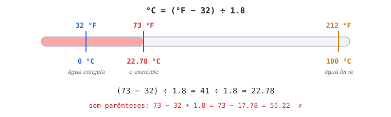

# Desafios de operadores

## Aritméticos

### 1 - Crie um programa que converta 73 °F para Celsius.

Fórmula: °C = (°F − 32) ÷ 1,8 (ou × 5/9).



<details>
<summary>Ver resposta</summary>

```jsx
function fahrenheitParaCelsius(fahrenheit) {
  return (fahrenheit - 32) / 1.8;
}

const tempF = 73;
const tempC = fahrenheitParaCelsius(tempF);

console.log(`${tempF} °F equivalem a ${tempC.toFixed(2)} °C.`);
// 73 °F equivalem a 22.78 °C.
```

**Por que os parênteses?** Sem eles, `tempF - 32 / 1.8` dividiria apenas o 32 (a divisão tem prioridade sobre a subtração), dando `55.22`, um valor errado.

</details>

## Relacionais

### 2 - A partir de A = 1 e B = 2, crie 5 expressões verdadeiras e 5 falsas.

<details>
<summary>Ver resposta</summary>

```jsx
const a = 1;
const b = 2;

// Verdadeiras
console.log(a < b);  // true → 1 < 2
console.log(a <= b);  // true → 1 <= 2
console.log(a !== b);  // true → 1 é diferente de 2
console.log(b === a + a);  // true → 2 === 2
console.log(a + b === b + a); // true → a soma é comutativa

// Falsas
console.log(a > b);  // false
console.log(a >= b);  // false
console.log(a === b); // false
console.log(b <= a);  // false
console.log(a === "1"); // false → mesmo valor, tipos diferentes
```

</details>

## Atribuição

### 3 - Crie uma lista de 10 pessoas com número e nome, uma por linha, e imprima tudo com um único `console.log`.

<details>
<summary>Ver resposta</summary>

```jsx
let texto = "Lista de aprovados";
texto += "\n==================";
texto += "\n01.\tAna Silva";
texto += "\n02.\tPedro Albuquerque";
texto += "\n03.\tGuilherme Pereira";
texto += "\n04.\tRebeca França";
texto += "\n05.\tWagner Araujo Sodre";
texto += "\n06.\tGiovani Francisco do Carmo";
texto += "\n07.\tBruna Carla Werneck";
texto += "\n08.\tFrancisco Conceição Souza";
texto += "\n09.\tPatrícia Amorim Neves";
texto += "\n10.\tAna Souza";

console.log(texto);
```

**Caracteres de escape** usados dentro das strings:

- `\n` → quebra de linha.
- `\t` → tabulação (alinha os nomes).

`texto += "..."` é a forma curta de `texto = texto + "..."`: cada linha **acrescenta** um pedaço ao final da string.

</details>

## Lógicos, relacionais e aritméticos

### 4 - Crie 3 expressões que resultem em `true` e 3 que resultem em `false`, combinando operadores aritméticos, relacionais e lógicos.

<details>
<summary>Ver resposta</summary>

```jsx
// Verdadeiras
const verd1 = (2 + 5 === 7) && (8 > 4);  // true && true  → true
const verd2 = (6 <= 12) || (4 === "4");  // true || false  → true
const verd3 = !(4 === 40);  // !false  → true

console.log(verd1, verd2, verd3); // true true true

// Falsas
const fals1 = (8 <= 2) || !(5 === 5);  // false || false → false
const fals2 = (8 <= 16) !== (8 + 5 + 1 === 7 * 2);  // true !== true  → false (XOR)
const fals3 = (8 - 2 === 5) && (12 === 12) && (8 % 2 !== 0); // false && ... → false

console.log(fals1, fals2, fals3); // false false false
```

**Como ler expressões grandes:** resolva primeiro cada parêntese (aritmética → comparação), anote o `true`/`false` de cada um e só então aplique os operadores lógicos.

</details>

## Ternário

### 5 - Crie `a = 8`, `b = 4` e uma variável `operacao` que recebe um sinal (`+`, `-`, `*` ou `/`). Uma 4ª variável, `resultado`, deve receber o cálculo correspondente ao sinal, usando operador ternário.

<details>
<summary>Ver resposta</summary>

```jsx
const a = 8;
const b = 4;
const operacao = "/";

const resultado =
  operacao === "+" ? a + b :
  operacao === "-" ? a - b :
  operacao === "*" ? a * b :
  operacao === "/" ? a / b :
  "Operação inválida";

console.log(`${a} ${operacao} ${b} = ${resultado}`); // 8 / 4 = 2
```

**Como funciona o encadeamento:** cada `? :` testa uma condição. Se for falsa, passa para o próximo teste. O último valor (`"Operação inválida"`) é o "senão" final.

Na versão original, qualquer sinal desconhecido caía na divisão. Testar `/` explicitamente e deixar um valor de erro no fim evita resultados enganosos.

</details>
