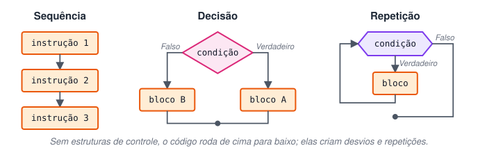
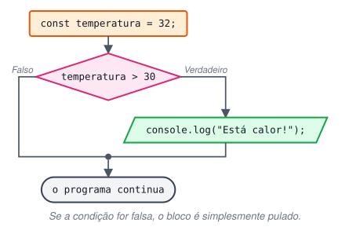
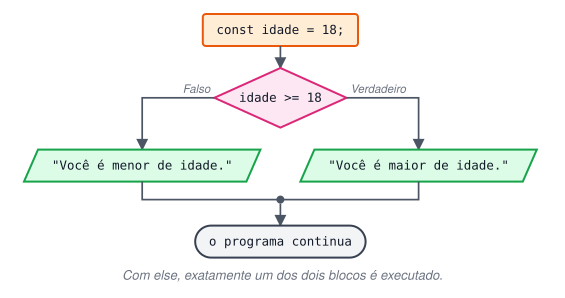
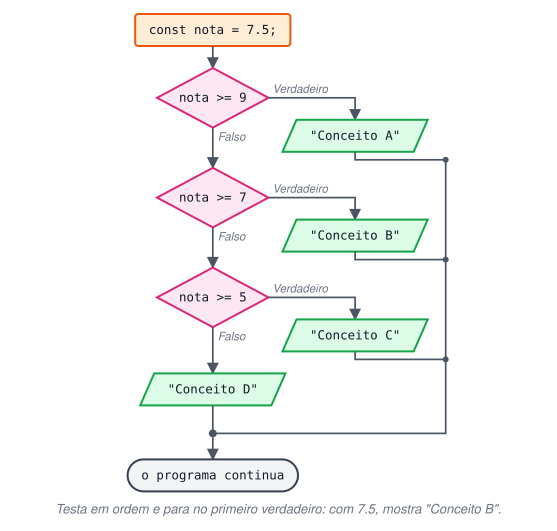
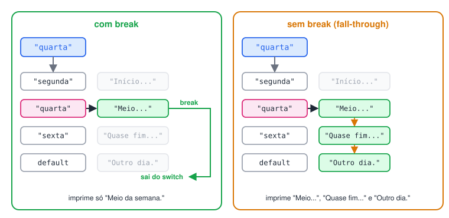
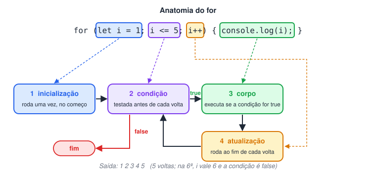
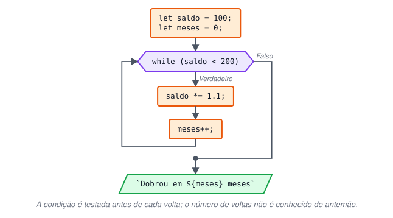
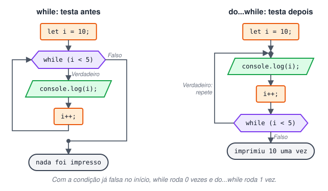
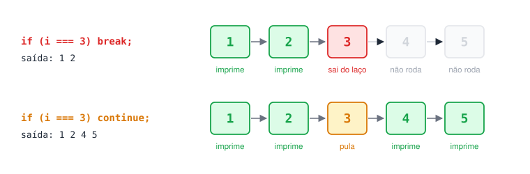
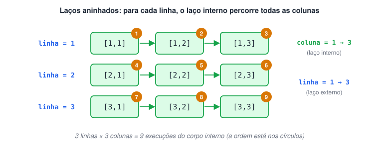

# Estruturas de controle

> 🗺️ **Nesta aula:** como mudar o caminho do programa com decisões (`if`, `else if`, `else`, `switch`) e como repetir instruções com laços (`for`, `while`, `do/while`), além de `break`, `continue` e laços aninhados.

## Definição

Por padrão, o código é executado **de cima para baixo, uma linha após a outra**. As estruturas de controle alteram esse fluxo:

- **Estruturas de decisão (condicionais)** → escolhem **se** um bloco será executado.
- **Estruturas de repetição (laços/loops)** → executam um bloco **várias vezes**.

Ambas trabalham sobre sentenças e blocos `{ }` e dependem de uma **condição**: uma expressão avaliada como verdadeira ou falsa (ver *truthy/falsy* em Operadores).



## Estruturas de decisão (condicionais)

### `if`

Executa o bloco somente se a condição for verdadeira.

```jsx
const temperatura = 32;

if (temperatura > 30) {
  console.log("Está calor!");
}
```



### `if / else`

O `else` define o que fazer quando a condição é falsa. Exatamente **um** dos dois blocos é executado.

```jsx
const idade = 18;

if (idade >= 18) {
  console.log("Você é maior de idade.");
} else {
  console.log("Você é menor de idade.");
}
```



### `if / else if / else`

Para mais de dois caminhos. As condições são testadas **em ordem** e só o **primeiro** bloco verdadeiro é executado; o resto é ignorado.

```jsx
const nota = 7.5;

if (nota >= 9) {
  console.log("Conceito A");
} else if (nota >= 7) {
  console.log("Conceito B"); // ← executa este e para
} else if (nota >= 5) {
  console.log("Conceito C");
} else {
  console.log("Conceito D");
}
```

Como a ordem importa, não é preciso escrever `nota >= 7 && nota < 9` no segundo teste: se chegou nele, já se sabe que `nota < 9`.

> ⚠️ Erro comum: colocar `;` logo após o `if`. Em `if (nota >= 7); { ... }` o `;` encerra o `if` com uma instrução vazia, e o bloco seguinte roda **sempre**, seja qual for a nota.



### `switch / case`

Compara **um valor** com vários casos usando igualdade estrita (`===`). É útil quando há muitos valores fixos possíveis.

```jsx
const diaDaSemana = "quarta";

switch (diaDaSemana) {
  case "segunda":
    console.log("Início da semana.");
    break;
  case "quarta":
    console.log("Meio da semana."); // ← executa e o break sai do switch
    break;
  case "sexta":
    console.log("Quase fim de semana!");
    break;
  default:
    console.log("Outro dia."); // quando nenhum case corresponde
}
```

- `break` encerra o `switch`. **Sem ele**, a execução "cai" nos `case` seguintes (*fall-through*) até encontrar um `break` ou o fim.
- `default` é opcional e funciona como o `else`.

O *fall-through* pode ser usado de propósito para agrupar casos:

```jsx
const dia = "sábado";

switch (dia) {
  case "sábado":
  case "domingo":
    console.log("Fim de semana");
    break;
  default:
    console.log("Dia útil");
}
// Fim de semana
```

**Quando usar cada um?** `switch` para comparar um valor com opções fixas (`"a"`, `"b"`, `1`, `2`…). `if/else` para faixas e condições compostas (`nota >= 7`, `x > 0 && y > 0`).



## Estruturas de repetição (laços)

### `for`

Usado quando se sabe **quantas vezes** repetir. O cabeçalho tem três partes separadas por `;`:

```
for (inicialização; condição; atualização) { ... }
```

1. **Inicialização**: executa uma vez, antes de tudo (`let i = 0`).
2. **Condição**: testada **antes** de cada volta. Se for falsa, o laço termina.
3. **Atualização**: executa **ao fim** de cada volta (`i++`).

```jsx
for (let i = 1; i <= 5; i++) {
  console.log(i);
}
// 1 2 3 4 5 (um por linha)

// Contagem regressiva, de 2 em 2
for (let i = 10; i >= 0; i -= 2) {
  console.log(i);
}
// 10 8 6 4 2 0
```

Declare o contador com `let`. Sem `let` (`for (i = 0; ...)`), `i` vira uma variável global implícita, o que é fonte de bugs (e erro em *strict mode*).



### `while`

Testa a condição **antes** de cada repetição. Ideal quando **não se sabe** quantas voltas serão necessárias.

```jsx
let saldo = 100;
let meses = 0;

while (saldo < 200) {
  saldo *= 1.1; // rende 10% ao mês
  meses++;
}

console.log(`Dobrou em ${meses} meses`); // Dobrou em 8 meses
```



### `do / while`

Executa o bloco **primeiro** e testa a condição **depois**. Portanto roda **pelo menos uma vez**, mesmo que a condição comece falsa.

```jsx
let i = 10;

do {
  console.log(i); // imprime 10, mesmo com a condição falsa
  i++;
} while (i < 5);
```

> ⚠️ **Laço infinito:** se a condição nunca ficar falsa (por exemplo, esquecer o `i++` no `while`), o programa trava. No terminal, interrompa com `Ctrl + C`.



### `break` e `continue`

- `break` → **encerra** o laço imediatamente.
- `continue` → **pula** o restante da volta atual e segue para a próxima.

```jsx
for (let i = 1; i <= 5; i++) {
  if (i === 3) {
    break; // ao chegar no 3, sai do laço
  }
  console.log(i);
}
// 1 2

for (let i = 1; i <= 5; i++) {
  if (i === 3) {
    continue; // pula só o 3
  }
  console.log(i);
}
// 1 2 4 5
```



### Laços aninhados

Um laço dentro de outro: para **cada** volta do laço externo, o interno executa **todas** as suas voltas. Muito usado para linhas × colunas.

```jsx
for (let linha = 1; linha <= 3; linha++) {
  let texto = "";
  for (let coluna = 1; coluna <= 3; coluna++) {
    texto += `[${linha},${coluna}] `;
  }
  console.log(texto);
}
// [1,1] [1,2] [1,3]
// [2,1] [2,2] [2,3]
// [3,1] [3,2] [3,3]
```



Os laços próprios para percorrer arrays e objetos (`for...of`, `for...in` e `forEach`) estão na página **Arrays**.

## 📌 Resumo da aula

| Estrutura | Use quando… | Cuidado |
| --- | --- | --- |
| `if` / `else` | há uma condição com dois caminhos | sem `;` depois do `if (...)` |
| `else if` | há várias faixas (notas, idades) | só o primeiro bloco verdadeiro roda; a ordem importa |
| `switch` | um valor é comparado com opções fixas | compara com `===`; não esqueça o `break` |
| `for` | você sabe quantas vezes repetir | declare o contador com `let` |
| `while` | repete até algo acontecer, sem saber quantas vezes | garanta que a condição fique falsa |
| `do/while` | precisa rodar pelo menos uma vez | testa a condição só no fim |
| `break` / `continue` | sair do laço / pular a volta atual | `forEach` não aceita `break` |
| Laços aninhados | linhas × colunas, combinações | o interno roda inteiro a cada volta do externo |
