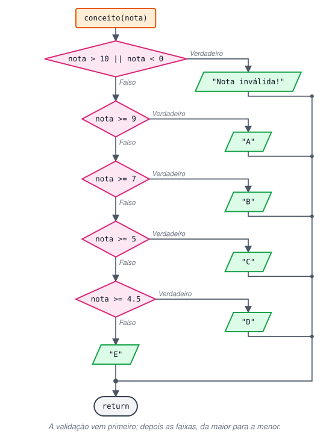

# Desafios de estruturas de controle

### Condicionais

**1 - Qual o problema deste código, que imprime "Aprovado" mesmo quando a nota é menor que 7?**

```jsx
const nota = 2.3;
if (nota >= 7); {
  console.log("Aprovado");
}
```

<details>
<summary>Ver resposta</summary>

O `;` logo depois do `if (nota >= 7)` termina o `if` com uma **instrução vazia**. O bloco `{ console.log(...) }` passa a ser um bloco independente, executado sempre.

```jsx
const nota = 2.3;

if (nota >= 7) {  // sem ponto e vírgula aqui
  console.log("Aprovado");
}
// não imprime nada, porque 2.3 < 7
```

</details>

**2 - Crie um programa que, a partir de uma nota, informe o conceito:** A (de 9 a 10) / B (de 7 a 8.9) / C (de 5 a 6.9) / D (de 4.5 a 4.9) / E (abaixo de 4.5).



<details>
<summary>Ver resposta</summary>

```jsx
function conceito(nota) {
  if (nota > 10 || nota < 0) {
    return "Nota inválida! Informe um valor de 0 a 10.";
  } else if (nota >= 9) {
    return "A";
  } else if (nota >= 7) {
    return "B";
  } else if (nota >= 5) {
    return "C";
  } else if (nota >= 4.5) {
    return "D";
  } else {
    return "E";
  }
}

console.log(conceito(9.5)); // A
console.log(conceito(7));  // B
console.log(conceito(4.7)); // D
console.log(conceito(3));  // E
console.log(conceito(11));  // Nota inválida! ...
```

**Raciocínio:** os testes vão do maior para o menor. Ao chegar em `nota >= 7`, já se sabe que a nota é menor que 9 (senão teria parado antes). Por isso cada faixa precisa de um só limite.

A validação (`> 10 || < 0`) vem primeiro para descartar valores fora do intervalo antes de classificar.

</details>

**3 - A partir de **`a = 28`** e **`b = 10`**, crie um programa com uma variável que define a operação a executar, usando **`if/else`**.**

<details>
<summary>Ver resposta</summary>

```jsx
function calcular(a, b, operacao) {
  if (operacao === "soma") {
    return `A soma de ${a} e ${b} é ${a + b}`;
  } else if (operacao === "sub") {
    return `A subtração de ${a} por ${b} é ${a - b}`;
  } else if (operacao === "mult") {
    return `A multiplicação de ${a} por ${b} é ${a * b}`;
  } else if (operacao === "div") {
    return `A divisão de ${a} por ${b} é ${a / b}`;
  } else if (operacao === "mod") {
    return `O resto da divisão de ${a} por ${b} é ${a % b}`;
  } else {
    return "Erro! Operação inválida.";
  }
}

console.log(calcular(28, 10, "mod"));  // O resto da divisão de 28 por 10 é 8
console.log(calcular(28, 10, "soma")); // A soma de 28 e 10 é 38
console.log(calcular(28, 10, "pot"));  // Erro! Operação inválida.
```

**Melhoria em relação à versão original:** a função recebe `a`, `b` e a operação como **parâmetros** e **retorna** o texto, em vez de ler e alterar variáveis globais. Assim ela funciona com quaisquer valores.

</details>

**4 - Use **`switch/case`** para dar um conceito de acordo com a nota (inteira):** A+ = 10, A = 9, B+ = 8, B = 7, C+ = 6, C = 5, D+ = 4, D = 3, E+ = 2, E = 1, F = 0.

<details>
<summary>Ver resposta</summary>

```jsx
function conceito(nota) {
  switch (nota) {
    case 10: return "A+";
    case 9:  return "A";
    case 8:  return "B+";
    case 7:  return "B";
    case 6:  return "C+";
    case 5:  return "C";
    case 4:  return "D+";
    case 3:  return "D";
    case 2:  return "E+";
    case 1:  return "E";
    case 0:  return "F";
    default: return "Nota inválida! Use um número inteiro de 0 a 10.";
  }
}

const nota = 10;
console.log(`Sua nota é ${nota}. O conceito é ${conceito(nota)}.`);
// Sua nota é 10. O conceito é A+.

console.log(conceito(7.5)); // Nota inválida! ...
```

**Observações**

- Dentro de uma função, `return` já encerra a execução, então dispensa o `break`.
- O `switch` compara com `===`. Por isso `7.5` (e também a string `"7"`) cai no `default`: não é igual a nenhum `case`.

</details>

### Repetição

**1 - Crie um laço **`for`** que imprima, em ordem decrescente, do 7 ao 3.**

<details>
<summary>Ver resposta</summary>

```jsx
for (let i = 7; i >= 3; i--) {
  console.log(i);
}
// 7 6 5 4 3
```

Começa em 7, continua **enquanto** `i >= 3` e diminui 1 a cada volta.

</details>

**2 - Usando **`for`**, imprima:** Linha 1 → [1,1] [1,2] [1,3] / Linha 2 → [2,1] [2,2] [2,3] / Linha 3 → [3,1] [3,2] [3,3].

<details>
<summary>Ver resposta</summary>

```jsx
for (let i = 1; i <= 3; i++) {
  let linha = "";
  for (let j = 1; j <= 3; j++) {
    linha += `[${i},${j}] `;
  }
  console.log(`Linha ${i} → ${linha}`);
}
// Linha 1 → [1,1] [1,2] [1,3]
// Linha 2 → [2,1] [2,2] [2,3]
// Linha 3 → [3,1] [3,2] [3,3]
```

**Como funciona:** o laço externo (`i`) controla a linha. Para cada linha, o laço interno (`j`) roda 3 vezes, montando a string. `linha` é zerada no início de cada volta externa, por isso fica dentro do primeiro `for`.

</details>

**3 - Usando **`for`** e sem usar números, imprima:**

```
#
##
###
####
#####
######
```

<details>
<summary>Ver resposta</summary>

```jsx
for (let i = "#"; i <= "######"; i += "#") {
  console.log(i);
}
```

**Como funciona:** o "contador" `i` é uma **string**, não um número.

1. Começa valendo `"#"`.
2. A cada volta, `i += "#"` acrescenta mais um caractere (concatenação).
3. A condição compara strings: elas são comparadas caractere a caractere, e uma string que é **prefixo** de outra é considerada menor. Então `"###" <= "######"` é `true`, mas `"#######" <= "######"` é `false` e o laço termina.

Uma alternativa que deixa o ponto de parada mais explícito é `i !== "#######"` (para quando chegar a 7 cerquilhas, sem imprimi-las).

</details>
