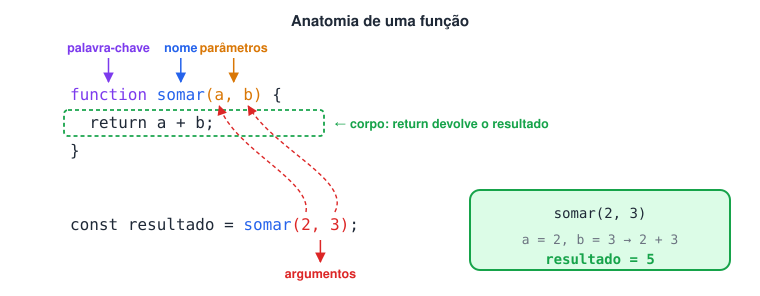
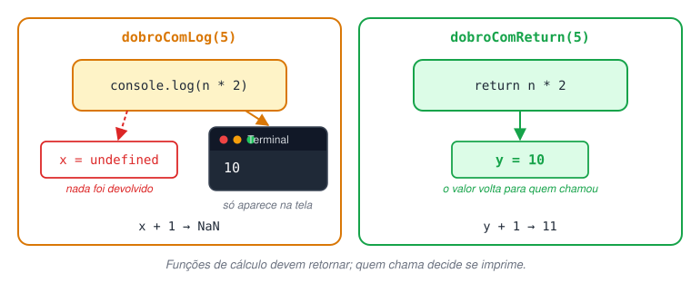
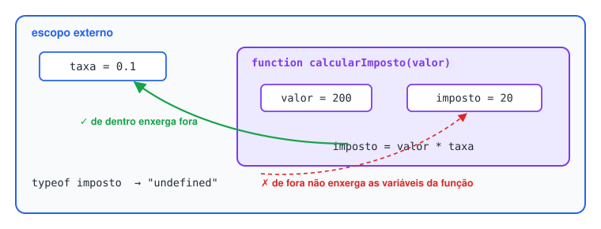
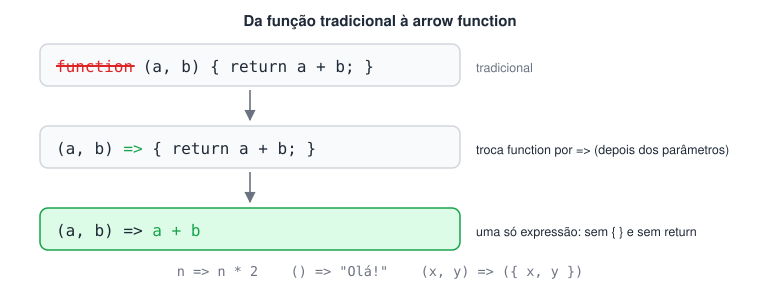
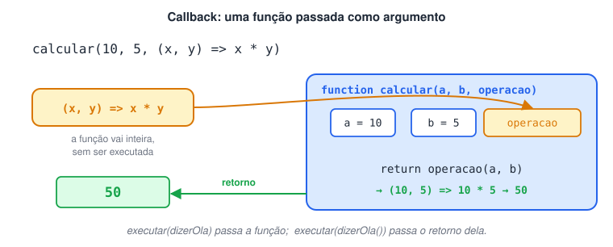
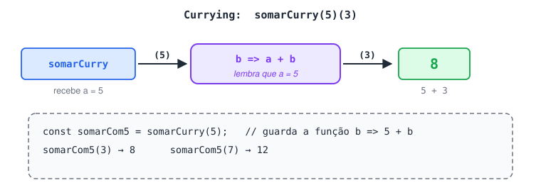
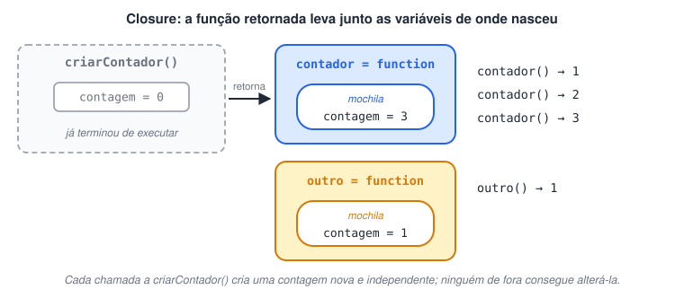

# Functions e arrow functions

> 🗺️ **Nesta aula:** criar e chamar funções, a diferença entre `return` e `console.log`, parâmetros padrão, escopo e hoisting, arrow functions e as ideias de função como valor: callbacks, funções que retornam funções, currying e closures.

## Functions

Uma função é um bloco de código com nome que **só executa quando é chamado**. Ela serve para:

- **Reutilizar** código: escreve uma vez, chama quantas vezes quiser.
- **Organizar**: cada função resolve uma parte do problema.
- **Abstrair**: quem usa precisa saber o que a função faz, não como.

### Declarando e chamando

```jsx
// Declaração: function nome(parâmetros) { corpo }
function somar(a, b) {
  return a + b;
}

// Chamada: nome(argumentos)
const resultado = somar(2, 3);
console.log(resultado); // 5
```

- **Parâmetros** são as variáveis declaradas na função (`a`, `b`).
- **Argumentos** são os valores passados na chamada (`2`, `3`).



### `return` × `console.log`

- `return` **devolve** um valor para quem chamou a função e **encerra** a execução dela. O valor pode ser guardado e reaproveitado.
- `console.log` apenas **mostra** algo no terminal. Uma função sem `return` devolve `undefined`.

```jsx
function dobroComLog(n) {
  console.log(n * 2); // só imprime
}

function dobroComReturn(n) {
  return n * 2; // devolve o valor
}

const x = dobroComLog(5);  // imprime 10
console.log(x);  // undefined → nada foi devolvido

const y = dobroComReturn(5); // não imprime nada
console.log(y + 1);  // 11 → o valor pode ser usado em contas
```



Regra prática: funções de cálculo devem **retornar**; quem chama decide se imprime.

### Parâmetros padrão e argumentos faltando

Se um argumento não for passado, o parâmetro vale `undefined`. Dá para definir um valor padrão:

```jsx
function saudar(nome = "visitante") {
  return `Olá, ${nome}!`;
}

console.log(saudar("Ana")); // Olá, Ana!
console.log(saudar());  // Olá, visitante!
```

### Escopo de função

Variáveis criadas dentro da função só existem nela. A função, por outro lado, enxerga as variáveis de fora.

```jsx
const taxa = 0.1; // escopo externo

function calcularImposto(valor) {
  const imposto = valor * taxa; // usa "taxa" de fora
  return imposto;
}

console.log(calcularImposto(200)); // 20
console.log(typeof imposto);  // "undefined" → não existe fora da função
```



### Hoisting de funções

Funções declaradas com `function nome() {}` são "içadas": podem ser chamadas **antes** da linha onde foram escritas.

```jsx
console.log(triplo(3)); // 9 → funciona

function triplo(n) {
  return n * 3;
}
```

### Função como expressão

Em JavaScript, função é um **valor** (como um número ou string). Por isso pode ser guardada em uma variável. Nesse caso **não** há hoisting: só pode ser chamada depois da linha de atribuição.

```jsx
const quadrado = function (n) {
  return n * n;
};

console.log(quadrado(4)); // 16
```

## Arrow functions

Introduzidas no ES6 (2015), são uma sintaxe mais curta para funções-expressão, usando a seta `=>`.

```jsx
// Função tradicional
const somar1 = function (a, b) {
  return a + b;
};

// Arrow function com bloco: precisa de return
const somar2 = (a, b) => {
  return a + b;
};

// Arrow function de uma expressão: o return é implícito
const somar3 = (a, b) => a + b;

console.log(somar1(3, 5), somar2(3, 5), somar3(3, 5)); // 8 8 8
```



**Variações de sintaxe:**

```jsx
const dobro = n => n * 2;  // um parâmetro: parênteses opcionais
const ola = () => "Olá!";  // sem parâmetros: () obrigatório
const criarPonto = (x, y) => ({ x, y }); // retornar objeto: envolva em ( )

console.log(dobro(4));  // 8
console.log(ola());  // Olá!
console.log(criarPonto(1, 2));  // { x: 1, y: 2 }
```

> ⚠️ Sem os parênteses, `(x, y) => { x, y }` é interpretado como um **bloco** de código, não como objeto, e a função retorna `undefined`.

**Diferenças em relação a **`function`**:**

|  | `function` | Arrow function |
| --- | --- | --- |
| Hoisting | Sim (na forma de declaração) | Não (é sempre expressão) |
| `this` próprio | Sim, depende de como é chamada | Não, herda o `this` de onde foi escrita |
| Objeto `arguments` | Sim | Não |
| Pode ser usada com `new` | Sim | Não |

Na prática: use arrow functions para funções curtas e callbacks (`map`, `filter`, `forEach`). Para **métodos de objetos** que usam `this`, prefira a forma tradicional (veja a página Objetos).

## Passando função como parâmetro para outra função

Como funções são valores, podem ser passadas como argumento. A função recebida é chamada de **callback**, e a função que recebe ou retorna outra função é chamada de **função de ordem superior** (*higher-order function*).

```jsx
function executar(funcao) {
  if (typeof funcao === "function") { // garante que recebeu uma função
    funcao();
  }
}

function dizerOla() {
  console.log("Olá, mundo!");
}

executar(dizerOla); // Olá, mundo!
```

Atenção à diferença:

- `executar(dizerOla)` → passa **a função** (sem parênteses).
- `executar(dizerOla())` → **chama** `dizerOla` agora e passa o **retorno** dela (`undefined`).

Um exemplo mais útil, em que o callback define o comportamento:

```jsx
function calcular(a, b, operacao) {
  return operacao(a, b);
}

console.log(calcular(10, 5, (x, y) => x + y)); // 15
console.log(calcular(10, 5, (x, y) => x * y)); // 50
```



É exatamente assim que funcionam `forEach`, `map` e `filter` dos arrays.

## Retornando uma função a partir de outra

Uma função pode criar e **retornar** outra função. Isso é possível porque funções são *cidadãs de primeira classe*: podem ser atribuídas a variáveis, passadas como argumento e retornadas como valor.

```jsx
function geradorDeMensagem(prefixo) {
  return function (mensagem) {
    return `${prefixo}: ${mensagem}`;
  };
}

const boasVindas = geradorDeMensagem("Bem-vindo");
const erro = geradorDeMensagem("Erro");

console.log(boasVindas("ao meu site!"));  // Bem-vindo: ao meu site!
console.log(erro("Falha na conexão."));  // Erro: Falha na conexão.
```

Cada chamada a `geradorDeMensagem` cria uma **nova** função, que "lembra" do prefixo recebido (isso é uma *closure*, explicada abaixo).

**Entendendo os parênteses encadeados:** cada `()` executa a função que estava sendo retornada.

```jsx
function nivel1() {
  return function nivel2() {
    return function () {
      return "Bom dia!!!";
    };
  };
}

console.log(typeof nivel1);  // "function" → a própria função, sem executar
console.log(typeof nivel1());  // "function" → retorno de nivel1 (= nivel2)
console.log(typeof nivel1()());  // "function" → retorno de nivel2 (a anônima)
console.log(nivel1()()());  // "Bom dia!!!" → retorno da anônima
```

### Currying

Técnica que transforma uma função de **vários argumentos** em uma **sequência de funções de um argumento cada**: `f(a, b)` vira `f(a)(b)`.

```jsx
// Versão normal
const somar = (a, b) => a + b;

// Versão com currying
function somarCurry(a) {
  return function (b) {
    return a + b;
  };
}
// Mesmo código em arrow function:
// const somarCurry = a => b => a + b;

console.log(somar(5, 3));  // 8
console.log(somarCurry(5)(3)); // 8

// Vantagem: "fixar" o primeiro argumento e reaproveitar
const somarCom5 = somarCurry(5);
console.log(somarCom5(3)); // 8
console.log(somarCom5(7)); // 12
```



### Closures

Uma *closure* é uma função que **continua acessando as variáveis do escopo onde foi criada**, mesmo depois que a função externa terminou de executar.

```jsx
function criarContador() {
  let contagem = 0; // variável local de criarContador

  return function () {
    contagem++;
    return contagem;
  };
}

const contador = criarContador(); // criarContador já terminou aqui...

console.log(contador()); // 1  ...mas a função retornada ainda enxerga "contagem"
console.log(contador()); // 2
console.log(contador()); // 3

const outro = criarContador(); // nova chamada → nova "contagem", independente
console.log(outro());  // 1
```

**Por que isso é útil?** A variável `contagem` fica **protegida**: não há como alterá-la de fora, só pela função retornada. É uma forma de criar estado privado.



O `geradorDeMensagem` e o `somarCurry` acima também são closures: as funções retornadas lembram de `prefixo` e de `a`.

## 📌 Resumo da aula

| Conceito | Lembre |
| --- | --- |
| Parâmetro × argumento | parâmetro na declaração; argumento na chamada |
| `return` | devolve o valor e encerra a função; sem ele, o retorno é `undefined` |
| Parâmetro padrão | `function f(x = 10)` |
| Escopo | a função enxerga o que está fora; o de fora não enxerga o que está dentro |
| Hoisting | só `function nome() {}` pode ser chamada antes de ser declarada |
| Arrow function | `(a, b) => a + b`; return implícito em uma linha; não tem `this` próprio |
| Callback | função passada como argumento: `f(minhaFuncao)`, sem parênteses |
| Função que retorna função | base de currying: `soma(5)(3)` |
| Closure | a função interna lembra das variáveis de onde foi criada |
