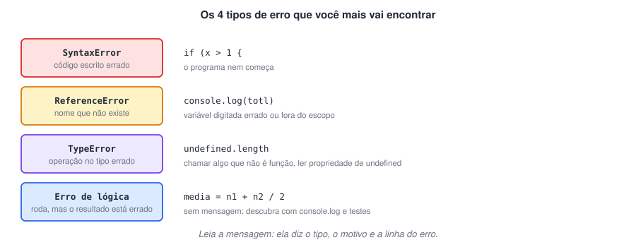

# Erros e depuração: encontrando e tratando problemas

> ✨ **Página nova:** errar faz parte de programar. Esta página ensina a ler as mensagens de erro, a investigar o código com o depurador e a tratar falhas com `try/catch`.

> 🗺️ **Nesta aula:** os tipos de erro mais comuns, como ler a mensagem do Node.js, técnicas de depuração com `console` e com breakpoints no VS Code, e tratamento de erros com `try`, `catch`, `finally` e `throw`.

## 1. Tipos de erro



## 2. Lendo a mensagem de erro

```
/home/ana/curso/media.js:3
console.log(totl);
      ^
ReferenceError: totl is not defined
  at Object.<anonymous> (/home/ana/curso/media.js:3:13)
```

| Parte | O que diz |
| --- | --- |
| `media.js:3` | arquivo e **linha** do problema |
| `^` | aponta o lugar exato na linha |
| `ReferenceError` | o **tipo** de erro |
| `totl is not defined` | o **motivo**: não existe nada chamado `totl` (erro de digitação de `total`) |
| `at ...:3:13` | caminho de chamadas (*stack trace*): linha 3, coluna 13 |

> 💡 Comece sempre pela **primeira** mensagem de erro e pela linha indicada. Se ainda assim não entender, copie a mensagem (sem trechos do seu código com dados pessoais) e pesquise: quase todo erro já foi explicado por alguém.

## 3. Depurando com `console`

- Espalhe `console.log` para ver os valores **no meio** da execução, não só no fim.
- Mostre o nome junto com o valor: `console.log({ total, i })` imprime `{ total: 10, i: 3 }`.
- `console.table(array)` mostra arrays de objetos como tabela.

**Código exemplo: achando um erro de lógica**

```jsx
const notas = [8, 6, 10];
let soma = 0;

for (let i = 1; i < notas.length; i++) {  // bug: começa em 1
  soma += notas[i];
  console.log({ i, nota: notas[i], soma });  // mostra cada passo
}
// { i: 1, nota: 6, soma: 6 }
// { i: 2, nota: 10, soma: 16 }  ← a nota 8 (índice 0) nunca entrou!

console.log(soma / notas.length);  // 5.33 (errado; o certo é 8)
```

## 4. Depurando com breakpoints no VS Code

1. Clique à esquerda do número de uma linha: aparece um **ponto vermelho** (breakpoint).
2. Pressione **F5** e escolha **Node.js**. O programa para naquela linha.
3. No painel **Run and Debug**, veja o valor de todas as variáveis.
4. Avance com **F10** (próxima linha) ou **F11** (entra na função). **F5** continua até o próximo breakpoint.
- É o teste de mesa feito pelo computador. Também dá para escrever `debugger;` no código para pausar naquele ponto.

## 5. Tratando erros com `try/catch`

- Quando um erro acontece durante a execução, o programa para. Com `try/catch` você **captura** o erro e decide o que fazer.
- `try`: código que pode falhar. `catch (erro)`: o que fazer se falhar. `finally`: roda sempre, com ou sem erro. `throw`: **lança** um erro seu.

**Código exemplo**

```jsx
function dividir(a, b) {
  if (b === 0) {
    throw new Error("Não é possível dividir por zero");  // em JS, 10 / 0 daria Infinity
  }
  return a / b;
}

try {
  console.log(dividir(10, 2));  // 5
  console.log(dividir(10, 0));  // lança o erro → pula para o catch
  console.log("não chega aqui");
} catch (erro) {
  console.log(`Ops: ${erro.message}`);  // Ops: Não é possível dividir por zero
} finally {
  console.log("Fim do cálculo");
}
```

**Código exemplo: JSON inválido**

```jsx
const texto = '{ "nome": "Ana", }';  // vírgula sobrando = JSON inválido

try {
  const dados = JSON.parse(texto);
  console.log(dados.nome);
} catch (erro) {
  console.log("Os dados recebidos estão em formato inválido.");
}
```

> ✅ **Boas práticas:** use `try/catch` para falhas que você **não controla** (dados do usuário, arquivos, rede). Para bugs do seu código, a solução é corrigir, não esconder. Nunca deixe o `catch` vazio: no mínimo, mostre uma mensagem.

## 📌 Resumo da aula

| Tema | Lembre |
| --- | --- |
| `SyntaxError` | código mal escrito; nada roda |
| `ReferenceError` | nome inexistente (digitação ou escopo) |
| `TypeError` | operação no tipo errado (ex.: propriedade de `undefined`) |
| Erro de lógica | sem mensagem; investigue com `console.log` e teste de mesa |
| Mensagem de erro | tipo + motivo + arquivo:linha |
| Breakpoints | F5 inicia, F10 avança, painel mostra as variáveis |
| `try/catch/finally` | tenta, trata, sempre executa; `throw` lança o seu erro |
