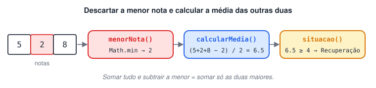

# Desafios de função

**1 - Crie uma função para cada operação elementar da matemática e uma condicional que escolha qual delas executar.**

<details>
<summary>Ver resposta</summary>

```jsx
// Uma função por operação (todas retornam o resultado)
const somar = (a, b) => a + b;
const subtrair = (a, b) => a - b;
const multiplicar = (a, b) => a * b;
const dividir = (a, b) => a / b;
const resto = (a, b) => a % b;

// Função que escolhe a operação pelo número
function escolherOperacao(numOperacao, a, b) {
  if (numOperacao === 1) {
    return `Soma: ${a} + ${b} = ${somar(a, b)}`;
  } else if (numOperacao === 2) {
    return `Subtração: ${a} - ${b} = ${subtrair(a, b)}`;
  } else if (numOperacao === 3) {
    return `Multiplicação: ${a} * ${b} = ${multiplicar(a, b)}`;
  } else if (numOperacao === 4) {
    return `Divisão: ${a} / ${b} = ${dividir(a, b)}`;
  } else if (numOperacao === 5) {
    return `Resto: ${a} % ${b} = ${resto(a, b)}`;
  } else {
    return "Operação inválida! Escolha de 1 a 5.";
  }
}

console.log(escolherOperacao(2, 10, 5)); // Subtração: 10 - 5 = 5
console.log(escolherOperacao(4, 10, 5)); // Divisão: 10 / 5 = 2
console.log(escolherOperacao(9, 10, 5)); // Operação inválida! Escolha de 1 a 5.
```

**Ideia central:** cada função faz **uma** coisa (calcular) e retorna o resultado. A função de escolha é a única responsável pela decisão e pelo texto. Separar responsabilidades assim facilita testar e reaproveitar.

</details>

**2 - Crie uma função que retorne a nota musical a partir de uma letra (A - Lá / B - Si / C - Dó / D - Ré / E - Mi / F - Fá / G - Sol) e mostre o resultado no console.**

<details>
<summary>Ver resposta</summary>

```jsx
function notaMusical(letra) {
  switch (letra.toLowerCase()) { // aceita "c" ou "C"
    case "a": return "Lá";
    case "b": return "Si";
    case "c": return "Dó";
    case "d": return "Ré";
    case "e": return "Mi";
    case "f": return "Fá";
    case "g": return "Sol";
    default:  return "Letra inválida! Escolha de A a G.";
  }
}

const letra = "C";
console.log(`A nota equivalente à letra "${letra}" é: ${notaMusical(letra)}`);
// A nota equivalente à letra "C" é: Dó
```

`toLowerCase()` converte a string para minúsculas antes da comparação, assim a função funciona com letras maiúsculas ou minúsculas.

</details>

**3 - Crie um programa que receba 3 notas, descarte a mais baixa e calcule a média das outras duas. Média ≥ 7: aprovado; de 4 a 6.9: recuperação; abaixo de 4: reprovado.**



<details>
<summary>Ver resposta</summary>

```jsx
function menorNota(n1, n2, n3) {
  return Math.min(n1, n2, n3);
}

function calcularMedia(n1, n2, n3) {
  const somaDasDuasMaiores = n1 + n2 + n3 - menorNota(n1, n2, n3);
  return somaDasDuasMaiores / 2;
}

function situacao(media) {
  if (media >= 7) {
    return "Aprovado";
  } else if (media >= 4) {
    return "Recuperação";
  } else {
    return "Reprovado";
  }
}

const nota1 = 5;
const nota2 = 2;
const nota3 = 8;

const media = calcularMedia(nota1, nota2, nota3);

console.log(`Notas: ${nota1}, ${nota2}, ${nota3}`);
console.log(`Nota descartada: ${menorNota(nota1, nota2, nota3)}`);
console.log(`Média: ${media} → ${situacao(media)}`);
// Notas: 5, 2, 8
// Nota descartada: 2
// Média: 6.5 → Recuperação
```

**Correção em relação à versão original:** o ternário `n1 <= n2 ? n1 : n2 <= n3 ? n2 : n3` não encontra o menor valor em todos os casos. Com as notas `2, 5, 1`, ele retorna `2` (porque `2 <= 5`) sem comparar com o `1`. `Math.min()` compara todos os valores e resolve o problema.

**Por que somar tudo e subtrair a menor?** É a forma mais simples de "remover" um valor da soma sem precisar descobrir quais são as duas maiores.

</details>
