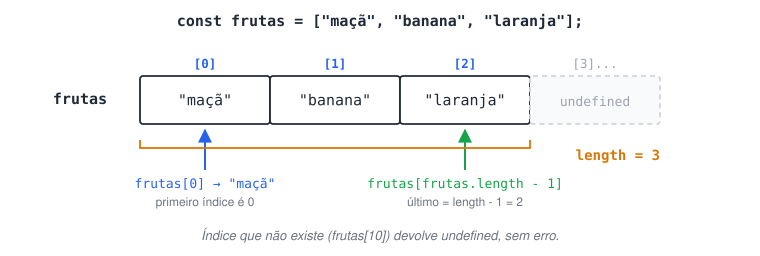
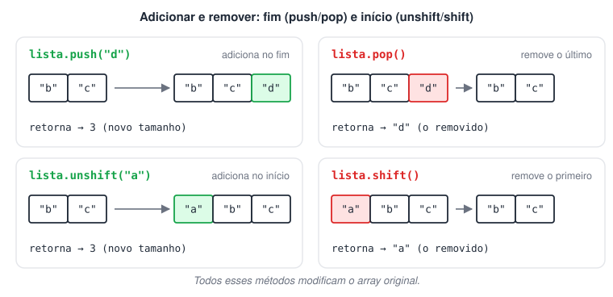
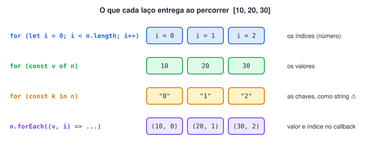
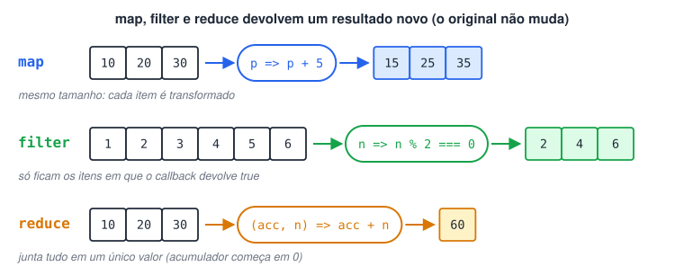
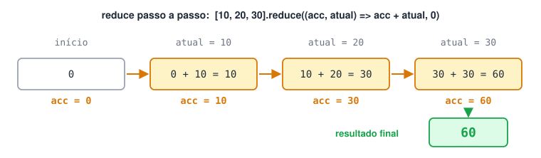
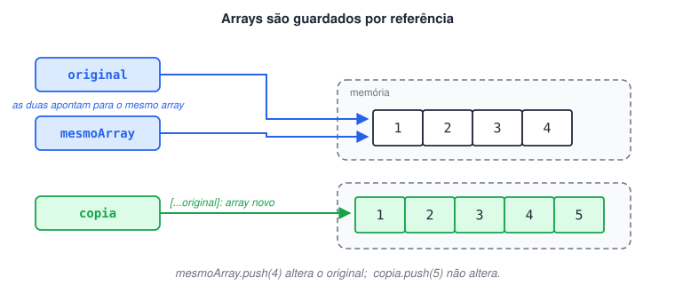

# Arrays

> 🗺️ **Nesta aula:** o que é um array e como funcionam os índices, os métodos para adicionar, remover e buscar, as formas de percorrer (`for`, `for...of`, `for...in`, `forEach`), os métodos `map`, `filter` e `reduce` e a diferença entre referência e cópia.

## Conceituando

Um **array** (vetor) é uma estrutura que guarda uma **lista ordenada** de valores em uma única variável.

- Cada elemento tem um **índice** numérico que indica sua posição. **O primeiro índice é 0**.
- O último índice é sempre `length - 1`.
- Os elementos podem ser de qualquer tipo, inclusive misturados: números, strings, objetos, outros arrays e até funções.
- Arrays em JS são **dinâmicos**: crescem e diminuem conforme você adiciona ou remove itens.

```jsx
const frutas = ["maçã", "banana", "laranja"];
//  índice:        0         1          2

console.log(frutas);  // [ 'maçã', 'banana', 'laranja' ]
console.log(frutas[0]);  // maçã  → primeiro elemento
console.log(frutas[2]);  // laranja
console.log(frutas.length);  // 3  → quantidade de elementos
console.log(frutas[frutas.length - 1]); // laranja → último elemento
console.log(frutas[10]);  // undefined → índice que não existe
```



### Alterando elementos

```jsx
const numeros = [10, 20, 30];

numeros[1] = 25;  // substitui o valor no índice 1
console.log(numeros); // [ 10, 25, 30 ]

const misto = [1, "dois", true, [3, 4], { nome: "Ana" }];
console.log(misto[3][0]);  // 3  → array dentro de array
console.log(misto[4].nome);  // Ana → objeto dentro de array
```

## Métodos básicos

### Adicionar e remover

| Método | O que faz | Retorna |
| --- | --- | --- |
| `push(x)` | Adiciona `x` no **fim** | Novo tamanho |
| `pop()` | Remove o **último** | O elemento removido |
| `unshift(x)` | Adiciona `x` no **início** | Novo tamanho |
| `shift()` | Remove o **primeiro** | O elemento removido |
| `splice(i, n)` | Remove `n` elementos a partir do índice `i` | Array com os removidos |



Todos esses métodos **modificam o array original**.

```jsx
const lista = ["b", "c"];

lista.push("d");  // [ 'b', 'c', 'd' ]
lista.unshift("a");  // [ 'a', 'b', 'c', 'd' ]
lista.pop();  // remove 'd' → [ 'a', 'b', 'c' ]
lista.shift();  // remove 'a' → [ 'b', 'c' ]
lista.splice(0, 1);  // remove 1 item a partir do índice 0 → [ 'c' ]

console.log(lista); // [ 'c' ]
```

### Buscar e transformar

```jsx
const linguagens = ["js", "python", "java"];

console.log(linguagens.includes("python")); // true  → existe no array?
console.log(linguagens.indexOf("java"));  // 2  → em que índice está?
console.log(linguagens.indexOf("ruby"));  // -1  → não encontrado
console.log(linguagens.join(" | "));  // js | python | java → vira string
console.log("a-b-c".split("-"));  // [ 'a', 'b', 'c' ] → string vira array
```

## Percorrendo arrays

### Com `for` (controle total pelo índice)

Use quando precisar do índice ou de um passo diferente de 1 (pular, ir de trás para frente).

```jsx
const nums = [1, 2, 3, 4, 5, 6];

for (let i = 0; i < nums.length; i++) {
  console.log(`Índice ${i}: ${nums[i]}`);
}
```

A condição é `i < nums.length` (e não `<=`) porque o último índice é `length - 1`.

### Com `for...of` (pega os valores)

Forma mais simples quando você só precisa de cada elemento.

```jsx
const numeros = [1, 2, 3];

for (const numero of numeros) {
  console.log(numero); // 1, 2, 3
}
```

### Com `for...in` (pega os índices/chaves)

Percorre as chaves. Em um array, as chaves são os índices **em formato de string**.

```jsx
const numeros = [10, 20, 30];

for (const indice in numeros) {
  console.log(indice, typeof indice, numeros[indice]);
}
// 0 string 10
// 1 string 20
// 2 string 30
```

> 💡 `for...in` foi feito para **objetos**. Em arrays, prefira `for` ou `for...of`: os índices vêm como string (`"0" + 1` resulta em `"01"`), o que causa bugs em contas.

### Com `forEach`

Recebe uma **função callback** e a executa uma vez para cada elemento. O callback recebe até três argumentos, nesta ordem: **elemento**, **índice** e o **array completo**.

```jsx
const frutas = ["maçã", "banana", "laranja"];

frutas.forEach((fruta, indice) => {
  console.log(`${indice}: ${fruta}`);
});
// 0: maçã
// 1: banana
// 2: laranja
```

`forEach` não retorna nada e não pode ser interrompido com `break`. Se precisar parar no meio, use `for` ou `for...of`.



## `map`, `filter` e `reduce`

São métodos de ordem superior (recebem funções) que **não alteram o array original**: devolvem um resultado novo.



### `map`: transforma cada elemento

Retorna um **novo array do mesmo tamanho**, com o resultado do callback para cada item.

```jsx
const precos = [10, 20, 30];
const comFrete = precos.map(preco => preco + 5);

console.log(comFrete);  // [ 15, 25, 35 ]
console.log(precos);  // [ 10, 20, 30 ] → original intacto
```

### `filter`: seleciona elementos

Retorna um **novo array** só com os itens para os quais o callback devolveu `true`.

```jsx
const numeros = [1, 2, 3, 4, 5, 6];
const pares = numeros.filter(n => n % 2 === 0);

console.log(pares); // [ 2, 4, 6 ]
```

### `reduce`: reduz o array a um único valor

O callback recebe um **acumulador** (o resultado até agora) e o **elemento atual**. O segundo argumento do `reduce` é o valor inicial do acumulador.

```jsx
const numeros = [10, 20, 30];

const soma = numeros.reduce((acumulador, atual) => acumulador + atual, 0);
console.log(soma); // 60

// Passo a passo:
// início:      acumulador = 0
// elemento 10: 0 + 10  = 10
// elemento 20: 10 + 20 = 30
// elemento 30: 30 + 30 = 60 → resultado final
```



## Copiando arrays

Arrays (e objetos) são guardados **por referência**: atribuir a outra variável **não cria uma cópia**, as duas apontam para o mesmo array.

```jsx
const original = [1, 2, 3];
const mesmoArray = original;  // não é cópia!
mesmoArray.push(4);
console.log(original);  // [ 1, 2, 3, 4 ] → o original mudou também

const copia = [...original];  // spread: cria um array novo com os mesmos itens
copia.push(5);
console.log(original);  // [ 1, 2, 3, 4 ] → original não muda
console.log(copia);  // [ 1, 2, 3, 4, 5 ]
```



O `...` (operador *spread*) "espalha" os elementos de um array dentro de outro.

## 📌 Resumo da aula

| Tema | Lembre |
| --- | --- |
| Índices | começam em 0; último = `length - 1` |
| Adicionar / remover | `push`/`pop` no fim · `unshift`/`shift` no início · `splice` no meio (todos alteram o original) |
| Buscar | `includes` (existe?) · `indexOf` (posição ou -1) |
| Converter | `join` (array → string) · `split` (string → array) |
| Percorrer | `for` (com índice) · `for...of` (valores) · `forEach` (callback, sem `break`); `for...in` é para objetos |
| `map` | transforma: novo array do mesmo tamanho |
| `filter` | seleciona: novo array só com quem passou no teste |
| `reduce` | junta tudo em um valor: `(acumulador, atual) => …, valorInicial` |
| Cópia | `=` copia a referência; `[...array]` cria um array novo |

Para continuar: `find`, `some`, `every`, `sort` e desestruturação estão na página **Mais sobre arrays**.
