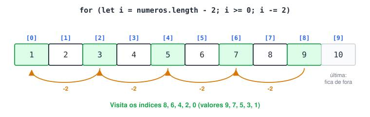

# Desafio arrays

**1 - Em um array de 10 posições, percorra de forma regressiva, de 2 em 2, da penúltima posição até a primeira. Não inclua a última posição.**



<details>
<summary>Ver resposta</summary>

```jsx
const numeros = [1, 2, 3, 4, 5, 6, 7, 8, 9, 10];
//      índices: 0  1  2  3  4  5  6  7  8  9

for (let i = numeros.length - 2; i >= 0; i -= 2) {
  console.log(`Índice ${i}: ${numeros[i]}`);
}
// Índice 8: 9
// Índice 6: 7
// Índice 4: 5
// Índice 2: 3
// Índice 0: 1
```

**Montando o **`for`**, parte por parte**

- **Início** `numeros.length - 2`: o último índice é `length - 1` (9), então o penúltimo é `length - 2` (8). Usar `length` em vez de escrever `8` faz o código funcionar com arrays de qualquer tamanho.
- **Condição** `i >= 0`: continua até o índice 0, inclusive.
- **Passo** `i -= 2`: anda 2 posições para trás a cada volta.

Atenção: **índice** e **valor** são coisas diferentes. No índice 8 está o valor 9.

</details>
