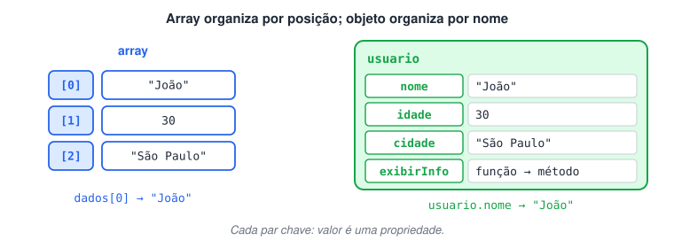
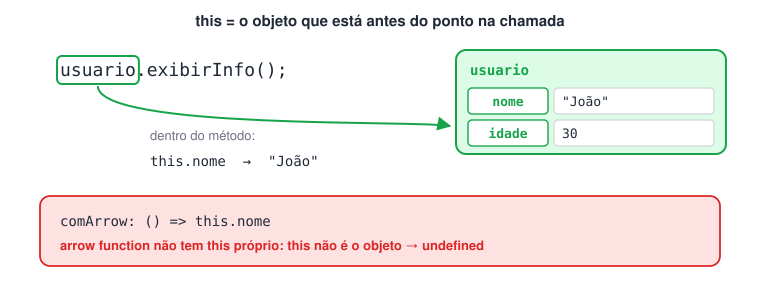
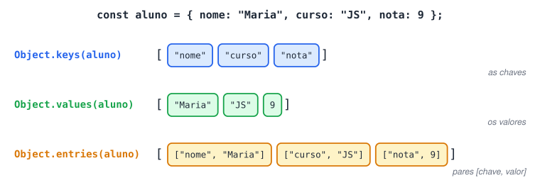
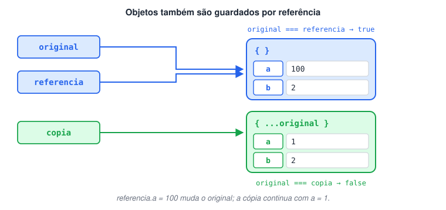
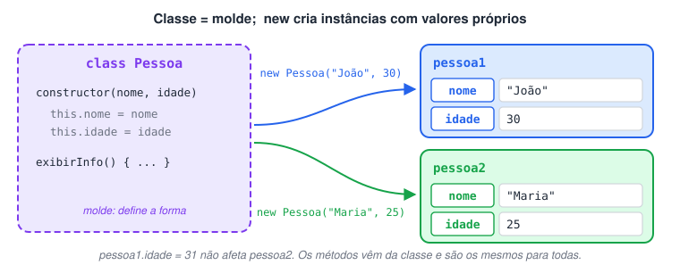
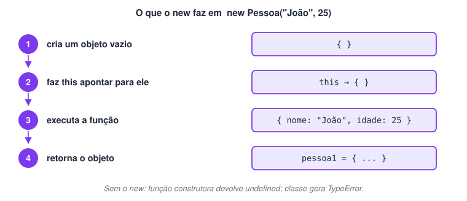

# Objetos

> 🗺️ **Nesta aula:** objetos como pares chave: valor, acesso por ponto e colchetes, `this`, percorrer com `Object.keys/values/entries`, referência e cópia, e as três formas de criar objetos parecidos: classe, função fábrica e função construtora.

## Definições

Um **objeto** agrupa dados relacionados em pares **chave: valor**.

- **Propriedades** (ou atributos) são as características: `nome: "João"`.
- **Métodos** são propriedades cujo valor é uma **função**: as ações do objeto.

Enquanto o array organiza valores **por posição** (índice), o objeto organiza **por nome** (chave).

```jsx
const usuario = {
  nome: "João",
  idade: 30,
  cidade: "São Paulo",

  // Método
  exibirInfo() {
    console.log(`${this.nome} tem ${this.idade} anos e mora em ${this.cidade}.`);
  },
};

console.log(usuario.nome);  // João
console.log(usuario.idade); // 30
usuario.exibirInfo();  // João tem 30 anos e mora em São Paulo.
```



### Acessando propriedades: ponto × colchetes

```jsx
const produto = { nome: "Caneta", preco: 2.5 };

// Notação de ponto: quando você sabe o nome da chave ao escrever o código
console.log(produto.nome); // Caneta

// Notação de colchetes: quando a chave está em uma variável (ou tem espaço/hífen)
const campo = "preco";
console.log(produto[campo]);  // 2.5
console.log(produto["nome"]); // Caneta

console.log(produto.estoque); // undefined → propriedade inexistente
```

### Adicionando, alterando e removendo

Objetos são dinâmicos: propriedades podem ser incluídas ou excluídas a qualquer momento (mesmo com `const`, que só impede trocar o objeto inteiro).

```jsx
const carro = { marca: "Fiat" };

carro.modelo = "Uno";  // adiciona
carro.marca = "VW";  // altera
delete carro.modelo;  // remove

console.log(carro);  // { marca: 'VW' }
console.log("marca" in carro); // true → verifica se a chave existe
```

### `this`

Dentro de um método, `this` se refere ao **objeto que chamou o método** (o que está antes do ponto em `usuario.exibirInfo()`). É assim que o método acessa as outras propriedades do próprio objeto.

> ⚠️ Não use arrow function para métodos que dependem de `this`. A arrow function não tem `this` próprio, então `this.nome` não aponta para o objeto e resulta em `undefined`.

```jsx
const pessoa = {
  nome: "Ana",
  comFunction() { return this.nome; },
  comArrow: () => this.nome,
};

console.log(pessoa.comFunction()); // Ana
console.log(pessoa.comArrow());  // undefined → o this da arrow não é o objeto
```



### Percorrendo um objeto

```jsx
const aluno = { nome: "Maria", curso: "JS", nota: 9 };

console.log(Object.keys(aluno));  // [ 'nome', 'curso', 'nota' ]
console.log(Object.values(aluno));  // [ 'Maria', 'JS', 9 ]
console.log(Object.entries(aluno)); // [ [ 'nome', 'Maria' ], [ 'curso', 'JS' ], [ 'nota', 9 ] ]

// for...in percorre as chaves
for (const chave in aluno) {
  console.log(`${chave}: ${aluno[chave]}`); // colchetes, pois a chave está em variável
}
```



### Referência e cópia

Assim como arrays, objetos são guardados **por referência**. Atribuir a outra variável não copia; para copiar, use o *spread* `{ ...obj }` (ou `Object.assign({}, obj)`).

```jsx
const original = { a: 1, b: 2 };

const referencia = original;  // mesmo objeto
const copia = { ...original };  // objeto novo

referencia.a = 100;
console.log(original.a); // 100 → mudou, pois é o mesmo objeto
console.log(copia.a);  // 1  → a cópia é independente

console.log(original === referencia); // true
console.log(original === copia);  // false → objetos diferentes na memória
```



Essas cópias são **rasas** (*shallow*): se uma propriedade guarda outro objeto ou array, esse item interno continua compartilhado.

## Conceitos importantes sobre orientação a objetos

### Classe

Uma **classe** é um **molde**: define quais atributos e métodos os objetos criados a partir dela terão. O objeto criado é chamado de **instância**.

- Declarada com `class NomeDaClasse { }` (por convenção, com inicial maiúscula).
- O método especial `constructor` é executado automaticamente quando um objeto é criado com `new`, e serve para inicializar os atributos.

```jsx
class Pessoa {
  constructor(nome, idade) {
    this.nome = nome;  // atributo
    this.idade = idade; // atributo
  }

  exibirInfo() {  // método
    console.log(`${this.nome} tem ${this.idade} anos.`);
  }
}

const pessoa1 = new Pessoa("João", 30); // instância 1
const pessoa2 = new Pessoa("Maria", 25); // instância 2

pessoa1.exibirInfo(); // João tem 30 anos.
pessoa2.exibirInfo(); // Maria tem 25 anos.
```



### Atributos

São as **características** de cada objeto. Dentro da classe, `this.nome = nome` cria o atributo `nome` na instância que está sendo construída e o preenche com o valor recebido no `new`.

Cada instância tem seus **próprios valores**: alterar `pessoa1.idade` não afeta `pessoa2`.

```jsx
// Continuando o exemplo acima (classe Pessoa, pessoa1 e pessoa2)
pessoa1.idade = 31;
console.log(pessoa1.idade); // 31
console.log(pessoa2.idade); // 25
```

### Métodos

São as **ações** que o objeto sabe executar. São funções definidas dentro da classe (sem a palavra `function`) e usam `this` para ler ou alterar os atributos da instância.

```jsx
class Conta {
  constructor(titular) {
    this.titular = titular;
    this.saldo = 0;
  }

  depositar(valor) {
    this.saldo += valor; // método que modifica o atributo
  }

  extrato() {
    return `${this.titular}: R$ ${this.saldo.toFixed(2)}`;
  }
}

const conta = new Conta("Ana");
conta.depositar(150);
console.log(conta.extrato()); // Ana: R$ 150.00
```

## Função que retorna objetos (função fábrica)

Uma função comum que **monta e retorna** um objeto literal. Evita repetir a mesma estrutura toda vez que você precisa de um novo objeto. Não usa `new`.

```jsx
function criarPessoa(nome, idade, cidade) {
  return {
    // Atalho: quando a chave tem o mesmo nome da variável,
    // "nome" é o mesmo que "nome: nome"
    nome,
    idade,
    cidade,

    apresentar() {
      console.log(`Olá, meu nome é ${this.nome}, tenho ${this.idade} anos e moro em ${this.cidade}.`);
    },
  };
}

const pessoa1 = criarPessoa("João", 25, "São Paulo");
const pessoa2 = criarPessoa("Maria", 30, "Rio de Janeiro");

pessoa1.apresentar(); // Olá, meu nome é João, tenho 25 anos e moro em São Paulo.
pessoa2.apresentar(); // Olá, meu nome é Maria, tenho 30 anos e moro em Rio de Janeiro.
```

Com arrow function, lembre de envolver o objeto em parênteses:

```jsx
const criarProduto = (nome, preco) => ({ nome, preco });
console.log(criarProduto("Mouse", 20)); // { nome: 'Mouse', preco: 20 }
```

## Função construtora

Antes de existir `class` (ES6, 2015), objetos eram criados a partir de **funções construtoras**. Ela cumpre o papel de molde, como uma classe em Java.

- É uma função normal, mas chamada com `new`.
- Por convenção, o nome começa com letra maiúscula.
- Ao usar `new`, o JS cria um objeto vazio, faz `this` apontar para ele, executa a função e **retorna o objeto automaticamente** (não precisa de `return`).

```jsx
function Pessoa(nome, idade, cidade) {
  this.nome = nome;
  this.idade = idade;
  this.cidade = cidade;

  this.apresentar = function () {
    console.log(`Olá, meu nome é ${this.nome}, tenho ${this.idade} anos e moro em ${this.cidade}.`);
  };
}

const pessoa1 = new Pessoa("João", 25, "São Paulo");
const pessoa2 = new Pessoa("Maria", 30, "Rio de Janeiro");

pessoa1.apresentar(); // Olá, meu nome é João, tenho 25 anos e moro em São Paulo.
pessoa2.apresentar(); // Olá, meu nome é Maria, tenho 30 anos e moro em Rio de Janeiro.
```



O mesmo molde escrito como **classe** (a forma moderna e recomendada):

```jsx
class Pessoa {
  constructor(nome, idade, cidade) {
    this.nome = nome;
    this.idade = idade;
    this.cidade = cidade;
  }

  apresentar() {
    console.log(`Olá, meu nome é ${this.nome}, tenho ${this.idade} anos e moro em ${this.cidade}.`);
  }
}

const pessoa1 = new Pessoa("João", 25, "São Paulo");
pessoa1.apresentar(); // Olá, meu nome é João, tenho 25 anos e moro em São Paulo.
```

### Resumo: três formas de criar objetos parecidos

| Forma | Como cria | Usa `new`? |
| --- | --- | --- |
| Função fábrica | `return { ... }` | Não |
| Função construtora | `this.x = ...` dentro de `function Nome()` | Sim |
| Classe | `constructor` dentro de `class Nome` | Sim |

> ⚠️ Esquecer o `new` com uma função construtora é um erro silencioso: `const p = Pessoa("João")` retorna `undefined` e o `this` não aponta para um objeto novo. Com `class`, esquecer o `new` gera erro na hora (`TypeError`), o que facilita achar o problema.

## 📌 Resumo da aula

| Tema | Lembre |
| --- | --- |
| Objeto | pares `chave: valor`; organiza por nome (o array organiza por posição) |
| Acesso | `obj.chave` ou `obj["chave"]` (colchetes quando a chave está numa variável) |
| Alterar | `obj.nova = 1` adiciona · `delete obj.chave` remove · `"chave" in obj` verifica |
| Método e `this` | `this` é o objeto antes do ponto; não use arrow function em métodos com `this` |
| Percorrer | `Object.keys`, `Object.values`, `Object.entries`, `for...in` |
| Cópia | `{ ...obj }` cria um objeto novo (cópia rasa) |
| Classe | molde com `constructor`; instâncias com `new` |
| Função fábrica | `return { ... }`, sem `new` |
| Função construtora | `this.x = ...`  • `new`; forma antiga da classe |
