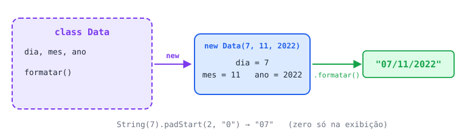

# Desafio objetos

**1 - Crie uma classe **`Data`** com os atributos dia, mês e ano e um método que exiba a data no formato dia/mês/ano.**



<details>
<summary>Ver resposta</summary>

```jsx
class Data {
  constructor(dia, mes, ano) {
    this.dia = dia;
    this.mes = mes;
    this.ano = ano;
  }

  formatar() {
    const dd = String(this.dia).padStart(2, "0"); // 7 → "07"
    const mm = String(this.mes).padStart(2, "0");
    return `${dd}/${mm}/${this.ano}`;
  }
}

const data = new Data(7, 11, 2022);
console.log(data.formatar()); // 07/11/2022

const outra = new Data(25, 12, 2023);
console.log(outra.formatar()); // 25/12/2023
```

**Pontos de atenção**

- O enunciado pede uma **classe**. A versão original usava um objeto literal, que funciona para **uma** data só. Com a classe, cada `new Data(...)` cria uma data diferente usando o mesmo molde.
- **Não escreva números com zero à esquerda** (`07`). Em JavaScript isso é a notação antiga de número octal: no modo estrito gera erro de sintaxe, e `08`/`09` têm comportamento inconsistente. O zero deve ser adicionado só na exibição.
- `padStart(2, "0")` completa a string com `"0"` à esquerda até ela ter 2 caracteres. Só funciona em strings, por isso o `String(...)` antes.

Versão alternativa com objeto literal (sem classe), para comparação:

```jsx
const data = {
  dia: 7,
  mes: 11,
  ano: 2022,
  formatar() {
    return `${this.dia}/${this.mes}/${this.ano}`;
  },
};

console.log(data.formatar()); // 7/11/2022
```

</details>
