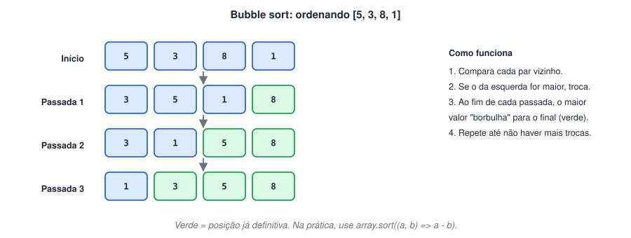

# Algoritmos clássicos: contador, acumulador, busca e ordenação

> ✨ **Página nova:** reúne os padrões de solução que aparecem em quase todo exercício de lógica, em provas técnicas e na lista final. Antes de olhar o código, tente resolver cada um sozinho.

> 🗺️ **Nesta aula:** contador, acumulador, maior e menor valor, média, busca linear, contagem de ocorrências, números primos, fatorial (com laço e com recursão), Fibonacci e ordenação com bubble sort.

## 1. Os quatro padrões básicos

| Padrão | Ideia | Começa com |
| --- | --- | --- |
| **Contador** | soma 1 cada vez que algo acontece | `let qtd = 0` |
| **Acumulador** | vai somando (ou multiplicando) valores | `let soma = 0` (ou `1` para produto) |
| **Maior / menor** | compara cada item com o "campeão" atual | o **primeiro** elemento |
| **Flag (bandeira)** | variável booleana que marca se algo foi encontrado | `let achou = false` |

**Código: contador, acumulador, maior, menor e média de uma vez**

```jsx
const idades = [17, 25, 32, 15, 40];

let maiores = 0;  // contador
let soma = 0;  // acumulador
let maior = idades[0];  // começa com o primeiro, nunca com 0
let menor = idades[0];

for (const idade of idades) {
  if (idade >= 18) maiores++;
  soma += idade;
  if (idade > maior) maior = idade;
  if (idade < menor) menor = idade;
}

console.log({ maiores, soma, maior, menor, media: soma / idades.length });
// { maiores: 3, soma: 129, maior: 40, menor: 15, media: 25.8 }
```

- **Por que não começar **`menor`** com 0?** Se todas as idades forem maiores que 0, o menor nunca seria atualizado e o resultado sairia 0, um valor que nem está na lista.

## 2. Busca linear

- Percorre a lista do início ao fim até encontrar o valor. Com `break` você para assim que achar.

**Código**

```jsx
function buscar(lista, alvo) {
  for (let i = 0; i < lista.length; i++) {
    if (lista[i] === alvo) return i;  // achou: devolve a posição e sai
  }
  return -1;  // percorreu tudo e não achou
}

buscar([4, 8, 15, 16], 15);  // 2
buscar([4, 8, 15, 16], 42);  // -1
// Equivale a lista.indexOf(alvo)
```

## 3. Contando ocorrências com um objeto

**Código**

```jsx
const votos = ["Ana", "Bruno", "Ana", "Carla", "Ana", "Bruno"];
const contagem = {};

for (const nome of votos) {
  contagem[nome] = (contagem[nome] || 0) + 1;  // se ainda não existe, começa em 0
}

console.log(contagem);  // { Ana: 3, Bruno: 2, Carla: 1 }
```

## 4. Número primo

- Primo é o número maior que 1 divisível apenas por 1 e por ele mesmo. Basta testar divisores até a **raiz quadrada** do número.

**Código**

```jsx
function ehPrimo(n) {
  if (n < 2) return false;
  for (let d = 2; d <= Math.sqrt(n); d++) {
    if (n % d === 0) return false;  // achou um divisor: não é primo
  }
  return true;
}

const primos = [];
for (let i = 1; i <= 30; i++) if (ehPrimo(i)) primos.push(i);
console.log(primos);  // [2, 3, 5, 7, 11, 13, 17, 19, 23, 29]
```

## 5. Fatorial e recursão

- Fatorial: `5! = 5 × 4 × 3 × 2 × 1 = 120` (por definição, `0! = 1`).
- **Recursão** é quando uma função chama a si mesma. Toda função recursiva precisa de um **caso base** que encerra as chamadas; sem ele, o programa estoura a pilha (`RangeError: Maximum call stack size exceeded`).

**Código**

```jsx
// Com laço
function fatorial(n) {
  let resultado = 1;  // acumulador de produto começa em 1
  for (let i = 2; i <= n; i++) resultado *= i;
  return resultado;
}

// Com recursão
function fatorialRec(n) {
  if (n <= 1) return 1;  // caso base
  return n * fatorialRec(n - 1);  // 5 * 4! → 5 * 4 * 3! → ...
}

console.log(fatorial(5), fatorialRec(5));  // 120 120
```

## 6. Sequência de Fibonacci

- Cada termo é a soma dos dois anteriores: 0, 1, 1, 2, 3, 5, 8, 13…

**Código**

```jsx
function fibonacci(qtd) {
  const seq = [0, 1];
  while (seq.length < qtd) {
    seq.push(seq[seq.length - 1] + seq[seq.length - 2]);
  }
  return seq.slice(0, qtd);
}

console.log(fibonacci(10));  // [0, 1, 1, 2, 3, 5, 8, 13, 21, 34]
```

## 7. Ordenação: bubble sort

- O método de ordenação mais simples de entender: compara vizinhos e troca quando estão fora de ordem.



**Código**

```jsx
function bubbleSort(original) {
  const v = [...original];  // não altera o array recebido
  for (let fim = v.length - 1; fim > 0; fim--) {
    let trocou = false;  // flag
    for (let i = 0; i < fim; i++) {
      if (v[i] > v[i + 1]) {
        [v[i], v[i + 1]] = [v[i + 1], v[i]]; // troca por desestruturação
        trocou = true;
      }
    }
    if (!trocou) break;  // já está ordenado
  }
  return v;
}

console.log(bubbleSort([5, 3, 8, 1]));  // [1, 3, 5, 8]
```

- Entender o bubble sort treina laços aninhados e trocas. No dia a dia, use `array.sort((a, b) => a - b)`, que é muito mais rápido.

## 📌 Resumo da aula

| Problema | Padrão de solução |
| --- | --- |
| "Quantos…?" | contador começando em 0 |
| "Qual a soma / média?" | acumulador; média = soma ÷ quantidade |
| "Qual o maior / menor?" | começar com o primeiro elemento e comparar |
| "Existe…? Onde está?" | busca linear (ou `includes` / `indexOf`) |
| "Quantas vezes cada um aparece?" | objeto como contador |
| Primo | testar divisores até √n |
| Fatorial / Fibonacci | acumulador de produto, recursão com caso base, sequência com `push` |
| Ordenar | bubble sort para aprender; `sort((a, b) => a - b)` na prática |
