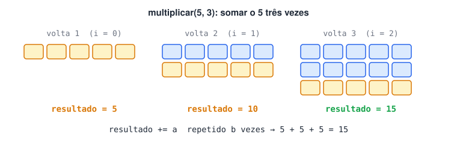
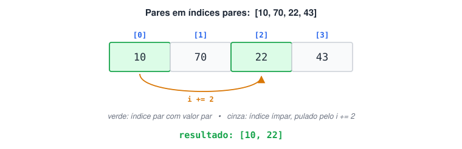
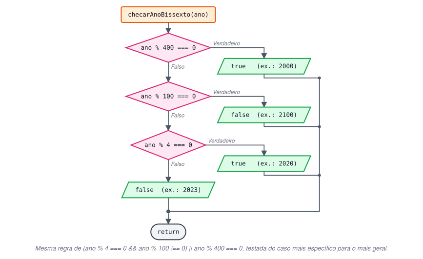
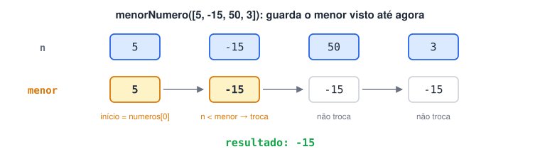
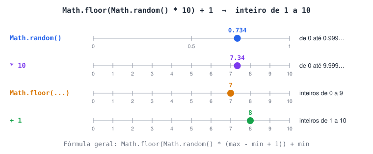

# Lista de exercícios finais

> 📌 Os enunciados pedem que as funções **retornem** o resultado. Por isso, nas respostas abaixo, cada função usa `return` e o `console.log` fica do lado de fora, na chamada. Os nomes das funções seguem os dos exemplos de cada enunciado, para que os testes possam ser copiados direto.

### 1 - Crie uma função que retorna a string "Olá, " concatenada com um argumento `texto` (a ser passado para a função) e com ponto de exclamação "!" no final.

Exemplos:

```
cumprimentar("Leonardo") // retornará "Olá, Leonardo!"
cumprimentar("Maria") // retornará "Olá, Maria!"
```

<details>
<summary>Ver resposta</summary>

```jsx
function cumprimentar(texto) {
  return `Olá, ${texto}!`;
}

console.log(cumprimentar("Leonardo")); // Olá, Leonardo!
console.log(cumprimentar("Maria"));  // Olá, Maria!
```

</details>

### 2 - Escreva uma função que receba a idade de uma pessoa em anos e retorne a mesma idade em dias.

```
Obs: considere que um ano tem 365 dias. Desconsidere anos bissextos (com 366 dias) e
desconsidere também dias decorridos desde o último aniversário.

Exemplos:
converterIdadeEmAnosParaDias(25) // retornará 9125
converterIdadeEmAnosParaDias(70) // retornará 25550
```

<details>
<summary>Ver resposta</summary>

```jsx
function converterIdadeEmAnosParaDias(idade) {
  return idade * 365;
}

console.log(converterIdadeEmAnosParaDias(25)); // 9125
console.log(converterIdadeEmAnosParaDias(70)); // 25550
```

</details>

### 3 - Desenvolva uma função que recebe dois parâmetros: a quantidade de horas trabalhadas por um funcionário num mês e o quanto ele recebe por hora. O retorno deve ser a string "Salário igual a R$ X", em que X é o quanto o funcionário ganhou no mês.

Exemplos:

```
calcularSalario(150, 40.5) // retornará "Salário igual a R$ 6075"
```

<details>
<summary>Ver resposta</summary>

```jsx
function calcularSalario(horasTrabalhadas, valorHora) {
  const salario = horasTrabalhadas * valorHora;
  return `Salário igual a R$ ${salario}`;
}

console.log(calcularSalario(150, 40.5)); // Salário igual a R$ 6075
```

</details>

### 4 - Crie uma função que recebe um número (de 1 a 12) e retorne o mês correspondente como string. Por exemplo, se a entrada for 2, a função deverá retornar "fevereiro", pois este é o 2° mês.

Exemplos:

```
nomeDoMes(1) // retornará "janeiro"
nomeDoMes(4) // retornará "abril"
```

<details>
<summary>Ver resposta</summary>

**Solução 1: **`switch` (a abordagem da seção de estruturas de controle)

```jsx
function nomeDoMes(numero) {
  switch (numero) {
    case 1:  return "janeiro";
    case 2:  return "fevereiro";
    case 3:  return "março";
    case 4:  return "abril";
    case 5:  return "maio";
    case 6:  return "junho";
    case 7:  return "julho";
    case 8:  return "agosto";
    case 9:  return "setembro";
    case 10: return "outubro";
    case 11: return "novembro";
    case 12: return "dezembro";
    default: return "Mês inválido! Informe um número de 1 a 12.";
  }
}

console.log(nomeDoMes(1));  // janeiro
console.log(nomeDoMes(4));  // abril
console.log(nomeDoMes(13)); // Mês inválido! ...
```

**Solução 2: array** (mais curta)

```jsx
function nomeDoMes(numero) {
  const meses = ["janeiro", "fevereiro", "março", "abril", "maio", "junho",
                 "julho", "agosto", "setembro", "outubro", "novembro", "dezembro"];

  if (numero < 1 || numero > 12) {
    return "Mês inválido! Informe um número de 1 a 12.";
  }
  return meses[numero - 1]; // mês 1 está no índice 0
}

console.log(nomeDoMes(4)); // abril
```

Na solução 2, o número do mês vira índice. Como arrays começam em 0, é preciso subtrair 1.

</details>

### 5 - Crie uma função que receba dois números e retorne qual é o maior, ou se são iguais.

Exemplos:

```
maiorOuIgual(0, 0) // Os números são iguais
maiorOuIgual(3, 1) // A é maior que B
maiorOuIgual(2, 8) // B é maior que A
```

<details>
<summary>Ver resposta</summary>

```jsx
function maiorOuIgual(a, b) {
  if (a > b) {
    return "A é maior que B";
  } else if (a < b) {
    return "B é maior que A";
  } else {
    return "Os números são iguais";
  }
}

console.log(maiorOuIgual(0, 0)); // Os números são iguais
console.log(maiorOuIgual(3, 1)); // A é maior que B
console.log(maiorOuIgual(2, 8)); // B é maior que A
```

</details>

### 6 - Escreva uma função que receba um valor booleano ou numérico. Se for booleano, retorne o inverso (`false` → `true`). Se for numérico, retorne o número com sinal invertido (`1` → `-1`). Se não for de nenhum desses tipos, retorne "booleano ou número esperados, mas o parâmetro é do tipo ...".

Exemplos:

```
inverso(true) // retornará false
inverso("6") // retornará "booleano ou número esperados, mas o parâmetro é do tipo string"
inverso(-2000) // retornará 2000
inverso("programação") // retornará "booleano ou número esperados, mas o parâmetro é do tipo string"
```

<details>
<summary>Ver resposta</summary>

```jsx
function inverso(valor) {
  const tipo = typeof valor;

  if (tipo === "boolean") {
    return !valor;  // negação lógica
  } else if (tipo === "number") {
    return -valor;  // negação numérica (inverte o sinal)
  } else {
    return `booleano ou número esperados, mas o parâmetro é do tipo ${tipo}`;
  }
}

console.log(inverso(true));  // false
console.log(inverso("6"));  // booleano ou número esperados, mas o parâmetro é do tipo string
console.log(inverso(-2000));  // 2000
console.log(inverso("programação")); // booleano ou número esperados, mas o parâmetro é do tipo string
```

`"6"` é string (está entre aspas), mesmo contendo um dígito. Por isso `typeof` é o teste certo aqui.

</details>

### 7 - Crie uma função que receba três números (`minimo`, `maximo`, `numero`) e um booleano `inclusivo`, e retorne se `numero` está entre `minimo` e `maximo`. Quando `inclusivo` for `true`, considere também os extremos (igual ao mínimo ou ao máximo). Se `inclusivo` não for informado, seu valor padrão deve ser `false`.

Exemplos:

```
estaEntre(10, 100, 50) // retornará true
estaEntre(16, 100, 160) // retornará false
estaEntre(3, 150, 3) // retornará false
estaEntre(3, 150, 3, true) // retornará true
```

<details>
<summary>Ver resposta</summary>

```jsx
function estaEntre(minimo, maximo, numero, inclusivo = false) {
  if (inclusivo) {
    return numero >= minimo && numero <= maximo;
  }
  return numero > minimo && numero < maximo;
}

console.log(estaEntre(10, 100, 50));  // true
console.log(estaEntre(16, 100, 160));  // false
console.log(estaEntre(3, 150, 3));  // false → exclusivo, 3 não é > 3
console.log(estaEntre(3, 150, 3, true));  // true  → inclusivo, 3 >= 3
```

**Ordem dos parâmetros:** o enunciado original da lista cita `(numero, minimo, maximo)`, mas os exemplos só fazem sentido com `(minimo, maximo, numero)`. Por exemplo, em `estaEntre(10, 100, 50)` é o 50 que está entre 10 e 100. Por isso o enunciado acima foi ajustado.

`inclusivo = false` é um **parâmetro padrão**: vale `false` quando o 4º argumento não é passado.

</details>

### 8 - Desenvolva uma função que recebe dois números inteiros não negativos (maiores ou iguais a zero) e realize a multiplicação deles, sem usar o operador de multiplicação.



Exemplos:

```
multiplicar(5, 5) // retornará 25
multiplicar(0, 7) // retornará 0
```

<details>
<summary>Ver resposta</summary>

```jsx
function multiplicar(a, b) {
  if (a < 0 || b < 0) {
    return "Erro! Os números devem ser maiores ou iguais a zero.";
  }

  let resultado = 0;
  for (let i = 0; i < b; i++) {
    resultado += a; // soma "a" um total de "b" vezes
  }
  return resultado;
}

console.log(multiplicar(5, 5)); // 25
console.log(multiplicar(0, 7)); // 0
console.log(multiplicar(4, 0)); // 0 → o laço não executa nenhuma vez
```

**Ideia:** multiplicar é somar repetidamente. `5 × 3` = `5 + 5 + 5`.

</details>

### 9 - Escreva uma função que receba dois parâmetros: o elemento que vai se repetir e o número de repetições. Um array deve ser retornado.

Exemplos:

```
repetir("código", 2) // retornará ["código", "código"]
repetir(7, 3) // retornará [7, 7, 7]
```

<details>
<summary>Ver resposta</summary>

```jsx
function repetir(elemento, vezes) {
  const resultado = [];

  for (let i = 0; i < vezes; i++) {
    resultado.push(elemento);
  }
  return resultado;
}

console.log(repetir("código", 2)); // [ 'código', 'código' ]
console.log(repetir(7, 3));  // [ 7, 7, 7 ]
```

Alternativa em uma linha: `new Array(vezes).fill(elemento)` cria um array com `vezes` posições e preenche todas com o elemento.

</details>

### 10 - Elabore uma função que recebe um número e retorne uma string com o símbolo "+" na quantidade especificada.

Exemplos:

```
simboloMais(2) // retornará "++"
simboloMais(4) // retornará "++++"
```

<details>
<summary>Ver resposta</summary>

```jsx
// Com laço
function simboloMais(quantidade) {
  let resultado = "";
  for (let i = 0; i < quantidade; i++) {
    resultado += "+";
  }
  return resultado;
}

console.log(simboloMais(2)); // ++
console.log(simboloMais(4)); // ++++

// Com o método repeat das strings
const simboloMais2 = quantidade => "+".repeat(quantidade);
console.log(simboloMais2(4)); // ++++
```

</details>

### 11 - Crie uma função que receba um array e retorne o primeiro e o último elemento desse array como um novo array.

Exemplos:

```
receberPrimeiroEUltimoElemento([7, 14, "olá"]) // retornará [7, "olá"]
receberPrimeiroEUltimoElemento([-100, "aplicativo", 16]) // retornará [-100, 16]
```

<details>
<summary>Ver resposta</summary>

```jsx
function receberPrimeiroEUltimoElemento(array) {
  return [array[0], array[array.length - 1]];
}

const lista = [7, 14, "olá"];
console.log(receberPrimeiroEUltimoElemento(lista)); // [ 7, 'olá' ]
console.log(lista); // [ 7, 14, 'olá' ] → original intacto

console.log(receberPrimeiroEUltimoElemento([-100, "aplicativo", 16])); // [ -100, 16 ]
```

**Correção em relação à versão original:** `shift()` e `pop()` **removem** os elementos do array recebido. A função funcionava, mas estragava o array de quem a chamou (efeito colateral). Acessar por índice lê os valores sem modificar nada.

</details>

### 12 - Quando manipulamos os atributos de um objeto (adicionando, atualizando ou removendo), estamos modificando-o, mas ele continua sendo o mesmo objeto: sua referência de memória é a mesma.

Num projeto em que você trabalha, foi pedido que você refatore diversas funções para que façam cópias de objetos e manipulem os dados dessas cópias, a fim de evitar efeitos indesejados causados por referências a objetos. Escreva uma função que recebe um objeto como primeiro parâmetro e, como segundo, o nome de uma propriedade desse objeto. Retorne uma **cópia** do objeto sem a propriedade especificada.

Exemplos:

```
removerPropriedade({a: 1, b: 2}, "a") // retornará {b: 2}
removerPropriedade({
  id: 20,
  nome: "caneta",
  descricao: "Não preenchido"
}, "descricao") // retornará {id: 20, nome: "caneta"}

Para testar se o objeto retornado não é o mesmo que foi passado como parâmetro,
use Object.is(), por exemplo:
Object.is(removerPropriedade(objeto, "descricao"), objeto)
Retornará false se o objeto não for o mesmo.
```

<details>
<summary>Ver resposta</summary>

```jsx
function removerPropriedade(objeto, propriedade) {
  const copia = { ...objeto };  // ou Object.assign({}, objeto)
  delete copia[propriedade];  // colchetes: o nome da chave está numa variável
  return copia;
}

const produto = { id: 20, nome: "caneta", descricao: "Não preenchido" };
const semDescricao = removerPropriedade(produto, "descricao");

console.log(semDescricao); // { id: 20, nome: 'caneta' }
console.log(produto);  // { id: 20, nome: 'caneta', descricao: 'Não preenchido' } → intacto
console.log(Object.is(semDescricao, produto)); // false → são objetos diferentes

console.log(removerPropriedade({ a: 1, b: 2 }, "a")); // { b: 2 }
```

**Por que copiar primeiro?** Se fizéssemos `delete objeto[propriedade]` direto, o objeto original seria alterado, e qualquer outra parte do programa que o usa também veria a mudança.

</details>

### 13 - Crie uma função que receba um array de elementos e retorne um array somente com os números presentes nele.

Exemplos:

```
filtrarNumeros(["Javascript", 1, "3", "Web", 20]) // retornará [1, 20]
filtrarNumeros(["a", "c"]) // retornará []
```

<details>
<summary>Ver resposta</summary>

```jsx
// Com laço
function filtrarNumeros(array) {
  const numeros = [];
  for (const item of array) {
    if (typeof item === "number") {
      numeros.push(item);
    }
  }
  return numeros;
}

console.log(filtrarNumeros(["Javascript", 1, "3", "Web", 20])); // [ 1, 20 ]
console.log(filtrarNumeros(["a", "c"]));  // []

// Com filter
const filtrarNumeros2 = array => array.filter(item => typeof item === "number");
console.log(filtrarNumeros2(["Javascript", 1, "3", "Web", 20])); // [ 1, 20 ]
```

`"3"` não entra no resultado porque é uma string.

</details>

### 14 - Desenvolva uma função que recebe um objeto e retorne um array de arrays, em que cada elemento é um par `[chave, valor]` de um atributo do objeto.

Exemplos:

```
objetoParaArray({
  nome: "Maria",
  profissao: "Desenvolvedora de software"
}) // irá retornar [["nome", "Maria"], ["profissao", "Desenvolvedora de software"]]

objetoParaArray({
  codigo: 11111,
  preco: 12000
}) // irá retornar [["codigo", 11111], ["preco", 12000]]
```

<details>
<summary>Ver resposta</summary>

```jsx
// Com Object.keys + map
function objetoParaArray(objeto) {
  return Object.keys(objeto).map(chave => [chave, objeto[chave]]);
}

console.log(objetoParaArray({ nome: "Maria", profissao: "Desenvolvedora de software" }));
// [ [ 'nome', 'Maria' ], [ 'profissao', 'Desenvolvedora de software' ] ]

console.log(objetoParaArray({ codigo: 11111, preco: 12000 }));
// [ [ 'codigo', 11111 ], [ 'preco', 12000 ] ]

// O JavaScript já tem um método que faz exatamente isso:
console.log(Object.entries({ codigo: 11111, preco: 12000 }));
// [ [ 'codigo', 11111 ], [ 'preco', 12000 ] ]
```

**Como funciona:** `Object.keys` devolve `["nome", "profissao"]`. O `map` transforma cada chave em um par `[chave, valor]`, buscando o valor com colchetes.

</details>

### 15 - Elabore uma função que receba um array de números e retorne um array com os números que são pares e que estão em índices pares.



Exemplos:

```
Lembre-se: um número é par quando o resto da divisão dele por 2 é zero.

receberSomenteOsParesDeIndicesPares([1, 2, 3, 4]) // retornará []
receberSomenteOsParesDeIndicesPares([10, 70, 22, 43]) // retornará [10, 22]
```

<details>
<summary>Ver resposta</summary>

```jsx
function receberSomenteOsParesDeIndicesPares(numeros) {
  const resultado = [];

  for (let i = 0; i < numeros.length; i += 2) { // só índices pares: 0, 2, 4...
    if (numeros[i] % 2 === 0) {  // só valores pares
      resultado.push(numeros[i]);
    }
  }
  return resultado;
}

console.log(receberSomenteOsParesDeIndicesPares([1, 2, 3, 4]));  // []
console.log(receberSomenteOsParesDeIndicesPares([10, 70, 22, 43])); // [ 10, 22 ]

// Com filter (o callback recebe valor e índice)
const versaoFilter = numeros => numeros.filter((n, i) => i % 2 === 0 && n % 2 === 0);
console.log(versaoFilter([10, 70, 22, 43])); // [ 10, 22 ]
```

Pular de 2 em 2 (`i += 2`) já garante os índices pares, então só falta testar o valor.

</details>

### 16 - Para manter o calendário ajustado ao movimento de translação da Terra, foram criados os anos bissextos, com 366 dias em vez de 365.

Um ano é bissexto se for **múltiplo de 4**, mas **não** pode ser múltiplo de 100, **exceto** se também for múltiplo de 400. Desenvolva uma função que recebe um ano e retorna se ele é bissexto.



Exemplos:

```
checarAnoBissexto(2020) // retornará true
checarAnoBissexto(2100) // retornará false, pois é múltiplo de 100 e não é múltiplo de 400
```

<details>
<summary>Ver resposta</summary>

```jsx
function checarAnoBissexto(ano) {
  return (ano % 4 === 0 && ano % 100 !== 0) || ano % 400 === 0;
}

console.log(checarAnoBissexto(2020)); // true  → múltiplo de 4, não de 100
console.log(checarAnoBissexto(2100)); // false → múltiplo de 100, não de 400
console.log(checarAnoBissexto(2000)); // true  → múltiplo de 400
console.log(checarAnoBissexto(2023)); // false → não é múltiplo de 4
```

**Traduzindo a regra para lógica:**

- "múltiplo de 4 **e não** de 100" → `ano % 4 === 0 && ano % 100 !== 0`
- "**ou** múltiplo de 400" → `|| ano % 400 === 0`

**Correção em relação à versão original:** o teste de 400 estava no `else` do teste de 4. Mas todo múltiplo de 400 também é múltiplo de 4, então esse ramo nunca era alcançado: o ano 2000 era classificado como normal, quando é bissexto.

</details>

### 17 - Escreva uma função que receba um array de números e retorne a soma de todos eles.

Exemplos:

```
somarNumeros([10, 10, 10]) // retornará 30
somarNumeros([15, 15, 15, 15]) // retornará 60
```

<details>
<summary>Ver resposta</summary>

```jsx
// Com laço
function somarNumeros(numeros) {
  let soma = 0;
  for (const n of numeros) {
    soma += n;
  }
  return soma;
}

console.log(somarNumeros([10, 10, 10]));  // 30
console.log(somarNumeros([15, 15, 15, 15])); // 60

// Com reduce
const somarNumeros2 = numeros => numeros.reduce((acc, n) => acc + n, 0);
console.log(somarNumeros2([15, 15, 15, 15])); // 60
```

</details>

### 18 - Você está trabalhando em uma aplicação pessoal de controle de despesas. Na tela principal, é possível adicionar produtos ou serviços informando nome, categoria e preço. A funcionalidade em desenvolvimento é a de somar o total das despesas.

Crie uma função que receba um array de produtos e retorne o total das despesas.

Exemplos:

```
despesasTotais([
  {nome: "Jornal online", categoria: "Informação", preco: 89.99},
  {nome: "Cinema", categoria: "Entretenimento", preco: 150}
]) // retornará 239.99

despesasTotais([
  {nome: "Galaxy S20", categoria: "Eletrônicos", preco: 3599.99},
  {nome: "Macbook Pro", categoria: "Eletrônicos", preco: 30999.90}
]) // retornará 34599.89
```

<details>
<summary>Ver resposta</summary>

```jsx
function despesasTotais(produtos) {
  let total = 0;
  for (const produto of produtos) {
    total += produto.preco; // acessa a propriedade preco de cada objeto
  }
  return Math.round(total * 100) / 100; // arredonda para 2 casas
}

console.log(despesasTotais([
  { nome: "Jornal online", categoria: "Informação", preco: 89.99 },
  { nome: "Cinema", categoria: "Entretenimento", preco: 150 },
])); // 239.99

console.log(despesasTotais([
  { nome: "Galaxy S20", categoria: "Eletrônicos", preco: 3599.99 },
  { nome: "Macbook Pro", categoria: "Eletrônicos", preco: 30999.9 },
])); // 34599.89
```

**Por que arredondar?** Somas de decimais em JavaScript podem gerar pequenas imprecisões (`0.1 + 0.2` dá `0.30000000000000004`). Os dois exemplos do enunciado não são afetados, mas outros preços podem ser, e em valores de dinheiro isso aparece na tela. `Math.round(total * 100) / 100` arredonda para 2 casas e **mantém** o resultado como número (`toFixed` devolveria uma string).

Versão com `reduce`:

```jsx
const despesasTotais2 = produtos =>
  Math.round(produtos.reduce((acc, p) => acc + p.preco, 0) * 100) / 100;
```

</details>

### 19 - Numa aplicação web de investimento financeiro em que você trabalha, a equipe quer adicionar a funcionalidade de calcular a média de um conjunto de números informados pelo usuário.

Crie uma função que receba um array com uma quantidade indeterminada de números e retorne a média simples deles (a soma de todos dividida pela quantidade).

Exemplos:

```
calcularMedia([0, 10]) // retornará 5
calcularMedia([1, 2, 3, 4, 5]) // retornará 3
```

<details>
<summary>Ver resposta</summary>

```jsx
function calcularMedia(numeros) {
  if (numeros.length === 0) {
    return 0; // evita 0 / 0, que resultaria em NaN
  }

  let soma = 0;
  for (const n of numeros) {
    soma += n;
  }
  return soma / numeros.length;
}

console.log(calcularMedia([0, 10]));  // 5
console.log(calcularMedia([1, 2, 3, 4, 5])); // 3
console.log(calcularMedia([]));  // 0
```

</details>

### 20 - Faça uma função que recebe a base e a altura de um triângulo e retorne a área dele, com precisão de duas casas decimais (arredondando se necessário).

Obs: a fórmula da área do triângulo é (base × altura) / 2.

Exemplos:

```
areaDoTriangulo(10, 15) // retornará 75.00
areaDoTriangulo(7, 9) // retornará 31.50
areaDoTriangulo(9.25, 13.1) // retornará 60.59
```

<details>
<summary>Ver resposta</summary>

```jsx
function areaDoTriangulo(base, altura) {
  const area = (base * altura) / 2;
  return area.toFixed(2); // string com exatamente 2 casas decimais
}

console.log(areaDoTriangulo(10, 15));  // 75.00
console.log(areaDoTriangulo(7, 9));  // 31.50
console.log(areaDoTriangulo(9.25, 13.1)); // 60.59
```

`toFixed(2)` retorna uma **string** (`"75.00"`). É a única forma de manter os zeros à direita, como os exemplos pedem. Se precisar do valor como número para novas contas, use `Number(area.toFixed(2))` (mas aí `75.00` vira `75`).

</details>

### 21 - Crie uma função que receba um array de números e retorne o menor deles.



Exemplos:

```
menorNumero([10, 5, 35, 65]) // retornará 5
menorNumero([5, -15, 50, 3]) // retornará -15
```

<details>
<summary>Ver resposta</summary>

```jsx
function menorNumero(numeros) {
  let menor = numeros[0]; // começa supondo que o primeiro é o menor

  for (const n of numeros) {
    if (n < menor) {
      menor = n; // encontrou um menor: atualiza
    }
  }
  return menor;
}

console.log(menorNumero([10, 5, 35, 65]));  // 5
console.log(menorNumero([5, -15, 50, 3]));  // -15

// Alternativa: Math.min com spread
console.log(Math.min(...[5, -15, 50, 3]));  // -15
```

**Por que começar com **`numeros[0]`** e não com **`0`**?** Se começasse com 0, um array só de positivos (`[10, 5]`) retornaria 0, que nem está no array.

</details>

### 22 - Desenvolva uma função que receba um número de 1 a 10. Internamente, ela sorteia um número aleatório de 1 a 10. Se o número informado for igual ao sorteado, retorne "Parabéns! O número sorteado foi o X". Caso contrário, retorne "Que pena! O número sorteado foi o X", em que X é o número sorteado.



Exemplos:

```
funcaoDaSorte(10) // retornará "Parabéns! O número sorteado foi o 10"
funcaoDaSorte(5) // retornará "Que pena! O número sorteado foi o 3"
funcaoDaSorte(5) // retornará "Que pena! O número sorteado foi o 1"
```

<details>
<summary>Ver resposta</summary>

```jsx
function funcaoDaSorte(numero) {
  if (numero < 1 || numero > 10) {
    return "Erro! Escolha um número de 1 a 10.";
  }

  const sorteado = Math.floor(Math.random() * 10) + 1;

  if (numero === sorteado) {
    return `Parabéns! O número sorteado foi o ${sorteado}`;
  }
  return `Que pena! O número sorteado foi o ${sorteado}`;
}

console.log(funcaoDaSorte(5)); // resultado varia a cada execução
```

**Gerando um inteiro de 1 a 10, passo a passo:**

1. `Math.random()` → decimal de 0 (incluso) até 1 (não incluso), ex.: `0.734`.
2. `* 10` → de 0 até 9.999…, ex.: `7.34`.
3. `Math.floor(...)` → arredonda para baixo: inteiro de 0 a 9, ex.: `7`.
4. `+ 1` → desloca para 1 a 10, ex.: `8`.

Fórmula geral para um intervalo: `Math.floor(Math.random() * (max - min + 1)) + min`.

</details>

### 23 - Crie uma função que receba uma string e conte quantas palavras ela tem. Considere que as palavras são separadas por um único espaço.

Exemplos:

```
contarPalavras("Sou uma frase") // retornará 3
contarPalavras("Me divirto aprendendo a programar") // retornará 5
```

<details>
<summary>Ver resposta</summary>

```jsx
function contarPalavras(frase) {
  return frase.split(" ").length;
}

console.log(contarPalavras("Sou uma frase"));  // 3
console.log(contarPalavras("Me divirto aprendendo a programar")); // 5
```

`split(" ")` quebra a string em um array, usando o espaço como separador: `["Sou", "uma", "frase"]`. O tamanho desse array é a quantidade de palavras.

</details>

### 24 - Desenvolva uma função que recebe um caractere e uma string e retorne quantas vezes o caractere aparece na string. A função deve ser *case-sensitive* (diferenciar maiúsculas de minúsculas).

Exemplos:

```
contarCaractere("r", "A sorte favorece os audazes") // retornará 2
contarCaractere("c", "Conhece-te a ti mesmo") // retornará 1
```

<details>
<summary>Ver resposta</summary>

```jsx
function contarCaractere(caractere, texto) {
  let contador = 0;

  for (const letra of texto) { // for...of também percorre strings, letra por letra
    if (letra === caractere) {
      contador++;
    }
  }
  return contador;
}

console.log(contarCaractere("r", "A sorte favorece os audazes")); // 2
console.log(contarCaractere("c", "Conhece-te a ti mesmo"));  // 1 → o "C" maiúsculo não conta
```

A comparação com `===` já é case-sensitive: `"c" === "C"` é `false`.

</details>

### 25 - Para criar um mecanismo de busca na sua aplicação, você precisa começar com uma função que identifique palavras semelhantes.

Escreva uma função que recebe como primeiro parâmetro uma palavra e, como segundo, um array de strings. A função deve retornar as palavras do array que **contêm** a string do primeiro parâmetro.

Exemplos:

```
buscarPalavrasSemelhantes("pro", ["programação", "mobile", "profissional"]) // retornará ["programação", "profissional"]
buscarPalavrasSemelhantes("python", ["javascript", "java", "c++"]) // retornará []
```

<details>
<summary>Ver resposta</summary>

```jsx
function buscarPalavrasSemelhantes(termo, palavras) {
  const encontradas = [];

  for (const palavra of palavras) {
    if (palavra.includes(termo)) {
      encontradas.push(palavra);
    }
  }
  return encontradas;
}

console.log(buscarPalavrasSemelhantes("pro", ["programação", "mobile", "profissional"]));
// [ 'programação', 'profissional' ]

console.log(buscarPalavrasSemelhantes("python", ["javascript", "java", "c++"]));
// []

// Com filter
const buscar2 = (termo, palavras) => palavras.filter(p => p.includes(termo));
```

`includes` verifica se o termo aparece **em qualquer parte** da palavra. Para buscar só no início, use `startsWith`.

</details>

### 26 - Desenvolva uma função que receba uma string e a retorne sem as vogais.

Exemplos:

```
removerVogais("Cod3r") // retornará "Cd3r"
removerVogais("Fundamentos") // retornará "Fndmnts"
```

<details>
<summary>Ver resposta</summary>

```jsx
// Com laço
function removerVogais(texto) {
  const vogais = "aeiouAEIOUáéíóúâêôãõàÁÉÍÓÚÂÊÔÃÕÀ";
  let resultado = "";

  for (const letra of texto) {
    if (!vogais.includes(letra)) { // mantém só o que NÃO é vogal
      resultado += letra;
    }
  }
  return resultado;
}

console.log(removerVogais("Cod3r"));  // Cd3r
console.log(removerVogais("Fundamentos"));  // Fndmnts
console.log(removerVogais("Rio de Janeiro")); // R d Jnr
```

**Correção em relação à versão original:** `string.replace("a", "")` remove **só a primeira** ocorrência. Em "Rio de Janeiro", o primeiro `e` sumia, mas o segundo ficava. Percorrer letra por letra resolve. Outra opção é `replaceAll`:

```jsx
function removerVogais2(texto) {
  const vogais = ["a", "e", "i", "o", "u", "A", "E", "I", "O", "U"];
  let resultado = texto;
  for (const vogal of vogais) {
    resultado = resultado.replaceAll(vogal, ""); // remove TODAS as ocorrências
  }
  return resultado;
}

console.log(removerVogais2("Rio de Janeiro")); // R d Jnr
```

</details>

### 27 - Desenvolva uma função que recebe um objeto e retorne outro objeto com as chaves e os valores invertidos, conforme o exemplo:

Exemplos:

```
inverter({ a: 1, b: 2, c: 3 }) // retornará { 1: "a", 2: "b", 3: "c" }
```

<details>
<summary>Ver resposta</summary>

```jsx
function inverter(objeto) {
  const invertido = {};

  for (const chave in objeto) {
    const valor = objeto[chave];
    invertido[valor] = chave; // o valor vira chave, a chave vira valor
  }
  return invertido;
}

console.log(inverter({ a: 1, b: 2, c: 3 }));
// { '1': 'a', '2': 'b', '3': 'c' }

console.log(inverter({ nome: "João", cidade: "Recife" }));
// { 'João': 'nome', Recife: 'cidade' }
```

**Observações**

- Chaves de objeto são sempre strings. Por isso o `1` aparece como `'1'` no resultado.
- Se dois atributos tiverem o mesmo valor, o último sobrescreve o anterior na inversão (uma chave não pode se repetir).

</details>

### 28 - Elabore uma função que recebe um array de números e uma quantidade de dígitos, e retorne somente os números do array que têm essa quantidade de dígitos.

Exemplos:

```
filtrarPorQuantidadeDeDigitos([38, 2, 365, 10, 125, 11], 2) // retornará [38, 10, 11]
filtrarPorQuantidadeDeDigitos([5, 9, 1, 125, 11], 1) // retornará [5, 9, 1]
```

<details>
<summary>Ver resposta</summary>

```jsx
function filtrarPorQuantidadeDeDigitos(numeros, quantidade) {
  const resultado = [];

  for (const n of numeros) {
    const digitos = String(Math.abs(n)).length; // converte para string e conta os caracteres
    if (digitos === quantidade) {
      resultado.push(n);
    }
  }
  return resultado;
}

console.log(filtrarPorQuantidadeDeDigitos([38, 2, 365, 10, 125, 11], 2)); // [ 38, 10, 11 ]
console.log(filtrarPorQuantidadeDeDigitos([5, 9, 1, 125, 11], 1));  // [ 5, 9, 1 ]
```

**Truque:** converter o número para string (`String(365)` → `"365"`) permite usar `.length` para contar os dígitos. `Math.abs` remove o sinal de números negativos, para que o `-` não seja contado como dígito.

</details>

### 29 - Crie uma função que recebe um array de números e retorna o segundo maior número presente nele.

Exemplos:

```
segundoMaior([12, 16, 1, 5]) // retornará 12
segundoMaior([8, 4, 5, 6]) // retornará 6
```

<details>
<summary>Ver resposta</summary>

**Solução 1: ordenar uma cópia**

```jsx
function segundoMaior(numeros) {
  const ordenado = [...numeros].sort((a, b) => b - a); // copia e ordena do maior para o menor
  return ordenado[1];
}

console.log(segundoMaior([12, 16, 1, 5])); // 12
console.log(segundoMaior([8, 4, 5, 6]));  // 6
```

- `[...numeros]` cria uma cópia, porque `sort` **altera** o array em que é chamado.
- `sort` sem argumento ordena como **texto** (`[10, 9, 1]` vira `[1, 10, 9]`). A função `(a, b) => b - a` faz a ordenação numérica decrescente.

**Solução 2: uma passada só, guardando os dois maiores**

```jsx
function segundoMaior2(numeros) {
  let maior = -Infinity;
  let segundo = -Infinity;

  for (const n of numeros) {
    if (n > maior) {
      segundo = maior; // o antigo maior passa a ser o segundo
      maior = n;
    } else if (n > segundo && n !== maior) {
      segundo = n;
    }
  }
  return segundo;
}

console.log(segundoMaior2([12, 16, 1, 5])); // 12
console.log(segundoMaior2([16, 16, 5]));  // 5 → ignora valores repetidos do maior
```

`-Infinity` é menor que qualquer número, por isso é um bom valor inicial. Note a diferença com repetidos: para `[16, 16, 5]`, a solução 1 retorna `16` (segundo **elemento**) e a solução 2 retorna `5` (segundo **valor distinto**).

**Correção em relação à versão original:** ela usava `splice` no array recebido e removia o maior número do array de quem chamou a função.

</details>

### 30 - Elabore uma função que recebe um objeto com estudantes e suas notas (as notas de cada estudante estão num array). Calcule a média de cada aluno e retorne um objeto com os atributos `nome` e `media` do aluno com o melhor desempenho.

Exemplos:

```
receberMelhorEstudante({
  Joao: [8, 7.6, 8.9, 6], // média 7.625
  Mariana: [9, 6.6, 7.9, 8], // média 7.875
  Carla: [7, 7, 8, 9] // média 7.75
}) // retornará { nome: "Mariana", media: 7.875 }
```

<details>
<summary>Ver resposta</summary>

```jsx
const soma = array => array.reduce((acumulador, atual) => acumulador + atual, 0);
const media = array => soma(array) / array.length;

function receberMelhorEstudante(estudantes) {
  let melhor = { nome: "", media: -Infinity };

  for (const [nome, notas] of Object.entries(estudantes)) {
    const mediaAluno = media(notas);
    if (mediaAluno > melhor.media) {
      melhor = { nome, media: mediaAluno };
    }
  }
  return melhor;
}

console.log(receberMelhorEstudante({
  Joao: [8, 7.6, 8.9, 6],
  Mariana: [9, 6.6, 7.9, 8],
  Carla: [7, 7, 8, 9],
}));
// { nome: 'Mariana', media: 7.875 }
```

**Passo a passo**

1. `Object.entries(estudantes)` transforma o objeto em pares: `[["Joao", [8, 7.6, ...]], ["Mariana", [...]], ...]`.
2. `for (const [nome, notas] of ...)` usa **desestruturação**: separa cada par em duas variáveis.
3. Para cada aluno, calcula a média e compara com a melhor até agora. Se for maior, substitui.

Alternativa do gabarito, com `map` + `sort`:

```jsx
function receberMelhorEstudante2(estudantes) {
  const comMedias = Object.entries(estudantes).map(([nome, notas]) => ({
    nome,
    media: media(notas),
  }));

  comMedias.sort((a, b) => b.media - a.media); // maior média primeiro
  return comMedias[0];
}
```

</details>
