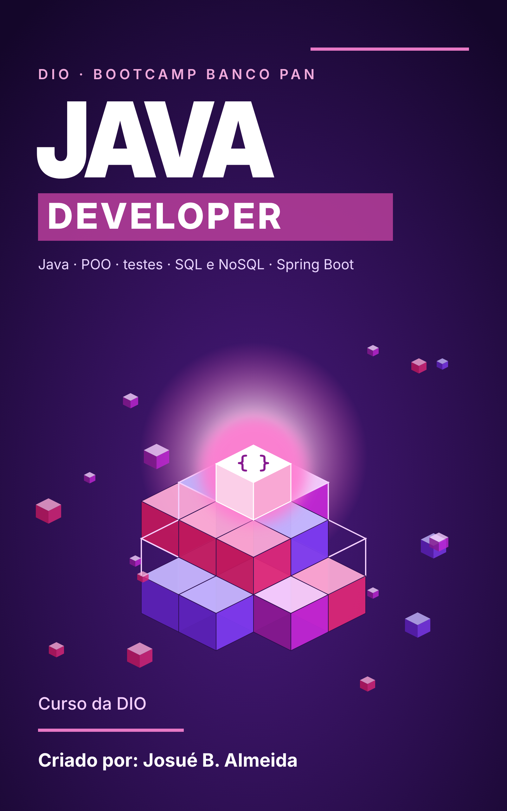

# Dio: Banco Pan - Java developer

📥 **[Baixar o EPUB](https://github.com/Joshpcbrrj/biblioteca-de-estudos/releases/download/epubs/dio-banco-pan-java.epub)**

Bootcamp de desenvolvimento back-end Java: Git e métodos ágeis, a linguagem Java, orientação a objetos, testes, bancos SQL e NoSQL e APIs REST com Spring Boot, segurança e JPA, com desafios de código entre as seções. Nos desafios, as respostas ficam recolhidas em **Ver resposta**.

- [Sobre o curso](aulas/00-sobre-o-curso.md)

## 🧭 1. Princípios de desenvolvimento de software

- [Introdução ao Git](aulas/01-introducao-ao-git.md)
- [Git: branches, repositórios remotos e pull requests (Adicionado pelo aluno para melhorar o estudo)](aulas/02-git-branches-repositorios-remotos-e-pull.md)
- [Trabalho com equipes ágeis](aulas/03-trabalho-com-equipes-ageis.md)

## ☕ 2. Conhecendo a linguagem Java

- [Dominando IDE’s Java](aulas/04-dominando-ides-java.md)
- [Aprendendo a sintaxe Java](aulas/05-aprendendo-a-sintaxe-java.md)
- [Lógica condicional e controle de fluxos em Java](aulas/06-logica-condicional-e-controle-de-fluxos-em-java.md)
- [Estruturas de repetição e arrays em Java](aulas/07-estruturas-de-repeticao-e-arrays-em-java.md)
- [Estrutura de dados em Java](aulas/08-estrutura-de-dados-em-java.md)
- [Métodos em Java](aulas/09-metodos-em-java.md)
- [Strings e StringBuilder (Adicionado pelo aluno para melhorar o estudo)](aulas/10-strings-e-stringbuilder.md)
- [Dinheiro e datas: BigDecimal e java.time (Adicionado pelo aluno para melhorar o estudo)](aulas/11-dinheiro-e-datas-bigdecimal-e-java-time.md)

## 🧩 3. Desafios de algoritmos básicos

- [Desafio: Fábrica de carros](aulas/12-desafio-fabrica-de-carros.md)
- [Desafio: Imprimindo positivos e média](aulas/13-desafio-imprimindo-positivos-e-media.md)
- [Desafio: Soma de H com N termos](aulas/14-desafio-soma-de-h-com-n-termos.md)
- [Desafio: Dragão](aulas/15-desafio-dragao.md)
- [Desafio: Fibonacci (fácil, não tão fácil quanto disseram)](aulas/16-desafio-fibonacci-facil-nao-tao-facil-quanto.md)

## 🧱 4. Programação orientada a objetos

- [Programação orientada a objetos com Java](aulas/17-programacao-orientada-a-objetos-com-java.md)
- [SOLID e código limpo (Adicionado pelo aluno para melhorar o estudo)](aulas/18-solid-e-codigo-limpo.md)
- [Collections](aulas/19-collections.md)
- [Debugging](aulas/20-debugging.md)
- [Tratamento de exceções em Java](aulas/21-tratamento-de-excecoes-em-java.md)
- [Gerenciamento de dependências e build em java com Maven](aulas/22-gerenciamento-de-dependencias-e-build-em-java.md)
- [Testes unitários com JUnit](aulas/23-testes-unitarios-com-junit.md)
- [Testes com Mockito (Adicionado pelo aluno para melhorar o estudo)](aulas/24-testes-com-mockito.md)
- [Desafio POO](aulas/25-desafio-poo.md)

## 🗄️ 5. Bancos de dados SQL e NoSQL

- [Primeiros passos com SQL](aulas/26-primeiros-passos-com-sql.md)
- [Consultas SQL: SELECT, JOIN e agrupamentos (Adicionado pelo aluno para melhorar o estudo)](aulas/27-consultas-sql-select-join-e-agrupamentos.md)
- [Introdução ao MongoDB (Banco de dados NoSQL)](aulas/28-introducao-ao-mongodb-banco-de-dados-nosql.md)
- [Desafio: Boas práticas DynamoDB](aulas/29-desafio-boas-praticas-dynamodb.md)

## 🌱 6. Produtividade com Spring Framework

- [Principais protocolos de comunicação da internet](aulas/30-principais-protocolos-de-comunicacao-da-internet.md)
- [Imersão no Spring Framework com Spring Boot](aulas/31-imersao-no-spring-framework-com-spring-boot.md)
- [Criando API REST documentada com Spring Web e Swagger](aulas/32-criando-api-rest-documentada-com-spring-web-e.md)
- [Validação de dados com Bean Validation (Adicionado pelo aluno para melhorar o estudo)](aulas/33-validacao-de-dados-com-bean-validation.md)
- [Adicionando segurança a uma API REST com Spring](aulas/34-adicionando-seguranca-a-uma-api-rest-com-spring.md)
- [Spring Data JPA: repositórios, consultas e transações (Adicionado pelo aluno para melhorar o estudo)](aulas/35-spring-data-jpa-repositorios-consultas-e.md)
- [Criando API REST conectada ao Amazon RDS com Java](aulas/36-criando-api-rest-conectada-ao-amazon-rds-com.md)
- [Projeto: Conhecendo o Spring Data JPA na prática com Java](aulas/37-projeto-conhecendo-o-spring-data-jpa-na-pratica.md)
- [Explorando Padrões de Projetos na Prática com Java](aulas/38-explorando-padroes-de-projetos-na-pratica-com.md)

## 🏆 7. Desafios de algoritmos intermediários

- [Desafio animal](aulas/39-desafio-animal.md)
- [Desafio quitanda do seu Zé](aulas/40-desafio-quitanda-do-seu-ze.md)
- [Desafio triângulo](aulas/41-desafio-triangulo.md)
- [Desafio conta espaços e vogais](aulas/42-desafio-conta-espacos-e-vogais.md)
- [Desafio taxa de Imposto de Renda](aulas/43-desafio-taxa-de-imposto-de-renda.md)
