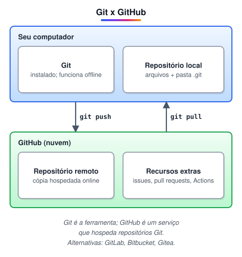
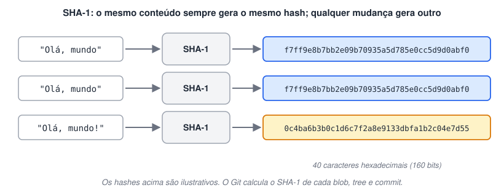
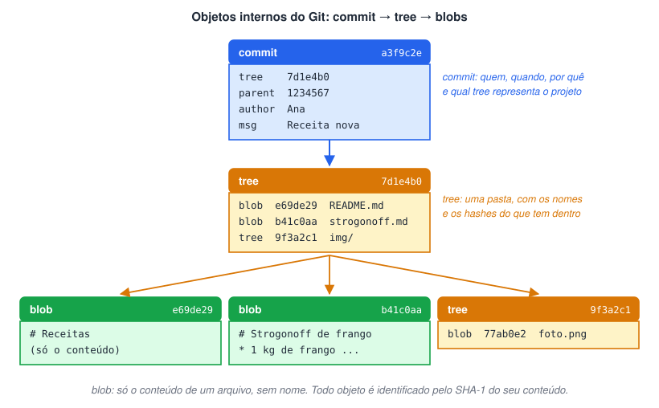
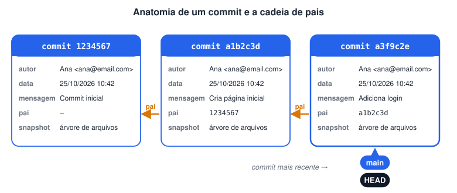
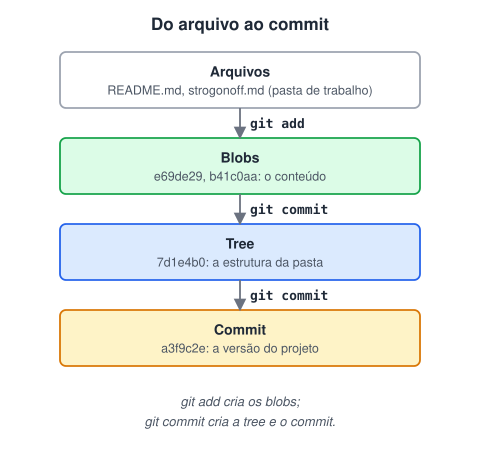
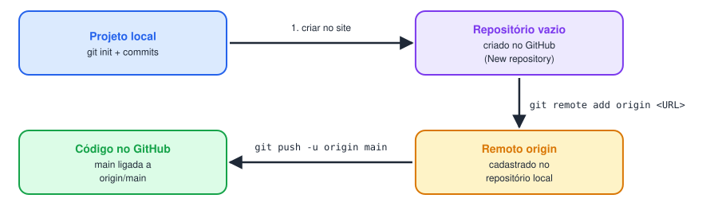
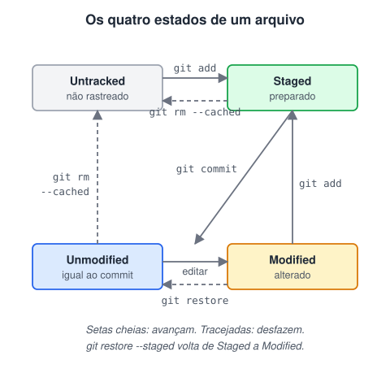
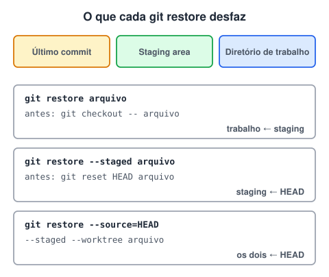
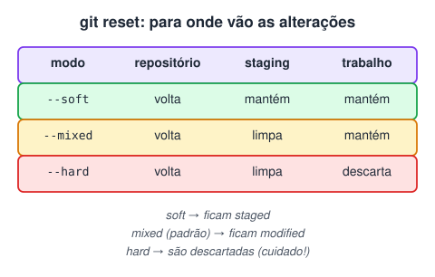
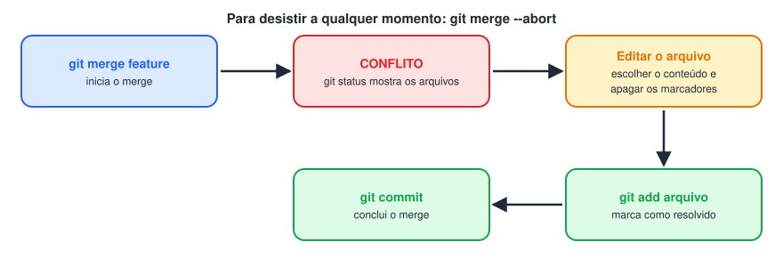

# Introdução ao Git

> 🗺️ **Nesta aula:** o que é o Git e por que ele mudou o controle de versão, como ele guarda o histórico por dentro, os primeiros comandos (configurar, iniciar, adicionar, commitar) e como desfazer alterações e resolver conflitos.

## Git: Revolução no Controle de Versão

### História do Git

O Git foi criado em 2005 por **Linus Torvalds**, o criador do kernel Linux. O projeto Linux era enorme e tinha milhares de colaboradores, e as ferramentas de controle de versão da época não davam conta: eram lentas ou dependiam de um servidor central. Linus então criou a própria ferramenta, com três objetivos:

- **velocidade**, mesmo em projetos com milhões de linhas;
- **ser distribuído**: cada desenvolvedor tem uma cópia completa do repositório, com todo o histórico;
- **integridade**: nenhuma alteração passa despercebida.

### Vantagens do Git

1. **Desempenho**: operações como commit, diff e troca de branch são quase instantâneas, porque acontecem localmente.
2. **Sistema distribuído**: dá para trabalhar offline e sincronizar depois. Se o servidor cair, qualquer cópia local tem o histórico inteiro.
3. **Branches baratas**: criar, mesclar e apagar ramificações é rápido, o que permite desenvolver várias funcionalidades em paralelo.
4. **Histórico completo e rastreável**: cada alteração registra quem fez, quando e por quê, o que ajuda a encontrar a origem de bugs.

### GitHub

O GitHub, lançado em 2008, é uma plataforma que **hospeda repositórios Git** na nuvem e acrescenta recursos de colaboração: repositórios públicos e privados, pull requests, issues, integração contínua (GitHub Actions) e páginas de projeto. Hoje é a maior comunidade de código aberto do mundo.

### Git x GitHub



| Git | GitHub |
| --- | --- |
| Programa instalado no computador | Serviço online |
| Controla as versões do projeto | Hospeda repositórios Git e permite colaborar |
| Funciona sem internet | Precisa de internet |
| Ferramenta de linha de comando | Interface web com recursos extras (PRs, issues, Actions) |

Existem alternativas ao GitHub que também usam Git, como GitLab e Bitbucket.

### Conclusão

O Git trouxe um controle de versão distribuído, rápido e flexível, que funciona bem tanto num projeto pessoal quanto num projeto com milhares de pessoas. O GitHub complementa o Git com uma plataforma para compartilhar código e colaborar. Juntos, são ferramentas essenciais no desenvolvimento de software atual.

## Como o Git funciona

### SHA-1: a identidade de cada objeto

O **SHA-1** (*Secure Hash Algorithm 1*) é uma função de hash criada pela NSA, a agência de segurança dos EUA. Ela recebe qualquer conteúdo e gera um identificador de **40 caracteres hexadecimais**, com duas propriedades importantes:

- o mesmo conteúdo gera **sempre o mesmo hash**;
- qualquer alteração, por menor que seja, gera um hash **completamente diferente**.



O Git usa o SHA-1 para identificar tudo o que guarda: cada arquivo, pasta e commit tem seu hash. É por isso que cada commit aparece com um código como `a3f9c2e…` (as primeiras letras do hash), que pode ser usado em comandos como `git checkout`, `git revert` e `git reset`. Como o hash depende do conteúdo, o Git percebe na hora se algo foi alterado ou corrompido.

> ⚠️ O SHA-1 é considerado inseguro para criptografia desde 2005, e por isso não deve ser usado para proteger senhas ou dados sensíveis. No Git ele serve para **identificar** conteúdos e garantir integridade. As versões mais novas do Git já suportam o SHA-256.

#### Testando no terminal

```bash
# No Git Bash, dentro da pasta do arquivo:
openssl sha1 nome_do_arquivo.txt

# O terminal mostra o hash do arquivo.
# Altere uma letra do arquivo e rode de novo: o hash muda completamente.
```

### Objetos internos do Git

Dentro da pasta oculta `.git`, o Git guarda o projeto como três tipos de objeto, cada um identificado pelo seu SHA-1:

- **Blob**: o **conteúdo** de um arquivo. Não guarda nome, pasta nem histórico, só os dados. Dois arquivos com conteúdo idêntico viram um único blob.
- **Tree**: uma **pasta**. Lista os nomes dos arquivos e subpastas, cada um apontando para o hash do blob ou da tree correspondente.
- **Commit**: uma **versão** do projeto. Aponta para a tree principal e guarda autor, data, mensagem e o hash do commit anterior (o pai).



Como cada commit aponta para o seu pai, os commits formam uma cadeia, que é o histórico do projeto:



### O fluxo completo

1. Ao fazer `git add`, o Git cria um **blob** para o conteúdo de cada arquivo adicionado.
2. Ao fazer `git commit`, ele monta as **trees** com a estrutura das pastas e cria o **commit**, que aponta para a tree principal.

O resultado é um histórico completo e verificável: os blobs guardam os dados, as trees organizam os blobs em pastas e os commits registram cada versão.



## Iniciando Git e criando commit

### Links úteis

Documentação oficial do Git:

🔗 [Git - git Documentation](https://git-scm.com/docs/git)

Download do Git:

🔗 [GitHub Desktop](https://git-scm.com/downloads)

GitHub Desktop (interface gráfica, opcional):

🔗 [https://desktop.github.com/](https://desktop.github.com/)

### Configuração inicial

Depois de instalar, informe seu nome e e-mail. Eles aparecem em todos os commits que você fizer. A opção `--global` vale para todos os repositórios do computador.

```bash
# Nome e e-mail do autor dos commits
git config --global user.name "Seu Nome"
git config --global user.email "seu@email.com"

# Conferir as configurações
git config --list

# Apagar uma configuração (para definir de novo depois)
git config --global --unset user.email
```

### Ajuda no terminal

```bash
# Manual completo do Git
man git

# Resumo dos comandos mais usados
git help

# Ajuda de um comando específico
git help commit
```

### Iniciando um repositório

```bash
# Transforma a pasta atual num repositório Git (cria a pasta oculta .git)
git init

# Lista também os arquivos ocultos, para ver a pasta .git
ls -a

# Renomeia a branch atual para main
git branch -M main

# Lista as branches do repositório
git branch
```

> 💡 Logo depois do `git init`, o `git branch` ainda não mostra nada: a branch só passa a existir de fato depois do primeiro commit. O `git branch -M main` garante que ela se chame `main`, o padrão do GitHub.

### Exemplo: versionando uma receita

#### Criando o arquivo

```bash
# Markdown (.md) é um formato de texto simples que vira HTML formatado
touch strogonoff.md
```

Conteúdo do arquivo:

```markdown
# Strogonoff de frango :chicken:

### Ingredientes
* 1 kg de frango sem pele
* 1 tablete de caldo de galinha
* 3 colheres (sopa) de óleo
* 2 latas de creme de leite sem soro
* 2 colheres (sopa) de molho de tomate
* 2 colheres (sopa) de ketchup
* 2 colheres (sopa) de mostarda
* Champignon a gosto
* Batata palha e arroz branco para acompanhar

### Modo de preparo
1. Em uma panela em fogo médio, coloque o óleo e dissolva o caldo de galinha.
   Junte o frango em cubos e deixe cozinhar, mexendo para não queimar.
2. Com o frango cozido, acrescente o molho de tomate, o ketchup,
   a mostarda e o champignon.
3. Abaixe o fogo, junte o creme de leite e mexa até a mistura ficar homogênea.
4. Está pronto para servir.

> Receitinha testada e aprovada!
```

#### 1. Adicionar à staging area

```bash
# Um arquivo específico
git add strogonoff.md

# Ou todos os arquivos novos e modificados
git add .
```

#### 2. Fazer o commit

```bash
# A mensagem resume o que foi feito
git commit -m "Adiciona receita de strogonoff"
```

#### 3. Ligar ao repositório remoto do GitHub

Crie um repositório vazio no GitHub e copie a URL dele.

```bash
# "origin" é o apelido padrão do repositório remoto
git remote add origin https://github.com/usuario/receitas.git

# Confere se o remoto foi cadastrado
git remote -v
```

#### 4. Enviar o código

```bash
# Envia a branch main para o remoto origin
# O -u liga as duas: depois disso basta "git push"
git push -u origin main
```



## Entendendo alguns pontos importantes

### Ciclo de vida dos arquivos

Todo arquivo de um repositório está em um destes quatro estados:

1. **Untracked** (não rastreado): o Git ainda não acompanha o arquivo. Ele não entra em commits nem tem histórico.
2. **Unmodified** (não modificado): o arquivo é rastreado e está igual ao último commit.
3. **Modified** (modificado): o arquivo mudou desde o último commit, mas as mudanças ainda não foram preparadas.
4. **Staged** (preparado): as mudanças foram adicionadas com `git add` e vão entrar no próximo commit.



Para ver em que estado cada arquivo está:

```bash
# Mostra arquivos não rastreados, modificados e preparados,
# e sugere o próximo comando
git status
```

### Desfazendo alterações: git restore

O `git restore` devolve arquivos a um estado anterior: descarta mudanças no diretório de trabalho ou tira arquivos da staging area.

```bash
# Descarta as mudanças não preparadas (volta à versão do último commit)
git restore arquivo

# Tira o arquivo da staging area (as mudanças continuam no arquivo)
git restore --staged arquivo

# Restaura o arquivo como estava num commit específico
git restore --source=<hash-do-commit> arquivo
```



> ⚠️ `git restore arquivo` apaga as mudanças não salvas em commit, e elas não podem ser recuperadas pelo Git.

### Desfazendo commits: git reset

O `git reset` move a branch atual de volta para um commit anterior, "desfazendo" os commits que vieram depois. O que acontece com as alterações desses commits depende do modo:

```bash
# Desfaz o commit; as alterações voltam para a staging area
git reset --soft <commit>

# Desfaz o commit; as alterações ficam no diretório de trabalho (modo padrão)
git reset --mixed <commit>

# Desfaz o commit e DESCARTA as alterações
git reset --hard <commit>

# Exemplo: desfaz só o último commit, mantendo o trabalho
git reset --soft HEAD~1
```



> ⚠️ O `git reset` reescreve o histórico. Não use em commits que já foram enviados e compartilhados com a equipe: para desfazer um commit público, prefira `git revert`, que cria um novo commit desfazendo o anterior. E cuidado com o `--hard`: as alterações descartadas não voltam.

### Resolvendo conflitos

Um conflito acontece quando o Git tenta juntar duas versões de um arquivo (num merge ou pull) e as duas alteraram **o mesmo trecho** de formas diferentes. Ele não sabe qual escolher e pede ajuda.

1. **Identifique**: o `git status` lista os arquivos em conflito.
2. **Abra o arquivo**: o Git marca o trecho em conflito assim:`<<<<<<< HEAD
versão da sua branch
=======
versão da branch que está sendo mesclada
>>>>>>> feature`
3. **Edite**: escolha uma versão (ou combine as duas) e apague as linhas de marcação `<<<<<<<`, `=======` e `>>>>>>>`.
4. **Marque como resolvido**: `git add arquivo`.
5. **Conclua**: `git commit` registra o merge com a resolução.



Depois de resolver, teste o projeto para garantir que tudo continua funcionando. Para desistir do merge no meio do caminho, use `git merge --abort`.

## 📌 Resumo

| Item | Em uma frase |
| --- | --- |
| Git | sistema de controle de versão distribuído: cada cópia tem o histórico completo |
| GitHub | plataforma que hospeda repositórios Git e adiciona colaboração (pull requests, issues) |
| SHA-1 | hash que identifica cada objeto (blob, tree, commit) e garante a integridade |
| Ciclo de vida | untracked → staged (`git add`) → committed (`git commit`) → modified |
| `git restore` | descarta mudanças no arquivo ou o tira da área de staging |
| `git reset` | volta o branch para um commit anterior (`--soft`, `--mixed`, `--hard`) |
| Conflito | o Git marca os trechos divergentes; você escolhe o resultado, adiciona e commita |
