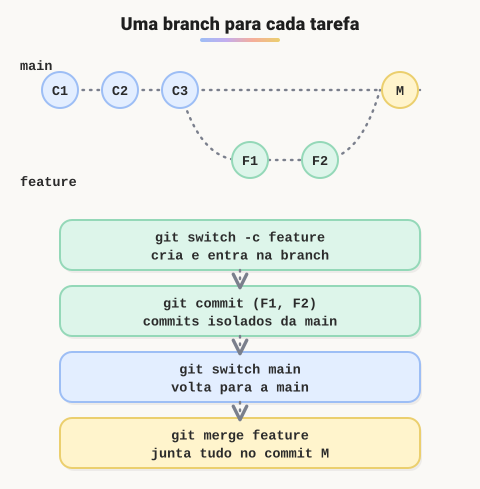
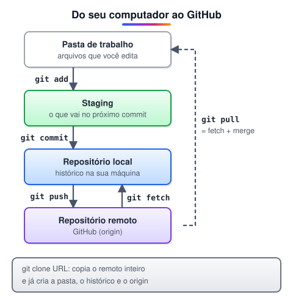

# Git: branches, repositórios remotos e pull requests

> ✨ **Página nova.** A aula de Git cobre commits e conflitos, mas não mostra como trabalhar em branches, sincronizar com o GitHub e colaborar por pull request, que é o dia a dia de um time.

> 🗺️ **Nesta aula:** criar e trocar de branch, juntar o trabalho com merge (e quando usar rebase), enviar e baixar alterações do repositório remoto e o fluxo de pull request.

## 1. O que é uma branch

Uma **branch** é uma linha de trabalho independente. Na prática, é só um ponteiro para um commit, que anda sozinho a cada novo commit. Criar uma branch é instantâneo e não copia arquivos.

O `HEAD` indica em qual branch você está. A regra de ouro dos times: **a** `main` **fica sempre estável**, e cada tarefa (uma funcionalidade, uma correção) ganha sua própria branch.



```bash
# lista as branches (a atual aparece com *)
git branch

# cria a branch e já entra nela
git switch -c feature/login

# volta para a main
git switch main

# forma antiga, ainda muito vista em tutoriais
git checkout -b feature/login
```

> 💡 Use prefixos que dizem o tipo da tarefa: `feature/` para funcionalidades, `fix/` para correções, `docs/` para documentação. Exemplo: `fix/calculo-juros`.

## 2. Juntando o trabalho: merge

Quando a tarefa termina, você volta para a branch de destino e traz as mudanças com `git merge`:

```bash
git switch main
git merge feature/login

# apaga a branch, que já foi integrada
git branch -d feature/login
```

O merge acontece de dois jeitos:

| Tipo | Quando acontece | Resultado |
| --- | --- | --- |
| Fast-forward | a `main` não andou desde que a branch saiu | o ponteiro da `main` só avança; nenhum commit novo |
| Merge commit | as duas branches receberam commits | o Git cria um commit de merge com dois pais |

Se as duas branches mudaram a mesma linha, acontece um **conflito**, resolvido como na aula anterior: edite o arquivo, `git add` e `git commit`.

## 3. Rebase: histórico em linha reta

O `git rebase` é outra forma de integrar. Em vez de criar um commit de merge, ele **reaplica** os commits da sua branch em cima da ponta da `main`, como se você tivesse começado a tarefa agora.

```bash
git switch feature/login
git rebase main
```

> ⚠️ O rebase reescreve os commits (eles ganham novos hashes). Só faça rebase de commits que estão **apenas na sua máquina**. Reescrever commits que outras pessoas já baixaram bagunça o histórico delas.

## 4. Repositórios remotos

Um **remoto** é uma cópia do repositório num servidor, como o GitHub. Por padrão ele se chama `origin`. Você trabalha localmente e sincroniza quando quiser.



```bash
# copia um repositório existente
git clone https://github.com/usuario/projeto.git

# mostra os remotos configurados
git remote -v

# envia a branch e liga ao remoto (1ª vez)
git push -u origin feature/login

# depois disso, basta
git push

# baixa as novidades sem mexer nos seus arquivos
git fetch origin

# baixa e já integra na branch atual
git pull
```

| Comando | O que faz | Mexe nos seus arquivos? |
| --- | --- | --- |
| `git fetch` | baixa os commits novos do remoto | não |
| `git pull` | `fetch`  • `merge` na branch atual | sim |
| `git push` | envia os seus commits para o remoto | não |

> 💡 Se o `git push` for recusado com "rejected", alguém enviou commits antes de você. Rode `git pull`, resolva conflitos se houver e tente o push de novo.

## 5. O fluxo de pull request

Um **pull request** (PR) é um pedido para juntar a sua branch na `main`, feito no GitHub. Ele mostra as diferenças, permite comentários e revisões e roda os testes automáticos antes do merge.

1. Atualize a `main`: `git switch main` e `git pull`.
2. Crie a branch da tarefa: `git switch -c feature/extrato`.
3. Faça commits pequenos, com mensagens claras.
4. Envie a branch: `git push -u origin feature/extrato`.
5. No GitHub, clique em **Compare & pull request** e descreva o que mudou.
6. Responda à revisão com novos commits na mesma branch; o PR se atualiza sozinho.
7. Aprovado, faça o merge pelo GitHub.
8. Na sua máquina, volte para a `main`, rode `git pull` e apague a branch local.

## 📌 Resumo

| Item | Em uma frase |
| --- | --- |
| Branch | ponteiro para um commit; uma linha de trabalho por tarefa |
| `git switch -c` | cria a branch e entra nela |
| `git merge` | traz os commits de outra branch para a atual |
| `git rebase` | reaplica seus commits sobre outra base; só em commits não compartilhados |
| `origin` | nome padrão do repositório remoto |
| `clone` / `fetch` / `pull` / `push` | copiar, baixar, baixar e integrar, enviar |
| Pull request | pedido de merge revisado pelo time no GitHub |
