# Trabalho com equipes ágeis

> 🧭 **Nesta aula:** como times de tecnologia se organizam: os valores do Manifesto Ágil, a diferença para a gestão tradicional e os principais métodos (XP, Scrum, Kanban, OKR) e ferramentas.

## Manifesto ágil

> 💡 **Em uma frase:** o Manifesto Ágil é a "constituição" do desenvolvimento ágil — 4 valores e 12 princípios que colocam pessoas, software funcionando e adaptação no centro do trabalho.

🔗 [Manifesto para Desenvolvimento Ágil de Software](https://agilemanifesto.org/iso/ptbr/manifesto.html)

### Agilidade x velocidade

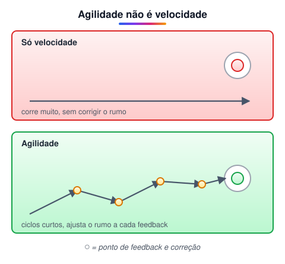

É comum confundir ágil com "rápido", mas são coisas diferentes:

- **Velocidade** é só o ritmo. Dá para ser muito rápido indo na direção errada.
- **Agilidade** é eficiência com **capacidade de adaptação**: o time entrega em ciclos curtos, recebe feedback e **corrige o rumo** continuamente.
- Para isso funcionar, a **comunicação** precisa ser clara, frequente e assertiva.

### Como surgiu

- O manifesto foi escrito em **fevereiro de 2001**, quando **17 desenvolvedores** se reuniram em uma estação de esqui em **Snowbird, Utah (EUA)**.
- Entre eles estavam criadores de métodos que já existiam, como Scrum (Ken Schwaber, Jeff Sutherland) e XP (Kent Beck).
- O resultado foi um texto curto com **valores** e **princípios** comuns a todos esses métodos — não um processo a ser seguido passo a passo.

### Os 4 valores do Manifesto Ágil

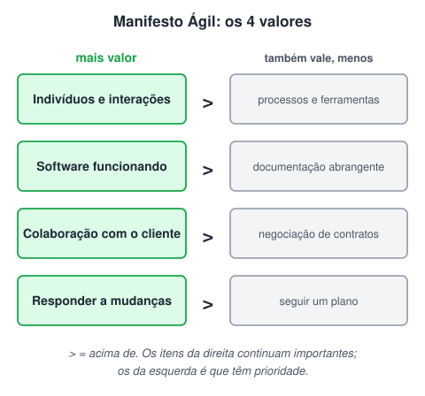

1. **Indivíduos e interações** acima de processos e ferramentas — o foco está nas pessoas e na conversa entre elas; ferramenta boa não salva time desalinhado.
2. **Software em funcionamento** acima de documentação abrangente — o que gera valor ao cliente é o produto rodando; documente o necessário, não o máximo.
3. **Colaboração com o cliente** acima de negociação de contratos — o cliente participa durante todo o projeto, em vez de só assinar um contrato no início.
4. **Responder a mudanças** acima de seguir um plano — planos existem, mas mudam quando o cenário muda.

> ⚠️ O manifesto **não** diz que processos, documentação, contratos e planos são inúteis. Ele diz que, quando houver conflito, os itens da esquerda têm mais peso.

### Os 12 princípios ágeis

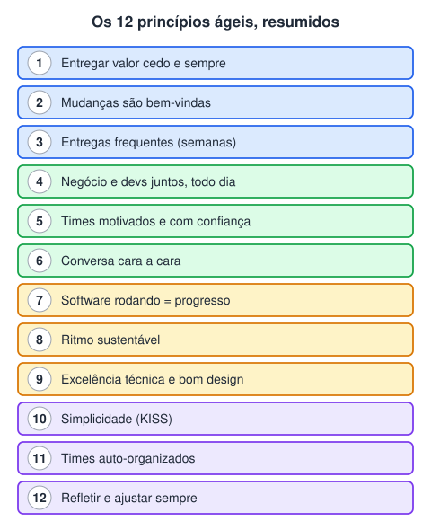

1. A maior prioridade é **satisfazer o cliente** com entregas contínuas e adiantadas de software de valor.
2. **Mudanças nos requisitos são bem-vindas**, mesmo tarde no projeto — elas podem virar vantagem competitiva para o cliente.
3. Entregar software funcionando **com frequência**, de semanas a meses, preferindo os períodos mais curtos.
4. Pessoas de negócio e desenvolvedores devem **trabalhar juntos diariamente** durante todo o projeto.
5. Construir projetos em torno de **pessoas motivadas**, dando ambiente, suporte e confiança para que façam o trabalho.
6. A forma mais eficiente de passar informação para e dentro do time é a **conversa cara a cara**.
7. **Software funcionando** é a principal medida de progresso.
8. Processos ágeis promovem um **ritmo sustentável**: patrocinadores, devs e usuários devem conseguir manter o ritmo indefinidamente.
9. Atenção contínua à **excelência técnica e ao bom design** aumenta a agilidade.
10. **Simplicidade** — a arte de maximizar o trabalho que *não* precisa ser feito — é essencial (princípio KISS: *Keep It Simple, Stupid*).
11. As melhores arquiteturas, requisitos e designs surgem de **times auto-organizados**.
12. Em intervalos regulares, o time **reflete** sobre como ser mais eficaz e **ajusta** seu comportamento.

### Características de um time ágil

| Característica | O que significa na prática |
| --- | --- |
| Alinhado com cliente e stakeholders | Sabe o que gera valor e para quem |
| Auto-organizado e responsável | Decide *como* fazer o trabalho e responde pelo resultado |
| Multidisciplinar | Reúne as habilidades necessárias para entregar sem depender de outros times |
| Entrega valor continuamente | Produz incrementos pequenos e utilizáveis |
| Sempre aprendendo | Busca conhecimento novo e compartilha dentro do time |
| Melhoria contínua | Revê o próprio processo com frequência (retrospectivas) |
| Métricas e metas claras | Sabe medir se está indo bem |
| Unido | Confiança e colaboração entre os membros |

### Por que o ágil é importante em tecnologia

- **Mercado muda rápido:** requisitos definidos no início de um projeto longo costumam ficar desatualizados antes da entrega.
- **Feedback cedo reduz risco:** erros aparecem nas primeiras entregas, quando ainda são baratos de corrigir.
- **Valor antes:** o cliente começa a usar partes do produto ainda durante o projeto.
- **Times mais engajados:** autonomia e propósito claro aumentam motivação e qualidade.

## Gerenciamento de projetos x Gestão Ágil

> 💡 **Resumo:** o gerenciamento tradicional planeja tudo no início e entrega no fim; a gestão ágil entrega em ciclos curtos, mede e se adapta durante o caminho.

### Projeto x processo

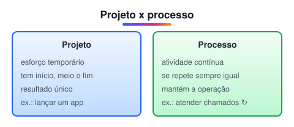

- **Projeto:** esforço **temporário**, com começo, meio e fim, que gera um resultado **único** (ex.: criar um novo app de cartões).
- **Processo:** atividade **contínua e repetitiva** que mantém a operação funcionando (ex.: atender chamados de suporte, fechar a folha de pagamento).
- Gestão de projetos cuida do primeiro tipo; métodos ágeis nasceram justamente para projetos de software, onde a incerteza é alta.

### Modelo tradicional x modelo ágil

#### Modelo tradicional (cascata / waterfall)

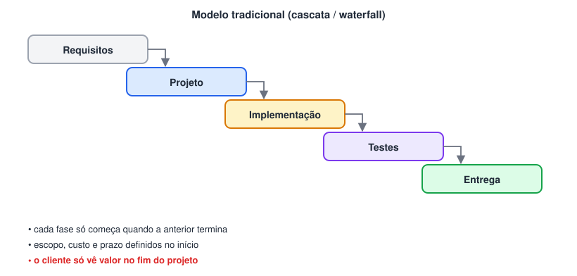

- Cada etapa só começa quando a anterior foi concluída.
- O planejamento é feito todo no início, fixando **escopo → custo → cronograma**.
- O cliente só recebe valor no final, depois da implementação e dos testes.
- Mudanças no meio do caminho são caras, porque exigem voltar fases.

#### Modelo ágil

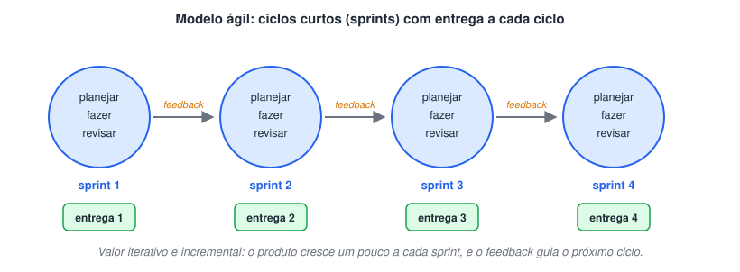

- O trabalho é dividido em **ciclos curtos** chamados **sprints** (normalmente de 1 a 4 semanas).
- Ao fim de cada ciclo há uma **entrega de valor** utilizável: o produto cresce de forma **iterativa e incremental**.
- Cada entrega gera **feedback**, que orienta o planejamento da próxima sprint.

#### Comparando a entrega de valor

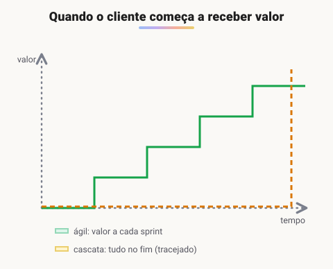

| Aspecto | Tradicional (cascata) | Ágil |
| --- | --- | --- |
| Planejamento | Detalhado, todo no início | Contínuo, a cada ciclo |
| Escopo | Fixo | Flexível; prazo e custo é que costumam ser fixos |
| Entrega de valor | No fim do projeto | A cada sprint |
| Mudanças | Evitadas (caras) | Esperadas e bem-vindas |
| Participação do cliente | Início e fim | Durante todo o projeto |
| Quando funciona bem | Requisitos estáveis e bem conhecidos | Cenário incerto, que muda com frequência |

### O que é gestão ágil?

Uma forma de gerir o trabalho que é:

- **Flexível**, capaz de se adaptar a mudanças;
- **Colaborativa e transparente**, com informação visível para todos;
- **Voltada ao aprendizado**, usando cada ciclo para melhorar;
- Focada em **entrega contínua de valor**.

## XP

> 💡 **XP em uma frase:** um método ágil focado em **práticas de engenharia** — levar ao "extremo" o que já se sabe que funciona (testar, revisar, integrar, simplificar).

### O que é

- **Extreme Programming (XP)** é um método ágil de desenvolvimento que busca **qualidade do software** e **satisfação do cliente** por meio de um processo iterativo e incremental, com ciclos curtos.
- Foi criado por **Kent Beck** no fim dos anos 1990 (projeto C3, na Chrysler), como reação a processos lentos e burocráticos em que os devs se perdiam em documentação e esqueciam do objetivo: software funcionando e bem feito.
- A ideia do nome: se revisar código é bom, revise o tempo todo (programação em par); se testar é bom, teste antes de escrever o código (TDD); se integrar é bom, integre várias vezes por dia.

### Práticas principais

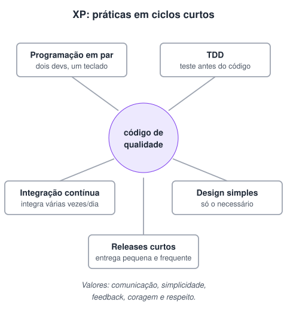

| Prática | Como funciona |
| --- | --- |
| Programação em par | Duas pessoas no mesmo código: uma digita, a outra revisa e pensa à frente; trocam de papel com frequência |
| TDD (desenvolvimento guiado por testes) | Escreve o teste que falha → escreve o código mínimo para passar → refatora |
| Integração contínua | O código de todos é integrado e testado automaticamente várias vezes ao dia |
| Design simples | Faz só o que é necessário agora e melhora o design com refatoração constante |
| Releases curtos | Versões pequenas e frequentes nas mãos do cliente |
| Cliente presente | Alguém do negócio acompanha o time e tira dúvidas na hora |

### Valores do XP

1. **Comunicação** — conversa constante entre time e cliente.
2. **Simplicidade** — a solução mais simples que funciona.
3. **Feedback** — testes, cliente e entregas mostram rápido se estamos no caminho certo.
4. **Coragem** — para refatorar, dizer a verdade sobre prazos e jogar fora o que não serve.
5. **Respeito** — entre os membros do time e com o trabalho de cada um.

### O que tem no XP, resumindo

- Ciclos curtos de entrega
- Cerimônias (reuniões de planejamento e acompanhamento)
- Testes automatizados desde o início
- Programação em par
- Feedback frequente
- Proximidade com o cliente
- Flexibilidade para mudar

## Scrum

> 💡 **Scrum em uma frase:** um framework leve que organiza o trabalho em sprints de duração fixa, com papéis, eventos e artefatos bem definidos, para entregar valor e aprender a cada ciclo.

### Guia do Scrum

O Scrum Guide é o documento oficial (curto e gratuito, inclusive em português):

🔗 [Home | Scrum Guides](https://scrumguides.org/index.html)

### Definição

- **Framework ágil** que promove uma forma colaborativa e iterativa de desenvolver produtos.
- Parte da ideia de que projetos de software são **complexos e difíceis de prever**, então é melhor planejar em ciclos curtos e ajustar com base no que se aprende (**empirismo**).
- O objetivo é permitir que o time se **adapte rápido** a mudanças sem perder qualidade.

> 🛠️ **Correção:** o texto original dizia que o Scrum foi criado em 1993 por Takeuchi e Nonaka. Na verdade, **Hirotaka Takeuchi e Ikujiro Nonaka** publicaram em **1986** o artigo *"The New New Product Development Game"*, que usou o termo "scrum" (do rúgbi) e inspirou o método. O **Scrum** como framework foi criado por **Jeff Sutherland** (que o aplicou em 1993) e **Ken Schwaber**, que o apresentaram juntos em **1995**.

### Os 3 pilares (TIA)

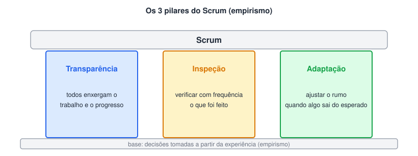

- **Transparência:** o trabalho, o progresso e os problemas ficam visíveis para todos (quadro, backlog, incremento). Sem isso, não dá para inspecionar direito.
- **Inspeção:** o time verifica com frequência o que foi produzido e como está trabalhando — principalmente nos eventos do Scrum.
- **Adaptação:** quando algo sai do esperado, o time ajusta o plano, o produto ou o processo o quanto antes. Nada é definitivo.

### Papéis, eventos e artefatos

| Elemento | Itens | Para que serve |
| --- | --- | --- |
| Papéis (accountabilities) | Product Owner | Define **o quê** será feito e a prioridade; cuida do Product Backlog |
|  | Scrum Master | Facilita o processo, ensina Scrum e remove impedimentos |
|  | Developers | Decidem **como** fazer e constroem o incremento |
| Eventos | Sprint | Ciclo fixo de até 1 mês que contém todos os outros eventos |
|  | Sprint Planning | Define o objetivo da sprint e o que entra nela |
|  | Daily Scrum | 15 min por dia para alinhar o progresso rumo ao objetivo |
|  | Sprint Review | Apresenta o incremento aos stakeholders e coleta feedback |
|  | Sprint Retrospective | O time discute como melhorar o próprio jeito de trabalhar |
| Artefatos | Product Backlog | Lista priorizada de tudo que o produto pode precisar |
|  | Sprint Backlog | Itens escolhidos para a sprint + plano para entregá-los |
|  | Incremento | Resultado utilizável da sprint, que atende à Definition of Done |

### Framework x metodologia

| Metodologia | Framework |
| --- | --- |
| Diz **por que**, **o que** e **como** fazer | Diz **por que** e **o que** fazer |
| Funciona como uma receita de bolo, passo a passo | O **como** fica em aberto: cada time completa com suas próprias práticas e ferramentas |
| Mais rígida | Mais flexível — por isso o Scrum é chamado de framework |

### O fluxo do Scrum

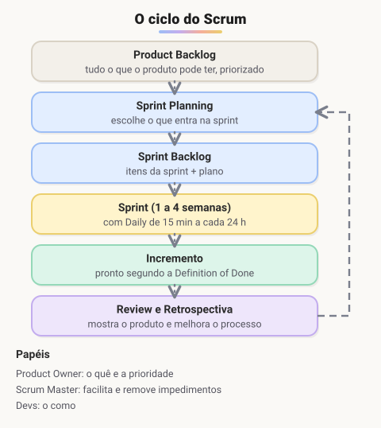

1. O **Product Owner** mantém o **Product Backlog** priorizado.
2. Na **Sprint Planning**, o time escolhe os itens e monta o **Sprint Backlog**.
3. Durante a **Sprint**, o time trabalha e faz a **Daily** todos os dias.
4. Ao final, gera um **Incremento** pronto (Definition of Done).
5. Na **Sprint Review**, mostra o resultado e coleta feedback; na **Retrospectiva**, melhora o processo.
6. Começa a próxima sprint, já com o aprendizado incorporado.

## Kanban

> 💡 **Kanban em uma frase:** deixar o fluxo de trabalho **visível** num quadro e **limitar** quanta coisa fica em andamento ao mesmo tempo, para terminar mais e acumular menos.

### O que é

- **Kanban** é um sistema visual para gerenciar o **fluxo de trabalho** — numa linha de montagem ou num time de software.
- A palavra japonesa significa **"cartão"** ou **"sinal visual"**: cada tarefa vira um cartão que se move pelas colunas do quadro.
- Surgiu na **Toyota**, entre o fim dos anos 1940 e os anos 1950 (com Taiichi Ohno), para produzir só o necessário, na hora certa, reduzindo estoque parado.
- Com o tempo, foi adaptado para TI e gestão de projetos — o "Método Kanban" para trabalho do conhecimento foi popularizado por David J. Anderson nos anos 2000.

> 🛠️ **Correção:** o texto original citava Kanban como prática de "metodologias ágeis como o Scrum e o Lean". O **Lean** não é uma metodologia ágil como o Scrum: é uma **filosofia de gestão** vinda do Sistema Toyota de Produção, focada em eliminar desperdícios. Na verdade, o próprio Kanban nasceu dentro do Lean. Times ágeis costumam usar Kanban sozinho ou junto com o Scrum (o chamado "Scrumban").

### Ilustrando um quadro Kanban

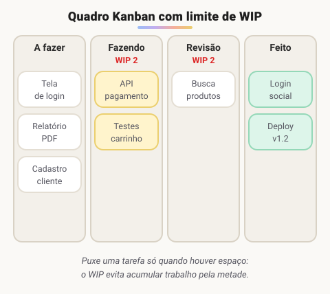

### Princípios práticos

| Prática | O que significa |
| --- | --- |
| Visualizar o fluxo | Todas as etapas e tarefas ficam no quadro, à vista de todos |
| Limitar o WIP | WIP = *Work In Progress*; cada coluna tem um máximo de cartões ao mesmo tempo |
| Puxar, não empurrar | Só se pega uma tarefa nova quando há espaço na coluna seguinte |
| Gerenciar o fluxo | Observar gargalos (colunas que enchem) e atacá-los |
| Políticas explícitas | Regras claras, como "o que significa estar pronto" |
| Melhoria contínua | Medir (ex.: *lead time*) e ajustar o processo aos poucos |

### Kanban x Scrum

|  | Kanban | Scrum |
| --- | --- | --- |
| Cadência | Fluxo contínuo | Sprints de duração fixa |
| Papéis | Não exige papéis novos | PO, Scrum Master e Developers |
| Mudanças | Podem entrar a qualquer momento | Em geral, só na próxima sprint |
| Métrica comum | Lead time / throughput | Itens entregues por sprint |

## OKR

> 💡 **OKR em uma frase:** um **Objetivo** que diz aonde queremos chegar + alguns **Resultados-chave** numéricos que provam se chegamos.

### O que é

- **OKR** = *Objectives and Key Results* (Objetivos e Resultados-chave). É um método para definir e acompanhar metas, aumentando o **foco** e o **alinhamento** da empresa.
- Foi criado por **Andy Grove** na **Intel**, nos anos 1970, e levado ao **Google** em 1999 por **John Doerr** — investidor da Kleiner Perkins que tinha trabalhado com Grove na Intel. Depois se espalhou por empresas de todos os setores.
- Os OKRs costumam ser definidos em **ciclos trimestrais**, revisados ao fim de cada ciclo.

### Estrutura

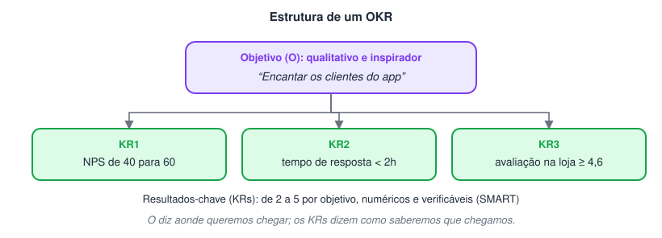

| Parte | Características | Exemplo |
| --- | --- | --- |
| Objetivo (O) | Qualitativo, inspirador, diz **o quê** queremos | "Encantar os clientes do app" |
| Resultados-chave (KRs) | Quantitativos, mensuráveis, com prazo; dizem **como saberemos** que chegamos | NPS de 40 para 60; tempo de resposta abaixo de 2h; nota na loja ≥ 4,6 |

> 🛠️ **Correção:** o texto original dizia que os **objetivos** devem ser SMART e mensuráveis. No OKR, quem precisa ser mensurável e SMART são os **resultados-chave**; o objetivo é propositalmente **qualitativo e inspirador**. Também ajustado: John Doerr não era executivo do Google, e sim o investidor que apresentou os OKRs aos fundadores.

### Regras dos resultados-chave (KRs)

> 📌 Os **KRs** são as metas que indicam se o objetivo foi atingido. Eles devem ser:
>
> - baseados em indicadores (KPIs);
> - **quantitativos** — um número, não uma tarefa ("lançar a tela X" é tarefa; "reduzir o abandono do cadastro de 30% para 15%" é KR);
> - **SMART**: eSpecíficos, Mensuráveis, Atingíveis, Relevantes e Temporais.
>
> **Em média, cada objetivo tem de 2 a 5 resultados-chave.**

### Dicas

- Poucos objetivos por ciclo (de 3 a 5) para manter o foco.
- OKRs ambiciosos: atingir cerca de 70% já costuma ser considerado um bom resultado.
- Acompanhe o progresso ao longo do ciclo, não só no fim.

## Algumas ferramentas Ágeis

> 💡 Ferramenta não torna um time ágil — ela só ajuda a dar **transparência** ao trabalho. Escolha a mais simples que atenda o time. (Links limpos de parâmetros de rastreamento.)

### Resumo rápido

| Ferramenta | Melhor para |
| --- | --- |
| Notion | Documentação, wikis e quadros simples num só lugar |
| innos | Alternativa all-in-one de notas e gestão de tarefas |
| ClickUp | Gestão de tarefas completa, com várias visões (lista, quadro, Gantt) |
| Miro | Quadro branco colaborativo: retrospectivas, brainstorms, fluxos |
| Trello | Quadro Kanban simples e visual |
| Jira | Scrum e Kanban para times de software (backlog, sprints, relatórios) |
| monday.com | Gestão de projetos e fluxos de trabalho com automações |
| Asana | Gestão de tarefas e projetos para times de negócio |
| TeamRetro | Retrospectivas e health checks de times ágeis |
| Pipefy | Automação de processos em formato de fluxo/Kanban |

### Ferramentas "all in one"

🔗 [Download Miro on your device](https://www.notion.so/)

🔗 [https://innos.io/](https://innos.io/)

🔗 [https://clickup.com/](https://clickup.com/)

🔗 [https://miro.com/](https://miro.com/)

### Ferramentas com gestão ágil

🔗 [Manage Your Team’s Projects From Anywhere | Trello](https://trello.com/)

🔗 [Jira | Software para acompanhamento de itens e projetos](https://www.atlassian.com/br/software/jira)

🔗 [monday.com - A Project Management Alternative](https://monday.com/)

🔗 [Gestão on-line dos trabalhos, projetos e tarefas da sua equipe • Asana](https://asana.com/pt)

🔗 [Automatize processos em minutos - Pipefy](https://www.teamretro.com/)

🔗 [https://www.pipefy.com/pt-br/](https://www.pipefy.com/pt-br/)

## 📌 Resumo

| Item | Em uma frase |
| --- | --- |
| Manifesto Ágil | 4 valores e 12 princípios: pessoas, software funcionando, colaboração e resposta a mudanças |
| Ágil × tradicional | entregas curtas e frequentes em vez de um plano fechado do começo ao fim |
| XP | práticas de engenharia: programação em par, TDD, integração contínua, entregas pequenas |
| Scrum | framework com papéis (PO, Scrum Master, time), eventos (sprint, daily, review, retro) e artefatos (backlogs, incremento) |
| Kanban | quadro visual do fluxo, com limite de trabalho em andamento |
| OKR | objetivo qualitativo medido por resultados-chave numéricos |
