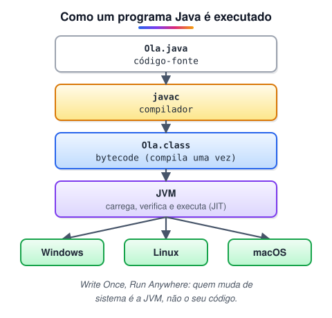
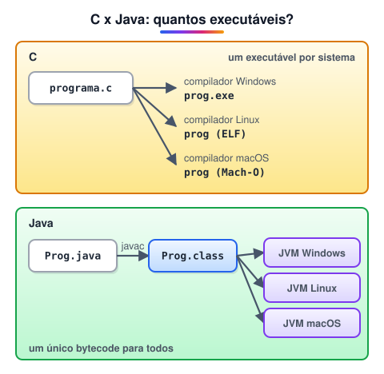
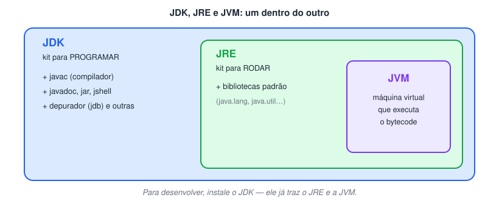

# Dominando IDE’s Java

> 🗺️ **Nesta aula:** a história e as características do Java, a diferença entre JDK, JRE e JVM, e os primeiros passos com as IDEs Eclipse e IntelliJ, com os atalhos mais úteis.

## História do java e alguns conceitos importantes

> 💡 **Resumo:** Java nasceu na Sun (1995), hoje pertence à Oracle e roda em qualquer sistema que tenha uma **JVM**: você compila uma vez para **bytecode** e executa em qualquer lugar.

### Um pouco de história

- Tudo começou com o **Projeto Green** (1991), na **Sun Microsystems**, liderado por **James Gosling** com **Mike Sheridan** e **Patrick Naughton**. A meta: uma linguagem que rodasse em vários dispositivos, independentemente do sistema.
- O primeiro nome foi **Oak** (carvalho), por causa de uma árvore em frente ao escritório de Gosling. Como "Oak" já era marca registrada de outra empresa, o nome mudou para **Java** — referência ao café da ilha de Java.
- O Java foi lançado oficialmente em **maio de 1995**.
- Em **2010**, a **Oracle** concluiu a compra da Sun e passou a ser a dona da linguagem.

### Onde o Java aparece

- Jogos e desktop: **Minecraft** (edição Java), as IDEs **IntelliJ IDEA** e **Eclipse**.
- Servidores: **Apache Tomcat**, aplicações corporativas e bancárias.
- Mobile: o **Android** usa Java (e Kotlin) para seus apps; o Android Studio também é feito em Java.
- **Jakarta EE** (antigo Java EE): base para sistemas corporativos grandes.

### Características da linguagem

- **Sintaxe parecida com C/C++**: Gosling quis facilitar a vida de quem já programava em C. Estruturas como `if`, `for`, `while`, operadores e tipos básicos são muito semelhantes.
- **Orientada a objetos**: o programa é organizado em **classes e objetos**, enquanto o C é **procedural** (organizado em funções).
- **Compilada e interpretada**: o código vira **bytecode** e depois é executado pela **JVM**; o C é compilado direto para código de máquina.
- **Gerenciamento automático de memória** (*garbage collector*): não é preciso liberar memória manualmente, como no C.

> 🛠️ **Ajuste:** o texto original dizia que "em Java, tudo é um objeto". Quase tudo — mas os **tipos primitivos** (`int`, `double`, `boolean`, `char` etc.) **não** são objetos. Por isso existem as classes *wrapper* (`Integer`, `Double`…). Também vale saber que a JVM moderna não apenas interpreta: ela usa um compilador **JIT** (*Just-In-Time*) que transforma os trechos mais usados em código de máquina durante a execução.

### Write Once, Run Anywhere

"Escreva uma vez, execute em qualquer lugar" é o princípio central do Java.

1. Você escreve o código-fonte em um arquivo `.java`.
2. O compilador `javac` gera um arquivo `.class` com **bytecode**, um formato intermediário que não depende do sistema operacional.
3. A **JVM** de cada sistema (Windows, Linux, macOS…) lê esse bytecode e o executa.

Assim não é preciso reescrever nem recompilar o programa para cada sistema: quem se adapta é a JVM.

### C x Java: ciclo de uma aplicação

|  | C | Java |
| --- | --- | --- |
| Compilação | Direto para código de máquina | Para bytecode |
| Resultado | Um executável diferente para cada sistema | Um único `.class` / `.jar` |
| Execução | Pelo sistema operacional | Pela JVM |
| Portabilidade | Precisa recompilar | Basta ter a JVM instalada |

### Linguagem Java x plataforma Java

- **Linguagem Java:** a sintaxe e as regras que usamos para escrever o código.
- **Plataforma Java:** o conjunto que permite executar esse código em qualquer lugar — **JVM**, **bibliotecas padrão (API)** e ferramentas como o **compilador**.

### Edições do Java

| Edição | Para que serve |
| --- | --- |
| Java SE (Standard Edition) | Base da linguagem; aplicações desktop e servidor |
| Jakarta EE (antigo Java EE) | Aplicações corporativas e web |
| Java ME (Micro Edition) | Dispositivos móveis e embarcados antigos |
| JavaFX | Interfaces gráficas ricas (hoje é um projeto à parte, o OpenJFX) |
| Java Card | Cartões inteligentes (chips de cartão de crédito, SIM cards) |
| Java TV | Aplicações para TV digital |

### JDK, JRE e JVM

- **JVM** (*Java Virtual Machine*) → a máquina virtual que **executa** o bytecode.
- **JRE** (*Java Runtime Environment*) → JVM + bibliotecas padrão: o necessário para **rodar** programas Java.
- **JDK** (*Java Development Kit*) → JRE + ferramentas de desenvolvimento (`javac`, `jar`, `javadoc`, `jshell`, depurador): o necessário para **programar**.

> 📌 Desde o Java 11, a Oracle não distribui mais o JRE separado: na prática, você instala o **JDK** (por exemplo, o Azul Zulu ou o Eclipse Temurin).

## Eclipse

> 💡 **Eclipse:** IDE gratuita e de código aberto, criada pela IBM e mantida pela Eclipse Foundation. Seu ponto forte é a extensibilidade por **plug-ins**.

### Links úteis

🔗 [Eclipse Downloads | The Eclipse Foundation](https://www.eclipse.org/downloads/)

#### Download do JDK (Azul Zulu)

🔗 [Downloads](https://www.azul.com/downloads/?package=jdk)

### Breve história

- O Eclipse veio do **VisualAge for Java**, ambiente de desenvolvimento da **IBM**. A IBM decidiu substituí-lo por uma plataforma **aberta e extensível**.
- Em **novembro de 2001**, a IBM liberou o código-fonte do novo ambiente, batizado de **Eclipse**.
- Em **2004** foi criada a **Eclipse Foundation**, organização sem fins lucrativos que mantém o projeto até hoje.
- A ideia central é a arquitetura de **plug-ins**: qualquer um pode estender a IDE. Por isso o Eclipse suporta também C/C++, Python, PHP, JavaScript e outras linguagens.
- O nome é frequentemente interpretado como uma provocação à **Sun** ("eclipsar o Sol"), concorrente da IBM na época.
- Roda em **Windows, macOS e Linux**.

### Atalhos úteis

> ⌨️ Atalhos para Windows/Linux. No macOS, troque `Ctrl` por `Cmd` na maioria deles.

| O que fazer | Atalho |
| --- | --- |
| Acesso rápido a qualquer comando (ex.: "Git perspective", "Debug perspective") | `Ctrl + 3` |
| Criar novo projeto/arquivo (pesquise "project") | `Ctrl + N` |
| Autocompletar / sugestões | `Ctrl + Espaço` |
| Rodar o programa como aplicação Java | `Alt + Shift + X`, depois `J` |
| Gerar construtor, getters/setters, `equals/hashCode`, `toString` | `Alt + Shift + S` (ou `Ctrl + 3` e pesquisar "constructor") |
| Apagar a linha | `Ctrl + D` |
| Mover linha/bloco para cima ou para baixo | `Alt + ↑` / `Alt + ↓` |
| Duplicar linha | `Ctrl + Alt + ↓` / `Ctrl + Alt + ↑` |
| Formatar o código | `Ctrl + Shift + F` |
| Organizar imports (adiciona os que faltam e remove os não usados) | `Ctrl + Shift + O` |
| Correção rápida / criar variável para o retorno de um método | `Ctrl + 1` |
| Procurar classes do projeto e das bibliotecas | `Ctrl + Shift + T` |

> 🛠️ **Correções:** o atalho de formatar código no Eclipse é `Ctrl + Shift + F` (no texto original estava `Alt + Shift + F`). Para gerar construtor/getters/setters, o menu direto é `Alt + Shift + S`. E `Alt + Shift + X` abre o menu "Run As"; em seguida aperte `J` para rodar como Java Application. No Linux, `Ctrl + Alt + ↓` pode estar ocupado pelo sistema.

## IntelliJ

> 💡 **IntelliJ IDEA:** IDE da JetBrains, muito usada no mercado Java. A versão **Community** é gratuita; a **Ultimate** é paga e traz suporte completo a Spring, bancos de dados e web.

### Links úteis

🔗 [IntelliJ IDEA](https://www.jetbrains.com/idea/download/)

#### Download do JDK (Azul Zulu)

🔗 [Downloads](https://www.azul.com/downloads/?package=jdk)

> ✨ Dica: o IntelliJ também consegue baixar um JDK sozinho em **File → Project Structure → SDK → Download JDK**.

### Lista completa de atalhos

🔗 [Atalhos do IntelliJ Idea - Basef](http://www.basef.com.br/index.php/Atalhos_do_IntelliJ_Idea)

🔗 [IntelliJ IDEA](https://www.jetbrains.com/pt-br/idea/resources/)

### Primeiros passos

#### Criar uma nova classe (para escrever o `main`)

1. Clique na pasta `src`.
2. Use `Alt + Insert` e escolha **Java Class**.
3. Dentro da classe, digite `psvm` + `Tab` para gerar o método `main` (e `sout` + `Tab` para um `System.out.println`).

#### Rodar o programa

- **Primeira vez:** `Ctrl + Shift + F10` (roda o arquivo atual).
- **Próximas vezes:** `Shift + F10` (repete a última configuração).

### Atalhos do dia a dia

> ⌨️ Atalhos para Windows/Linux (keymap padrão). No macOS, em geral troque `Ctrl` por `Cmd` e `Alt` por `Option`.

| O que fazer | Atalho |
| --- | --- |
| Gerar construtor, getters/setters, `toString` (dentro da classe) | `Alt + Insert` |
| Comentar/descomentar linha | `Ctrl + /` |
| Comentar bloco (`/* */`) | `Ctrl + Shift + /` |
| Importar / correção rápida (em cima do erro) | `Alt + Enter` |
| Apagar a linha | `Ctrl + Y` |
| Duplicar linha | `Ctrl + D` |
| Mover linha para cima/baixo | `Alt + Shift + ↑` / `Alt + Shift + ↓` |
| Mover método/bloco inteiro | `Ctrl + Shift + ↑` / `Ctrl + Shift + ↓` |
| Renomear (classe, variável, pacote) em todo o projeto | `Shift + F6` |
| Mostrar/esconder o painel de projeto | `Alt + 1` |
| Formatar (indentar) o código | `Ctrl + Alt + L` |
| Criar variável para o retorno de um método | `Ctrl + Alt + V` |
| Procurar classe | `Ctrl + N` |
| Procurar qualquer coisa | `Shift` duas vezes |
| Ir para a declaração (entrar na classe/método) | `Ctrl + B` ou `Ctrl + clique` |

> 🛠️ **Correções:** o painel de projeto é mostrado/escondido com `Alt + 1` (`Shift + F12` restaura o layout padrão das janelas). E `Ctrl + Shift + ↑/↓` move o **bloco/método** inteiro; para mover só a **linha**, use `Alt + Shift + ↑/↓`.

## 📌 Resumo

| Item | Em uma frase |
| --- | --- |
| Write Once, Run Anywhere | o código vira bytecode, que roda em qualquer sistema com uma JVM |
| JVM | máquina virtual que executa o bytecode |
| JRE | JVM com as bibliotecas necessárias para rodar programas |
| JDK | JRE com o compilador (`javac`) e as ferramentas de desenvolvimento |
| Edições | Java SE (base), Jakarta EE (corporativo) e Java ME (embarcados) |
| IDE | Eclipse e IntelliJ: editor, compilação, depuração e atalhos num só lugar |
