# Aprendendo a sintaxe Java

> 🗺️ **Nesta aula:** como uma classe Java é organizada, os tipos primitivos e as variáveis, os operadores, como declarar métodos, o escopo das variáveis, as palavras reservadas, o Javadoc e como compilar e rodar pelo terminal.

### Documentação do professor

🔗 [Table of contents](https://felipe-silva-aguiar.gitbook.io/dio-java/gitbook/summary)

### Conteúdo

## Anatomia das classes

> Uma classe bem estruturada não quer guerra com ninguém.

> 💡 **Nesta página:** como declarar uma classe, o método `main`, convenções de nomes, indentação, pacotes e boas práticas de nomenclatura (Java Beans).

### Criação de classes

- Um programa é escrito combinando **palavras reservadas** da linguagem (`public`, `class`, `int`…) com **nomes que nós escolhemos** para arquivos, classes, atributos e métodos.
- É comum misturar inglês com português no código. Muitos projetos preferem escrever tudo em inglês — o importante é **escolher um idioma e manter**.

#### Sintaxe de declaração de uma classe

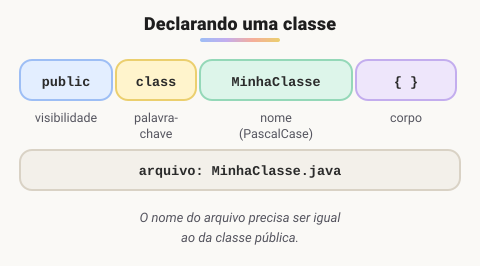

- Quase todas as classes começam com `public class`.
- Toda classe precisa de um nome, por exemplo `MinhaClasse`.
- O **nome do arquivo** deve ser **idêntico** ao nome da classe pública: `MinhaClasse.java`.
- Depois do nome vem o **corpo** `{ }`, onde ficam os atributos e métodos.

#### Localizando-se dentro das chaves

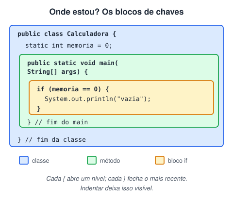

É essencial saber em qual par de chaves `{ }` você está: dentro da classe, dentro de um método ou dentro de um bloco (`if`, `for`…).

#### O método `main`

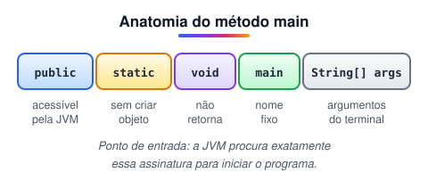

- É o **ponto de entrada** do programa: a JVM começa a execução por ele.
- Recomenda-se que **apenas uma classe** da aplicação tenha `main`.
- Sua assinatura é sempre: visibilidade `public`, modificador `static`, retorno `void`, nome `main` e um parâmetro `String[] args`.

> 🛠️ **Correção:** o texto original dizia que o `main` recebe "um array de caracteres". Na verdade `String[]` é um **array de Strings** (textos) — os argumentos passados ao rodar o programa pelo terminal. Um array de caracteres seria `char[]`.

### Padrões de nomenclatura

| Elemento | Convenção | Exemplos |
| --- | --- | --- |
| Arquivo `.java` e classe | **PascalCase**: cada palavra começa com maiúscula; nome igual ao da classe | `Calculadora.java`, `CalculadoraCientifica.java` |
| Variável e método | **camelCase**: primeira letra minúscula, demais palavras com inicial maiúscula | `ano`, `anoFabricacao`, `calcularMedia()` |
| Constante | **SCREAMING_SNAKE_CASE**: tudo maiúsculo, separado por `_` | `PI`, `ESTADOS_BRASILEIROS` |
| Pacote | tudo minúsculo, domínio invertido | `com.suaempresa.conta` |

```java
// arquivo CalculadoraCientifica.java
public class CalculadoraCientifica {

}
```

> 📌 **Constantes:** quando um valor nunca deve mudar, usamos a palavra `final` e escrevemos o nome em maiúsculas.
>
> ```java
> final String BR = "Brasil";
> final double PI = 3.14;
> final int ESTADOS_BRASILEIROS = 27;
> final int ANO_2000 = 2000;
> final String CODIGO_BR = "055";
> ```
>
> Escrever o nome em maiúsculas é só convenção; quem **impede** a alteração é o `final`.

> 🛠️ **Correção no código:** no exemplo original faltavam os `;` no fim de cada linha e o `final` só aparecia na última constante — sem `final`, as demais seriam variáveis comuns que podem mudar.

#### Regras para nomes de variáveis

> ⚠️ - Use apenas letras, números, `_` (underline) e `$`.
> - Comece com letra (preferencialmente), `_` ou `$` — **nunca com número**.
> - Por boa prática, comece com letra **minúscula**.
> - **Sem espaços**.
> - **Não** use palavras reservadas (`int`, `long`, `class`…).
> - O nome deve ser **único** dentro do escopo.

```java
// Declarações INVÁLIDAS
int numero&um = 1;  // símbolo & não é permitido (só _ e $)
int 1numero = 1;  // não pode começar com número
int numero um = 1;  // não pode ter espaço
int long = 1;  // long é palavra reservada

// Declarações VÁLIDAS
int numero$um = 1;
int numero1 = 1;
int numeroUm = 1;
int longo = 1;
```

### Declarando variáveis e métodos

Variáveis e métodos seguem estruturas parecidas:

```java
// Variável: Tipo nomeBemDefinido = valor (opcional em alguns casos);
int idade = 23;
double altura = 1.62;
Dog spike; // sem valor ainda — é permitido

// Método: TipoRetorno nomeNoInfinitivo(parâmetros)
int somar(int numeroUm, int numeroDois)
String formatarCep(long cep)
```

> 💡 A **visibilidade** (`public`, `private`…) também faz parte da declaração, mas será vista mais adiante.

### Indentação

**Indentar** é recuar o código para mostrar sua hierarquia: o que está dentro de quê. O compilador ignora os espaços, mas para quem lê faz toda a diferença.

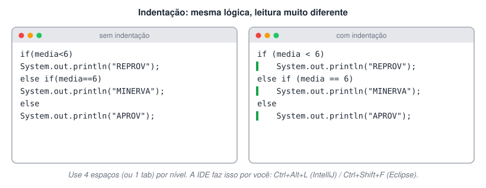

**Sem indentação**

```java
public class BoletimEstudantil {
public static void main(String[] args) {
int mediaFinal = 6;
if(mediaFinal<6)
System.out.println("REPROVADO");
else if(mediaFinal==6)
System.out.println("PROVA MINERVA");
else
System.out.println("APROVADO");
}
}
```

**Com indentação**

```java
public class BoletimEstudantil {
  public static void main(String[] args) {
    int mediaFinal = 6;
    if (mediaFinal < 6)
      System.out.println("REPROVADO");
    else if (mediaFinal == 6)
      System.out.println("PROVA MINERVA");
    else
      System.out.println("APROVADO");
  }
}
```

### Organizando arquivos em pacotes

Conforme o sistema cresce, surgem muitos arquivos. Eles são organizados em **pacotes** (*packages*), que na prática são pastas.

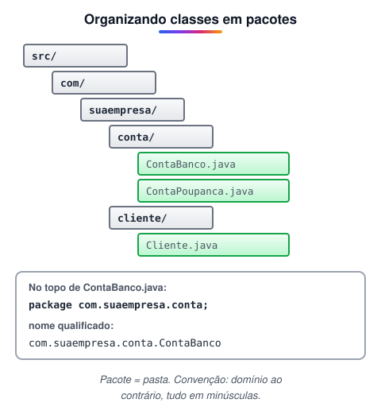

Com pacotes, cada classe passa a ter dois nomes:

- **Nome simples:** só o nome da classe — `ContaBanco`.
- **Nome qualificado:** pacote + classe — `com.suaempresa.conta.ContaBanco`.

### Java Beans: convenções de escrita

Código legível é aquele que o time (e você mesmo, no futuro) entende sem esforço. Por isso o Java sugere convenções para classes, atributos, métodos e pacotes.

#### Variáveis

- Nome **claro**, sem abreviações sem sentido.
- No **singular**, exceto quando representa um array ou coleção.
- **Um só idioma** em todo o código.

**Não recomendado**

```java
double salMedio = 1500.23;  // abreviado, difícil de entender
String emails = "aluno@escola.com"; // plural para um único e-mail confunde
String myName = "JOSEPH";  // mistura de idiomas no nome
```

**Recomendado**

```java
double salarioMedio = 1500.23;
String email = "aluno@escola.com";
String[] emails = {"aluno@escola.com", "professor@escola.com"};
String meuNome = "JOSEPH";
```

#### Métodos

Nomes de métodos são **verbos** em camelCase e cada método deve ter **uma única responsabilidade**.

```java
somar(int n1, int n2) {}
abrirConexao() {}
concluirProcessamento() {}
findById(int id) {}  // você verá muitos métodos em inglês
calcularImprimir() {} // problema: faz duas coisas; separe em calcular() e imprimir()
```

## Tipos e variáveis

> 💡 **Resumo:** Java é **fortemente tipado** — toda variável tem um tipo definido. Os 8 tipos primitivos guardam valores simples; todo o resto (String, objetos, arrays) é **referência**.

### Tipos primitivos

O Java tem palavras reservadas para os tipos de dados básicos, chamados **tipos primitivos**.

> 📌 **Os oito tipos primitivos:** `byte`, `short`, `int`, `long`, `float`, `double`, `boolean` e `char`. Eles **não são objetos**: representam o valor bruto. Quando declarados como variáveis locais, ficam diretamente na **stack** (pilha de memória).

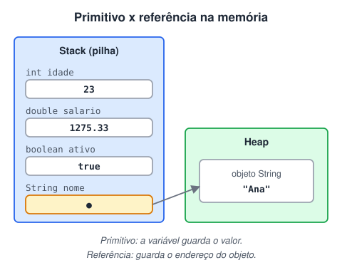

#### Inteiros

| Tipo | Memória | Valor mínimo | Valor máximo |
| --- | --- | --- | --- |
| `byte` | 1 byte | -128 | 127 |
| `short` | 2 bytes | -32.768 | 32.767 |
| `int` | 4 bytes | -2.147.483.648 | 2.147.483.647 |
| `long` | 8 bytes | -9.223.372.036.854.775.808 | 9.223.372.036.854.775.807 |

#### Decimais (ponto flutuante)

| Tipo | Memória | Faixa aproximada | Precisão |
| --- | --- | --- | --- |
| `float` | 4 bytes | ±3,4028 × 10³⁸ | 6 a 7 dígitos |
| `double` | 8 bytes | ±1,7976 × 10³⁰⁸ | 15 a 16 dígitos |

#### Outros

| Tipo | Memória | Valores |
| --- | --- | --- |
| `boolean` | depende da JVM | `true` ou `false` |
| `char` | 2 bytes | um caractere Unicode, entre aspas simples: `'A'` |

> 🛠️ **Correção da tabela:** os valores máximos estavam errados — eles são sempre **um a menos** que o módulo do mínimo, porque o zero conta do lado positivo: `short` vai até **32.767**, `int` até **2.147.483.647** e `long` até **9.223.372.036.854.775.807**. Também foram incluídos `boolean` e `char`, que faltavam.

#### Qual tipo usar no dia a dia?

- `float` usa metade da memória do `double`, mas tem pouca precisão (6–7 dígitos), por isso é menos usado.
- `byte` e `short` raramente são necessários hoje — economia de memória quase nunca compensa.
- `long` aparece quando os números passam de ~2 bilhões (ex.: IDs, timestamps em milissegundos).
- **Regra prática:** `int` para inteiros e `double` para decimais.

> 💰 **E dinheiro?** Para valores monetários reais (como num banco), use `BigDecimal`. `double` pode gerar erros de arredondamento: `0.1 + 0.2` dá `0.30000000000000004`.
>
> *Pergunta para fixar: qual tipo usar para a idade de uma pessoa? E para o salário de um funcionário?*

### Declaração de variáveis

Uma **variável** é um nome para um espaço de memória. É composta por **tipo + nome + valor (opcional)**.

```java
// <Tipo> <nomeVariavel> = <valor opcional>;
int idade;  // tipo int, nome idade, sem valor ainda
int anoFabricacao = 2021;  // tipo int, nome anoFabricacao, valor 2021
double salarioMinimo = 2500.0; // tipo double, nome salarioMinimo, valor 2500.0
```

> 🛠️ **Correção no código:** o original tinha `double salarioMinimo = 2.500;`. Em Java o ponto é o **separador decimal**, então isso vale **2,5** (dois e meio), não dois mil e quinhentos. O certo é `2500.0` — ou `2_500.0`, usando `_` para facilitar a leitura.

#### Peculiaridades de alguns tipos

```java
public class TipoDados {
  public static void main(String[] args) {
    byte idade = 123;
    short ano = 2021;
    int cep = 21070333;  // se começar com zero, o zero é perdido!
    long cpf = 98765432109L;  // long precisa do sufixo L
    float pi = 3.14F;  // float precisa do sufixo F
    double salario = 1275.33;
  }
}
```

- Literais `long` terminam com `L` e literais `float` com `F`.
- **CEP e CPF** costumam ter zero à esquerda e não são usados em contas, por isso o ideal é guardá-los como `String`.

> Java é fortemente tipado.

### Variáveis e constantes

- **Variável:** área de memória com um nome e um tipo, cujo valor **pode mudar**. Diferente do JavaScript, em Java é obrigatório declarar o tipo (ou usar `var`, a partir do Java 10, quando o tipo pode ser inferido).
- **Constante:** valor que **não pode** ser alterado depois de atribuído. Usa a palavra `final` e, por convenção, nome em CAIXA ALTA.

> 🛠️ **Ajuste conceitual:** o texto original dizia que toda variável Java é uma "referência (ponteiro)". Isso vale só para **objetos**. Uma variável primitiva guarda o **próprio valor**; uma variável de objeto guarda o **endereço** do objeto (veja a imagem acima).

```java
public class ExemploVariavel {
  public static void main(String[] args) {
    // declaração: tipo + nome + valor
    int numero = 5;

    // reatribuição: o tipo não é repetido
    numero = 10;
    System.out.println(numero); // 10

    // constante: final impede qualquer nova atribuição
    final double VALOR_DE_PI = 3.14;

    VALOR_DE_PI = 3.15; // ERRO de compilação: não é possível alterar uma constante
  }
}
```

## Operadores

> 💡 **Operadores** são símbolos com significado especial para a linguagem: atribuem valores, fazem contas, comparam e combinam condições.

Um programa é um conjunto de instruções que, executadas, produzem um resultado. Quase sempre o fluxo é o mesmo: **receber dados**, **processá-los** com alguma lógica e **apresentar** o resultado. Os operadores são as ferramentas do meio desse caminho.

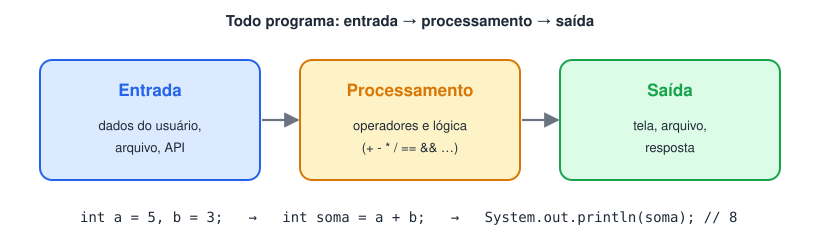

### Resumo

| Categoria | Operadores |
| --- | --- |
| Atribuição | `=` `+=` `-=` `*=` `/=` `%=` |
| Aritméticos | `+` `-` `*` `/` `%` |
| Unários | `+` `-` `++` `--` `!` |
| Ternário | `condição ? valorSeTrue : valorSeFalse` |
| Relacionais | `==` `!=` `>` `>=` `<` `<=` |
| Lógicos | `&&` `\|\|` `!` (e as versões sem curto-circuito `&` e `\|`) |

### Atribuição

O símbolo `=` define o valor inicial de uma variável ou sobrescreve o valor atual.

```java
String nome = "Ana";
String time = "Flamengo";
int idade = 22;
double peso = 99.9;
char sexo = 'M';
boolean doadorOrgao = true;
LocalDate dataNascimento = LocalDate.of(2001, 5, 10); // import java.time.LocalDate;
```

Existem também as **atribuições compostas**, que operam e atribuem de uma vez: `x += 5` equivale a `x = x + 5`.

### Aritméticos

Fazem operações matemáticas: `+` (adição), `-` (subtração), `*` (multiplicação), `/` (divisão) e `%` (módulo — o **resto** da divisão).

```java
double soma = 10.5 + 15.7;  // 26.2
int subtracao = 113 - 25;  // 88
int multiplicacao = 20 * 7;  // 140
int divisao = 15 / 3;  // 5
int modulo = 18 % 3;  // 0 (18 é divisível por 3)
double resultado = (10 * 7) + (20 / 4); // 75.0
```

> ⚠️ **Atenção:**
>
> - Com textos, o `+` faz **concatenação**: `"Olá, " + nome`.
> - Divisão entre dois `int` **descarta a parte decimal**: `7 / 2` dá `3`. Para obter `3.5`, um dos lados precisa ser decimal: `7 / 2.0` ou `(double) 7 / 2`.

### Unários

Atuam sobre **um único** operando: tornam positivo/negativo, incrementam, decrementam ou invertem um booleano.

| Operador | O que faz |
| --- | --- |
| `+` | valor positivo (já é o padrão) |
| `-` | inverte o sinal |
| `++` | soma 1 |
| `--` | subtrai 1 |
| `!` | inverte um booleano |

```java
int numero = 5;

System.out.println(-numero);  // -5

numero++;
System.out.println(numero);  // 6

System.out.println(numero++);  // imprime 6 e SÓ DEPOIS incrementa (pós-incremento)
System.out.println(numero);  // 7

System.out.println(++numero);  // incrementa ANTES e imprime 8 (pré-incremento)

boolean verdadeiro = true;
System.out.println("Inverteu " + !verdadeiro); // Inverteu false
```

> 🛠️ **Ajuste nos comentários:** no original, a linha `System.out.println(numero ++)` estava comentada como "imprime 7". Ela imprime **6**: no pós-incremento (`x++`) o valor é usado primeiro e incrementado depois; no pré-incremento (`++x`) incrementa primeiro.

### Ternário

Forma resumida de um `if/else` que **escolhe entre dois valores** em uma única linha.

`<condição> ? <valor se true> : <valor se false>`

```java
int a = 5;
int b = 6;

/* Mesma lógica com if/else:
String resultado;
if (a == b)
  resultado = "verdadeiro";
else
  resultado = "falso";
*/

String resultado = (a == b) ? "verdadeiro" : "falso";
System.out.println(resultado); // falso
```

> 🛠️ **Correção no código:** o original declarava `String resultado` duas vezes (erro de compilação: variável já definida), imprimia uma variável `valor` que não existia e misturava `"falso"` com `"false"`.

### Relacionais

Comparam dois valores e retornam um `boolean`.

| Operador | Significado |
| --- | --- |
| `==` | igual a |
| `!=` | diferente de |
| `>` | maior que |
| `>=` | maior ou igual a |
| `<` | menor que |
| `<=` | menor ou igual a |

```java
int numero1 = 1;
int numero2 = 2;

if (numero1 > numero2)
  System.out.println("Número 1 é maior que número 2");

if (numero1 < numero2)
  System.out.println("Número 1 é menor que número 2");  // imprime

if (numero1 >= numero2)
  System.out.println("Número 1 é maior ou igual ao número 2");

if (numero1 <= numero2)
  System.out.println("Número 1 é menor ou igual ao número 2"); // imprime

if (numero1 != numero2)
  System.out.println("Número 1 é diferente do número 2");  // imprime
```

#### Comparações avançadas: `==` x `equals`

> 📌 - `==` compara o **conteúdo** em primitivos, mas em **objetos** compara a **referência** (se são o mesmo objeto na memória).
> - `equals()` compara o **conteúdo** dos objetos.
>
> Por isso, para comparar `String`, `Integer` e outros objetos, use **sempre** `equals`.

```java
String nome1 = "JAVA";
String nome2 = "JAVA";
System.out.println(nome1 == nome2);  // true  (literais iguais reaproveitam o mesmo objeto no String Pool)

String nome3 = new String("JAVA");
System.out.println(nome1 == nome3);  // false (new cria outro objeto)

String nome4 = nome3;
System.out.println(nome3 == nome4);  // true  (mesma referência)

System.out.println(nome1.equals(nome2)); // true
System.out.println(nome2.equals(nome3)); // true
System.out.println(nome3.equals(nome4)); // true
```

```java
int primitivo1 = 130;
int primitivo2 = 130;
System.out.println(primitivo1 == primitivo2); // true (primitivos comparam valor)

Integer objeto1 = 130;
Integer objeto2 = 130;
System.out.println(objeto1 == objeto2);  // false (objetos diferentes)
System.out.println(objeto1.equals(objeto2));  // true  (mesmo conteúdo)
```

> 🛠️ **Correção no código:** o original declarava `numero1` e `numero2` duas vezes no mesmo método (primeiro como `int`, depois como `Integer`), o que não compila; renomeei as variáveis. Curiosidade: com `Integer` entre **-128 e 127** o `==` dá `true`, porque o Java reaproveita esses objetos em cache — mais um motivo para usar sempre `equals`.

### Lógicos

Combinam duas ou mais expressões booleanas.

| Operador | Nome | Resultado `true` quando… |
| --- | --- | --- |
| `&&` | E | **as duas** condições são verdadeiras |
| `\|\|` | OU | **pelo menos uma** é verdadeira |
| `!` | NÃO | a condição é falsa |

```java
boolean condicao1 = true;
boolean condicao2 = false;

if (condicao1 && condicao2)
  System.out.println("Os dois valores precisam ser verdadeiros");

if (condicao1 || condicao2)
  System.out.println("Um dos valores precisa ser verdadeiro"); // imprime
```

#### Curto-circuito: `&&` x `&` e `||` x `|`

> 📌 Os operadores **duplos** (`&&` e `||`) fazem **curto-circuito**: param de avaliar assim que o resultado já está definido.
>
> - `A && B`: se **A for falso**, B nem é avaliado (o resultado já é falso).
> - `A || B`: se **A for verdadeiro**, B nem é avaliado (o resultado já é verdadeiro).
>
> Os **simples** (`&` e `|`) sempre avaliam os dois lados.

```java
int numero1 = 1;
int numero2 = 1;

if (numero1 == 2 & numero2++ == 2)
  System.out.println("As 2 condições são verdadeiras");

System.out.println("numero1 = " + numero1); // 1
System.out.println("numero2 = " + numero2); // 2 → o lado direito foi avaliado

// Troque & por && e rode de novo:
// como numero1 == 2 é falso, numero2++ NÃO é executado e numero2 continua 1.
```

> 🛠️ **Correção conceitual:** o texto original dizia que, com `&&`, "se a condição1 atender aos critérios, não é necessário validar a condição2". É o contrário: no `&&`, a segunda condição é pulada quando a primeira é **falsa**; no `||`, quando a primeira é **verdadeira**.

## Métodos

> Todas as ações de uma aplicação são métodos.

> 💡 Uma classe é formada por **atributos** (os dados, geralmente variáveis) e **métodos** (as ações, equivalentes a funções ou sub-rotinas).

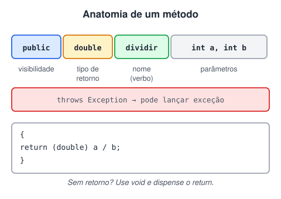

### Como nomear métodos

Não é obrigatório, mas seguir as convenções deixa o código legível para você e para o time:

- O nome deve ser um **verbo** (ação).
- Use **camelCase**: tudo minúsculo, com a inicial de cada palavra a partir da segunda em maiúscula.

```java
somar(int n1, int n2) {}
abrirConexao() {}
concluirProcessamento() {}
findById(int id) {}  // você verá muitos métodos em inglês
calcularImprimir() {} // problema: deveria ter uma única finalidade
```

> ⚠️ Em Java **não existem métodos globais**: todo método precisa estar dentro de uma classe.

### Como definir um método: 5 perguntas

1. **Qual é a finalidade do método?** Pergunte até entender exatamente o que ele deve fazer — e garanta que seja **uma** coisa só.
2. **Qual o tipo de retorno?** O método devolve algum valor? Se não devolver nada, o tipo é `void`.
3. **Quais parâmetros são necessários?** Que informações ele precisa receber para trabalhar?
4. **Ele pode lançar alguma exceção?** Se algo pode dar errado (ex.: divisão por zero, arquivo inexistente), é preciso prever e tratar.
5. **Qual a visibilidade?** Visível para toda a aplicação (`public`), só para o pacote (padrão), para subclasses (`protected`) ou só para a própria classe (`private`).

### Exemplo

```java
public class MinhaClasse {

  public double somar(int num1, int num2) {
    return num1 + num2; // devolve o resultado
  }

  public void imprimir(String texto) {
    System.out.println(texto); // void: não precisa de return
  }

  // throws: avisa que o método pode lançar uma exceção
  public double dividir(int dividendo, int divisor) throws Exception {
    if (divisor == 0) {
      throw new Exception("Divisor não pode ser zero");
    }
    return (double) dividendo / divisor;
  }

  // private: só pode ser usado dentro desta classe
  private void metodoPrivado() {}

  // ---- equívocos comuns ----

  public void validar() {
    // um método de validação deveria retornar boolean (true/false)
  }

  public void calcularEnviar() {
    // faz duas coisas: separe em calcular() e enviar()
  }

  // muitos parâmetros soltos...
  public void gravarCliente(String nome, String cpf, String telefone) {}

  // ...ficam melhor agrupados em um objeto
  public void gravar(Cliente cliente) {}
}
```

> 🛠️ **Correções no código:** o exemplo original tinha `return ... ;` e `throws Exception{}` sem corpo nem retorno (não compilam) — completei os métodos. Também troquei `Integer telefone` por `String telefone` (telefone tem zeros e símbolos, não é número para contas) e removi o `....` da lista de parâmetros, que não é sintaxe válida.

## Escopo

> 💡 **Escopo** é a região do código onde uma variável existe e pode ser usada. Em Java, ele é definido pelo **bloco** `{ }` onde a variável foi declarada.

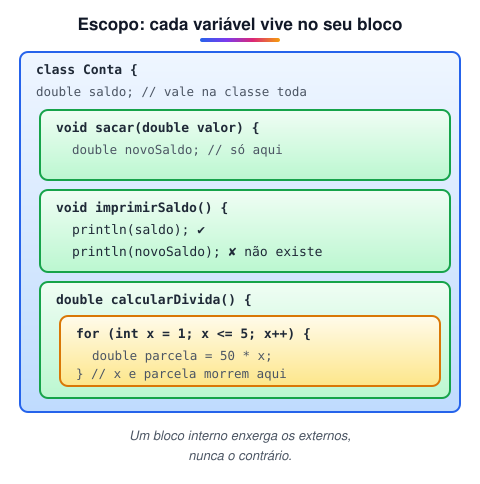

### Como funciona

- A variável passa a existir quando é **declarada** e deixa de existir quando a execução **sai do bloco** onde ela foi criada. Fora desse bloco, ela não pode ser lida nem alterada.
- **Atributos** (declarados no corpo da classe) são visíveis em **todos os métodos** da classe.
- **Variáveis locais** (declaradas dentro de um método) só existem **dentro daquele método**.
- **Variáveis de bloco** (dentro de `for`, `if`, `while`…) só existem **dentro daquele bloco**.
- Regra de ouro: **um bloco interno enxerga as variáveis dos blocos externos, mas nunca o contrário.**

Dominar escopo evita erros estruturais: variáveis "sumindo", valores que não são atualizados e conflitos de nomes.

### Exemplo

```java
public class Conta {
  // atributo: disponível em toda a classe
  double saldo = 10.0;

  public void sacar(double valor) {
    // variável local: só existe dentro de sacar()
    double novoSaldo = saldo - valor;
    saldo = novoSaldo; // atualiza o atributo
  }

  public void imprimirSaldo() {
    System.out.println(saldo);  // OK: atributo é visível aqui
    // System.out.println(novoSaldo); // ERRO: novoSaldo só existe em sacar()
  }

  public double calcularDividaExponencial() {
    double valorParcela = 50.0;  // variável local
    double valorMontante = 0.0;

    for (int x = 1; x <= 5; x++) {  // x: escopo do for
      // recriada a cada volta do laço
      double valorCalculado = valorParcela * x;
      valorMontante = valorMontante + valorCalculado;
    }
    // x e valorCalculado NÃO existem aqui fora

    return valorMontante; // 750.0
  }
}
```

> 🛠️ **Correção no código:** no original, `imprimirSaldo()` tentava imprimir `novoSaldo`, o que **não compila** (era a ideia do exemplo, mas a linha estava ativa). Deixei comentada com a explicação. Também fiz `sacar()` atualizar o `saldo` — antes o cálculo era feito e perdido — e troquei `Double` por `double`, mais adequado para um parâmetro simples.

## Palavras reservadas

> 💡 **Palavras reservadas** já têm um significado para a linguagem, então **não podem** ser usadas como nomes de variáveis, classes, métodos ou atributos. Todas são escritas em minúsculas e a IDE costuma destacá-las com uma cor própria.

### Referência

🔗 [http://www.linhadecodigo.com.br/artigo/83/as-52-palavras-reservadas-do-java.aspx](http://www.linhadecodigo.com.br/artigo/83/as-52-palavras-reservadas-do-java.aspx)

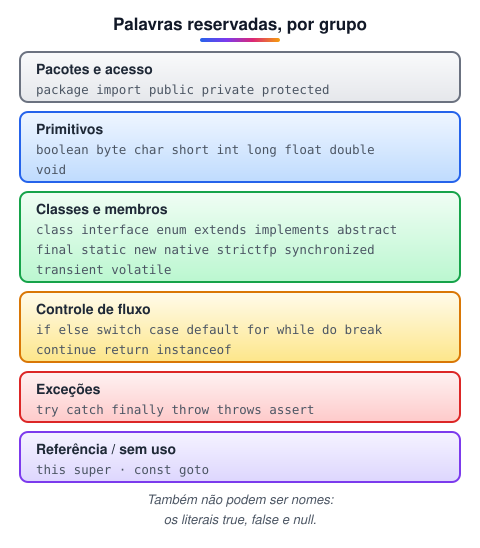

> 🛠️ **Ajuste:** a lista clássica fala em "52 palavras", mas isso inclui os literais `true`, `false` e `null`, que tecnicamente não são *keywords*. Versões mais novas do Java adicionaram `enum` (Java 5) e palavras contextuais como `var`, `record`, `yield` e `sealed`. A tabela de primitivos também dizia que `short` tem 32 bits — o correto é **16 bits**.

### Por grupo

#### Controle de pacotes

| Palavra | Uso |
| --- | --- |
| `package` | Diz a qual pacote as classes do arquivo pertencem |
| `import` | Traz classes de outros pacotes para o código |

#### Modificadores de acesso

| Palavra | Quem acessa |
| --- | --- |
| `public` | Qualquer classe |
| `protected` | Classes do mesmo pacote e subclasses |
| `private` | Apenas a própria classe |

#### Tipos primitivos e `void`

| Palavra | Descrição |
| --- | --- |
| `boolean` | verdadeiro ou falso |
| `byte` | inteiro de 8 bits, com sinal |
| `short` | inteiro de **16** bits, com sinal |
| `int` | inteiro de 32 bits, com sinal |
| `long` | inteiro de 64 bits, com sinal |
| `float` | ponto flutuante de 32 bits |
| `double` | ponto flutuante de 64 bits |
| `char` | um caractere Unicode (16 bits, sem sinal) |
| `void` | indica que o método **não retorna** valor |

#### Modificadores de classes, variáveis e métodos

| Palavra | Uso |
| --- | --- |
| `class` | Declara uma classe |
| `interface` | Declara uma interface |
| `enum` | Declara um conjunto fixo de constantes |
| `extends` | Indica a superclasse que está sendo estendida |
| `implements` | Indica as interfaces que a classe implementa |
| `abstract` | Classe que não pode ser instanciada / método sem corpo que a subclasse deve implementar |
| `final` | Classe não pode ser estendida, método não pode ser sobrescrito, variável não pode ser reatribuída |
| `static` | Membro pertence à **classe**, não aos objetos |
| `new` | Cria um objeto, chamando seu construtor |
| `native` | Método implementado em outra linguagem (ex.: C) |
| `strictfp` | Força regras rígidas de ponto flutuante (sem efeito desde o Java 17) |
| `synchronized` | Só uma thread por vez executa o método/bloco |
| `transient` | Campo ignorado na serialização |
| `volatile` | Variável compartilhada entre threads, sempre lida da memória principal |

#### Controle de fluxo

| Palavra | Uso |
| --- | --- |
| `if` / `else` | Executa um bloco conforme uma condição / o bloco alternativo |
| `switch` / `case` / `default` | Escolhe um bloco conforme o valor de uma variável / caso padrão |
| `for` | Laço com contador |
| `while` | Repete enquanto a condição for verdadeira |
| `do` | Executa uma vez e depois testa a condição (`do…while`) |
| `break` | Sai do laço ou do `switch` |
| `continue` | Pula para a próxima volta do laço |
| `return` | Encerra o método (e pode devolver um valor) |
| `instanceof` | Testa se um objeto é de determinada classe ou interface |

#### Tratamento de erros

| Palavra | Uso |
| --- | --- |
| `try` | Bloco que pode lançar uma exceção |
| `catch` | Bloco que trata a exceção |
| `finally` | Bloco que sempre executa, com ou sem exceção |
| `throw` | **Lança** uma exceção |
| `throws` | **Declara** que o método pode lançar uma exceção |
| `assert` | Verifica uma suposição durante o desenvolvimento |

#### Variáveis de referência

| Palavra | Refere-se a… |
| --- | --- |
| `this` | O próprio objeto atual |
| `super` | A superclasse imediata |

#### Reservadas, mas sem uso

- `const` — não use para constantes; use `static final`.
- `goto` — nunca implementada, por ser considerada prejudicial.

#### Literais reservados

Pela especificação, `null`, `true` e `false` são **literais**, não *keywords* — mas também não podem ser usados como nomes.

### Onde cada palavra aparece

| Uso | Palavras | Observação |
| --- | --- | --- |
| Arquivo | `package`, `import`, `import static` | Sempre no topo do arquivo |
| Classe | `public`  • `final` ou `abstract`  • `extends` / `implements` | `private` e `protected` só em classes internas |
| Método | `public`/`protected`/`private`  • `static`, `final` ou `abstract`  • tipo de retorno ou `void` | `return` para devolver valor |
| Atributo | `public`/`protected`/`private`  • `static` e/ou `final`  • tipo | Tipo pode ser primitivo ou classe |

### Palavras "opostas"

| Palavra | Palavra | Diferença |
| --- | --- | --- |
| `package` | `import` | `package` diz **onde a classe está**; `import` diz **de onde trazer** outra classe (importante quando há classes com o mesmo nome em pacotes diferentes) |
| `extends` | `implements` | `extends`: classe herda de classe (ou interface de interface); `implements`: classe implementa interface |
| `final` | `abstract` | `final` **impede** alterações (herança, sobrescrita, reatribuição); `abstract` **exige** que a subclasse implemente. Se uma classe tem um método abstrato, ela inteira precisa ser abstrata |
| `throws` | `throw` | `throws` **avisa** que o método pode lançar uma exceção; `throw` **lança** a exceção de fato (mais detalhes em Exceções) |

## Java Doc

> 💡 O Java sempre teve uma **documentação oficial rica**: dá para explorar pacotes, classes e métodos sem escrever uma linha de código. Saber ler documentação é uma das habilidades que mais separam iniciantes de devs avançados.

### Documentação oficial

🔗 [https://docs.oracle.com/en/java/javase/21/docs/api/index.html](https://docs.oracle.com/en/java/javase/21/docs/api/index.html)

🔗 [https://docs.oracle.com/javase/8/docs/technotes/guides/troubleshoot/index.html](https://docs.oracle.com/javase/8/docs/technotes/guides/troubleshoot/index.html)

> 🛠️ **Ajuste de link:** o link original apontava para o guia de *troubleshooting* do Java 8, não para a documentação da API. Mantive-o e adicionei acima o link da **API do Java 21** (versão LTS), onde ficam as classes e métodos documentados.

### Tipos de comentário

```java
// Comentário de uma linha

/* Comentário de
   várias linhas */

/**
 * Comentário de documentação (Javadoc).
 * Começa com /** e é usado para gerar a documentação.
 */
```

### Tags do Javadoc

| Tag | Descrição |
| --- | --- |
| `@author` | Autor / criador |
| `@version` | Versão do recurso |
| `@since` | Versão ou data em que o recurso passou a existir |
| `@param` | Descreve um parâmetro do método |
| `@return` | Descreve o valor retornado |
| `@throws` | Exceção que o método pode lançar |
| `@see` | Referência a outra classe ou método relacionado |
| `@deprecated` | Indica que o recurso não deve mais ser usado |

> 🛠️ **Correção:** a tag é `@author` (em inglês). Com `@autor` o Javadoc não reconhece a informação.

#### Exemplo documentado

```java
/**
 * Realiza operações matemáticas simples.
 *
 * @author Ana Souza
 * @version 1.0
 * @since 2023
 */
public class Calculadora {

    /**
     * Divide dois números inteiros.
     *
     * @param dividendo número a ser dividido
     * @param divisor   número que divide; não pode ser zero
     * @return o resultado da divisão como double
     * @throws ArithmeticException se o divisor for zero
     */
    public double dividir(int dividendo, int divisor) {
        if (divisor == 0) throw new ArithmeticException("Divisor zero");
        return (double) dividendo / divisor;
    }
}
```

### A ferramenta `javadoc`

- O **Javadoc** é um gerador de documentação criado pela Sun que lê os comentários `/** */` do código-fonte e produz páginas **HTML** — exatamente no formato da documentação oficial do Java.
- É o padrão de documentação de classes Java, e as IDEs conseguem gerá-lo automaticamente (e mostrar esses comentários quando você passa o mouse sobre um método).

Gerando a documentação pelo terminal:

```bash
javadoc -encoding UTF-8 -docencoding UTF-8 -charset UTF-8 -d ../docs src/*.java
```

- `-encoding`: codificação dos arquivos `.java`.
- `-docencoding` / `-charset`: codificação do HTML gerado (use UTF-8 para acentos aparecerem corretamente).
- `-d ../docs`: pasta de destino.

> 🛠️ **Correção no comando:** o original usava `-docencoding ISO-8859-1`, o que pode quebrar os acentos no HTML. Com tudo em **UTF-8** o resultado fica consistente. Também troquei o bloco de `java` para `bash`, já que é um comando de terminal.

### Link útil

🔗 [Javadoc](https://pt.wikipedia.org/wiki/Javadoc)

## Terminal

> 💡 A IDE é só uma ferramenta de desenvolvimento. Para rodar um programa Java basta ter a **JVM** — e o terminal mostra o que a IDE faz "por baixo dos panos".

### Links úteis

🔗 [https://code.visualstudio.com/docs/java/java-debugging](https://code.visualstudio.com/docs/java/java-debugging)

🔗 [Pass parameters when debugging vscode java. [Note]](https://linuxtut.com/pass-parameters-when-debugging-vscode-java.-note-462e0/)

### Por que aprender a rodar pelo terminal?

- Seus clientes não vão instalar Eclipse ou VS Code para usar o sistema. Com a JVM configurada, o programa pode ser empacotado (ex.: um `.jar`) e executado em qualquer sistema operacional.
- Servidores normalmente não têm interface gráfica: tudo é feito por linha de comando.
- Entender `javac` e `java` ajuda a resolver erros de *classpath* e de compilação.

### A classe de exemplo

Crie o arquivo `MinhaClasse.java`:

```java
public class MinhaClasse {
  public static void main(String[] args) {
    System.out.println("Oi, fui executado pelo Terminal");
  }
}
```

### Onde ficam os arquivos

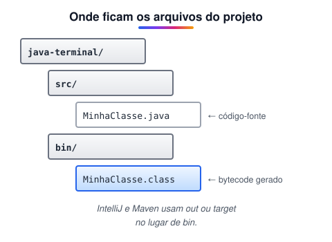

- Um projeto criado pela IDE tem a pasta do **código-fonte** (`src`) e a pasta de **saída** com os arquivos `.class` (o bytecode). No Eclipse ela se chama `bin`; no IntelliJ, `out`; em projetos Maven, `target/classes`.
- Mesmo usando IDE, é importante saber **onde** estão as classes do projeto. No exemplo: `C:\estudos\dio-trilha-java-basico\java-terminal`.

### Executando pelo terminal

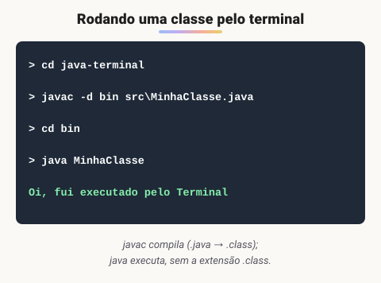

1. Abra o **Prompt de Comando**, o **PowerShell** ou o terminal do VS Code.
2. Vá até a pasta do projeto:<br>`cd C:\estudos\dio-trilha-java-basico\java-terminal`
3. *(Se ainda não compilou pela IDE)* compile, mandando o `.class` para a pasta `bin`:<br>`javac -d bin src\MinhaClasse.java`
4. Entre na pasta `bin`:<br>`cd bin`
5. Execute a classe — informe o nome **sem** a extensão `.class`:<br>`java MinhaClasse`

> ✨ **Dicas:**
>
> - Sem entrar na pasta: `java -cp bin MinhaClasse` (`-cp` = *classpath*, onde procurar as classes).
> - Desde o Java 11, um arquivo único pode ser executado direto, sem compilar antes: `java src\MinhaClasse.java`.
> - Argumentos depois do nome da classe chegam no `String[] args` do `main`: `java MinhaClasse Ana 25`.

> 🛠️ **Complemento:** o passo a passo original pulava a **compilação** (`javac`), supondo que a IDE já tinha gerado o `.class`. Incluí o comando para que o roteiro funcione também fora da IDE.

## 📌 Resumo

| Item | Em uma frase |
| --- | --- |
| Classe | arquivo `NomeDaClasse.java` com atributos e métodos; nomes em PascalCase |
| Tipos primitivos | `byte`, `short`, `int`, `long`, `float`, `double`, `char`, `boolean` |
| Constante | `final` impede nova atribuição; nome em MAIÚSCULAS |
| Operadores | atribuição, aritméticos, unários, ternário, relacionais e lógicos (`&&` e `\|\|` fazem curto-circuito) |
| Método | tipo de retorno, nome no infinitivo e parâmetros; uma única responsabilidade |
| Escopo | a variável só existe dentro do bloco `{ }` em que foi declarada |
| Javadoc | comentários `/** */` com tags como `@param` e `@return` viram documentação |
| Terminal | `javac Arquivo.java` compila; `java Arquivo` executa |
