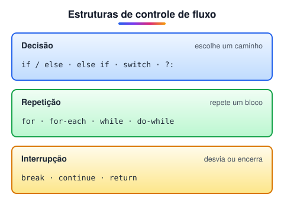
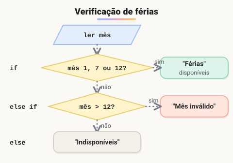
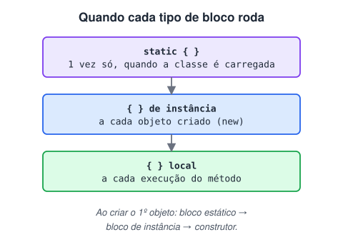

# Lógica condicional e controle de fluxos em Java

> 🗺️ **Nesta aula:** operadores relacionais e lógicos com suas tabelas-verdade, as estruturas de decisão `if`/`else` e `switch`, e os tipos de bloco de código do Java.

## Operadores relacionais

> 💡 **Operadores relacionais** comparam dois operandos e devolvem sempre um `boolean` (`true` ou `false`). São a base de qualquer `if` ou laço.

### Tipos

| Grupo | Operador | Significado | Exemplo (`a = 10`, `b = 20`) |
| --- | --- | --- | --- |
| Igualdade | `==` | igual a | `a == b` → `false` |
|  | `!=` | diferente de | `a != b` → `true` |
| Tamanho | `>` | maior que | `a > b` → `false` |
|  | `>=` | maior ou igual a | `a >= 10` → `true` |
|  | `<` | menor que | `a < b` → `true` |
|  | `<=` | menor ou igual a | `b <= 10` → `false` |

> ⚠️ - `=` **atribui**; `==` **compara**. Confundir os dois é um dos erros mais comuns.
> - Para comparar `String` e outros objetos, use `.equals()`, não `==`.
> - `char` também pode ser comparado: a comparação usa o código Unicode (`'x' < 'y'` é `true`).

### Exercício: comparando variáveis

```java
public class ExercicioOperadoresRelacionais {
  public static void main(String[] args) {
    int i1 = 10;
    int i2 = 20;
    float f1 = 4.5f;
    float f2 = 3.5f;
    char c1 = 'x';
    char c2 = 'y';

    System.out.println("i1 é igual a i2? " + (i1 == i2));  // false
    System.out.println("i1 é diferente de i2? " + (i1 != i2));  // true
    System.out.println("i1 é maior que i2? " + (i1 > i2));  // false
    System.out.println("i1 é menor ou igual a i2? " + (i1 <= i2));  // true

    System.out.println("f1 é igual a f2? " + (f1 == f2));  // false
    System.out.println("f1 é diferente de f2? " + (f1 != f2));  // true
    System.out.println("f1 é maior ou igual a f2? " + (f1 >= f2));  // true
    System.out.println("f1 é menor que f2? " + (f1 < f2));  // false

    System.out.println("c1 é igual a c2? " + (c1 == c2));  // false
    System.out.println("c1 é diferente de c2? " + (c1 != c2));  // true
    System.out.println("c1 é maior que c2? " + (c1 > c2));  // false
    System.out.println("c1 é menor ou igual a c2? " + (c1 <= c2));  // true
  }
}
```

> 🛠️ **Correções no código:** algumas mensagens não batiam com o operador usado — "menor ou igual" usava `<`, e "maior que" usava `>=`. Ajustei os operadores para corresponder ao texto. Também removi variáveis declaradas e nunca usadas (`d1`, `s1`…`s3`, `b1`, `b2`, `l1`, `l2`, `y1`, `st`) e adicionei o resultado esperado de cada linha.

## Operadores lógicos

> 💡 **Operadores lógicos** combinam valores ou expressões booleanas e devolvem um novo `boolean`. Permitem montar condições como "maior de idade **e** com documento".

### Resumo

| Operação | Operador | Verdadeiro quando… |
| --- | --- | --- |
| Conjunção (E / *and*) | `&&` | **as duas** partes são verdadeiras |
| Disjunção (OU / *or*) | `\|\|` | **pelo menos uma** parte é verdadeira |
| Disjunção exclusiva (OU exclusivo / *xor*) | `^` | as partes são **diferentes** entre si |
| Negação (NÃO / *not*) | `!` | a parte é **falsa** (inverte o valor) |

### Tabelas-verdade

#### Conjunção `&&`

| A | B | A && B |
| --- | --- | --- |
| true | true | **true** |
| true | false | false |
| false | true | false |
| false | false | false |

#### Disjunção `||`

| A | B | A \|\| B |
| --- | --- | --- |
| true | true | **true** |
| true | false | **true** |
| false | true | **true** |
| false | false | false |

#### Disjunção exclusiva `^`

| A | B | A ^ B |
| --- | --- | --- |
| true | true | false |
| true | false | **true** |
| false | true | **true** |
| false | false | false |

#### Negação `!`

| A | !A |
| --- | --- |
| true | false |
| false | true |

> 📌 **Curiosidades — operadores que confundem iniciantes:**
>
> - `&` **e** `|`: com **inteiros**, são operadores *bitwise* (operam bit a bit). Com **booleanos**, funcionam como E/OU lógicos **sem curto-circuito** — avaliam sempre os dois lados, ao contrário de `&&` e `||`.
> - **Deslocamento (*shift*)**: `<<`, `>>` e `>>>` deslocam os bits de um inteiro para a esquerda ou direita (`1 << 3` = 8).
> - `~`: complemento bit a bit — inverte todos os bits de um inteiro (`~5` = -6).

> 🛠️ **Correção:** o texto original listava `~` entre os operadores de *shift*. Na verdade `~` é o **NOT bit a bit**; os de deslocamento são só `<<`, `>>` e `>>>`. Também ajustei a explicação de `&` e `|`: com booleanos eles **são** operadores lógicos válidos (só não fazem curto-circuito).

### Exercício: demonstrando os operadores

```java
public class ExercicioOperadoresLogicos {
  public static void main(String[] args) {
    boolean b1 = true;
    boolean b2 = false;
    boolean b3 = true;
    boolean b4 = false;

    int i1 = 10;
    int i2 = 5;
    float f1 = 20f;
    float f2 = 50f;

    System.out.println("and: " + (b1 && b2)); // false
    System.out.println("and: " + (b1 && b3)); // true
    System.out.println("or:  " + (b1 || b2)); // true
    System.out.println("or:  " + (b2 || b4)); // false
    System.out.println("xor: " + (b1 ^ b2));  // true
    System.out.println("xor: " + (b2 ^ b4));  // false
    System.out.println("not: " + !b1);  // false
    System.out.println("not: " + !b2);  // true

    // combinando com expressões relacionais
    System.out.println((i1 + i2) < (f2 - f1) && true); // 15 < 30 && true → true
    System.out.println((i1 > i2) || (f2 < f1));  // true || false → true
  }
}
```

## Estruturas de controle de fluxo

> 💡 **Estruturas de controle de fluxo** decidem **qual** trecho do código roda, **quantas vezes** roda e **quando parar**.



| Grupo | Estruturas | Para quê |
| --- | --- | --- |
| Decisão | `if`, `if-else`, `if-else-if`, `switch`, ternário `?:` | Escolher entre caminhos |
| Repetição | `for`, `for-each`, `while`, `do-while` | Repetir um bloco |
| Interrupção | `break`, `continue`, `return` | Sair de um laço, pular uma volta ou encerrar o método |

### Exercício 1: mês atual e férias

> Crie uma estrutura `if` que mostre o mês de acordo com o número digitado e outra que diga se as férias estão disponíveis. Os meses de férias são janeiro, julho e dezembro.



```java
import java.util.Scanner;

public class ExercicioControleDeFluxo1 {
  public static void main(String[] args) {
    Scanner input = new Scanner(System.in);
    System.out.println("Digite o número do mês atual: ");
    int mesAtual = input.nextInt();

    if (mesAtual == 1) {
      System.out.println("Estamos no mês de Janeiro");
    } else if (mesAtual == 2) {
      System.out.println("Estamos no mês de Fevereiro");
    } else if (mesAtual == 3) {
      System.out.println("Estamos no mês de Março");
    } else if (mesAtual == 4) {
      System.out.println("Estamos no mês de Abril");
    } else if (mesAtual == 5) {
      System.out.println("Estamos no mês de Maio");
    } else if (mesAtual == 6) {
      System.out.println("Estamos no mês de Junho");
    } else if (mesAtual == 7) {
      System.out.println("Estamos no mês de Julho");
    } else if (mesAtual == 8) {
      System.out.println("Estamos no mês de Agosto");
    } else if (mesAtual == 9) {
      System.out.println("Estamos no mês de Setembro");
    } else if (mesAtual == 10) {
      System.out.println("Estamos no mês de Outubro");
    } else if (mesAtual == 11) {
      System.out.println("Estamos no mês de Novembro");
    } else if (mesAtual == 12) {
      System.out.println("Estamos no mês de Dezembro");
    } else {
      System.out.println("Erro! Mês inválido. Escolha entre 1 e 12.");
    }

    if (mesAtual == 1 || mesAtual == 7 || mesAtual == 12) {
      System.out.println("Período de férias disponível.");
    } else if (mesAtual < 1 || mesAtual > 12) {
      System.out.println("Erro no mês escolhido!");
    } else {
      System.out.println("Período de férias indisponível. "
          + "Os meses de férias são janeiro, julho e dezembro.");
    }

    input.close();
  }
}
```

> ✨ **Versão mais enxuta:** quando há uma lista de valores fixos, um array evita a longa cadeia de `else if`:
>
> ```java
> String[] meses = {"Janeiro", "Fevereiro", "Março", "Abril", "Maio", "Junho",
>     "Julho", "Agosto", "Setembro", "Outubro", "Novembro", "Dezembro"};
> if (mesAtual >= 1 && mesAtual <= 12) {
>   System.out.println("Estamos no mês de " + meses[mesAtual - 1]);
> }
> ```

> 🛠️ **Ajustes no código:** renomeei `mes_atual` para `mesAtual` (em Java a convenção é **camelCase**, não *snake_case*), corrigi "Periodo/mêses" para "Período/meses", removi parênteses desnecessários e fechei o `Scanner` no final.

### Prática 2: `switch`

> Com `switch`, mostre o nome do dia da semana a partir do seu número. Depois, faça outro `switch` em que, se o número for de 1 a 3, mostre "certo"; se for 4, "errado"; se for 5, "talvez"; para os demais, "valor não definido".

```java
import java.util.Scanner;

public class ExercicioControleDeFluxo2 {
  public static void main(String[] args) {
    Scanner input = new Scanner(System.in);

    System.out.println("Digite o número do dia da semana (de 1 a 7):");
    int numeroDiaSemana = input.nextInt();

    // switch "enhanced" (Java 14+): sem break, com ->
    switch (numeroDiaSemana) {
      case 1 -> System.out.println("Hoje é domingo");
      case 2 -> System.out.println("Hoje é segunda-feira");
      case 3 -> System.out.println("Hoje é terça-feira");
      case 4 -> System.out.println("Hoje é quarta-feira");
      case 5 -> System.out.println("Hoje é quinta-feira");
      case 6 -> System.out.println("Hoje é sexta-feira");
      case 7 -> System.out.println("Hoje é sábado");
      default -> System.out.println("Erro! Opção inválida.");
    }

    System.out.println("Digite um número de 1 a 5:");
    int numeroDaSorte = input.nextInt();

    // switch tradicional: precisa de break para não "cair" no próximo case
    switch (numeroDaSorte) {
      case 1, 2, 3:
        System.out.println("Certo");
        break;
      case 4:
        System.out.println("Errado");
        break;
      case 5:
        System.out.println("Talvez");
        break;
      default:
        System.out.println("Valor não definido.");
    }

    input.close();
  }
}
```

> 📌 - `switch` **tradicional (**`case X:`**)**: sem `break`, a execução continua nos `case` seguintes (*fall-through*).
> - `switch` **com seta (**`case X ->`**)**: disponível a partir do **Java 14**; não precisa de `break` e pode até devolver um valor.
> - `case 1, 2, 3` (vários valores no mesmo `case`) também exige **Java 14+**. Em versões antigas, escreva `case 1: case 2: case 3:`.
> - O enunciado pedia o `switch` a partir de uma **String** (o nome do dia). Isso também é possível: `switch (dia) { case "segunda" -> ... }`.

## Blocos de código

> 💡 Um **bloco de código** é um conjunto de instruções agrupadas entre chaves `{ }` e executadas juntas. Ele também define o **escopo** das variáveis declaradas dentro dele.

### Definição

- Um bloco pode conter declarações de variáveis, contas, chamadas de métodos, estruturas de controle (`if`, `for`, `while`…) e outros blocos.
- Blocos organizam o código: deixam claro o que pertence a cada estrutura e tornam o programa mais legível e fácil de manter.
- Quando um `if`, `for` ou `while` tem **apenas uma instrução**, as chaves são opcionais — mas é boa prática **usá-las sempre**, para evitar erros ao adicionar linhas depois.

### Tipos de bloco



| Tipo | Onde fica | Quando executa |
| --- | --- | --- |
| Estático (`static { }`) | Direto no corpo da classe | **Uma única vez**, quando a classe é carregada pela JVM |
| De instância (`{ }`) | Direto no corpo da classe, sem `static` | **A cada objeto criado** com `new`, antes do construtor |
| Local (`{ }`) | Dentro de um método | Quando a execução do método chega nele |

### Prática: vendo os blocos em ação

```java
public class ExemploBlocosCodigo {

  // Bloco ESTÁTICO: roda uma vez, quando a classe é carregada
  static {
    System.out.println("1) Bloco estático: classe carregada.");
  }

  // Bloco de INSTÂNCIA: roda a cada new, antes do construtor
  {
    System.out.println("3) Bloco de instância: objeto sendo criado.");
  }

  public ExemploBlocosCodigo() {
    System.out.println("4) Construtor executado.");
  }

  public static void main(String[] args) {
    System.out.println("2) Início do main.");

    // Bloco LOCAL: suas variáveis só existem aqui dentro
    {
      int numero = 10;
      System.out.println("Bloco local, número = " + numero);
    }
    // System.out.println(numero); // ERRO: numero não existe fora do bloco

    new ExemploBlocosCodigo();
    new ExemploBlocosCodigo(); // bloco de instância roda de novo; o estático não
  }
}
```

**Saída:**

```
1) Bloco estático: classe carregada.
2) Início do main.
Bloco local, número = 10
3) Bloco de instância: objeto sendo criado.
4) Construtor executado.
3) Bloco de instância: objeto sendo criado.
4) Construtor executado.
```

> 🛠️ **Correção no exemplo:** o código original chamava de "bloco de instância" um bloco `{ }` **dentro de um método de instância** — que na verdade é um **bloco local**. Um bloco de instância de verdade fica **direto no corpo da classe** e roda a cada `new`, antes do construtor. Reescrevi o exemplo para mostrar os três tipos e a ordem em que executam.

## 📌 Resumo

| Item | Em uma frase |
| --- | --- |
| Relacionais | `==`, `!=`, `>`, `<`, `>=`, `<=` comparam e devolvem `boolean` |
| Lógicos | `&&` (E), `\|\|` (OU) e `!` (NÃO) combinam condições |
| `if` / `else if` / `else` | escolhe um caminho conforme as condições, testadas em ordem |
| `switch` | escolhe entre valores fixos; no formato tradicional, sem `break` a execução continua no próximo `case` |
| `switch` com `->` | formato moderno: sem `break` e sem cair no próximo caso |
| Blocos | trechos entre `{ }` que definem o escopo das variáveis |
