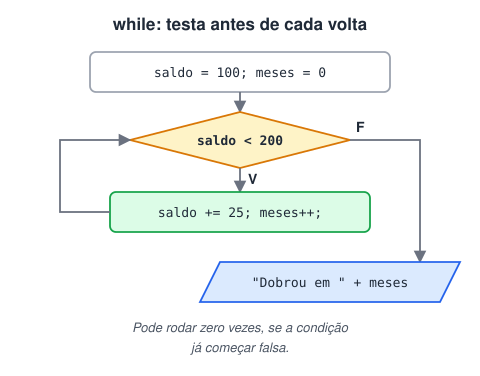
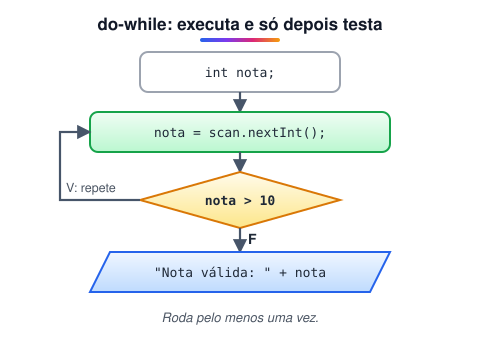
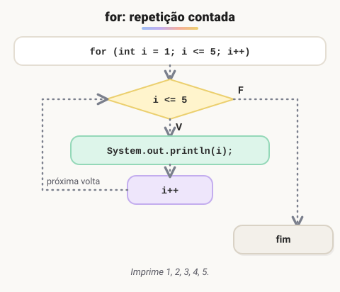
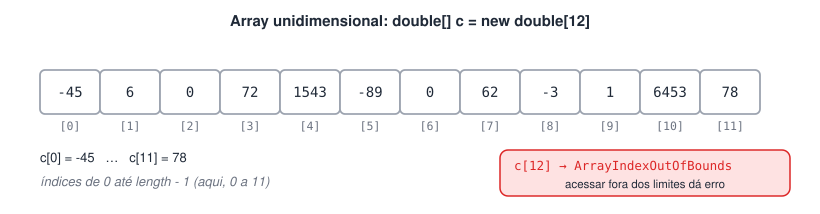
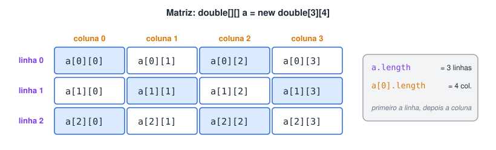

# Estruturas de repetição e arrays em Java

> 🧭 **Nesta aula:** como repetir código com `while`, `do-while` e `for`, e como guardar vários valores em vetores e matrizes — com exercícios resolvidos.

## Visão geral

> 💡 **Laços** repetem um bloco de código; **arrays** guardam vários valores do mesmo tipo em uma única variável. Os dois quase sempre andam juntos: usamos um laço para percorrer um array.

### Estruturas de repetição

Servem para executar um bloco várias vezes — enquanto uma condição for verdadeira ou por um número definido de vezes. A escolha depende da lógica:

| Estrutura | Teste da condição | Use quando… |
| --- | --- | --- |
| `while` | **antes** de cada volta | não se sabe quantas voltas serão necessárias |
| `do-while` | **depois** de cada volta | o bloco precisa rodar **pelo menos uma vez** (ex.: menu, validação de entrada) |
| `for` | antes, com contador | o número de voltas é conhecido |
| `for-each` | percorre cada elemento | é preciso visitar todos os itens de um array ou coleção |

#### `while` — teste no início



#### `do-while` — teste no final



#### `for` — repetição contada



#### Comandos complementares

- `break`: encerra o laço imediatamente.
- `continue`: pula o restante da volta atual e vai direto para o próximo teste da condição.

```java
for (int i = 1; i <= 10; i++) {
  if (i % 2 == 0) continue; // pula os pares
  if (i > 7) break;  // para tudo depois do 7
  System.out.print(i + " "); // 1 3 5 7
}
```

### Incremento e decremento: pré x pós

```java
// Pré-fixado (++i): incrementa ANTES de usar o valor
System.out.println("Incremento pré-fixado:");
for (int i = 0; i < 5; ++i) {
  System.out.println("Valor de i: " + i);
}

// Pós-fixado (j++): usa o valor e DEPOIS incrementa
System.out.println("Incremento pós-fixado:");
int j = 0;
while (j < 5) {
  System.out.println("Valor de j: " + j);
  j++;
}
```

> 📌 Nos dois exemplos a saída é igual (0 a 4), porque o incremento está **sozinho** na instrução. A diferença entre `++i` e `i++` só aparece quando o valor é usado na mesma expressão: `int a = 5; int b = a++;` → `b = 5`, `a = 6`; já `int b = ++a;` → `b = 6`, `a = 6`.

### Operadores de atribuição composta

| Operador | Equivale a | Exemplo | Resultado |
| --- | --- | --- | --- |
| `+=` | `x = x + valor` | `numero = 10; numero += 5;` | 15 |
| `-=` | `x = x - valor` | `numero = 10; numero -= 5;` | 5 |
| `*=` | `x = x * valor` | `numero = 5; numero *= 3;` | 15 |
| `/=` | `x = x / valor` | `numero = 20; numero /= 4;` | 5 |
| `%=` | `x = x % valor` | `numero = 17; numero %= 5;` | 2 |

> 🛠️ **Correções no texto:** a explicação do `-=` estava como "variavel = variavel valor" (faltava o `-`) e a do `*=` mostrava apenas `=`. Ajustei e reuni tudo na tabela acima.

### Arrays

Um **array** guarda um conjunto de valores **do mesmo tipo** em uma única variável. Cada elemento é acessado por um **índice** que começa em **0** e vai até **tamanho − 1**. O tamanho é fixo depois de criado.

```java
tipo[] nomeDoArray = new tipo[tamanho];

// ou, já com valores:
int[] numeros = {10, 20, 30};
```

#### Array unidimensional (vetor)

Uma única "fila" de elementos, acessados por um índice.

```java
double[] c = new double[12]; // 12 posições: c[0] até c[11]

c[0] = -45;
c[1] = 6;
c[2] = 0;
c[3] = 72;
c[4] = 1543;
c[5] = -89;
c[6] = 0;
c[7] = 62;
c[8] = -3;
c[9] = 1;
c[10] = 6453;
c[11] = 78;
```



#### Array multidimensional (matriz)

Um array de arrays: um índice para a **linha** e outro para a **coluna**.

```java
double[][] a = new double[3][4]; // 3 linhas e 4 colunas
a[1][2] = 9.5;  // linha 1, coluna 2
```



> 🛠️ **Ajuste:** o texto original dizia "temos um índice para coluna e outro para linhas" — a ordem correta no Java é `[linha][coluna]`.

## Exercícios de estruturas de repetição

> 💡 Seis exercícios para praticar `while`, `do-while` e `for`. Tente resolver antes de abrir o código. Os nomes de variáveis foram ajustados para **camelCase**, a convenção do Java.

### 1. Nome e idade até digitar 0

> Leia pares de valores — nome do aluno e idade. O programa termina quando o nome digitado for `0`.

<details>
<summary>Ver resposta</summary>

```java
package loops;

import java.util.Scanner;

public class Ex1NomeEIdade {
  public static void main(String[] args) {
    Scanner input = new Scanner(System.in);

    while (true) {
      System.out.println("Digite o nome do aluno (0 para sair): ");
      String nomeAluno = input.next();

      if (nomeAluno.equals("0")) break; // condição de saída

      System.out.println("Digite a idade do aluno: ");
      int idadeAluno = input.nextInt();
      System.out.println("Aluno: " + nomeAluno + " | idade: " + idadeAluno);
    }

    System.out.println("Saí do laço de repetição.");
    input.close();
  }
}
```

</details>

> 📌 `input.next()` lê só **uma palavra**. Para nomes compostos ("Ana Maria"), use `input.nextLine()` — lembrando de consumir a quebra de linha que sobra depois do `nextInt()`.

### 2. Nota válida entre 0 e 10

> Peça uma nota entre 0 e 10. Se for inválida, mostre uma mensagem e continue pedindo até receber um valor válido.

<details>
<summary>Ver resposta</summary>

```java
package loops;

import java.util.Scanner;

public class Ex2Nota {
  public static void main(String[] args) {
    Scanner scan = new Scanner(System.in);
    double nota;

    do {
      System.out.println("Digite uma nota de 0 a 10: ");
      nota = scan.nextDouble();
      if (nota < 0 || nota > 10) {
        System.out.println("Erro! Nota inválida.");
      }
    } while (nota < 0 || nota > 10);

    System.out.println("A nota digitada foi: " + nota);
    scan.close();
  }
}
```

</details>

> 🛠️ **Ajuste:** troquei `int` por `double` — notas como 7,5 são comuns e seriam rejeitadas com `nextInt()`.

### 3. Maior número e média de 5 valores

> Leia 5 números e informe o maior deles e a média.

<details>
<summary>Ver resposta: Código sem arrays</summary>

```java
package loops;

import java.util.Scanner;

public class Ex3MaiorNumeroEMedia {
  public static void main(String[] args) {
    Scanner scan = new Scanner(System.in);
    int somaNumeros = 0;
    int maiorNumero = Integer.MIN_VALUE; // menor int possível

    for (int i = 0; i < 5; i++) {
      System.out.println("Digite o número " + (i + 1) + " de 5:");
      int numero = scan.nextInt();

      if (numero > maiorNumero) {
        maiorNumero = numero;
      }
      somaNumeros += numero;
    }

    System.out.println("O maior número digitado é: " + maiorNumero);
    System.out.println("A média dos 5 números é: " + (somaNumeros / 5.0));
    scan.close();
  }
}
```

</details>

<details>
<summary>Ver resposta: Código com arrays</summary>

```java
package loops;

import java.util.Arrays;
import java.util.Scanner;

public class Ex3MaiorNumeroEMediaArray {
  public static void main(String[] args) {
    Scanner scan = new Scanner(System.in);
    int[] numeros = new int[5];

    for (int i = 0; i < numeros.length; i++) {
      System.out.println("Digite o número " + (i + 1) + " de 5:");
      numeros[i] = scan.nextInt();
    }

    int maiorNumero = numeros[0];
    int somaNumeros = 0;
    for (int numero : numeros) {
      if (numero > maiorNumero) maiorNumero = numero;
      somaNumeros += numero;
    }
    double media = (double) somaNumeros / numeros.length;

    System.out.println("Números digitados: " + Arrays.toString(numeros));
    System.out.println("O maior número é: " + maiorNumero);
    System.out.println("A média é: " + media);
    scan.close();
  }
}
```

</details>

> 🛠️ **Correções:**
>
> - Na versão sem arrays, `maiorNumero` começava em `0`. Se todos os números fossem negativos (ex.: -3, -8, -1), o programa diria que o maior é **0**, que nem foi digitado. Agora começa em `Integer.MIN_VALUE`.
> - Nas duas versões, a média era calculada com **divisão inteira** (`soma / 5`), descartando as casas decimais: 1, 2, 2, 2, 2 dava 1 em vez de 1,8. Agora a divisão é feita com `5.0` / `(double)`.
> - Na versão com arrays, juntei os dois laços (maior e soma) em um único `for-each`.

### 4. Quantidade de pares e ímpares

> Peça *n* números inteiros e mostre quantos são pares e quantos são ímpares.

<details>
<summary>Ver resposta</summary>

```java
package loops;

import java.util.Scanner;

public class Ex4ParOuImpar {
  public static void main(String[] args) {
    Scanner scan = new Scanner(System.in);

    System.out.println("Quantos números você vai digitar? ");
    int quantNumeros = scan.nextInt();

    int pares = 0, impares = 0;
    for (int i = 0; i < quantNumeros; i++) {
      System.out.println("Digite o número " + (i + 1) + " de " + quantNumeros + ":");
      int numero = scan.nextInt();

      if (numero % 2 == 0) pares++;
      else impares++;
    }

    System.out.println("Números digitados: " + quantNumeros);
    System.out.println("Pares: " + pares + " | Ímpares: " + impares);
    scan.close();
  }
}
```

</details>

### 5. Gerador de tabuada (1 a 10)

> Gere a tabuada de qualquer número inteiro entre 1 e 10 informado pelo usuário.

<details>
<summary>Ver resposta</summary>

```java
package loops;

import java.util.Scanner;

public class Ex5Tabuada {
  public static void main(String[] args) {
    Scanner scan = new Scanner(System.in);
    int numero;

    do {
      System.out.println("Digite um número de 1 a 10 para montar a tabuada:");
      numero = scan.nextInt();
      if (numero < 1 || numero > 10) {
        System.out.println("Erro! Número inválido.");
      }
    } while (numero < 1 || numero > 10);

    System.out.println("Tabuada do " + numero + ":");
    for (int i = 1; i <= 10; i++) {
      System.out.println(numero + " x " + i + " = " + (numero * i));
    }
    scan.close();
  }
}
```

</details>

> 🛠️ **Ajustes:** "taboada" → **tabuada**. O laço original ia de 0 a 9 e somava 1 em todo lugar (`i + 1`); contar direto de 1 a 10 deixa o código mais legível, com o mesmo resultado.

### 6. Fatorial

> Calcule o fatorial de um número inteiro informado pelo usuário (ex.: 5! = 5 × 4 × 3 × 2 × 1 = 120).

<details>
<summary>Ver resposta</summary>

```java
package loops;

import java.util.Scanner;

public class Ex6Fatorial {
  public static void main(String[] args) {
    Scanner scan = new Scanner(System.in);

    System.out.println("Digite um número para calcular o fatorial: ");
    int numero = scan.nextInt();

    if (numero < 0) {
      System.out.println("Não existe fatorial de número negativo.");
    } else {
      long fatorial = 1;
      for (int i = numero; i >= 1; i--) {
        fatorial *= i;
      }
      System.out.println(numero + "! = " + fatorial);
    }
    scan.close();
  }
}
```

</details>

> 🛠️ **Correção:** com `int`, o fatorial **estoura** a partir de 13! (o resultado passa de 2,1 bilhões e vira um número errado, sem nenhum aviso). Com `long` o cálculo é correto até 20!. Também tratei números negativos, que antes resultavam em 1.

## Exercícios de arrays

> 💡 Quatro exercícios para praticar vetores e matrizes. Os nomes foram ajustados para **camelCase** e as classes para **PascalCase**, seguindo as convenções do Java.

### 1. Seis números na ordem inversa

> Crie um vetor de 6 inteiros e mostre-os na ordem inversa.

<details>
<summary>Ver resposta</summary>

```java
package arrays;

import java.util.Arrays;
import java.util.Scanner;

public class Ex1OrdemInversa {
  public static void main(String[] args) {
    Scanner scan = new Scanner(System.in);
    int[] numeros = new int[6];
    int[] inverso = new int[numeros.length];

    for (int i = 0; i < numeros.length; i++) {
      System.out.println("Digite o número " + (i + 1) + " de 6: ");
      numeros[i] = scan.nextInt();
    }

    // posição i vai para a posição espelhada (length - 1 - i)
    for (int i = 0; i < numeros.length; i++) {
      inverso[numeros.length - 1 - i] = numeros[i];
    }

    System.out.println("Ordem normal:  " + Arrays.toString(numeros));
    System.out.println("Ordem inversa: " + Arrays.toString(inverso));
    scan.close();
  }
}
```

</details>

### 2. Contando consoantes

> Leia um vetor de 6 caracteres, diga quantas consoantes foram lidas e imprima somente as consoantes.

<details>
<summary>Ver resposta</summary>

```java
package arrays;

import java.util.Arrays;
import java.util.Scanner;

public class Ex2Consoantes {
  public static void main(String[] args) {
    Scanner scan = new Scanner(System.in);
    char[] letras = new char[6];
    StringBuilder consoantes = new StringBuilder();
    int contaConsoantes = 0;

    for (int i = 0; i < letras.length; i++) {
      System.out.print("Digite a letra " + (i + 1) + " de 6: ");
      letras[i] = scan.next().charAt(0);

      char letra = Character.toLowerCase(letras[i]);
      boolean ehLetra = Character.isLetter(letra);
      boolean ehVogal = "aeiouáéíóúâêôãõà".indexOf(letra) >= 0;

      if (ehLetra && !ehVogal) {
        contaConsoantes++;
        consoantes.append(letras[i]).append(' ');
      }
    }

    System.out.println("\nLetras digitadas: " + Arrays.toString(letras));
    System.out.println("Quantidade de consoantes: " + contaConsoantes);
    System.out.println("Consoantes: " + consoantes);
    scan.close();
  }
}
```

</details>

> 🛠️ **Correções:** o original só comparava com as vogais **minúsculas sem acento**. Assim, `'A'`, `'E'`, `'á'` e até números e símbolos (`'7'`, `'#'`) eram contados como consoantes. Agora a letra é convertida para minúscula, só letras são consideradas e vogais acentuadas também são excluídas. Troquei a concatenação de `String` no laço por `StringBuilder`.

### 3. Vinte números aleatórios e seus sucessores

> Gere 20 inteiros aleatórios entre 0 e 100, guarde-os em um vetor e mostre os números e, separadamente, seus sucessores.

<details>
<summary>Ver resposta</summary>

```java
package arrays;

import java.util.Random;

public class Ex3NumerosAleatorios {
  public static void main(String[] args) {
    Random random = new Random();
    int[] numeros = new int[20];

    for (int i = 0; i < numeros.length; i++) {
      numeros[i] = random.nextInt(101); // 0 a 100 (o limite superior é exclusivo)
    }

    System.out.print("Números aleatórios: ");
    for (int numero : numeros) {
      System.out.print(numero + " ");
    }

    System.out.print("\nSucessores:         ");
    for (int numero : numeros) {
      System.out.print((numero + 1) + " ");
    }
  }
}
```

</details>

> 🛠️ **Correção:** `random.nextInt(0, 100)` gera de **0 a 99** — o limite superior é **exclusivo**, então o 100 nunca aparecia. Além disso, a versão com dois parâmetros só existe a partir do **Java 17**. `random.nextInt(101)` funciona em qualquer versão e inclui o 100.

### 4. Matriz 4×4 com números de 0 a 9

> Crie uma matriz 4×4 com números aleatórios entre 0 e 9 e mostre na tela.

<details>
<summary>Ver resposta: Código com `Arrays.deepToString`</summary>

```java
package arrays;

import java.util.Arrays;
import java.util.Random;

public class Ex4Matriz {
  public static void main(String[] args) {
    int[][] matriz = new int[4][4];
    Random random = new Random();

    for (int i = 0; i < matriz.length; i++) {
      for (int j = 0; j < matriz[i].length; j++) {
        matriz[i][j] = random.nextInt(10); // 0 a 9
      }
    }
    System.out.println("Matriz: " + Arrays.deepToString(matriz));
  }
}
```

</details>

<details>
<summary>Ver resposta: Código com for-each (formato de tabela)</summary>

```java
package arrays;

import java.util.Random;

public class Ex4MatrizForEach {
  public static void main(String[] args) {
    int[][] matriz = new int[4][4];
    Random random = new Random();

    for (int i = 0; i < matriz.length; i++) {
      for (int j = 0; j < matriz[i].length; j++) {
        matriz[i][j] = random.nextInt(10);
      }
    }

    System.out.println("Matriz de números aleatórios entre 0 e 9:");
    for (int[] linha : matriz) {
      for (int valor : linha) {
        System.out.print(valor + " ");
      }
      System.out.println();
    }
  }
}
```

</details>

> 🛠️ **Correção:** `random.nextInt(0, 9)` gera de **0 a 8** — o 9 nunca aparecia. O correto é `nextInt(10)`. Também removi o `import java.util.Arrays` da versão com for-each, que não era usado.

## 📌 Resumo

| Item | Em uma frase |
| --- | --- |
| `while` | testa a condição antes; pode não executar nenhuma vez |
| `do-while` | executa uma vez e depois testa; bom para validar entrada |
| `for` | laço com início, condição e passo; ideal quando se sabe quantas voltas |
| `break` / `continue` | sai do laço / pula para a próxima volta |
| `i++` × `++i` | pós-incremento usa o valor e depois soma; pré-incremento soma antes |
| Array | tamanho fixo, índices de 0 a `length - 1` |
| Matriz | array de arrays: `int[][] m = new int[4][4]` |
