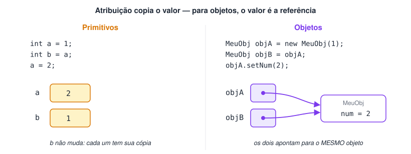
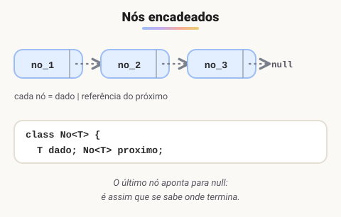
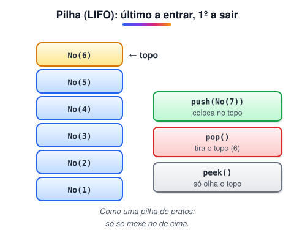
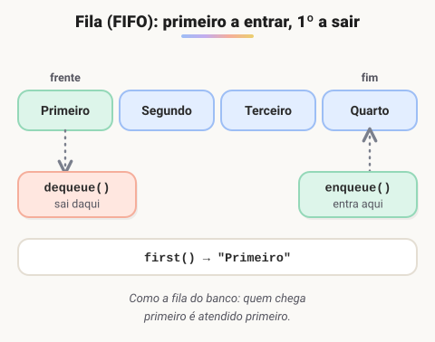
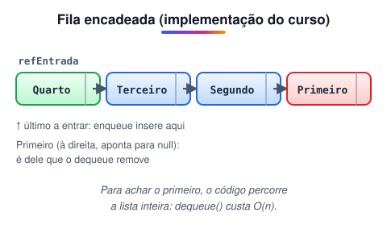
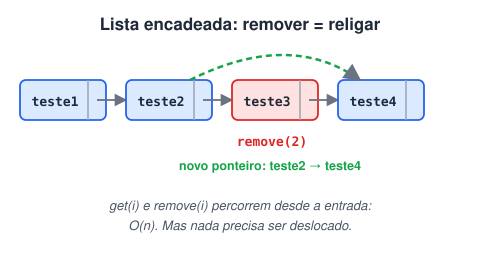
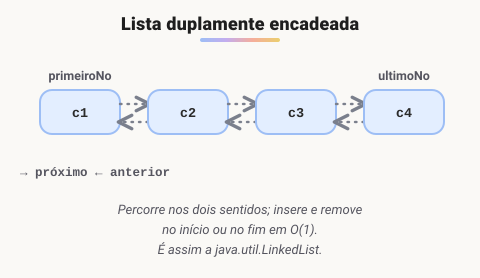
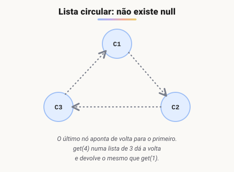
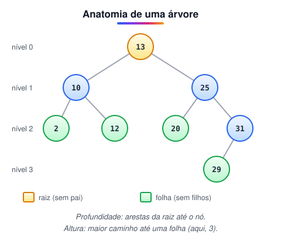
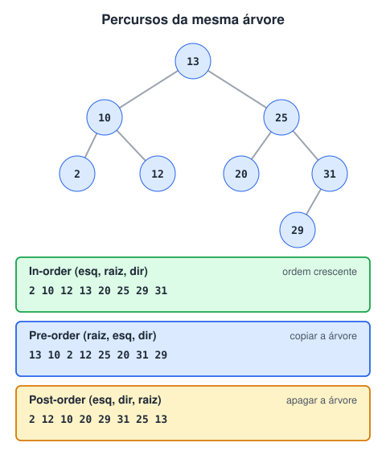

# Estrutura de dados em Java

> 🗺️ **Nesta aula:** como montar estruturas de dados com nós e referências (pilha, fila, listas encadeadas, duplamente encadeadas e circulares, árvore binária) e quais classes prontas do Java fazem o mesmo papel.

## Introdução e conceitos básicos

> 💡 Antes de pilhas, filas, listas e árvores, três ideias-base: **como o Java copia valores**, o que é um **nó** e como **generics** tornam essas estruturas reutilizáveis para qualquer tipo.

### Tipos de dados no Java

| Categoria | Tipos | Onde fica o valor |
| --- | --- | --- |
| Primitivos inteiros | `byte`, `short`, `int`, `long` | Na própria variável |
| Primitivos decimais | `float`, `double` | Na própria variável |
| Outros primitivos | `char`, `boolean` | Na própria variável |
| Referência | `String`, arrays, classes (`Integer`, `No`, `Pilha`…) | A variável guarda o **endereço** do objeto, que fica no *heap* |

### Atribuição e referência

- Em Java, a atribuição **sempre copia o valor**.
- Com **primitivos**, o valor copiado é o próprio dado: as duas variáveis ficam independentes.
- Com **objetos**, o valor copiado é a **referência**: as duas variáveis passam a apontar para o **mesmo** objeto, sem duplicá-lo.



**Mostrando em código**

```java
// Classe Main
package com.projeto.atribuicaoreferencia;

public class Main {
  public static void main(String[] args) {
    // Primitivos: b recebe uma CÓPIA do valor de a
    int a = 1;
    int b = a;
    System.out.println("Tipo primitivo");
    System.out.println("a = " + a + ", b = " + b); // a = 1, b = 1

    a = 2;
    System.out.println("a = " + a + ", b = " + b); // a = 2, b = 1 (b não mudou)

    // Objetos: objB recebe uma cópia da REFERÊNCIA de objA
    MeuObj objA = new MeuObj(1);
    MeuObj objB = objA;
    System.out.println("\nObjetos");
    System.out.println("objA = " + objA + ", objB = " + objB); // 1 e 1

    objA.setNum(2);
    System.out.println("objA = " + objA + ", objB = " + objB); // 2 e 2 (mesmo objeto!)
  }
}
```

```java
// Classe MeuObj
package com.projeto.atribuicaoreferencia;

public class MeuObj {
  private Integer num;

  public MeuObj(Integer num) {
    this.num = num;
  }

  public void setNum(Integer num) {
    this.num = num;
  }

  @Override
  public String toString() {
    return num.toString();
  }
}
```

> 🛠️ **Ajustes de nomenclatura:** `Meu_obj` → `MeuObj`, `int_a` → `a`, `obj_a` → `objA` e pacote `atribuicao_referencia` → `atribuicaoreferencia`. Em Java, classes usam **PascalCase**, variáveis **camelCase** e pacotes **só minúsculas**, sem `_`. Também deixei o atributo `num` como `private`.

### Nó e encadeamento de nós



- Um **nó** (*node*) é o bloco básico de várias estruturas de dados (listas encadeadas, pilhas, filas, árvores, grafos).
- Em Java, um nó é uma classe com pelo menos dois campos: o **dado** que ele guarda e a **referência** para o próximo nó.
- O **encadeamento** é a ligação entre os nós: cada um sabe quem vem depois. Isso permite percorrer os dados em sequência e **inserir ou remover** nós apenas trocando referências — sem deslocar elementos, como aconteceria em um array.
- A última referência da estrutura é `null`, indicando o fim. Em uma árvore, por exemplo, as **folhas** têm as referências para filhos iguais a `null`.

**Mostrando em código (classe No)**

```java
// Classe Main
package com.projeto.no;

public class Main {
  public static void main(String[] args) {
    // no1 -> no2 -> no3 -> no4 -> null
    No no1 = new No("Conteúdo no1");
    No no2 = new No("Conteúdo no2");
    no1.setProximoNo(no2);

    No no3 = new No("Conteúdo no3");
    no2.setProximoNo(no3);

    No no4 = new No("Conteúdo no4");
    no3.setProximoNo(no4);

    System.out.println(no1);  // no1
    System.out.println(no1.getProximoNo());  // no2
    System.out.println(no1.getProximoNo().getProximoNo());  // no3
    System.out.println(no1.getProximoNo().getProximoNo().getProximoNo()); // no4
    System.out.println(no1.getProximoNo().getProximoNo().getProximoNo().getProximoNo()); // null
  }
}
```

```java
// Classe No
package com.projeto.no;

public class No {
  private String conteudo;
  private No proximoNo;

  public No(String conteudo) {
    this.conteudo = conteudo;
    this.proximoNo = null;
  }

  public String getConteudo() { return conteudo; }
  public void setConteudo(String conteudo) { this.conteudo = conteudo; }

  public No getProximoNo() { return proximoNo; }
  public void setProximoNo(No proximoNo) { this.proximoNo = proximoNo; }

  @Override
  public String toString() {
    return "No{conteudo='" + conteudo + "'}";
  }
}
```

### Generics

#### Documentação

🔗 [Why Use Generics? (The Java™ Tutorials >                    Learning the Java Language > Generics (Updated))](https://docs.oracle.com/javase/tutorial/java/generics/why.html)

- **Generics** permitem criar classes, interfaces e métodos **parametrizados por tipo**. Escrevemos o código uma vez e o reutilizamos para `String`, `Integer`, `Cliente` ou qualquer outro tipo.
- O tipo é indicado entre `< >`: `ArrayList<String>` é uma lista de textos; `ArrayList<Integer>`, uma lista de inteiros — a **mesma** classe `ArrayList<E>` serve para os dois.
- Vantagens: o compilador **verifica os tipos** (você não consegue colocar um `Integer` numa lista de `String`), não é preciso fazer *cast* e o código fica mais legível.

> 🛠️ **Ajuste:** o texto original dizia que generics evitam "criar uma classe diferente para cada tipo de coleção (ArrayList, LinkedList, HashSet…)". Na verdade, essas continuam sendo classes diferentes; o que generics evitam é criar uma versão de cada coleção para cada **tipo de elemento** (uma lista de `String`, outra de `Integer`…).

#### Convenção para nomes de tipo

| Letra | Significado |
| --- | --- |
| `T` | *Type* — um tipo qualquer |
| `E` | *Element* — elemento de uma coleção |
| `K` | *Key* — chave de um mapa |
| `V` | *Value* — valor de um mapa |
| `N` | *Number* — número |

#### Wildcards (`?`)

O `?` representa um **tipo desconhecido** e aparece no **uso** de um tipo genérico (parâmetros, variáveis), não na declaração da classe.

| Forma | Significado | Exemplo |
| --- | --- | --- |
| `<?>` | qualquer tipo | `List<?>` aceita lista de qualquer coisa |
| `<? extends Tipo>` | `Tipo` ou qualquer **subclasse** (limite superior) | `List<? extends Animal>` aceita `List<Cachorro>` |
| `<? super Tipo>` | `Tipo` ou qualquer **superclasse** (limite inferior) | `List<? super Integer>` aceita `List<Number>` |

> 🛠️ **Ajuste:** o `?` estava na lista de convenções de nomes (K, V, E, T). Ele **não** é um nome de parâmetro de tipo — não dá para escrever `class Caixa<?>`. É um *wildcard*, usado ao referenciar um tipo genérico já existente.

**Mostrando em código (classe No com generics)**

```java
// Classe Main
package com.projeto.no;

public class Main {
  public static void main(String[] args) {
    // aqui o tipo do conteúdo é String, mas poderia ser qualquer outro
    No<String> no1 = new No<>("Conteúdo no1");
    No<String> no2 = new No<>("Conteúdo no2");
    no1.setProximoNo(no2);

    No<String> no3 = new No<>("Conteúdo no3");
    no2.setProximoNo(no3);

    No<String> no4 = new No<>("Conteúdo no4");
    no3.setProximoNo(no4);

    System.out.println(no1);
    System.out.println(no1.getProximoNo());
    System.out.println(no1.getProximoNo().getProximoNo());
    System.out.println(no1.getProximoNo().getProximoNo().getProximoNo());
    System.out.println(no1.getProximoNo().getProximoNo().getProximoNo().getProximoNo()); // null

    No<Integer> numero = new No<>(42); // a mesma classe com outro tipo
  }
}
```

```java
// Classe No<T>
package com.projeto.no;

public class No<T> {
  private T conteudo;
  private No<T> proximoNo;

  public No(T conteudo) {
    this.conteudo = conteudo;
    this.proximoNo = null;
  }

  public T getConteudo() { return conteudo; }
  public void setConteudo(T conteudo) { this.conteudo = conteudo; }

  public No<T> getProximoNo() { return proximoNo; }
  public void setProximoNo(No<T> proximoNo) { this.proximoNo = proximoNo; }

  @Override
  public String toString() {
    return "No{conteudo='" + conteudo + "'}";
  }
}
```

## Pilhas (LIFO: last in, first out)

> 💡 **Pilha (*stack*)** é uma estrutura **LIFO** — *Last In, First Out*: o último elemento a entrar é o primeiro a sair. Só se mexe no **topo**.



### Onde pilhas aparecem

- **Desfazer (Ctrl+Z)**: a última ação feita é a primeira desfeita.
- **Voltar do navegador**: a última página visitada é a primeira a reaparecer.
- **Chamadas de métodos e recursão**: a JVM empilha cada chamada na *call stack* — daí o erro `StackOverflowError`.
- **Inverter a ordem** de dados e validar parênteses/chaves em expressões.

### Principais operações

| Método | O que faz |
| --- | --- |
| `push(elemento)` | Coloca um elemento no topo |
| `pop()` | Remove e devolve o elemento do topo |
| `peek()` / `top()` | Devolve o elemento do topo **sem** remover |
| `isEmpty()` | Diz se a pilha está vazia |
| `search(elemento)` | Na `java.util.Stack`, devolve a posição a partir do topo (começando em **1**) ou `-1` se não existir |

> ✨ No dia a dia, em vez de implementar a sua própria pilha ou usar a antiga `java.util.Stack`, a recomendação oficial é `Deque<Integer> pilha = new ArrayDeque<>();` com os métodos `push`, `pop` e `peek`.

**Mostrando em código**

```java
// Classe Main
package com.projeto.pilha;

public class Main {
  public static void main(String[] args) {
    Pilha minhaPilha = new Pilha();

    minhaPilha.push(new No(1));
    minhaPilha.push(new No(2));
    minhaPilha.push(new No(3));
    minhaPilha.push(new No(4));
    minhaPilha.push(new No(5));
    minhaPilha.push(new No(6));

    // a impressão sai do topo (6) para a base (1)
    System.out.println(minhaPilha);

    System.out.println("Elemento removido: " + minhaPilha.pop()); // No{dado=6}
    System.out.println(minhaPilha);
  }
}
```

```java
// Classe No
package com.projeto.pilha;

public class No {
  private int dado;
  private No refNo = null;

  public No(int dado) {
    this.dado = dado;
  }

  public No() {}

  public int getDado() { return dado; }
  public void setDado(int dado) { this.dado = dado; }

  public No getRefNo() { return refNo; }
  public void setRefNo(No refNo) { this.refNo = refNo; }

  @Override
  public String toString() {
    return "No{dado=" + dado + "}";
  }
}
```

```java
// Classe Pilha
package com.projeto.pilha;

public class Pilha {
  // referência para o nó do TOPO
  private No refNoEntradaPilha;

  public Pilha() {
    this.refNoEntradaPilha = null;
  }

  public boolean isEmpty() {
    return refNoEntradaPilha == null;
  }

  // devolve o topo sem remover (também chamado de peek)
  public No top() {
    return refNoEntradaPilha;
  }

  // coloca o novo nó no TOPO, apontando para o antigo topo
  public void push(No novoNo) {
    No refAuxiliar = refNoEntradaPilha;
    refNoEntradaPilha = novoNo;
    refNoEntradaPilha.setRefNo(refAuxiliar);
  }

  // remove e devolve o nó do topo
  public No pop() {
    if (isEmpty()) {
      return null;
    }
    No noRemovido = refNoEntradaPilha;
    refNoEntradaPilha = refNoEntradaPilha.getRefNo();
    return noRemovido;
  }

  @Override
  public String toString() {
    StringBuilder sb = new StringBuilder();
    sb.append("-------------\n");
    sb.append("    Pilha\n");
    sb.append("-------------\n");

    No noAuxiliar = refNoEntradaPilha;
    while (noAuxiliar != null) {
      sb.append("[No{dado=").append(noAuxiliar.getDado()).append("}]\n");
      noAuxiliar = noAuxiliar.getRefNo();
    }

    sb.append("=============");
    return sb.toString();
  }
}
```

> 🛠️ **Ajustes no código:**
>
> - O comentário do `push` dizia "acrescenta no fim da pilha" — ele acrescenta no **topo**.
> - `return x == null ? true : false;` foi simplificado para `return x == null;` (a comparação já é um `boolean`).
> - O método `Top()` virou `top()`: em Java, métodos começam com letra **minúscula**.
> - O `while (true)` com `break` do `toString` virou `while (noAuxiliar != null)`, e a concatenação de `String` no laço foi trocada por `StringBuilder`.
> - Nomes com `_` (`ref_no`, `minha_pilha`) passaram para camelCase.

## Filas (FIFO: first in, first out)

> 💡 **Fila (*queue*)** é uma estrutura **FIFO** — *First In, First Out*: o primeiro elemento a entrar é o primeiro a sair. Entra-se pelo **fim** e sai-se pela **frente**.



### Como funciona

- A **inserção** é feita no **fim** da fila (*tail*) e a **remoção**, na **frente** (*head*), respeitando a ordem de chegada.
- Exemplos: fila de impressão, processamento de tarefas pelo sistema operacional, pedidos de um e-commerce, mensagens em sistemas como RabbitMQ e Kafka.

> 🛠️ **Correções no texto:**
>
> - O original chamava a estrutura de "pilhas FIFO". Pilha é **LIFO**; a estrutura FIFO se chama **fila**.
> - Dizia também que, ao remover, "todos os elementos são deslocados uma posição". Isso só acontece em filas feitas com **array** simples. Na fila **encadeada** (a deste curso) nada é deslocado: basta trocar uma referência.

### Principais operações

| Método | O que faz |
| --- | --- |
| `enqueue(elemento)` | Adiciona no **fim** |
| `dequeue()` | Remove e devolve o elemento da **frente** |
| `first()` / `front()` | Devolve o elemento da frente **sem** remover |
| `rear()` | Devolve o elemento do fim sem remover |
| `isEmpty()` | Diz se a fila está vazia |
| `isFull()` | Diz se está cheia — só faz sentido em filas de **tamanho fixo** (com array) |

> ✨ Na biblioteca padrão, use a interface `Queue`: `Queue<String> fila = new ArrayDeque<>();` com `offer()` (entra), `poll()` (sai) e `peek()` (olha a frente).

### A implementação do curso



A classe `Fila` guarda só uma referência, `refNoEntradaFila`, que aponta para o **último nó inserido**. Cada nó aponta para o que chegou **antes** dele, até o primeiro, que aponta para `null`. Por isso:

- `enqueue` é rápido: o novo nó passa a ser a entrada e aponta para a antiga entrada.
- `dequeue` e `first` precisam **percorrer a lista inteira** até achar o nó que aponta para `null`.

O código evoluiu em três etapas:

1. A `Main` cria os nós (`new No("Primeiro")`) e os passa para a fila.
2. A `Fila` passa a criar o nó internamente — a `Main` só envia o objeto (`enqueue("Primeiro")`).
3. Generics (`Fila<T>` e `No<T>`) garantem o tipo dos elementos, sem *casts*.

**Versão 1: a Main cria os nós**

```java
// Classe Main
package com.projeto.filafifo;

public class Main {
  public static void main(String[] args) {
    Fila minhaFila = new Fila();

    minhaFila.enqueue(new No("Primeiro"));
    minhaFila.enqueue(new No("Segundo"));
    minhaFila.enqueue(new No("Terceiro"));
    minhaFila.enqueue(new No("Quarto"));

    System.out.println("Fila: " + minhaFila);
    System.out.println("\nObjeto removido: " + minhaFila.dequeue()); // Primeiro
    System.out.println("\nNova fila: " + minhaFila);

    minhaFila.enqueue(new No("Último"));
    System.out.println("\nCom 'Último' adicionado: " + minhaFila);
    System.out.println("\nPrimeiro da fila: " + minhaFila.first()); // Segundo
  }
}
```

```java
// Classe No
package com.projeto.filafifo;

public class No {
  private Object object;
  private No refNo;

  public No(Object object) {
    this.object = object;
    this.refNo = null;
  }

  public No() {}

  public No getRefNo() { return refNo; }
  public void setRefNo(No refNo) { this.refNo = refNo; }

  public Object getObject() { return object; }
  public void setObject(Object object) { this.object = object; }

  @Override
  public String toString() {
    return "No{object=" + object + "}";
  }
}
```

```java
// Classe Fila
package com.projeto.filafifo;

public class Fila {
  private No refNoEntradaFila; // último nó inserido

  public Fila() {
    this.refNoEntradaFila = null;
  }

  public boolean isEmpty() {
    return refNoEntradaFila == null;
  }

  public void enqueue(No novoNo) {
    novoNo.setRefNo(refNoEntradaFila);
    refNoEntradaFila = novoNo;
  }

  public No dequeue() {
    if (isEmpty()) return null;

    No primeiroNo = refNoEntradaFila;
    No noAuxiliar = null;
    while (primeiroNo.getRefNo() != null) { // anda até o primeiro da fila
      noAuxiliar = primeiroNo;
      primeiroNo = primeiroNo.getRefNo();
    }

    if (noAuxiliar == null) {
      refNoEntradaFila = null;  // só havia um elemento
    } else {
      noAuxiliar.setRefNo(null);  // o penúltimo vira o primeiro
    }
    return primeiroNo;
  }

  public No first() {
    if (isEmpty()) return null;

    No primeiroNo = refNoEntradaFila;
    while (primeiroNo.getRefNo() != null) {
      primeiroNo = primeiroNo.getRefNo();
    }
    return primeiroNo;
  }

  @Override
  public String toString() {
    if (isEmpty()) return "[]";

    StringBuilder sb = new StringBuilder();
    No noAuxiliar = refNoEntradaFila;
    while (noAuxiliar != null) {
      sb.append("[No{objeto=").append(noAuxiliar.getObject()).append("}]-->");
      noAuxiliar = noAuxiliar.getRefNo();
    }
    return sb.append("null").toString();
  }
}
```

**Versão 3 (final): fila genérica que cria os próprios nós**

```java
// Classe Main
package com.projeto.filafifo;

public class Main {
  public static void main(String[] args) {
    Fila<Integer> minhaFila = new Fila<>();

    minhaFila.enqueue(1);
    minhaFila.enqueue(2);
    minhaFila.enqueue(3);
    minhaFila.enqueue(4);

    System.out.println("Fila: " + minhaFila);
    System.out.println("\nRemovido: " + minhaFila.dequeue()); // 1
    System.out.println("\nNova fila: " + minhaFila);

    minhaFila.enqueue(5);
    System.out.println("\nCom o 5 adicionado: " + minhaFila);
    System.out.println("\nPrimeiro da fila: " + minhaFila.first()); // 2
  }
}
```

```java
// Classe No<T>
package com.projeto.filafifo;

public class No<T> {
  private T object;
  private No<T> refNo;

  public No(T object) {
    this.object = object;
    this.refNo = null;
  }

  public No<T> getRefNo() { return refNo; }
  public void setRefNo(No<T> refNo) { this.refNo = refNo; }

  public T getObject() { return object; }
  public void setObject(T object) { this.object = object; }

  @Override
  public String toString() {
    return "No{object=" + object + "}";
  }
}
```

```java
// Classe Fila<T>
package com.projeto.filafifo;

public class Fila<T> {
  private No<T> refNoEntradaFila; // último nó inserido

  public boolean isEmpty() {
    return refNoEntradaFila == null;
  }

  public void enqueue(T object) {
    No<T> novoNo = new No<>(object);
    novoNo.setRefNo(refNoEntradaFila);
    refNoEntradaFila = novoNo;
  }

  public T dequeue() {
    if (isEmpty()) return null;

    No<T> primeiroNo = refNoEntradaFila;
    No<T> noAuxiliar = null;
    while (primeiroNo.getRefNo() != null) {
      noAuxiliar = primeiroNo;
      primeiroNo = primeiroNo.getRefNo();
    }

    if (noAuxiliar == null) {
      refNoEntradaFila = null;
    } else {
      noAuxiliar.setRefNo(null);
    }
    return primeiroNo.getObject();
  }

  public T first() {
    if (isEmpty()) return null;

    No<T> primeiroNo = refNoEntradaFila;
    while (primeiroNo.getRefNo() != null) {
      primeiroNo = primeiroNo.getRefNo();
    }
    return primeiroNo.getObject();
  }

  @Override
  public String toString() {
    if (isEmpty()) return "[]";

    StringBuilder sb = new StringBuilder();
    No<T> noAuxiliar = refNoEntradaFila;
    while (noAuxiliar != null) {
      sb.append("[No{objeto=").append(noAuxiliar.getObject()).append("}]-->");
      noAuxiliar = noAuxiliar.getRefNo();
    }
    return sb.append("null").toString();
  }
}
```

> 🛠️ **Correções no código:**
>
> - **Bug ao esvaziar a fila:** com um único elemento, o `dequeue` original fazia `noAuxiliar.setRefNo(null)` no **próprio** nó removido, mas `refEntradaFila` continuava apontando para ele. A fila nunca ficava vazia e o mesmo elemento era devolvido para sempre. Agora, nesse caso, `refNoEntradaFila` vira `null`.
> - Na versão com generics, `No` era usado sem `<T>` ("tipo cru") e `getObject()` devolvia `Object`, exigindo *cast* `(T)` com aviso do compilador. Agora tudo é `No<T>` e não há *casts*.
> - O `toString` de uma fila vazia devolvia `null`; agora devolve `"[]"`.
> - Removi a versão intermediária (só mudava quem cria o nó) para não repetir quase o mesmo código três vezes — a evolução está descrita acima. Nomes com `_` passaram para camelCase.

## Listas encadeadas

> 💡 **Lista encadeada** é uma sequência de nós ligados: cada nó guarda um dado e a referência para o próximo. Diferente de pilha e fila, ela permite inserir, ler e remover em **qualquer posição** (por índice).



### Lista encadeada x array

|  | Array / `ArrayList` | Lista encadeada |
| --- | --- | --- |
| Acesso por índice (`get(i)`) | **O(1)** — vai direto à posição | **O(n)** — percorre desde o início |
| Inserir/remover no meio | O(n) — desloca os elementos seguintes | Só religa referências (depois de achar a posição) |
| Tamanho | Fixo (array) ou realocado (`ArrayList`) | Cresce nó a nó |
| Memória | Só os dados | Dados + uma referência por nó |

> 🛠️ **Correção:** o texto original dizia que listas encadeadas "são mais eficientes para acessar elementos aleatórios". É o contrário: o acesso por índice é a **maior fraqueza** delas, porque é preciso percorrer nó por nó. O ponto forte é inserir e remover sem deslocar elementos.

**Mostrando em código**

```java
// Classe Main
package com.projeto.listaencadeada;

public class Main {
  public static void main(String[] args) {
    ListaEncadeada<String> minhaLista = new ListaEncadeada<>();

    minhaLista.add("teste1");
    minhaLista.add("teste2");
    minhaLista.add("teste3");
    minhaLista.add("teste4");

    System.out.println(minhaLista.get(0)); // teste1
    System.out.println(minhaLista.get(1)); // teste2
    System.out.println(minhaLista.get(2)); // teste3
    System.out.println(minhaLista.get(3)); // teste4

    System.out.println(minhaLista);
    System.out.println(minhaLista.remove(3)); // teste4
    System.out.println(minhaLista);
  }
}
```

```java
// Classe No<T>
package com.projeto.listaencadeada;

public class No<T> {
  private T conteudo;
  private No<T> proximoNo;

  public No(T conteudo) {
    this.conteudo = conteudo;
    this.proximoNo = null;
  }

  public T getConteudo() { return conteudo; }
  public void setConteudo(T conteudo) { this.conteudo = conteudo; }

  public No<T> getProximoNo() { return proximoNo; }
  public void setProximoNo(No<T> proximoNo) { this.proximoNo = proximoNo; }

  @Override
  public String toString() {
    return "No{conteudo=" + conteudo + "}";
  }
}
```

```java
// Classe ListaEncadeada<T>
package com.projeto.listaencadeada;

public class ListaEncadeada<T> {
  private No<T> referenciaEntrada;
  private int tamanho;

  public boolean isEmpty() {
    return referenciaEntrada == null;
  }

  public int size() {
    return tamanho;
  }

  // adiciona no fim da lista
  public void add(T conteudo) {
    No<T> novoNo = new No<>(conteudo);
    if (isEmpty()) {
      referenciaEntrada = novoNo;
    } else {
      No<T> noAuxiliar = referenciaEntrada;
      while (noAuxiliar.getProximoNo() != null) {
        noAuxiliar = noAuxiliar.getProximoNo();
      }
      noAuxiliar.setProximoNo(novoNo);
    }
    tamanho++;
  }

  private void validaIndice(int indice) {
    if (indice < 0 || indice >= tamanho) {
      throw new IndexOutOfBoundsException("Índice " + indice
          + " inválido. A lista vai de 0 até " + (tamanho - 1) + ".");
    }
  }

  private No<T> getNo(int indice) {
    validaIndice(indice);
    No<T> noAuxiliar = referenciaEntrada;
    for (int i = 0; i < indice; i++) {
      noAuxiliar = noAuxiliar.getProximoNo();
    }
    return noAuxiliar;
  }

  public T get(int indice) {
    return getNo(indice).getConteudo();
  }

  public T remove(int indice) {
    No<T> noAlvo = getNo(indice);
    if (indice == 0) {
      referenciaEntrada = noAlvo.getProximoNo();
    } else {
      No<T> noAnterior = getNo(indice - 1);
      noAnterior.setProximoNo(noAlvo.getProximoNo());
    }
    tamanho--;
    return noAlvo.getConteudo();
  }

  @Override
  public String toString() {
    StringBuilder sb = new StringBuilder();
    No<T> noAuxiliar = referenciaEntrada;
    while (noAuxiliar != null) {
      sb.append("[No{conteudo=").append(noAuxiliar.getConteudo()).append("}]--->");
      noAuxiliar = noAuxiliar.getProximoNo();
    }
    return sb.append("null").toString();
  }
}
```

> 🛠️ **Correções no código:**
>
> - `validaIndice` não rejeitava **índices negativos**: `get(-1)` devolvia o primeiro elemento em vez de dar erro. Agora valida `indice < 0` também.
> - `size()` percorria a lista inteira a cada chamada, e o `add` chamava `size()` antes de percorrer de novo — inserir *n* elementos custava O(n²). Agora a lista guarda um contador `tamanho`.
> - Na classe `No<T>`, a referência `proximoNo` estava sem o tipo (`No` cru); passou a ser `No<T>`. O comentário "Wildcard" em `T conteudo` também foi removido: `T` é um **parâmetro de tipo**, não um wildcard.
> - Removi o método `toString_enc()`, que não era usado, e padronizei nomes em camelCase (`is_empty` → `isEmpty`, `get_no` → `getNo`).

## Listas duplamente encadeadas

> 💡 Na **lista duplamente encadeada**, cada nó guarda referências para o **anterior** e para o **próximo**. A lista conhece o primeiro nó (cabeça) e o último (cauda).



### Características

- Pode ser percorrida **nos dois sentidos**: do início para o fim e do fim para o início.
- Como a lista guarda a cauda, **inserir ou remover no início ou no fim** é O(1).
- Para acessar um índice no meio, ainda é preciso percorrer — mas dá para começar pela ponta mais próxima.
- O custo é de memória: cada nó tem **uma referência a mais** que na lista simples.
- A `java.util.LinkedList` é implementada exatamente assim.

> 🛠️ **Ajuste:** o texto original dizia que cada nó "contém duas referências adicionais" em relação à lista simples. A diferença é de **uma** referência (o nó anterior); a lista simples já tem a do próximo.

**Mostrando em código**

```java
// Classe Main
package com.projeto.listaduplamenteencadeada;

public class Main {
  public static void main(String[] args) {
    ListaDuplamenteEncadeada<String> minhaLista = new ListaDuplamenteEncadeada<>();

    minhaLista.add("c1");
    minhaLista.add("c2");
    minhaLista.add("c3");
    minhaLista.add("c4");
    minhaLista.add("c5");
    minhaLista.add("c6");
    minhaLista.add("c7");
    System.out.println(minhaLista);

    minhaLista.remove(3);  // remove c4
    minhaLista.add(3, "99");  // insere 99 na posição 3
    System.out.println("Novo elemento: " + minhaLista.get(3)); // 99
    System.out.println(minhaLista);
  }
}
```

```java
// Classe NoDuplo<T>
package com.projeto.listaduplamenteencadeada;

public class NoDuplo<T> {
  private T conteudo;
  private NoDuplo<T> noProximo;
  private NoDuplo<T> noPrevio;

  public NoDuplo(T conteudo) {
    this.conteudo = conteudo;
  }

  public T getConteudo() { return conteudo; }
  public void setConteudo(T conteudo) { this.conteudo = conteudo; }

  public NoDuplo<T> getNoProximo() { return noProximo; }
  public void setNoProximo(NoDuplo<T> noProximo) { this.noProximo = noProximo; }

  public NoDuplo<T> getNoPrevio() { return noPrevio; }
  public void setNoPrevio(NoDuplo<T> noPrevio) { this.noPrevio = noPrevio; }

  @Override
  public String toString() {
    return "NoDuplo{conteudo=" + conteudo + "}";
  }
}
```

```java
// Classe ListaDuplamenteEncadeada<T>
package com.projeto.listaduplamenteencadeada;

public class ListaDuplamenteEncadeada<T> {
  private NoDuplo<T> primeiroNo;
  private NoDuplo<T> ultimoNo;
  private int tamanho;

  public int size() {
    return tamanho;
  }

  private NoDuplo<T> getNo(int indice) {
    if (indice < 0 || indice >= tamanho) {
      throw new IndexOutOfBoundsException("Índice inválido: " + indice);
    }
    NoDuplo<T> noAuxiliar = primeiroNo;
    for (int i = 0; i < indice; i++) {
      noAuxiliar = noAuxiliar.getNoProximo();
    }
    return noAuxiliar;
  }

  public T get(int indice) {
    return getNo(indice).getConteudo();
  }

  // adiciona no fim
  public void add(T elemento) {
    NoDuplo<T> novoNo = new NoDuplo<>(elemento);
    novoNo.setNoPrevio(ultimoNo);
    if (primeiroNo == null) {
      primeiroNo = novoNo;
    } else {
      ultimoNo.setNoProximo(novoNo);
    }
    ultimoNo = novoNo;
    tamanho++;
  }

  // adiciona em uma posição específica
  public void add(int indice, T elemento) {
    if (indice == tamanho) {  // inserir no fim = add comum
      add(elemento);
      return;
    }
    NoDuplo<T> noAtual = getNo(indice); // nó que vai "andar uma casa"
    NoDuplo<T> novoNo = new NoDuplo<>(elemento);

    novoNo.setNoProximo(noAtual);
    novoNo.setNoPrevio(noAtual.getNoPrevio());

    if (indice == 0) {
      primeiroNo = novoNo;
    } else {
      noAtual.getNoPrevio().setNoProximo(novoNo);
    }
    noAtual.setNoPrevio(novoNo);
    tamanho++;
  }

  public void remove(int indice) {
    NoDuplo<T> noAlvo = getNo(indice);

    if (noAlvo == primeiroNo) {
      primeiroNo = noAlvo.getNoProximo();
    } else {
      noAlvo.getNoPrevio().setNoProximo(noAlvo.getNoProximo());
    }

    if (noAlvo == ultimoNo) {
      ultimoNo = noAlvo.getNoPrevio();
    } else {
      noAlvo.getNoProximo().setNoPrevio(noAlvo.getNoPrevio());
    }
    tamanho--;
  }

  @Override
  public String toString() {
    StringBuilder sb = new StringBuilder();
    NoDuplo<T> noAuxiliar = primeiroNo;
    while (noAuxiliar != null) {
      sb.append("[No{conteudo=").append(noAuxiliar.getConteudo()).append("}]--->");
      noAuxiliar = noAuxiliar.getNoProximo();
    }
    return sb.append("null").toString();
  }
}
```

> 🛠️ **Correções no código (bugs reais da versão original):**
>
> - **Remover o último elemento** fazia `ultimoNo = no_auxiliar` — ou seja, a cauda continuava apontando para o nó **removido**. O próximo `add` ligava o novo nó a um nó que nem estava mais na lista, e ele "sumia". O correto é `ultimoNo = noAlvo.getNoPrevio()`.
> - **Remover o índice 0 de uma lista com 1 elemento** não atualizava `ultimoNo`, que ficava apontando para o nó removido.
> - `add(indice, elemento)` **no fim da lista** (índice igual ao tamanho) fazia `novo_no.setNo_proximo(ultimo_no)` — o novo nó apontava para **trás** como se fosse o próximo, criando um ciclo. Agora esse caso usa o `add` comum.
> - `getNo` não validava o índice; um índice inválido causava `NullPointerException` em vez de uma mensagem clara.

## Listas circulares

> 💡 Numa **lista circular**, o último nó aponta de volta para o primeiro, formando um ciclo. Não há `null` no fim: dá para percorrer a lista indefinidamente.



### Características

- Numa lista linear o último nó aponta para `null`; na circular, ele aponta para o **primeiro**.
- Percorrer a partir de qualquer nó sempre leva de volta ao ponto de partida.
- Usos comuns: **escalonamento** ***round-robin*** (cada processo recebe sua vez em rodízio), playlists em repetição, jogos de turnos entre jogadores.

> 🛠️ **Esclarecimento sobre os nomes:** o texto original dizia que "o primeiro elemento é chamado de cauda e o último de cabeça". Isso é uma escolha **deste código** (que insere novos elementos no início) — normalmente se usa o contrário: *head* (cabeça) para o primeiro e *tail* (cauda) para o último. O importante é saber qual referência marca a entrada da lista.

**Mostrando em código**

```java
// Classe Main
package com.projeto.listacircular;

public class Main {
  public static void main(String[] args) {
    ListaCircular<String> minhaLista = new ListaCircular<>();

    minhaLista.add("C0");
    System.out.println("Lista inicial: " + minhaLista);

    minhaLista.remove(0);
    System.out.println("Após remover: " + minhaLista);

    minhaLista.add("C1");
    minhaLista.add("C2");
    minhaLista.add("C3"); // add insere no início: C3 -> C2 -> C1
    System.out.println("Após inserções: " + minhaLista);

    System.out.println("Índice 1: " + minhaLista.get(1));  // C2
    System.out.println("Índice 4: " + minhaLista.get(4) + "\n");  // dá a volta: C2

    for (int i = 0; i < 20; i++) {
      System.out.println("Índice " + i + ": " + minhaLista.get(i));
    }
  }
}
```

```java
// Classe No<T>
package com.projeto.listacircular;

public class No<T> {
  private T conteudo;
  private No<T> noProximo;

  public No(T conteudo) {
    this.conteudo = conteudo;
  }

  public T getConteudo() { return conteudo; }
  public void setConteudo(T conteudo) { this.conteudo = conteudo; }

  public No<T> getNoProximo() { return noProximo; }
  public void setNoProximo(No<T> noProximo) { this.noProximo = noProximo; }

  @Override
  public String toString() {
    return "No{conteudo=" + conteudo + "}";
  }
}
```

```java
// Classe ListaCircular<T>
package com.projeto.listacircular;

public class ListaCircular<T> {
  private No<T> cauda;  // entrada da lista (primeiro nó)
  private No<T> cabeca; // último nó, que aponta de volta para a cauda
  private int tamanho;

  public int size() {
    return tamanho;
  }

  public boolean isEmpty() {
    return tamanho == 0;
  }

  private No<T> getNo(int indice) {
    if (isEmpty()) {
      throw new IndexOutOfBoundsException("A lista está vazia!");
    }
    No<T> noAuxiliar = cauda;
    for (int i = 0; i < indice; i++) { // pode passar do tamanho: a lista dá a volta
      noAuxiliar = noAuxiliar.getNoProximo();
    }
    return noAuxiliar;
  }

  public T get(int indice) {
    return getNo(indice).getConteudo();
  }

  public void remove(int indice) {
    if (indice < 0 || indice >= tamanho) {
      throw new IndexOutOfBoundsException("Índice inválido: " + indice);
    }

    if (tamanho == 1) {  // era o único elemento
      cauda = null;
      cabeca = null;
    } else if (indice == 0) {  // remove o primeiro
      cauda = cauda.getNoProximo();
      cabeca.setNoProximo(cauda);
    } else {
      No<T> anterior = getNo(indice - 1);
      No<T> removido = anterior.getNoProximo();
      anterior.setNoProximo(removido.getNoProximo());
      if (removido == cabeca) {  // removeu o último
        cabeca = anterior;
      }
    }
    tamanho--;
  }

  // adiciona no INÍCIO da lista
  public void add(T conteudo) {
    No<T> novoNo = new No<>(conteudo);
    if (isEmpty()) {
      cabeca = novoNo;
      cauda = novoNo;
      novoNo.setNoProximo(novoNo); // aponta para si mesmo
    } else {
      novoNo.setNoProximo(cauda);
      cabeca.setNoProximo(novoNo);
      cauda = novoNo;
    }
    tamanho++;
  }

  @Override
  public String toString() {
    if (isEmpty()) return "[]";
    StringBuilder sb = new StringBuilder();
    No<T> noAuxiliar = cauda;
    for (int i = 0; i < tamanho; i++) {
      sb.append("[").append(noAuxiliar).append("]--->");
      noAuxiliar = noAuxiliar.getNoProximo();
    }
    return sb.append("(volta ao início)").toString();
  }
}
```

> 🛠️ **Correções no código (bugs reais):**
>
> - **Remover o último elemento** não atualizava a referência `cabeca`: ela continuava apontando para o nó removido. No `add` seguinte, `cabeca.setNoProximo(novoNo)` ligava o novo nó a um nó fora da lista, e o ciclo quebrava. Agora, se o removido era a cabeça, ela passa a ser o nó anterior.
> - **Remover o único elemento** deixava `cauda` e `cabeca` apontando para o nó removido. Agora as duas viram `null`.
> - `remove` não rejeitava índices negativos.
> - Na `Main`, a mensagem "Objeto de índice 3" imprimia `get(4)`; ajustei o texto.

## Árvores binárias

> 💡 Uma **árvore** organiza dados em **hierarquia**: um nó raiz no topo e, abaixo dele, nós filhos ligados por arestas. Na **árvore binária**, cada nó tem no máximo **dois** filhos.

### Estrutura de árvore

Cada elemento da árvore é um **nó**, que guarda um valor (chave ou dado). Cada nó tem **um único pai** (menos a raiz) e pode ter vários filhos. Há vários tipos — binária, de busca binária, AVL, rubro-negra — usados em índices de banco de dados, sistemas de arquivos, menus e organogramas.



| Termo | Significado |
| --- | --- |
| Raiz | Nó do topo; o único sem pai |
| Filho / pai | Nós ligados diretamente por uma aresta |
| Folha | Nó sem filhos |
| Subárvore | Um nó com todos os seus descendentes — também é uma árvore |
| Profundidade | Nº de arestas da raiz até o nó |
| Altura | Nº de arestas do nó até a folha mais distante abaixo dele |
| Balanceamento | Árvore em que, em todo nó, as alturas das subárvores esquerda e direita diferem no máximo em 1 |

### Árvore binária e árvore de busca binária (BST)

- Na **árvore binária**, cada nó tem no máximo um **filho esquerdo** e um **filho direito**; cada subárvore também é uma árvore binária.
- Na **árvore de busca binária** (*Binary Search Tree*), vale ainda uma regra de ordem: em todo nó, os valores **menores** ficam à **esquerda** e os **maiores** à **direita**. Isso permite buscar descartando metade da árvore a cada passo — O(log n) quando ela está balanceada.

#### A interface `Comparable`

Para saber se um valor é "menor" ou "maior", a árvore precisa comparar objetos. Em Java, isso é feito com a interface `Comparable<T>` e seu método `compareTo`:

| `a.compareTo(b)` devolve | Significado |
| --- | --- |
| número **negativo** | `a` vem **antes** de `b` (é menor) |
| **zero** | são equivalentes |
| número **positivo** | `a` vem **depois** de `b` (é maior) |

Por isso a árvore declara `BinArvore<T extends Comparable<T>>`: ela só aceita tipos que saibam se comparar. `Integer`, `String` e `LocalDate`, por exemplo, já implementam `Comparable`.

### Operações básicas na BST

1. **Inserção:** começa na raiz e desce comparando — menor vai para a esquerda, maior para a direita — até achar uma posição vazia.O caminho percorrido para inserir o 29.
2. **Remoção:** encontra o nó e trata um de três casos.Folha, um filho ou dois filhos.
3. **Busca:** mesma lógica da inserção, parando quando encontra o valor (ou chega a `null`).
4. **Percurso (*traversal*):** visitar todos os nós numa ordem definida.
5. **Mínimo e máximo:** o mínimo é o nó mais à **esquerda**; o máximo, o mais à **direita**.

### Percursos



| Percurso | Ordem de visita | Resultado no exemplo |
| --- | --- | --- |
| **In-order** (em ordem) | esquerda → raiz → direita | 2, 10, 12, 13, 20, 25, 29, 31 — ordem crescente |
| **Pre-order** (pré-ordem) | raiz → esquerda → direita | 13, 10, 2, 12, 25, 20, 31, 29 |
| **Post-order** (pós-ordem) | esquerda → direita → raiz | 2, 12, 10, 20, 29, 31, 25, 13 |

Existe ainda o percurso **em nível** (*level-order*), que visita a árvore andar por andar: 13, 10, 25, 2, 12, 20, 31, 29.

> 🛠️ **Correção:** a saída do pós-ordem estava como "2, 12, 10, 20, 29, 25 e 13" — faltava o **31**. O correto é **2, 12, 10, 20, 29, 31, 25, 13**.

**Mostrando em código a árvore binária**

```java
// Classe Main
package com.projeto.arvorebinaria;

import com.projeto.arvorebinaria.model.Obj;

public class Main {
  public static void main(String[] args) {
    BinArvore<Obj> minhaArvore = new BinArvore<>();

    minhaArvore.inserir(new Obj(13)); // raiz
    minhaArvore.inserir(new Obj(10));
    minhaArvore.inserir(new Obj(25));
    minhaArvore.inserir(new Obj(2));
    minhaArvore.inserir(new Obj(12));
    minhaArvore.inserir(new Obj(20));
    minhaArvore.inserir(new Obj(31));
    minhaArvore.inserir(new Obj(29));

    minhaArvore.exibirEmOrdem();  // 2, 10, 12, 13, 20, 25, 29, 31
    minhaArvore.exibirPreOrdem();  // 13, 10, 2, 12, 25, 20, 31, 29
    minhaArvore.exibirPosOrdem();  // 2, 12, 10, 20, 29, 31, 25, 13

    minhaArvore.remover(new Obj(13)); // remove a raiz (caso de dois filhos)
    minhaArvore.exibirEmOrdem();  // 2, 10, 12, 20, 25, 29, 31
  }
}
```

```java
// Classe BinNo<T>
package com.projeto.arvorebinaria;

// T precisa saber se comparar (limite superior: T extends Comparable<T>)
public class BinNo<T extends Comparable<T>> {
  private T conteudo;
  private BinNo<T> noEsq;
  private BinNo<T> noDir;

  public BinNo(T conteudo) {
    this.conteudo = conteudo;
  }

  public T getConteudo() { return conteudo; }
  public void setConteudo(T conteudo) { this.conteudo = conteudo; }

  public BinNo<T> getNoEsq() { return noEsq; }
  public void setNoEsq(BinNo<T> noEsq) { this.noEsq = noEsq; }

  public BinNo<T> getNoDir() { return noDir; }
  public void setNoDir(BinNo<T> noDir) { this.noDir = noDir; }

  @Override
  public String toString() {
    return "BinNo{conteudo=" + conteudo + "}";
  }
}
```

```java
// Classe BinArvore<T>
package com.projeto.arvorebinaria;

public class BinArvore<T extends Comparable<T>> {
  private BinNo<T> raiz;

  // ---------- inserção ----------
  public void inserir(T conteudo) {
    raiz = inserir(raiz, new BinNo<>(conteudo));
  }

  private BinNo<T> inserir(BinNo<T> atual, BinNo<T> novo) {
    if (atual == null) {
      return novo; // achou a posição vazia
    }
    if (novo.getConteudo().compareTo(atual.getConteudo()) < 0) {
      atual.setNoEsq(inserir(atual.getNoEsq(), novo));
    } else {
      atual.setNoDir(inserir(atual.getNoDir(), novo));
    }
    return atual;
  }

  // ---------- percursos ----------
  public void exibirEmOrdem() {
    System.out.println("\nIn-order:");
    exibirEmOrdem(raiz);
  }

  private void exibirEmOrdem(BinNo<T> atual) {
    if (atual != null) {
      exibirEmOrdem(atual.getNoEsq());
      System.out.print(atual.getConteudo() + ", ");
      exibirEmOrdem(atual.getNoDir());
    }
  }

  public void exibirPreOrdem() {
    System.out.println("\nPre-order:");
    exibirPreOrdem(raiz);
  }

  private void exibirPreOrdem(BinNo<T> atual) {
    if (atual != null) {
      System.out.print(atual.getConteudo() + ", ");
      exibirPreOrdem(atual.getNoEsq());
      exibirPreOrdem(atual.getNoDir());
    }
  }

  public void exibirPosOrdem() {
    System.out.println("\nPost-order:");
    exibirPosOrdem(raiz);
  }

  private void exibirPosOrdem(BinNo<T> atual) {
    if (atual != null) {
      exibirPosOrdem(atual.getNoEsq());
      exibirPosOrdem(atual.getNoDir());
      System.out.print(atual.getConteudo() + ", ");
    }
  }

  // ---------- remoção ----------
  public void remover(T conteudo) {
    raiz = remover(raiz, conteudo);
  }

  private BinNo<T> remover(BinNo<T> atual, T conteudo) {
    if (atual == null) {
      System.out.println("Conteúdo não encontrado: " + conteudo);
      return null;
    }

    int comparacao = conteudo.compareTo(atual.getConteudo());
    if (comparacao < 0) {
      atual.setNoEsq(remover(atual.getNoEsq(), conteudo));
    } else if (comparacao > 0) {
      atual.setNoDir(remover(atual.getNoDir(), conteudo));
    } else {
      // casos 1 e 2: nenhum ou um filho → o filho (ou null) ocupa o lugar
      if (atual.getNoEsq() == null) return atual.getNoDir();
      if (atual.getNoDir() == null) return atual.getNoEsq();

      // caso 3: dois filhos → copia o sucessor e remove-o da subárvore direita
      BinNo<T> sucessor = atual.getNoDir();
      while (sucessor.getNoEsq() != null) {
        sucessor = sucessor.getNoEsq();
      }
      atual.setConteudo(sucessor.getConteudo());
      atual.setNoDir(remover(atual.getNoDir(), sucessor.getConteudo()));
    }
    return atual;
  }
}
```

Pacote `model`:

```java
// Classe abstrata ObjArvore<T>
package com.projeto.arvorebinaria.model;

public abstract class ObjArvore<T> implements Comparable<T> {
  public abstract boolean equals(Object obj);
  public abstract int hashCode();
  public abstract int compareTo(T outro);
  public abstract String toString();
}
```

```java
// Classe Obj
package com.projeto.arvorebinaria.model;

import java.util.Objects;

public class Obj extends ObjArvore<Obj> {
  private Integer meuValor;

  public Obj(Integer meuValor) {
    this.meuValor = meuValor;
  }

  @Override
  public boolean equals(Object o) {
    if (this == o) return true;
    if (o == null || getClass() != o.getClass()) return false;
    Obj obj = (Obj) o;
    return Objects.equals(meuValor, obj.meuValor);
  }

  @Override
  public int hashCode() {
    return Objects.hash(meuValor);
  }

  @Override
  public int compareTo(Obj outro) {
    return Integer.compare(this.meuValor, outro.meuValor);
  }

  @Override
  public String toString() {
    return meuValor.toString();
  }
}
```

> 🛠️ **Correções no código:**
>
> - `remover` **original tinha bugs sérios:** no caso de remover a **raiz** com dois filhos, o laço avançava com `no_filho.getNo_esq()` (deveria ir para a **direita** em busca do predecessor), e o `if` de troca nunca era executado como esperado; no caso geral, a religação ao pai acontecia **dentro** do laço. Além disso, quando o valor não existia, o código seguia em frente e só "funcionava" porque um `NullPointerException` era capturado no `catch`. Substituí por uma versão recursiva com os três casos explícitos, sem depender de exceções.
> - `compareTo` do `Obj` virou `Integer.compare(...)`, que faz o mesmo com uma linha.
> - O comentário "upperbounded wildcard" em `BinNo<T extends Comparable<T>>` foi corrigido: isso é um **parâmetro de tipo com limite superior** (*bounded type parameter*), não um *wildcard* (`?`).
> - Nomes padronizados em camelCase (`exibir_em_ordem` → `exibirEmOrdem`, `no_esq` → `noEsq`) e pacote em minúsculas.

## Principais implementações das estruturas de dados do Java

### Equals and hashCode

`equals()` **e** `hashCode()`são métodos da classe `Object`em Java, que permitem comparar e identificar objetos com base em seus valores.

- O método `equals()`é usado para comparar dois objetos para determinar se eles são iguais ou não. Quando você chama o método `equals()`em um objeto, ele compara o objeto atual com outro objeto passado como parâmetro e retorna verdadeiro se ambos os objetos tiverem valores iguais.
- O método `hashCode()`é usado para obter um código hash de um objeto. Um código hash é um número inteiro que é usado para identificar um objeto em uma coleção, como um HashMap ou HashSet. O código hash é gerado a partir dos valores dos atributos do objeto, e é importante que objetos iguais tenham o mesmo código hash, para que possam ser armazenados e recuperados corretamente de coleções.

##### Exemplo em código

```java
//Class "main"
package com.projeto.Equals_and_hasCode;

import java.util.ArrayList;
import java.util.List;

public class Main {
  public static void main(String[] args) {
    //Criando lista de carros
    List<Carro> lista_de_carros = new ArrayList<>();

    //Acrescentando objetos carros na "lista_de_carros"
    lista_de_carros.add(new Carro("Ford"));
    lista_de_carros.add(new Carro("Chevrolet"));
    lista_de_carros.add(new Carro("Volkswagen"));

    //Verificando se contém na lista um carro de marca "Ford" (Usando equals para comparar)
    System.out.println("Contém marca 'Ford' na lista ? " + lista_de_carros.contains(new Carro("Ford")));

    //Verificando o hashCode da marca "Ford"
    System.out.println("HashCode da marca Ford: " + new Carro("Ford").hashCode());

    //Criando objetos do tipo "Carro"
    Carro carro_1 = new Carro("Ford");
    Carro carro_2 = new Carro("Toyota");

    //Comparando os objetos "carro_1" e "carro_2
    System.out.println(carro_1.equals(carro_2));

    //Vendo os hashCode de "carro_1" e "carro_2" (Números totalmente diferentes)
    System.out.println("hashCode carro_1: " + carro_1.hashCode());
    System.out.println("hashCode carro_2: " + carro_2.hashCode());

  }
}
```

```java
//Class "Carro"
package com.projeto.Equals_and_hasCode;

import java.util.Objects;

public class Carro {
  String marca;

  //Construtor
  public Carro(String marca) {
    this.marca = marca;
  }

  //Getters e setters
  public String getMarca() {
    return marca;
  }
  public void setMarca(String marca) {
    this.marca = marca;
  }

  //Método "Equals"
  @Override
  public boolean equals(Object o) {
    if (this == o) return true;
    if (o == null || getClass() != o.getClass()) return false;
    Carro carro = (Carro) o;
    return Objects.equals(marca, carro.marca);
  }
  //Método "hashCode"
  @Override
  public int hashCode() {
    return Objects.hash(marca);
  }
}
```

> 📌 **O contrato entre** `equals` **e** `hashCode`**:**
>
> - Se `a.equals(b)` é `true`, então `a.hashCode() == b.hashCode()` **obrigatoriamente**.
> - Se os hashCodes são iguais, os objetos **podem ou não** ser iguais (colisão é permitida).
> - Por isso, **sempre sobrescreva os dois juntos**. Se só o `equals` for sobrescrito, `HashSet` e `HashMap` não vão encontrar o objeto, porque procuram primeiro pelo hash.
> - Sem sobrescrever nada, o `equals` herdado de `Object` compara **referências** (igual a `==`): `lista.contains(new Carro("Ford"))` daria `false`.

> 🛠️ **Ajuste:** o comentário do código dizia que os hashCodes de objetos diferentes são "números totalmente diferentes". Normalmente são, mas **não é garantido** — dois objetos diferentes podem ter o mesmo hash. A única garantia é no sentido contrário: objetos iguais têm hashes iguais. Dica: em projetos modernos, o atributo `marca` deveria ser `private`, e a IDE gera os dois métodos com *Generate → equals() and hashCode()*.

### Pilhas (Stacks)

Em Java, uma stack (pilha) é uma estrutura de dados que segue o modelo LIFO (Last In, First Out), ou seja, o último elemento adicionado à pilha é o primeiro a ser removido.

Na classe `java.util.Stack`, que estende `java.util.Vector`, temos os seguintes métodos principais:

> 🛠️ **Correção:** o texto original dizia que `Stack` implementa a interface `Deque`. Na verdade `Stack` é uma classe antiga (Java 1.0) que **estende** `Vector` e é sincronizada. A própria documentação recomenda usar `Deque<Carro> pilha = new ArrayDeque<>();` no lugar, com os mesmos `push`, `pop` e `peek` — a diferença é que, vazia, ela devolve `null` em `peek()` e lança `NoSuchElementException` em `pop()`.

- `push(E e)`: adiciona um elemento à pilha no topo.
- `pop()`: remove e retorna o elemento do topo da pilha. Se a pilha estiver vazia, gera uma exceção `EmptyStackException`.
- `peek()`: retorna o elemento do topo da pilha, sem removê-lo. Se a pilha estiver vazia, gera uma exceção `EmptyStackException`.
- `empty()`: retorna `true` se a pilha estiver vazia, `false` caso contrário.
- `search(Object o)`: retorna a posição do objeto na pilha, onde o topo da pilha é a posição 1. Se o objeto não estiver na pilha, retorna -1.

##### Mostrando em código

```java
//Class "main"
package com.projeto.Stack;

import java.util.Stack;

public class Main {
  public static void main(String[] args) {
    //Criando pilhas do objeto "Carro" (pilha_de_carros)
    Stack<Carro> pilha_de_carros = new Stack<>();

    //Método push (Adicionando carros na "pilha_de_carros")
    pilha_de_carros.push(new Carro("Ford"));
    pilha_de_carros.push(new Carro("Toyota"));
    pilha_de_carros.push(new Carro("Fiat")); //último adicionado vai pro topo da pilha

    //Mostrando "pilha_de_carros" na tela
    System.out.println("Lista de carros: " + pilha_de_carros);

    //Método pop (Mostrando objeto removido do topo da pilha)
    System.out.println(pilha_de_carros.pop());

    //Método peek (Pega e mostra o elemento do topo sem remover)
    System.out.println("Novo top da lista: " + pilha_de_carros.peek());

    //Método empty (Testa se a pilha está vazia; também existe isEmpty(), herdado de Vector)
    System.out.println("A pilha esta vazia ? " + pilha_de_carros.empty());

  }
}
```

```java
//Class "Carros"
package com.projeto.Stack;

import java.util.Objects;

public class Carro {
  String marca;

  //Construtor
  public Carro(String marca) {
    this.marca = marca;
  }

  //Getters e setters
  public String getMarca() {
    return marca;
  }
  public void setMarca(String marca) {
    this.marca = marca;
  }

  //Método "Equals"
  @Override
  public boolean equals(Object o) {
    if (this == o) return true;
    if (o == null || getClass() != o.getClass()) return false;
    Carro carro = (Carro) o;
    return Objects.equals(marca, carro.marca);
  }
  //Método "hashCode"
  @Override
  public int hashCode() {
    return Objects.hash(marca);
  }
  //Método "toString"
  @Override
  public String toString() {
    return "Carro{" +
        "marca='" + marca + '\'' +
        '}';
  }
}
```

### Fila (Queue/ Linkedlist)

> 📖 **Resumo dos métodos da** `Queue`**:** cada operação tem uma versão que **lança exceção** e outra que **devolve um valor especial**.
>
> | Operação | Lança exceção | Devolve valor |
> | --- | --- | --- |
> | Inserir no fim | `add(e)` | `offer(e)` → `false` |
> | Remover da frente | `remove()` | `poll()` → `null` |
> | Ver a frente | `element()` | `peek()` → `null` |

#### Interface Queue

A interface `Queue`em Java define uma coleção de elementos em que a inserção ocorre no final e a remoção ocorre no início da coleção. Ela estende a interface `Collection`e adiciona métodos para manipular a fila, como adicionar elementos no final da fila, remover elementos no início da fila e verificar se a fila está vazia. Uma `Queue` é uma coleção de elementos organizados em ordem linear, onde o elemento mais antigo é sempre o primeiro a ser removido. É como uma fila em um supermercado ou em um banco, onde o primeiro cliente a chegar é o primeiro a ser atendido.

`Queue` é uma interface (e não uma classe) que define os principais métodos que uma fila deve suportar, como:

- `add(element) `→ adiciona um elemento ao final da fila. Se a fila já estiver cheia (ou seja, atingiu sua capacidade máxima), esse método lançará uma exceção IllegalStateException.
- `offer(element)` → adiciona um elemento ao final da fila. Se a fila já estiver cheia, esse método retornará false, caso contrário, retornará true.
- `remove()` → remove e retorna o elemento na frente da fila. Se a fila estiver vazia, esse método lançará uma exceção NoSuchElementException.
- `poll()` → remove e retorna o elemento na frente da fila. Se a fila estiver vazia, esse método retornará null.
- `element()` → retorna o elemento na frente da fila sem removê-lo. Se a fila estiver vazia, esse método lançará uma exceção NoSuchElementException.
- `peek()` → retorna o elemento na frente da fila sem removê-lo. Se a fila estiver vazia, esse método retornará null.

##### Outros usos

a interface `queue` é apenas uma especificação que define um conjunto de métodos que uma fila deve implementar. Na linguagem Java, existem várias classes que implementam essa interface, cada uma delas com suas próprias particularidades e características. Aqui está uma breve descrição de algumas das classes mais comuns que implementam a interface `queue`:`ArrayDeque`: é uma classe que implementa a interface `Deque`, que por sua vez estende a interface `Queue`. Ela representa uma fila de elementos que podem ser adicionados e removidos tanto no final quanto no início da fila. Internamente, essa classe usa um array para armazenar seus elementos, e é altamente eficiente tanto para adicionar quanto para remover elementos.`LinkedList`: é uma classe que também implementa a interface `Deque`. Ela representa uma fila de elementos que podem ser adicionados e removidos tanto no final quanto no início da fila, bem como em qualquer posição intermediária. Internamente, essa classe usa uma estrutura de lista ligada para armazenar seus elementos, o que a torna menos eficiente do que a `ArrayDeque` em algumas operações.`PriorityQueue`: é uma classe que implementa a interface `Queue`, mas em vez de simplesmente armazenar seus elementos em ordem de chegada, ela os armazena em ordem de prioridade. Isso significa que cada elemento na fila tem uma "prioridade" associada a ele, e quando é adicionado à fila, ele é inserido na posição correta de acordo com sua prioridade.

#### Falando mais sobre LinkedList

LinkedList é uma estrutura de dados que permite armazenar uma lista de elementos, onde cada elemento possui um ponteiro para o próximo **e para o anterior** (é uma lista **duplamente** encadeada). Isso permite que os elementos sejam inseridos e removidos de maneira eficiente, sem precisar realocar todos os elementos na lista. A classe LinkedList implementa a interface List, que define métodos como "add", "remove", "get", "set" e "size", além de outros métodos específicos para trabalhar com listas duplamente encadeadas, como:Alguns dos principais métodos da classe LinkedList são:`add(element)` → Adiciona um elemento ao final da lista.`addFirst(element)` →  Adiciona um elemento no início da lista.`addLast(element) `→  Adiciona um elemento no final da lista.`remove() `→  Remove e retorna o primeiro elemento da lista.`removeFirst()` →  Remove e retorna o primeiro elemento da lista.`removeLast()` → Remove e retorna o último elemento da lista.`get(index) `→ Retorna o elemento na posição especificada.`set(index, element)` → Substitui o elemento na posição especificada pelo novo elemento.`size()` →  Retorna o número de elementos na lista.`clear()` → Remove todos os elementos da lista.

##### Mostrando em código

```java
//Class "main"
package com.projeto.Queue;

import java.util.LinkedList;
import java.util.Queue;

public class Main {
  public static void main(String[] args) {
    //Criando uma fila de carros linkada "fila_de_carros"
    Queue<Carro> fila_de_carros = new LinkedList<>();

    //Método add (Adicionando elementos em "fila_de_carros"/ Retorna erro se nao adicionar)
    fila_de_carros.add(new Carro("Honda"));
    fila_de_carros.add(new Carro("Mercedes Benz"));
    fila_de_carros.add(new Carro("Kia"));
    fila_de_carros.add(new Carro("Chevrolet"));

    //Adicionando mais um elemento Carro a lista e mostrando se adição foi ou não sucedida
    System.out.println("Adição foi bem sucedida ? " + fila_de_carros.add(new Carro("BMW")));

    //Mostrando "fila_de_carros" na tela
    System.out.println("Fila de carros: " + fila_de_carros);

    //Método offer (outra forma de adicionar/ retorna true se conseguir adicionar
    System.out.println("Adicionou ? " + fila_de_carros.offer(new Carro("Renault")));

    //Método peek (Retorna o primeiro elemento da fila sem remover)
    System.out.println("Primeiro carro da fila: " + fila_de_carros.peek());
    System.out.println("Fila de carros: " + fila_de_carros);

    //Método poll (Retorna o primeiro elemento da fila e o remove
    System.out.println("Primeiro carro da fila: " + fila_de_carros.poll());
    System.out.println("Fila de carros: " + fila_de_carros);

    //Método "isEmpty" (Verifica se a fila está vazia)
    System.out.println("A fila esta vázia ? " + fila_de_carros.isEmpty());

    //Método size (Para saber o tamanho da fila (Quandos elementos tem))
    System.out.println("Quantidade de elementos na fila: " + fila_de_carros.size());
  }
}
```

```java
//Class "Carro"
package com.projeto.Queue;

import java.util.Objects;

public class Carro {
  String marca;

  //Construtor
  public Carro(String marca) {
    this.marca = marca;
  }

  //Getters e setters
  public String getMarca() {
    return marca;
  }
  public void setMarca(String marca) {
    this.marca = marca;
  }

  //Método "Equals"
  @Override
  public boolean equals(Object o) {
    if (this == o) return true;
    if (o == null || getClass() != o.getClass()) return false;
    Carro carro = (Carro) o;
    return Objects.equals(marca, carro.marca);
  }
  //Método "hashCode"
  @Override
  public int hashCode() {
    return Objects.hash(marca);
  }
  //Método "toString"
  @Override
  public String toString() {
    return "Carro{" +
        "marca='" + marca + '\'' +
        '}';
  }
}
```

### Listas (List)

A interface `List`em Java define uma coleção de elementos ordenados que permite o acesso aos seus elementos por meio de um índice (posição). A interface `List`é uma subinterface da interface `Collection` e estende a mesma, portanto, ela herda todos os métodos da interface `Collection`. Além disso, a interface `List`<br> adiciona métodos específicos para trabalhar com listas:`add(E element)`: adiciona um elemento ao final da lista.`add(int index, E element)`: adiciona um elemento em uma posição específica na lista.`get(int index)`: retorna o elemento na posição especificada na lista.`set(int index, E element)`: substitui o elemento na posição especificada na lista pelo elemento fornecido.`remove(int index)`: remove o elemento na posição especificada na lista.`indexOf(Object o)`: retorna o índice da primeira ocorrência do elemento especificado na lista.`lastIndexOf(Object o)`: retorna o índice da última ocorrência do elemento especificado na lista.`size()`: retorna o número de elementos na lista.`isEmpty()`: retorna `true` se a lista estiver vazia, ou seja, não contiver nenhum elemento.`contains(Object o)`: retorna `true` se a lista contiver o elemento especificado.`toArray()`: retorna um array contendo todos os elementos da lista na ordem em que aparecem.`addAll(Collection<? extends E> c)`: adiciona todos os elementos da coleção especificada à lista, na ordem em que aparecem na coleção.`clear()`: remove todos os elementos da lista.`subList(int fromIndex, int toIndex)`: retorna uma sub lista contendo os elementos da lista original entre os índices `fromIndex` e `toIndex`. A sub lista é uma visão da lista original, o que significa que as alterações feitas na sub lista serão refletidas na lista original e vice-versa.As classes que implementam a interface `List`em Java incluem:`ArrayList` → que é uma implementação de lista baseada em um **array dinâmico** (que cresce automaticamente).`LinkedList` **→** que é uma implementação de lista baseada em lista ligada. `Vector` → que é uma implementação de lista semelhante à `ArrayList`mas é sincronizada (ou seja, pode ser usada em ambientes multithread).

|  | `ArrayList` | `LinkedList` | `Vector` |
| --- | --- | --- | --- |
| Estrutura interna | Array dinâmico | Lista duplamente encadeada | Array dinâmico |
| `get(i)` | O(1) | O(n) | O(1) |
| Inserir/remover no início | O(n) | O(1) | O(n) |
| Sincronizada | Não | Não | Sim (mais lenta) |
| Quando usar | **Padrão para quase tudo** | Muitas inserções/remoções nas pontas | Código legado |

> 📌 `contains` e `indexOf` usam o método `equals` para comparar. Por isso a classe `Carro` sobrescreve `equals` — sem ele, `contains(new Carro("Kia"))` daria `false`, porque seria outro objeto na memória.

##### Mostrando em código

```java
//Class "main"
package com.projeto.List;

import java.util.ArrayList;
import java.util.List;

public class Main {
  public static void main(String[] args) {

    //Criando lista de carros "lista_de_carros"
    List<Carro> lista_de_carros = new ArrayList<>();

    //Método add (Adicionando elementos a lista "lista_de_carros"
    lista_de_carros.add(new Carro("Ford"));
    lista_de_carros.add(new Carro("Kia"));
    lista_de_carros.add(new Carro("Mercedes Benz"));
    lista_de_carros.add(new Carro("BMW"));
    lista_de_carros.add(new Carro("Nissan"));

    //Mostrando "lista_de_carros" na tela
    System.out.println("Lista de carros: " + lista_de_carros);

    //Método contains (Verificando se a lista contém determinado elemento
    System.out.println("Contem marca 'Kia': " + lista_de_carros.contains(new Carro("Kia")));

    //Método get (Mostrando apenas uma posição de acordo com o índice
    System.out.println("Carro indice 2: " + lista_de_carros.get(2));

    //Método indexOf (Verificar qual é o índice de um elemento na lista — devolve -1 se não achar)
    System.out.println("Qual o indice: " + lista_de_carros.indexOf(new Carro("Kia")));

    //Método remove (Removendo elemento da lista de acordo com o indice)
    System.out.println("Elemento removido: " + lista_de_carros.remove(1));

    //Mostrando a "lista_de_carros" na tela novamente
    System.out.println("Lista de carros com um item removido: " + lista_de_carros);

  }
}
```

```java
//Class "Carro"
package com.projeto.List;

import java.util.Objects;
public class Carro {
  String marca;

  //Construtor
  public Carro(String marca) {
    this.marca = marca;
  }

  //Getters e setters
  public String getMarca() {
    return marca;
  }
  public void setMarca(String marca) {
    this.marca = marca;
  }

  //Método "Equals"
  @Override
  public boolean equals(Object o) {
    if (this == o) return true;
    if (o == null || getClass() != o.getClass()) return false;
    Carro carro = (Carro) o;
    return Objects.equals(marca, carro.marca);
  }
  //Método "hashCode"
  @Override
  public int hashCode() {
    return Objects.hash(marca);
  }
  //Método "toString"
  @Override
  public String toString() {
    return "Carro{" +
        "marca='" + marca + '\'' +
        '}';
  }
}
```

### Set / HashSet

#### Set

A `interface Set` em Java é uma das interfaces de coleção de dados fornecidas pela plataforma Java. Ela estende a interface `Collection` e define um conjunto não ordenado de elementos únicos. Isso significa que não há elementos duplicados em um conjunto e não há garantia da ordem em que os elementos são armazenados. A interface `Set` fornece uma série de métodos para trabalhar com conjuntos, incluindo:

- `add(E element)`: adiciona o elemento especificado ao conjunto se ele ainda não estiver presente.
- `remove(Object o)`: remove o elemento especificado do conjunto, se presente.
- `contains(Object o)`: retorna `true` se o conjunto contiver o elemento especificado.
- `isEmpty()`: retorna `true` se o conjunto não contiver nenhum elemento.
- `size()`: retorna o número de elementos no conjunto.
- `clear()`: remove todos os elementos do conjunto.
- `iterator()`: retorna um iterador sobre os elementos no conjunto.

As implementações da interface `Set` em Java incluem `HashSet`, `TreeSet` e `LinkedHashSet`. O `HashSet` é a implementação mais rápida e eficiente, mas não garante a ordem dos elementos. O `TreeSet` mantém os elementos em ordem natural ou de acordo com um `Comparator` especificado, enquanto o `LinkedHashSet` mantém a ordem de inserção dos elementos. Os conjuntos são frequentemente usados para remover elementos duplicados de uma lista, verificar a presença de um elemento em uma coleção ou fazer operações de conjunto como união, interseção e diferença.

##### Falando mais de HashSet

`HashSet` é uma classe em Java que implementa a interface `Set`. É uma coleção que não permite elementos duplicados e não tem ordem definida para os elementos. Em outras palavras, ele armazena um conjunto de elementos únicos sem ordem garantida (a ordem depende do hash de cada elemento — não é aleatória, mas também não é previsível). Os elementos armazenados em um `HashSet` são acessados por meio de seu valor e não por um índice específico. Uma das principais vantagens do `HashSet` é que ele possui um tempo de acesso constante (O(1)) para a maioria das operações, o que o torna uma escolha eficiente para conjuntos de elementos grandes. No entanto, o `HashSet` não garante a ordem em que os elementos são armazenados. Se a ordem dos elementos é importante, é necessário usar uma outra classe, como o `LinkedHashSet`, que mantém a ordem em que os elementos foram adicionados à coleção.

|  | `HashSet` | `LinkedHashSet` | `TreeSet` |
| --- | --- | --- | --- |
| Ordem | Nenhuma garantida | Ordem de inserção | Ordenada (`compareTo` ou `Comparator`) |
| Estrutura | Tabela hash | Tabela hash + lista ligada | Árvore rubro-negra |
| `add` / `contains` | O(1) em média | O(1) em média | O(log n) |
| Depende de | `equals`  • `hashCode` | `equals`  • `hashCode` | `compareTo` |

##### Mostrando em código

```java
//Class main
package com.projeto.Set;

import java.util.HashSet;
import java.util.Set;
import java.util.TreeSet;

public class Main {
  public static void main(String[] args) {
    //Criando um hashSet de carros "conjunto_de_carros_hashSet" (sem ordenamento)
    Set<Carro> conjunto_de_carros_hashSet = new HashSet<>();
    //Método add (Adicionando elemento no "conjunto_de_carros_hashSet"
    conjunto_de_carros_hashSet.add(new Carro("Ford"));
    conjunto_de_carros_hashSet.add(new Carro("Toyota"));
    conjunto_de_carros_hashSet.add(new Carro("Nissan"));
    conjunto_de_carros_hashSet.add(new Carro("Hyundai"));
    conjunto_de_carros_hashSet.add(new Carro("Chevrolet"));
    conjunto_de_carros_hashSet.add(new Carro("Audi"));
    //Mostdando "conjunto_de_carros_hashSet" na tela (Veremos sem ordem de adição)
    System.out.println("Conjunto hashSet sem ordem específica: " + conjunto_de_carros_hashSet);

    //Criando um treeSet de carros "conjunto_de_carros_treeSet" (Exige método comparaTo)
    Set <Carro> conjunto_de_carros_treeSet = new TreeSet<>();
    //Método add (Adicionando elemento no "conjunto_de_carros_treeSet"
    conjunto_de_carros_treeSet.add(new Carro("Ford"));
    conjunto_de_carros_treeSet.add(new Carro("Toyota"));
    conjunto_de_carros_treeSet.add(new Carro("honda"));
    conjunto_de_carros_treeSet.add(new Carro("Volkswagen"));
    conjunto_de_carros_treeSet.add(new Carro("Chevrolet"));
    conjunto_de_carros_treeSet.add(new Carro("BMW"));
    //Mostrando "conjunto_de_carros_treeSet" na tela (ordenado por compareTo: maiúsculas antes de minúsculas!)
    System.out.println("Conjunto treehSet ordem alfabética': " +conjunto_de_carros_treeSet);

  }
}
```

```java
//Class Carro
package com.projeto.Set;

import java.util.Objects;

public class Carro implements Comparable<Carro>{
    String marca;

    //Construtor
    public Carro(String marca) {
        this.marca = marca;
    }

    //Getters e setters
    public String getMarca() {
        return marca;
    }
    public void setMarca(String marca) {
        this.marca = marca;
    }

    //Método "Equals"
    @Override
    public boolean equals(Object o) {
        if (this == o) return true;
        if (o == null || getClass() != o.getClass()) return false;
        Carro carro = (Carro) o;
        return Objects.equals(marca, carro.marca);
    }
    //Método "hashCode"
    @Override
    public int hashCode() {
        return Objects.hash(marca);
    }
    //Método "toString"
    @Override
    public String toString() {
        return "Carro{" +
                "marca='" + marca + '\'' +
                '}';
    }
    //Método "compareTo" implementado para usar o "treeSet" (Estruturas de arvores exigem)
    @Override
    public int compareTo(Carro o) {
      return this.getMarca().compareTo(o.getMarca());
    }
}
```

> 🛠️ **Atenção no exemplo do** `TreeSet`**:** o `compareTo` de `String` diferencia maiúsculas de minúsculas e coloca **todas as maiúsculas antes** das minúsculas. Por isso `"honda"` aparece **depois** de `"Volkswagen"`, e não entre "Ford" e "Toyota". Para ordem alfabética de verdade, use `this.getMarca().compareToIgnoreCase(o.getMarca())` — ou padronize os nomes. Também corrigi os comentários "Mostdando" → "Mostrando".

### Map/ HashMap/ TreeMap

#### Interface map

estruturas de dados em Java que permitem armazenar e manipular pares de chave-valor.

A interface `Map` define um mapa de associações entre **chaves únicas** e valores (os valores podem se repetir). Cada chave pode ser associada a apenas um valor, mas diferentes chaves podem estar associadas ao mesmo valor. Se trata de uma estrutura de dados em Java que permite armazenar pares de chave e valor. A interface `Map` é genérica e tem a seguinte assinatura: `public interface Map<K, V>` **→ Onde** `K` **é a chave e** `V` **o valor**

##### Falando sobre HashMap

A classe `HashMap` é uma implementação da interface `Map` que armazena as chaves e valores em uma tabela hash, que é uma estrutura de dados que permite a busca, inserção e remoção de elementos em tempo constante (O(1)), em média. A classe `HashMap` não garante a ordem em que os elementos são armazenados e permite valores nulos e uma chave nula. Algumas operações comuns em um `HashMap` são:

- `put(K key, V value)`: associa o valor especificado à chave especificada neste mapa.
- `get(Object key)`: retorna o valor associado à chave especificada neste mapa, ou `null` se não houver nenhuma correspondência.
- `containsKey(Object key)`: retorna `true` se este mapa contiver uma chave para a chave especificada.
- `containsValue(Object value)`: retorna `true` se este mapa mapear uma ou mais chaves para o valor especificado.
- `remove(Object key)`: remove a entrada para a chave especificada deste mapa, se existir.
- `isEmpty()`: retorna `true` se este mapa não contiver nenhuma entrada.
- `size()`: retorna o número de entradas neste mapa.
- `keySet()`: retorna um conjunto de todas as chaves neste mapa.
- `values()`: retorna uma coleção de todos os valores neste mapa.

> 💡 OBS
>
> HashMap é uma das classes mais usadas em Java, pois oferece uma maneira eficiente e conveniente de armazenar e recuperar pares de chave-valor. No entanto, em certas situações, pode ser necessário usar outras implementações da interface `Map`, como `TreeMap` ou `LinkedHashMap`, dependendo dos requisitos de ordem, sincronização ou desempenho da aplicação.

##### Falando sobre TreeMap

`TreeMap` é uma classe em Java que implementa a interface `Map` e fornece um mapa ordenado por meio de uma árvore de busca binária **balanceada** (uma árvore rubro-negra, que garante O(log n) mesmo no pior caso). Ela mantém as chaves em ordem natural crescente ou em uma ordem especificada por meio de um comparador personalizado.`TreeMap` é semelhante ao `HashMap` em muitos aspectos, mas há algumas diferenças importantes. Enquanto o `HashMap` não garante a ordem das chaves e dos valores, o `TreeMap` sempre mantém as chaves em ordem. Além disso, enquanto as operações básicas de busca, inserção e remoção em um `HashMap` têm tempo de execução médio constante, O(1), em um `TreeMap`, essas operações são realizadas em tempo de execução O(log n) no pior caso. Algumas operações comuns em um `TreeMap` são semelhantes às de um `HashMap`, como `put(K key, V value)`, `get(Object key)`, `containsKey(Object key)`, `containsValue(Object value)`, `remove(Object key)`, `isEmpty()`, `size()`, `keySet()`, `values()`, entre outras. Além disso, `TreeMap` fornece alguns métodos extras que são úteis para trabalhar com um mapa ordenado, como `firstKey()`, `lastKey()`, `lowerKey(K key)`, `higherKey(K key)`, `subMap(K fromKey, K toKey)` e `descendingMap()`, entre outros.

- A principal desvantagem do `TreeMap` em comparação com o `HashMap` é que ele é mais lento em inserções, remoções e atualizações em massa, porque precisa manter a ordem das chaves o tempo todo. No entanto, se a ordem das chaves for importante para sua aplicação, o `TreeMap` pode ser uma escolha melhor.

##### Mostrando em código

```java
//Class "main"
package com.projeto.Map;

import java.util.ArrayList;
import java.util.HashMap;
import java.util.List;
import java.util.Map;

public class Main {
  public static void main(String[] args) {

    //Criando map (chave, valor) de "aluno"
    Map<String, String> aluno = new HashMap<>();
    aluno.put("Name", "João");
    aluno.put("idade", "17");
    aluno.put("Media", "8.5");
    aluno.put("Turma", "3A");

    System.out.println(aluno);

    //Método "keyset" para ver todas as chaves de aluno
    System.out.println(aluno.keySet());

    //Método "values" para ver valores de cada chave de aluno
    System.out.println(aluno.values());

    //Criando "aluno2"
    Map<String, String> aluno2 = new HashMap<>();
    aluno2.put("Name", "Maria");
    aluno2.put("idade", "21");
    aluno2.put("Media", "7");
    aluno2.put("Turma", "3B");

    //Criando uma lista de "aluno"
    List<Map<String, String>> lista_alunos = new ArrayList<>();

    //Adicionando "aluno" e "aluno2" na "lista_alunos"
    lista_alunos.add(aluno);
    lista_alunos.add(aluno2);

    //Mostrando a lista de alunos
    System.out.println("Lista de alunos: " + lista_alunos);

    //Método "containsKey" (busca a chave no mapa "aluno" — containsKey é do Map, não da lista)
    System.out.println("Contem nome pesquisado: " + aluno.containsKey("Name"));
  }
}
```

|  | `HashMap` | `LinkedHashMap` | `TreeMap` |
| --- | --- | --- | --- |
| Ordem das chaves | Nenhuma garantida | Ordem de inserção | Ordenada |
| `put` / `get` | O(1) em média | O(1) em média | O(log n) |
| Chave `null` | Permite uma | Permite uma | Não permite |

> 🛠️ **Ajustes:**
>
> - O texto dizia que o `Map` associa chaves a "valores únicos". Quem é única é a **chave**; um `put` com chave repetida **substitui** o valor antigo.
> - No exemplo, as chaves misturam maiúsculas e minúsculas (`"Name"`, `"idade"`, `"Media"`) e inglês com português. Como `"Name"` e `"name"` seriam chaves **diferentes**, é melhor padronizar (ex.: `"nome"`, `"idade"`, `"media"`, `"turma"`).
> - Guardar todos os dados como `String` num `Map` funciona, mas para entidades como "aluno" o ideal é criar uma **classe** `Aluno` com atributos tipados e usar um `Map<String, Aluno>` (por matrícula, por exemplo).

## 📌 Resumo

| Estrutura | Em uma frase |
| --- | --- |
| Nó | objeto que guarda um valor e a referência para o próximo nó |
| Pilha (LIFO) | o último a entrar é o primeiro a sair: `push`, `pop`, `peek` |
| Fila (FIFO) | o primeiro a entrar é o primeiro a sair: `enqueue`, `dequeue` |
| Lista encadeada | nós ligados em sequência; inserir no meio é barato, acessar por índice é caro |
| Duplamente encadeada | cada nó aponta para o anterior e o próximo |
| Circular | o último nó aponta de volta para o primeiro |
| Árvore de busca binária | menores à esquerda, maiores à direita; percursos pré, em e pós-ordem |
| No Java | `ArrayDeque`, `LinkedList`, `ArrayList`, `HashSet`, `HashMap`, `TreeMap` |
