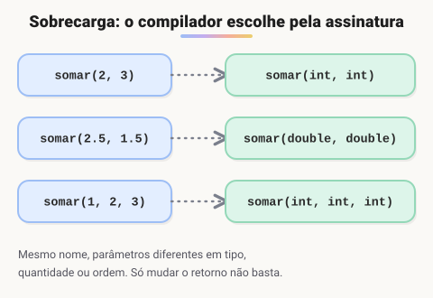
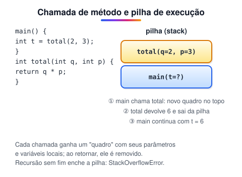

# Métodos em Java

> 🗺️ **Nesta aula:** o que é um método e suas partes, boas práticas, sobrecarga (mesmo nome com parâmetros diferentes), tipos de retorno e exercícios.

## De onde paramos

Você já viu estruturas de dados que guardam vários valores. Agora vai aprender a dividir o código em partes com nome, que podem ser chamadas quantas vezes for preciso.

## Conceitos importantes de métodos

> 🗺️ **Nesta aula:** o que é um método, sua assinatura, construtores, coleta de lixo, passagem de parâmetros e boas práticas.

### Definição de método

- Em Java, o termo "método" é usado para se referir a uma função ou procedimento que é definido dentro de uma classe. Um método em Java é uma coleção de instruções que realizam uma determinada tarefa.
- Os métodos são usados para encapsular a lógica de um programa, de modo que ela possa ser facilmente reutilizada em vários pontos do programa. Um método pode receber argumentos de entrada, processar esses argumentos e retornar um valor ou simplesmente realizar uma ação sem retornar nada.
- Para chamar um método **de instância**, é preciso criar um objeto da classe e chamar `objeto.metodo(argumentos)`. Já um método `static` pertence à classe e é chamado direto pelo nome dela, sem criar objeto: `Math.max(3, 7)`.
- Em resumo, um método em Java é um bloco de código que pode ser chamado várias vezes a partir de diferentes partes do programa, tornando o código mais modular, organizado e reutilizável.

#### Como criar métodos

```java
<visibilidade> <modificadores> <tipoDeRetorno> <nome>(<parâmetros>) throws <exceções> {
  // corpo do método
  return <valor>; // só se o tipo de retorno não for void
}

// exemplo real
public static double dividir(int a, int b) throws ArithmeticException {
  return (double) a / b;
}
```

> 🛠️ **Correção no modelo:** o original começava com `public` *e* `<visibilidade>` (repetido), tinha um parênteses sobrando e tratava `<retorno>` como uma parte da assinatura. Na verdade, o **tipo de retorno** vem antes do nome, e a palavra `return` fica **dentro do corpo**. Visibilidade, modificadores, parâmetros e `throws` são opcionais.

- `<visibilidade>`: especifica a visibilidade do método, ou seja, quem pode acessá-lo. Pode ser `public`, `private` ou `protected`, ou pode ser omitido para tornar o método acessível apenas dentro do pacote em que ele está definido.
- `<tipo>`: especifica o tipo de dado que o método retorna, ou `void` se o método não retorna valor.
- `<modificador>`: especifica um modificador adicional para o método, como `final`, `static`, `synchronized`, entre outros.
- `return` (no corpo): devolve o valor ao chamador e encerra o método. É obrigatório quando o tipo de retorno não é `void`.
- `<nome>`: nome do método, utilizado para chamá-lo posteriormente.
- `<parametros>`: lista de parâmetros do método, separados por vírgulas, que especifica os valores que o método irá receber como entrada.
- `<excecoes>`: lista de exceções que o método pode lançar, separadas por vírgulas.
- `corpo`: o bloco de código que define as instruções que o método irá executar.

### Conceitos importantes

#### Assinatura do método

A assinatura de método em Java é a combinação única do nome do método e dos tipos e ordem dos parâmetros que ele recebe. A assinatura do método é usada pelo compilador Java para determinar qual método deve ser chamado quando há vários métodos com o mesmo nome em uma classe ou em suas superclasses. A assinatura de um método inclui o nome do método e os tipos de seus parâmetros, mas não inclui o tipo de retorno do método. Por exemplo, o seguinte método tem a assinatura "exibir(String, int)":

```java
public void exibir(String texto, int numero) {
  // código do método
}
  
/* A assinatura do método acima é determinada pelo nome "exibir" e pelos tipos de seus 
   parâmetros "String" e "int". Se houvesse outro método com o nome "exibir" na mesma 
   classe, mas com parâmetros diferentes, o compilador Java poderia escolher o método 
   correto com base em suas assinaturas. */
```

#### Construtor

Em Java, construtor e destrutor são conceitos relacionados à criação e destruição de objetos. O construtor é um método especial que é chamado automaticamente quando um objeto é criado. Ele é responsável por inicializar os valores dos campos do objeto e executar outras ações necessárias para deixar o objeto em um estado válido. O construtor tem o mesmo nome da classe e não tem tipo de retorno, nem mesmo void.

```java
//Class "Pessoa" (Geralmente classes tem primeira letra em maiúsculo)
public class Pessoa {
    private String nome;
    private int idade;

    //Construtor
    public Pessoa(String nome, int idade) {
        this.nome = nome;
        this.idade = idade;
    }
}
/* O construtor acima recebe dois parâmetros, um para o nome e outro para a idade, 
   e atribui esses valores aos campos correspondentes. */
```

#### Destrutor (a coleta de lixo)

- Java não tem destrutor como em C++. Quem libera a memória é o garbage collector, que roda automaticamente e descarta objetos que não estão mais em uso pelo programa. O garbage collector é responsável por liberar a memória ocupada por esses objetos e torná-la disponível para outros usos.
- Não é necessário implementar um destrutor em Java, pois o garbage collector cuida dessa tarefa automaticamente.
- Existe o método `finalize()`, que o GC **poderia** chamar antes de descartar o objeto — mas ele está **depreciado desde o Java 9** e marcado para remoção, porque não há garantia de quando (nem se) será executado.
- Para liberar recursos (arquivos, conexões), use `try-with-resources` com classes que implementam `AutoCloseable`.

#### Passagem de parâmetro

- Em programação, "passagem de parâmetros" se refere ao processo de transmitir argumentos ou valores para um método ou função. Os parâmetros são informações que o método precisa para executar uma determinada ação. A passagem de parâmetros é uma das formas mais comuns de comunicação entre diferentes partes de um programa.
- Em geral, a passagem de parâmetros pode ser feita de duas formas: por valor(Cópia) ou por referência(Endereço na memória) . Na passagem por valor, uma cópia do valor do argumento é passada para o método. Já na passagem por referência, é passada uma referência ou endereço de memória do argumento para o método, o que permite que o método altere o valor do argumento original.
- Em Java, a passagem de parâmetros é feita sempre por valor, mesmo quando se trata de tipos de referência. Isso significa que, quando um objeto é passado como argumento para um método, na verdade está sendo passada uma cópia da referência do objeto e não do objeto em si. Se o método altera o estado do objeto, essa alteração será refletida também no objeto original, já que ambas as referências apontam para o mesmo objeto na memória. Porém, se o método atribui um novo objeto à referência, essa alteração não será refletida fora do método.`public class ExemploParametros {
  
  // Método que recebe um valor por parâmetro e o altera
  public static void alterarValor(int valor) {
    valor = 10;
    System.out.println("Dentro do método alterarValor: " + valor);
  }
  
  // Método que recebe um objeto por parâmetro e altera um de seus atributos
  public static void alterarObjeto(Objeto obj) {
    obj.setValor(10);
    System.out.println("Dentro do método alterarObjeto: " + obj.getValor());
  }
  
  public static void main(String[] args) {
    int valor = 5;
    System.out.println("Antes do método alterarValor: " + valor);
    alterarValor(valor);
    System.out.println("Depois do método alterarValor: " + valor);
    
    Objeto obj = new Objeto(5);
    System.out.println("Antes do método alterarObjeto: " + obj.getValor());
    alterarObjeto(obj);
    System.out.println("Depois do método alterarObjeto: " + obj.getValor());
  }
}

class Objeto {
  private int valor;
 
	//Construtor 
  public Objeto(int valor) {
    this.valor = valor;
  }
  
 //Getters e setters
  public int getValor() {
    return valor;
  }
  public void setValor(int valor) {
    this.valor = valor;
  }
}`Boas práticas
- Métodos devem ter nomes curtos e descritivos.
- Em Java, a convenção é **camelCase** (`calcularMedia`). *snake_case* é comum em Python, não em Java.
- Métodos devem ser **curtos** e fazer **uma coisa só** — se passar de umas 20–30 linhas, provavelmente dá para dividir.

> 🛠️ **Ajuste:** o texto original dizia que métodos "devem ter de 80 a 120 linhas". Esses números são o limite comum de **colunas (caracteres por linha)**, não de linhas por método. Um método com 100 linhas costuma ser sinal de que faz coisas demais.

- Evite lista de parâmetros muito longas.
- Visibilidade adequada a funcionalidade (Se o método vai ser publico ou só para uso privado).

### 🧠 Revisão rápida

**Um construtor pode ter tipo de retorno, mesmo que seja `void`?**

Não. Ele tem o mesmo nome da classe e não declara tipo de retorno.

**O que faz o garbage collector?**

Libera a memória de objetos que não são mais alcançáveis pelo programa.

### 📌 Resumo

| Item | Em uma frase |
| --- | --- |
| Método | bloco de código com nome, reutilizável dentro de uma classe |
| Assinatura | nome e tipos dos parâmetros; o retorno não faz parte dela |
| Construtor | mesmo nome da classe, sem tipo de retorno; roda ao criar o objeto |
| Coleta de lixo | libera a memória de objetos não usados; não existe destrutor em Java |
| Parâmetros | sempre passados por valor; para objetos, copia-se a referência |
| Boas práticas | nome em camelCase, uma só responsabilidade, poucos parâmetros |

## Sobrecarga de métodos

> 🗺️ **Nesta aula:** sobrecarga de métodos (mesmo nome, parâmetros diferentes), como ela difere da sobrescrita e exemplos de cada uma.

Sobrecarga de métodos é um recurso da linguagem de programação Java que permite que um mesmo nome de método seja utilizado para executar diferentes ações, dependendo dos argumentos passados para ele. Isso significa que é possível ter dois ou mais métodos com o mesmo nome em uma classe, desde que eles tenham uma assinatura diferente, ou seja, um conjunto diferente de parâmetros de entrada. Por exemplo, considere uma classe que tenha dois métodos com o nome "soma", um que recebe dois números inteiros como parâmetros e outro que recebe dois números decimais. Ambos os métodos teriam o mesmo nome, mas teriam assinaturas diferentes, permitindo que o compilador Java distinguisse entre eles.

A sobrecarga de métodos é útil para criar interfaces mais intuitivas e fáceis de usar, reduzir a complexidade do código e melhorar a legibilidade do programa. Além disso, ela pode ajudar a evitar erros comuns, como a passagem de argumentos de tipos diferentes para um método que espera um tipo específico de entrada.

#### Sobrecarga x sobrescrita

- A sobrecarga de métodos, como descrito anteriormente, permite que um mesmo nome de método seja utilizado para executar diferentes ações, dependendo dos argumentos passados para ele. Isso significa que vários métodos com o mesmo nome podem coexistir em uma classe, desde que tenham diferentes assinaturas.
- Por outro lado, a sobrescrita de métodos ocorre quando uma subclasse redefine um método que já foi definido em sua classe pai. Isso significa que a subclasse fornece sua própria implementação para o método, substituindo a implementação herdada da classe pai.
- Na sobrescrita de métodos, o nome e os parâmetros devem ser idênticos aos da classe pai; o tipo de retorno deve ser o mesmo **ou um subtipo dele** (retorno covariante). A subclasse não pode reduzir a visibilidade do método (por exemplo, mudar de `public` para `private`).

|  | Sobrecarga (*overload*) | Sobrescrita (*override*) |
| --- | --- | --- |
| Onde | Na mesma classe (ou herdada) | Na subclasse |
| Nome | Igual | Igual |
| Parâmetros | **Diferentes** | **Iguais** |
| Retorno | Pode mudar | Igual ou subtipo |
| Decidido em | Compilação (pelos argumentos) | Execução (pelo tipo real do objeto) |
| Anotação | — | `@Override` (recomendada) |

> ⚠️ Mudar **só o tipo de retorno** não cria uma sobrecarga: `int soma(int a, int b)` e `double soma(int a, int b)` na mesma classe dão **erro de compilação**, porque a assinatura (nome + parâmetros) é a mesma.



> 💡 **Analogia:** é como um tradutor que atende pelo mesmo nome. Quem pede "soma" com dois inteiros recebe a versão inteira; com decimais, a versão decimal. O compilador escolhe pelo que você passa.

#### Exemplo de código de Sobrecarga

```java
public class ExemploSobrecarga {

  public static void main(String[] args) {
    int somaInteiros = soma(2, 3);
    System.out.println("A soma dos inteiros é: " + somaInteiros);

    double somaDecimais = soma(2.5, 3.7);
    System.out.println("A soma dos decimais é: " + somaDecimais);
  }

  // Método de sobrecarga para soma de inteiros
  public static int soma(int a, int b) {
    int resultado = a + b;
    return resultado;
  }

  // Método de sobrecarga para soma de decimais
  public static double soma(double a, double b) {
    double resultado = a + b;
    return resultado;
  }
}
```

#### Exemplo de código de sobrescrita

```java
class Animal {
  public void fazerBarulho() {
    System.out.println("O animal faz algum barulho.");
  }
}

class Cachorro extends Animal {
  @Override
  public void fazerBarulho() {
    System.out.println("O cachorro faz 'Au Au!'");
  }
}

public class ExemploSobrescrita {
  public static void main(String[] args) {
    Animal animal = new Animal();
    animal.fazerBarulho(); // Saída: O animal faz algum barulho.

    Cachorro cachorro = new Cachorro();
    cachorro.fazerBarulho(); // Saída: O cachorro faz 'Au Au!'
  }
}
```

### 🧠 Revisão rápida

**Por que `soma(2, 3)` e `soma(2.5, 3.7)` podem coexistir na mesma classe?**

Porque as assinaturas são diferentes: o primeiro recebe `int`, o segundo recebe `double`.

**Mudar só o tipo de retorno cria uma sobrecarga?**

Não. A assinatura não inclui o retorno, então o compilador acusa erro.

### 📌 Resumo

| Item | Em uma frase |
| --- | --- |
| Sobrecarga | mesmo nome com parâmetros diferentes; escolhida pelo compilador |
| Sobrescrita | a subclasse redefine o método herdado, com a mesma assinatura |
| Assinatura | nome e tipos dos parâmetros; o tipo de retorno não entra |
| `@Override` | anotação que faz o compilador conferir a sobrescrita |

## Retornos de métodos

> 🗺️ **Nesta aula:** o que é o retorno de um método, como declarar o tipo de retorno e quando usar `void`.

O retorno de um método em programação é o valor ou objeto que é devolvido ao chamador do método após sua execução. Em outras palavras, quando um método é chamado, ele executa uma série de instruções e, em seguida, retorna um valor para o código que o chamou.

- Em muitas linguagens de programação, incluindo Java, os métodos têm um tipo de retorno declarado. Isso significa que ao definir um método, é necessário especificar qual é o tipo de valor que será retornado quando o método for chamado. Por exemplo, um método pode ter um tipo de retorno "int", que significa que ele deve retornar um valor inteiro quando for executado.
- Ao chamar um método que retorna um valor, o valor retornado pode ser usado em outras partes do código. Por exemplo, se um método "soma" retorna o resultado de uma operação de adição entre dois números, o valor retornado pode ser armazenado em uma variável ou usado em outras operações.
- Além disso, em Java é possível ter métodos que não retornam valores, ou seja, que têm um tipo de retorno "void". Nesse caso, o método executa suas instruções, mas não retorna nenhum valor ao chamador. Em vez disso, ele pode ser usado para realizar ações como imprimir uma mensagem na tela ou atualizar uma variável de instância.
- O `return` é uma instrução de interrupção, assim como o `break`. O método executa seu retorno quando acontece uma dessas situações:
- Completa todas as instruções internas
- Chega a uma declaração explicita de retorno
- Lança uma exceção



> 💡 **Analogia:** pense em pedir um café no balcão. O método é o barista; o retorno é o copo entregue a você. Um método `void` é o barista que só limpa a máquina e não entrega nada.

#### Exemplo em código:

```java
public class ExemploMetodo {

  public static void main(String[] args) {
    int resultado = soma(2, 3);
    System.out.println("A soma é: " + resultado);

    imprimirMensagem();
  }

  public static int soma(int a, int b) {
    int resultado = a + b;
    return resultado;
  }

  public static void imprimirMensagem() {
    System.out.println("Método sem retorno. Essa mensagem foi impressa!");
  }
}
```

### 🧠 Revisão rápida

**Qual é o tipo de retorno de um método que não devolve nada?**

`void`.

**O que acontece quando a execução chega a um `return`?**

O método encerra e devolve o valor ao chamador; o restante do método não é executado.

### 📌 Resumo

| Item | Em uma frase |
| --- | --- |
| Retorno | valor devolvido ao chamador quando o método termina |
| `return` | encerra o método e devolve o valor; é obrigatório se o tipo não for `void` |
| `void` | indica que o método não devolve valor |
| Fim do método | ocorre ao chegar ao fim, a um `return` ou ao lançar exceção |

## Exercícios

> 🗺️ **Nesta aula:** exercícios de métodos: calculadora, mensagem por hora, simulação de empréstimo, sobrecarga e retorno de valores.

1. Crie um programa que calcule as 4 operações básicas: soma, subtração, multiplicação e divisão, com 2 valores como parâmetro.Código`// Classe "main"
package ex01;

public class Main {
    public static void main(String[] args) {
        // Os métodos são static: chamamos pela classe,
        // sem criar um objeto Calculadora
        Calculadora.somaNumeros(3, 6);
        Calculadora.subtraiNumeros(10, 2);
        Calculadora.multiplicaNumeros(5, 5);
        Calculadora.divideNumeros(8, 2);
        Calculadora.mostraRestoNumeros(10, 3);
    }
}``// Classe "Calculadora"
package ex01;

public class Calculadora {
    public static void somaNumeros(double num1, double num2) {
        double resultado = num1 + num2;
        System.out.println("A soma de: " + num1 + " com " + num2 + " é: " + resultado);
    }

    public static void subtraiNumeros(double num1, double num2) {
        double resultado = num1 - num2;
        System.out.println("A subtração de: " + num1 + " por " + num2 + " é: " + resultado);
    }

    public static void multiplicaNumeros(double num1, double num2) {
        double resultado = num1 * num2;
        System.out.println("A multiplicação de: " + num1 + " por " + num2 + " é: " + resultado);
    }

    public static void divideNumeros(double num1, double num2) {
        double resultado = num1 / num2;
        System.out.println("A divisão de: " + num1 + " por " + num2 + " é: " + resultado);
    }

    public static void mostraRestoNumeros(double num1, double num2) {
        double resto = num1 % num2;
        System.out.println("O resto da divisão de: " + num1 + " por " + num2 + " é: " + resto);
    }
}`
2. A partir da hora do dia, informe a mensagem adequada: bom dia, boa tarde ou boa noite.🛠️**Bug corrigido:** no original, a condição `horaDoDia >= 12` pegava **todas** as horas da tarde e da noite, então o `else` (boa noite) **nunca** era executado: `obterMensagem(22)` imprimia "Boa tarde!!". Agora a tarde vai até 17h, e horas fora de 0 a 23 são rejeitadas.Código`// Classe "main"
package ex02;

public class Main {
    public static void main(String[] args) {
        Mensagem.obterMensagem(6);
        Mensagem.obterMensagem(13);
        Mensagem.obterMensagem(22);
    }
}``// Classe "Mensagem"
package ex02;

public class Mensagem {
    public static void obterMensagem(int horaDoDia) {
        if (horaDoDia < 0 || horaDoDia > 23) {
            System.out.println("Hora inválida!");
        } else if (horaDoDia < 12) {
            saudacaoDia();       // 0h às 11h
        } else if (horaDoDia < 18) {
            saudacaoTarde();     // 12h às 17h
        } else {
            saudacaoNoite();     // 18h às 23h
        }
    }

    private static void saudacaoDia() {
        System.out.println("Bom dia!");
    }

    private static void saudacaoTarde() {
        System.out.println("Boa tarde!!");
    }

    private static void saudacaoNoite() {
        System.out.println("Boa noite!!!");
    }
}`
3. Calcule o valor final de um empréstimo, a partir do valor solicitado. Taxas e parcelas influenciam. Defina arbitrariamente as faixas que influenciam nos valores.🛠️**Correções:** a tabela exibida dizia **15%** para 20 parcelas, mas o cálculo usava `0.2` (20%); o código agora usa 15%. Também corrigi "3,9 de juros" para "3,9%" e o erro de digitação "Bem vindo". O `jurosMes` é o juro total dividido pelas parcelas (um valor médio em reais por parcela), e não uma taxa mensal. As taxas são **juros simples sobre o total**, e não compostos como em um empréstimo real. Para dinheiro de verdade, prefira `BigDecimal` a `double`.Código`// Classe "main"
package ex03;

public class Main {
    public static void main(String[] args) {
        Emprestimo.mostraCondicaoEmprestimo();
        Emprestimo.simulaEmprestimo(100, 20);
    }
}``// Classe "Emprestimo"
package ex03;

public class Emprestimo {
    public static void mostraCondicaoEmprestimo() {
        System.out.println("Bem-vindo ao nosso banco. Seguem as condições do nosso empréstimo:");
        System.out.println("01 parcela - 1% de juros");
        System.out.println("02 parcelas - 2% de juros");
        System.out.println("03 parcelas - 2,5% de juros");
        System.out.println("04 parcelas - 3% de juros");
        System.out.println("05 parcelas - 3,5% de juros");
        System.out.println("06 a 09 parcelas - 3,9% de juros");
        System.out.println("10 parcelas - 10% de juros");
        System.out.println("11 a 19 parcelas - 11% de juros");
        System.out.println("20 parcelas - 15% de juros");
        System.out.println("O maior valor que emprestamos é R$ 100.000, "
            + "e a maior quantidade de parcelas é 20\n");
    }

    public static void simulaEmprestimo(double valorEmprestimo, int quantParcelas) {
        validaValores(valorEmprestimo, quantParcelas);
        double vTotal = calculaTotal(valorEmprestimo, quantParcelas);
        double vParcela = calculaValorParcela(vTotal, quantParcelas);
        double vJuros = calculaJuro(valorEmprestimo, vTotal);
        double jurosMes = vJuros / quantParcelas;

        System.out.println("A simulação ficou da seguinte forma:");
        System.out.println("Valor solicitado: " + valorEmprestimo);
        System.out.println("Juros médios por parcela: " + jurosMes);
        System.out.println("Total com juros: " + vTotal);
        System.out.println("Quantidade de parcelas: " + quantParcelas);
        System.out.println("Valor da parcela: " + vParcela);
    }

    private static double calculaTotal(double valorEmprestimo, int quantParcelas) {
        switch (quantParcelas) {
            case 1:
                return valorEmprestimo + valorEmprestimo * 0.01;
            case 2:
                return valorEmprestimo + valorEmprestimo * 0.02;
            case 3:
                return valorEmprestimo + valorEmprestimo * 0.025;
            case 4:
                return valorEmprestimo + valorEmprestimo * 0.03;
            case 5:
                return valorEmprestimo + valorEmprestimo * 0.035;
            case 6, 7, 8, 9:
                return valorEmprestimo + valorEmprestimo * 0.039;
            case 10:
                return valorEmprestimo + valorEmprestimo * 0.10;
            case 11, 12, 13, 14, 15, 16, 17, 18, 19:
                return valorEmprestimo + valorEmprestimo * 0.11;
            case 20:
                return valorEmprestimo + valorEmprestimo * 0.15;
            default:
                throw new IllegalArgumentException("Número de parcelas inválido");
        }
    }

    private static double calculaValorParcela(double total, int parcelas) {
        return total / parcelas;
    }

    private static double calculaJuro(double valorInicial, double valorFinal) {
        return valorFinal - valorInicial;
    }

    private static void validaValores(double valorEmprestimo, int parcelas) {
        if (valorEmprestimo > 100000 || valorEmprestimo < 10) {
            throw new IllegalArgumentException("Erro! Valor de empréstimo inválido");
        } else if (parcelas < 1 || parcelas > 20) {
            throw new IllegalArgumentException("Erro! Quantidade de parcelas inválida");
        }
    }
}`
4. Crie uma aplicação que calcule a área dos 3 quadriláteros notáveis (quadrado, retângulo e trapézio). Use sobrecarga.Código`// Classe "main"
package ex04;

public class Main {
    public static void main(String[] args) {
        // Quadrado: um lado
        Quadrilatero.area(7);
        // Retângulo: dois lados
        Quadrilatero.area(5, 8);
        // Trapézio: duas bases e altura
        Quadrilatero.area(9, 7, 12);
    }
}``package ex04;

public class Quadrilatero {
    // Quadrado: todos os lados iguais
    public static void area(double lado) {
        System.out.println("A área do quadrado é: " + lado * lado);
    }

    // Retângulo: dois lados diferentes
    public static void area(double lado1, double lado2) {
        System.out.println("A área do retângulo é: " + lado1 * lado2);
    }

    // Trapézio: duas bases e a altura
    public static void area(double baseMaior, double baseMenor, double altura) {
        System.out.println("A área do trapézio é: " + ((baseMaior + baseMenor) * altura) / 2);
    }
}`
5. Recrie a aplicação que calcula a área dos 3 quadriláteros notáveis. Agora use métodos que retornem valores.Código`// Classe "main"
package ex05;

public class Main {
    public static void main(String[] args) {
        double quadrado = QuadrilateroComRetorno.area(5);
        System.out.println("A área do quadrado é: " + quadrado);

        double retangulo = QuadrilateroComRetorno.area(8, 5);
        System.out.println("A área do retângulo é: " + retangulo);

        double trapezio = QuadrilateroComRetorno.area(7, 5, 10);
        System.out.println("A área do trapézio é: " + trapezio);
    }
}``// Classe "QuadrilateroComRetorno"
package ex05;

public class QuadrilateroComRetorno {
    // Quadrado
    public static double area(double lado) {
        return lado * lado;
    }

    // Retângulo
    public static double area(double lado1, double lado2) {
        return lado1 * lado2;
    }

    // Trapézio
    public static double area(double baseMaior, double baseMenor, double altura) {
        return ((baseMaior + baseMenor) * altura) / 2;
    }
}`🛠️**Ajustes de nomenclatura:** métodos, variáveis e pacotes seguem o padrão Java (`somaNumeros`, `ex01`, `QuadrilateroComRetorno`). Antes eram `soma_numeros`, `Ex_01` e `Quadriatero_com_retorno`. A variável `retultado` também foi corrigida para `resultado`.

### 🧠 Revisão rápida

<details>
<summary>Ver resposta: No Exercício 4, por que a mesma classe pode ter três métodos chamados `area`?</summary>

Porque a sobrecarga usa assinaturas diferentes: 1, 2 ou 3 parâmetros.

</details>

<details>
<summary>Ver resposta: Por que o exercício 2 usa `else if` com faixas de horas em vez de vários `if` separados?</summary>

Porque só uma faixa deve valer por vez. Com a cadeia de `else if`, a primeira condição verdadeira decide a mensagem, e as outras são ignoradas.

</details>

### 📌 Resumo

| Exercício | O que pratica |
| --- | --- |
| 1. Calculadora | métodos `static` com dois parâmetros |
| 2. Saudação | decisões encadeadas e métodos `private` |
| 3. Empréstimo | `switch`, validação com exceções e cálculo de parcelas |
| 4. Áreas com sobrecarga | o mesmo nome `area` com três assinaturas |
| 5. Áreas com retorno | métodos que devolvem o valor em vez de imprimi-lo |

> ➡️ **Próximo passo:** na próxima aula você aprende a manipular textos com `String` e `StringBuilder`.

## 🧠 Revisão rápida

**Dois métodos chamados `somar`, um com `(int a, int b)` e outro com `(double a, double b)`, são sobrecarga?**

Sim: o nome é igual, mas a lista de parâmetros difere. O compilador escolhe o certo pelos argumentos.

**Dois métodos com o mesmo nome e os mesmos parâmetros, mas retornos diferentes, podem coexistir?**

Não. O tipo de retorno sozinho não diferencia sobrecargas.

## 📌 Resumo

| Item | Em uma frase |
| --- | --- |
| Assinatura | visibilidade, modificadores, tipo de retorno, nome e parâmetros |
| `static` | pertence à classe; chamado sem criar objeto |
| `void` | o método não devolve valor |
| `return` | encerra o método e devolve o valor do tipo declarado |
| Sobrecarga | mesmo nome com lista de parâmetros diferente; o tipo de retorno sozinho não basta |
| Boas práticas | nome no infinitivo, uma responsabilidade, poucos parâmetros |
