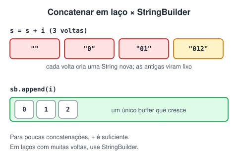

# Strings e StringBuilder (Adicionado pelo aluno para melhorar o estudo)

> 🗺️ **Nesta aula:** por que `String` é imutável, como comparar textos com `equals`, os métodos mais usados, formatação, text blocks e quando usar `StringBuilder`.

## De onde paramos

Você já sabe criar métodos que recebem e devolvem valores. Agora vai ver o tipo mais usado em Java: o texto.

## `String` é imutável

**Uma vez criada, uma** `String` **nunca muda.** Todo método que parece alterá-la devolve, na verdade, uma **nova** String:

```java
String nome = "ana";
nome.toUpperCase();  // cria "ANA" e descarta: nome continua "ana"
nome = nome.toUpperCase();  // ✅ guarde o resultado
```

A imutabilidade torna Strings seguras para compartilhar entre threads e para usar como chave de `HashMap`.

## Comparando: use `equals`

```java
String a = "pan";
String b = "pan";
String c = new String("pan");

a == b;  // true, mas por acaso: literais iguais reaproveitam o mesmo objeto (String pool)
a == c;  // false: objetos diferentes
a.equals(c);  // true ✅ compara o conteúdo
a.equalsIgnoreCase("PAN");  // true
"pan".equals(entrada);  // seguro mesmo se entrada for null
```

## Métodos mais usados

| Método | Exemplo | Resultado |
| --- | --- | --- |
| `length()` | `"Java".length()` | `4` |
| `charAt(i)` | `"Java".charAt(0)` | `'J'` |
| `substring(i, f)` | `"Banco PAN".substring(6)` | `"PAN"` |
| `indexOf` / `contains` | `"Banco PAN".contains("PAN")` | `true` |
| `startsWith` / `endsWith` | `"arquivo.pdf".endsWith(".pdf")` | `true` |
| `replace` | `"123.456.789-00".replace(".", "")` | `"123456789-00"` |
| `split` | `"a;b;c".split(";")` | `["a", "b", "c"]` |
| `trim` / `strip` (11+) | `"  oi  ".strip()` | `"oi"` |
| `isEmpty` / `isBlank` (11+) | `"   ".isBlank()` | `true` |
| `repeat` (11+) | `"-".repeat(5)` | `"-----"` |
| `String.join` | `String.join(", ", lista)` | `"a, b, c"` |

> 💡 `split` recebe uma **expressão regular**. Para separar por ponto, use `split("\\.")`; `split(".")` devolve um array vazio, porque `.` significa "qualquer caractere".

## Formatando

```java
String.format("Cliente %s tem %d contas", nome, qtd);
"Saldo: %.2f".formatted(1234.5);  // Java 15+: "Saldo: 1234.50"

// moeda brasileira
NumberFormat brl = NumberFormat.getCurrencyInstance(Locale.forLanguageTag("pt-BR"));
brl.format(new BigDecimal("1234.5"));  // "R$ 1.234,50"
```

## Text blocks (Java 15+)

Para textos de várias linhas, como JSON, SQL e HTML, sem `\n` e sem concatenação:

```java
String sql = """
  SELECT c.nome, SUM(t.valor)
  FROM clientes c
  JOIN transacoes t ON t.cliente_id = c.id
  GROUP BY c.nome
  """;
```

## `StringBuilder`: montando texto em laços



> 💡 **Analogia:** concatenar com `+` dentro de um laço é como reescrever a folha inteira a cada palavra nova. O `StringBuilder` é um caderno em que você só acrescenta linhas no fim.

Como String é imutável, concatenar com `+` dentro de um laço cria um objeto novo a cada volta e copia todo o texto de novo. Com milhares de itens, isso fica lento:

```java
// ❌ lento em laços grandes
String csv = "";
for (Conta c : contas) csv += c.getNumero() + ";";

// ✅ um único buffer que cresce
StringBuilder sb = new StringBuilder();
for (Conta c : contas) {
  sb.append(c.getNumero()).append(';');
}
String csv = sb.toString();
```

Outros métodos: `insert`, `deleteCharAt`, `reverse` (útil para palíndromos) e `setLength(0)` para reaproveitar o buffer.

- `StringBuilder`: não é sincronizado e é o mais rápido. Use quase sempre.
- `StringBuffer`: é sincronizado (thread-safe) e mais lento. Hoje raramente é necessário.

Fora de laços, o `+` comum está ótimo: o compilador já otimiza `"Olá, " + nome + "!"`.

> ➡️ **Próximo passo:** na próxima aula você trabalha com dinheiro de forma segura (`BigDecimal`) e com datas (`java.time`).

## 🧠 Revisão rápida

**Por que `nome.toUpperCase();` sozinho não muda a variável `nome`?**

Porque a String é imutável: o método devolve uma nova String, que precisa ser guardada (`nome = nome.toUpperCase();`).

**Por que `"pan".equals(entrada)` é mais seguro que `entrada.equals("pan")`?**

Se `entrada` for `null`, a chamada `entrada.equals(...)` lança `NullPointerException`; invertendo, o resultado é `false`.

## 📌 Resumo

| Item | Em uma frase |
| --- | --- |
| Imutável | métodos como `toUpperCase()` devolvem uma nova `String`; a original não muda |
| `equals` | compara o conteúdo; `==` compara se é o mesmo objeto |
| Métodos úteis | `length`, `trim`/`strip`, `contains`, `split`, `replace`, `substring` |
| Formatação | `String.format` e `formatted` com `%s`, `%d`, `%.2f` |
| Text block | texto de várias linhas entre `"""` (Java 15+) |
| `StringBuilder` | monta texto em laços sem criar uma `String` nova a cada passo |
