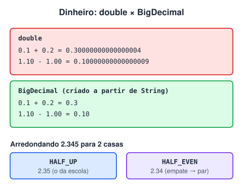
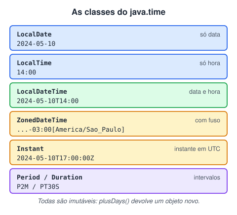

# Dinheiro e datas: BigDecimal e java.time (Adicionado pelo aluno para melhorar o estudo)

> 🗺️ **Nesta aula:** por que `double` erra contas de dinheiro, como usar `BigDecimal` (criação, arredondamento, divisão e comparação) e a API `java.time` para datas e horas.

## Por que não usar `double` para dinheiro



`double` guarda números em **binário**, e valores como 0,1 não têm representação exata:

```java
System.out.println(0.1 + 0.2);  // 0.30000000000000004
System.out.println(1.10 - 1.00);  // 0.10000000000000009
```

Em um banco, centavos sobrando ou faltando em milhões de operações viram problema contábil. **Para valores monetários, use** `BigDecimal`, ou guarde centavos em `long`.

## BigDecimal na prática

```java
BigDecimal a = new BigDecimal("0.1");  // ✅ sempre a partir de String
BigDecimal b = new BigDecimal(0.1);  // ❌ 0.1000000000000000055511151231257827...
BigDecimal c = BigDecimal.valueOf(0.1);  // ✅ também ok (usa a representação em texto do double)

BigDecimal saldo = new BigDecimal("1000.00");
saldo = saldo.add(new BigDecimal("250.50"));  // imutável: guarde o resultado!
saldo = saldo.subtract(new BigDecimal("100"));
BigDecimal juros = saldo.multiply(new BigDecimal("0.0125"));
```

### Arredondamento e divisão

```java
juros.setScale(2, RoundingMode.HALF_EVEN);  // 2 casas, "arredondamento bancário"

new BigDecimal("2.345").setScale(2, RoundingMode.HALF_UP);  // 2.35 (o da escola)
new BigDecimal("2.345").setScale(2, RoundingMode.HALF_EVEN);  // 2.34 (empate vai para o par)

BigDecimal.ONE.divide(new BigDecimal("3"));  // 💥 ArithmeticException (dízima)
BigDecimal.ONE.divide(new BigDecimal("3"), 2, RoundingMode.HALF_EVEN); // 0.33 ✅
```

`HALF_EVEN` distribui os empates para cima e para baixo e evita viés em grandes volumes. Por isso é o padrão em sistemas financeiros.

### Comparando

```java
new BigDecimal("2.0").equals(new BigDecimal("2.00"));  // false! equals considera a escala
new BigDecimal("2.0").compareTo(new BigDecimal("2.00"));  // 0 ✅ são iguais em valor

saldo.compareTo(valorSaque) < 0  // saldo menor que o saque?
valor.signum() > 0  // valor positivo?
```

No banco de dados, use `DECIMAL(15,2)` ou `NUMERIC`. Em JPA: `@Column(precision = 15, scale = 2) private BigDecimal valor;`.

## Datas: a API `java.time` (Java 8+)



Esqueça `Date` e `Calendar`, que são mutáveis, confusos e têm meses começando em 0. Use `java.time`:

| Classe | Representa | Exemplo |
| --- | --- | --- |
| `LocalDate` | só data | vencimento de boleto |
| `LocalTime` | só hora | horário de corte do TED |
| `LocalDateTime` | data e hora sem fuso | agendamento local |
| `ZonedDateTime` | data, hora e fuso | `2024-05-10T14:00-03:00[America/Sao_Paulo]` |
| `Instant` | um instante em UTC | data/hora de uma transação no log ou no banco |
| `Period` / `Duration` | intervalo em dias/meses/anos / em horas, minutos, segundos | prazo de um empréstimo / tempo de uma requisição |

```java
LocalDate hoje = LocalDate.now();
LocalDate vencimento = LocalDate.of(2024, 1, 31);
vencimento.plusMonths(1);  // 2024-02-29: ajusta para o último dia do mês
vencimento.plusDays(30);
vencimento.getDayOfWeek();  // WEDNESDAY
vencimento.isBefore(hoje);  // vencido?

long dias = ChronoUnit.DAYS.between(vencimento, hoje);  // dias de atraso
int idade = Period.between(dataNascimento, hoje).getYears();

Instant agora = Instant.now();
ZonedDateTime emSp = agora.atZone(ZoneId.of("America/Sao_Paulo"));
```

### Formatando e convertendo texto

```java
DateTimeFormatter br = DateTimeFormatter.ofPattern("dd/MM/yyyy");
LocalDate d = LocalDate.parse("25/12/2024", br);  // texto → data
d.format(br);  // data → "25/12/2024"
LocalDate.parse("2024-12-25");  // ISO-8601 dispensa formatador
```

Cuidado com o padrão: `MM` é mês e `mm` é minuto; `yyyy` é ano e `YYYY` é o "ano da semana", que dá errado perto do réveillon.

> 💡 Regra prática: **grave e trafegue em UTC** (`Instant`, ou `OffsetDateTime` em JSON no formato ISO) e **converta para o fuso do usuário só na hora de exibir**. Como as classes de `java.time` são imutáveis, `plusDays` devolve uma nova data: guarde o resultado.

## 📌 Resumo

| Item | Em uma frase |
| --- | --- |
| `double` | binário: `0.1 + 0.2` dá `0.30000000000000004`; não serve para dinheiro |
| `BigDecimal` | crie a partir de texto (`new BigDecimal("0.10")`), nunca de `double` |
| Divisão | sempre informe escala e arredondamento (`RoundingMode.HALF_EVEN`) |
| Comparar | use `compareTo`; `equals` considera a escala (2.0 ≠ 2.00) |
| `LocalDate` / `LocalDateTime` | data e data-hora sem fuso, imutáveis |
| `DateTimeFormatter` | converte data em texto e texto em data (`dd/MM/yyyy`) |
| `ChronoUnit` / `Period` | diferença entre datas |
