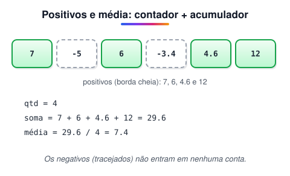

# Desafio: Imprimindo positivos e média

> 🗺️ **Nesta aula:** desafio com laço, condição, contador e acumulador: contar os valores positivos e calcular a média deles. Tente resolver antes de abrir a resolução.

## O que fazer ?

Leia **6** valores. Em seguida, mostre **quantos** destes valores digitados **foram positivos**. Na próxima linha, deve-se **mostrar a média** de **todos os valores positivos digitados**, com **um** dígito **após** o ponto **decimal**.

### Entrada

A entrada contém **6 números** que podem ser valores **inteiros ( int )** ou de **ponto flutuante ( float ou double** ). Pelo menos **um** destes números **será positivo**.

### Saída

O **primeiro valor** de saída é a **quantidade de valores positivos**. A próxima linha deve mostrar a **média** dos valores positivos digitados.

| **Exemplo de Entrada** | **Exemplo de Saída** |
| --- | --- |
| 7 | 4 valores positivos |
| -5 | 7.4 |
| 6 |  |
| -3.4 |  |
| 4.6 |  |
| 12 |  |



### Código da resposta

<details>
<summary>Ver resposta</summary>

```java
//Classe "main"
package Imprimindo_Positivos_e_Média;

import java.util.Scanner;
public class Main {
  public static void main(String[] args) {
    Scanner leitor = new Scanner(System.in);
    int cont = 0;
    double media = 0;
    double x;

    /* Implemente as condições adequadas para obter a quantidade
    //de valores positivos e a média dos valores positivos */
    for (int i = 0; i < 6; i++){
      x = leitor.nextDouble();

      if(x > 0){
        cont ++;
        media += x;
      }
    }
    media = media / cont ;
    System.out.println(cont + " valores positivos");
    System.out.printf("%.1f%n", media);

  }
}
```

</details>

> 🧮 **Conferindo o exemplo:** os positivos são 7, 6, 4,6 e 12 → **4 valores**. Média = (7 + 6 + 4,6 + 12) / 4 = 29,6 / 4 = **7,4**.

> 🛠️ **Cuidado com o idioma do computador:** `System.out.printf("%.1f%n", media)` usa o *locale* da máquina. Num Windows em português, a saída sai como `7,4` (com vírgula), e um corretor automático que espera `7.4` marca como errado. Para garantir o ponto: `System.out.printf(Locale.US, "%.1f%n", media);` (com `import java.util.Locale;`). Pelo mesmo motivo, `nextDouble()` pode exigir que o usuário digite `4,6` em vez de `4.6` — use `new Scanner(System.in).useLocale(Locale.US)` para padronizar.

## 📌 Resumo

| Item | O que o desafio pratica |
| --- | --- |
| Laço `for` | repetir a leitura um número fixo de vezes (6) |
| Contador | `cont++` a cada valor positivo |
| Acumulador | `soma += x` guarda o total dos positivos |
| `printf("%.1f")` | mostrar a média com uma casa decimal |
| Locale | use `Locale.US` para garantir o ponto decimal na entrada e na saída |
