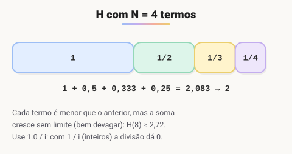

# Desafio: Soma de H com N termos

> 🗺️ **Nesta aula:** desafio de laço com acumulador e divisão decimal: somar a série harmônica H = 1 + 1/2 + ... + 1/N. Tente resolver antes de abrir a resolução.

## O que fazer ?

Neste desafio, faça um programa que calcule o valor de H com N termos.

Sendo, H = 1 + 1/2 + 1/3 + 1/4 + ... + 1/N.

### Entrada

A entrada consiste em um número inteiro positivo.

### Saída

Na saída será impresso o valor que representa a soma dos termos.

| Entrada | Saída |
| --- | --- |
| 4 | 2 |
| 8 | 3 |
| 3 | 2 |

> 🧮 **Conferindo os exemplos:** H(3) = 1 + 0,5 + 0,333 = 1,83 → **2**. H(4) = 1,83 + 0,25 = 2,08 → **2**. H(8) ≈ 2,72 → **3**. A saída é o valor arredondado.

> 🛠️ **Ajustes:** o bloco estava marcado como **JavaScript** (o código é Java). O comentário falava em "duas casas decimais", mas o código (corretamente, segundo os exemplos) arredonda para inteiro. E `n` passou de `double` para `int`, já que é uma quantidade de termos. Note o `1.0/i`: com `1/i` (dois inteiros) a divisão daria 0 a partir de i = 2.



### Código

<details>
<summary>Ver resposta</summary>

```java
package soma_h_com_n_termos;

import java.util.Scanner;

public class Main {
  public static void main(String[] args) {

    double h = 0;
    Scanner sc = new Scanner(System.in);
    int n = sc.nextInt();

    for (int i = 1; i <= n; i++) {
      /*Calcule o valor de H de forma que resulte na soma dos termos:*/
      h += 1.0/i; // soma a fração 1/i a cada iteração
    }
    // O corretor espera o valor ARREDONDADO para o inteiro mais próximo (ver exemplos)
    System.out.println(Math.round(h));
  }
}
```

</details>

## 📌 Resumo

| Item | O que o desafio pratica |
| --- | --- |
| Acumulador | `h += 1.0 / i` soma um termo por volta |
| Divisão decimal | `1.0 / i`; com `1 / i` (dois inteiros) o resultado seria 0 a partir de i = 2 |
| `Math.round` | arredonda para o inteiro mais próximo, como pedem os exemplos |
