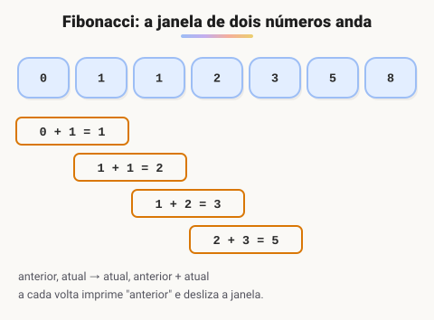
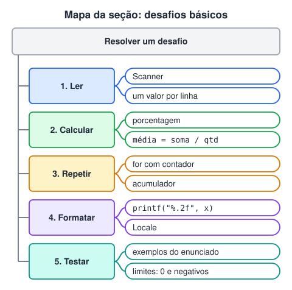

# Desafio: Fibonacci (fácil, não tão fácil quanto disseram)

> 🗺️ **Nesta aula:** desafio de sequência numérica: gerar os N primeiros termos de Fibonacci com três variáveis e controlar o espaço depois do último número. Tente resolver antes de abrir a resolução.

## O que fazer ?

A seguinte sequência de números 0 1 1 2 3 5 8 13 21... é conhecida como série de Fibonacci. Nessa sequência, cada número, depois dos 2 primeiros, é igual à soma dos 2 anteriores. Escreva um algoritmo que leia um inteiro N (N < 46) e mostre os N primeiros números dessa série.

## Entrada

O arquivo de entrada contém um valor inteiro N (0 < N < 46).

## Saída

Os valores devem ser mostrados na mesma linha, separados por um espaço em branco. Não deve haver espaço após o último valor.

| Exemplo de Entrada | Exemplo de Saída |
| --- | --- |
| 5 | 0 1 1 2 3 |

> 💡 **Como funciona:** a cada volta o programa imprime `anterior` e "anda" a sequência: `proximo = anterior + atual`, depois `anterior` recebe `atual` e `atual` recebe `proximo`. O truque do enunciado é **não deixar espaço depois do último número** — por isso o último valor usa `println` sem o `" "`.
>
> Com N < 46, o maior número impresso é o 45º termo (701.408.733), e o laço chega a calcular, sem imprimir, o 47º (1.836.311.903). Os dois cabem num `int`, cujo máximo é 2.147.483.647. O `int` só estoura a partir do 48º termo (2.971.215.073); para ir além, use `long`.



> 💡 **Analogia:** é um trem de dois vagões. A cada passo, o vagão da frente (`atual`) passa a ser o de trás, e o novo vagão engatado na frente é a soma dos dois anteriores.

### Código

<details>
<summary>Ver resposta</summary>

```java
package fibonaccifacil;

import java.util.Scanner;
public class Main {
  public static void main(String[] args) {
    Scanner leitor = new Scanner(System.in);
    int n = leitor.nextInt();
    int proximo, anterior = 0, atual = 1;

    for (int i = 1; i <= n; i++) {
      if (i == n) System.out.println(anterior); //Último termo: imprime sem espaço depois

      //Implemente a condição ideal para que possamos obter os valores solicitados:
      else System.out.print(anterior + " "); //Demais termos: imprime com espaço depois
      proximo = anterior + atual;
      anterior = atual;
      atual = proximo;
    }
  }
}
```

</details>

## 🧠 Revisão rápida

<details>
<summary>Ver resposta: Qual é o 6º termo da série com a sequência começando em 0 1?</summary>

5 (0, 1, 1, 2, 3, 5).

</details>

<details>
<summary>Ver resposta: Por que o código usa `println` no último valor?</summary>

Para não deixar espaço depois do último número, como pede o enunciado.

</details>

## 📌 Resumo

| Item | O que o desafio pratica |
| --- | --- |
| Fibonacci | cada termo é a soma dos dois anteriores: 0 1 1 2 3 5 8... |
| Três variáveis | `anterior`, `atual` e `proximo` "andam" a sequência |
| Último valor | `println` sem espaço depois; os outros usam `print(valor + " ")` |
| Limite do `int` | 2.147.483.647; acima disso, use `long` |

## 🧭 Mapa da seção


