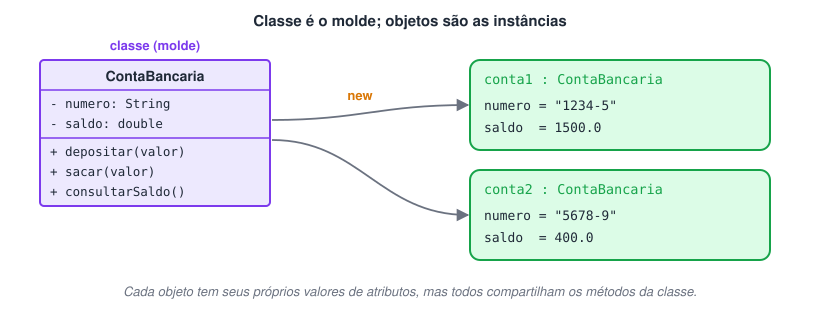
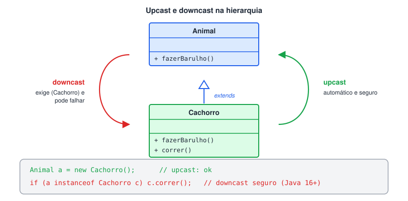
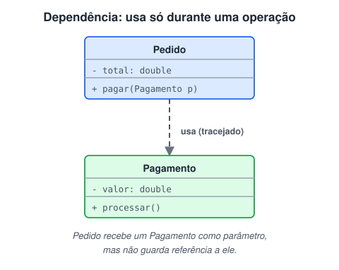
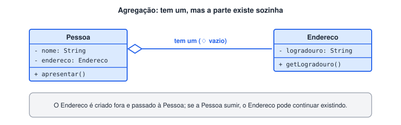
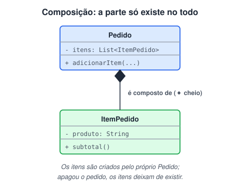
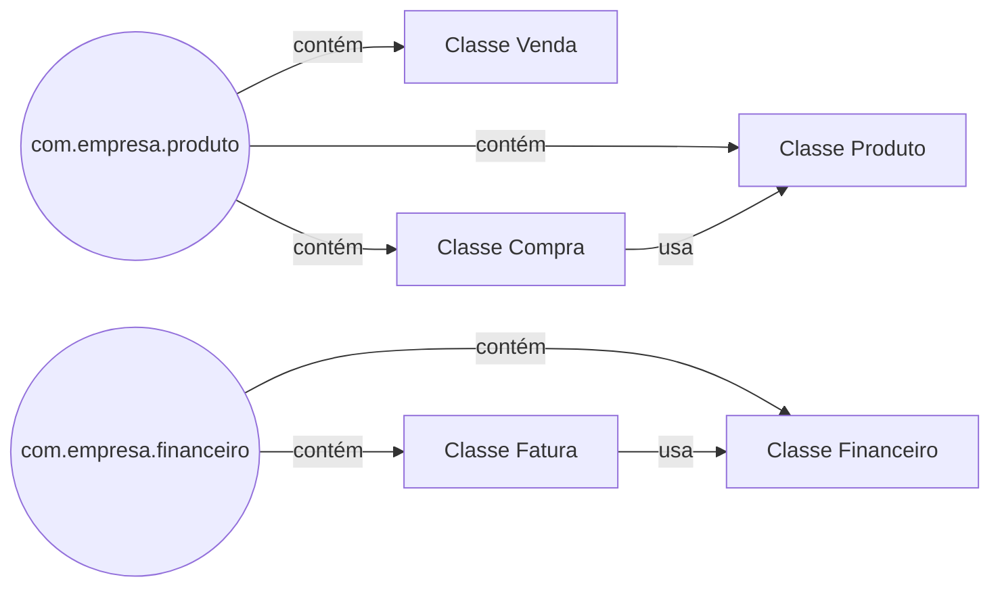

# Programação orientada a objetos com Java

> 🗺️ **Nesta aula:** classes, atributos, métodos e objetos; `equals`, `hashCode` e `toString`; herança, associação, interfaces e classes abstratas; pacotes e modificadores de acesso; e os recursos modernos: enums, records e generics.

### Introdução

## Estrutura básica de OO

### Classes

Em programação orientada a objetos com Java, uma classe é um tipo de estrutura de dados que descreve um conjunto de objetos com as mesmas propriedades e comportamentos. Ela serve como um modelo ou plano para a criação de objetos, que são instâncias dessa classe.

- Uma classe é composta por atributos, que definem as propriedades dos objetos, e métodos, que definem o comportamento dos objetos. Por exemplo, uma classe "Pessoa" pode ter atributos como nome, idade e altura, e métodos como "andar" e "falar". Quando um objeto é criado a partir dessa classe, ele **possui** esses atributos (cada um com seus próprios valores) e pode usar esses métodos. *("Herdar" é outro conceito, usado entre classes — veja a página de Herança.)*
- As classes são importantes porque permitem a reutilização de código, permitindo que diferentes objetos possam ser criados a partir da mesma classe com comportamentos e propriedades semelhantes. Além disso, elas também ajudam a organizar o código, tornando-o mais legível e fácil de manter.`//Classe "Pessoa" -> Geralmente o nome da classe tem a primeira letra em maiúsculo
public class Pessoa {

    // Atributos da classe Pessoa
    private String nome;
    private int idade;
    private double altura;
    
    // Construtor da classe Pessoa
    public Pessoa(String nome, int idade, double altura) {
        this.nome = nome;
        this.idade = idade;
        this.altura = altura;
    }
    
    // Métodos da classe Pessoa
    public String getNome() {
        return nome;
    }
    
    public int getIdade() {
        return idade;
    }
    
    public double getAltura() {
        return altura;
    }
}`



### Atributo

Em programação orientada a objetos na linguagem Java, um atributo é uma variável que está associada a uma classe ou objeto e que representa uma característica ou propriedade do objeto em questão. Atributos são definidos dentro da classe e são usados para armazenar valores específicos para cada objeto que é criado a partir da classe.

- Por exemplo, em uma classe "Pessoa", os atributos poderiam ser "nome", "idade", "altura", etc. Cada objeto criado a partir dessa classe teria seus próprios valores atribuídos a esses atributos. Esses valores podem ser acessados ou modificados por meio de métodos específicos da classe “Pessoa”.`public class Pessoa {

    // Atributos da classe Pessoa
    public String nome;
    public int idade;
    public double altura;
}`⚠️Aqui os atributos são `public` só para simplificar. Na prática, use `private` e exponha getters/setters (encapsulamento), como no exemplo da classe anterior.

### Método

Em programação orientada a objetos em Java, um método é um bloco de código que realiza uma ação específica em um objeto ou classe. Métodos são usados para executar operações, manipular dados e fornecer comportamento específico para objetos.

- Um método pode receber zero ou mais parâmetros como entrada, e pode ou não retornar um valor de saída. O valor de retorno é definido pelo tipo de dado que o método é declarado para retornar.`public class Retangulo {
    private int largura;
    private int altura;
    
    // Construtor da classe Retangulo (Note que o construtor tem o mesmo nome da classe)
    public Retangulo(int largura, int altura) {
        this.largura = largura;
        this.altura = altura;
    }
    
    // Método que calcula a área do retângulo
    public int calcularArea() {
        return largura * altura;
    }
}

public class Main {
    public static void main(String[] args) {
        Retangulo retangulo = new Retangulo(5, 10);
        int area = retangulo.calcularArea(); // Usando o método "calculaArea"
        System.out.println("A área do retângulo é: " + area);
    }
}`

### Objeto

Em programação orientada a objetos, um objeto é uma instância de uma classe. Uma classe define a estrutura e comportamento de um objeto, enquanto um objeto é uma representação concreta de uma entidade específica, com seus próprios valores de dados e estado de comportamento. Os objetos geralmente têm atributos que representam dados e métodos que definem o comportamento do objeto. Os objetos podem interagir uns com os outros por meio de mensagens, que acionam a execução de métodos e podem modificar o estado do objeto receptor.

- Por exemplo, um programa de gerenciamento de banco pode ter uma classe "Conta Bancária" que define a estrutura e comportamento de uma conta bancária. Cada conta bancária criada a partir dessa classe seria um objeto separado com seus próprios valores de dados, como saldo e número da conta.
  - Ao criar um objeto a partir de uma classe, usamos o construtor da classe para inicializar os valores de seus atributos. Em seguida, podemos chamar os métodos definidos na classe para interagir com o objeto e realizar operações em seus dados.`public class ContaBancaria {
      private String numero;
      private double saldo;
      
      public ContaBancaria(String numero, double saldoInicial) {
          this.numero = numero;
          this.saldo = saldoInicial;
      }
      
      public void depositar(double valor) {
          saldo += valor;
      }
      
      public void sacar(double valor) {
          if (saldo >= valor) {
              saldo -= valor;
          } else {
              System.out.println("Saldo insuficiente!");
          }
      }
      
      public double consultarSaldo() {
          return saldo;
      }
      
      public String getNumero() {
          return numero;
      }
  }
  
  public class GerenciamentoDeBanco {
      public static void main(String[] args) {
          // Criação de duas contas bancárias
          ContaBancaria conta1 = new ContaBancaria("1234-5", 1000.0);
          ContaBancaria conta2 = new ContaBancaria("5678-9", 500.0);
          
          // Depósito na primeira conta
          conta1.depositar(500.0);
          
          // Saque na segunda conta
          conta2.sacar(100.0);
          
          // Consulta de saldo na primeira conta
          System.out.println("Saldo da conta " + conta1.getNumero() + ": " + conta1.consultarSaldo());
          
          // Consulta de saldo na segunda conta
          System.out.println("Saldo da conta " + conta2.getNumero() + ": " + conta2.consultarSaldo());
      }
  }`

### Mensagem

Em programação orientada a objetos, a mensagem é a forma de comunicação entre objetos. Quando um objeto precisa que outro objeto execute uma operação específica, ele envia uma mensagem para esse objeto. A mensagem é composta pelo nome do método a ser executado e pelos argumentos que o método precisa para realizar a operação. O objeto receptor da mensagem é responsável por receber a mensagem e executar o método solicitado.

- A mensagem é importante na programação orientada a objetos porque permite que os objetos interajam e cooperem uns com os outros, realizando operações específicas e trocando informações entre si. Com a utilização de mensagens, os objetos podem se comunicar e trabalhar juntos para realizar tarefas mais complexas e completas.`public class Pessoa {
    private String nome;
    
    public Pessoa(String nome) {
        this.nome = nome;
    }
    
    public void dizerOla() {
        System.out.println("Olá, meu nome é " + nome);
    }
}

public class Saudacao {
    public static void main(String[] args) {
        Pessoa pessoa1 = new Pessoa("João");
        Pessoa pessoa2 = new Pessoa("Maria");
        
				//Vamos usar o nome do objeto + . + nome do método
        pessoa1.dizerOla(); // mensagem enviada para o objeto pessoa1
        pessoa2.dizerOla(); // mensagem enviada para o objeto pessoa2
    }
}`

#### Exercício

> 🛠️ **Ajustes nesta página:** os blocos de código estavam marcados como **JavaScript**; agora estão como **Java** (o destaque de sintaxe fica correto). No exercício, os atributos de `Carro` deveriam ser `private` e os nomes em camelCase (`capacidadeTanque`, `totalParaEncherTanque`, `carro1`) — `capacidade_tanque` e `carro_1` fogem da convenção Java. "Mercedez" → "Mercedes" e "Etius" → "Etios".

Crie uma classe carro com os atributos “cor”, “modelo” e “capacidade do tanque”. A classe deve ter um método para calcular o valor que será gasto para encher o tanque. Instancie alguns objetos a partir da classe carro e manipule seus atributos e use seu método.

<details>
<summary>Ver resposta</summary>

```java
//Class main
package estrutura_basica;

public class Main {
  public static void main(String[] args) {

    //Criando objeto da classe "Carro" com construtor vazio (Construtor default)
    Carro carro_1 = new Carro();

    //Definindo atributos de "carro_1" com os setters
    carro_1.setCor("Prata");
    carro_1.setModelo("Toyota Etius");
    carro_1.setCapacidade_tanque(50);

    //Mostrando atributos de "carro_1" com os Getters
    System.out.println("carro_1");
    System.out.println("Cor: " + carro_1.getCor());
    System.out.println("Modelo: " + carro_1.getModelo());
    System.out.println("Capacidade do tanque: " + carro_1.getCapacidade_tanque());
    System.out.println("Encho o tanque com: R$ " + carro_1.total_para_encher_tanque(5.51)+ "\n");

    //Criando objeto "carro_2" e passando os atributos no construtor
    Carro carro_2 = new Carro("Preto", "Mercedez-Benz Classe C", 66);

    //Mostrando os atributos de "carro_2"
    System.out.println("carro_2");
    System.out.println("Cor: " + carro_2.getCor());
    System.out.println("Modelo: " + carro_2.getModelo());
    System.out.println("Capacidade do tanque: " + carro_2.getCapacidade_tanque());
    System.out.println("Encho o tanque com: R$ " + carro_2.total_para_encher_tanque(5.51));
  }
}
```

```java
//Classe Carro
package estrutura_basica;

public class Carro {

  //Atributos
  String cor;
  String modelo;
  int capacidade_tanque;

  //Construtores
  public Carro() {}
  public Carro(String cor, String modelo, int capacidade_tanque) {
    this.cor = cor;
    this.modelo = modelo;
    this.capacidade_tanque = capacidade_tanque;
  }

  //Getters e setters
  public String getCor() {
    return cor;
  }
  public void setCor(String cor) {
    this.cor = cor;
  }
  public String getModelo() {
    return modelo;
  }
  public void setModelo(String modelo) {
    this.modelo = modelo;
  }
  public int getCapacidade_tanque() {
    return capacidade_tanque;
  }
  public void setCapacidade_tanque(int capacidade_tanque) {
    this.capacidade_tanque = capacidade_tanque;
  }

  //Metodo "total_para_encher_tanque"
  public double total_para_encher_tanque(double valor_gasolina){
    return capacidade_tanque * valor_gasolina;
  }
}
```

</details>

## equals, hashCode e toString

### Os três métodos herdados de `Object`

Toda classe Java herda de `Object` e, com ela, três métodos que quase sempre vale sobrescrever:

| Método | Padrão de `Object` | O que você quer |
| --- | --- | --- |
| `equals` | iguais só se forem **o mesmo objeto** na memória | iguais se tiverem os mesmos **dados** que importam |
| `hashCode` | um número ligado ao objeto em memória | um número calculado a partir dos mesmos campos do `equals` |
| `toString` | `Cliente@1b6d3586` | `Cliente[cpf=123..., nome=Ana]` |

### `==` versus `equals`

```java
String a = new String("pan");
String b = new String("pan");
a == b;  // false: são dois objetos diferentes
a.equals(b);  // true: o conteúdo é igual
```

Para **objetos**, `==` compara a **referência** (se é o mesmo objeto). Para comparar conteúdo, use `equals`. Com tipos primitivos (`int`, `double`...), `==` compara o valor normalmente.

> ⚠️ Cuidado com `Integer`: `Integer x = 127, y = 127; x == y` dá `true` (o Java reaproveita valores de -128 a 127), mas com `1000` dá `false`. Para wrappers, compare sempre com `equals`.

### Implementando

```java
public class Cliente {
  private final String cpf;
  private String nome;

  public Cliente(String cpf, String nome) {
    this.cpf = cpf;
    this.nome = nome;
  }

  @Override
  public boolean equals(Object o) {
    if (this == o) return true;
    if (!(o instanceof Cliente outro)) return false;  // pattern matching (Java 16+)
    return Objects.equals(cpf, outro.cpf);  // o CPF identifica o cliente
  }

  @Override
  public int hashCode() {
    return Objects.hash(cpf);  // os MESMOS campos do equals
  }

  @Override
  public String toString() {
    return "Cliente[cpf=" + cpf + ", nome=" + nome + "]";
  }
}
```

IDEs geram os três métodos (IntelliJ: `Alt + Insert`; Eclipse: *Source → Generate*). Lombok tem `@EqualsAndHashCode` e `@ToString`, e um **record** (veja "Enums e records") já vem com os três prontos.

### O contrato: por que `hashCode` importa

**Se** `a.equals(b)` **é verdadeiro, então** `a.hashCode() == b.hashCode()` **tem de ser verdadeiro.** O contrário não precisa valer, porque objetos diferentes podem ter o mesmo hash.

`HashSet` e `HashMap` usam o `hashCode` para decidir em que "gaveta" procurar e só depois usam o `equals`. Se você sobrescrever só o `equals`:

```java
Set<Cliente> clientes = new HashSet<>();
clientes.add(new Cliente("123", "Ana"));
clientes.contains(new Cliente("123", "Ana"));  // false! procurou na gaveta errada
clientes.add(new Cliente("123", "Ana"));  // e agora o Set tem um "duplicado"
```

### Outras regras do `equals`

- **Reflexivo:** `a.equals(a)` é verdadeiro.
- **Simétrico:** se `a.equals(b)`, então `b.equals(a)`.
- **Transitivo:** se `a.equals(b)` e `b.equals(c)`, então `a.equals(c)`.
- `a.equals(null)` é sempre `false`, sem lançar exceção.
- Evite campos **mutáveis** no `hashCode`: se o valor mudar depois de o objeto entrar em um `HashSet`, ele "some" do conjunto.

### Em entidades JPA

Em `@Entity`, o `id` costuma ser gerado só ao salvar, então fica `null` antes disso. Prefira comparar por uma **chave de negócio** imutável (CPF, número da conta) ou siga o padrão recomendado pelo Hibernate. E **não** coloque coleções *lazy* no `toString`, porque isso dispara consultas ou `LazyInitializationException`.

> ✨ **Página nova:** `equals` e `hashCode` são pré-requisitos para usar `Set` e `Map` corretamente (página de Collections) e estão entre as perguntas mais comuns em entrevistas de Java.

### As relações (Herança, associação e interface)

## Herança

> 💡 **Herança** cria uma hierarquia de classes: a classe filha (subclasse) recebe os atributos e métodos da classe pai (superclasse) e pode acrescentar ou redefinir comportamentos. Em Java, usa-se `extends`.

### Exemplo básico

Classe pai `Animal`:

```java
// Classe pai, mãe ou superclasse
public class Animal {
  private String nome;
  private int idade;

  public Animal(String nome, int idade) {
    this.nome = nome;
    this.idade = idade;
  }

  public String getNome() { return nome; }
  public int getIdade() { return idade; }

  public void fazerSom() {
    System.out.println("O animal está fazendo som!");
  }
}
```

Classe filha `Cachorro`, que herda de `Animal` e acrescenta `latir()`:

```java
// Subclasse ou classe filha
public class Cachorro extends Animal {
  public Cachorro(String nome, int idade) {
    super(nome, idade); // chama o construtor da classe pai
  }

  public void latir() {
    System.out.println("O cachorro está latindo!");
  }
}
```

A filha **não precisa** declarar de novo o que já existe na classe pai:

```java
public static void main(String[] args) {
  Cachorro cachorro = new Cachorro("Rex", 3);
  System.out.println(cachorro.getNome());  // Rex
  System.out.println(cachorro.getIdade()); // 3
  cachorro.fazerSom();  // O animal está fazendo som!
  cachorro.latir();  // O cachorro está latindo!
}
```

> 📌 O objeto `Cachorro` usa `getNome()`, `getIdade()` e `fazerSom()`, que vieram de `Animal`, e também `latir()`, que é só dele. Atributos `private` da classe pai **existem** no objeto filho, mas só são acessados pelos getters/setters herdados.

### Tipos de herança

#### Herança simples

A subclasse herda de **uma única** superclasse — é o único tipo de herança entre classes que o Java permite.

```java
// Superclasse
public class Pessoa {
  private String nome;
  private int idade;

  public Pessoa(String nome, int idade) {
    this.nome = nome;
    this.idade = idade;
  }

  public String getNome() { return nome; }
  public int getIdade() { return idade; }
}

// Subclasse
public class Aluno extends Pessoa {
  private String matricula;

  public Aluno(String nome, int idade, String matricula) {
    super(nome, idade);
    this.matricula = matricula;
  }

  public String getMatricula() { return matricula; }
}
```

#### Herança múltipla (com interfaces)

Uma classe herdar de **duas ou mais** classes **não é permitido** em Java (evita ambiguidades, como dois pais com o mesmo método). O efeito parecido é obtido com **interfaces**: uma classe pode implementar várias.

```java
public interface Animal {
  void emitirSom();
}

public interface Voador {
  void voar();
}

public class Pato implements Animal, Voador {
  @Override
  public void emitirSom() {
    System.out.println("Quack quack");
  }

  @Override
  public void voar() {
    System.out.println("Voando...");
  }
}
```

```java
public static void main(String[] args) {
  Pato pato = new Pato();
  pato.emitirSom(); // Quack quack
  pato.voar();  // Voando...
}
```

### Upcast e downcast



- **Upcast:** tratar um objeto da subclasse como se fosse da superclasse (`Animal a = new Cachorro();`). É **automático e sempre seguro**, porque todo cachorro *é um* animal.
- **Downcast:** tratar uma referência da superclasse como subclasse (`Cachorro c = (Cachorro) a;`). Exige **cast explícito** e pode falhar em tempo de execução com `ClassCastException` se o objeto não for daquele tipo. Por isso, teste antes com `instanceof`.

> 🛠️ **Ajuste:** o texto original dizia que o problema do downcast é "perda de dados". Não há perda: o objeto continua o mesmo na memória. O risco real é a `ClassCastException` quando o objeto não é do tipo para o qual estamos convertendo.

```java
public class Main {
  public static void main(String[] args) {
    Animal animal = new Cachorro(); // upcast
    animal.fazerBarulho();  // Au au! (método da subclasse)
    // animal.correr();  // erro de compilação: Animal não tem correr()

    if (animal instanceof Cachorro) {
      Cachorro cachorro = (Cachorro) animal; // downcast seguro
      cachorro.correr();
    }
  }
}
```

```java
class Animal {
  public void fazerBarulho() {
    System.out.println("Fazendo barulho genérico de animal");
  }
}

class Cachorro extends Animal {
  @Override
  public void fazerBarulho() {
    System.out.println("Au au!");
  }

  public void correr() {
    System.out.println("Cachorro correndo");
  }
}
```

### Polimorfismo e sobrescrita

#### Polimorfismo

É a capacidade de uma mesma referência assumir **várias formas**: uma variável do tipo da superclasse pode apontar para objetos de qualquer subclasse, e o método executado é o **do objeto real**. Isso permite escrever código genérico (que trabalha com `Animal`) sem conhecer cada subtipo.

**Código exemplo**

```java
class Animal {
  public void emitirSom() {
    System.out.println("O animal emite um som.");
  }
}

class Cachorro extends Animal {
  @Override
  public void emitirSom() {
    System.out.println("O cachorro late.");
  }
}

class Gato extends Animal {
  @Override
  public void emitirSom() {
    System.out.println("O gato mia.");
  }
}

public class ExemploPolimorfismo {
  public static void main(String[] args) {
    Animal animal1 = new Cachorro();
    Animal animal2 = new Gato();

    animal1.emitirSom(); // O cachorro late.
    animal2.emitirSom(); // O gato mia.
  }
}
```

#### Sobrescrita

É quando a subclasse fornece **sua própria implementação** de um método herdado. Ao chamar o método, a versão da subclasse é executada no lugar da versão da classe pai. Use sempre `@Override`: o compilador avisa se a assinatura não bater.

**Código exemplo**

```java
class Veiculo {
  public void acelerar() {
    System.out.println("O veículo está acelerando.");
  }
}

class Carro extends Veiculo {
  @Override
  public void acelerar() {
    System.out.println("O carro está acelerando rapidamente.");
  }
}

class Moto extends Veiculo {
  @Override
  public void acelerar() {
    System.out.println("A moto está acelerando velozmente.");
  }
}

public class ExemploSobrescrita {
  public static void main(String[] args) {
    Veiculo veiculo1 = new Carro();
    Veiculo veiculo2 = new Moto();

    veiculo1.acelerar(); // O carro está acelerando rapidamente.
    veiculo2.acelerar(); // A moto está acelerando velozmente.
  }
}
```

> 🛠️ **Outros ajustes:** blocos de código marcados como JavaScript passaram para Java; `class main` virou `class Main` (classes começam com maiúscula); adicionei `@Override` onde faltava e um `instanceof` antes do downcast.

## Associação

> 💡 **Associação** é qualquer relacionamento entre objetos de classes diferentes. Ela pode ser **comportamental** (dependência) ou **estrutural** (agregação e composição).

### Dependência

Uma classe **usa** outra para realizar uma operação, mas não guarda uma referência permanente a ela (normalmente recebe o objeto como parâmetro ou o cria dentro de um método).



### Agregação

Uma classe **tem** um objeto de outra como atributo, mas esse objeto **pode existir independentemente** de quem o possui.



### Composição

Uma classe **é composta** de objetos de outra, e essas partes **só existem enquanto o todo existir** — normalmente são criadas pelo próprio dono.



### Resumo

| Tipo | Relação | A parte vive sem o todo? | Exemplo |
| --- | --- | --- | --- |
| Dependência | "usa" | — (não guarda referência) | `Pedido.pagar(Pagamento p)` |
| Agregação | "tem um" | **Sim** | `Pessoa` tem um `Endereco` |
| Composição | "é composto de" | **Não** | `Pedido` é composto de `ItemPedido` |

### Exemplo: agregação entre `Pessoa` e `Endereco`

```java
public class Main {
  public static void main(String[] args) {
    Endereco endereco = new Endereco("Rua 1", 123, "Centro"); // existe por conta própria
    Pessoa pessoa = new Pessoa("Fulano", 30, endereco);  // a pessoa apenas recebe o endereço
    pessoa.apresentar();
  }
}
```

```java
public class Pessoa {
  private String nome;
  private int idade;
  private Endereco endereco;

  public Pessoa(String nome, int idade, Endereco endereco) {
    this.nome = nome;
    this.idade = idade;
    this.endereco = endereco;
  }

  public void apresentar() {
    System.out.println("Olá, meu nome é " + nome + " e tenho " + idade + " anos.");
    System.out.println("Moro em " + endereco.getLogradouro() + ", "
        + endereco.getNumero() + " - " + endereco.getBairro());
  }
}
```

```java
public class Endereco {
  private String logradouro;
  private int numero;
  private String bairro;

  public Endereco(String logradouro, int numero, String bairro) {
    this.logradouro = logradouro;
    this.numero = numero;
    this.bairro = bairro;
  }

  public String getLogradouro() { return logradouro; }
  public int getNumero() { return numero; }
  public String getBairro() { return bairro; }
}
```

> ✨ **Como seria uma composição?** Se o próprio `Pedido` criasse seus itens (`itens.add(new ItemPedido(produto, qtd))`) e eles não fossem acessíveis de fora, os itens nasceriam e morreriam junto com o pedido.

> 🛠️ **Ajuste:** o último bloco de código estava marcado como JavaScript; agora está como Java. Também incluí a tabela-resumo e um exemplo de composição, que o texto só citava.

## Interface

Uma interface é uma especificação de um conjunto de métodos e constantes que uma classe deve implementar. É uma forma de definir um contrato que outras classes podem seguir. Em Java, uma interface é definida usando a palavra-chave `interface` e os métodos são definidos sem implementação. As classes que implementam uma interface devem fornecer uma implementação para todos os métodos da interface.

#### Comparação entre interface e herança:

Tanto interface quanto herança são recursos da programação orientada a objetos que permitem a reutilização de código. No entanto, existem algumas diferenças importantes entre eles.

- A herança permite que uma classe herde características (métodos e atributos) de outra classe, permitindo a criação de uma hierarquia de classes. A classe filha pode herdar tudo ou parte do comportamento da classe pai e ainda adicionar novos comportamentos.
- uma interface é um conjunto de métodos que uma classe deve implementar. Uma classe pode implementar várias interfaces, permitindo a adição de vários comportamentos diferentes. As interfaces não têm implementação de métodos, portanto, a implementação deve ser fornecida pela classe que as implementa.

Resumindo, a herança é usada para estabelecer uma relação "é um" entre duas classes, enquanto a interface é usada para estabelecer uma relação "pode fazer". A herança é uma relação mais forte e mais restrita do que a interface: uma classe só pode estender **uma** classe, e herda todos os seus membros. Já uma classe pode implementar **várias** interfaces — mas precisa implementar **todos** os métodos abstratos de cada uma (a não ser que seja uma classe abstrata).

> 🛠️ **Correções:**
>
> - O texto dizia que a interface "permite que a classe escolha quais métodos implementar". Não permite: uma classe concreta é **obrigada** a implementar todos os métodos abstratos da interface, senão o código não compila.
> - Também dizia que interfaces "não têm implementação de métodos". Desde o **Java 8**, interfaces podem ter métodos `default` e `static` com corpo (e, desde o Java 9, métodos `private`). Atributos de interface são sempre constantes (`public static final`).

|  | Classe abstrata / herança | Interface |
| --- | --- | --- |
| Palavra-chave | `extends` | `implements` |
| Quantas por classe | Apenas **uma** | **Várias** |
| Relação | "é um" | "pode fazer" / "é capaz de" |
| Atributos | Qualquer tipo, com estado | Só constantes |
| Construtor | Pode ter | Não tem |

#### Exemplo de uso de interface

```java
public class Main {
  public static void main(String[] args) {
    Jogo xbox = new Xbox();
    xbox.jogar();

    Jogo playStation = new PlayStation();
    playStation.jogar();
  }
}
```

```java
public interface Jogo {
  void jogar();
}
```

```java
public class Xbox implements Jogo {
  
  @Override
  public void jogar() {
    System.out.println("Jogando no Xbox...");
  }
}
```

```java
public class PlayStation implements Jogo {

  @Override
  public void jogar() {
    System.out.println("Jogando no PlayStation...");
  }
}
```

## Classes abstratas

### O que é

**Uma classe abstrata é uma classe "incompleta": serve de base para outras, mas não pode ser instanciada.** Ela fica no meio do caminho entre uma classe comum e uma interface: pode ter atributos, construtor e métodos prontos, e também **métodos abstratos** (sem corpo), que as filhas são obrigadas a implementar.

```java
public abstract class Conta {
  private final String numero;
  protected BigDecimal saldo = BigDecimal.ZERO;

  protected Conta(String numero) {  // abstrata pode ter construtor
    this.numero = numero;
  }

  public void depositar(BigDecimal valor) {  // método concreto, herdado por todas
    saldo = saldo.add(valor);
  }

  public abstract BigDecimal calcularTarifaMensal();  // cada tipo de conta decide

  public String getNumero() { return numero; }
  public BigDecimal getSaldo() { return saldo; }
}
```

```java
public class ContaCorrente extends Conta {
  public ContaCorrente(String numero) { super(numero); }

  @Override
  public BigDecimal calcularTarifaMensal() {
    return new BigDecimal("19.90");
  }
}

public class ContaPoupanca extends Conta {
  public ContaPoupanca(String numero) { super(numero); }

  @Override
  public BigDecimal calcularTarifaMensal() {
    return BigDecimal.ZERO;
  }
}
```

```java
Conta c = new Conta("123");  // ❌ erro de compilação: Conta é abstrata
Conta c = new ContaCorrente("123");  // ✅ polimorfismo
c.calcularTarifaMensal();  // 19.90
```

### Regras

- Uma classe com **pelo menos um** método abstrato **precisa** ser `abstract`.
- Uma classe abstrata pode não ter nenhum método abstrato, só para impedir que seja instanciada.
- A filha concreta deve implementar **todos** os métodos abstratos; se não implementar, ela também precisa ser `abstract`.
- Método abstrato não pode ser `private`, `static` nem `final`, porque precisa ser sobrescrito.

### Padrão Template Method

Um uso clássico: a classe abstrata define o **roteiro** e deixa as etapas variáveis para as filhas.

```java
public abstract class GeradorRelatorio {
  public final String gerar() {  // final: o roteiro não muda
    return cabecalho() + "\n" + corpo() + "\n" + rodape();
  }
  protected String cabecalho() { return "Banco PAN"; }
  protected abstract String corpo();  // cada relatório implementa
  protected String rodape() { return "Gerado em " + LocalDate.now(); }
}
```

### Abstrata ou interface?

| Use **classe abstrata** quando... | Use **interface** quando... |
| --- | --- |
| as filhas compartilham **estado** (atributos) e código | só quer definir um **contrato** ("sabe fazer X") |
| existe uma relação forte "é um" | classes sem relação entre si precisam do mesmo comportamento |
| precisa de construtor ou de campos `protected` | a classe precisa de **vários** tipos (só dá para estender uma classe) |

Na dúvida, comece com uma **interface**: ela prende menos o design. Combinar as duas também é comum (`abstract class ContaBase implements Conta`).

> ✨ **Página nova:** classes abstratas apareciam só de passagem na tabela da página de Interface. Elas completam o trio herança, interface e abstração.

### Organização de pacotes e visibilidades

## Pacotes

Os pacotes em programação Java servem para organizar classes relacionadas em uma única unidade lógica. Eles permitem agrupar classes que têm funcionalidades e objetivos semelhantes e facilitam a modularidade, a manutenção e a reutilização de código. Além disso, os pacotes evitam conflitos de nome: duas classes podem ter o mesmo nome simples (ex.: `Date`) desde que estejam em pacotes diferentes (`java.util.Date` e `java.sql.Date`), porque o **nome qualificado** (pacote + classe) é único.

- **Convenção:** domínio da empresa ao contrário, tudo em minúsculas — `com.empresa.produto`.
- A declaração `package` deve ser a **primeira linha** do arquivo, e a estrutura de pastas precisa espelhar o pacote (`com/empresa/produto/Produto.java`).
- Para usar uma classe de outro pacote: `import com.empresa.financeiro.Fatura;`.
- Pacotes também controlam acesso: membros sem modificador (*default*) só são visíveis dentro do mesmo pacote.

Exemplo



> 🛠️ **Ajuste no diagrama:** o original dizia que "Compra herda de Produto" e que "Fatura implementa Financeiro" (uma classe). Uma compra não é um tipo de produto, e só se *implementa* uma **interface**, não uma classe. Troquei por relações de uso, que é o que o exemplo quer mostrar: classes de pacotes diferentes colaborando.

## Modificadores de acesso

Em Java, os modificadores de acesso são palavras-chave que definem o nível de acesso que outros componentes do código têm a uma classe, método ou variável. Existem quatro tipos de modificadores de acesso em Java:

1. `public`: permite que uma classe, método ou variável seja acessada por qualquer outra classe em qualquer pacote. É o nível de acesso mais permissivo em Java.
2. `protected`: permite que uma classe, método ou variável seja acessada por outras classes no mesmo pacote e por classes que herdam da classe em questão.
3. `default` (ou nenhum modificador): permite que uma classe, método ou variável seja acessada apenas por outras classes no mesmo pacote.
4. `private`: permite que uma classe, método ou variável seja acessada apenas pela própria classe em que foi declarada. É o nível de acesso mais restritivo em Java.

| Modificador | Mesma classe | Mesmo pacote | Subclasse (outro pacote) | Qualquer lugar |
| --- | --- | --- | --- | --- |
| `public` | ✅ | ✅ | ✅ | ✅ |
| `protected` | ✅ | ✅ | ✅ | ❌ |
| *default* (nenhum) | ✅ | ✅ | ❌ | ❌ |
| `private` | ✅ | ❌ | ❌ | ❌ |

> 🛠️ **Ajustes no exemplo abaixo:**
>
> - Classes de nível superior (fora de outra classe) só podem ser `public` ou *default*. Não existe "classe protegida" ou "classe privada" nesse nível — nos nomes `ProtectedClass` e `PrivateClass`, o modificador se aplica ao **método**, não à classe.
> - Um mesmo arquivo `.java` só pode ter **uma** classe `public`, com o mesmo nome do arquivo. O exemplo tem `PublicClass` e `Main` públicas no mesmo arquivo, o que não compila; cada uma deve ficar em seu próprio arquivo.
> - Como `Main` está no mesmo pacote, a chamada a `protectedMethod()` funciona por estar no **mesmo pacote**, não por herança.

#### Código exemplo

```java
// Classe publica
public class PublicClass {
  public void publicMethod() {
    System.out.println("Método público");
  }
}

// Classe (default) com método protegido
class ProtectedClass {
  protected void protectedMethod() {
    System.out.println("Método protegido");
  }
}

// Classe com modificador padrão
class DefaultClass {
  void defaultMethod() {
    System.out.println("Método com modificador padrão");
  }
}

// Classe (default) com método privado
class PrivateClass {
  private void privateMethod() {
    System.out.println("Método privado");
  }
}

// Classe principal
public class Main {
  public static void main(String[] args) {
    PublicClass publicObj = new PublicClass();
    publicObj.publicMethod(); // Acesso permitido em qualquer lugar

    ProtectedClass protectedObj = new ProtectedClass();
    protectedObj.protectedMethod(); // Permitido: Main está no mesmo pacote

    DefaultClass defaultObj = new DefaultClass();
    defaultObj.defaultMethod(); // Acesso permitido apenas no mesmo pacote

    PrivateClass privateObj = new PrivateClass();
    // privateObj.privateMethod(); // Erro de compilação, acesso negado fora da própria classe
  }
}
```

### Recursos do Java moderno

## Enums e records

### Enum: um conjunto fechado de valores

**Um** `enum` **define um tipo com uma lista fixa de constantes.** É melhor que usar `String` ou `int` soltos, porque o compilador impede valores inválidos.

```java
public enum TipoTransacao {
  PIX, TED, BOLETO
}

TipoTransacao t = TipoTransacao.PIX;
t.name();  // "PIX"
t.ordinal();  // 0 (posição; não grave isso no banco!)
TipoTransacao.valueOf("TED");  // TED (lança IllegalArgumentException se não existir)
TipoTransacao.values();  // [PIX, TED, BOLETO]
```

#### Enum com atributos e comportamento

```java
public enum TipoTransacao {
  PIX("0.00"), TED("8.50"), BOLETO("3.00");

  private final BigDecimal tarifa;

  TipoTransacao(String tarifa) {  // construtor sempre privado
    this.tarifa = new BigDecimal(tarifa);
  }

  public BigDecimal getTarifa() { return tarifa; }

  public boolean isInstantanea() { return this == PIX; }
}
```

#### Enum no `switch` (Java 14+)

```java
String prazo = switch (tipo) {
  case PIX -> "na hora";
  case TED -> "no mesmo dia útil";
  case BOLETO -> "até 3 dias úteis";
};  // sem default: o compilador avisa se faltar algum caso
```

Em JPA, use `@Enumerated(EnumType.STRING)`. O padrão (`ORDINAL`) grava a posição, e qualquer reordenação do enum corrompe os dados já salvos.

### Record: classe de dados imutável (Java 16+)

**Um** `record` **declara em uma linha uma classe que só carrega dados.** O compilador gera:

- campos `private final`;
- o construtor com todos eles;
- os métodos de acesso;
- `equals`, `hashCode` e `toString`.

```java
public record TransferenciaRequest(String contaOrigem, String contaDestino, BigDecimal valor) { }

var req = new TransferenciaRequest("001", "002", new BigDecimal("150.00"));
req.valor();  // 150.00  ← o acessor é valor(), e NÃO getValor()
req.toString();  // TransferenciaRequest[contaOrigem=001, contaDestino=002, valor=150.00]
```

#### Validação no construtor compacto

```java
public record Dinheiro(BigDecimal valor, String moeda) {
  public Dinheiro {  // sem parâmetros: "compacto"
    Objects.requireNonNull(valor, "valor obrigatório");
    if (valor.signum() < 0) throw new IllegalArgumentException("valor negativo");
    valor = valor.setScale(2, RoundingMode.HALF_EVEN);
  }

  public Dinheiro somar(Dinheiro outro) {  // records podem ter métodos
    return new Dinheiro(valor.add(outro.valor), moeda);
  }
}
```

#### Onde usar records

- **DTOs** de entrada e saída de APIs Spring (o Jackson serializa records normalmente).
- Retornos com vários valores, chaves compostas de `Map` e objetos de valor (dinheiro, CPF).

#### Limitações

- Não podem estender outra classe (já estendem `java.lang.Record`), mas podem **implementar interfaces**.
- Os campos são `final`: não há setters.
- **Não servem como** `@Entity` **JPA**, que exige construtor vazio e campos mutáveis. Use records para os DTOs e classes comuns para as entidades.

> ✨ **Página nova:** enums e records são recursos do Java moderno usados em praticamente toda API Spring (status, tipos e DTOs) e não estavam no curso.

## Generics

### O problema que os generics resolvem

Antes do Java 5, uma lista guardava `Object`, e era preciso fazer cast. Se alguém colocasse o tipo errado, o erro só aparecia na execução:

```java
List lista = new ArrayList();
lista.add("texto");
Integer n = (Integer) lista.get(0);  // ClassCastException em tempo de execução
```

**Generics permitem parametrizar o tipo**, e o compilador passa a verificar tudo:

```java
List<Integer> numeros = new ArrayList<>();  // <> (diamond): o tipo é inferido
numeros.add("texto");  // ❌ erro de compilação
int n = numeros.get(0);  // sem cast
```

### Criando uma classe genérica

```java
public class Resposta<T> {
  private final T dados;
  private final String mensagem;

  public Resposta(T dados, String mensagem) {
    this.dados = dados;
    this.mensagem = mensagem;
  }

  public T getDados() { return dados; }
}

Resposta<Cliente> r1 = new Resposta<>(cliente, "ok");
Resposta<List<Conta>> r2 = new Resposta<>(contas, "ok");
Cliente c = r1.getDados();  // já tipado
```

Convenções de nomes: `T` (tipo), `E` (elemento), `K` e `V` (chave e valor), `R` (retorno).

### Métodos genéricos

```java
public static <T> T primeiroOuPadrao(List<T> lista, T padrao) {
  return lista.isEmpty() ? padrao : lista.get(0);
}

String s = primeiroOuPadrao(List.of("a", "b"), "vazio");  // T = String
```

### Limitando o tipo: `extends`

```java
public static <T extends Comparable<T>> T maior(T a, T b) {
  return a.compareTo(b) >= 0 ? a : b;  // só compila porque T é Comparable
}

maior(3, 7);  // 7
maior(new BigDecimal("1.5"), new BigDecimal("2")); // 2
```

### Curingas: `?`, `? extends`, `? super`

Um detalhe que confunde: `List<Integer>` **NÃO é uma** `List<Number>`, mesmo que `Integer` seja um `Number`. Se fosse, daria para colocar um `Double` em uma lista de inteiros. Os curingas resolvem isso:

```java
// ? extends: SÓ LER (produtor). Aceita List<Integer>, List<BigDecimal>...
public static double somar(List<? extends Number> numeros) {
  double total = 0;
  for (Number n : numeros) total += n.doubleValue();
  return total;
}

// ? super: ESCREVER (consumidor). Aceita List<Integer>, List<Number>, List<Object>
public static void preencher(List<? super Integer> destino) {
  destino.add(1);
  destino.add(2);
}
```

Regra mnemônica **PECS**: *Producer Extends, Consumer Super*.

### Limitações

- **Não aceita tipos primitivos:** use `List<Integer>`, e não `List<int>`. O autoboxing converte automaticamente.
- **Type erasure:** o tipo genérico só existe na compilação e é apagado no bytecode. Por isso não dá para fazer `new T()`, `new T[10]` nem `obj instanceof List<String>`.

> ✨ **Página nova:** o curso usa generics o tempo todo (`List<String>`, `Map<K,V>`, `JpaRepository<Cliente, Long>`, `ResponseEntity<T>`), mas não explicava como funcionam.

## 📌 Resumo

| Item | Em uma frase |
| --- | --- |
| Classe × objeto | a classe é o molde; o objeto é uma instância criada com `new` |
| Encapsulamento | atributos `private`, acesso por métodos (getters e setters) |
| `equals` / `hashCode` | se dois objetos são iguais por `equals`, precisam ter o mesmo `hashCode` |
| Herança | `extends` reaproveita e especializa uma classe; `@Override` sobrescreve métodos |
| Polimorfismo | a mesma chamada executa o método da classe real do objeto |
| Associação | dependência, agregação (parte vive sozinha) e composição (parte morre com o todo) |
| Interface × abstrata | interface define um contrato; classe abstrata compartilha código e estado |
| Modificadores | `public`, `protected`, padrão (pacote) e `private` |
| Enum / record | conjunto fixo de constantes / classe de dados imutável (Java 16+) |
| Generics | tipos parametrizados (`List<T>`) com checagem em tempo de compilação |
