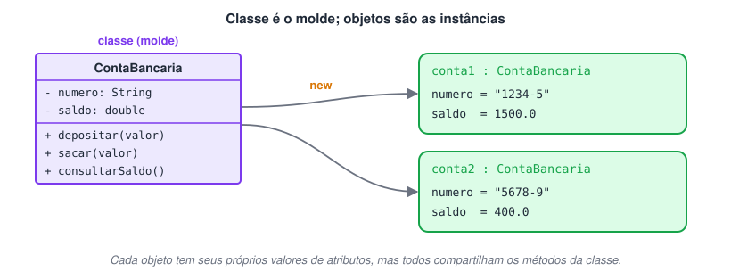
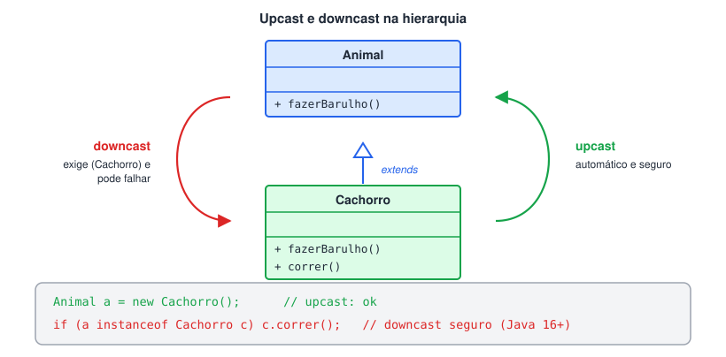
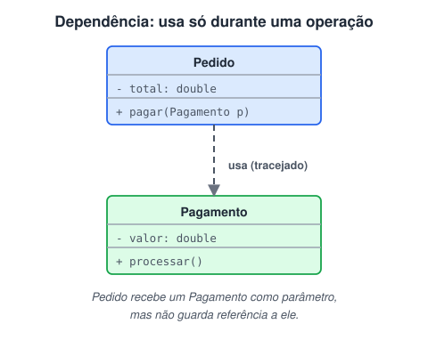
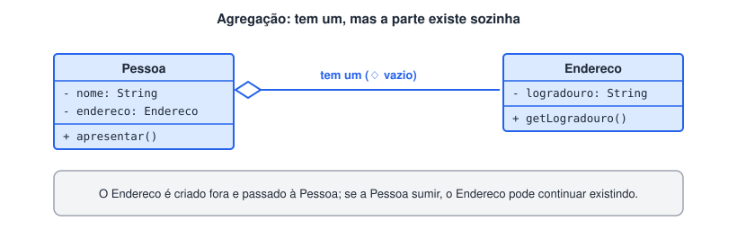
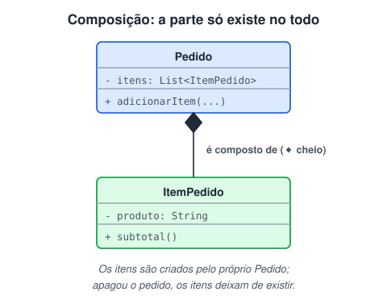
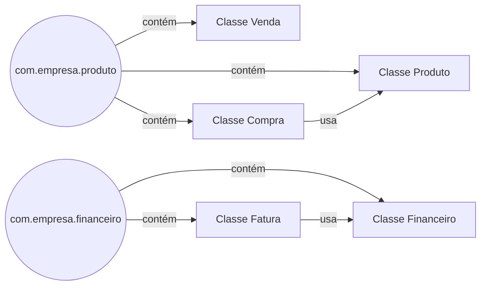

# Programação orientada a objetos com Java

> 🗺️ **Nesta aula:** classes, atributos, métodos e objetos; `equals`, `hashCode` e `toString`; herança, associação, interfaces e classes abstratas; pacotes e modificadores de acesso; e os recursos modernos: enums, records e generics.

## Estrutura básica de OO

> 🗺️ **Nesta aula:** os blocos básicos da orientação a objetos: classe, atributo, método, objeto e mensagem, com um exercício de carro.

### De onde paramos

Você já escreve programas com variáveis e métodos. Agora vai modelar um problema com objetos, o primeiro passo da POO.

### Classes

Uma classe é o **molde** de um tipo de objeto. Ela diz quais dados (atributos) e quais ações (métodos) todo objeto daquele tipo terá. Os objetos são as **instâncias** criadas a partir desse molde.

> 💡 **Analogia:** a classe é a planta de uma casa; cada casa construída com essa planta é um objeto. Todas têm os mesmos cômodos, mas cada uma tem a sua cor de parede e os seus moradores.

- Uma classe "Pessoa" pode ter os atributos nome, idade e altura, e os métodos "andar" e "falar". Cada objeto criado a partir dela **possui** esses atributos (cada um com seus próprios valores) e pode usar esses métodos. *("Herdar" é outro conceito, usado entre classes — veja a página de Herança.)*
- Classes permitem reutilizar código: vários objetos saem do mesmo molde. Também organizam o programa, deixando-o mais legível e fácil de manter.`// Nome de classe começa com maiúscula
public class Pessoa {

    // Atributos
    private String nome;
    private int idade;
    private double altura;

    // Construtor
    public Pessoa(String nome, int idade,
                  double altura) {
        this.nome = nome;
        this.idade = idade;
        this.altura = altura;
    }

    // Métodos
    public String getNome() {
        return nome;
    }

    public int getIdade() {
        return idade;
    }

    public double getAltura() {
        return altura;
    }
}`



### Atributo

Um atributo é uma variável que pertence à classe e guarda uma característica de cada objeto. Ele é declarado dentro da classe, e cada objeto recebe a sua própria cópia, com o seu próprio valor.

- Na classe "Pessoa", os atributos podem ser "nome", "idade" e "altura". Cada objeto tem os seus valores, que podem ser lidos ou alterados por métodos da classe.`public class Pessoa {

    // Atributos
    public String nome;
    public int idade;
    public double altura;
}`⚠️Aqui os atributos são `public` só para simplificar. Na prática, use `private` e exponha getters/setters (encapsulamento), como no exemplo da classe anterior.

### Método

Um método é um bloco de código que executa uma ação do objeto: calcular algo, alterar dados ou devolver uma informação.

- Ele pode receber zero ou mais **parâmetros** e pode ou não **retornar** um valor. O tipo de retorno vem antes do nome (`int`, `String`...); `void` quer dizer que não retorna nada.
- O **construtor** é um método especial: tem o mesmo nome da classe, não tem tipo de retorno e roda quando usamos `new`.`public class Retangulo {
    private int largura;
    private int altura;

    // Construtor: mesmo nome da classe
    public Retangulo(int largura, int altura) {
        this.largura = largura;
        this.altura = altura;
    }

    // Calcula a área do retângulo
    public int calcularArea() {
        return largura * altura;
    }
}

public class Main {
    public static void main(String[] args) {
        Retangulo r = new Retangulo(5, 10);
        // Usando o método calcularArea
        int area = r.calcularArea();
        System.out.println("Área: " + area);
    }
}`

### Objeto

Um objeto é uma instância concreta de uma classe: tem seus próprios valores (o **estado**) e usa os métodos definidos na classe (o **comportamento**). Objetos interagem entre si por meio de mensagens, que chamam métodos e podem mudar o estado de quem as recebe.

- Num sistema de banco, a classe "ContaBancaria" define como toda conta funciona. Cada conta criada é um objeto separado, com o seu saldo e o seu número.
  - Ao criar o objeto com `new`, o construtor inicializa os atributos. Depois chamamos os métodos para operar sobre ele.`public class ContaBancaria {
      private String numero;
      private double saldo;
  
      public ContaBancaria(String numero,
                           double saldoInicial) {
          this.numero = numero;
          this.saldo = saldoInicial;
      }
  
      public void depositar(double valor) {
          saldo += valor;
      }
  
      public void sacar(double valor) {
          if (saldo >= valor) {
              saldo -= valor;
          } else {
              System.out.println("Saldo insuficiente!");
          }
      }
  
      public double consultarSaldo() {
          return saldo;
      }
  
      public String getNumero() {
          return numero;
      }
  }
  
  public class GerenciamentoDeBanco {
      public static void main(String[] args) {
          // Duas contas, dois objetos
          ContaBancaria c1 =
              new ContaBancaria("1234-5", 1000.0);
          ContaBancaria c2 =
              new ContaBancaria("5678-9", 500.0);
  
          c1.depositar(500.0); // c1: 1500.0
          c2.sacar(100.0);     // c2: 400.0
  
          System.out.println("Conta "
              + c1.getNumero() + ": "
              + c1.consultarSaldo());
          System.out.println("Conta "
              + c2.getNumero() + ": "
              + c2.consultarSaldo());
      }
  }`

> 💡 Mexer em `c1` não altera `c2`: cada objeto guarda o seu próprio estado, mesmo vindo da mesma classe.

### Mensagem

Mensagem é a forma como objetos conversam: quando um objeto precisa que outro faça algo, ele chama um método desse outro. A mensagem é formada pelo **nome do método** e pelos **argumentos**; quem recebe executa o método.

- Com mensagens, objetos cooperam e trocam informações para realizar tarefas maiores do que cada um faria sozinho.`public class Pessoa {
    private String nome;

    public Pessoa(String nome) {
        this.nome = nome;
    }

    public void dizerOla() {
        System.out.println("Olá, sou " + nome);
    }
}

public class Saudacao {
    public static void main(String[] args) {
        Pessoa p1 = new Pessoa("Ana");
        Pessoa p2 = new Pessoa("Bruno");

        // objeto + . + método = mensagem
        p1.dizerOla(); // mensagem para p1
        p2.dizerOla(); // mensagem para p2
    }
}`

### Exercício

> 🛠️ **Ajustes nesta página:** os blocos de código estavam marcados como **JavaScript**; agora estão como **Java**. No exercício, os atributos de `Carro` passaram a ser `private` e os nomes seguem camelCase (`capacidadeTanque`, `totalParaEncherTanque`, `carro1`), a convenção Java. "Mercedez" → "Mercedes" e "Etius" → "Etios".

Crie uma classe carro com os atributos “cor”, “modelo” e “capacidade do tanque”. A classe deve ter um método para calcular o valor que será gasto para encher o tanque. Instancie alguns objetos a partir da classe carro e manipule seus atributos e use seu método.

<details>
<summary>Ver resposta</summary>

```java
// Classe Main
package estruturabasica;

public class Main {
  public static void main(String[] args) {

    // Construtor vazio (default)
    Carro carro1 = new Carro();

    // Definindo atributos com os setters
    carro1.setCor("Prata");
    carro1.setModelo("Toyota Etios");
    carro1.setCapacidadeTanque(50);

    // Lendo atributos com os getters
    System.out.println("carro1");
    System.out.println("Cor: "
      + carro1.getCor());
    System.out.println("Modelo: "
      + carro1.getModelo());
    System.out.println("Tanque: "
      + carro1.getCapacidadeTanque());
    System.out.println("Encher: R$ "
      + carro1.totalParaEncherTanque(5.51)
      + "\n");

    // Atributos passados no construtor
    Carro carro2 = new Carro("Preto",
      "Mercedes-Benz Classe C", 66);

    System.out.println("carro2");
    System.out.println("Cor: "
      + carro2.getCor());
    System.out.println("Modelo: "
      + carro2.getModelo());
    System.out.println("Tanque: "
      + carro2.getCapacidadeTanque());
    System.out.println("Encher: R$ "
      + carro2.totalParaEncherTanque(5.51));
  }
}
```

```java
// Classe Carro
package estruturabasica;

public class Carro {

    // Atributos
    private String cor;
    private String modelo;
    private int capacidadeTanque;

    // Construtores
    public Carro() {}

    public Carro(String cor, String modelo,
                 int capacidadeTanque) {
        this.cor = cor;
        this.modelo = modelo;
        this.capacidadeTanque = capacidadeTanque;
    }

    // Getters e setters
    public String getCor() {
        return cor;
    }
    public void setCor(String cor) {
        this.cor = cor;
    }
    public String getModelo() {
        return modelo;
    }
    public void setModelo(String modelo) {
        this.modelo = modelo;
    }
    public int getCapacidadeTanque() {
        return capacidadeTanque;
    }
    public void setCapacidadeTanque(int c) {
        this.capacidadeTanque = c;
    }

    // Litros do tanque x preço do litro
    public double totalParaEncherTanque(
            double precoGasolina) {
        return capacidadeTanque * precoGasolina;
    }
}
```

</details>

### 🧠 Revisão rápida

**Qual a diferença entre classe e objeto?**

A classe é o molde (define atributos e métodos); o objeto é uma instância concreta criada com `new`, com seus próprios valores.

**O que é um construtor e como reconhecê-lo?**

É o método que inicializa o objeto no `new`. Tem o mesmo nome da classe e não declara tipo de retorno.

**Se eu depositar em `c1`, o saldo de `c2` muda?**

Não. Cada objeto guarda o seu próprio estado.

**O que é enviar uma mensagem a um objeto?**

É chamar um método dele: `objeto.metodo(argumentos)`.

> ➡️ **Próximo passo:** **Associação**, para ver como objetos se relacionam.

### 📌 Resumo

| Item | Em uma frase |
| --- | --- |
| Classe | Molde que define atributos e métodos. |
| Atributo | Variável que guarda uma característica do objeto. |
| Método | Ação do objeto; pode receber parâmetros e retornar valor. |
| Objeto | Instância concreta da classe, com estado próprio. |
| Mensagem | Chamada de método entre objetos. |

## equals, hashCode e toString (Adicionado pelo aluno para melhorar o estudo)

> 🗺️ **Nesta aula:** como sobrescrever `equals`, `hashCode` e `toString`, e por que os dois primeiros precisam andar juntos.

### Os três métodos herdados de `Object`

Toda classe Java herda de `Object` e, com ela, três métodos que quase sempre vale sobrescrever:

| Método | Padrão de `Object` | O que você quer |
| --- | --- | --- |
| `equals` | iguais só se forem **o mesmo objeto** na memória | iguais se tiverem os mesmos **dados** que importam |
| `hashCode` | um número ligado ao objeto em memória | um número calculado a partir dos mesmos campos do `equals` |
| `toString` | `Cliente@1b6d3586` | `Cliente[cpf=123..., nome=Ana]` |

### `==` versus `equals`

```java
String a = new String("pan");
String b = new String("pan");
a == b;  // false: são dois objetos diferentes
a.equals(b);  // true: o conteúdo é igual
```

Para **objetos**, `==` compara a **referência** (se é o mesmo objeto). Para comparar conteúdo, use `equals`. Com tipos primitivos (`int`, `double`...), `==` compara o valor normalmente.

> ⚠️ Cuidado com `Integer`: `Integer x = 127, y = 127; x == y` dá `true` (o Java reaproveita valores de -128 a 127), mas com `1000` dá `false`. Para wrappers, compare sempre com `equals`.

> 💡 **Analogia:** pense numa carteira de identidade. Duas pessoas diferentes nunca têm o mesmo CPF, mesmo que tenham o mesmo nome. Para comparar pessoas, o que importa é o documento, e não a aparência.

### Implementando

```java
import java.util.Objects;

public class Cliente {
  private final String cpf;
  private String nome;

  public Cliente(String cpf, String nome) {
    this.cpf = cpf;
    this.nome = nome;
  }

  @Override
  public boolean equals(Object o) {
    if (this == o) return true;
    if (!(o instanceof Cliente outro)) return false;  // pattern matching (Java 16+)
    return Objects.equals(cpf, outro.cpf);  // o CPF identifica o cliente
  }

  @Override
  public int hashCode() {
    return Objects.hash(cpf);  // os MESMOS campos do equals
  }

  @Override
  public String toString() {
    return "Cliente[cpf=" + cpf + ", nome=" + nome + "]";
  }
}
```

IDEs geram os três métodos (IntelliJ: `Alt + Insert`; Eclipse: *Source → Generate*). Lombok tem `@EqualsAndHashCode` e `@ToString`, e um **record** (veja "Enums e records") já vem com os três prontos.

### O contrato: por que `hashCode` importa

**Se** `a.equals(b)` **é verdadeiro, então** `a.hashCode() == b.hashCode()` **tem de ser verdadeiro.** O contrário não precisa valer, porque objetos diferentes podem ter o mesmo hash.

`HashSet` e `HashMap` usam o `hashCode` para decidir em que "gaveta" procurar e só depois usam o `equals`. Se você sobrescrever só o `equals`:

```java
Set<Cliente> clientes = new HashSet<>();
clientes.add(new Cliente("123", "Ana"));
clientes.contains(new Cliente("123", "Ana"));  // false! procurou na gaveta errada
clientes.add(new Cliente("123", "Ana"));  // e agora o Set tem um "duplicado"
```

### Outras regras do `equals`

- **Reflexivo:** `a.equals(a)` é verdadeiro.
- **Simétrico:** se `a.equals(b)`, então `b.equals(a)`.
- **Transitivo:** se `a.equals(b)` e `b.equals(c)`, então `a.equals(c)`.
- `a.equals(null)` é sempre `false`, sem lançar exceção.
- Evite campos **mutáveis** no `hashCode`: se o valor mudar depois de o objeto entrar em um `HashSet`, ele "some" do conjunto.

### Em entidades JPA

Em `@Entity`, o `id` costuma ser gerado só ao salvar, então fica `null` antes disso. Prefira comparar por uma **chave de negócio** imutável (CPF, número da conta) ou siga o padrão recomendado pelo Hibernate. E **não** coloque coleções *lazy* no `toString`, porque isso dispara consultas ou `LazyInitializationException`.

### 🧠 Revisão rápida

**Se dois objetos são iguais pelo `equals`, o que precisa valer para o `hashCode`?**

Eles precisam ter o mesmo `hashCode`.

**Por que `Integer x = 1000, y = 1000; x == y` dá `false`?**

Porque são dois objetos diferentes; para wrappers, compare com `equals`.

### 📌 Resumo

| Item | Em uma frase |
| --- | --- |
| `equals` | compara os dados que definem a identidade do objeto, não só a referência |
| `hashCode` | deve usar os mesmos campos do `equals` |
| `toString` | devolve uma representação legível do objeto, útil em logs e depuração |
| Contrato | objetos iguais pelo `equals` precisam ter o mesmo `hashCode` |

## Herança

> 🗺️ **Nesta aula:** herança com `extends`, por que Java não tem herança múltipla de classes, upcast/downcast, polimorfismo e sobrescrita.

### De onde paramos

Você já sabe criar classes, atributos, métodos e construtores. Agora vai conectar classes em uma hierarquia para reaproveitar código sem copiá-lo.

> 💡 **Herança** cria uma hierarquia de classes: a classe filha (subclasse) recebe os atributos e métodos da classe pai (superclasse) e pode acrescentar ou redefinir comportamentos. Em Java, usa-se `extends`. Pense na relação "**é um**": todo cachorro *é um* animal.

### Exemplo básico

Classe pai `Animal`:

```java
// Classe pai ou superclasse
public class Animal {
  private String nome;
  private int idade;

  public Animal(String nome, int idade) {
    this.nome = nome;
    this.idade = idade;
  }

  public String getNome() { return nome; }
  public int getIdade() { return idade; }

  public void fazerSom() {
    System.out.println("O animal faz som!");
  }
}
```

Classe filha `Cachorro`, que herda de `Animal` e acrescenta `latir()`:

```java
// Subclasse ou classe filha
public class Cachorro extends Animal {
  public Cachorro(String nome, int idade) {
    // chama o construtor da classe pai
    super(nome, idade);
  }

  public void latir() {
    System.out.println("O cachorro late!");
  }
}
```

A filha **não precisa** declarar de novo o que já existe na classe pai:

```java
public static void main(String[] args) {
  Cachorro c = new Cachorro("Rex", 3);
  System.out.println(c.getNome());  // Rex
  System.out.println(c.getIdade()); // 3
  c.fazerSom(); // O animal faz som!
  c.latir();  // O cachorro late!
}
```

> 📌 O objeto `Cachorro` usa `getNome()`, `getIdade()` e `fazerSom()`, que vieram de `Animal`, e também `latir()`, que é só dele. Atributos `private` da classe pai **existem** no objeto filho, mas só são acessados pelos getters/setters herdados.

> ⚠️ `super(...)` precisa ser a **primeira linha** do construtor da filha. Se a classe pai não tiver construtor vazio, a filha é obrigada a chamá-lo.

### Tipos de herança

#### Herança simples

A subclasse herda de **uma única** superclasse — é o único tipo de herança entre classes que o Java permite.

```java
// Superclasse
public class Pessoa {
    private String nome;
    private int idade;

    public Pessoa(String nome, int idade) {
        this.nome = nome;
        this.idade = idade;
    }

    public String getNome() { return nome; }
    public int getIdade() { return idade; }
}

// Subclasse
public class Aluno extends Pessoa {
    private String matricula;

    public Aluno(String nome, int idade,
                 String matricula) {
        super(nome, idade);
        this.matricula = matricula;
    }

    public String getMatricula() {
        return matricula;
    }
}
```

#### Herança múltipla (com interfaces)

Uma classe herdar de **duas ou mais** classes **não é permitido** em Java (evita ambiguidades, como dois pais com o mesmo método). O efeito parecido é obtido com **interfaces**: uma classe pode implementar várias.

```java
public interface Animal {
  void emitirSom();
}

public interface Voador {
  void voar();
}

public class Pato implements Animal, Voador {
  @Override
  public void emitirSom() {
    System.out.println("Quack quack");
  }

  @Override
  public void voar() {
    System.out.println("Voando...");
  }
}
```

```java
public static void main(String[] args) {
  Pato pato = new Pato();
  pato.emitirSom(); // Quack quack
  pato.voar();  // Voando...
}
```

### Upcast e downcast



- **Upcast:** tratar um objeto da subclasse como se fosse da superclasse (`Animal a = new Cachorro();`). É **automático e sempre seguro**, porque todo cachorro *é um* animal.
- **Downcast:** tratar uma referência da superclasse como subclasse (`Cachorro c = (Cachorro) a;`). Exige **cast explícito** e pode falhar em tempo de execução com `ClassCastException` se o objeto não for daquele tipo. Por isso, teste antes com `instanceof`.

> 🛠️ **Ajuste:** o texto original dizia que o problema do downcast é "perda de dados". Não há perda: o objeto continua o mesmo na memória. O risco real é a `ClassCastException` quando o objeto não é do tipo para o qual estamos convertendo.

```java
public class Main {
  public static void main(String[] args) {
    Animal animal = new Cachorro(); // upcast
    // Roda a versão da subclasse: Au au!
    animal.fazerBarulho();
    // Erro de compilação:
    // Animal não tem correr()
    // animal.correr();

    if (animal instanceof Cachorro) {
      // downcast seguro
      Cachorro c = (Cachorro) animal;
      c.correr();
    }
  }
}
```

```java
class Animal {
  public void fazerBarulho() {
    System.out.println("Barulho genérico");
  }
}

class Cachorro extends Animal {
  @Override
  public void fazerBarulho() {
    System.out.println("Au au!");
  }

  public void correr() {
    System.out.println("Cachorro correndo");
  }
}
```

> 💡 Desde o Java 16 dá para testar e converter de uma vez: `if (animal instanceof Cachorro c) { c.correr(); }`.

### Polimorfismo e sobrescrita

#### Polimorfismo

É a capacidade de uma mesma referência assumir **várias formas**: uma variável do tipo da superclasse pode apontar para objetos de qualquer subclasse, e o método executado é o **do objeto real**. Isso permite escrever código genérico (que trabalha com `Animal`) sem conhecer cada subtipo.

> 💡 **Analogia:** o controle remoto universal tem um botão "ligar". Apertado na TV, liga a TV; no ar-condicionado, liga o ar. O botão (a chamada) é o mesmo; quem decide o que acontece é o aparelho (o objeto real).

**Código exemplo**

```java
class Animal {
  public void emitirSom() {
    System.out.println("O animal emite som.");
  }
}

class Cachorro extends Animal {
  @Override
  public void emitirSom() {
    System.out.println("O cachorro late.");
  }
}

class Gato extends Animal {
  @Override
  public void emitirSom() {
    System.out.println("O gato mia.");
  }
}

public class ExemploPolimorfismo {
  public static void main(String[] args) {
    Animal a1 = new Cachorro();
    Animal a2 = new Gato();

    a1.emitirSom(); // O cachorro late.
    a2.emitirSom(); // O gato mia.
  }
}
```

#### Sobrescrita

É quando a subclasse fornece **sua própria implementação** de um método herdado. Ao chamar o método, a versão da subclasse é executada no lugar da versão da classe pai. Use sempre `@Override`: o compilador avisa se a assinatura não bater.

**Código exemplo**

```java
class Veiculo {
  public void acelerar() {
    System.out.println("Veículo acelera.");
  }
}

class Carro extends Veiculo {
  @Override
  public void acelerar() {
    System.out.println("Carro acelera rápido.");
  }
}

class Moto extends Veiculo {
  @Override
  public void acelerar() {
    System.out.println("Moto acelera veloz.");
  }
}

public class ExemploSobrescrita {
  public static void main(String[] args) {
    Veiculo v1 = new Carro();
    Veiculo v2 = new Moto();

    v1.acelerar(); // Carro acelera rápido.
    v2.acelerar(); // Moto acelera veloz.
  }
}
```

> ⚠️ Não confunda **sobrescrita** (override: mesma assinatura, na subclasse) com **sobrecarga** (overload: mesmo nome, parâmetros diferentes, na mesma classe).

> 🛠️ **Outros ajustes:** blocos de código marcados como JavaScript passaram para Java; `class main` virou `class Main` (classes começam com maiúscula); adicionei `@Override` onde faltava e um `instanceof` antes do downcast.

### 🧠 Revisão rápida

**Qual palavra-chave cria herança entre classes?**

`extends`. Para interfaces, a classe usa `implements`.

**Java permite uma classe herdar de duas classes?**

Não. Herança de classe é simples; o efeito de herança múltipla vem de implementar várias interfaces.

**Upcast ou downcast: qual exige cast explícito?**

O downcast. Ele pode lançar `ClassCastException`, por isso teste com `instanceof` antes.

**`Animal a = new Gato(); a.emitirSom();` — qual versão roda?**

A de `Gato`: o método executado é o do objeto real (polimorfismo).

> ➡️ **Próximo passo:** **Interface**, que contorna a falta de herança múltipla de classes.

### 📌 Resumo

| Item | Em uma frase |
| --- | --- |
| Herança | A filha recebe atributos e métodos da pai com `extends`. |
| `super` | Chama o construtor ou método da classe pai. |
| Interfaces | Substituem a herança múltipla de classes. |
| Upcast | Filha vista como pai; automático e seguro. |
| Downcast | Pai convertida em filha; cast + `instanceof`. |
| Polimorfismo | Roda o método do objeto real. |
| Sobrescrita | A filha redefine um método herdado (`@Override`). |

## Associação

> 🗺️ **Nesta aula:** os três jeitos de um objeto se relacionar com outro — dependência, agregação e composição — e como diferenciá-los no código e na UML.

### De onde paramos

Você já sabe criar classes e objetos. Agora vai ver como um objeto se relaciona com outro: usa, tem ou é composto de.

> 💡 **Associação** é qualquer relacionamento entre objetos de classes diferentes. Ela pode ser **comportamental** (dependência) ou **estrutural** (agregação e composição).

### Dependência

Uma classe **usa** outra para realizar uma operação, mas não guarda uma referência permanente a ela (normalmente recebe o objeto como parâmetro ou o cria dentro de um método).



```java
public class Pedido {
  // Pagamento só é usado aqui dentro
  public void pagar(Pagamento p) {
    p.processar(total());
  }
}
```

### Agregação

Uma classe **tem** um objeto de outra como atributo, mas esse objeto **pode existir independentemente** de quem o possui.



### Composição

Uma classe **é composta** de objetos de outra, e essas partes **só existem enquanto o todo existir** — normalmente são criadas pelo próprio dono.



> 💡 **Analogia:** um time e seus jogadores é **agregação** — se o time acabar, os jogadores continuam existindo e vão para outro time. Uma casa e seus cômodos é **composição** — demolida a casa, não sobra "cozinha" solta por aí.

### Resumo dos tipos

| Tipo | Relação | A parte vive sem o todo? | Exemplo |
| --- | --- | --- | --- |
| Dependência | "usa" | — (não guarda referência) | `Pedido.pagar(Pagamento p)` |
| Agregação | "tem um" | **Sim** | `Pessoa` tem um `Endereco` |
| Composição | "é composto de" | **Não** | `Pedido` é composto de `ItemPedido` |

### Exemplo: agregação entre `Pessoa` e `Endereco`

```java
public class Main {
  public static void main(String[] args) {
    // O endereço existe por conta própria
    Endereco end =
      new Endereco("Rua 1", 123, "Centro");
    // A pessoa apenas recebe o endereço
    Pessoa p = new Pessoa("Ana", 30, end);
    p.apresentar();
  }
}
```

```java
public class Pessoa {
    private String nome;
    private int idade;
    private Endereco endereco;

    public Pessoa(String nome, int idade,
                  Endereco endereco) {
        this.nome = nome;
        this.idade = idade;
        this.endereco = endereco;
    }

    public void apresentar() {
        System.out.println("Olá, sou " + nome
            + " e tenho " + idade + " anos.");
        System.out.println("Moro em "
            + endereco.getLogradouro() + ", "
            + endereco.getNumero() + " - "
            + endereco.getBairro());
    }
}
```

```java
public class Endereco {
  private String logradouro;
  private int numero;
  private String bairro;

  public Endereco(String logradouro,
          int numero, String bairro) {
    this.logradouro = logradouro;
    this.numero = numero;
    this.bairro = bairro;
  }

  public String getLogradouro() {
    return logradouro;
  }
  public int getNumero() { return numero; }
  public String getBairro() { return bairro; }
}
```

### Exemplo: composição entre `Pedido` e `ItemPedido`

Aqui o próprio pedido cria os itens e não os entrega para fora. Os itens nascem e morrem junto com o pedido.

```java
public class Pedido {
    private final List<ItemPedido> itens =
        new ArrayList<>();

    // O pedido cria o item: ninguém de fora
    // recebe uma referência a ele
    public void adicionar(String produto,
                          int qtd, double preco) {
        itens.add(
            new ItemPedido(produto, qtd, preco));
    }

    public double total() {
        double soma = 0;
        for (ItemPedido i : itens) {
            soma += i.subtotal();
        }
        return soma;
    }
}
```

> ⚠️ Em Java o coletor de lixo apaga objetos sem referência, então a diferença entre agregação e composição está no **desenho**: quem cria a parte e se ela é compartilhada. Se o objeto vem de fora (parâmetro), é agregação; se o dono cria e guarda só para si, é composição.

> 🛠️ **Ajuste:** o último bloco de código estava marcado como JavaScript; agora está como Java. Também incluí a tabela-resumo e um exemplo de composição, que o texto só citava.

### 🧠 Revisão rápida

**Um método recebe um objeto como parâmetro e não o guarda. Que relação é essa?**

Dependência: a classe só usa o outro objeto durante aquela operação.

**Qual o símbolo UML de agregação e de composição?**

Agregação: losango **vazio** no lado do todo. Composição: losango **cheio**.

**`Pessoa` recebe um `Endereco` já criado no construtor. Agregação ou composição?**

Agregação: o endereço foi criado fora e pode existir sem a pessoa.

> ➡️ **Próximo passo:** **Herança**, para reaproveitar código entre classes relacionadas.

### 📌 Resumo

| Item | Em uma frase |
| --- | --- |
| Dependência | "Usa" outro objeto só durante um método. |
| Agregação | "Tem um" objeto que vive por conta própria. |
| Composição | "É composto de" partes que nascem e morrem com o todo. |

## Interface

> 🗺️ **Nesta aula:** o que é uma interface, a diferença para herança e como usar `implements` em classes concretas.

### De onde paramos

Você já sabe criar classes e herdar com `extends`. Agora vai separar o **contrato** (o que o objeto faz) da **implementação** (como ele faz).

> 💡 **Analogia:** a interface é o padrão da tomada. Qualquer aparelho com o plugue certo funciona, sem que a tomada precise saber o que ele faz. A interface define o encaixe; cada classe fornece o aparelho.

Uma interface é uma especificação de um conjunto de métodos e constantes que uma classe deve implementar. É uma forma de definir um contrato que outras classes podem seguir. Em Java, uma interface é definida usando a palavra-chave `interface` e os métodos são definidos sem implementação. As classes que implementam uma interface devem fornecer uma implementação para todos os métodos da interface.

#### Comparação entre interface e herança:

Tanto interface quanto herança são recursos da programação orientada a objetos que permitem a reutilização de código. No entanto, existem algumas diferenças importantes entre eles.

- A herança permite que uma classe herde características (métodos e atributos) de outra classe, permitindo a criação de uma hierarquia de classes. A classe filha pode herdar tudo ou parte do comportamento da classe pai e ainda adicionar novos comportamentos.
- uma interface é um conjunto de métodos que uma classe deve implementar. Uma classe pode implementar várias interfaces, permitindo a adição de vários comportamentos diferentes. As interfaces não têm implementação de métodos, portanto, a implementação deve ser fornecida pela classe que as implementa.

Resumindo, a herança é usada para estabelecer uma relação "é um" entre duas classes, enquanto a interface é usada para estabelecer uma relação "pode fazer". A herança é uma relação mais forte e mais restrita do que a interface: uma classe só pode estender **uma** classe, e herda todos os seus membros. Já uma classe pode implementar **várias** interfaces — mas precisa implementar **todos** os métodos abstratos de cada uma (a não ser que seja uma classe abstrata).

> 🛠️ **Correções:**
>
> - O texto dizia que a interface "permite que a classe escolha quais métodos implementar". Não permite: uma classe concreta é **obrigada** a implementar todos os métodos abstratos da interface, senão o código não compila.
> - Também dizia que interfaces "não têm implementação de métodos". Desde o **Java 8**, interfaces podem ter métodos `default` e `static` com corpo (e, desde o Java 9, métodos `private`). Atributos de interface são sempre constantes (`public static final`).

|  | Classe abstrata / herança | Interface |
| --- | --- | --- |
| Palavra-chave | `extends` | `implements` |
| Quantas por classe | Apenas **uma** | **Várias** |
| Relação | "é um" | "pode fazer" / "é capaz de" |
| Atributos | Qualquer tipo, com estado | Só constantes |
| Construtor | Pode ter | Não tem |

#### Exemplo de uso de interface

```java
public class Main {
  public static void main(String[] args) {
    Jogo xbox = new Xbox();
    xbox.jogar();

    Jogo playStation = new PlayStation();
    playStation.jogar();
  }
}
```

```java
public interface Jogo {
  void jogar();
}
```

```java
public class Xbox implements Jogo {
  
  @Override
  public void jogar() {
    System.out.println("Jogando no Xbox...");
  }
}
```

```java
public class PlayStation implements Jogo {

  @Override
  public void jogar() {
    System.out.println("Jogando no PlayStation...");
  }
}
```

### 🧠 Revisão rápida

**Uma classe pode implementar duas interfaces? E estender duas classes?**

Pode implementar quantas interfaces quiser; estender, só uma classe.

**O que uma classe concreta precisa fazer com os métodos abstratos da interface?**

Implementá-los todos, senão o código não compila.

> ➡️ **Próximo passo:** **Classes abstratas**, o meio-termo entre herança e interface.

### 📌 Resumo

| Item | Em uma frase |
| --- | --- |
| Interface | Contrato de métodos que uma classe promete cumprir. |
| `implements` | A classe assume o contrato; pode ser em várias interfaces. |
| Herança x interface | Herança é "é um" (uma classe-mãe); interface é "pode fazer" (várias). |

## Classes abstratas (Adicionado pelo aluno para melhorar o estudo)

> 🗺️ **Nesta aula:** classes abstratas, com métodos abstratos e o padrão Template Method, e quando escolher classe abstrata ou interface.

### De onde paramos

Você já viu herança e interfaces. Agora vai ver o meio-termo: uma classe que serve de base, mas não pode ser criada sozinha.

### O que é

**Uma classe abstrata é uma classe "incompleta": serve de base para outras, mas não pode ser instanciada.** Ela fica no meio do caminho entre uma classe comum e uma interface: pode ter atributos, construtor e métodos prontos, e também **métodos abstratos** (sem corpo), que as filhas são obrigadas a implementar.

```java
public abstract class Conta {
  private final String numero;
  protected BigDecimal saldo = BigDecimal.ZERO;

  protected Conta(String numero) {  // abstrata pode ter construtor
    this.numero = numero;
  }

  public void depositar(BigDecimal valor) {  // método concreto, herdado por todas
    saldo = saldo.add(valor);
  }

  public abstract BigDecimal calcularTarifaMensal();  // cada tipo de conta decide

  public String getNumero() { return numero; }
  public BigDecimal getSaldo() { return saldo; }
}
```

```java
public class ContaCorrente extends Conta {
  public ContaCorrente(String numero) { super(numero); }

  @Override
  public BigDecimal calcularTarifaMensal() {
    return new BigDecimal("19.90");
  }
}

public class ContaPoupanca extends Conta {
  public ContaPoupanca(String numero) { super(numero); }

  @Override
  public BigDecimal calcularTarifaMensal() {
    return BigDecimal.ZERO;
  }
}
```

```java
Conta c = new Conta("123");  // ❌ erro de compilação: Conta é abstrata
Conta c = new ContaCorrente("123");  // ✅ polimorfismo
c.calcularTarifaMensal();  // 19.90
```

> 💡 **Analogia:** é um formulário-modelo de contrato. Boa parte do texto já vem pronta (cláusulas comuns a todos), e alguns campos ficam em branco para cada cliente preencher do seu jeito.

### Regras

- Uma classe com **pelo menos um** método abstrato **precisa** ser `abstract`.
- Uma classe abstrata pode não ter nenhum método abstrato, só para impedir que seja instanciada.
- A filha concreta deve implementar **todos** os métodos abstratos; se não implementar, ela também precisa ser `abstract`.
- Método abstrato não pode ser `private`, `static` nem `final`, porque precisa ser sobrescrito.

### Padrão Template Method

Um uso clássico: a classe abstrata define o **roteiro** e deixa as etapas variáveis para as filhas.

```java
public abstract class GeradorRelatorio {
  public final String gerar() {  // final: o roteiro não muda
    return cabecalho() + "\n" + corpo() + "\n" + rodape();
  }
  protected String cabecalho() { return "Banco PAN"; }
  protected abstract String corpo();  // cada relatório implementa
  protected String rodape() { return "Gerado em " + LocalDate.now(); }
}
```

### Abstrata ou interface?

| Use **classe abstrata** quando... | Use **interface** quando... |
| --- | --- |
| as filhas compartilham **estado** (atributos) e código | só quer definir um **contrato** ("sabe fazer X") |
| existe uma relação forte "é um" | classes sem relação entre si precisam do mesmo comportamento |
| precisa de construtor ou de campos `protected` | a classe precisa de **vários** tipos (só dá para estender uma classe) |

Na dúvida, comece com uma **interface**: ela prende menos o design. Combinar as duas também é comum (`abstract class ContaBase implements Conta`).

### 🧠 Revisão rápida

**Dá para criar um objeto de uma classe abstrata com `new`?**

Não. Ela serve só de base para subclasses concretas.

**O que a filha concreta precisa fazer com um método abstrato herdado?**

Implementá-lo; caso contrário, ela também precisa ser `abstract`.

> ➡️ **Próximo passo:** **Pacotes**, para organizar classes conforme o projeto cresce.

### 📌 Resumo

| Item | Em uma frase |
| --- | --- |
| Classe abstrata | Classe incompleta, base para subclasses, não instanciável. |
| Método abstrato | Sem corpo; a subclasse concreta é obrigada a implementar. |
| Template Method | Roteiro fixo na classe-mãe com etapas que as filhas completam. |

## Pacotes

> 🗺️ **Nesta aula:** pacotes, a declaração `package`, o `import` e a convenção de nomes.

### De onde paramos

Você já sabe criar classes. Agora vai organizá-las em pacotes, como gavetas, para o projeto crescer sem bagunça.

Os pacotes em programação Java servem para organizar classes relacionadas em uma única unidade lógica. Eles permitem agrupar classes que têm funcionalidades e objetivos semelhantes e facilitam a modularidade, a manutenção e a reutilização de código. Além disso, os pacotes evitam conflitos de nome: duas classes podem ter o mesmo nome simples (ex.: `Date`) desde que estejam em pacotes diferentes (`java.util.Date` e `java.sql.Date`), porque o **nome qualificado** (pacote + classe) é único.

- **Convenção:** domínio da empresa ao contrário, tudo em minúsculas — `com.empresa.produto`.
- A declaração `package` deve ser a **primeira linha** do arquivo, e a estrutura de pastas precisa espelhar o pacote (`com/empresa/produto/Produto.java`).
- Para usar uma classe de outro pacote: `import com.empresa.financeiro.Fatura;`.
- Pacotes também controlam acesso: membros sem modificador (*default*) só são visíveis dentro do mesmo pacote.

> 💡 **Analogia:** pacotes são as gavetas de um arquivo. Cada gaveta junta documentos do mesmo assunto, e dois documentos com o mesmo nome podem existir em gavetas diferentes sem confusão.

#### Exemplo



> 🛠️ **Ajuste no diagrama:** o original dizia que "Compra herda de Produto" e que "Fatura implementa Financeiro" (uma classe). Uma compra não é um tipo de produto, e só se *implementa* uma **interface**, não uma classe. Troquei por relações de uso, que é o que o exemplo quer mostrar: classes de pacotes diferentes colaborando.

### 🧠 Revisão rápida

**Duas classes com o mesmo nome simples podem coexistir no mesmo projeto?**

Sim, desde que estejam em pacotes diferentes: o nome qualificado é que é único.

**Onde deve ficar a declaração `package`?**

Na primeira linha do arquivo.

> ➡️ **Próximo passo:** **Modificadores de acesso**, para decidir quem enxerga cada membro.

### 📌 Resumo

| Item | Em uma frase |
| --- | --- |
| Pacote | Agrupa classes relacionadas e evita conflito de nomes. |
| `package` / `import` | Declara a qual pacote a classe pertence / traz classes de outro pacote. |
| Convenção | Domínio ao contrário, tudo em minúsculas: `com.empresa.produto`. |

## Modificadores de acesso

> 🗺️ **Nesta aula:** os quatro modificadores de acesso (`public`, `protected`, padrão e `private`) e o que cada um libera.

### De onde paramos

Você já viu o `private` nos exemplos. Agora vai entender os quatro níveis de acesso e quando usar cada um.

Em Java, os modificadores de acesso são palavras-chave que definem o nível de acesso que outros componentes do código têm a uma classe, método ou variável. Existem quatro tipos de modificadores de acesso em Java:

1. `public`: permite que uma classe, método ou variável seja acessada por qualquer outra classe em qualquer pacote. É o nível de acesso mais permissivo em Java.
2. `protected`: permite que uma classe, método ou variável seja acessada por outras classes no mesmo pacote e por classes que herdam da classe em questão.
3. `default` (ou nenhum modificador): permite que uma classe, método ou variável seja acessada apenas por outras classes no mesmo pacote.
4. `private`: permite que uma classe, método ou variável seja acessada apenas pela própria classe em que foi declarada. É o nível de acesso mais restritivo em Java.

| Modificador | Mesma classe | Mesmo pacote | Subclasse (outro pacote) | Qualquer lugar |
| --- | --- | --- | --- | --- |
| `public` | ✅ | ✅ | ✅ | ✅ |
| `protected` | ✅ | ✅ | ✅ | ❌ |
| *default* (nenhum) | ✅ | ✅ | ❌ | ❌ |
| `private` | ✅ | ❌ | ❌ | ❌ |

> 🛠️ **Ajustes no exemplo abaixo:**
>
> - Classes de nível superior (fora de outra classe) só podem ser `public` ou *default*. Não existe "classe protegida" ou "classe privada" nesse nível — nos nomes `ProtectedClass` e `PrivateClass`, o modificador se aplica ao **método**, não à classe.
> - Um mesmo arquivo `.java` só pode ter **uma** classe `public`, com o mesmo nome do arquivo. O exemplo tinha `PublicClass` e `Main` públicas no mesmo arquivo, o que não compila; deixei `Main` sem `public`.
> - Como `Main` está no mesmo pacote, a chamada a `protectedMethod()` funciona por estar no **mesmo pacote**, não por herança.

> 💡 **Analogia:** pense num prédio de escritórios. O `public` é o hall da entrada, aberto a qualquer um. O `protected` é a sala de reunião da equipe. O `default` é o andar, só para quem trabalha ali. O `private` é a gaveta pessoal da mesa.

#### Código exemplo

```java
// Classe publica
public class PublicClass {
  public void publicMethod() {
    System.out.println("Método público");
  }
}

// Classe (default) com método protegido
class ProtectedClass {
  protected void protectedMethod() {
    System.out.println("Método protegido");
  }
}

// Classe com modificador padrão
class DefaultClass {
  void defaultMethod() {
    System.out.println("Método com modificador padrão");
  }
}

// Classe (default) com método privado
class PrivateClass {
  private void privateMethod() {
    System.out.println("Método privado");
  }
}

// Classe principal
class Main {
  public static void main(String[] args) {
    PublicClass publicObj = new PublicClass();
    publicObj.publicMethod(); // Acesso permitido em qualquer lugar

    ProtectedClass protectedObj = new ProtectedClass();
    protectedObj.protectedMethod(); // Permitido: Main está no mesmo pacote

    DefaultClass defaultObj = new DefaultClass();
    defaultObj.defaultMethod(); // Acesso permitido apenas no mesmo pacote

    PrivateClass privateObj = new PrivateClass();
    // privateObj.privateMethod(); // Erro de compilação, acesso negado fora da própria classe
  }
}
```

### 🧠 Revisão rápida

**Uma subclasse em outro pacote consegue chamar um método `protected` herdado?**

Sim: `protected` libera o acesso para subclasses, mesmo fora do pacote.

**Qual modificador deixa um atributo visível só para a própria classe?**

`private`.

> ➡️ **Próximo passo:** **Enums e records**, para modelar conjuntos fixos de valores e dados imutáveis.

### 📌 Resumo

| Modificador | Em uma frase |
| --- | --- |
| `public` | Visível em qualquer lugar. |
| `protected` | Visível no pacote e para subclasses. |
| *default* | Visível só dentro do pacote. |
| `private` | Visível só dentro da própria classe. |

## Enums e records (Adicionado pelo aluno para melhorar o estudo)

> 🗺️ **Nesta aula:** `enum` para conjuntos fechados de valores e `record` para classes de dados imutáveis.

### De onde paramos

Você já sabe criar classes com atributos e construtores. Agora vai ver dois tipos especiais que economizam código: `enum` e `record`.

### Enum: um conjunto fechado de valores

**Um** `enum` **define um tipo com uma lista fixa de constantes.** É melhor que usar `String` ou `int` soltos, porque o compilador impede valores inválidos.

```java
public enum TipoTransacao {
  PIX, TED, BOLETO
}

TipoTransacao t = TipoTransacao.PIX;
t.name();  // "PIX"
t.ordinal();  // 0 (posição; não grave isso no banco!)
TipoTransacao.valueOf("TED");  // TED (lança IllegalArgumentException se não existir)
TipoTransacao.values();  // [PIX, TED, BOLETO]
```

#### Enum com atributos e comportamento

```java
public enum TipoTransacao {
  PIX("0.00"), TED("8.50"), BOLETO("3.00");

  private final BigDecimal tarifa;

  TipoTransacao(String tarifa) {  // construtor sempre privado
    this.tarifa = new BigDecimal(tarifa);
  }

  public BigDecimal getTarifa() { return tarifa; }

  public boolean isInstantanea() { return this == PIX; }
}
```

#### Enum no `switch` (Java 14+)

```java
String prazo = switch (tipo) {
  case PIX -> "na hora";
  case TED -> "no mesmo dia útil";
  case BOLETO -> "até 3 dias úteis";
};  // sem default: o compilador avisa se faltar algum caso
```

Em JPA, use `@Enumerated(EnumType.STRING)`. O padrão (`ORDINAL`) grava a posição, e qualquer reordenação do enum corrompe os dados já salvos.

### Record: classe de dados imutável (Java 16+)

**Um** `record` **declara em uma linha uma classe que só carrega dados.** O compilador gera:

- campos `private final`;
- o construtor com todos eles;
- os métodos de acesso;
- `equals`, `hashCode` e `toString`.

```java
public record TransferenciaRequest(String contaOrigem, String contaDestino, BigDecimal valor) { }

var req = new TransferenciaRequest("001", "002", new BigDecimal("150.00"));
req.valor();  // 150.00  ← o acessor é valor(), e NÃO getValor()
req.toString();  // TransferenciaRequest[contaOrigem=001, contaDestino=002, valor=150.00]
```

#### Validação no construtor compacto

```java
public record Dinheiro(BigDecimal valor, String moeda) {
  public Dinheiro {  // sem parâmetros: "compacto"
    Objects.requireNonNull(valor, "valor obrigatório");
    if (valor.signum() < 0) throw new IllegalArgumentException("valor negativo");
    valor = valor.setScale(2, RoundingMode.HALF_EVEN);
  }

  public Dinheiro somar(Dinheiro outro) {  // records podem ter métodos
    return new Dinheiro(valor.add(outro.valor), moeda);
  }
}
```

#### Onde usar records

- **DTOs** de entrada e saída de APIs Spring (o Jackson serializa records normalmente).
- Retornos com vários valores, chaves compostas de `Map` e objetos de valor (dinheiro, CPF).

#### Limitações

- Não podem estender outra classe (já estendem `java.lang.Record`), mas podem **implementar interfaces**.
- Os campos são `final`: não há setters.
- **Não servem como** `@Entity` **JPA**, que exige construtor vazio e campos mutáveis. Use records para os DTOs e classes comuns para as entidades.

### 🧠 Revisão rápida

**Qual método devolve o nome da constante de um enum?**

`name()`. O `ordinal()` devolve a posição, que não deve ser gravada no banco.

**Um record pode estender outra classe?**

Não, mas pode implementar interfaces.

> ➡️ **Próximo passo:** **Generics**, para criar classes e métodos que aceitam qualquer tipo com segurança.

### 📌 Resumo

| Item | Em uma frase |
| --- | --- |
| `enum` | Conjunto fechado de constantes; o compilador bloqueia valores inválidos. |
| `record` | Classe de dados imutável, com construtor, acessores, `equals`, `hashCode` e `toString` prontos. |

## Generics (Adicionado pelo aluno para melhorar o estudo)

> 🗺️ **Nesta aula:** generics, que parametrizam tipos com `<T>`, e os curingas `? extends` e `? super`.

### De onde paramos

Você já usa coleções como `List` e `Map`. Agora vai entender o que significa o `<T>` entre os sinais de maior e menor.

> 💡 **Analogia:** generics são como caixas com etiqueta. Uma caixa rotulada "livros" só aceita livros: se alguém tentar colocar uma panela, a erro aparece na hora de guardar, e não só quando você for procurar o livro.

### O problema que os generics resolvem

Antes do Java 5, uma lista guardava `Object`, e era preciso fazer cast. Se alguém colocasse o tipo errado, o erro só aparecia na execução:

```java
List lista = new ArrayList();
lista.add("texto");
Integer n = (Integer) lista.get(0);  // ClassCastException em tempo de execução
```

**Generics permitem parametrizar o tipo**, e o compilador passa a verificar tudo:

```java
List<Integer> numeros = new ArrayList<>();  // <> (diamond): o tipo é inferido
numeros.add("texto");  // ❌ erro de compilação
int n = numeros.get(0);  // sem cast
```

### Criando uma classe genérica

```java
public class Resposta<T> {
  private final T dados;
  private final String mensagem;

  public Resposta(T dados, String mensagem) {
    this.dados = dados;
    this.mensagem = mensagem;
  }

  public T getDados() { return dados; }
}

Resposta<Cliente> r1 = new Resposta<>(cliente, "ok");
Resposta<List<Conta>> r2 = new Resposta<>(contas, "ok");
Cliente c = r1.getDados();  // já tipado
```

Convenções de nomes: `T` (tipo), `E` (elemento), `K` e `V` (chave e valor), `R` (retorno).

### Métodos genéricos

```java
public static <T> T primeiroOuPadrao(List<T> lista, T padrao) {
  return lista.isEmpty() ? padrao : lista.get(0);
}

String s = primeiroOuPadrao(List.of("a", "b"), "vazio");  // T = String
```

### Limitando o tipo: `extends`

```java
public static <T extends Comparable<T>> T maior(T a, T b) {
  return a.compareTo(b) >= 0 ? a : b;  // só compila porque T é Comparable
}

maior(3, 7);  // 7
maior(new BigDecimal("1.5"), new BigDecimal("2")); // 2
```

### Curingas: `?`, `? extends`, `? super`

Um detalhe que confunde: `List<Integer>` **NÃO é uma** `List<Number>`, mesmo que `Integer` seja um `Number`. Se fosse, daria para colocar um `Double` em uma lista de inteiros. Os curingas resolvem isso:

```java
// ? extends: SÓ LER (produtor). Aceita List<Integer>, List<BigDecimal>...
public static double somar(List<? extends Number> numeros) {
  double total = 0;
  for (Number n : numeros) total += n.doubleValue();
  return total;
}

// ? super: ESCREVER (consumidor). Aceita List<Integer>, List<Number>, List<Object>
public static void preencher(List<? super Integer> destino) {
  destino.add(1);
  destino.add(2);
}
```

Regra mnemônica **PECS**: *Producer Extends, Consumer Super*.

### Limitações

- **Não aceita tipos primitivos:** use `List<Integer>`, e não `List<int>`. O autoboxing converte automaticamente.
- **Type erasure:** o tipo genérico só existe na compilação e é apagado no bytecode. Por isso não dá para fazer `new T()`, `new T[10]` nem `obj instanceof List<String>`.

### 🧠 Revisão rápida

**Por que `List<int>` não compila?**

Generics aceitam só tipos de referência. Use `List<Integer>`; o autoboxing faz a conversão.

**Em `List<? extends Number>`, o que dá para ler e o que dá para adicionar?**

Dá para ler como `Number`; não dá para adicionar nada (exceto `null`), porque o tipo exato é desconhecido.

> ➡️ **Próximo passo:** **Collections**, onde você vai usar generics no dia a dia.

### 📌 Resumo

| Item | Em uma frase |
| --- | --- |
| Generics | Parametrizam o tipo e deixam o compilador verificar. |
| `&lt;T extends X&gt;` | Limita o tipo a X ou às suas subclasses. |
| `? extends` / `? super` | Produtor (ler) / consumidor (escrever); regra PECS. |
| Type erasure | O tipo genérico some no bytecode. |

## 🧠 Revisão rápida

**Se a classe `Conta` for o molde, o que é `new Conta()`?**

Um objeto: uma instância criada a partir do molde.

**Qual a diferença entre herança e interface?**

Herança (`extends`) reaproveita código de uma classe-mãe; interface (`implements`) define um contrato que a classe promete cumprir.

## 📌 Resumo

| Item | Em uma frase |
| --- | --- |
| Classe × objeto | a classe é o molde; o objeto é uma instância criada com `new` |
| Encapsulamento | atributos `private`, acesso por métodos (getters e setters) |
| `equals` / `hashCode` | se dois objetos são iguais por `equals`, precisam ter o mesmo `hashCode` |
| Herança | `extends` reaproveita e especializa uma classe; `@Override` sobrescreve métodos |
| Polimorfismo | a mesma chamada executa o método da classe real do objeto |
| Associação | dependência, agregação (parte vive sozinha) e composição (parte morre com o todo) |
| Interface × abstrata | interface define um contrato; classe abstrata compartilha código e estado |
| Modificadores | `public`, `protected`, padrão (pacote) e `private` |
| Enum / record | conjunto fixo de constantes / classe de dados imutável (Java 16+) |
| Generics | tipos parametrizados (`List<T>`) com checagem em tempo de compilação |
