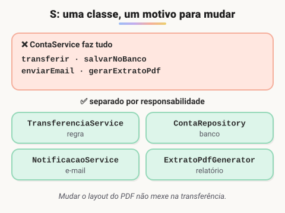
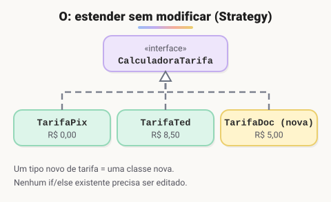
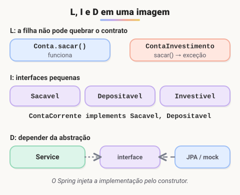

# SOLID e código limpo (Adicionado pelo aluno para melhorar o estudo)

> 🗺️ **Nesta aula:** os cinco princípios SOLID com exemplos em Java e as práticas de código limpo do dia a dia.

## O que é SOLID

**SOLID reúne cinco princípios de design orientado a objetos**, popularizados por Robert C. Martin ("Uncle Bob"). O objetivo é ter código fácil de mudar e de testar, em que uma alteração não quebre partes distantes do sistema.

## S: Single Responsibility (responsabilidade única)

**Uma classe deve ter um único motivo para mudar.**



```java
// ❌ faz tudo: regra, persistência, e-mail e PDF
class ContaService {
  void transferir(...) { ... }
  void salvarNoBanco(...) { ... }
  void enviarEmail(...) { ... }
  byte[] gerarExtratoPdf(...) { ... }
}

// ✅ cada uma com seu papel
class TransferenciaService { ... }  // regra de negócio
interface ContaRepository { ... }  // persistência
class NotificacaoService { ... }  // e-mail/SMS
class ExtratoPdfGenerator { ... }  // relatório
```

## O: Open/Closed (aberto/fechado)

**Aberto para extensão, fechado para modificação:** acrescentar um comportamento novo não deveria exigir editar código que já funciona.



```java
// ❌ todo tipo novo de tarifa obriga a mexer neste if/else
BigDecimal tarifa(String tipo) {
  if (tipo.equals("PIX")) return BigDecimal.ZERO;
  else if (tipo.equals("TED")) return new BigDecimal("8.50");
  ...
}

// ✅ um tipo novo = uma classe nova (padrão Strategy)
interface CalculadoraTarifa { BigDecimal calcular(BigDecimal valor); }
class TarifaPix implements CalculadoraTarifa { ... }
class TarifaTed implements CalculadoraTarifa { ... }
```



## L: Liskov Substitution (substituição de Liskov)

**Uma subclasse deve poder substituir a classe pai sem quebrar quem a usa.**

```java
class Conta {
  void sacar(BigDecimal valor) { ... }
}

// ❌ ContaInvestimento "é uma" Conta, mas quebra o contrato de sacar
class ContaInvestimento extends Conta {
  @Override
  void sacar(BigDecimal valor) {
    throw new UnsupportedOperationException("Resgate só no vencimento");
  }
}
```

Se uma filha precisa **anular** um método herdado, a hierarquia está errada. Uma solução é separar a capacidade em uma interface (`Sacavel`) implementada só por quem realmente saca.

## I: Interface Segregation (segregação de interfaces)

**Prefira várias interfaces pequenas a uma grande:** nenhuma classe deve ser obrigada a implementar métodos que não usa.

```java
// ❌
interface OperacoesBancarias {
  void sacar(...); void depositar(...); void investir(...); void emitirBoleto(...);
}

// ✅
interface Sacavel { void sacar(BigDecimal v); }
interface Depositavel { void depositar(BigDecimal v); }
interface Investivel { void investir(BigDecimal v); }

class ContaCorrente implements Sacavel, Depositavel { ... }
```

## D: Dependency Inversion (inversão de dependência)

**Dependa de abstrações (interfaces), e não de implementações concretas.** Quem cria a dependência é quem está de fora, e o Spring faz exatamente isso com a injeção de dependência.

```java
// ❌ preso a uma implementação e impossível de testar sem enviar SMS de verdade
class TransferenciaService {
  private final SmsTwilio sms = new SmsTwilio();
}

// ✅ depende da interface; o Spring injeta a implementação (e o teste injeta um mock)
class TransferenciaService {
  private final Notificador notificador;
  TransferenciaService(Notificador notificador) { this.notificador = notificador; }
}
```

## Código limpo no dia a dia

- **Nomes que explicam:** `calcularJurosAtraso(diasAtraso)` em vez de `calc(d)`; `clientesAtivos` em vez de `lista2`.
- **Métodos curtos**, que fazem uma coisa e estão em um único nível de abstração.
- **Sem números mágicos:** `private static final BigDecimal LIMITE_PIX_NOTURNO = new BigDecimal("1000");`.
- **Retorne cedo** em vez de aninhar `if`s (*guard clauses*):

```java
if (valor.signum() <= 0) throw new IllegalArgumentException("Valor inválido");
if (!conta.isAtiva()) throw new ContaInativaException();
// caminho principal, sem indentação extra
```

- **Comentários explicam o porquê**, e não o quê: se o código precisa de um comentário para ser entendido, tente renomear ou extrair um método.
- **DRY** (*Don't Repeat Yourself*) e **KISS** (*Keep It Simple*): evite duplicação, mas também abstrações antes da hora.

> 💡 SOLID é um guia, e não uma lei. Aplicar todos os princípios em um script de 50 linhas gera complexidade sem ganho. O valor aparece em sistemas que crescem e são mantidos por equipes, que é o caso de um banco.

## 📌 Resumo

| Princípio | Em uma frase |
| --- | --- |
| S: responsabilidade única | cada classe tem um só motivo para mudar |
| O: aberto/fechado | aberta para extensão, fechada para modificação |
| L: substituição de Liskov | a subclasse pode ocupar o lugar da classe-mãe sem quebrar nada |
| I: segregação de interfaces | interfaces pequenas e específicas em vez de uma grande |
| D: inversão de dependência | dependa de abstrações (interfaces), não de implementações |
| Código limpo | nomes claros, métodos curtos, sem duplicação e com testes |
