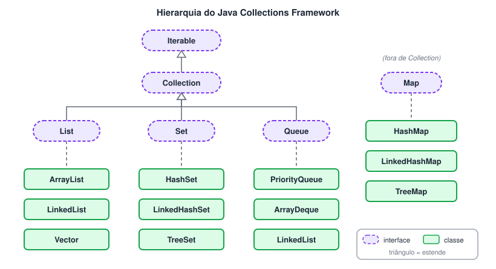
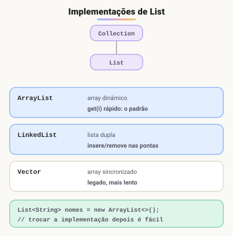
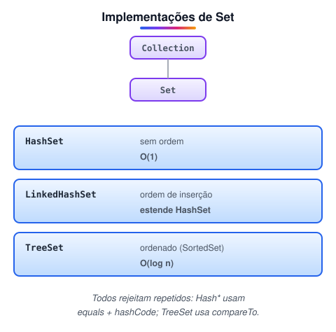
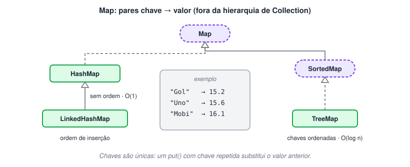
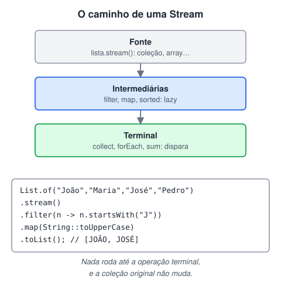

# Collections

> 🗺️ **Nesta aula:** o framework Collections (`List`, `Set` e `Map` e suas implementações), exercícios resolvidos, a Stream API com lambdas e o `Optional` para evitar `null`.

> 💡 **Analogia:** o framework Collections é uma caixa de ferramentas com gavetas diferentes. `List` é a gaveta de itens numerados, `Set` é a gaveta em que nada se repete e `Map` é a agenda de nome e telefone.

## O que é collection

> 🗺️ **Nesta aula:** o que é o Java Collections Framework, suas interfaces principais e por que usar coleções em vez de arrays.

### De onde paramos

Você já sabe criar arrays e percorrê-los. Agora vai conhecer o framework que reúne listas, conjuntos, filas e mapas em um só lugar.

> 💡 O **Java Collections Framework** é o conjunto de interfaces e classes do pacote `java.util` para guardar e manipular **grupos de objetos**: listas, conjuntos, filas e mapas.

### O que é

- Oferece **interfaces** (`List`, `Set`, `Queue`, `Map`) que definem *o que* uma coleção faz e **implementações** prontas (`ArrayList`, `HashSet`, `HashMap`…) que definem *como*.
- Traz algoritmos prontos para ordenar, buscar, filtrar e transformar dados — na classe utilitária `Collections` e, desde o Java 8, na **Stream API**.
- Diferente dos arrays, as coleções **crescem e encolhem** sozinhas e só guardam **objetos** (para números, usam-se os *wrappers*: `Integer`, `Double`…).

> 💡 **Analogia:** o array é uma caixa de ovos — tamanho fixo, uma posição para cada ovo. Uma coleção é uma sacola: cabe mais coisa quando você precisa, e cada tipo de sacola tem uma regra (a lista guarda na ordem, o conjunto não aceita repetidos, o mapa etiqueta cada item com uma chave).

### Hierarquia



| Interface | Característica | Implementação mais usada |
| --- | --- | --- |
| `List` | Ordenada, aceita repetidos, acesso por índice | `ArrayList` |
| `Set` | Não aceita repetidos | `HashSet` |
| `Queue` / `Deque` | Fila (FIFO) / fila dupla | `ArrayDeque` |
| `Map` | Pares chave → valor, chaves únicas | `HashMap` |

> 📌 `Map` faz parte do framework, mas **não** estende `Collection` — ele trabalha com pares, não com elementos soltos. E cuidado com os nomes: `Collection` (sem "s") é a **interface**; `Collections` (com "s") é uma **classe utilitária** com métodos estáticos como `sort`, `max` e `shuffle`.

### Exemplo em código

```java
import java.util.ArrayList;
import java.util.List;

public class ExemploCollections {
  public static void main(String[] args) {
    // Declarada pelo tipo da interface
    List<Integer> numeros = new ArrayList<>();

    numeros.add(10);
    numeros.add(20);
    numeros.add(30);

    // Percorrendo com for-each
    for (Integer n : numeros) {
      System.out.println(n);
    }
  }
}
```

> 💡 Declare pelo tipo da **interface** (`List`) e crie com a **implementação** (`ArrayList`). Assim, trocar para `LinkedList` depois muda só uma linha.

> ✨ Desde o Java 7 basta `new ArrayList<>()` — o "operador diamante" deduz o tipo pela declaração. E para listas fixas e imutáveis existe `List.of(10, 20, 30)` (Java 9+).

### 🧠 Revisão rápida

**`Collection` e `Collections` são a mesma coisa?**

Não. `Collection` é a interface-mãe de listas, conjuntos e filas; `Collections` é uma classe utilitária com métodos estáticos.

**`Map` estende `Collection`?**

Não. Ele faz parte do framework, mas trabalha com pares chave → valor.

**Por que não dá para fazer `List<int>`?**

Coleções só guardam objetos. Use o wrapper: `List<Integer>`.

> ➡️ **Próximo passo:** **Lists**, a primeira e mais usada das interfaces.

### 📌 Resumo

| Item | Em uma frase |
| --- | --- |
| Collections Framework | Interfaces e classes de `java.util` para grupos de objetos. |
| Interface × implementação | A interface diz o que faz; a classe diz como. |
| Coleção × array | Coleções crescem sozinhas e só guardam objetos. |
| `Collections` | Classe utilitária: `sort`, `max`, `shuffle`... |

## Lists

> 🗺️ **Nesta aula:** a interface `List`, as diferenças entre `ArrayList`, `LinkedList` e `Vector`, ordenação com `Comparable`/`Comparator` e quatro exercícios resolvidos.

### De onde paramos

Você já sabe criar arrays e percorrê-los. Agora vai usar uma coleção que cresce e encolhe sozinha.

> 💡 `java.util.List` é uma **sequência ordenada** de elementos, acessados por **índice**, que **aceita repetidos**. Estende `Collection` e acrescenta métodos para trabalhar com posições.

- As implementações mais conhecidas são `ArrayList`, `LinkedList` e `Vector`, cada uma com vantagens diferentes de desempenho e memória.
- Métodos típicos de `List`: `add(e)`, `add(i, e)`, `get(i)`, `set(i, e)`, `remove(i)` / `remove(obj)`, `indexOf(obj)`, `contains(obj)`, `size()`, `isEmpty()`, `clear()`, `sort(comparator)`.

> 💡 **Analogia:** uma List é uma fila de pessoas numeradas. Cada um tem sua posição, a ordem importa e a mesma pessoa pode aparecer mais de uma vez. ArrayList é uma fila em pé, rápida para ir até o número 5; LinkedList é uma fila de mãos dadas, rápida para entrar ou sair nas pontas.

### Hierarquia



### `ArrayList`

**Código**

Usa um **array interno** que cresce sozinho. É a mais rápida para acessar por índice. Inserir ou remover **no meio** é mais lento, porque os elementos seguintes precisam ser deslocados.

```java
import java.util.ArrayList;
import java.util.List;

public class ExemploArrayList {
  public static void main(String[] args) {
    List<String> nomes = new ArrayList<>();

    nomes.add("Ana");
    nomes.add("Bruno");
    nomes.add("Carla");

    System.out.println(nomes.get(0)); // Ana
    System.out.println(nomes.get(1)); // Bruno
    System.out.println(nomes.get(2)); // Carla

    for (String nome : nomes) {
      System.out.println(nome);
    }
  }
}
```

### `LinkedList`

**Código**

É uma **lista duplamente encadeada**: inserir/remover nas pontas é muito rápido, mas acessar por índice exige percorrer a lista (a partir do início ou do fim, o que estiver mais perto).

```java
import java.util.LinkedList;
import java.util.List;

public class ExemploLinkedList {
  public static void main(String[] args) {
    List<Double> precos = new LinkedList<>();

    precos.add(10.0);
    precos.add(20.0);
    precos.add(30.0);

    System.out.println(precos.get(0)); // 10.0
    System.out.println(precos.get(1)); // 20.0
    System.out.println(precos.get(2)); // 30.0

    for (Double preco : precos) {
      System.out.println(preco);
    }
  }
}
```

### `Vector`

**Código**

Parecida com `ArrayList`, mas **sincronizada** (segura para várias threads), o que a deixa mais lenta em programas de uma thread só. É considerada legada: para concorrência, prefira `Collections.synchronizedList(...)` ou `CopyOnWriteArrayList`.

```java
import java.util.List;
import java.util.Vector;

public class ExemploVector {
  public static void main(String[] args) {
    List<Integer> numeros = new Vector<>();

    numeros.add(10);
    numeros.add(20);
    numeros.add(30);

    System.out.println(numeros.get(0)); // 10
    System.out.println(numeros.get(1)); // 20
    System.out.println(numeros.get(2)); // 30

    for (Integer n : numeros) {
      System.out.println(n);
    }
  }
}
```

> 💡 **Qual escolher?** Na dúvida, `ArrayList`: é a mais rápida na maioria dos usos reais. `LinkedList` só vale a pena quando você insere e remove muito nas pontas (como numa fila). `Vector` fica para código legado.

### Exercício 1 — Notas de um aluno

Dada a lista de notas `[7, 8.5, 9.3, 5, 7, 0, 3.6]`:

1. Crie uma lista e adicione as 7 notas.
2. Exiba a posição da nota 5.0.
3. Adicione a nota 8.0 na posição 4.
4. Substitua a nota 5.0 por 6.0.
5. Verifique se a nota 5.0 ainda está na lista.
6. Imprima cada índice com sua nota.
7. Exiba a 3ª nota adicionada (índice 2).
8. Exiba a menor nota.
9. Exiba a maior nota.
10. Exiba a soma das notas.
11. Exiba a média simples.
12. Remova a nota 0.
13. Remova a nota do índice 0.
14. Remova as notas menores que 7 e exiba a lista.
15. Apague toda a lista.
16. Mostre que a lista está vazia.

<details>
<summary>Ver resposta</summary>

```java
package ex01;

import java.util.ArrayList;
import java.util.Collections;
import java.util.Iterator;
import java.util.List;

public class Main {
  public static void main(String[] args) {
    // 1 - criando a lista
    List<Double> notas = new ArrayList<>();
    notas.add(7.0);
    notas.add(8.5);
    notas.add(9.3);
    notas.add(5.0);
    notas.add(7.0);
    notas.add(0.0);
    notas.add(3.6);
    System.out.println("Notas: " + notas);

    // 2 - posição da nota 5.0
    System.out.println("Índice de 5.0: "
      + notas.indexOf(5d));

    // 3 - 8.0 no índice 4
    notas.add(4, 8d);
    System.out.println("Com 8.0: " + notas);

    // 4 - trocando 5.0 por 6.0
    notas.set(notas.indexOf(5d), 6.0);
    System.out.println("Trocado: " + notas);

    // 5 - 5.0 ainda existe?
    System.out.println("Tem 5.0? "
      + notas.contains(5.0));

    // 6 - índice e nota
    for (int i = 0; i < notas.size(); i++) {
      System.out.print(i + ": "
        + notas.get(i) + "  ");
    }

    // 7 - terceira nota
    System.out.println("\nÍndice 2: "
      + notas.get(2));

    // 8 e 9 - métodos estáticos
    // da classe utilitária Collections
    System.out.println("Menor: "
      + Collections.min(notas));
    System.out.println("Maior: "
      + Collections.max(notas));

    // 10 - soma usando Iterator
    Iterator<Double> it = notas.iterator();
    double soma = 0;
    while (it.hasNext()) {
      soma += it.next();
    }
    System.out.println("Soma: " + soma);

    // 11 - média simples
    System.out.println("Média: "
      + (soma / notas.size()));

    // 12 - remove(Object): o valor 0.0
    System.out.println("Removeu 0.0? "
      + notas.remove(0d));
    System.out.println("Lista: " + notas);

    // 13 - remove(int): o índice 0
    System.out.println("Removida: "
      + notas.remove(0));
    System.out.println("Lista: " + notas);

    // 14 - notas menores que 7
    notas.removeIf(n -> n < 7);
    System.out.println(">= 7: " + notas);

    // 15 - apagando tudo
    notas.clear();
    System.out.println("Lista: " + notas);

    // 16 - está vazia?
    System.out.println("Vazia? "
      + notas.isEmpty());
  }
}
```

</details>

> 📌 **Pegadinha do** `remove`**:** em `List<Double>`, `remove(0)` remove o **índice 0**, enquanto `remove(0d)` (ou `remove(Double.valueOf(0))`) remove o **valor** 0.0. Com `List<Integer>` isso confunde ainda mais: `remove(5)` é sempre índice — para remover o número 5, use `remove(Integer.valueOf(5))`.

> 🛠️ **Ajustes:** o comentário do item 8 dizia que `Collections` é "a superclasse de `List`". Não é: a superinterface de `List` é `Collection` (sem "s"); `Collections` é uma classe utilitária com métodos estáticos. No item 14, o laço com `Iterator` foi trocado por `removeIf` (Java 8+), que faz o mesmo em uma linha — remover dentro de um *for-each* comum lançaria `ConcurrentModificationException`.

### Exercício 2 — Ordenando gatos

Com os gatos gato1 (Jon, 18 meses, preto), gato2 (Simba, 6 meses, tigrado) e gato3 (Jon, 12 meses, amarelo), crie uma lista e mostre:

1. Nome – idade – cor.
2. Por ordem de inserção.
3. Em ordem aleatória.
4. Por nome (ordem alfabética).
5. Por idade.
6. Por cor (ordem alfabética).
7. Por nome, depois cor, depois idade (desempate sucessivo).

<details>
<summary>Ver resposta</summary>

```java
package ex02;

import java.util.ArrayList;
import java.util.Collections;
import java.util.Comparator;
import java.util.List;

public class Main {
  public static void main(String[] args) {
    // 1 - criando a lista
    List<Gato> gatos = new ArrayList<>();
    gatos.add(new Gato("Jon", 18, "preto"));
    gatos.add(
      new Gato("Simba", 6, "tigrado"));
    gatos.add(
      new Gato("Jon", 12, "amarelo"));

    // 2 - ordem de inserção
    System.out.println("Inserção: " + gatos);

    // 3 - ordem aleatória
    Collections.shuffle(gatos);
    System.out.println("Aleatória: " + gatos);

    // 4 - por nome (compareTo de Gato)
    Collections.sort(gatos);
    System.out.println("Nome: " + gatos);

    // 5 - por idade
    gatos.sort(new ComparatorIdade());
    System.out.println("Idade: " + gatos);

    // 6 - por cor
    gatos.sort(new ComparatorCor());
    System.out.println("Cor: " + gatos);

    // 7 - nome, depois cor, depois idade
    gatos.sort(new ComparatorNomeCorIdade());
    System.out.println("Todos: " + gatos);

    // Bônus: o item 7 com a API
    // de Comparator (Java 8+)
    gatos.sort(Comparator
      .comparing(Gato::getNome,
        String.CASE_INSENSITIVE_ORDER)
      .thenComparing(Gato::getCor,
        String.CASE_INSENSITIVE_ORDER)
      .thenComparing(Gato::getIdade));
  }
}

class Gato implements Comparable<Gato> {
  private String nome;
  private Integer idade; // em meses
  private String cor;

  public Gato(String nome, Integer idade,
        String cor) {
    this.nome = nome;
    this.idade = idade;
    this.cor = cor;
  }

  public String getNome() { return nome; }
  public Integer getIdade() { return idade; }
  public String getCor() { return cor; }

  @Override
  public String toString() {
    return "{" + nome + ", " + idade
      + ", " + cor + "}";
  }

  @Override
  public int compareTo(Gato outro) {
    return this.nome
      .compareToIgnoreCase(outro.nome);
  }
}

class ComparatorIdade
    implements Comparator<Gato> {
  @Override
  public int compare(Gato g1, Gato g2) {
    return Integer.compare(
      g1.getIdade(), g2.getIdade());
  }
}

class ComparatorCor
    implements Comparator<Gato> {
  @Override
  public int compare(Gato g1, Gato g2) {
    return g1.getCor()
      .compareToIgnoreCase(g2.getCor());
  }
}

class ComparatorNomeCorIdade
    implements Comparator<Gato> {
  @Override
  public int compare(Gato g1, Gato g2) {
    int nome = g1.getNome()
      .compareToIgnoreCase(g2.getNome());
    if (nome != 0) return nome;
    int cor = g1.getCor()
      .compareToIgnoreCase(g2.getCor());
    if (cor != 0) return cor;
    return Integer.compare(
      g1.getIdade(), g2.getIdade());
  }
}
```

</details>

> 🛠️ **Ajustes:**
>
> - O enunciado misturava unidades (Jon com "16 meses", Simba com "6 anos") e o código usava 18 e 6. Padronizei tudo **em meses** (18, 6 e 12) — comparar meses com anos daria uma ordenação errada.
> - A lista era criada com `new ArrayList<>(){{ add(...); }}` (*double brace initialization*). Isso cria uma **classe anônima** a cada uso e, com o diamante `<>`, só compila a partir do Java 9. Troquei por `add` comuns.
> - Comparable = ordem **natural** (definida dentro da classe, uma só); Comparator = ordens **alternativas** (quantas quiser, em classes separadas ou lambdas).

> 💡 **Como ler o retorno de** `compare`**:** negativo = o primeiro vem antes; zero = empate; positivo = o primeiro vem depois. Por isso usamos `Integer.compare` em vez de subtrair (a subtração pode estourar com números muito grandes).

### Exercício 3 — Temperaturas do semestre (resolvido)

> Receba a temperatura média dos 6 primeiros meses do ano e guarde em uma lista. Calcule a média semestral e mostre as temperaturas acima da média, com o mês por extenso.

<details>
<summary>Ver resposta</summary>

```java
package ex03;

import java.util.ArrayList;
import java.util.List;
import java.util.Scanner;

public class Main {
  public static void main(String[] args) {
    Scanner scan = new Scanner(System.in);
    String[] meses = {"Janeiro",
      "Fevereiro", "Março", "Abril",
      "Maio", "Junho"};
    List<Double> temps = new ArrayList<>();

    for (String mes : meses) {
      System.out.print(mes + ": ");
      temps.add(scan.nextDouble());
    }

    double media = temps.stream()
      .mapToDouble(Double::doubleValue)
      .average()
      .orElse(0);
    System.out.printf(
      "Média: %.1f°C%n", media);

    System.out.println("Acima da média:");
    for (int i = 0; i < temps.size(); i++) {
      if (temps.get(i) > media) {
        System.out.printf(
          "%d - %s: %.1f°C%n",
          i + 1, meses[i], temps.get(i));
      }
    }
    scan.close();
  }
}
```

</details>

### Exercício 4 — Investigação do crime (resolvido)

Faça 5 perguntas sobre um crime. Com 2 respostas positivas, a pessoa é **suspeita**; com 3 ou 4, **cúmplice**; com 5, **assassina**. Caso contrário, **inocente**.

1. Telefonou para a vítima?
2. Esteve no local do crime?
3. Mora perto da vítima?
4. Devia para a vítima?
5. Já trabalhou com a vítima?

<details>
<summary>Ver resposta</summary>

```java
package ex04;

import java.util.ArrayList;
import java.util.List;
import java.util.Scanner;

public class Main {
  public static void main(String[] args) {
    Scanner scan = new Scanner(System.in);
    List<String> perguntas = List.of(
      "Telefonou para a vítima?",
      "Esteve no local do crime?",
      "Mora perto da vítima?",
      "Devia para a vítima?",
      "Já trabalhou com a vítima?");

    List<String> resp = new ArrayList<>();
    for (String p : perguntas) {
      System.out.print(p + " (s/n): ");
      resp.add(scan.next()
        .trim().toLowerCase());
    }

    long positivas = resp.stream()
      .filter(r -> r.startsWith("s"))
      .count();

    String classe;
    if (positivas == 5) {
      classe = "Assassina";
    } else if (positivas >= 3) {
      classe = "Cúmplice";
    } else if (positivas == 2) {
      classe = "Suspeita";
    } else {
      classe = "Inocente";
    }

    System.out.println("Positivas: "
      + positivas);
    System.out.println("Classificação: "
      + classe);
    scan.close();
  }
}
```

</details>

> ✨ Os exercícios 3 e 4 estavam com o código em branco; adicionei uma solução para cada. Repare na ordem dos `if`: testamos do caso mais restrito (5) para o mais amplo, para que cada faixa seja avaliada corretamente.

### 🧠 Revisão rápida

**Quando preferir `LinkedList` a `ArrayList`?**

Quando há muitas inserções e remoções nas pontas. Para acesso por índice, `ArrayList` ganha.

**Em `List<Integer>`, o que faz `remove(5)`?**

Remove o elemento do **índice** 5. Para remover o valor 5, use `remove(Integer.valueOf(5))`.

**Qual a diferença entre `Comparable` e `Comparator`?**

`Comparable` define a ordem natural dentro da classe (`compareTo`); `Comparator` define ordens extras, fora dela (`compare`).

**Por que não remover itens dentro de um for-each?**

Lança `ConcurrentModificationException`. Use `removeIf` ou `Iterator.remove()`.

> ➡️ **Próximo passo:** **Set**, a coleção que não aceita repetidos.

### 📌 Resumo

| Item | Em uma frase |
| --- | --- |
| `List` | Sequência ordenada, com índice e repetidos. |
| `ArrayList` | Array que cresce; acesso rápido por índice. |
| `LinkedList` | Lista encadeada; rápida nas pontas. |
| `Vector` | Sincronizada e legada. |
| `Comparable` / `Comparator` | Ordem natural / ordens alternativas. |

## Set

> 🗺️ **Nesta aula:** a interface `Set` (coleção sem repetidos), suas três implementações, operações de conjunto e quatro exercícios resolvidos.

### De onde paramos

Você já viu a `List`, que aceita repetidos. Agora vai ver a coleção que não aceita repetidos.

> 💡 Um `Set` é uma coleção de **elementos únicos**: não aceita repetidos. É a interface `java.util.Set`, implementada principalmente por `HashSet`, `LinkedHashSet` e `TreeSet`.

> 💡 **Analogia:** é a lista de convidados de uma festa. Escrever o mesmo nome duas vezes não traz a pessoa duas vezes — ela está ou não está na lista.

### Implementações



|  | `HashSet` | `LinkedHashSet` | `TreeSet` |
| --- | --- | --- | --- |
| Ordem | Nenhuma garantida | Ordem de inserção | Crescente (natural ou `Comparator`) |
| Estrutura | Tabela hash | Tabela hash + lista ligada | Árvore rubro-negra |
| `add` / `contains` | O(1) | O(1), um pouco mais lento | O(log n) |
| Aceita `null` | Sim (um) | Sim (um) | Não |
| Precisa de | `equals`  • `hashCode` | `equals`  • `hashCode` | `compareTo` ou `Comparator` |

- **HashSet** é a mais usada e a mais rápida.
- **LinkedHashSet** estende `HashSet` e mantém a ordem em que os elementos foram inseridos.
- **TreeSet** mantém os elementos ordenados e oferece métodos como `first()`, `last()`, `headSet()` e `tailSet()`. Buscar em um `TreeSet` (O(log n)) é muito mais rápido do que procurar em uma `ArrayList` (O(n)).

> ⚠️ Em `HashSet` com objetos seus, sobrescreva `equals` **e** `hashCode` **juntos**. Sem isso, dois objetos com os mesmos dados são vistos como diferentes e o "repetido" entra no conjunto.

> 🛠️ **Ajuste:** o texto dizia "importar a **classe** Set" — `Set` é uma **interface**; o que se instancia é uma das classes que a implementam (`new HashSet<>()`).

### `HashSet` — sem ordem

```java
import java.util.HashSet;
import java.util.Set;

public class ExemploSet {
  public static void main(String[] args) {
    Set<Integer> a = new HashSet<>();
    a.add(1);
    a.add(2);
    a.add(3);
    a.add(4);
    a.add(4); // ignorado: já existe

    a.remove(2);

    if (a.contains(1)) {
      System.out.println("1 está no Set");
    }
    System.out.println(a); // [1, 3, 4]

    Set<Integer> b =
      new HashSet<>(Set.of(3, 4, 5, 6));

    // União
    Set<Integer> uniao = new HashSet<>(a);
    uniao.addAll(b);
    System.out.println(uniao); // [1, 3, 4, 5, 6]

    // Interseção
    Set<Integer> inter = new HashSet<>(a);
    inter.retainAll(b);
    System.out.println(inter); // [3, 4]

    // Diferença
    Set<Integer> dif = new HashSet<>(a);
    dif.removeAll(b);
    System.out.println(dif); // [1]
  }
}
```

> 💡 Repare que cada operação começa copiando `a` (`new HashSet<>(a)`). `addAll`, `retainAll` e `removeAll` **alteram** o conjunto em que são chamados.

### `LinkedHashSet` — ordem de inserção

```java
import java.util.LinkedHashSet;
import java.util.Set;

public class ExemploLinkedHashSet {
  public static void main(String[] args) {
    Set<String> frutas = new LinkedHashSet<>();
    frutas.add("banana");
    frutas.add("maçã");
    frutas.add("laranja");
    frutas.add("uva");
    frutas.add("abacaxi");
    // Na ordem em que foram inseridos
    System.out.println(frutas);

    frutas.remove("uva");
    System.out.println(frutas);
  }
}
```

### `TreeSet` — ordenado

```java
import java.util.TreeSet;

public class ExemploTreeSet {
  public static void main(String[] args) {
    TreeSet<Integer> nums = new TreeSet<>();
    nums.add(10);
    nums.add(5);
    nums.add(20);
    nums.add(15);
    nums.add(25);

    // [5, 10, 15, 20, 25]
    System.out.println(nums);
    System.out.println(nums.first()); // 5
    System.out.println(nums.last());  // 25
  }
}
```

### Exercício 1 — Notas em conjuntos

1. Insira as notas 7, 8.5, 9.3, 5, 7, 0 e 3.6.
2. Confira se a nota 5 está no conjunto.
3. Exiba a menor nota.
4. Exiba a maior nota.
5. Exiba a soma.
6. Exiba a média.
7. Remova a nota 0.
8. Remova as notas abaixo de 7.
9. Crie um `LinkedHashSet` com os mesmos elementos iniciais.
10. Mostre-o na ordem de inserção.
11. Crie um `TreeSet` e mostre as notas da menor para a maior.
12. Apague o primeiro conjunto e mostre que ficou vazio.

<details>
<summary>Ver resposta</summary>

```java
package ex1;

import java.util.*;

public class Main {
  public static void main(String[] args) {
    List<Double> dados = Arrays.asList(
      7d, 8.5, 9.3, 5d, 7d, 0d, 3.6);

    // 1 - o 7.0 repetido é descartado
    Set<Double> notas = new HashSet<>(dados);
    System.out.println("Notas: " + notas);

    // 2
    System.out.println("Tem 5? "
      + notas.contains(5.0));

    // 3 e 4
    System.out.println("Menor: "
      + Collections.min(notas));
    System.out.println("Maior: "
      + Collections.max(notas));

    // 5 - soma
    double soma = 0;
    for (Double nota : notas) {
      soma += nota;
    }
    System.out.println("Soma: " + soma);

    // 6 - média (só valores ÚNICOS!)
    System.out.println("Média: "
      + (soma / notas.size()));

    // 7
    notas.remove(0d);
    System.out.println("Sem 0.0: " + notas);

    // 8
    notas.removeIf(n -> n < 7);
    System.out.println(">= 7: " + notas);

    // 9 e 10 - ordem de inserção
    Set<Double> notas2 =
      new LinkedHashSet<>(dados);
    System.out.println("Inserção: " + notas2);

    // 11 - do menor para o maior
    Set<Double> notas3 = new TreeSet<>(notas2);
    System.out.println("Crescente: " + notas3);

    // 12
    notas.clear();
    System.out.println("Vazio? "
      + notas.isEmpty());
  }
}
```

</details>

> 📌 **Atenção à média (item 6):** como o `Set` descarta o 7.0 repetido, ele guarda **6** notas, não 7. A média sai diferente da calculada com uma `List` — por isso conjuntos não são a estrutura certa quando os repetidos importam.

> 🛠️ **Ajustes:** o comentário do item 11 dizia que o `TreeSet` organiza "do maior para o menor" — é do **menor para o maior**. Troquei o laço com `Iterator` do item 8 por `removeIf` e simplifiquei a criação do `LinkedHashSet`.

### Exercício 2 — Séries favoritas

Com as séries Got (Fantasia, 60 min), Dark (Drama, 60 min) e That '70s Show (Comédia, 25 min):

1. Crie um conjunto e mostre nome, gênero e tempo de episódio.
2. Mostre em ordem aleatória (`HashSet`).
3. Mostre na ordem de inserção (`LinkedHashSet`).
4. Mostre pelo tempo de episódio, do menor para o maior (`TreeSet`).

<details>
<summary>Ver resposta</summary>

```java
package ex2;

import java.util.*;

public class Main {
    public static void main(String[] args) {
        List<Serie> dados = List.of(
            new Serie("Got", "Fantasia", 60),
            new Serie("Dark", "Drama", 60),
            new Serie("That '70s Show",
                      "Comédia", 25));

        // 1 e 2 - HashSet (sem ordem)
        Set<Serie> series = new HashSet<>(dados);
        for (Serie s : series) {
            System.out.println(s.getNome()
                + " - " + s.getGenero()
                + " - " + s.getTempoEpisodio());
        }

        // 3 - LinkedHashSet (inserção)
        Set<Serie> series2 =
            new LinkedHashSet<>(dados);
        System.out.println("Inserção: " + series2);

        // 4 - TreeSet (usa o compareTo)
        Set<Serie> series3 = new TreeSet<>(series2);
        System.out.println("Tempo: " + series3);
    }
}
```

```java
package ex2;

import java.util.Objects;

public class Serie implements Comparable<Serie> {
    private String nome;
    private String genero;
    private Integer tempoEpisodio;

    public Serie(String nome, String genero,
                 Integer tempoEpisodio) {
        this.nome = nome;
        this.genero = genero;
        this.tempoEpisodio = tempoEpisodio;
    }

    public String getNome() { return nome; }
    public String getGenero() { return genero; }
    public Integer getTempoEpisodio() {
        return tempoEpisodio;
    }

    @Override
    public String toString() {
        return "[" + nome + ", " + genero
            + ", " + tempoEpisodio + "]";
    }

    @Override
    public boolean equals(Object o) {
        if (this == o) return true;
        if (o == null
            || getClass() != o.getClass())
            return false;
        Serie s = (Serie) o;
        return Objects.equals(nome, s.nome)
            && Objects.equals(genero, s.genero)
            && Objects.equals(tempoEpisodio,
                              s.tempoEpisodio);
    }

    @Override
    public int hashCode() {
        return Objects.hash(
            nome, genero, tempoEpisodio);
    }

    // Desempate: tempo -> gênero -> nome.
    // Sem isso, Got e Dark (ambas 60 min)
    // seriam "iguais" para o TreeSet e uma
    // delas seria descartada!
    @Override
    public int compareTo(Serie outra) {
        int t = Integer.compare(
            tempoEpisodio, outra.tempoEpisodio);
        if (t != 0) return t;
        int g = genero.compareTo(outra.genero);
        if (g != 0) return g;
        return nome.compareTo(outra.nome);
    }
}
```

</details>

> 📌 O comentário no `compareTo` mostra um detalhe importante: o `TreeSet` considera **iguais** os elementos cujo `compareTo` devolve 0 — e descarta o repetido. Por isso o desempate por gênero e nome é essencial.

### Exercício 3 — Cores do arco-íris (resolvido)

Crie um conjunto com as sete cores do arco-íris e:

1. Exiba todas as cores uma abaixo da outra. 2. Exiba a quantidade. 3. Exiba em ordem alfabética. 4. Exiba na ordem inversa da informada. 5. Exiba as que começam com "V". 6. Remova as que **não** começam com "V". 7. Limpe o conjunto e mostre que está vazio.

<details>
<summary>Ver resposta</summary>

```java
package ex3;

import java.util.*;

public class Main {
  public static void main(String[] args) {
    Set<String> cores = new LinkedHashSet<>(
      List.of("Vermelho", "Laranja",
        "Amarelo", "Verde", "Azul",
        "Anil", "Violeta"));

    // 1
    cores.forEach(System.out::println);

    // 2
    System.out.println("Quantidade: "
      + cores.size());

    // 3
    System.out.println("Alfabética: "
      + new TreeSet<>(cores));

    // 4 - ordem inversa da informada
    List<String> inv = new ArrayList<>(cores);
    Collections.reverse(inv);
    System.out.println("Inversa: " + inv);

    // 5
    System.out.print("Com V: ");
    cores.stream()
      .filter(c -> c.startsWith("V"))
      .forEach(c -> System.out.print(c + " "));

    // 6
    cores.removeIf(c -> !c.startsWith("V"));
    System.out.println("\nSó V: " + cores);

    // 7
    cores.clear();
    System.out.println("Vazio? "
      + cores.isEmpty());
  }
}
```

</details>

> 🛠️ **Ajuste:** o enunciado começava com um parágrafo vazio e não dizia de onde vinham as cores; completei com "Crie um conjunto com as sete cores do arco-íris".

### Exercício 4 — Linguagens favoritas (resolvido)

> Crie a classe `LinguagemFavorita` com `nome`, `anoDeCriacao` e `ide`. Crie um conjunto com 3 linguagens e ordene por: 1. inserção; 2. nome; 3. IDE; 4. ano de criação; 5. nome, ano e IDE.

<details>
<summary>Ver resposta</summary>

```java
package ex4;

import java.util.*;

public class Main {
  public static void main(String[] args) {
    Set<LinguagemFavorita> ling =
      new LinkedHashSet<>(List.of(
        new LinguagemFavorita(
          "Java", 1995, "IntelliJ"),
        new LinguagemFavorita(
          "Python", 1991, "PyCharm"),
        new LinguagemFavorita(
          "JavaScript", 1995, "VS Code")));

    System.out.println("1. Inserção: " + ling);

    // compareTo = nome
    Set<LinguagemFavorita> porNome =
      new TreeSet<>(ling);
    System.out.println("2. Nome: " + porNome);

    Set<LinguagemFavorita> porIde =
      new TreeSet<>(Comparator.comparing(
        LinguagemFavorita::getIde));
    porIde.addAll(ling);
    System.out.println("3. IDE: " + porIde);

    // Desempate: Java e JS são de 1995
    Set<LinguagemFavorita> porAno =
      new TreeSet<>(Comparator
        .comparing(
          LinguagemFavorita::getAnoDeCriacao)
        .thenComparing(
          LinguagemFavorita::getNome));
    porAno.addAll(ling);
    System.out.println("4. Ano: " + porAno);

    Set<LinguagemFavorita> porTudo =
      new TreeSet<>(Comparator
        .comparing(LinguagemFavorita::getNome)
        .thenComparing(
          LinguagemFavorita::getAnoDeCriacao)
        .thenComparing(
          LinguagemFavorita::getIde));
    porTudo.addAll(ling);
    System.out.println("5. Tudo: " + porTudo);
  }
}

class LinguagemFavorita
    implements Comparable<LinguagemFavorita> {
  private final String nome;
  private final Integer anoDeCriacao;
  private final String ide;

  LinguagemFavorita(String nome,
      Integer anoDeCriacao, String ide) {
    this.nome = nome;
    this.anoDeCriacao = anoDeCriacao;
    this.ide = ide;
  }

  public String getNome() { return nome; }
  public Integer getAnoDeCriacao() {
    return anoDeCriacao;
  }
  public String getIde() { return ide; }

  @Override
  public int compareTo(LinguagemFavorita o) {
    return nome.compareTo(o.nome);
  }

  @Override
  public boolean equals(Object o) {
    if (this == o) return true;
    if (!(o instanceof LinguagemFavorita l))
      return false;
    return nome.equals(l.nome)
      && anoDeCriacao.equals(l.anoDeCriacao)
      && ide.equals(l.ide);
  }

  @Override
  public int hashCode() {
    return Objects.hash(
      nome, anoDeCriacao, ide);
  }

  @Override
  public String toString() {
    return nome + " (" + anoDeCriacao
      + ", " + ide + ")";
  }
}
```

</details>

> ✨ Os exercícios 3 e 4 estavam só com o enunciado; acrescentei uma solução para cada, usando `Comparator.comparing(...).thenComparing(...)`, a forma moderna (Java 8+) de montar ordenações com desempate.

### 🧠 Revisão rápida

**Qual implementação de `Set` mantém a ordem de inserção?**

`LinkedHashSet`. O `HashSet` não garante ordem e o `TreeSet` ordena pelo valor.

**O que um `HashSet` de objetos seus precisa para detectar repetidos?**

`equals` e `hashCode` sobrescritos de forma coerente.

**Por que um `TreeSet` pode "sumir" com um elemento?**

Ele trata como iguais os elementos com `compareTo` igual a 0. Sem desempate, um deles é descartado.

**Qual método faz a interseção de dois conjuntos?**

`retainAll` (união: `addAll`; diferença: `removeAll`).

> ➡️ **Próximo passo:** **Map**, para guardar pares chave → valor.

### 📌 Resumo

| Item | Em uma frase |
| --- | --- |
| `Set` | Coleção sem repetidos. |
| `HashSet` | Mais rápido, sem ordem garantida. |
| `LinkedHashSet` | Mantém a ordem de inserção. |
| `TreeSet` | Sempre ordenado; usa `compareTo`/`Comparator`. |
| Operações | União, interseção e diferença com `addAll`, `retainAll`, `removeAll`. |

## Map

> 🗺️ **Nesta aula:** a interface `Map` (pares chave → valor), `HashMap`, `LinkedHashMap` e `TreeMap`, três exercícios e um desafio de contagem.

### De onde paramos

Você já viu `List` e `Set`, que guardam valores soltos. Agora vai guardar pares: uma chave e o valor que ela identifica.

> 💡 Um `Map` guarda **pares chave → valor**, com chaves únicas. Em vez de buscar por posição, buscamos pela chave: `mapa.get("Gol")`.

> 💡 **Analogia:** é um dicionário. A palavra é a chave e o significado é o valor; você não procura "a 532ª palavra", procura direto pela palavra. E cada palavra aparece uma vez só.

### O que é

- `java.util.Map<K, V>` é uma interface do Collections Framework, com implementações como `HashMap`, `LinkedHashMap` e `TreeMap`.
- Operações principais: `put(k, v)`, `get(k)`, `remove(k)`, `containsKey(k)`, `containsValue(v)`, `keySet()`, `values()`, `entrySet()`, `getOrDefault(k, padrao)`.
- No `HashMap`, inserir, buscar e remover pela chave custam **O(1)** em média.
- `put` com uma chave que já existe **substitui** o valor antigo; `get` de uma chave inexistente devolve `null`.

> 🛠️ **Correção:** o texto original dizia que `Map` "estende a interface `Collection`" e também "estende a interface `java.util.Map`". Nenhuma das duas coisas é verdade: `Map` **não** herda de `Collection` (ele trabalha com pares, não com elementos isolados) e, sendo ele próprio `java.util.Map`, não estende a si mesmo.

### Hierarquia



### `HashMap` — sem ordem garantida

Guarda os pares em uma tabela hash: o acesso é muito rápido, mas a ordem de iteração não é previsível.

```java
import java.util.HashMap;
import java.util.Map;

public class ExemploHashMap {
  public static void main(String[] args) {
    Map<String, Integer> mapa = new HashMap<>();
    mapa.put("chave1", 10);
    mapa.put("chave2", 20);
    mapa.put("chave3", 30);

    for (Map.Entry<String, Integer> e
        : mapa.entrySet()) {
      System.out.println(
        e.getKey() + " = " + e.getValue());
    }
  }
}
```

### `LinkedHashMap` — ordem de inserção

Igual ao `HashMap`, mas mantém uma lista duplamente ligada que preserva a ordem em que as chaves foram inseridas.

```java
import java.util.LinkedHashMap;
import java.util.Map;

public class ExemploLinkedHashMap {
  public static void main(String[] args) {
    Map<String, Integer> mapa =
      new LinkedHashMap<>();
    mapa.put("chave1", 10);
    mapa.put("chave2", 20);
    mapa.put("chave3", 30);

    mapa.forEach((k, v) ->
      System.out.println(k + " = " + v));
  }
}
```

### `TreeMap` — chaves ordenadas

Usa uma árvore rubro-negra (busca binária balanceada) e mantém as chaves em ordem crescente — O(log n) por operação.

```java
import java.util.Map;
import java.util.TreeMap;

public class ExemploTreeMap {
  public static void main(String[] args) {
    Map<String, Integer> mapa = new TreeMap<>();
    mapa.put("chave3", 30);
    mapa.put("chave1", 10);
    mapa.put("chave2", 20);

    mapa.forEach((k, v) ->
      System.out.println(k + " = " + v));
    // chave1 = 10, chave2 = 20, chave3 = 30
  }
}
```

> ✨ Para percorrer chave **e** valor, prefira `entrySet()` (ou `forEach`) a `keySet()` + `get(chave)`: assim cada par é lido uma vez só, sem uma busca extra por chave.

### Exercício 1 — Consumo dos carros

1. Insira em um `HashMap`: Gol 14.4, Uno 15.6, Mobi 16.1, HB20 14.5, Kwid 15.6 (km/L).
2. Troque o consumo do Gol para 15.2.
3. Confira se o Tucson está no mapa.
4. Exiba o consumo do Uno.
5. Exiba os modelos (`keySet`).
6. Exiba os consumos (`values`).
7. Mostre o modelo mais econômico e seu consumo.
8. Mostre o modelo menos econômico e seu consumo.
9. Exiba a soma dos consumos.
10. Exiba a média.
11. Remova os modelos com consumo 15.6.
12. Mostre na ordem de inserção (`LinkedHashMap`).
13. Mostre em ordem alfabética (`TreeMap`).
14. Apague o mapa e mostre que ficou vazio.

<details>
<summary>Ver resposta</summary>

```java
package ex01;

import java.util.*;

public class Main {
  public static void main(String[] args) {
    // 1
    Map<String, Double> carros =
      new HashMap<>();
    carros.put("Gol", 14.4);
    carros.put("Uno", 15.6);
    carros.put("Mobi", 16.1);
    carros.put("HB20", 14.5);
    carros.put("Kwid", 15.6);
    System.out.println("Carros: " + carros);

    // 2 - chave existente: substitui
    carros.put("Gol", 15.2);
    System.out.println("Gol: " + carros);

    // 3
    System.out.println("Tem Tucson? "
      + carros.containsKey("Tucson"));

    // 4
    System.out.println("Uno: "
      + carros.get("Uno"));

    // 5 e 6
    System.out.println("Modelos: "
      + carros.keySet());
    System.out.println("Consumos: "
      + carros.values());

    // 7 - mais econômico = MAIOR km/L
    Double maior =
      Collections.max(carros.values());
    for (Map.Entry<String, Double> e
        : carros.entrySet()) {
      if (e.getValue().equals(maior)) {
        System.out.println("Mais econ.: "
          + e.getKey() + " - " + maior);
      }
    }

    // 8 - menos econômico = MENOR km/L
    Double menor =
      Collections.min(carros.values());
    for (Map.Entry<String, Double> e
        : carros.entrySet()) {
      if (e.getValue().equals(menor)) {
        System.out.println("Menos econ.: "
          + e.getKey() + " - " + menor);
      }
    }

    // 9 e 10
    double soma = 0;
    for (Double c : carros.values()) {
      soma += c;
    }
    System.out.println("Soma: " + soma);
    System.out.println("Média: "
      + (soma / carros.size()));

    // 11 - remover pelo VALOR
    carros.values()
      .removeIf(c -> c.equals(15.6));
    System.out.println("Sem 15.6: " + carros);

    // 12 - ordem de inserção
    Map<String, Double> carros2 =
      new LinkedHashMap<>();
    carros2.put("Gol", 14.4);
    carros2.put("Uno", 15.6);
    carros2.put("Mobi", 16.1);
    carros2.put("HB20", 14.5);
    carros2.put("Kwid", 15.6);
    System.out.println("Inserção: " + carros2);

    // 13 - chaves em ordem alfabética
    Map<String, Double> carros3 =
      new TreeMap<>(carros2);
    System.out.println("Alfabética: "
      + carros3);

    // 14
    carros.clear();
    System.out.println("Vazio? "
      + carros.isEmpty());
  }
}
```

</details>

> 🛠️ **Correções:** no item 8 o nome do carro era guardado na variável `modelo_eficiente` (do item 7) em vez de `modelo_menos_eficiente`, que ficava sem uso. A remoção do item 11 com `Iterator` virou `values().removeIf(...)`. Também troquei a inicialização com chaves duplas (`new HashMap<>(){{ ... }}`) por `put` comuns e os nomes para camelCase.

### Exercício 2 — Autores e livros

1. Crie um `HashMap` autor → livro:
  - Stephen Hawking — *Uma Breve História do Tempo* — 256 páginas
  - Charles Duhigg — *O Poder do Hábito* — 408 páginas
  - Yuval Noah Harari — *21 Lições para o Século 21* — 432 páginas
2. Mostre autor e livro em ordem aleatória.
3. Mostre na ordem de inserção (`LinkedHashMap`).
4. Mostre em ordem alfabética de autor (`TreeMap`).
5. Mostre em ordem alfabética do nome do livro (`TreeSet` + `Comparator`).
6. Mostre por quantidade de páginas (`TreeSet` + `Comparator`).

<details>
<summary>Ver resposta</summary>

```java
package ex02;

import java.util.*;

public class Main {
  public static void main(String[] args) {
    // 1 e 3 - LinkedHashMap já guarda
    // a ordem de inserção
    Map<String, Livro> livros =
      new LinkedHashMap<>();
    livros.put("Stephen Hawking", new Livro(
      "Uma Breve História do Tempo", 256));
    livros.put("Charles Duhigg", new Livro(
      "O Poder do Hábito", 408));
    livros.put("Yuval Noah Harari", new Livro(
      "21 Lições para o Século 21", 432));

    // 2 - ordem aleatória (HashMap)
    System.out.println("-- Aleatória --");
    imprimir(new HashMap<>(livros).entrySet());

    // 3
    System.out.println("\n-- Inserção --");
    imprimir(livros.entrySet());

    // 4 - TreeMap ordena pela chave (autor)
    System.out.println("\n-- Autor --");
    imprimir(new TreeMap<>(livros).entrySet());

    // 5 - pelo nome do livro
    Set<Map.Entry<String, Livro>> porTitulo =
      new TreeSet<>(Comparator.comparing(
        (Map.Entry<String, Livro> e) -> e.getValue().getNome()));
    porTitulo.addAll(livros.entrySet());
    System.out.println("\n-- Título --");
    imprimir(porTitulo);

    // 6 - pela quantidade de páginas
    Set<Map.Entry<String, Livro>> porPag =
      new TreeSet<>(Comparator.comparing(
        (Map.Entry<String, Livro> e) -> e.getValue().getPaginas()));
    porPag.addAll(livros.entrySet());
    System.out.println("\n-- Páginas --");
    imprimir(porPag);
  }

  private static void imprimir(
      Set<Map.Entry<String, Livro>> itens) {
    for (Map.Entry<String, Livro> e : itens) {
      Livro l = e.getValue();
      System.out.println(e.getKey() + " - "
        + l.getNome() + " ("
        + l.getPaginas() + " págs.)");
    }
  }
}
```

```java
package ex02;

import java.util.Objects;

public class Livro {
  private final String nome;
  private final Integer paginas;

  public Livro(String nome, Integer paginas) {
    this.nome = nome;
    this.paginas = paginas;
  }

  public String getNome() { return nome; }
  public Integer getPaginas() { return paginas; }

  @Override
  public boolean equals(Object o) {
    if (this == o) return true;
    if (o == null
      || getClass() != o.getClass())
      return false;
    Livro l = (Livro) o;
    return Objects.equals(nome, l.nome)
      && Objects.equals(paginas, l.paginas);
  }

  @Override
  public int hashCode() {
    return Objects.hash(nome, paginas);
  }

  @Override
  public String toString() {
    return nome + " (" + paginas + ")";
  }
}
```

</details>

> 🛠️ **Correções:** a classe principal se chamava `Man` (em vez de `Main`); o item 6 (ordenar por páginas) não tinha sido feito — agora está; e o título "Uma breve história **o** tempo" virou "Uma Breve História **do** Tempo". A classe `ComparatorNome` foi substituída por `Comparator.comparing(...)`, que faz o mesmo em uma linha.

### Exercício 3 — População do Nordeste (resolvido)

Crie um mapa estado → população e:

1. Crie o mapa: PE 9.616.621; AL 3.351.543; CE 9.187.103; RN 3.534.265. 2. Mostre estados e populações. 3. Troque RN para 3.534.165. 4. Se PB não estiver no mapa, adicione PB 4.039.277. 5. Exiba a população de PE. 6. Mostre na ordem de inserção. 7. Mostre em ordem alfabética. 8. Estado com menor população. 9. Estado com maior população. 10. Soma das populações. 11. Média. 12. Remova os estados com menos de 4.000.000. 13. Apague e mostre que está vazio.

<details>
<summary>Ver resposta</summary>

```java
package ex03;

import java.util.*;

public class Main {
  public static void main(String[] args) {
    // 1 e 6 - LinkedHashMap mantém
    // a ordem de inserção
    Map<String, Integer> uf =
      new LinkedHashMap<>();
    uf.put("PE", 9_616_621);
    uf.put("AL", 3_351_543);
    uf.put("CE", 9_187_103);
    uf.put("RN", 3_534_265);
    System.out.println("2. " + uf);

    uf.put("RN", 3_534_165);  // 3
    uf.putIfAbsent("PB", 4_039_277); // 4
    System.out.println("5. PE: "
      + uf.get("PE"));
    System.out.println("6. Inserção: " + uf);
    System.out.println("7. Alfabética: "
      + new TreeMap<>(uf));

    Map.Entry<String, Integer> menor =
      Collections.min(uf.entrySet(),
        Map.Entry.comparingByValue());
    Map.Entry<String, Integer> maior =
      Collections.max(uf.entrySet(),
        Map.Entry.comparingByValue());
    System.out.println("8. Menor: "
      + menor.getKey() + " - "
      + menor.getValue());
    System.out.println("9. Maior: "
      + maior.getKey() + " - "
      + maior.getValue());

    long soma = uf.values().stream()
      .mapToLong(Integer::longValue).sum();
    System.out.println("10. Soma: " + soma);
    System.out.println("11. Média: "
      + (double) soma / uf.size());

    // 12
    uf.values().removeIf(p -> p < 4_000_000);
    System.out.println("12. > 4 mi: " + uf);

    // 13
    uf.clear();
    System.out.println("13. Vazio? "
      + uf.isEmpty());
  }
}
```

</details>

> 💡 O `_` em `9_616_621` é só separador visual de milhar (Java 7+); o valor é o mesmo que `9616621`. A soma usa `long` para não estourar o limite de `int` se houver muitos estados.

### Desafio — Lançando um dado 100 vezes (resolvido)

> Simule 100 lançamentos de um dado, guarde os valores e mostre quantas vezes cada face saiu.

<details>
<summary>Ver resposta</summary>

```java
package desafio;

import java.util.*;

public class Main {
  public static void main(String[] args) {
    Random random = new Random();
    List<Integer> lances = new ArrayList<>();
    for (int i = 0; i < 100; i++) {
      // nextInt(6) dá 0 a 5; +1 = 1 a 6
      lances.add(random.nextInt(6) + 1);
    }

    // TreeMap: faces em ordem
    Map<Integer, Integer> freq = new TreeMap<>();
    for (Integer face : lances) {
      // soma 1 à contagem da face
      freq.merge(face, 1, Integer::sum);
    }

    freq.forEach((face, vezes) ->
      System.out.println("Face " + face
        + ": " + vezes + " vezes"));
  }
}
```

</details>

> ✨ O exercício 3 e o desafio estavam só com o enunciado; acrescentei soluções. O `merge(chave, 1, Integer::sum)` é o jeito idiomático de **contar ocorrências** com um `Map`: se a chave não existe, grava 1; se existe, soma 1 ao valor atual.

### 🧠 Revisão rápida

**O que acontece com `put` de uma chave que já existe?**

O valor antigo é substituído (e `put` devolve o valor antigo).

**Qual implementação mantém as chaves em ordem alfabética?**

`TreeMap`. `LinkedHashMap` mantém a ordem de inserção; `HashMap`, nenhuma.

**Como remover entradas pelo valor?**

`mapa.values().removeIf(v -> condição)` — a visão `values()` remove do mapa original.

**Como contar quantas vezes cada item aparece?**

`mapa.merge(item, 1, Integer::sum)` para cada item.

> ➡️ **Próximo passo:** **Stream API**, para filtrar e transformar coleções com menos código.

### 📌 Resumo

| Item | Em uma frase |
| --- | --- |
| `Map` | Pares chave → valor, com chaves únicas. |
| `HashMap` | O(1) em média, sem ordem. |
| `LinkedHashMap` | Ordem de inserção. |
| `TreeMap` | Chaves ordenadas, O(log n). |
| `entrySet()` | Percorre chave e valor de uma vez. |
| `merge` | Conta ocorrências em uma linha. |

## Stream API

> 🗺️ **Nesta aula:** como funciona uma stream (fonte → intermediárias → terminal), os conceitos por trás dela (classe anônima, interface funcional, lambda e referência de método) e dois exercícios refatorados.

### De onde paramos

Você já sabe percorrer e transformar listas com laços. Agora vai fazer o mesmo com uma linha de operações encadeadas.

> 💡 A **Stream API** (Java 8) processa coleções de forma **declarativa**: você diz *o que* quer (filtrar, transformar, somar) em vez de escrever *como* (laços e variáveis auxiliares). O código fica mais curto e legível.

### Como funciona

Toda stream tem três partes:

1. **Fonte** — de onde vêm os dados (`lista.stream()`, `Arrays.stream(array)`, `Stream.of(...)`).
2. **Operações intermediárias** — transformam a stream e devolvem **outra stream** (`filter`, `map`, `sorted`, `distinct`, `limit`, `skip`). São *lazy*: só rodam quando há uma operação terminal.
3. **Operação terminal** — produz o resultado e encerra a stream (`collect`, `forEach`, `count`, `sum`, `average`, `min`, `max`, `reduce`).



> 💡 **Analogia:** uma linha de montagem. A esteira (fonte) traz as peças; cada estação (intermediária) descarta, pinta ou embala; a última estação (terminal) entrega a caixa pronta. Sem alguém no fim da linha esperando a caixa, a esteira nem liga — é isso que significa ser *lazy*.

> 📌 Uma stream **não altera** a coleção original e **só pode ser usada uma vez** — depois da operação terminal, é preciso criar outra com `.stream()`.

#### Exemplo

```java
import java.util.List;

public class ExemploStream {
    public static void main(String[] args) {
        List<String> nomes = List.of("João",
            "Maria", "José", "Pedro", "Lucas");

        // filtrar: nomes que começam com "J"
        nomes.stream()
             .filter(n -> n.startsWith("J"))
             .forEach(System.out::println);
        // João, José

        // mapear: cada nome para o seu tamanho
        nomes.stream()
             .map(String::length)
             .forEach(System.out::println);
        // 4, 5, 4, 5, 5

        // reduzir: soma dos tamanhos
        int total = nomes.stream()
                         .mapToInt(String::length)
                         .sum();
        System.out.println("Total: " + total); // 23
    }
}
```

### Conceitos que tornam as streams possíveis

#### Classe anônima

Classe **sem nome**, declarada e instanciada no mesmo lugar. Útil para implementar uma interface uma única vez, sem criar um arquivo só para isso.

**Exemplo**

```java
public class ExemploClasseAnonima {
  public static void main(String[] args) {
    // Runnable implementado por uma
    // classe anônima
    new Thread(new Runnable() {
      @Override
      public void run() {
        System.out.println("Executando...");
      }
    }).start();
  }
}
```

#### Interface funcional

Interface com **um único método abstrato** (SAM — *Single Abstract Method*). É ela que permite usar lambdas e referências de método. A anotação `@FunctionalInterface` faz o compilador garantir essa regra. Exemplos prontos do Java: `Runnable`, `Comparator<T>`, `Predicate<T>`, `Function<T, R>`, `Consumer<T>`, `Supplier<T>`.

| Interface | Recebe → devolve | Usada em |
| --- | --- | --- |
| `Predicate<T>` | T → boolean | `filter` |
| `Function<T, R>` | T → R | `map` |
| `Consumer<T>` | T → nada | `forEach` |
| `Supplier<T>` | nada → T | `orElseGet` |

**Exemplo**

```java
@FunctionalInterface
interface Operacao {
  int calcular(int x, int y);
}

public class ExemploInterfaceFuncional {
  public static void main(String[] args) {
    Operacao soma = (x, y) -> x + y;
    Operacao sub = (x, y) -> x - y;

    System.out.println(soma.calcular(5, 3)); // 8
    System.out.println(sub.calcular(5, 3));  // 2
  }
}
```

#### Expressões lambda

Funções anônimas, escritas como `(parâmetros) -> corpo`, que implementam uma interface funcional de forma compacta.

**Exemplo**

```java
import java.util.ArrayList;
import java.util.List;

public class ExemploExpressoesLambda {
  public static void main(String[] args) {
    List<String> nomes = new ArrayList<>(
      List.of("João", "Maria", "José",
          "Pedro", "Lucas"));

    // ordem alfabética
    nomes.sort((s1, s2) -> s1.compareTo(s2));
    // em maiúsculas
    nomes.forEach(n ->
      System.out.println(n.toUpperCase()));
  }
}
```

#### Referência de método

Atalho para uma lambda que apenas chama um método já existente: `Classe::metodo` ou `objeto::metodo`.

| Lambda | Referência de método |
| --- | --- |
| `s -> System.out.println(s)` | `System.out::println` |
| `s -> Integer.parseInt(s)` | `Integer::parseInt` |
| `s -> s.length()` | `String::length` |

**Exemplo**

```java
import java.util.List;

public class ExemploReferenciaMetodo {
    public static void main(String[] args) {
        List<String> nomes = List.of("João",
            "Maria", "José", "Pedro", "Lucas");

        // imprime cada nome
        nomes.forEach(System.out::println);
        // imprime o tamanho de cada nome
        nomes.stream()
             .map(String::length)
             .forEach(System.out::println);
    }
}
```

> 🛠️ **Ajuste:** o comentário do exemplo dizia que `nomes.forEach(System.out::println)` imprime "a quantidade de caracteres de cada string" — ele imprime os **nomes**. Para os tamanhos, é preciso antes um `map(String::length)`, como acrescentado acima.

### Refatorando exercícios com streams

#### Ex01 — Agenda de contatos

1. Monte um mapa id → contato: id 1 (Simba, 2222), id 4 (Cami, 5555), id 3 (Jon, 1111).
2. Mostre em ordem aleatória (`HashMap`).
3. Mostre na ordem de inserção (`LinkedHashMap`).
4. Mostre por ordem de id (`TreeMap`).
5. Mostre por ordem de telefone (lambda).
6. Mostre por ordem alfabética do nome (`TreeSet` + `Comparator`).

<details>
<summary>Ver resposta</summary>

```java
package ex01;

import java.util.*;

public class Main {
  public static void main(String[] args) {
    // 1 e 3 - LinkedHashMap mantém
    // a ordem de inserção
    Map<Integer, Contato> agenda =
      new LinkedHashMap<>();
    agenda.put(1, new Contato("Simba", 2222));
    agenda.put(4, new Contato("Cami", 5555));
    agenda.put(3, new Contato("Jon", 1111));

    System.out.println("-- Aleatória --");
    new HashMap<>(agenda).forEach((id, c) ->
      System.out.println(id + " - "
        + c.getNome()));

    System.out.println("\n-- Inserção --");
    agenda.forEach((id, c) ->
      System.out.println(id + " - "
        + c.getNome()));

    System.out.println("\n-- Id --");
    new TreeMap<>(agenda).forEach((id, c) ->
      System.out.println(id + " - "
        + c.getNome()));

    // 5 - por telefone, com lambda.
    // Antes do Java 8 seria uma classe
    // anônima implementando Comparator.
    Set<Map.Entry<Integer, Contato>> porTel =
      new TreeSet<>(Comparator.comparing(
        e -> e.getValue().getNumero()));
    porTel.addAll(agenda.entrySet());
    System.out.println("\n-- Telefone --");
    porTel.forEach(e -> System.out.println(
      e.getKey() + " - "
      + e.getValue().getNumero() + ": "
      + e.getValue().getNome()));

    // 6 - ordem alfabética do nome
    Set<Map.Entry<Integer, Contato>> porNome =
      new TreeSet<>(Comparator.comparing(
        e -> e.getValue().getNome(),
        String.CASE_INSENSITIVE_ORDER));
    porNome.addAll(agenda.entrySet());
    System.out.println("\n-- Nome --");
    porNome.forEach(e -> System.out.println(
      e.getKey() + " - "
      + e.getValue().getNome()));
  }
}
```

```java
package ex01;

import java.util.Objects;

public class Contato {
  private final String nome;
  private final Integer numero;

  public Contato(String nome, Integer numero) {
    this.nome = nome;
    this.numero = numero;
  }

  public String getNome() { return nome; }
  public Integer getNumero() { return numero; }

  @Override
  public boolean equals(Object o) {
    if (this == o) return true;
    if (o == null
      || getClass() != o.getClass())
      return false;
    Contato c = (Contato) o;
    return nome.equals(c.nome)
      && numero.equals(c.numero);
  }

  @Override
  public int hashCode() {
    return Objects.hash(nome, numero);
  }

  @Override
  public String toString() {
    return nome + " (" + numero + ")";
  }
}
```

</details>

> 🛠️ **Ajustes:** o enunciado e o código tinham telefones diferentes (no texto, Simba 2222 / Cami 5555 / Jon 1111; no código, 5555 / 1111 / 2222). Padronizei pelos valores do enunciado. A classe `ComparatorOrdemNumerica` foi removida (não era usada) e `ComparatorOrdemNomeContato` virou um `Comparator.comparing`.

#### Ex02 — Números com streams (completo)

1. Crie uma lista de `String` com: "1", "0", "4", "1", "2", "3", "9", "9", "6", "5".
2. Imprima todos os elementos.
3. Pegue os 5 primeiros e coloque num `Set`.
4. Transforme a lista de `String` em lista de inteiros.
5. Pegue os pares maiores que 2 e coloque numa lista.
6. Mostre a média dos números.
7. Remova os ímpares.
8. Ignore os 3 primeiros e mostre o restante.
9. Retire os repetidos.
10. Mostre o menor número.
11. Mostre o maior número.
12. Some só os ímpares.
13. Mostre a lista em ordem numérica.
14. Agrupe os ímpares múltiplos de 3 e os que não são.

<details>
<summary>Ver resposta</summary>

```java
package ex02;

import java.util.*;
import java.util.stream.Collectors;

public class Main {
  public static void main(String[] args) {
    // 1
    List<String> textos = Arrays.asList(
      "1", "0", "4", "1", "2",
      "3", "9", "9", "6", "5");

    // 2 - referência de método
    System.out.println("2. Todos: ");
    textos.forEach(System.out::print);

    // 3 - o Set descarta o "1" repetido:
    // sobram 4 elementos
    Set<String> cinco = textos.stream()
      .limit(5)
      .collect(Collectors.toSet());
    System.out.println("\n3. Set: " + cinco);

    // 4
    List<Integer> nums = textos.stream()
      .map(Integer::parseInt)
      .collect(Collectors.toList());
    System.out.println("4. Inteiros: " + nums);

    // 5 - [4, 6]
    List<Integer> pares = nums.stream()
      .filter(n -> n % 2 == 0 && n > 2)
      .collect(Collectors.toList());
    System.out.println("5. Pares > 2: " + pares);

    // 6 - 4.0
    nums.stream()
      .mapToInt(Integer::intValue)
      .average()
      .ifPresent(m ->
        System.out.println("6. Média: " + m));

    // 7 - removeIf altera a lista;
    // por isso usamos uma cópia
    List<Integer> semImp =
      new ArrayList<>(nums);
    semImp.removeIf(n -> n % 2 != 0);
    // [0, 4, 2, 6]
    System.out.println("7. Pares: " + semImp);

    // 8
    System.out.println("8. Sem 3 primeiros: "
      + nums.stream().skip(3)
        .collect(Collectors.toList()));

    // 9
    System.out.println("9. Distintos: "
      + nums.stream().distinct()
        .collect(Collectors.toList()));

    // 10 e 11
    nums.stream().min(Integer::compare)
      .ifPresent(n ->
        System.out.println("10. Menor: " + n));
    nums.stream().max(Integer::compare)
      .ifPresent(n ->
        System.out.println("11. Maior: " + n));

    // 12 - 28
    int somaImp = nums.stream()
      .filter(n -> n % 2 != 0)
      .mapToInt(Integer::intValue)
      .sum();
    System.out.println("12. Soma ímpares: "
      + somaImp);

    // 13
    System.out.println("13. Ordenada: "
      + nums.stream().sorted()
        .collect(Collectors.toList()));

    // 14 - true = ímpar múltiplo de 3
    Map<Boolean, List<Integer>> grupos =
      nums.stream().collect(
        Collectors.partitioningBy(
          n -> n % 2 != 0 && n % 3 == 0));
    // [3, 9, 9]
    System.out.println("14. Ímpar e mult. 3: "
      + grupos.get(true));
    System.out.println("    Demais: "
      + grupos.get(false));
  }
}
```

</details>

> 🛠️ **Ajustes:**
>
> - O enunciado listava `"9", "6"`, mas o código tinha `"9", "9", "6"`; padronizei o enunciado com o código (10 elementos).
> - O exercício parava no item 7. Completei os itens **8 a 14** com `skip`, `distinct`, `min`, `max`, `filter` + `sum`, `sorted` e `partitioningBy`.
> - O comentário do item 2 falava em "reference method" mas usava uma lambda; agora usa `System.out::print`. O nome correto em português é **referência de método** (*method reference*).

> 💡 Desde o Java 16, `.toList()` substitui `.collect(Collectors.toList())` — mas a lista devolvida é **imutável**.

### 🧠 Revisão rápida

**Quais as três partes de uma stream?**

Fonte, operações intermediárias (devolvem outra stream) e uma operação terminal (produz o resultado).

**Por que um `filter` sozinho não imprime nada nem executa?**

Operações intermediárias são *lazy*: só rodam quando há uma operação terminal.

**O que é uma interface funcional?**

Uma interface com um único método abstrato; é o "tipo" de uma lambda.

**Como escrever `s -> s.length()` como referência de método?**

`String::length`.

> ➡️ **Próximo passo:** **Optional**, para lidar com resultados que podem não existir.

### 📌 Resumo

| Item | Em uma frase |
| --- | --- |
| Stream | Processa coleções de forma declarativa, sem alterar a original. |
| Intermediária | `filter`, `map`, `sorted`...; preguiçosa. |
| Terminal | `collect`, `forEach`, `sum`...; dispara o processamento. |
| Interface funcional | Um só método abstrato; base das lambdas. |
| Lambda | Função curta: `(x) -> x * 2`. |
| Referência de método | Atalho `Classe::metodo` para uma lambda. |

## Optional (Adicionado pelo aluno para melhorar o estudo)

> 🗺️ **Nesta aula:** por que `null` causa erros, como criar e usar `Optional` e as boas práticas para evitar `NullPointerException`.

### De onde paramos

Você já viu streams e sabe que alguns resultados podem não existir. Agora vai aprender a tratar esse caso sem `null`.

> 💡 **Analogia:** um `Optional` é uma caixa com etiqueta que diz "pode estar vazia". Antes de abrir, você já sabe que precisa conferir; um `null` comum é uma caixa sem etiqueta, e o susto só vem quando você tenta usar o que não existe.

### O problema: `null` e o `NullPointerException`

Quando um método pode não encontrar nada, retornar `null` deixa a cargo de quem chama lembrar de testar. Quem esquece recebe um `NullPointerException`:

```java
Cliente c = repositorio.buscarPorCpf("123");  // pode ser null
c.getNome();  // 💥 NPE se não achou
```

`Optional<T>` **(Java 8) é uma "caixa" que pode conter um valor ou estar vazia.** O próprio tipo de retorno avisa que o resultado pode não existir. O Spring Data, por exemplo, devolve `Optional` em `findById`.

### Criando

```java
Optional<String> cheio = Optional.of("PAN");  // valor obrigatório (null → NPE)
Optional<String> talvez = Optional.ofNullable(texto);  // aceita null → vazio
Optional<String> vazio = Optional.empty();
```

### Usando o valor

```java
Optional<Cliente> opt = clienteRepository.findById(id);

// 1. valor padrão
Cliente c = opt.orElse(Cliente.anonimo());
// ou, criando o padrão só se estiver vazio:
// Cliente c = opt.orElseGet(() -> criarClientePadrao());

// 2. lançar exceção (muito comum em services)
Cliente c = opt.orElseThrow(() -> new ClienteNaoEncontradoException(id));

// 3. fazer algo só se existir
opt.ifPresent(cli -> log.info("Achou {}", cli.getNome()));
opt.ifPresentOrElse(
  cli -> enviarEmail(cli),
  () -> log.warn("Cliente {} não existe", id)
);
```

> ⚠️ `orElse(x)` **sempre avalia** `x`, mesmo quando o Optional tem valor. Se `x` for uma chamada cara (consulta ao banco, criação de objeto), use `orElseGet(() -> x)`, que só executa quando está vazio.

### Transformando sem `if`

```java
String cidade = clienteRepository.findById(id)
    .map(Cliente::getEndereco)  // Optional<Endereco>
    .map(Endereco::getCidade)  // Optional<String>
    .filter(cid -> !cid.isBlank())
    .orElse("Não informada");
```

Se qualquer etapa for vazia ou `null`, o resultado final é `"Não informada"`, sem nenhum `if (x != null)`. Use `flatMap` quando o método chamado **já devolver** um `Optional`.

### Boas práticas

| ✅ Faça | ❌ Evite |
| --- | --- |
| use como **tipo de retorno** de métodos que podem não achar nada | usar como atributo de classe ou de entidade |
| `orElseThrow`, `map`, `ifPresent` | `opt.get()` sem checar (lança `NoSuchElementException`) |
| retornar `Optional.empty()` | retornar `null` em um método cujo tipo é `Optional` |
| para coleções, retornar uma **lista vazia** | `Optional<List<...>>` |
| `OptionalInt`, `OptionalDouble` (vindos de streams) | `Optional<Integer>` em código que precisa de desempenho |

`if (opt.isPresent()) { opt.get()... }` funciona, mas é só um `null`-check disfarçado. Prefira os métodos funcionais acima.

### Optional e streams

Várias operações terminais já devolvem Optional:

```java
Optional<Conta> maiorSaldo = contas.stream().max(Comparator.comparing(Conta::getSaldo));
Optional<Conta> primeiraVip = contas.stream().filter(Conta::isVip).findFirst();
OptionalDouble media = numeros.stream().mapToInt(Integer::intValue).average();
```

### 🧠 Revisão rápida

**Qual a diferença entre `orElse` e `orElseGet`?**

`orElse` sempre avalia o argumento; `orElseGet` só executa o supplier quando o Optional está vazio.

**Por que `Optional` não deve ser atributo de entidade?**

Porque ele foi pensado como tipo de retorno; como campo, complica serialização e persistência.

> ➡️ **Próximo passo:** a próxima seção do curso, em que você aplica essas ferramentas em projetos reais, com Maven e testes.

### 📌 Resumo

| Item | Em uma frase |
| --- | --- |
| `Optional` | Caixa que pode conter um valor ou estar vazia. |
| `orElseThrow` | Retorna o valor ou lança a exceção escolhida. |
| `map` / `filter` | Transformam ou descartam o valor sem `if`. |
| `opt.get()` sem checar | Evite: lança `NoSuchElementException` se estiver vazio. |

## 📌 Resumo

| Item | Em uma frase |
| --- | --- |
| `List` | ordenada e com repetição; `ArrayList` (acesso rápido) e `LinkedList` (inserção rápida) |
| `Set` | sem repetição; `HashSet` (sem ordem), `LinkedHashSet` (ordem de inserção), `TreeSet` (ordenado) |
| `Map` | pares chave → valor; `HashMap`, `LinkedHashMap`, `TreeMap` |
| Ordenação | `Comparable` (ordem natural) e `Comparator` (outras ordens) |
| Stream API | `filter`, `map`, `sorted`, `collect`; não altera a coleção original |
| Lambda | função curta passada como valor: `x -> x * 2` |
| `Optional` | caixa que pode estar vazia; evita `NullPointerException` |

## 🧠 Revisão rápida

**Qual a diferença entre `Comparable` e `Comparator`?**

`Comparable` define a ordem natural da própria classe; `Comparator` define uma ordem externa, escolhida na hora.

**Uma Stream altera a lista original?**

Não. `filter`, `map` e `sorted` devolvem um novo fluxo; a coleção original permanece igual.
